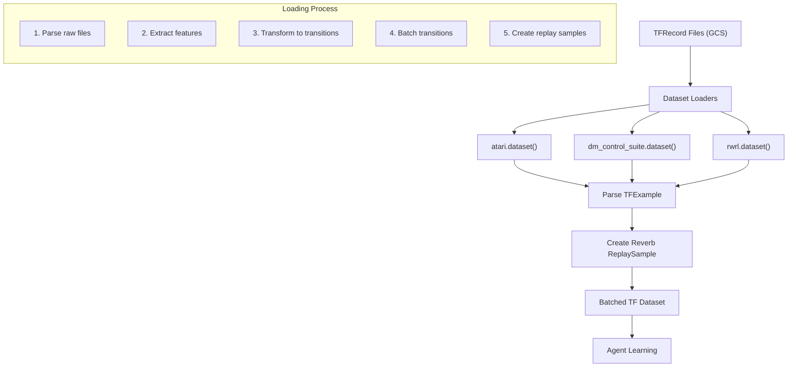
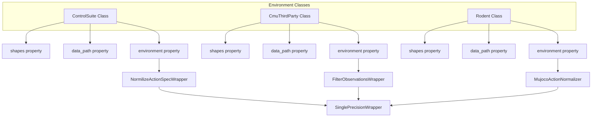
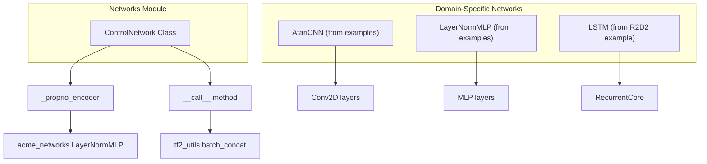

<!-- source: DeepWiki mcp.deepwiki.com · repo google-deepmind/deepmind-research · page 3.1 RL Unplugged · fetched 2026-10-26 -->

# RL Unplugged

<details>
<summary>Relevant source files</summary>

The following files were used as context for generating this wiki page:

- [rl_unplugged/README.md](rl_unplugged/README.md)
- [rl_unplugged/atari.py](rl_unplugged/atari.py)
- [rl_unplugged/atari_dqn.ipynb](rl_unplugged/atari_dqn.ipynb)
- [rl_unplugged/atari_example.py](rl_unplugged/atari_example.py)
- [rl_unplugged/bsuite.ipynb](rl_unplugged/bsuite.ipynb)
- [rl_unplugged/dm_control_suite.py](rl_unplugged/dm_control_suite.py)
- [rl_unplugged/dm_control_suite_crr.ipynb](rl_unplugged/dm_control_suite_crr.ipynb)
- [rl_unplugged/dm_control_suite_d4pg.ipynb](rl_unplugged/dm_control_suite_d4pg.ipynb)
- [rl_unplugged/dm_control_suite_example.py](rl_unplugged/dm_control_suite_example.py)
- [rl_unplugged/dmlab_r2d2.ipynb](rl_unplugged/dmlab_r2d2.ipynb)
- [rl_unplugged/images/tasks.png](rl_unplugged/images/tasks.png)
- [rl_unplugged/networks.py](rl_unplugged/networks.py)
- [rl_unplugged/requirements.txt](rl_unplugged/requirements.txt)
- [rl_unplugged/rwrl.py](rl_unplugged/rwrl.py)
- [rl_unplugged/rwrl_d4pg.ipynb](rl_unplugged/rwrl_d4pg.ipynb)
- [rl_unplugged/rwrl_example.py](rl_unplugged/rwrl_example.py)
- [scratchgan/experiment.py](scratchgan/experiment.py)
- [scratchgan/generators.py](scratchgan/generators.py)
- [scratchgan/losses.py](scratchgan/losses.py)
- [scratchgan/reader.py](scratchgan/reader.py)
- [scratchgan/utils.py](scratchgan/utils.py)

</details>


RL Unplugged is a suite of benchmarks for offline reinforcement learning (RL). It provides standardized datasets collected from a variety of environments to facilitate research in RL methods that learn from pre-collected data rather than through active environment interaction. The suite is designed to enable easy comparison of offline RL algorithms across diverse domains, focusing on challenging aspects such as high-dimensional action spaces, high-dimensional observations, partial observability, and difficulty of exploration.

## System Overview

RL Unplugged consists of several components:
1. Dataset collections from various environments
2. Environment implementations for evaluation
3. Dataset loading utilities
4. Example implementations of offline RL algorithms
5. Evaluation methodologies

```mermaid
graph TD
    subgraph "RL_Unplugged_System"
        Datasets["Datasets"]
        Environments["Environment Implementations"]
        DataLoaders["Dataset Loaders"]
        AgentExamples["Agent Examples"]
    end
    
    Datasets --> Atari["Atari Games"]
    Datasets --> DM_Control["DM Control Suite"]
    Datasets --> DM_Locomotion["DM Locomotion"]
    Datasets --> RWRL["RealWorld RL"]
    Datasets --> DM_Lab["DeepMind Lab"]
    Datasets --> BSuite["bsuite"]
    
    DataLoaders --> AtariLoader["atari.dataset()"]
    DataLoaders --> DMControlLoader["dm_control_suite.dataset()"]
    DataLoaders --> RWRLLoader["rwrl.dataset()"]
    
    AgentExamples --> DQN["DQN (Discrete)"]
    AgentExamples --> D4PG["D4PG (Continuous)"]
    AgentExamples --> R2D2["R2D2 (Memory-based)"]
    AgentExamples --> CRR["CRR (Continuous)"]
    
    Environments --> AtariEnv["Atari Environments"]
    Environments --> DMControlEnv["DM Control Suite Environments"]
    Environments --> CmuThirdParty["Humanoid Locomotion"]
    Environments --> Rodent["Rodent Locomotion"]
    Environments --> RWRLEnv["RWRL Environments"]
    Environments --> DMLabEnv["DM Lab Environments"]
    Environments --> BSuiteEnv["bsuite Environments"]
```



Sources: [rl_unplugged/README.md:1-124](). [rl_unplugged/dm_control_suite.py:13-27](), [rl_unplugged/atari.py:14-37](), [rl_unplugged/rwrl.py:14-37]()

## Dataset Domains

### Atari Dataset

The Atari dataset contains gameplay sequences from 46 Atari games. The data was generated by running an online DQN agent and recording transitions from its replay buffer during training. For each game, the dataset includes data from five runs with 50 million transitions each, using sticky actions as described by Machado et al. (2018).

Each transition contains:
- Observation at time t (84x84x4 stacked frames)
- Action taken at time t
- Reward at time t
- Discount at time t
- Observation at time t+1
- Action at time t+1
- Extra metadata (episode ID, episode return)

The API provides utilities to load this data for offline learning algorithms with discrete action spaces.

Sources: [rl_unplugged/README.md:29-44](), [rl_unplugged/atari.py:14-37](), [rl_unplugged/atari_example.py:14-53]()

### DeepMind Control Suite Dataset

These datasets cover 9 tasks from the DeepMind Control Suite, implemented in MuJoCo. Most datasets were generated using D4PG, except for "Manipulator insert ball" and "Manipulator insert peg" which used V-MPO as D4PG couldn't solve these tasks. 

Each transition contains:
- Observation at time t (proprioceptive features)
- Action at time t (continuous)
- Reward at time t
- Discount at time t
- Observation at time t+1

The dataset is designed for evaluating offline RL algorithms in continuous control domains.

Sources: [rl_unplugged/README.md:61-76](), [rl_unplugged/dm_control_suite.py:14-27](), [rl_unplugged/dm_control_suite_example.py:14-70]()

### DeepMind Locomotion Dataset

The locomotion tasks feature challenging high-dimensional continuous control problems involving the CMU Humanoid and a virtual rodent. These tasks emphasize perception from rich egocentric observations.

Tasks include:
- Humanoid corridor navigation
- Humanoid navigation with walls
- Humanoid navigation with gaps
- Rodent escape
- Rodent corridor with gaps
- Rodent target touching
- Rodent maze navigation

The dataset is particularly challenging due to the high degrees of freedom in the action spaces (56-dimensional for humanoid tasks).

Sources: [rl_unplugged/README.md:46-60](), [rl_unplugged/dm_control_suite.py:51-689]()

### RealWorld RL Dataset

This dataset represents state-action-reward-state (SARS) transitions collected from a partially online trained agent as described in the RealWorld RL paper. It includes 8 datasets across cartpole, walker, quadruped, and humanoid tasks, each with different levels of environmental challenge.

Sources: [rl_unplugged/README.md:78-86](), [rl_unplugged/rwrl.py:14-37](), [rl_unplugged/rwrl_example.py:14-50]()

### DeepMind Lab Dataset

The DeepMind Lab dataset contains data from several levels of the partially observable DeepMind Lab suite. The data was collected by training distributed R2D2 agents from scratch on individual tasks. Datasets are available for five different levels, with additional "snapshot" datasets for one level with different exploration parameters.

Sources: [rl_unplugged/README.md:88-106](), [rl_unplugged/dmlab_r2d2.ipynb:93-367]()

### bsuite Dataset

The bsuite datasets were collected by training DQN agents with default settings on three tasks: cartpole, catch, and mountain_car. The environments were converted from deterministic to stochastic by randomly replacing the agent's action with a uniformly sampled action with a controllable probability (0, 0.1, 0.2, 0.3, 0.4, 0.5).

These datasets are deliberately lightweight and designed for rapid experimentation with offline RL algorithms.

Sources: [rl_unplugged/README.md:108-123](), [rl_unplugged/bsuite.ipynb:97-216]()

## Data Loading Architecture

RL Unplugged provides a unified data loading API that makes it easy to work with all datasets in the suite once a general pipeline has been established. The data loading process follows a similar pattern across all domains:



Sources: [rl_unplugged/atari.py:104-204](), [rl_unplugged/dm_control_suite.py:692-830](), [rl_unplugged/rwrl.py:110-180]()

### Atari Data Loading

For Atari datasets, the `atari.dataset()` function loads TFRecord files and processes them into Reverb replay samples. The key processing steps include:

1. Decoding PNG frames into tensor observations
2. Extracting action, reward, and discount information
3. Creating replay samples with the SARSA structure required by agents
4. Batching and shuffling for training

Sources: [rl_unplugged/atari.py:108-204](), [rl_unplugged/atari_example.py:14-53]()

### Control Suite Data Loading

The loading process for Control Suite data follows a similar pattern but handles the specifics of continuous control data:

1. Processing raw data from TFRecord files
2. Parsing observation, action, reward, and discount information
3. Building either SARSA samples (for value-based methods) or sequence samples (for recurrent methods)
4. Applying appropriate padding and batching

Sources: [rl_unplugged/dm_control_suite.py:692-830](), [rl_unplugged/dm_control_suite_example.py:14-70]()

### Environment Classes



Sources: [rl_unplugged/dm_control_suite.py:346-690]()

## Example Agent Implementations

RL Unplugged provides example implementations of several offline RL algorithms for different tasks:

### DQN for Atari

The DQN implementation demonstrates how to train a Q-learning agent on Atari data. It uses:
- A convolutional network architecture for processing image observations
- The DQN learning algorithm with importance sampling
- Evaluation against the actual Atari environment

Sources: [rl_unplugged/atari_dqn.ipynb:32-386]()

### D4PG for Control Suite and RWRL

The D4PG (Distributed Distributional Deterministic Policy Gradients) examples show how to train a continuous control agent on the DeepMind Control Suite and RealWorld RL datasets:
- Policy and critic network architectures for continuous control
- Distributional value function representation
- Evaluation on the corresponding environments

Sources: [rl_unplugged/dm_control_suite_d4pg.ipynb:31-450](), [rl_unplugged/rwrl_d4pg.ipynb:31-584]()

### CRR for Control Suite

The CRR (Critic Regularized Regression) notebook demonstrates a more recent offline RL algorithm specialized for continuous control tasks:
- Advanced policy improvement with critic regularization
- Network architectures for the Control Suite
- Evaluation methodology

Sources: [rl_unplugged/dm_control_suite_crr.ipynb:31-449]()

### R2D2 for DeepMind Lab

The R2D2 (Recurrent Replay Distributed DQN) example shows how to train a memory-based agent on partially observable environments from DeepMind Lab:
- Recurrent network architecture
- Replay of sequential data
- Integration with DeepMind Lab environments

Sources: [rl_unplugged/dmlab_r2d2.ipynb:93-367]()

## Network Architectures

RL Unplugged provides several network architectures for dealing with different types of observations:



Sources: [rl_unplugged/networks.py:14-92](), [rl_unplugged/atari_dqn.ipynb:239-250](), [rl_unplugged/dm_control_suite_d4pg.ipynb:304-347](), [rl_unplugged/dmlab_r2d2.ipynb:467-539]()

## Using RL Unplugged

To use RL Unplugged in your own research:

1. Install the required dependencies:
   ```
   pip install -r requirements.txt
   ```

2. Download the datasets from Google Cloud Storage:
   ```
   gsutil cp gs://rl_unplugged/[dataset_path] /tmp/dataset/
   ```

3. Load the dataset using the appropriate function:
   ```python
   dataset = rl_unplugged.[domain].dataset(...)
   ```

4. Create the corresponding environment for evaluation:
   ```python
   env = rl_unplugged.[domain].environment(...)
   ```

5. Train your offline RL algorithm on the dataset and evaluate on the environment

See the example notebooks for more detailed implementations of this workflow.

Sources: [rl_unplugged/README.md:125-147](), [rl_unplugged/requirements.txt:1-58](), [rl_unplugged/atari_example.py:14-53](), [rl_unplugged/dm_control_suite_example.py:14-70](), [rl_unplugged/rwrl_example.py:14-50]()

## Performance Metrics

The standard performance metrics for evaluating algorithms trained on RL Unplugged datasets include:

| Dataset | Metric | Baseline Methods |
|---------|--------|------------------|
| Atari | Mean episode return | DQN, BCQ |
| Control Suite | Mean episode return | D4PG, CRR, BCQ |
| Locomotion | Mean episode return | D4PG, CRR, BC |
| RWRL | Mean episode return | D4PG, BCQ |
| DeepMind Lab | Mean episode return | R2D2, BC |
| bsuite | Mean episode return | DQN, BC |

When reporting results on RL Unplugged, it's important to evaluate on multiple environments within each domain and provide details of the training procedure to ensure fair comparison.

Sources: [rl_unplugged/README.md:149-164]()

---

