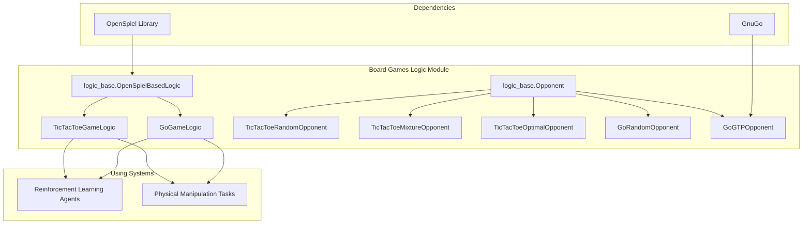
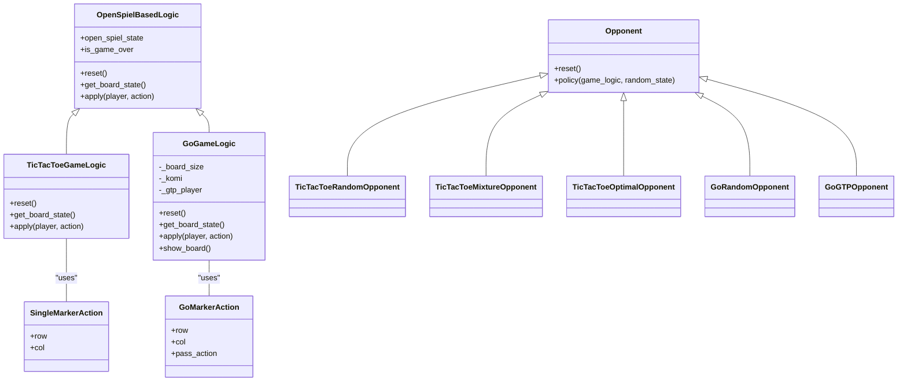
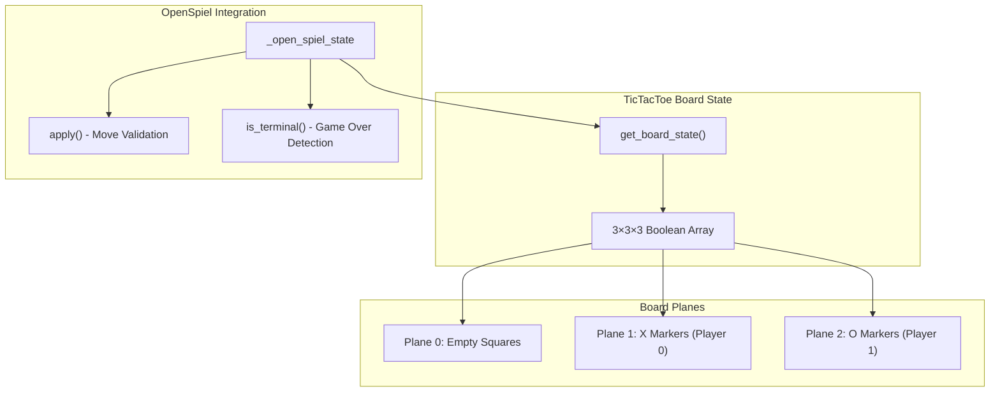
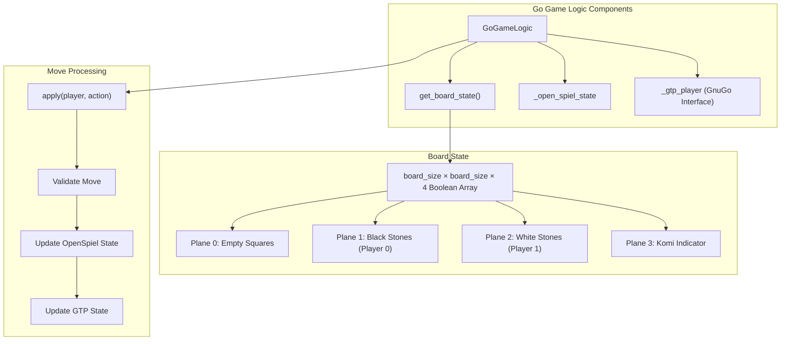
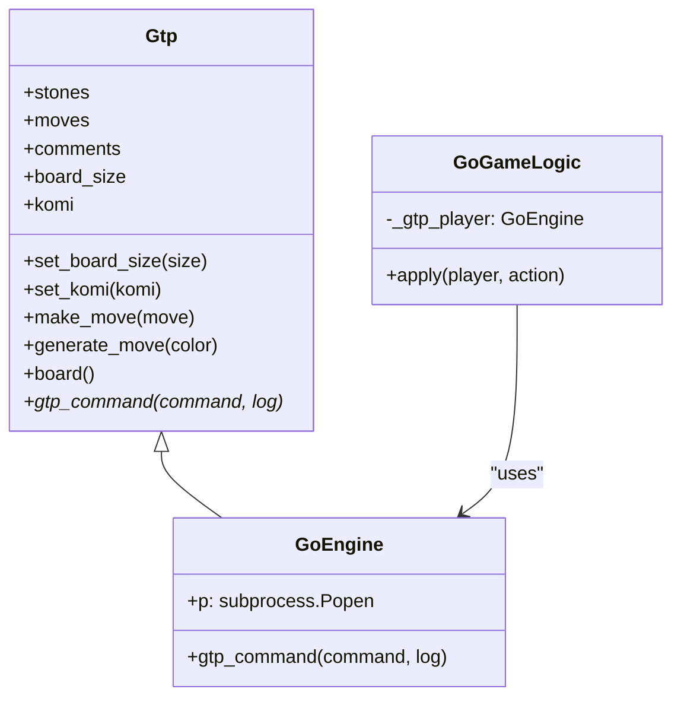

<!-- source: DeepWiki mcp.deepwiki.com · repo google-deepmind/deepmind-research · page 3.2 Board Games Logic · fetched 2026-10-26 -->

# Board Games Logic

<details>
<summary>Relevant source files</summary>

The following files were used as context for generating this wiki page:

- [ogb_lsc/README.md](ogb_lsc/README.md)
- [ogb_lsc/mag/README.md](ogb_lsc/mag/README.md)
- [ogb_lsc/mag/config.py](ogb_lsc/mag/config.py)
- [ogb_lsc/mag/csr_builder.py](ogb_lsc/mag/csr_builder.py)
- [ogb_lsc/mag/data_utils.py](ogb_lsc/mag/data_utils.py)
- [ogb_lsc/mag/datasets.py](ogb_lsc/mag/datasets.py)
- [ogb_lsc/mag/download_mag.py](ogb_lsc/mag/download_mag.py)
- [ogb_lsc/mag/ensemble_predictions.py](ogb_lsc/mag/ensemble_predictions.py)
- [ogb_lsc/mag/requirements.txt](ogb_lsc/mag/requirements.txt)
- [ogb_lsc/pcq/README.md](ogb_lsc/pcq/README.md)
- [ogb_lsc/pcq/requirements.txt](ogb_lsc/pcq/requirements.txt)
- [physics_planning_games/board_games/go_logic.py](physics_planning_games/board_games/go_logic.py)
- [physics_planning_games/board_games/tic_tac_toe_logic.py](physics_planning_games/board_games/tic_tac_toe_logic.py)

</details>


This document describes the board games logic implementation in the DeepMind research repository. The module provides implementations of classic board games (Tic-Tac-Toe and Go) that can be used for AI research, particularly in reinforcement learning contexts. It offers game state representation, move validation, and opponent implementations of varying skill levels.

## Overview

The board games logic module is part of the `physics_planning_games` package and provides a foundation for AI agents to interact with classic board games. It leverages the OpenSpiel framework and follows a consistent interface pattern, allowing different games to be used interchangeably in higher-level systems.



Sources: [physics_planning_games/board_games/tic_tac_toe_logic.py:16-33](https://github.com/google-deepmind/deepmind-research/blob/master/physics_planning_games/board_games/tic_tac_toe_logic.py), [physics_planning_games/board_games/go_logic.py:16-29](https://github.com/google-deepmind/deepmind-research/blob/master/physics_planning_games/board_games/go_logic.py)

## Class Hierarchy and Data Types

The module organizes game implementations around a common inheritance structure:



Sources: [physics_planning_games/board_games/tic_tac_toe_logic.py:33-91](), [physics_planning_games/board_games/go_logic.py:33-446]()

The module defines two specialized named tuple types to represent game actions:

| Action Type | Structure | Purpose |
|-------------|-----------|---------|
| `SingleMarkerAction` | `row`, `col` | Represents a Tic-Tac-Toe move placement |
| `GoMarkerAction` | `row`, `col`, `pass_action` | Represents a Go stone placement or pass move |

Sources: [physics_planning_games/board_games/tic_tac_toe_logic.py:28-29](), [physics_planning_games/board_games/go_logic.py:32-33]()

## TicTacToe Implementation

The `TicTacToeGameLogic` class provides a comprehensive implementation of the classic 3×3 Tic-Tac-Toe game.

### Game State Representation

The Tic-Tac-Toe game state is represented as a 3×3×3 boolean array:
- First plane: unmarked squares
- Second plane: X's (player 0)
- Third plane: O's (player 1)



Sources: [physics_planning_games/board_games/tic_tac_toe_logic.py:56-69]()

### Opponent Implementations

The module includes three opponent implementations for Tic-Tac-Toe:

| Opponent Class | Description | Implementation Method |
|----------------|-------------|------------------------|
| `TicTacToeRandomOpponent` | Makes random legal moves | Selects randomly from available legal actions |
| `TicTacToeMixtureOpponent` | Combines random and optimal moves | Uses mixture probability to choose between random and optimal opponents |
| `TicTacToeOptimalOpponent` | Makes optimal moves | Uses minimax search algorithm |

The core of the optimal opponent is the `tic_tac_toe_minimax` function which implements the minimax search algorithm to find the best possible move:

```python
def tic_tac_toe_minimax(state, random_state):
  """Tree search from the world_state in order to find the optimal action."""
  # Find all legal actions
  legal_actions = state.legal_actions()
  best_actions = []
  best_value = -100

  # Evaluate each possible action
  for action in legal_actions:
    state_after_action = state.clone()
    state_after_action.apply_action(action)
    value, _ = minimax.expectiminimax(state_after_action, 100, None,
                                    current_player)
    # Track best actions (there may be multiple equally good ones)
    if value > best_value:
      best_value = value
      best_actions = [action]
    elif value == best_value:
      best_actions.append(action)

  # Choose randomly among the best actions
  action = random_state.choice(best_actions)
  return open_spiel_move_to_single_marker_action(action)
```

Sources: [physics_planning_games/board_games/tic_tac_toe_logic.py:94-167](), [physics_planning_games/board_games/tic_tac_toe_logic.py:227-265]()

## Go Implementation

The `GoGameLogic` class provides a more complex board game implementation with configurable board size (typically 9×9 or 19×19).

### Game State Representation

The Go game state is represented as a boolean array with dimensions `(board_size, board_size, 4)`:
- First plane: unmarked squares
- Second plane: black stones (player 0)
- Third plane: white stones (player 1)
- Fourth plane: komi indicator (showing whether white is to play)



Sources: [physics_planning_games/board_games/go_logic.py:382-395]()

### GTP (Go Text Protocol) Interface

A key feature of the Go implementation is the integration with external Go programs through the GTP (Go Text Protocol) interface. This enables communication with established Go engines like GnuGo for move generation or evaluation.



The GTP interface enables the system to:
1. Set up board configurations
2. Apply moves to the external engine
3. Request move suggestions from external engines
4. Query board state

Sources: [physics_planning_games/board_games/go_logic.py:163-338](), [physics_planning_games/board_games/go_logic.py:347-368]()

### Opponent Implementations

The Go module provides two opponent implementations:

| Opponent Class | Description | Implementation Method |
|----------------|-------------|------------------------|
| `GoRandomOpponent` | Makes random legal moves | Selects randomly from available legal actions |
| `GoGTPOpponent` | Uses external Go engine | Communicates with GnuGo through GTP interface, with option to mix random moves |

The `GoGTPOpponent` is particularly interesting as it leverages existing strong Go-playing programs through the GTP interface to provide challenging opponents:

```python
def policy(self, game_logic, player, random_state):
  """Return policy action."""
  if random_state.rand() < self._mixture_p:
    return gen_random_move(game_logic, random_state)
  else:
    return gen_move(game_logic, player)
```

Sources: [physics_planning_games/board_games/go_logic.py:471-525]()

## Usage Examples

### TicTacToe Example

```python
# Initialize the game
game_logic = TicTacToeGameLogic()

# Create an opponent (20% random, 80% optimal)
opponent = TicTacToeMixtureOpponent(mixture_p=0.2)  

# Make a move (center of the board)
action = SingleMarkerAction(row=1, col=1)
game_logic.apply(player=0, action=action)

# Get opponent's move
random_state = np.random.RandomState(42)
opponent_action = opponent.policy(game_logic, random_state)
game_logic.apply(player=1, action=opponent_action)

# Get board state
board_state = game_logic.get_board_state()
```

### Go Example

```python
# Initialize the game with a 9x9 board
game_logic = GoGameLogic(board_size=9, gnugo_level=1)

# Create an opponent (10% random, 90% GnuGo)
opponent = GoGTPOpponent(board_size=9, mixture_p=0.1)

# Make a move (center of the board)
action = GoMarkerAction(row=4, col=4, pass_action=False)
game_logic.apply(player=0, action=action)

# Get opponent's move
random_state = np.random.RandomState(42)
opponent_action = opponent.policy(game_logic, player=1, random_state=random_state)
game_logic.apply(player=1, action=opponent_action)

# Display the board
game_logic.show_board()
```

Sources: [physics_planning_games/board_games/tic_tac_toe_logic.py:33-91](), [physics_planning_games/board_games/go_logic.py:340-446]()

## Integration with OpenSpiel

Both game implementations are built on top of the OpenSpiel framework, which provides a common interface for various games. The games use OpenSpiel's state representation, action validation, and game tree search algorithms:

| OpenSpiel Feature | Usage in Board Games Logic |
|-------------------|----------------------------|
| `State` objects | Maintain game state and rules |
| `legal_actions()` | Determine valid moves |
| `apply_action()` | Update game state when moves are made |
| `observation_tensor()` | Generate board state representations |
| `minimax` algorithms | Implement optimal opponents |

Sources: [physics_planning_games/board_games/tic_tac_toe_logic.py:42-44](), [physics_planning_games/board_games/go_logic.py:369-370]()

## Utilities and Helper Functions

The module includes several utility functions for converting between different representations of game states and moves:

- For Tic-Tac-Toe:
  - `numpy_array_to_open_spiel_state`: Converts NumPy array to OpenSpiel state
  - `open_spiel_move_to_single_marker_action`: Converts OpenSpiel move to `SingleMarkerAction`

- For Go:
  - `_go_marker_to_int`: Converts `GoMarkerAction` to integer representation
  - `_int_to_go_marker`: Converts integer to `GoMarkerAction`
  - `_go_marker_to_str`: Converts `GoMarkerAction` to string representation
  - `_str_to_go_marker`: Converts string to `GoMarkerAction`

These utility functions enable seamless interoperability between different components of the system and external tools.

Sources: [physics_planning_games/board_games/tic_tac_toe_logic.py:170-196](), [physics_planning_games/board_games/go_logic.py:41-107]()

---

