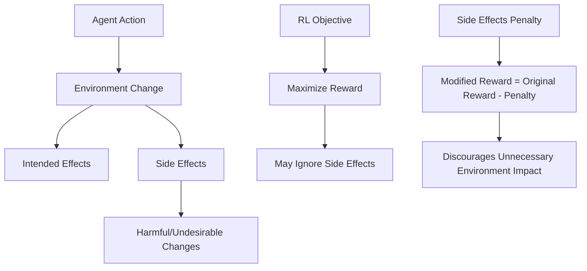
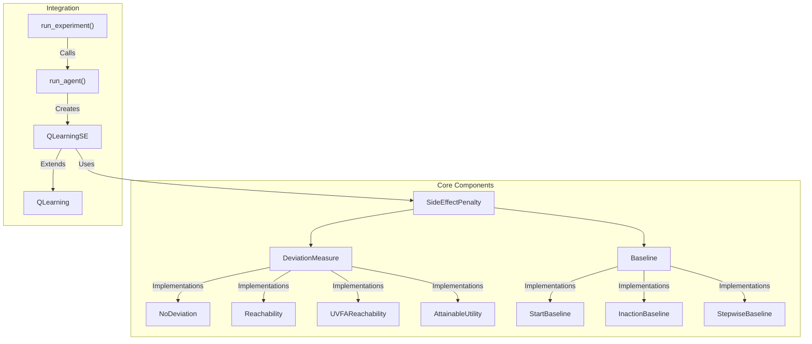
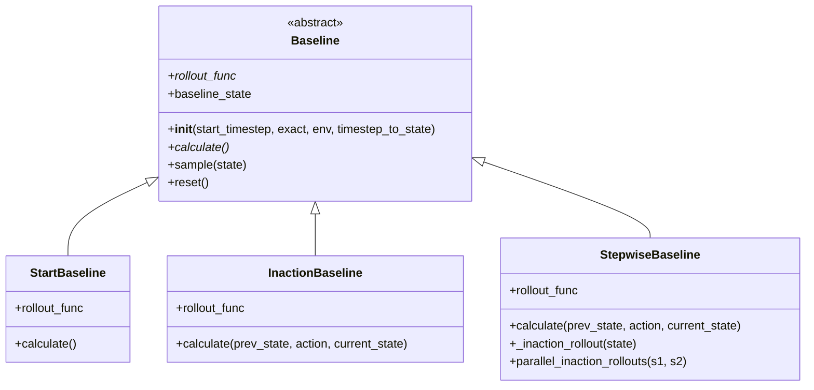
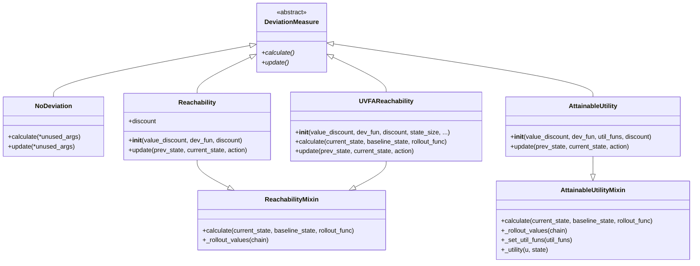
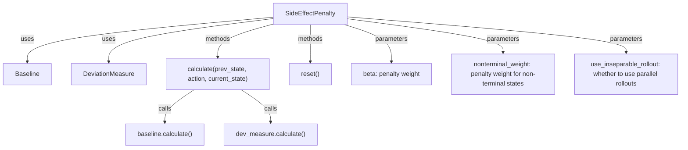
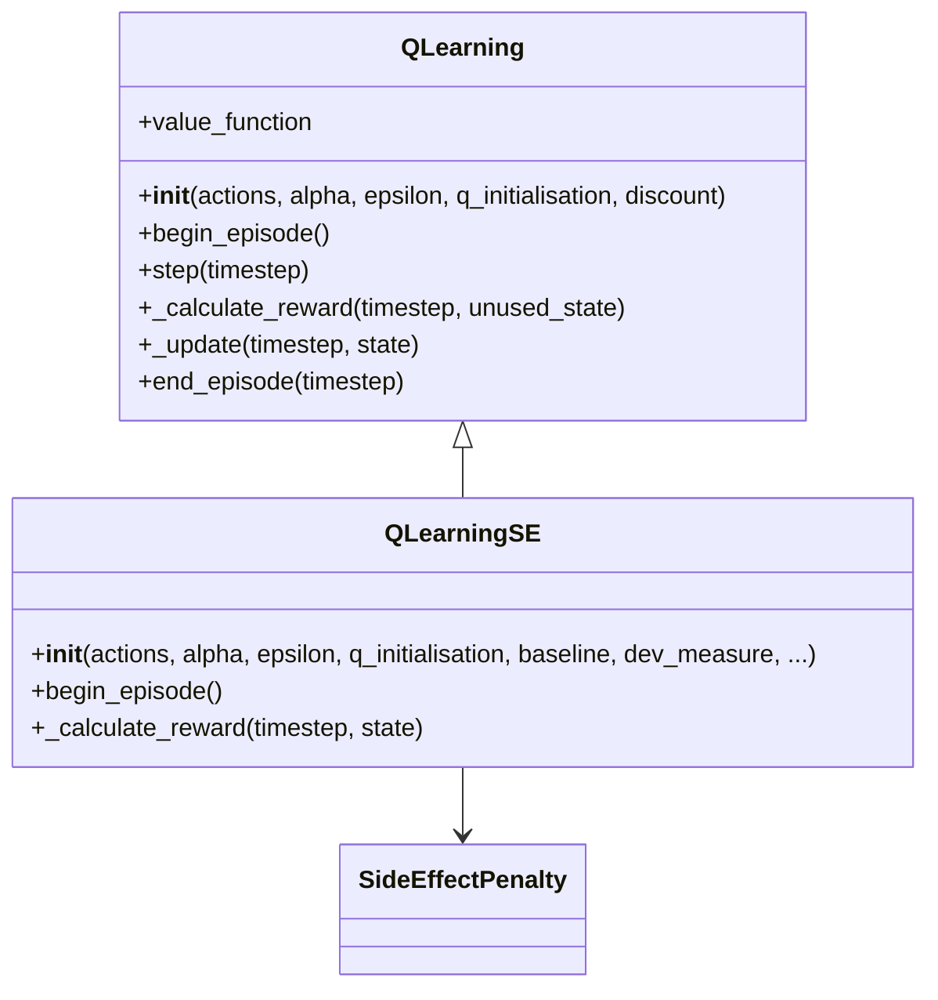
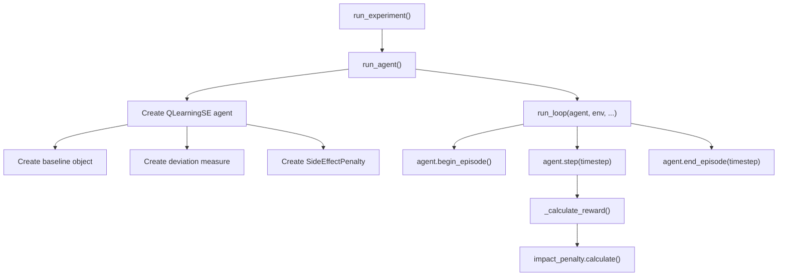

<!-- source: DeepWiki mcp.deepwiki.com · repo google-deepmind/deepmind-research · page 3.3 Side Effects Penalties · fetched 2026-10-26 -->

# Side Effects Penalties

<details>
<summary>Relevant source files</summary>

The following files were used as context for generating this wiki page:

- [side_effects_penalties/README.md](side_effects_penalties/README.md)
- [side_effects_penalties/__init__.py](side_effects_penalties/__init__.py)
- [side_effects_penalties/agent.py](side_effects_penalties/agent.py)
- [side_effects_penalties/agent_with_penalties.py](side_effects_penalties/agent_with_penalties.py)
- [side_effects_penalties/file_loading.py](side_effects_penalties/file_loading.py)
- [side_effects_penalties/plot_results.ipynb](side_effects_penalties/plot_results.ipynb)
- [side_effects_penalties/requirements.txt](side_effects_penalties/requirements.txt)
- [side_effects_penalties/results_summary.py](side_effects_penalties/results_summary.py)
- [side_effects_penalties/run_experiment.py](side_effects_penalties/run_experiment.py)
- [side_effects_penalties/side_effects_penalty.py](side_effects_penalties/side_effects_penalty.py)
- [side_effects_penalties/side_effects_penalty_test.py](side_effects_penalties/side_effects_penalty_test.py)
- [side_effects_penalties/training.py](side_effects_penalties/training.py)

</details>


## Purpose and Scope

The Side Effects Penalties system provides a framework for mitigating unintended side effects in reinforcement learning agents. Instead of explicitly penalizing all possible side effects, the system gives agents a general penalty for impacting the environment beyond what's necessary to complete their tasks. 

This page documents the implementation of various side effects penalties in tabular Q-learning agents within the DeepMind Research repository. Each penalty consists of a deviation measure, a baseline state, and other configurable parameters.

For broader information about Reinforcement Learning systems in the repository, see [Reinforcement Learning Systems](#3). For information about the board games logic implementation specifically, see [Board Games Logic](#3.2).

## Overview of Side Effects



Sources: [side_effects_penalties/README.md:1-3](). [side_effects_penalties/agent_with_penalties.py:116-119]()

The Side Effects Penalties system introduces a principled approach to mitigating unintended consequences of agent actions by measuring deviation from some baseline state. This approach doesn't require explicitly anticipating every possible side effect, making it more generalizable and scalable.

## System Architecture



Sources: [side_effects_penalties/side_effects_penalty.py:46-196](), [side_effects_penalties/agent_with_penalties.py:26-119](), [side_effects_penalties/training.py:74-140]()

The system is composed of several key components:

1. **Baseline**: Defines the reference state against which environmental changes are measured
2. **DeviationMeasure**: Computes the deviation between the current state and the baseline state
3. **SideEffectPenalty**: Combines the baseline and deviation measure to compute the penalty
4. **QLearningSE**: Q-learning agent that incorporates the side effects penalty

## Penalty Components

### Baselines



Sources: [side_effects_penalties/side_effects_penalty.py:47-195]()

The `Baseline` abstract class provides the interface for computing baseline states. There are three implementations:

1. **StartBaseline**: Uses the starting state of the episode as the baseline
2. **InactionBaseline**: Uses the state that would result from taking no-ops from the starting state
3. **StepwiseBaseline**: Uses the state that would result from taking a no-op from the current state

Each baseline computes a reference state that represents what the environment would look like without the agent's intervention or with minimal intervention.

### Deviation Measures



Sources: [side_effects_penalties/side_effects_penalty.py:198-602]()

The `DeviationMeasure` abstract class provides the interface for measuring deviations between states. The implemented measures are:

1. **NoDeviation**: Returns zero penalty (baseline implementation)
2. **Reachability**: Measures how difficult it is to reach the baseline state from the current state
3. **UVFAReachability**: Approximates reachability using a Universal Value Function Approximator (neural network)
4. **AttainableUtility**: Measures the difference in attainable utility between the current and baseline states

Each deviation measure computes how much the current state differs from the baseline state, which represents the impact of the agent's actions on the environment.

### Side Effect Penalty



Sources: [side_effects_penalties/side_effects_penalty.py:613-682]()

The `SideEffectPenalty` class combines a baseline and a deviation measure to compute the penalty for side effects. It has the following key parameters:

- `beta`: Weight (scaling factor) for the impact penalty
- `nonterminal_weight`: Penalty weight on non-terminal states
- `use_inseparable_rollout`: Whether to compute the penalty as the average of deviations over parallel inaction rollouts

## Agent Integration



Sources: [side_effects_penalties/agent.py:68-151](), [side_effects_penalties/agent_with_penalties.py:26-119]()

The `QLearningSE` class extends the base `QLearning` agent to incorporate side effects penalties. The key modifications include:

1. Initializing a `SideEffectPenalty` object based on the provided baseline and deviation measure
2. Overriding `begin_episode()` to reset the penalty at the start of each episode
3. Overriding `_calculate_reward()` to subtract the side effects penalty from the original reward

This integration allows the agent to learn policies that achieve the task while minimizing unnecessary environment changes.

## Penalty Types and Configuration

The Side Effects Penalties system implements several approaches described in research papers:

### Baseline Types

| Baseline Type | Description | Implementation |
|---------------|-------------|----------------|
| Starting state (`start`) | Uses the initial state as baseline | `StartBaseline` |
| Inaction (`inaction`) | Uses the state resulting from taking no-ops from start | `InactionBaseline` |
| Stepwise inaction with rollouts (`stepwise`) | Uses the state one no-op after current state with rollouts | `StepwiseBaseline` |
| Stepwise inaction without rollouts (`step_noroll`) | Same as stepwise but without inaction rollouts | `StepwiseBaseline(use_rollouts=False)` |

### Deviation Measures

| Deviation Measure | Description | Implementation |
|-------------------|-------------|----------------|
| None (`none`) | No penalty | `NoDeviation` |
| Unreachability (`reach`) | Measures difficulty to reach baseline state from current state | `Reachability` |
| Relative reachability (`rel_reach`) | Considers difference in reachability of all states | `Reachability` with `dev_fun` |
| Attainable utility (`att_util`) | Measures difference in attainable utility | `AttainableUtility` |
| UVFA relative reachability (`uvfa_rel_reach`) | Neural network approximation of relative reachability | `UVFAReachability` |

### Summary Functions

| Summary Function | Description | Implementation |
|------------------|-------------|----------------|
| Truncation (`truncation`) | max(0, x) | `lambda diff: np.maximum(0, diff)` |
| Absolute (`absolute`) | \|x\| | `np.abs` |

Sources: [side_effects_penalties/README.md:20-36](), [side_effects_penalties/agent_with_penalties.py:67-74]()

## Usage and Experiments

The Side Effects Penalties system can be used through the `run_experiment.py` script, which provides a command-line interface for running experiments with different penalty configurations:

```
python -m side_effects_penalties.run_experiment -baseline <X> -dev_measure <Y> -env_name <Z> -suffix <S>
```

Key command-line arguments:

- `-baseline`: Baseline state (`start`, `inaction`, `stepwise`, `step_noroll`)
- `-dev_measure`: Deviation measure (`none`, `reach`, `rel_reach`, `att_util`, `uvfa_rel_reach`)
- `-dev_fun`: Summary function (`truncation` or `absolute`)
- `-discount`: Discount factor for rewards
- `-value_discount`: Discount factor for the deviation measure value function
- `-beta`: Weight for the side effects penalty
- `-nonterminal`: Penalty for non-terminal states relative to terminal states
- `-env_name`: Environment name (e.g., `box`, `vase`, `sushi_goal`)



Sources: [side_effects_penalties/run_experiment.py:74-159](), [side_effects_penalties/training.py:47-140]()

## Example Environments

The Side Effects Penalties system includes several test environments from the AI Safety Gridworlds suite:

1. **Box**: A simple environment with a box that can be moved
2. **Vase**: An environment with a vase that can be broken
3. **Sushi**: A conveyor belt environment with sushi

These environments are designed to test different aspects of side effects mitigation, such as reversible vs. irreversible changes, and direct vs. indirect effects.

Sources: [side_effects_penalties/training.py:26-44](), [side_effects_penalties/side_effects_penalty_test.py:30-32]()

## Conclusion

The Side Effects Penalties system provides a flexible framework for implementing and experimenting with different approaches to mitigating unintended side effects in reinforcement learning. By combining various baselines and deviation measures, researchers can explore different trade-offs and find effective solutions for specific problem domains.

The system is part of ongoing research into building safer AI systems that act in accordance with human values and avoid unnecessary disruptions to their environments.

---

