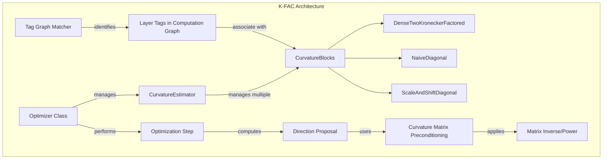
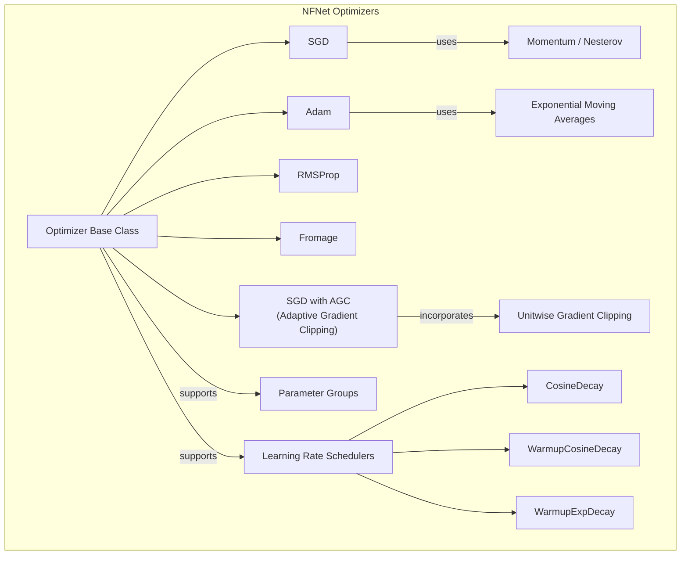
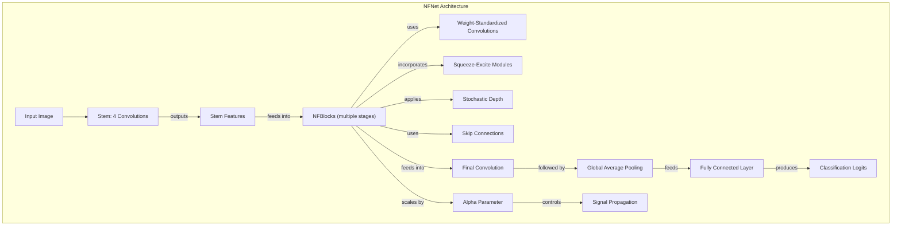
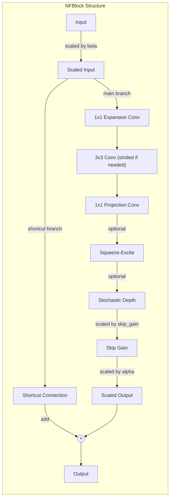

<!-- source: DeepWiki mcp.deepwiki.com · repo google-deepmind/deepmind-research · page 4 Machine Learning Techniques · fetched 2026-10-26 -->

# Machine Learning Techniques

<details>
<summary>Relevant source files</summary>

The following files were used as context for generating this wiki page:

- [kfac_ferminet_alpha/__init__.py](kfac_ferminet_alpha/__init__.py)
- [kfac_ferminet_alpha/curvature_blocks.py](kfac_ferminet_alpha/curvature_blocks.py)
- [kfac_ferminet_alpha/distributions.py](kfac_ferminet_alpha/distributions.py)
- [kfac_ferminet_alpha/estimator.py](kfac_ferminet_alpha/estimator.py)
- [kfac_ferminet_alpha/example.py](kfac_ferminet_alpha/example.py)
- [kfac_ferminet_alpha/layers_and_loss_tags.py](kfac_ferminet_alpha/layers_and_loss_tags.py)
- [kfac_ferminet_alpha/loss_functions.py](kfac_ferminet_alpha/loss_functions.py)
- [kfac_ferminet_alpha/optimizer.py](kfac_ferminet_alpha/optimizer.py)
- [kfac_ferminet_alpha/requirements.txt](kfac_ferminet_alpha/requirements.txt)
- [kfac_ferminet_alpha/run.sh](kfac_ferminet_alpha/run.sh)
- [kfac_ferminet_alpha/utils.py](kfac_ferminet_alpha/utils.py)
- [nfnets/README.md](nfnets/README.md)
- [nfnets/base.py](nfnets/base.py)
- [nfnets/experiment.py](nfnets/experiment.py)
- [nfnets/experiment_nfnets.py](nfnets/experiment_nfnets.py)
- [nfnets/fixup_resnet.py](nfnets/fixup_resnet.py)
- [nfnets/nf_resnet.py](nfnets/nf_resnet.py)
- [nfnets/nfnet.py](nfnets/nfnet.py)
- [nfnets/optim.py](nfnets/optim.py)
- [nfnets/skipinit_resnet.py](nfnets/skipinit_resnet.py)
- [nfnets/test.py](nfnets/test.py)

</details>


This page provides an overview of the core machine learning optimization and network architecture techniques implemented in the DeepMind Research repository. It focuses on two main components: K-FAC (Kronecker-Factored Approximate Curvature) optimization and Normalizer-Free Networks (NFNets), along with their accompanying optimization methods. For specific application domains that use these techniques, see [Application Domains](#5).

## 1. Optimization Methods

The repository implements several advanced optimization techniques designed to improve neural network training efficiency and performance.

### 1.1 K-FAC (Kronecker-Factored Approximate Curvature)

K-FAC is a second-order optimization technique that approximates the Fisher Information Matrix using Kronecker products of smaller matrices. This provides a more efficient curvature estimate than first-order methods while being computationally feasible for large models.



K-FAC uses a computational graph tagging system to identify layer structures automatically. It approximates the curvature matrix using block-diagonal approximations where each block corresponds to parameters of a specific layer.

Key components:

- **Optimizer**: Manages the optimization process, including learning rate scheduling, momentum, and damping
- **CurvatureEstimator**: Maintains the approximation of the Fisher Information Matrix
- **CurvatureBlocks**: Represent layer-specific curvature approximations using different factorization techniques

The optimizer performs the following steps during training:
1. Update curvature matrix estimation using model outputs
2. Periodically update inverse curvature estimates
3. Compute preconditioned gradients using the curvature inverse
4. Apply momentum and learning rate schedules
5. Update parameters

Sources: [kfac_ferminet_alpha/optimizer.py:34-487](), [kfac_ferminet_alpha/estimator.py:36-340](), [kfac_ferminet_alpha/curvature_blocks.py:29-100]()

### 1.2 Custom Optimizers for NFNets

The repository includes specialized optimizers designed specifically for Normalizer-Free Networks.



Notable optimizers include:

- **SGD with AGC (Adaptive Gradient Clipping)**: Performs unitwise gradient clipping based on parameter magnitudes, which is crucial for training Normalizer-Free Networks
- **Adam**: Implements the Adam optimizer with additional features like decoupled weight decay (AdamW)
- **Schedulers**: Various learning rate scheduling techniques including cosine decay with warmup

Sources: [nfnets/optim.py:25-134](), [nfnets/optim.py:226-499](), [nfnets/optim.py:164-223]()

## 2. Normalizer-Free Networks (NFNets)

NFNets are a family of neural network architectures designed to operate without batch normalization while achieving state-of-the-art performance.

### 2.1 Architecture and Principles

NFNets replace batch normalization with carefully designed architectural components and training techniques that maintain stable signal propagation.



Key features of NFNets:

- **Weight-Standardized Convolutions**: Replace batch normalization by standardizing weights in convolutional layers
- **Signal Scaling**: Careful scaling of residual connections using the alpha parameter
- **Adaptive Gradient Clipping**: Controls the update step size based on parameter magnitudes
- **Squeeze-Excite Modules**: Channel attention mechanism to improve representation power

NFNets come in various configurations (F0-F7) with different depths and widths, suitable for different computational budgets.

Sources: [nfnets/nfnet.py:30-176](), [nfnets/base.py:121-138](), [nfnets/base.py:51-96]()

### 2.2 NFBlock: The Building Block

The core building block of NFNets is the NFBlock, which incorporates several innovative components for stable training without normalization.



Key components of NFBlock:

- **Beta Scaling**: Input scaling to ensure each block sees normalized inputs
- **Alpha Scaling**: Controls the contribution of the residual path
- **Skip Gain**: Initially zero parameter that allows for stable initialization
- **Weight-Standardized Convolutions**: Control signal magnification through careful weight standardization

Sources: [nfnets/nfnet.py:176-277](), [nfnets/base.py:121-138]()

## 3. Training and Optimization Workflow

The ML techniques operate together in a comprehensive training and optimization workflow.

```mermaid
flowchart TD
    subgraph "Training Workflow"
        Input["Model Inputs"] --> Forward["Forward Pass"]
        Forward --> Loss["Loss Computation"]
        Loss --> Grads["Gradient Computation"]
        
        subgraph "KFAC Optimization"
            Grads --> KFACPrecon["KFAC Preconditioning"]
            KFACPrecon --> |"update"| CurvEstimate["Curvature Estimation"]
            CurvEstimate --> |"computes"| InvCurv["Inverse Curvature"]
            InvCurv --> |"applied to"| PreconGrads["Preconditioned Gradients"]
        end
        
        subgraph "NFNet Optimization"
            Grads --> UnitNorm["Compute Unit-wise Norms"]
            UnitNorm --> |"compare"| ParamNorm["Parameter Norms"]
            ParamNorm --> |"determine"| ClipThresh["Clipping Threshold"]
            ClipThresh --> |"applied to"| ClippedGrads["Clipped Gradients"]
        end
        
        PreconGrads --> |"or"| ClippedGrads --> |"with"| Momentum["Momentum"]
        Momentum --> |"and"| LRSchedule["Learning Rate Schedule"]
        LRSchedule --> ParamUpdate["Parameter Update"]
        ParamUpdate --> NextIter["Next Iteration"]
    end
```



The workflow combines:

1. **Forward pass** through the network architecture (e.g., NFNet variants)
2. **Loss computation** and gradient calculation
3. **Optimization step** using either:
   - KFAC with curvature estimation and preconditioning
   - First-order methods with adaptive gradient clipping
4. **Parameter updates** with learning rate scheduling

Sources: [kfac_ferminet_alpha/optimizer.py:330-487](), [nfnets/experiment.py:166-308](), [nfnets/experiment_nfnets.py:102-134]()

## 4. Implementation Components

### 4.1 K-FAC Implementation

The K-FAC implementation consists of several interacting components:

| Component | Purpose | Key Implementation |
|-----------|---------|-------------------|
| `Optimizer` | Main optimization class that orchestrates the K-FAC algorithm | `kfac_ferminet_alpha/optimizer.py` |
| `CurvatureEstimator` | Manages curvature approximation and inverse computation | `kfac_ferminet_alpha/estimator.py` |
| `CurvatureBlock` | Abstract class for different factorization strategies | `kfac_ferminet_alpha/curvature_blocks.py` |
| `TwoKroneckerFactored` | Implements Kronecker factorization for dense layers | `kfac_ferminet_alpha/curvature_blocks.py` |
| `TagGraphMatcher` | Identifies layer structures in the computation graph | `kfac_ferminet_alpha/tag_graph_matcher.py` |
| `LayerTag` | Marks specific layer types in the computation graph | `kfac_ferminet_alpha/layers_and_loss_tags.py` |

The K-FAC optimizer provides several configuration options:
- Damping parameters to control curvature conditioning
- Momentum and learning rate schedules
- Curvature matrix update frequency
- Norm constraints for update steps

Sources: [kfac_ferminet_alpha/optimizer.py:34-95](), [kfac_ferminet_alpha/estimator.py:36-49](), [kfac_ferminet_alpha/curvature_blocks.py:29-100]()

### 4.2 NFNet Optimization Components

The NFNet optimization system includes:

| Component | Purpose | Key Implementation |
|-----------|---------|-------------------|
| `Optimizer` base class | Abstract base for all optimizers with shared functionality | `nfnets/optim.py:25-134` |
| `SGD_AGC` | SGD with adaptive gradient clipping for NFNets | `nfnets/optim.py:462-499` |
| `Schedule` | Base class for learning rate scheduling | `nfnets/optim.py:164-167` |
| `WarmupCosineDecay` | Cosine decay with linear warmup period | `nfnets/optim.py:181-200` |
| `WSConv2D` | Weight-standardized convolution implementation | `nfnets/base.py:121-154` |
| `NFBlock` | Core building block of NFNet architectures | `nfnets/nfnet.py:176-277` |

The adaptive gradient clipping technique is particularly important for NFNets, as it enables stable training without normalization by:
1. Computing unitwise gradient norms
2. Comparing them to parameter norms
3. Clipping gradients that exceed a specified ratio
4. Enabling larger learning rates without instability

Sources: [nfnets/optim.py:462-499](), [nfnets/base.py:121-154](), [nfnets/experiment_nfnets.py:102-134]()

## 5. Extensibility and Customization

Both K-FAC and NFNet implementations are designed for extensibility:

### 5.1 Extending K-FAC

K-FAC can be extended by:
- Creating new `CurvatureBlock` implementations for different layer types
- Registering new layer tags for automatic identification
- Customizing damping and learning rate schedules

Example of registering a new curvature block:

```python
@utils.Stateful.infer_class_state
class CustomCurvatureBlock(CurvatureBlock):
    # Implementation of required methods
    
# Register with the system
set_default_tag_to_block("custom_tag", CustomCurvatureBlock)
```

Sources: [kfac_ferminet_alpha/curvature_blocks.py:477-496](), [kfac_ferminet_alpha/layers_and_loss_tags.py:28-194]()

### 5.2 Customizing NFNets

NFNets and their optimization can be customized by:
- Creating new model variants with different depth and width patterns
- Implementing custom optimizers based on the provided base classes
- Creating new learning rate schedulers

The model variant dictionary can be extended for custom architectures:

```python
nfnet_params.update(**{
    'CustomVariant': {
        'width': [256, 512, 1536, 1536], 'depth': [2, 4, 12, 6],
        'train_imsize': 224, 'test_imsize': 320,
        'drop_rate': 0.3
    },
})
```

Sources: [nfnets/base.py:51-96](), [nfnets/optim.py:25-134](), [nfnets/optim.py:164-200]()

## 6. Performance Considerations

### 6.1 K-FAC Performance Tradeoffs

K-FAC makes several performance tradeoffs:

| Feature | Performance Impact | Implementation |
|---------|-------------------|----------------|
| Inverse update period | Controls computation vs. accuracy tradeoff | `kfac_ferminet_alpha/optimizer.py:433-439` |
| Damping parameter | Affects numerical stability and convergence | `kfac_ferminet_alpha/optimizer.py:433-439` |
| Curvature EMA decay | Controls stability of curvature estimates | `kfac_ferminet_alpha/optimizer.py:423-430` |
| Multi-device support | Enables distributed computation | `kfac_ferminet_alpha/optimizer.py:268-279` |

Sources: [kfac_ferminet_alpha/optimizer.py:433-439](), [kfac_ferminet_alpha/optimizer.py:423-430](), [kfac_ferminet_alpha/optimizer.py:268-279]()

### 6.2 NFNet Performance Considerations

NFNets include performance optimizations:

| Feature | Performance Impact | Implementation |
|---------|-------------------|----------------|
| Adaptive Gradient Clipping | Enables larger learning rates | `nfnets/optim.py:484-498` |
| Stochastic Depth | Improves regularization and training efficiency | `nfnets/base.py:202-220` |
| Weight Standardization | Replaces batch normalization | `nfnets/base.py:121-154` |
| Squeeze-Excite ratio | Controls attention mechanism complexity | `nfnets/base.py:177-199` |

Sources: [nfnets/optim.py:484-498](), [nfnets/base.py:202-220](), [nfnets/base.py:121-154](), [nfnets/base.py:177-199]()

## 7. References

For more detailed information about these techniques:

- **K-FAC**: "Optimizing Neural Networks with Kronecker-factored Approximate Curvature" by James Martens and Roger Grosse
- **NFNets**: "High-Performance Large-Scale Image Recognition Without Normalization" by Andrew Brock, Soham De, Samuel L. Smith, and Karen Simonyan

The repository also includes experimental scripts and tests demonstrating the usage of these techniques:

- K-FAC example: `kfac_ferminet_alpha/example.py`
- NFNet experiments: `nfnets/experiment.py` and `nfnets/experiment_nfnets.py`

---

