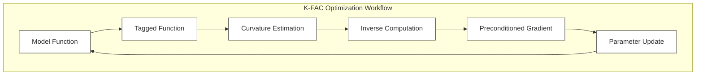
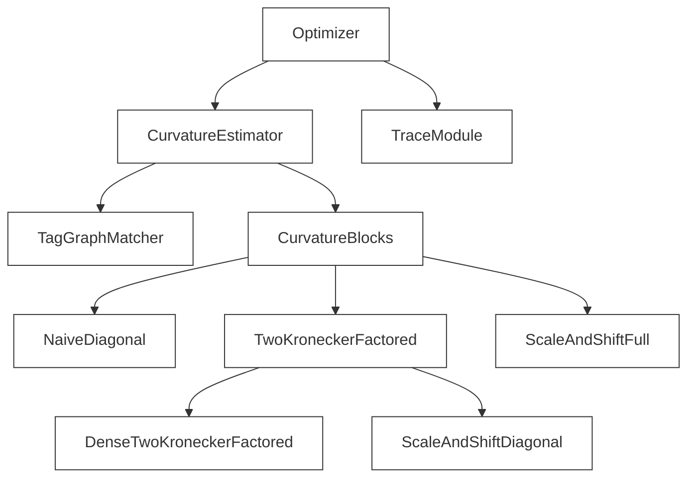
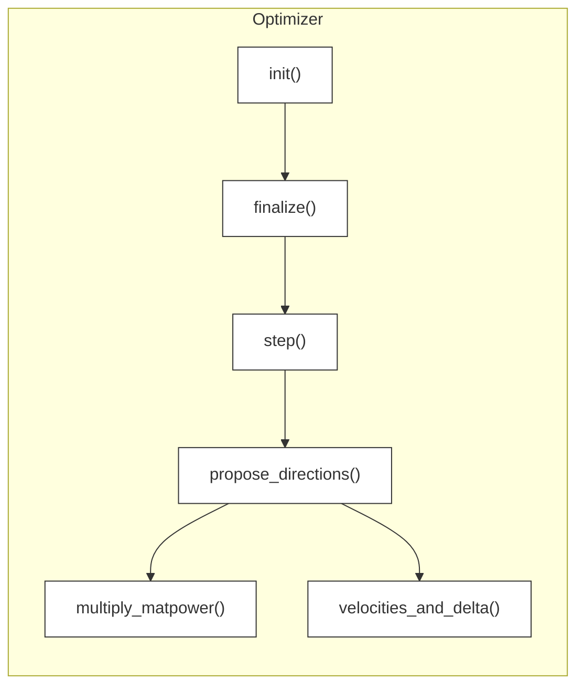
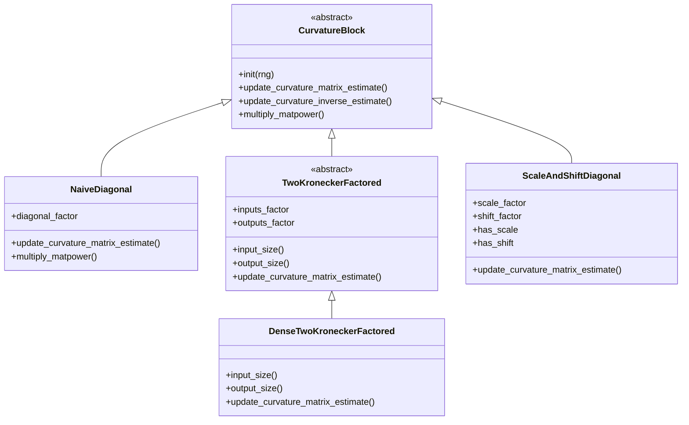
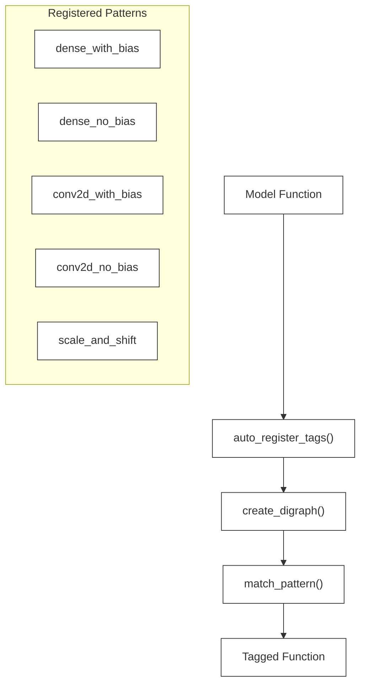
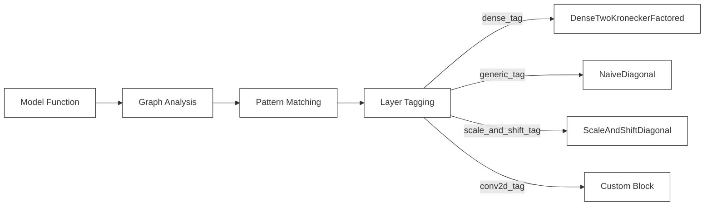

<!-- source: DeepWiki mcp.deepwiki.com · repo google-deepmind/deepmind-research · page 4.1 K-FAC Optimization · fetched 2026-10-26 -->

# K-FAC Optimization

<details>
<summary>Relevant source files</summary>

The following files were used as context for generating this wiki page:

- [kfac_ferminet_alpha/__init__.py](kfac_ferminet_alpha/__init__.py)
- [kfac_ferminet_alpha/curvature_blocks.py](kfac_ferminet_alpha/curvature_blocks.py)
- [kfac_ferminet_alpha/distributions.py](kfac_ferminet_alpha/distributions.py)
- [kfac_ferminet_alpha/estimator.py](kfac_ferminet_alpha/estimator.py)
- [kfac_ferminet_alpha/example.py](kfac_ferminet_alpha/example.py)
- [kfac_ferminet_alpha/layers_and_loss_tags.py](kfac_ferminet_alpha/layers_and_loss_tags.py)
- [kfac_ferminet_alpha/loss_functions.py](kfac_ferminet_alpha/loss_functions.py)
- [kfac_ferminet_alpha/optimizer.py](kfac_ferminet_alpha/optimizer.py)
- [kfac_ferminet_alpha/requirements.txt](kfac_ferminet_alpha/requirements.txt)
- [kfac_ferminet_alpha/run.sh](kfac_ferminet_alpha/run.sh)
- [kfac_ferminet_alpha/tag_graph_matcher.py](kfac_ferminet_alpha/tag_graph_matcher.py)
- [kfac_ferminet_alpha/tests/graph_matcher_test.py](kfac_ferminet_alpha/tests/graph_matcher_test.py)
- [kfac_ferminet_alpha/tests/tracer_test.py](kfac_ferminet_alpha/tests/tracer_test.py)
- [kfac_ferminet_alpha/tracer.py](kfac_ferminet_alpha/tracer.py)
- [kfac_ferminet_alpha/utils.py](kfac_ferminet_alpha/utils.py)

</details>


This document describes the Kronecker-Factored Approximate Curvature (K-FAC) implementation in DeepMind's research repository. K-FAC is a second-order optimization method that approximates the natural gradient for more efficient training of neural networks.

## Overview

K-FAC approximates the Fisher Information Matrix (FIM) using a block-diagonal structure where each block corresponds to a layer in the neural network. Each block is further approximated as a Kronecker product of two smaller matrices, making it computationally feasible to invert the approximated FIM and use it for optimization.



Sources:
[kfac_ferminet_alpha/optimizer.py:39-106](kfac_ferminet_alpha/optimizer.py:39-106)
[kfac_ferminet_alpha/optimizer.py:107-187](kfac_ferminet_alpha/optimizer.py:107-187)

## Architecture

The K-FAC implementation consists of several core components working together to provide efficient second-order optimization.



Sources:
[kfac_ferminet_alpha/optimizer.py:34-69](kfac_ferminet_alpha/optimizer.py:34-69)
[kfac_ferminet_alpha/estimator.py:36-48](kfac_ferminet_alpha/estimator.py:36-48)
[kfac_ferminet_alpha/curvature_blocks.py:29-100](kfac_ferminet_alpha/curvature_blocks.py:29-100)

### Core Components

#### 1. Optimizer

The `Optimizer` class is the main interface for using K-FAC. It manages the optimization process, including parameter updates, scheduling of learning rates, momentum, and damping.



Sources:
[kfac_ferminet_alpha/optimizer.py:34-487](kfac_ferminet_alpha/optimizer.py:34-487)
[kfac_ferminet_alpha/optimizer.py:488-597](kfac_ferminet_alpha/optimizer.py:488-597)

#### 2. Curvature Estimator

The `CurvatureEstimator` class handles the approximation of the curvature matrix (Fisher or Generalized Gauss-Newton) for the model. It supports various estimation modes, manages curvature blocks, and provides methods for computing matrix-vector products.

| Estimation Mode | Description |
|-----------------|-------------|
| `fisher_gradients` | Basic estimation using gradients (default) |
| `fisher_empirical` | Using the data's distribution for targets |
| `fisher_exact` | Exact computation using one-hot vectors |
| `fisher_curvature_prop` | Uses random vectors and half-factors |
| `ggn_exact` | Exact Generalized Gauss-Newton matrix |
| `ggn_curvature_prop` | Approximation of GGN using curvature propagation |

Sources:
[kfac_ferminet_alpha/estimator.py:36-170](kfac_ferminet_alpha/estimator.py:36-170)
[kfac_ferminet_alpha/estimator.py:171-234](kfac_ferminet_alpha/estimator.py:171-234)
[kfac_ferminet_alpha/estimator.py:235-340](kfac_ferminet_alpha/estimator.py:235-340)

#### 3. Curvature Blocks

Curvature blocks implement different approximation strategies for different types of layers or operations in the neural network. The base class `CurvatureBlock` defines the interface, with specialized implementations for common layer types.



Sources:
[kfac_ferminet_alpha/curvature_blocks.py:29-100](kfac_ferminet_alpha/curvature_blocks.py:29-100)
[kfac_ferminet_alpha/curvature_blocks.py:106-150](kfac_ferminet_alpha/curvature_blocks.py:106-150)
[kfac_ferminet_alpha/curvature_blocks.py:154-243](kfac_ferminet_alpha/curvature_blocks.py:154-243)
[kfac_ferminet_alpha/curvature_blocks.py:246-276](kfac_ferminet_alpha/curvature_blocks.py:246-276)
[kfac_ferminet_alpha/curvature_blocks.py:279-379](kfac_ferminet_alpha/curvature_blocks.py:279-379)

#### 4. Tag Graph Matcher

The `tag_graph_matcher` module identifies patterns in the computation graph and associates them with appropriate curvature blocks. It supports automatic registration of tags for common layer types.



Sources:
[kfac_ferminet_alpha/tag_graph_matcher.py:38-141](kfac_ferminet_alpha/tag_graph_matcher.py:38-141)
[kfac_ferminet_alpha/tag_graph_matcher.py:462-609](kfac_ferminet_alpha/tag_graph_matcher.py:462-609)
[kfac_ferminet_alpha/tag_graph_matcher.py:666-755](kfac_ferminet_alpha/tag_graph_matcher.py:666-755)

## Key Concepts

### 1. Automatic Tagging

One of the key features of this K-FAC implementation is automatic tagging of layers in the computation graph. This allows the optimizer to identify different types of operations and apply appropriate curvature approximations.



Sources:
[kfac_ferminet_alpha/tag_graph_matcher.py:462-609](kfac_ferminet_alpha/tag_graph_matcher.py:462-609)
[kfac_ferminet_alpha/curvature_blocks.py:477-496](kfac_ferminet_alpha/curvature_blocks.py:477-496)

### 2. Kronecker Factorization

K-FAC approximates the Fisher Information Matrix using Kronecker products, which enables efficient inversion and multiplication operations.

For a dense layer with input `x` and output `y = Wx + b`, the Fisher block is approximated as:

```
F ≈ E[xx^T] ⊗ E[gg^T]
```

where `g` is the gradient of the loss with respect to the pre-activation output, and `⊗` denotes the Kronecker product.

Sources:
[kfac_ferminet_alpha/curvature_blocks.py:154-243](kfac_ferminet_alpha/curvature_blocks.py:154-243)
[kfac_ferminet_alpha/curvature_blocks.py:246-276](kfac_ferminet_alpha/curvature_blocks.py:246-276)

### 3. Damping and Scheduling

The implementation supports damping of the Fisher matrix to ensure numerical stability and improve optimization performance. It also supports scheduling of learning rates, momentum, and damping.

| Parameter | Description |
|-----------|-------------|
| `learning_rate_schedule` | Schedule for learning rate |
| `momentum_schedule` | Schedule for momentum |
| `damping_schedule` | Schedule for damping parameter |
| `min_damping` | Minimum value for damping |
| `max_damping` | Maximum value for damping |
| `norm_constraint` | Optional constraint on the update norm |

Sources:
[kfac_ferminet_alpha/optimizer.py:96-106](kfac_ferminet_alpha/optimizer.py:96-106)
[kfac_ferminet_alpha/optimizer.py:107-116](kfac_ferminet_alpha/optimizer.py:107-116)

## Usage

### Initialization

To use the K-FAC optimizer, you need to:

1. Define your model and loss function
2. Create the optimizer with appropriate settings
3. Initialize the optimizer state
4. Use the `step` method for optimization

```python
# Example initialization
optim = kfac_ferminet_alpha.Optimizer(
    value_and_grad_func=jax.value_and_grad(loss_func, has_aux=True),
    l2_reg=1e-3,
    value_func_has_aux=True,
    value_func_has_state=False,
    value_func_has_rng=False,
    learning_rate_schedule=None,
    momentum_schedule=None,
    damping_schedule=None,
    norm_constraint=1.0,
    num_burnin_steps=10,
)

# Initialize optimizer state
opt_state = optim.init(params, rng_key, example_batch, func_state)
```

Sources:
[kfac_ferminet_alpha/example.py:132-144](kfac_ferminet_alpha/example.py:132-144)
[kfac_ferminet_alpha/example.py:147-147](kfac_ferminet_alpha/example.py:147-147)

### Optimization Loop

```python
# Optimization loop
for step in range(num_steps):
    params, opt_state, stats = optim.step(
        params,
        opt_state,
        rng_key,
        data_iterator,
        learning_rate=learning_rate,
        momentum=momentum,
        damping=damping
    )
```

Sources:
[kfac_ferminet_alpha/example.py:149-167](kfac_ferminet_alpha/example.py:149-167)

## Customization

### Custom Curvature Blocks

You can create custom curvature blocks by extending the `CurvatureBlock` class and implementing the required methods. You can then associate these blocks with specific layer types using the `layer_tag_to_block_cls` parameter of the optimizer.

```python
# Example of custom block mapping
custom_block_mapping = {
    "dense_tag": MyCustomDenseBlock,
    "conv2d_tag": MyCustomConvBlock,
}

optim = kfac_ferminet_alpha.Optimizer(
    # Other parameters...
    layer_tag_to_block_cls=custom_block_mapping,
)
```

Sources:
[kfac_ferminet_alpha/curvature_blocks.py:29-100](kfac_ferminet_alpha/curvature_blocks.py:29-100)
[kfac_ferminet_alpha/optimizer.py:129-133](kfac_ferminet_alpha/optimizer.py:129-133)

### Custom Layer Registration

You can register custom layer patterns for automatic tagging using the `register_function` in the `tag_graph_matcher` module.

Sources:
[kfac_ferminet_alpha/tag_graph_matcher.py:617-664](kfac_ferminet_alpha/tag_graph_matcher.py:617-664)
[kfac_ferminet_alpha/tag_graph_matcher.py:666-755](kfac_ferminet_alpha/tag_graph_matcher.py:666-755)

## Technical Details

### Estimation Modes

The K-FAC implementation supports several estimation modes for the curvature matrix:

1. `fisher_gradients` - Estimates Fisher using gradients (default)
2. `fisher_empirical` - Uses the data's distribution for targets
3. `fisher_exact` - Computes exact Fisher using one-hot vectors
4. `fisher_curvature_prop` - Uses random vectors and half-factors
5. `ggn_exact` - Computes exact Generalized Gauss-Newton matrix
6. `ggn_curvature_prop` - Approximates GGN using curvature propagation

Sources:
[kfac_ferminet_alpha/estimator.py:41-116](kfac_ferminet_alpha/estimator.py:41-116)
[kfac_ferminet_alpha/estimator.py:236-322](kfac_ferminet_alpha/estimator.py:236-322)

### Multi-device Support

The implementation supports distributed computation across multiple devices using JAX's `pmap`. This can be enabled by setting the `multi_device` parameter to `True` in the optimizer.

Sources:
[kfac_ferminet_alpha/optimizer.py:156-162](kfac_ferminet_alpha/optimizer.py:156-162)
[kfac_ferminet_alpha/optimizer.py:267-279](kfac_ferminet_alpha/optimizer.py:267-279)

## Conclusion

The K-FAC optimizer implementation in DeepMind's research repository provides a flexible and efficient framework for second-order optimization of neural networks. It supports various approximation strategies, automatic layer detection, and multi-device computation.

By leveraging Kronecker-factored approximations of the Fisher Information Matrix, K-FAC can achieve faster convergence than first-order methods while maintaining reasonable computational complexity.

---

