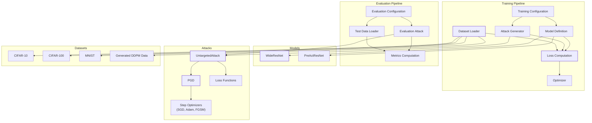
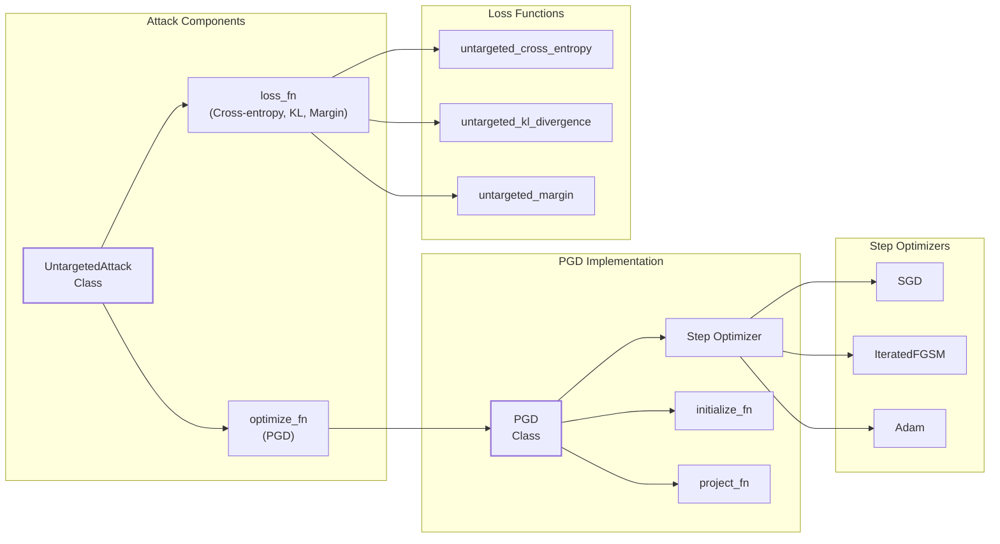
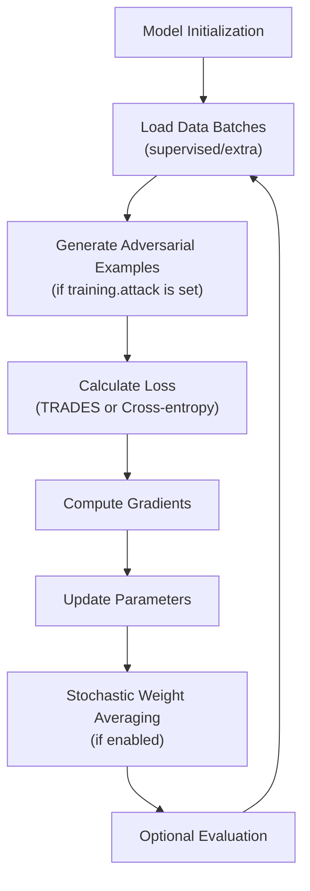
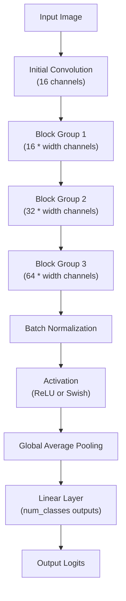
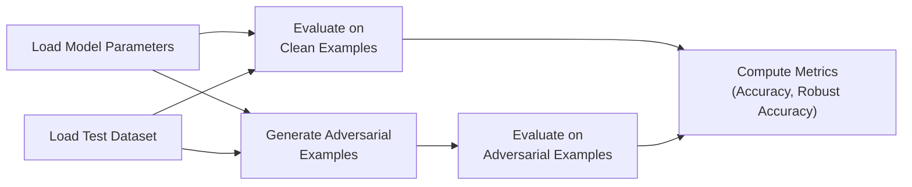

<!-- source: DeepWiki mcp.deepwiki.com · repo google-deepmind/deepmind-research · page 4.2 Adversarial Robustness · fetched 2026-10-26 -->

# Adversarial Robustness

<details>
<summary>Relevant source files</summary>

The following files were used as context for generating this wiki page:

- [adversarial_robustness/README.md](adversarial_robustness/README.md)
- [adversarial_robustness/iclrw2021data/README.md](adversarial_robustness/iclrw2021data/README.md)
- [adversarial_robustness/iclrw2021doing/README.md](adversarial_robustness/iclrw2021doing/README.md)
- [adversarial_robustness/jax/attacks.py](adversarial_robustness/jax/attacks.py)
- [adversarial_robustness/jax/datasets.py](adversarial_robustness/jax/datasets.py)
- [adversarial_robustness/jax/eval.py](adversarial_robustness/jax/eval.py)
- [adversarial_robustness/jax/experiment.py](adversarial_robustness/jax/experiment.py)
- [adversarial_robustness/jax/experiment_test.py](adversarial_robustness/jax/experiment_test.py)
- [adversarial_robustness/jax/model_zoo.py](adversarial_robustness/jax/model_zoo.py)
- [adversarial_robustness/jax/train.py](adversarial_robustness/jax/train.py)
- [adversarial_robustness/pytorch/README.md](adversarial_robustness/pytorch/README.md)
- [adversarial_robustness/pytorch/eval.py](adversarial_robustness/pytorch/eval.py)
- [adversarial_robustness/pytorch/model_zoo.py](adversarial_robustness/pytorch/model_zoo.py)
- [adversarial_robustness/requirements.txt](adversarial_robustness/requirements.txt)
- [adversarial_robustness/run.sh](adversarial_robustness/run.sh)
- [nfnets/agc_optax.py](nfnets/agc_optax.py)
- [ogb_lsc/mag/batching_utils.py](ogb_lsc/mag/batching_utils.py)
- [ogb_lsc/mag/experiment.py](ogb_lsc/mag/experiment.py)
- [ogb_lsc/pcq/batching_utils.py](ogb_lsc/pcq/batching_utils.py)
- [ogb_lsc/pcq/experiment.py](ogb_lsc/pcq/experiment.py)

</details>


## Purpose and Scope

This document describes the adversarial robustness framework in the DeepMind research repository, which provides tools for training and evaluating neural networks that are robust against adversarial examples. The framework includes implementations of various adversarial attacks, defense mechanisms, pre-trained models, and training pipelines. It specifically focuses on models trained using techniques from three key publications:

1. "Uncovering the Limits of Adversarial Training against Norm-Bounded Adversarial Examples" (Gowal et al., 2020)
2. "Fixing Data Augmentation to Improve Adversarial Robustness" (Rebuffi et al., 2021) 
3. "Improving Robustness using Generated Data" (Gowal et al., 2021)

The framework supports both JAX and PyTorch implementations, with a primary focus on CIFAR-10, CIFAR-100, and MNIST datasets. This document focuses on the technical implementation details rather than the theoretical aspects of adversarial robustness.

Sources: [adversarial_robustness/README.md:1-14]()

## System Architecture

### High-Level Components



Sources: [adversarial_robustness/jax/experiment.py:15-151](), [adversarial_robustness/jax/attacks.py:15-83](), [adversarial_robustness/jax/model_zoo.py:15-144]()

### Adversarial Attack Implementation



Sources: [adversarial_robustness/jax/attacks.py:84-311]()

## Adversarial Attacks

The framework provides a flexible implementation of adversarial attacks, with the primary approach being Projected Gradient Descent (PGD) with various optimization methods.

### Attack Configuration

The main attack class `UntargetedAttack` combines an optimization function with a loss function to create adversarial examples. The typical usage pattern is:

```python
# Example of attack configuration (from experiment.py)
epsilon = 8 / 255  # Perturbation radius for inputs between 0 and 1
eval_attack = attacks.UntargetedAttack(
    attacks.PGD(
        attacks.Adam(optax.piecewise_constant_schedule(
            init_value=.1,
            boundaries_and_scales={20: .1, 30: .01})),
        num_steps=40,
        initialize_fn=attacks.linf_initialize_fn(epsilon),
        project_fn=attacks.linf_project_fn(epsilon, bounds=(0., 1.))),
    loss_fn=attacks.untargeted_margin)
```

### Loss Functions

The framework supports three main loss functions for adversarial attacks:

| Loss Function | Description | Purpose |
|---------------|-------------|---------|
| `untargeted_cross_entropy` | Maximizes the cross-entropy of the true class | Make the true class less likely |
| `untargeted_kl_divergence` | Maximizes KL divergence from target distribution | Maximize distance from clean predictions |
| `untargeted_margin` | Maximizes difference between highest non-true logit and true logit | Create adversarial misclassification |

### Step Optimizers

The following optimization methods are implemented:

| Optimizer | Description |
|-----------|-------------|
| `SGD` | Vanilla gradient descent with optional normalization |
| `IteratedFGSM` | Fast Gradient Sign Method with iterative steps |
| `Adam` | Adam optimizer with configurable parameters |

Sources: [adversarial_robustness/jax/attacks.py:84-311](), [adversarial_robustness/jax/experiment.py:86-107]()

## Training Pipeline

The training pipeline is implemented as a JAXline experiment, with the main components defined in `experiment.py`.

### Training Workflow



Sources: [adversarial_robustness/jax/experiment.py:193-242](), [adversarial_robustness/jax/experiment.py:244-342]()

### Key Training Components

1. **Model Configuration**: Primarily uses WideResNet with configurable depth and width
   ```python
   model_ctor = model_zoo.WideResNet
   model_kwargs = dict(
       num_classes=num_classes,
       depth=28,
       width=10,
       activation='swish')
   ```

2. **Loss Functions**: 
   - Standard cross-entropy loss for clean examples
   - TRADES loss for adversarial training, which balances between standard performance and robustness

3. **Data Augmentation**:
   - CutMix can be enabled via the `use_cutmix` flag
   - Generated data can be incorporated through the `extra_data_path` parameter

4. **Adversarial Training**:
   - Uses a configurable attack during training
   - Default is a 10-step PGD with Adam optimizer

5. **Stochastic Weight Averaging (SWA)**:
   - Used to improve generalization
   - Controlled by the `swa_decay` parameter

Sources: [adversarial_robustness/jax/experiment.py:44-150](), [adversarial_robustness/jax/experiment.py:300-341]()

## Models

The framework primarily uses WideResNet architectures but also supports PreActResNet.

### WideResNet Architecture



### Model Parameters

Various model configurations are available with different depth and width parameters:

| Architecture | Depth | Width | Parameters | Used For |
|--------------|-------|-------|------------|----------|
| WRN-70-16    | 70    | 16    | ~267M      | Top performance |
| WRN-34-20    | 34    | 20    | ~46M       | Strong baseline |
| WRN-28-10    | 28    | 10    | ~36M       | Standard baseline |
| ResNet-18    | 18    | -     | ~11M       | Lightweight option |

Sources: [adversarial_robustness/jax/model_zoo.py:15-144](), [adversarial_robustness/pytorch/model_zoo.py:15-114](), [adversarial_robustness/pytorch/model_zoo.py:114-271]()

## Evaluation

Evaluation is conducted using both clean and adversarial examples, with metrics tracking standard and robust accuracy.

### Evaluation Process



### Default Evaluation Attack

The default evaluation attack is a 40-step PGD attack with the margin loss:

```python
eval_attack = attacks.UntargetedAttack(
    attacks.PGD(
        attacks.Adam(learning_rate_fn=optax.piecewise_constant_schedule(
            init_value=.1,
            boundaries_and_scales={20: .1, 30: .01})),
        num_steps=40,
        initialize_fn=attacks.linf_initialize_fn(epsilon),
        project_fn=attacks.linf_project_fn(epsilon, bounds=(0., 1.))),
    loss_fn=attacks.untargeted_margin)
```

### Evaluation Command

Models can be evaluated using the provided `eval.py` script:

```bash
python3 eval.py \
  --ckpt=${PATH_TO_CHECKPOINT} --depth=70 --width=16 --dataset=cifar10
```

Sources: [adversarial_robustness/jax/eval.py:15-141](), [adversarial_robustness/jax/experiment.py:350-407](), [adversarial_robustness/README.md:85-96]()

## Pre-trained Models

The repository provides a variety of pre-trained models with different configurations.

### Model Performance

| Dataset | Norm | Radius | Architecture | Extra Data | Clean | Robust | 
|---------|------|--------|--------------|-----------|-------|--------|
| CIFAR-10 | ℓ∞ | 8/255 | WRN-70-16 | ✓ | 91.10% | 65.88% |
| CIFAR-10 | ℓ∞ | 8/255 | WRN-28-10 | ✓ | 89.48% | 62.80% |
| CIFAR-10 | ℓ∞ | 8/255 | WRN-70-16 | ✗ | 85.29% | 57.20% |
| CIFAR-10 | ℓ2 | 128/255 | WRN-70-16 | ✓ | 94.74% | 80.53% |
| CIFAR-100 | ℓ∞ | 8/255 | WRN-70-16 | ✓ | 69.15% | 36.88% |
| MNIST | ℓ∞ | 0.3 | WRN-28-10 | ✗ | 99.26% | 96.34% |

*Additional models from "Fixing Data Augmentation" and "Improving Robustness using Generated Data" are also available.*

### Model Formats

All models are provided in two formats:
1. JAX format (`.npy` files)
2. PyTorch format (`.pt` files)

Sources: [adversarial_robustness/README.md:26-61]()

## Datasets

### Standard Datasets

The framework primarily uses:
- CIFAR-10
- CIFAR-100
- MNIST

### Generated Datasets

In addition to standard datasets, the framework also utilizes generated data created using Denoising Diffusion Probabilistic Models (DDPM):

| Dataset | Model | Size | Description |
|---------|-------|------|-------------|
| CIFAR-10 | DDPM | 1M | Generated samples using DDPM trained on CIFAR-10 |
| CIFAR-100 | DDPM | 1M | Generated samples using DDPM trained on CIFAR-100 |
| SVHN | DDPM | 1M | Generated samples using DDPM trained on SVHN |

These generated datasets are used to improve robustness without requiring external data.

### Data Processing

The framework includes standard preprocessing functions for each dataset:
- Random cropping with 4-pixel padding
- Random horizontal flipping
- Normalization with dataset-specific means and standard deviations

Sources: [adversarial_robustness/README.md:123-157](), [adversarial_robustness/jax/datasets.py:15-181]()

## Running the Framework

### Installation

```bash
# Run from the parent directory
sh adversarial_robustness/run.sh
```

This will create a virtual environment and install all necessary dependencies.

### Training a Model

Models can be trained using the JAXline training pipeline:

```bash
cd jax
python3 train.py --config=experiment.py
```

Training configuration can be modified by editing the `get_config()` function in `experiment.py`.

### Evaluating a Model

```bash
cd jax
python3 eval.py \
  --ckpt=${PATH_TO_CHECKPOINT} --depth=70 --width=16 --dataset=cifar10
```

For PyTorch models:

```bash
cd pytorch
python3 eval.py \
  --ckpt=${PATH_TO_CHECKPOINT} --depth=70 --width=16 --dataset=cifar10
```

Sources: [adversarial_robustness/README.md:63-121](), [adversarial_robustness/run.sh:1-44]()

---

