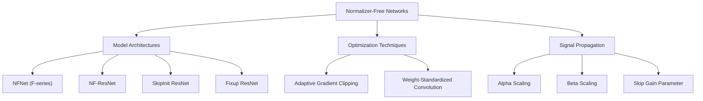
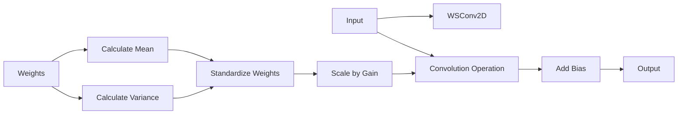
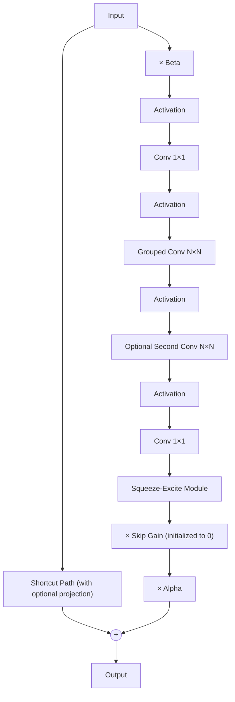
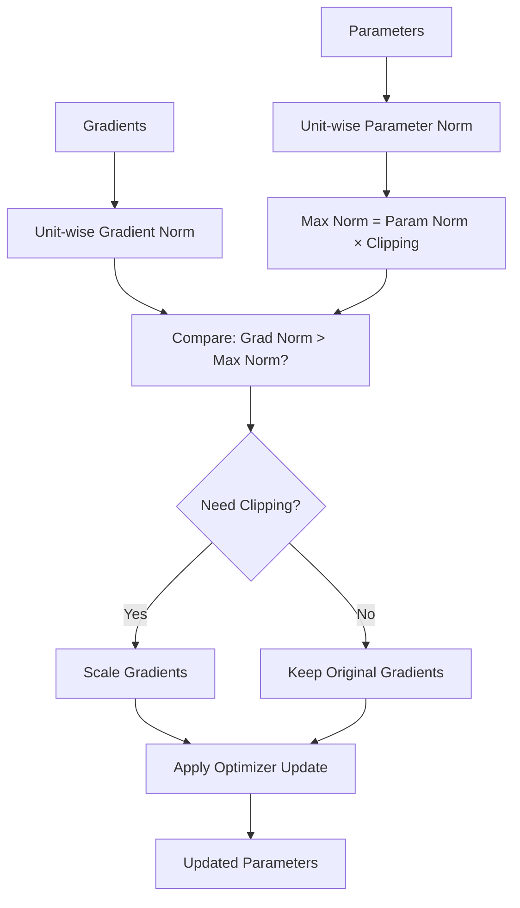
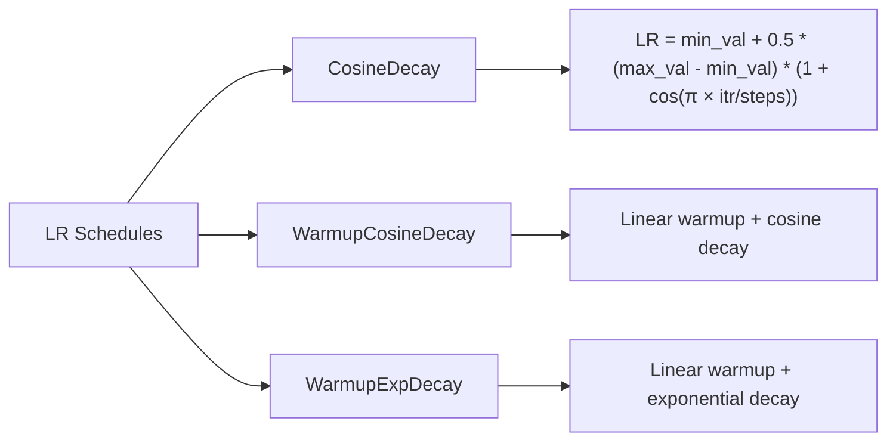
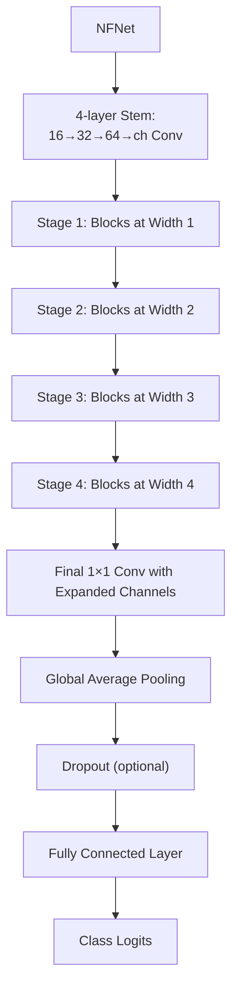
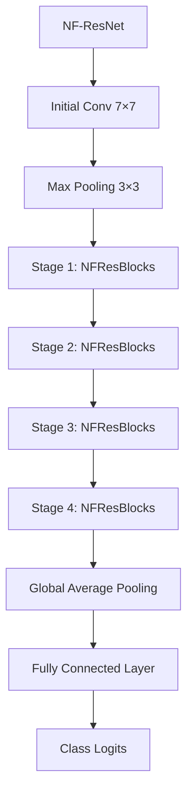
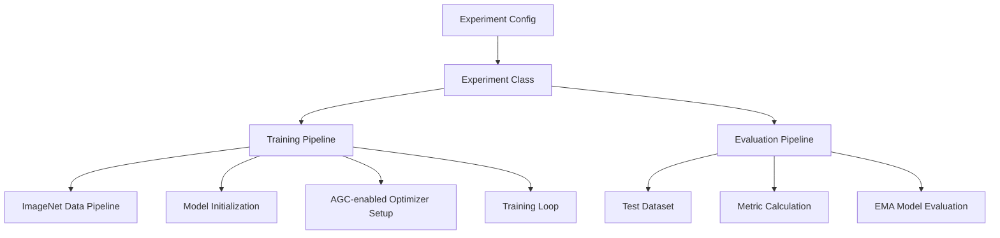
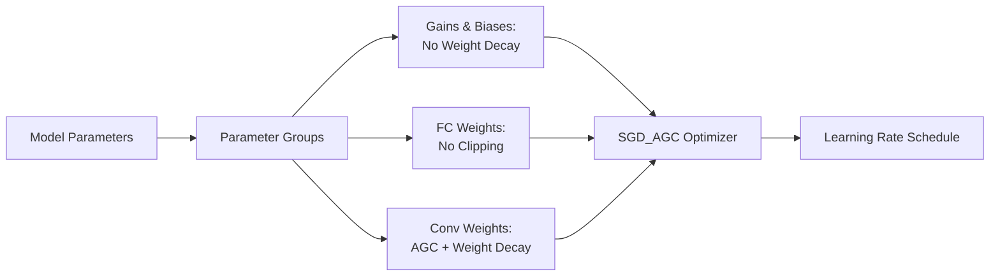

<!-- source: DeepWiki mcp.deepwiki.com · repo google-deepmind/deepmind-research · page 4.3 Normalizer-Free Networks · fetched 2026-10-26 -->

# Normalizer-Free Networks

<details>
<summary>Relevant source files</summary>

The following files were used as context for generating this wiki page:

- [nfnets/README.md](nfnets/README.md)
- [nfnets/base.py](nfnets/base.py)
- [nfnets/experiment.py](nfnets/experiment.py)
- [nfnets/experiment_nfnets.py](nfnets/experiment_nfnets.py)
- [nfnets/fixup_resnet.py](nfnets/fixup_resnet.py)
- [nfnets/nf_resnet.py](nfnets/nf_resnet.py)
- [nfnets/nfnet.py](nfnets/nfnet.py)
- [nfnets/optim.py](nfnets/optim.py)
- [nfnets/skipinit_resnet.py](nfnets/skipinit_resnet.py)
- [nfnets/test.py](nfnets/test.py)

</details>


This document describes the Normalizer-Free Networks implementation within the DeepMind research repository. Normalizer-Free Networks (NFNets) are a family of neural network architectures designed to achieve high performance without using normalization layers like BatchNorm. This page focuses on the implementation and technical details of these networks, including optimization techniques specifically designed for normalization-free training.

## Architectural Overview

Normalizer-Free Networks use specialized techniques to maintain signal propagation stability without normalization layers:



Sources: [nfnets/nfnet.py](), [nfnets/nf_resnet.py](), [nfnets/skipinit_resnet.py](), [nfnets/fixup_resnet.py]()

The implementation includes several model variants, each approaching normalization-free training in a distinct way:

| Model | Approach | Key Technique |
|-------|----------|---------------|
| NFNet | Advanced architecture with signal propagation control | Weight standardization + AGC |
| NF-ResNet | Modified ResNet with signal propagation parameters | Alpha/beta scaling + skip gain |
| SkipInit ResNet | ResNet with zero-initialized skip connections | Skip gain parameter |
| Fixup ResNet | ResNet with careful initialization scheme | Fixed-up initialization |

## Core Components

### Weight-Standardized Convolution

The foundation of NFNets is the `WSConv2D` class which implements weight-standardized convolutions:



Sources: [nfnets/base.py:121-154]()

Weight standardization normalizes the weights instead of activations:
1. Compute mean and variance of weights
2. Standardize: `(w - mean) * gain / sqrt(N * var)`
3. Apply convolution with standardized weights
4. Add learnable bias

### Normalizer-Free Block

The NFBlock is the fundamental building block of these networks:



Sources: [nfnets/nfnet.py:176-272](), [nfnets/nf_resnet.py:132-212]()

Key features of the NFBlock:
- **Beta scaling** (parameter value at input) to control signal magnitude
- **Activation-first** design where activation precedes convolution
- **Squeeze-excite attention** for channel-wise feature recalibration
- **Skip gain** (zero-initialized parameter) to stabilize training
- **Alpha scaling** (parameter value) to control residual branch contribution
- **Stochastic depth** for regularization in deeper models

## Optimization Techniques

### Adaptive Gradient Clipping (AGC)

A critical innovation in NFNets is the Adaptive Gradient Clipping (AGC) technique implemented in the `SGD_AGC` optimizer:



Sources: [nfnets/optim.py:462-499](), [nfnets/optim.py:440-459]()

AGC functionality:
1. For each parameter tensor, compute its unit-wise norm and the norm of its gradient
2. If `grad_norm > param_norm * clipping_threshold`, rescale the gradient
3. Perform the standard optimizer update with the (potentially) clipped gradient

The unit-wise approach (per-filter for convolutions, per-neuron for linear layers) prevents exploding gradients while being more granular than global clipping.

### Learning Rate Schedules

NFNets use specialized learning rate schedules implemented in the `optim.py` module:



Sources: [nfnets/optim.py:164-223]()

The schedules include:
- **CosineDecay**: Standard cosine learning rate decay
- **WarmupCosineDecay**: Cosine decay with linear warmup period
- **WarmupExpDecay**: Exponential decay with linear warmup period

## Model Variants

### NFNet (F-series)

The F-series NFNet models are the highest performing variants in the family:



Sources: [nfnets/nfnet.py:30-173](), [nfnets/base.py:53-96]()

Key characteristics of F-series models:
- 4-layer convolutional stem
- 4 stages of NFBlocks with increasing width and varying depth
- SE module in each block
- Stochastic depth with linearly increasing drop rate
- Advanced architecture features (grouped convolutions, double 3×3 convs)

Available F-series variants:

| Model | Width Pattern | Depth Pattern | Parameters | ImageNet Top-1 |
|-------|--------------|--------------|------------|---------------|
| F0    | [256,512,1536,1536] | [1,2,6,3]   | 71.5M      | 83.6%         |
| F1    | [256,512,1536,1536] | [2,4,12,6]  | 132.6M     | 84.7%         |
| F2    | [256,512,1536,1536] | [3,6,18,9]  | 193.8M     | 85.1%         |
| F3    | [256,512,1536,1536] | [4,8,24,12] | 254.9M     | 85.7%         |
| F4    | [256,512,1536,1536] | [5,10,30,15]| 316.1M     | 85.9%         |
| F5    | [256,512,1536,1536] | [6,12,36,18]| 377.2M     | 86.0%         |

### NF-ResNet

The NF-ResNet model adapts the traditional ResNet architecture to work without normalization:



Sources: [nfnets/nf_resnet.py:24-129](), [nfnets/nf_resnet.py:132-212]()

NF-ResNet features:
- Similar structure to standard ResNet
- Replaces BatchNorm with weight standardization
- Uses beta/alpha scaling and skip gain for signal propagation
- Supports stochastic depth for regularization

## Training and Usage

### Experiment Framework

The repository includes a complete training framework for NFNets:



Sources: [nfnets/experiment.py:116-384](), [nfnets/experiment_nfnets.py:102-133]()

The experiment system features:
- JAXline-based training framework
- Support for multiple model variants
- Integration with ImageNet data pipeline
- Configurable optimization settings
- Exponential moving average (EMA) of weights
- Performance metrics tracking

### Optimizer Configuration

When training NFNets, proper optimizer configuration is crucial:



Sources: [nfnets/experiment_nfnets.py:105-133](), [nfnets/optim.py:462-499]()

Key configuration aspects:
1. Separate parameter groups with different AGC settings:
   - No weight decay for bias parameters and gains
   - No AGC clipping for FC layer weights
   - Full AGC + weight decay for convolutional weights
2. Learning rate scheduling with warmup
3. Stochastic depth with increasing rate
4. Higher weight decay for larger models

## Usage Example

To use a pre-trained NFNet model:

```python
import haiku as hk
from nfnets import NFNet, utils

# Define the forward pass
def forward(x, is_training=False):
    model = NFNet(num_classes=1000, variant='F0', width=1.0, se_ratio=0.5,
                  alpha=0.2, stochdepth_rate=0.25)
    return model(x, is_training=is_training)

# Create the model
model = hk.transform_with_state(forward)

# Load the pre-trained weights
params = utils.load_haiku_file('F0_haiku.npz')

# Run inference
logits, _ = model.apply(params, state={}, rng=None, x=images, is_training=False)
```

To train with AGC:

```python
from nfnets import optim

# Group parameters for optimal AGC behavior
def param_filter(module_name, name, value):
    return name in ['scale', 'offset', 'b'] or 'gain' in name or 'bias' in name

gains_biases, weights = hk.data_structures.partition(param_filter, params)
fc_filter = lambda mod, name, val: 'linear' in mod and 'squeeze_excite' not in mod
fc_weights, conv_weights = hk.data_structures.partition(fc_filter, weights)

# Initialize optimizer with parameter groups
optimizer = optim.SGD_AGC([
    {'params': gains_biases, 'weight_decay': None},
    {'params': fc_weights, 'clipping': None},
    {'params': conv_weights}
], lr=0.1, momentum=0.9, nesterov=True, weight_decay=2e-5, clipping=0.01)
```

Sources: [nfnets/experiment_nfnets.py:105-133](), [nfnets/README.md:38-46]()

---

