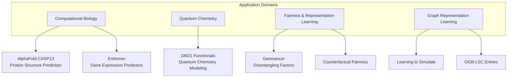
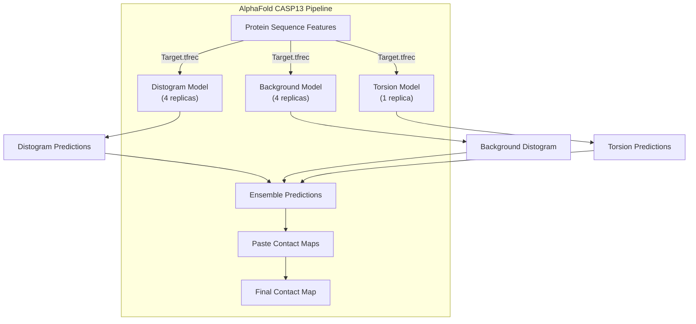
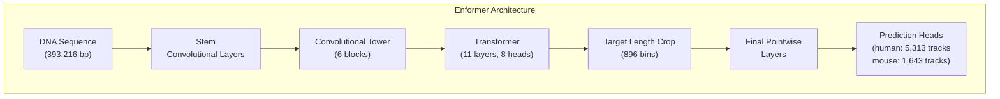
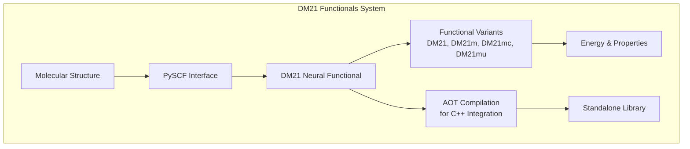
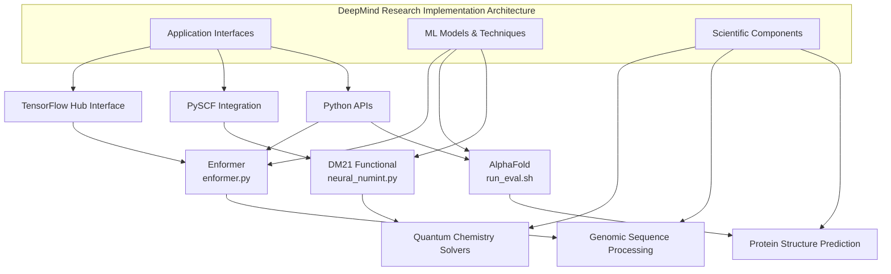

<!-- source: DeepWiki mcp.deepwiki.com · repo google-deepmind/deepmind-research · page 5 Application Domains · fetched 2026-10-26 -->

# Application Domains

Relevant source files

The following files were used as context for generating this wiki page:

- [alphafold_casp13/README.md](alphafold_casp13/README.md)
- [alphafold_casp13/run_eval.sh](alphafold_casp13/run_eval.sh)
- [density_functional_approximation_dm21/.bazelrc](density_functional_approximation_dm21/.bazelrc)
- [density_functional_approximation_dm21/.bazelversion](density_functional_approximation_dm21/.bazelversion)
- [density_functional_approximation_dm21/README.md](density_functional_approximation_dm21/README.md)
- [density_functional_approximation_dm21/WORKSPACE.bazel](density_functional_approximation_dm21/WORKSPACE.bazel)
- [density_functional_approximation_dm21/external/tf_bazel.patch](density_functional_approximation_dm21/external/tf_bazel.patch)
- [density_functional_approximation_dm21/requirements.txt](density_functional_approximation_dm21/requirements.txt)
- [density_functional_approximation_dm21/requirements_aot_compilation.txt](density_functional_approximation_dm21/requirements_aot_compilation.txt)
- [enformer/README.md](enformer/README.md)
- [enformer/attention_module.py](enformer/attention_module.py)
- [enformer/enformer-training.ipynb](enformer/enformer-training.ipynb)
- [enformer/enformer-usage.ipynb](enformer/enformer-usage.ipynb)
- [enformer/enformer.py](enformer/enformer.py)
- [enformer/enformer_test.py](enformer/enformer_test.py)
- [enformer/requirements.txt](enformer/requirements.txt)
- [gated_linear_networks/colabs/README.md](gated_linear_networks/colabs/README.md)
- [gated_linear_networks/colabs/dendritic_gated_network.ipynb](gated_linear_networks/colabs/dendritic_gated_network.ipynb)

This page provides an overview of the specialized application areas in the DeepMind Research repository, focusing on how machine learning techniques are applied to solve problems in specific scientific domains. The repository showcases DeepMind's approach to developing both general-purpose and domain-specific machine learning solutions for real-world scientific challenges.

## Overview of Application Domains

The repository contains implementations for several key application domains:

Sources: [alphafold_casp13/README.md](), [enformer/README.md](), [density_functional_approximation_dm21/README.md]()

## Computational Biology

DeepMind has made significant contributions to computational biology, with machine learning models that tackle important problems in protein structure prediction and gene expression.

### AlphaFold CASP13

AlphaFold CASP13 (also known as AlphaFold 1) was DeepMind's entry into the CASP13 competition (2018). This implementation focuses on contact prediction in protein structures, which is a critical step in predicting the 3D structure of proteins from their amino acid sequences.

The system predicts:
- Distograms (distance histograms between amino acid residues)
- Background distograms (provides context for the main prediction)
- Torsion angles (geometric properties of the protein backbone)

Key components:
- The `run_eval.sh` script orchestrates the entire prediction pipeline
- Multiple model replicas are used for ensembling to improve accuracy
- Contact maps are generated from distograms in the final step

Note that this is the original AlphaFold from 2018, which is completely different from AlphaFold 2 used in CASP14 (2020).

Sources: [alphafold_casp13/README.md](), [alphafold_casp13/run_eval.sh]()

### Enformer

Enformer is a deep learning model for gene expression prediction that can effectively model long-range interactions in genomic sequences. It represents a significant advance over previous methods by capturing regulatory elements that can be located far from genes they control.

The architecture consists of:
- A DNA sequence input of length 393,216 base pairs
- Initial convolutional layers (stem) followed by a convolutional tower
- A transformer module with 11 layers and 8 attention heads
- Output heads for human (5,313 tracks) and mouse (1,643 tracks) gene expression

Applications:
- Predicting gene expression from DNA sequence
- Computing contribution scores to understand regulatory elements
- Predicting the effect of genetic variants on gene expression

Enformer can be used both for basic prediction tasks and for analyzing the impact of genetic variants on gene regulation, which has implications for understanding disease mechanisms.

Sources: [enformer/README.md](), [enformer/enformer.py:42-184](), [enformer/attention_module.py]()

## Quantum Chemistry

### DM21 Functionals

The DM21 (DeepMind 21) family of exchange-correlation functionals provides improved accuracy for quantum chemistry calculations using density functional theory (DFT). These functionals address the "fractional electron problem" in DFT, leading to more accurate predictions of molecular properties.

The DM21 system provides:
- A neural network-based exchange-correlation functional
- Integration with PySCF, a Python-based quantum chemistry package
- Multiple variants with different training constraints:
  - `DM21`: Trained on molecules dataset with fractional charge and spin constraints
  - `DM21m`: Trained only on molecules dataset
  - `DM21mc`: Trained on molecules with fractional charge constraints
  - `DM21mu`: Trained on molecules with electron gas constraints
- Ahead-of-time compilation for integration with C++ applications

Key improvement over traditional methods:
- Improved accuracy for molecular properties
- Better handling of fractional electron systems
- Compatibility with standard quantum chemistry workflows

Sources: [density_functional_approximation_dm21/README.md](), [density_functional_approximation_dm21/requirements.txt]()

## Fairness and Representation Learning

DeepMind Research includes several projects focused on fairness and ethical considerations in machine learning, with implementation of methods for achieving fairness and disentangling factors of representation.

### Geomancer

Geomancer provides a framework for disentangling factors of variation in data, with applications in fairness and interpretability. It uses geometric techniques to identify and separate different sources of variation in complex datasets.

### Counterfactual Fairness

This component implements methods for achieving fairness through counterfactual reasoning, which involves reasoning about what would have happened under different circumstances. This approach helps in creating ML systems that make fair predictions across different demographic groups.

Sources: The section on Fairness systems is referenced in the repository structure diagram but detailed code files were not included in the provided list.

## Graph Representation Learning

The repository contains several implementations related to graph neural networks and their applications in different domains.

### Learning to Simulate

This component focuses on using graph-based approaches to learn complex physics simulations. Graph neural networks are particularly well-suited for this task because they can model complex interactions between entities in a simulation.

### OGB Large-Scale Challenge (OGB-LSC)

These are entries for the Open Graph Benchmark Large-Scale Challenge, which tests graph neural network methods on large-scale, real-world graph datasets. This demonstrates the application of graph representation learning to large-scale problems.

Sources: The section on Graph Neural Networks is referenced in the repository structure diagram but detailed code files were not included in the provided list.

## Implementation Details and Technical Integration

Sources: [enformer/README.md](), [alphafold_casp13/README.md](), [density_functional_approximation_dm21/README.md]()

## Deployment and Usage

The applications in the DeepMind Research repository are provided with different interfaces for deployment and usage:

| Application | Primary Interface | Deployment Options | Example Usage |
|-------------|------------------|-------------------|---------------|
| Enformer | TensorFlow Hub | Python API, TFHub | Gene expression prediction, variant effect analysis |
| AlphaFold CASP13 | Command-line script | Python scripts | Protein contact prediction for CASP13 targets |
| DM21 Functionals | PySCF integration | Python API, C++ library | Quantum chemistry calculations |
| Graph Neural Networks | Python API | Python | Simulation, graph property prediction |
| Fairness Models | Python API | Python | Fair machine learning applications |

Each application includes example code and notebooks that demonstrate how to use the models for their intended purposes. The implementations are designed to be adaptable to different research and application contexts while maintaining compatibility with standard tools in their respective domains.

Sources: [enformer/enformer-usage.ipynb](), [alphafold_casp13/run_eval.sh](), [density_functional_approximation_dm21/README.md]()

---

