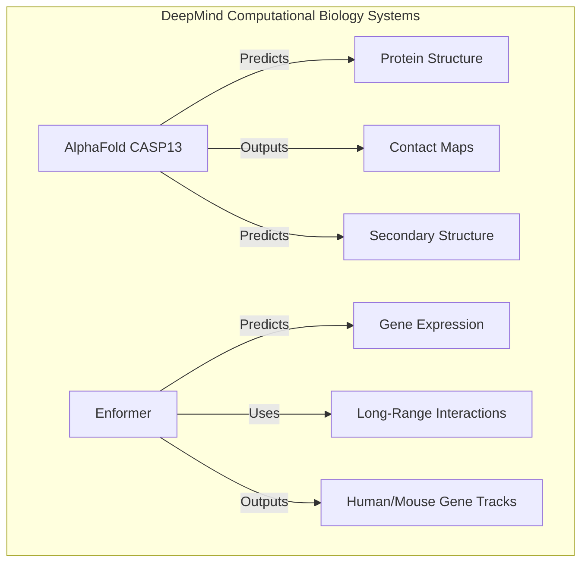
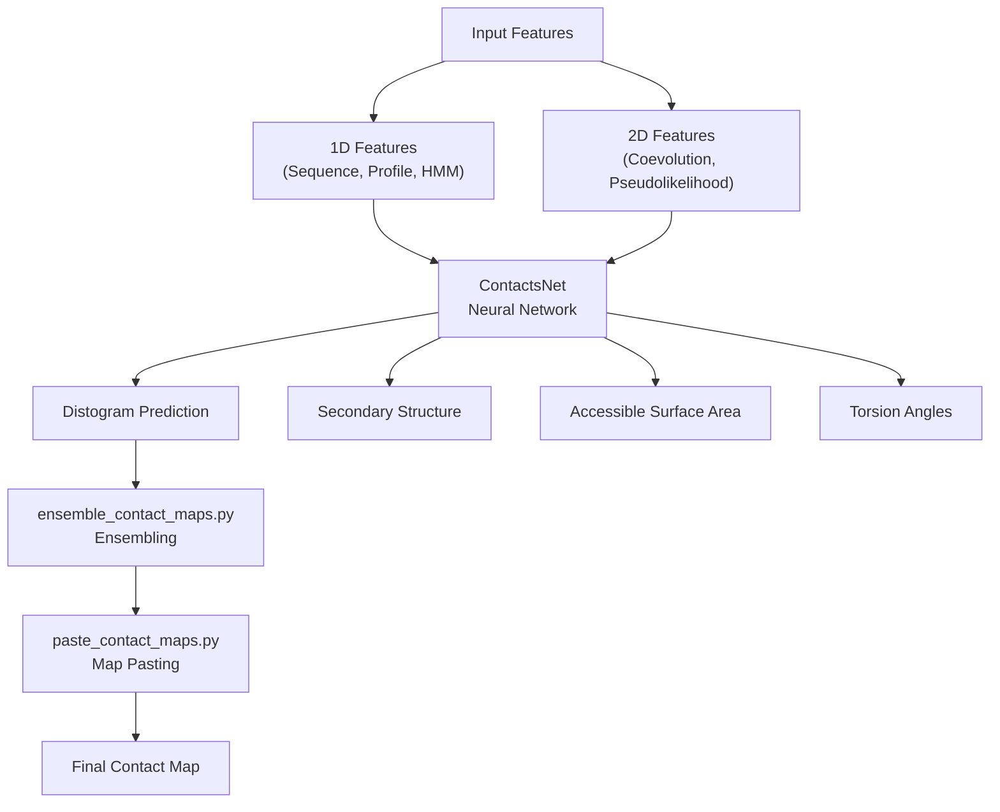
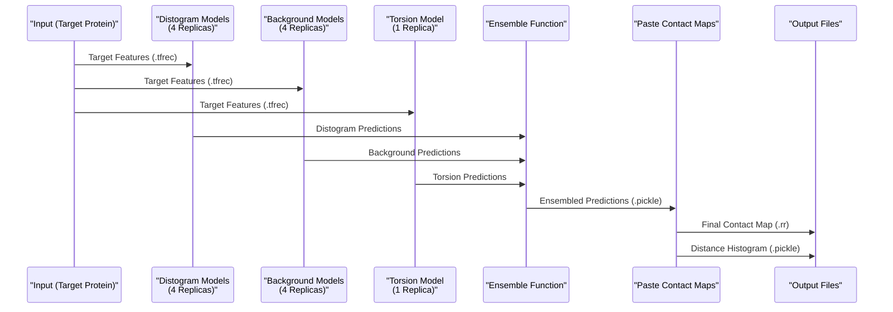
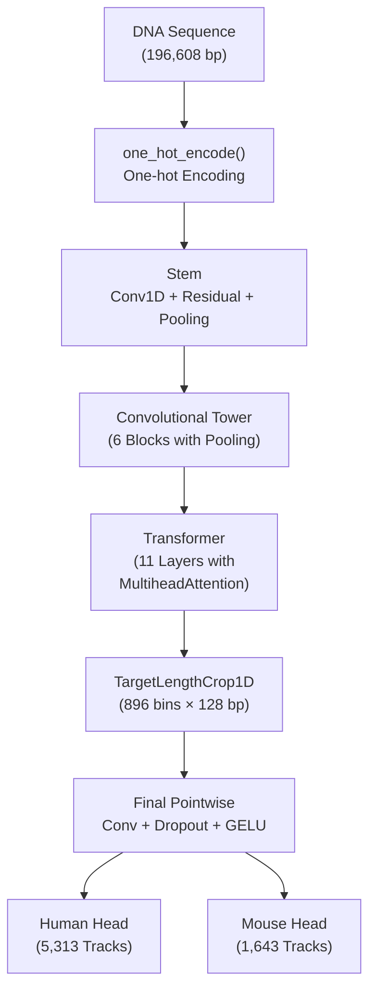
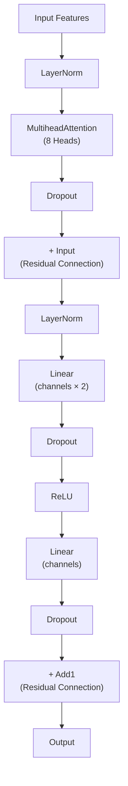
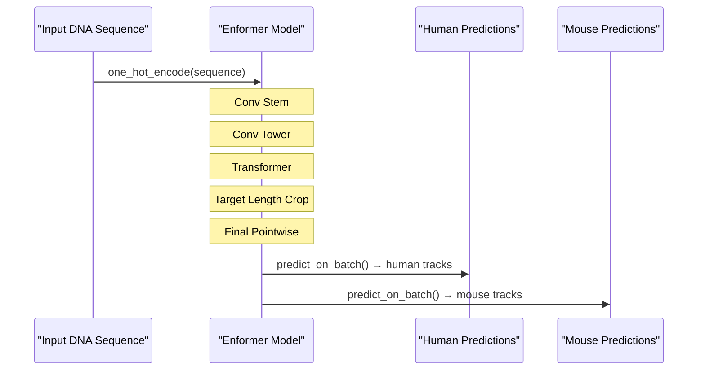
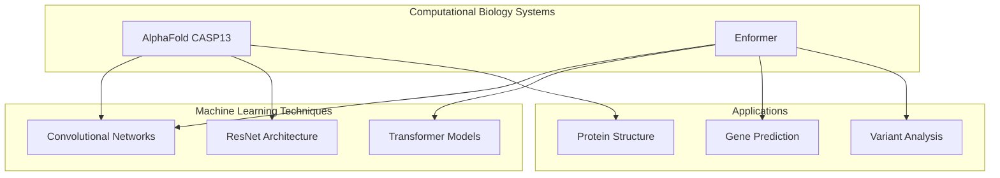

<!-- source: DeepWiki mcp.deepwiki.com · repo google-deepmind/deepmind-research · page 5.1 Computational Biology · fetched 2026-10-26 -->

# Computational Biology

<details>
<summary>Relevant source files</summary>

The following files were used as context for generating this wiki page:

- [alphafold_casp13/README.md](alphafold_casp13/README.md)
- [alphafold_casp13/asa_output.py](alphafold_casp13/asa_output.py)
- [alphafold_casp13/contacts.py](alphafold_casp13/contacts.py)
- [alphafold_casp13/contacts_dataset.py](alphafold_casp13/contacts_dataset.py)
- [alphafold_casp13/contacts_experiment.py](alphafold_casp13/contacts_experiment.py)
- [alphafold_casp13/contacts_network.py](alphafold_casp13/contacts_network.py)
- [alphafold_casp13/distogram_io.py](alphafold_casp13/distogram_io.py)
- [alphafold_casp13/ensemble_contact_maps.py](alphafold_casp13/ensemble_contact_maps.py)
- [alphafold_casp13/parsers.py](alphafold_casp13/parsers.py)
- [alphafold_casp13/paste_contact_maps.py](alphafold_casp13/paste_contact_maps.py)
- [alphafold_casp13/run_eval.sh](alphafold_casp13/run_eval.sh)
- [alphafold_casp13/secstruct.py](alphafold_casp13/secstruct.py)
- [alphafold_casp13/two_dim_convnet.py](alphafold_casp13/two_dim_convnet.py)
- [alphafold_casp13/two_dim_resnet.py](alphafold_casp13/two_dim_resnet.py)
- [enformer/README.md](enformer/README.md)
- [enformer/attention_module.py](enformer/attention_module.py)
- [enformer/enformer-training.ipynb](enformer/enformer-training.ipynb)
- [enformer/enformer-usage.ipynb](enformer/enformer-usage.ipynb)
- [enformer/enformer.py](enformer/enformer.py)
- [enformer/enformer_test.py](enformer/enformer_test.py)
- [enformer/requirements.txt](enformer/requirements.txt)
- [gated_linear_networks/colabs/README.md](gated_linear_networks/colabs/README.md)
- [gated_linear_networks/colabs/dendritic_gated_network.ipynb](gated_linear_networks/colabs/dendritic_gated_network.ipynb)

</details>


This page provides an overview of the computational biology systems in the DeepMind Research repository. The systems covered here focus on protein structure prediction and gene expression analysis - two fundamental problems in computational biology. For machine learning techniques used in these systems, see [Machine Learning Techniques](#4).

## Overview of Computational Biology Systems

The DeepMind Research repository contains two major computational biology systems:

1. **AlphaFold CASP13** (also known as AlphaFold 1) - A system for protein structure prediction using deep learning
2. **Enformer** - A transformer-based model for gene expression prediction from DNA sequences

These systems represent DeepMind's contributions to solving fundamental problems in computational biology using advanced machine learning techniques.



Sources: [alphafold_casp13/README.md:1-20](), [enformer/README.md:1-15]()

## AlphaFold CASP13 (AlphaFold 1)

AlphaFold CASP13 is a protein structure prediction system used in the CASP13 competition (2018). It's important to note that this is **not** the same as AlphaFold 2 used in CASP14 (2020), which is available in a separate repository.

### System Architecture and Components

AlphaFold CASP13 predicts protein structure through several key components:

1. **Distogram Prediction**: Predicts a probability distribution of distances between residue pairs
2. **Contact Prediction**: Derived from the distogram by summing probabilities below a distance threshold
3. **Secondary Structure Prediction**: Predicts the protein's secondary structure elements
4. **Accessible Surface Area (ASA) Prediction**: Predicts solvent exposure of residues
5. **Torsion Angle Prediction**: Predicts backbone torsion angles



Sources: [alphafold_casp13/contacts_network.py:41-195](), [alphafold_casp13/contacts_experiment.py:33-70](), [alphafold_casp13/secstruct.py:14-66](), [alphafold_casp13/asa_output.py:15-33]()

### Prediction Workflow

The contact prediction workflow involves multiple steps executed by the `run_eval.sh` script:

1. **Feature Processing**: Process the input protein sequence to generate features
2. **Multiple Model Inference**: Run multiple models on the features:
   - 4 replicas of the distogram model
   - 4 replicas of the background model
   - 1 replica of the torsion model
3. **Ensembling**: Combine outputs from replicas using `ensemble_contact_maps.py`
4. **Pasting**: Combine predictions from different crops to get the full contact map using `paste_contact_maps.py`



Sources: [alphafold_casp13/run_eval.sh:19-103](), [alphafold_casp13/contacts.py:14-393](), [alphafold_casp13/ensemble_contact_maps.py:15-124](), [alphafold_casp13/paste_contact_maps.py:14-201]()

### Data Format and Features

AlphaFold CASP13 uses a rich set of protein features including:

| Feature Type | Description | Shape |
|-------------|-------------|-------|
| `aatype` | One-hot encoding of amino acid types | `[num_residues, 21]` |
| `hmm_profile` | HHBlits HMM profile | `[num_residues, 30]` |
| `deletion_probability` | Fraction of sequences with deletion at this position | `[num_residues, 1]` |
| `gap_matrix` | Covariation signal from gapped states | `[num_residues, num_residues, 1]` |
| `non_gapped_profile` | Profile from amino acids only | `[num_residues, 21]` |
| `pseudo_frob` | Frobenius norm of pseudolikelihood | `[num_residues, num_residues, 1]` |
| `pseudolikelihood` | MSA pseudolikelihood computation weights | `[num_residues, num_residues, 484]` |

The output distogram is stored as a Python pickle file containing:
- `min_range`: Minimum range in Angstroms
- `max_range`: Maximum range in Angstroms
- `num_bins`: Number of distance bins
- `sequence`: Target amino acid sequence
- `probs`: Probability distribution of shape `[L, L, num_bins]` (where L is sequence length)

Sources: [alphafold_casp13/README.md:180-255](), [alphafold_casp13/contacts_dataset.py:32-83](), [alphafold_casp13/distogram_io.py:57-83]()

## Enformer Model

Enformer is a deep learning model for predicting gene expression from DNA sequence by integrating long-range interactions.

### Model Architecture

The Enformer architecture consists of several key components:

1. **Input Processing**: Processes DNA sequences of length 196,608 bp
2. **Convolutional Stem**: Initial feature extraction with convolutional layers
3. **Convolutional Tower**: Hierarchical feature extraction with residual blocks
4. **Transformer**: 11 transformer layers to capture long-range interactions
5. **Output Heads**: Predict gene expression for human (5,313 tracks) and mouse (1,643 tracks)



Sources: [enformer/enformer.py:38-177](), [enformer/attention_module.py:58-105]()

### Enformer Components in Detail

#### Transformer Block

The transformer implementation in Enformer uses multi-head attention with relative positional encodings:



Sources: [enformer/attention_module.py:66-101](), [enformer/enformer.py:117-152]()

#### Prediction Workflow

The gene expression prediction workflow:

1. **Sequence Input**: DNA sequence of length 393,216 bp (central 196,608 bp used)
2. **Model Forward Pass**: Process through Enformer architecture
3. **Output**: Gene expression predictions for 896 bins (each 128 bp) for human and mouse tracks



Sources: [enformer/enformer.py:171-183](), [enformer/README.md:78-100]()

### Applications and Usage

Enformer can be used for:

1. **Gene Expression Prediction**: Predict gene expression from DNA sequence
2. **Variant Effect Prediction**: Assess the impact of genetic variants on gene expression
3. **Regulatory Element Analysis**: Identify and characterize gene regulatory elements

Pre-computed variant effect scores for frequent variants from the 1000 Genomes project are available for download.

The model can be loaded via TensorFlow Hub:

```python
enformer = hub.Module('https://tfhub.dev/deepmind/enformer/1')
inputs = tf.zeros((1, 393216, 4), dtype=tf.float32)  # One-hot encoded sequence
predictions = enformer.predict_on_batch(inputs)
predictions['human'].shape  # [1, 896, 5313]
predictions['mouse'].shape  # [1, 896, 1643]
```

Sources: [enformer/README.md:38-75](), [enformer/README.md:108-117]()

## Integration with Other Systems

Both computational biology systems are part of DeepMind's broader research initiatives and can be integrated with other systems:



Sources: [alphafold_casp13/contacts_network.py:41-65](), [enformer/enformer.py:42-53]()

## Summary

DeepMind Research provides two sophisticated computational biology systems:

1. **AlphaFold CASP13** for protein structure prediction through contact maps and related structural properties
2. **Enformer** for gene expression prediction by capturing long-range interactions in DNA

These systems represent significant contributions to computational biology through the application of advanced deep learning techniques.

---

