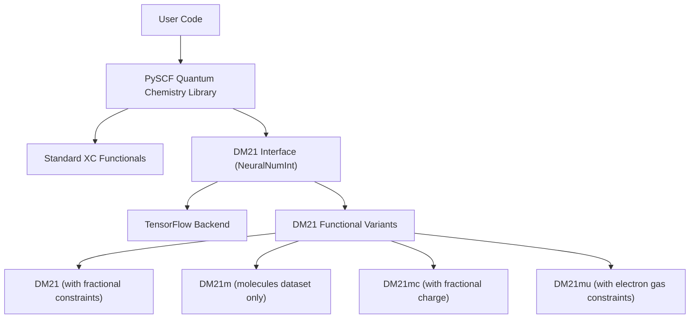
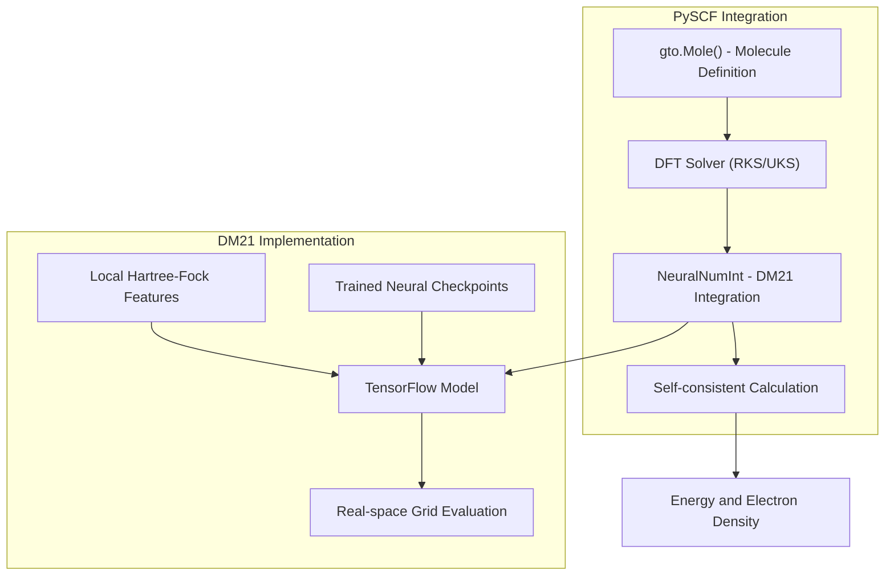
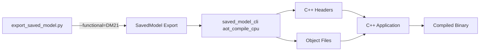

<!-- source: DeepWiki mcp.deepwiki.com · repo google-deepmind/deepmind-research · page 5.2 Quantum Chemistry · fetched 2026-10-26 -->

# Quantum Chemistry

<details>
<summary>Relevant source files</summary>

The following files were used as context for generating this wiki page:

- [density_functional_approximation_dm21/.bazelrc](density_functional_approximation_dm21/.bazelrc)
- [density_functional_approximation_dm21/.bazelversion](density_functional_approximation_dm21/.bazelversion)
- [density_functional_approximation_dm21/README.md](density_functional_approximation_dm21/README.md)
- [density_functional_approximation_dm21/WORKSPACE.bazel](density_functional_approximation_dm21/WORKSPACE.bazel)
- [density_functional_approximation_dm21/external/tf_bazel.patch](density_functional_approximation_dm21/external/tf_bazel.patch)
- [density_functional_approximation_dm21/requirements.txt](density_functional_approximation_dm21/requirements.txt)
- [density_functional_approximation_dm21/requirements_aot_compilation.txt](density_functional_approximation_dm21/requirements_aot_compilation.txt)

</details>


This page documents the Quantum Chemistry subsystem in the DeepMind Research repository, specifically focusing on the DM21 (DeepMind 21) family of exchange-correlation functionals for density functional theory (DFT) calculations. This system provides a practical implementation of state-of-the-art neural network-based functional approximations for quantum chemistry calculations.

For information about protein structure prediction, see [Computational Biology](#5.1).

## Overview

The Quantum Chemistry module provides a series of density functional approximations called the DM21 family, which are designed to address certain limitations in existing quantum chemistry methods, particularly the "fractional electron problem." These functionals are implemented as neural networks and can be used with the PySCF quantum chemistry software package to perform accurate electronic structure calculations for molecules.

### DM21 Functional Family

The system includes four variants of the DM21 functional:

- **DM21**: Trained on molecules dataset, fractional charge, and fractional spin constraints
- **DM21m**: Trained on molecules dataset only
- **DM21mc**: Trained on molecules dataset and fractional charge constraints
- **DM21mu**: Trained on molecules dataset and electron gas constraints

Sources: [density_functional_approximation_dm21/README.md:103-109]()

## System Architecture

The DM21 functionals are implemented as a wrapper around PySCF's numerical integration capability, providing neural network-based evaluation of exchange-correlation energies and potentials.

### DM21 Functional System Architecture



Sources: [density_functional_approximation_dm21/README.md:90-109]()

### Integration Flow



Sources: [density_functional_approximation_dm21/README.md:72-89]()

## Installation and Usage

### Installation

The DM21 functionals can be installed via pip:

```
pip install git+git://github.com/deepmind/deepmind-research.git#subdirectory=density_functional_approximation_dm21
```

Alternatively, it can be installed from a local repository after cloning:

```
git clone https://github.com/deepmind/deepmind-research.git
cd deepmind-research/density_functional_approximation_dm21
pip install .
```

Sources: [density_functional_approximation_dm21/README.md:8-40]()

### Basic Usage

The following example demonstrates how to use DM21 functional with PySCF:

```python
import density_functional_approximation_dm21 as dm21
from pyscf import gto
from pyscf import dft

# Create the molecule of interest and select the basis set
mol = gto.Mole()
mol.atom = 'Ne 0.0 0.0 0.0'
mol.basis = 'cc-pVDZ'
mol.build()

# Create a DFT solver and insert the DM21 functional into the solver
mf = dft.RKS(mol)
mf._numint = dm21.NeuralNumInt(dm21.Functional.DM21)

# Run the DFT calculation
mf.kernel()
```

Unlike conventional functionals which are specified using `mf.xc = <functional name>`, the DM21 functionals are inserted by replacing the numerical integrator with `dm21.NeuralNumInt`.

Sources: [density_functional_approximation_dm21/README.md:50-101]()

### Best Practices

For practical calculations, the documentation recommends:

1. Starting with a cheaper functional (e.g., B3LYP) to get an initial density
2. Relaxing convergence tolerances (recommended: `conv_tol = 1E-6`, `conv_tol_grad = 1E-3`)
3. Using the initial density as input to DM21 calculation
4. Applying D3 corrections for dispersion effects

Sources: [density_functional_approximation_dm21/README.md:116-189]()

## Example Calculation

The following code demonstrates a practical atomization energy calculation for methane using DM21:

```python
import density_functional_approximation_dm21 as dm21
from pyscf import gto
from pyscf import dft

# Methane molecule definition
methane = gto.Mole()
methane.atom = """H 0.0 0.0 0.0
                  C 0.0 0.0 1.087900000000
                  H 1.025681956337 0.0 1.450533333333
                  H -0.512840978169 0.888266630391 1.450533333333
                  H -0.512840978169 -0.888266630391 1.450533333333"""
methane.basis = 'def2-qzvp'
methane.build()

# Individual atoms for atomization energy
carbon = gto.Mole()
carbon.atom = 'C 0.0 0.0 0.0'
carbon.basis = 'def2-qzvp'
carbon.spin = 2  # Carbon has 4 unpaired electrons
carbon.build()

hydrogen = gto.Mole()
hydrogen.atom = 'H 0.0 0.0 0.0'
hydrogen.basis = 'def2-qzvp'
hydrogen.spin = 1  # Hydrogen has 1 unpaired electron
hydrogen.build()

# Calculate energies for all systems
energies = []
for mol in [methane, carbon, hydrogen]:
  # Create appropriate DFT solver based on spin
  if mol.spin == 0:
    mf = dft.RKS(mol)  # Restricted Kohn-Sham for closed-shell
  else:
    mf = dft.UKS(mol)  # Unrestricted Kohn-Sham for open-shell
    
  # Start with B3LYP for initial density
  mf.xc = 'B3LYP'
  mf.run()
  dm0 = mf.make_rdm1()
  
  # Switch to DM21 functional
  mf._numint = dm21.NeuralNumInt(dm21.Functional.DM21)
  mf.conv_tol = 1E-6
  mf.conv_tol_grad = 1E-3
  energy = mf.kernel(dm0=dm0)
  energies.append(energy)
```

After calculation, the atomization energy can be derived from these energies and corrected with D3(BJ) dispersion correction.

Sources: [density_functional_approximation_dm21/README.md:130-185]()

## C++ Integration

### C++ Usage Options

The DM21 functionals can be used from C++ in two ways:

1. Loading the SavedModel using TensorFlow's C++ API (requires TensorFlow library dependency)
2. Compiling the model ahead-of-time (AOT) into a standalone library

Sources: [density_functional_approximation_dm21/README.md:192-203]()

### AOT Compilation Process



The AOT compilation process generates C++ headers and object files that can be linked into a C++ application without requiring a runtime dependency on TensorFlow.

Sources: [density_functional_approximation_dm21/README.md:239-283]()

## Technical Implementation Details

### Required Dependencies

The DM21 functionals have the following core dependencies:

| Dependency | Version | Purpose |
|------------|---------|---------|
| PySCF | 2.1.1+ | Quantum chemistry framework |
| TensorFlow | 2.11.0 | Neural network backend |
| NumPy | 1.24.1 | Numerical operations |
| h5py | 3.8.0 | Checkpoint handling |
| scipy | 1.9.3 | Scientific computing |

Sources: [density_functional_approximation_dm21/requirements.txt:1-9]()

### System Components

The DM21 system consists of the following key components:

1. **NeuralNumInt class**: Wrapper around PySCF's numerical integrator that handles the neural network evaluation
2. **Functional enum**: Defines the available functional variants (DM21, DM21m, DM21mc, DM21mu)
3. **Pre-trained checkpoints**: Neural network weights for each functional variant
4. **Model export tools**: Utilities for exporting models for C++ usage

### Performance Considerations

The documentation notes several important performance considerations:

1. PySCF 2.0+ enables more efficient calculation of local Hartree-Fock features
2. The neural functionals run at single precision, making high convergence thresholds difficult to achieve
3. Using a cheaper functional for initial density improves convergence
4. Relaxed convergence tolerances are recommended for practical calculations

Sources: [density_functional_approximation_dm21/README.md:14-16](), [density_functional_approximation_dm21/README.md:116-125]()

## Scientific Background

The DM21 functionals are described in the scientific paper "Pushing the Frontiers of Density Functionals by Solving the Fractional Electron Problem" published in Science. The functionals are designed to address known limitations in existing density functional approximations, particularly related to the treatment of fractional electron numbers.

Sources: [density_functional_approximation_dm21/README.md:286-294]()

## License Information

The code for DM21 functionals is released under the Apache 2.0 License, while the model parameters (in the checkpoints subdirectory) are made available under the Creative Commons Attribution 4.0 International (CC BY 4.0) License.

Sources: [density_functional_approximation_dm21/README.md:296-302]()

---

