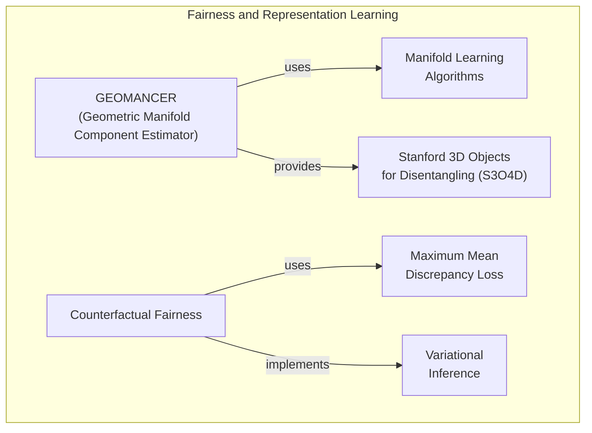
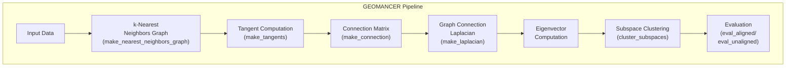
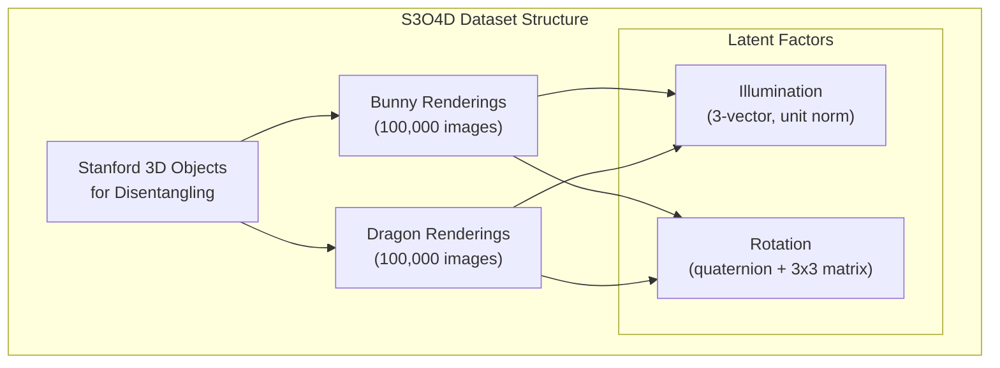
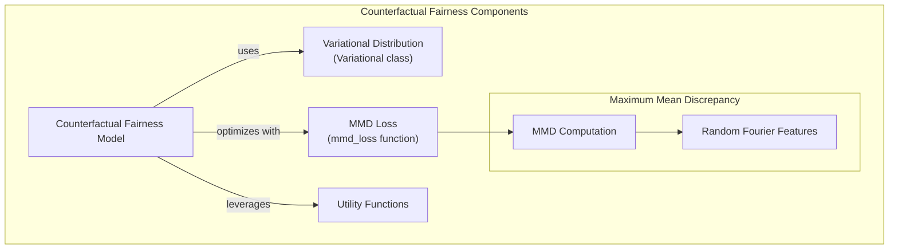
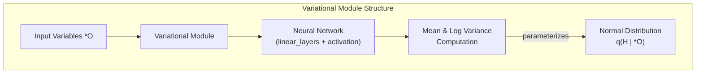
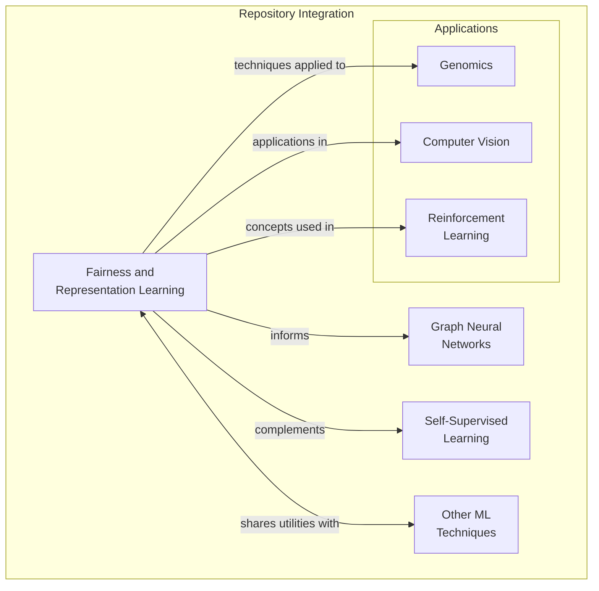

<!-- source: DeepWiki mcp.deepwiki.com · repo google-deepmind/deepmind-research · page 5.3 Fairness and Representation Learning · fetched 2026-10-26 -->

# Fairness and Representation Learning

<details>
<summary>Relevant source files</summary>

The following files were used as context for generating this wiki page:

- [counterfactual_fairness/utils.py](counterfactual_fairness/utils.py)
- [counterfactual_fairness/variational.py](counterfactual_fairness/variational.py)
- [gated_linear_networks/examples/utils.py](gated_linear_networks/examples/utils.py)
- [geomancer/README.md](geomancer/README.md)
- [geomancer/geomancer.py](geomancer/geomancer.py)
- [geomancer/geomancer_test.py](geomancer/geomancer_test.py)
- [geomancer/run.sh](geomancer/run.sh)
- [geomancer/s3o4d.png](geomancer/s3o4d.png)
- [geomancer/setup.py](geomancer/setup.py)
- [geomancer/train.py](geomancer/train.py)
- [mmv/models/types.py](mmv/models/types.py)
- [ogb_lsc/pcq/model.py](ogb_lsc/pcq/model.py)

</details>


## Purpose and Scope

This document details the fairness and representation learning systems within the DeepMind research repository. It covers algorithms and implementations for learning disentangled representations and ensuring fairness in machine learning models. The primary focus is on two key systems: GEOMANCER (Geometric Manifold Component Estimator) for disentangling factors of variation in data, and Counterfactual Fairness approaches for building fair representations in machine learning models.

## Overview of Fairness and Representation Learning Systems

The repository contains implementations of advanced techniques for representation learning with a focus on disentanglement and fairness. These approaches aim to identify and separate the underlying factors of variation in data, which is valuable for creating fair, interpretable, and robust machine learning models.



Sources: [geomancer/README.md:1-193](), [counterfactual_fairness/utils.py:169-236](), [counterfactual_fairness/variational.py:1-87]()

## GEOMANCER: Geometric Manifold Component Estimator

GEOMANCER is a nonparametric algorithm for disentangling factors of variation in data. Unlike deep learning-based disentanglement methods (like β-VAE), GEOMANCER focuses on identifying subspaces around each data point that correspond to different factors of variation, making it especially suitable for data with multi-dimensional factors like 3D rotations.

### Core Algorithm and Components



Sources: [geomancer/geomancer.py:29-318](), [geomancer/README.md:25-93]()

The GEOMANCER algorithm works through the following process:

1. **Nearest Neighbors Graph Construction**: The algorithm first constructs a k-nearest neighbors graph using the `make_nearest_neighbors_graph` function.
2. **Tangent Space Computation**: For each point, it computes the local tangent space using the `make_tangents` function.
3. **Connection Matrix**: The algorithm builds connection matrices between tangent spaces of neighboring points via `make_connection`.
4. **Second-order Graph Laplacian**: It then constructs a 2nd-order graph connection Laplacian with `make_laplacian`.
5. **Spectral Decomposition**: Computes eigenvectors of the Laplacian.
6. **Subspace Clustering**: Finally, it clusters the eigenvectors to identify separate subspaces representing different factors of variation using `cluster_subspaces`.

### Stanford 3D Objects for Disentangling (S3O4D) Dataset

The Stanford 3D Objects for Disentangling (S3O4D) dataset is designed specifically for research on disentanglement. It contains 100,000 renderings each of Bunny and Dragon objects from the Stanford 3D Scanning Repository under varying illumination and rotation conditions.



Sources: [geomancer/README.md:94-173]()

Key features of the S3O4D dataset:

- Images are rendered with uniformly sampled illumination from the 2-sphere and 3D rotations
- True latent states (illumination and rotation parameters) are provided with the images
- Unlike other datasets, S3O4D contains the *full manifold* of 3D rotations, not just azimuth/elevation
- Available through TensorFlow Datasets or directly from Google Cloud

### Usage Example

GEOMANCER can be used to identify the disentangled subspaces in data with the following simplified workflow:

```python
import numpy as np
import geomancer

# Generate or load data
data = ...  # Shape: [num_points, data_dimension]

# Run GEOMANCER with manifold dimension k
components, spectrum = geomancer.fit(data, k=4)

# Evaluate results if ground truth is available
if aligned_ground_truth_available:
    errors = geomancer.eval_aligned(components, ground_truth_tangents)
else:
    errors = geomancer.eval_unaligned(data, components, 
                                     ground_truth_data, ground_truth_tangents)
```

Sources: [geomancer/README.md:36-62](), [geomancer/train.py:141-198]()

## Counterfactual Fairness

The Counterfactual Fairness system implements fairness-aware machine learning using causal models and variational inference. It focuses on ensuring that predictions remain consistent in counterfactual scenarios where protected attributes are changed.

### System Architecture



Sources: [counterfactual_fairness/utils.py:169-278](), [counterfactual_fairness/variational.py:1-87]()

### Maximum Mean Discrepancy (MMD) Loss

The MMD loss is a key component that measures the distance between two probability distributions. It's used to enforce fairness by ensuring that representations for different protected groups are similar. The implementation offers:

1. **FastMMD Approximation**: Using Random Fourier Features for efficient computation in `mmd_loss`
2. **Exact MMD Calculation**: For smaller datasets or higher precision in `mmd_loss_exact`

The core MMD loss function takes:
- A distribution (whose samples will be compared)
- A boolean array indicating which elements correspond to class A vs. B
- Number of samples to draw from the distribution
- Random seed
- Kernel parameters

Sources: [counterfactual_fairness/utils.py:169-236](), [counterfactual_fairness/utils.py:238-278]()

### Variational Inference

The `Variational` class implements the variational distribution q(H | *O) where H is a continuous random variable. This is used to learn fair representations through variational inference:



Sources: [counterfactual_fairness/variational.py:27-87]()

The Variational module:
1. Takes input features and concatenates them
2. Passes them through common hidden layers
3. Splits into separate pathways for mean and log variance
4. Constructs a normal distribution using these parameters

### Utility Functions

The system includes several utility functions for working with distributions and evaluating models:

- **Multinomial Mode/Class Functions**: Compute modes and classes of multinomial distributions
- **Distribution Sampling**: Utilities for sampling from batched distributions
- **Log Probability**: Functions to compute log probabilities in a consistent manner

Sources: [counterfactual_fairness/utils.py:45-118](), [counterfactual_fairness/utils.py:139-155](), [counterfactual_fairness/utils.py:281-313]()

### Dataset Preparation

For dataset handling, the system provides:

- **get_dataset**: Converts pandas DataFrames into TensorFlow Datasets with appropriate preprocessing
- **Category Encoding**: Automatically converts categorical variables to numeric codes

Sources: [counterfactual_fairness/utils.py:29-42]()

## Integration with Other Systems

The fairness and representation learning systems connect with other components in the DeepMind research repository:



Sources: [geomancer/README.md:1-193](), [counterfactual_fairness/utils.py:1-313](), [ogb_lsc/pcq/model.py:145-526]()

## Further Development

For further development and research:

1. **GEOMANCER**: Can be extended to handle more complex manifolds and higher dimensional data
2. **Counterfactual Fairness**: Could be integrated with other ML frameworks and extended to handle more types of fairness constraints
3. **Combined Approaches**: Future work might combine disentanglement with explicit fairness objectives

The systems provide a foundation for further research into interpretable, fair, and disentangled representations in machine learning.

---

