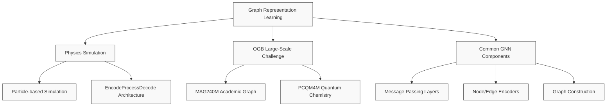
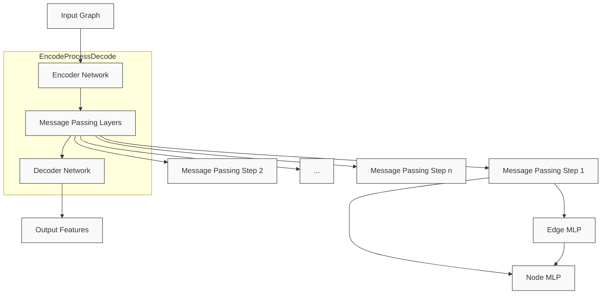
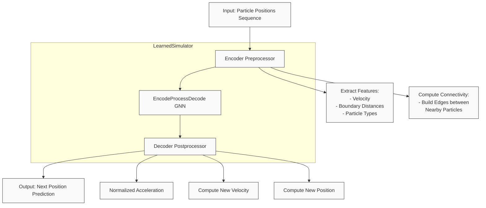
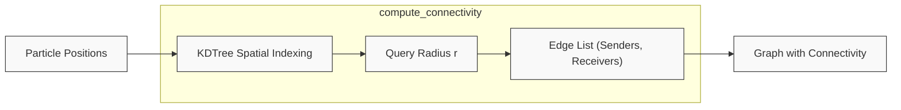
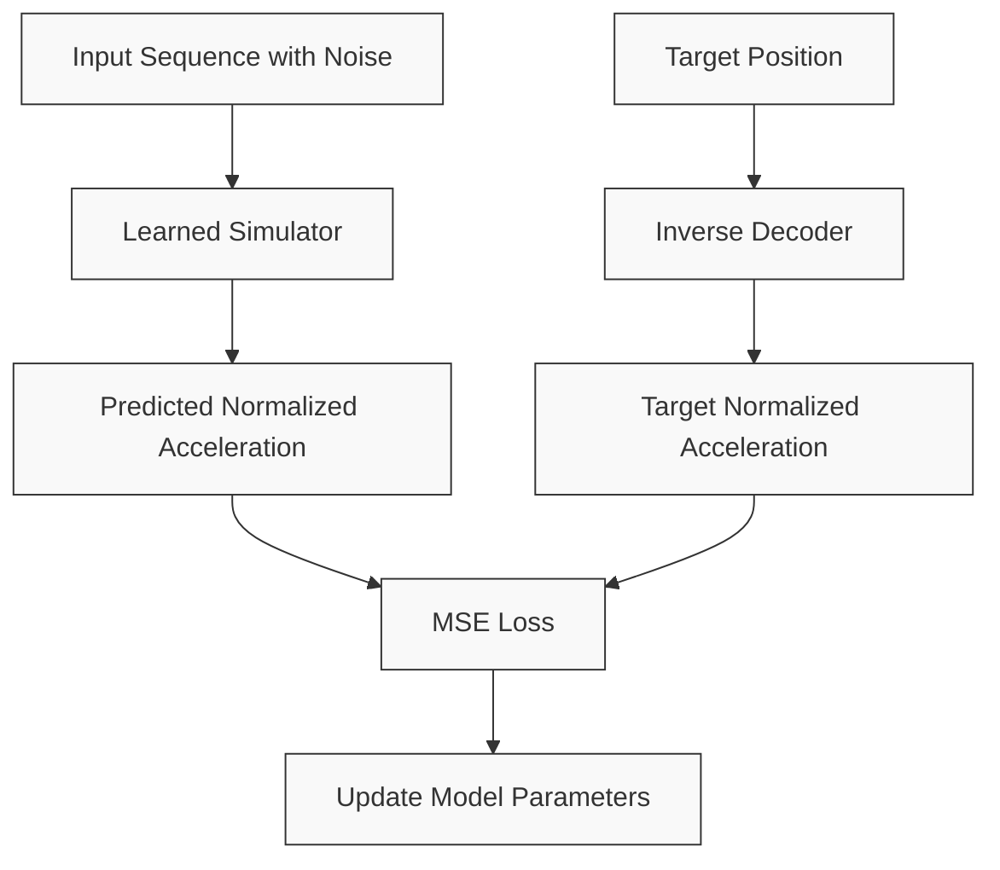
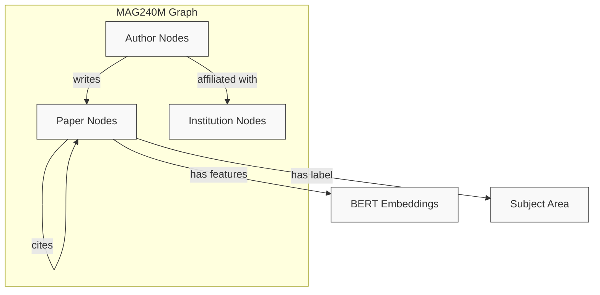
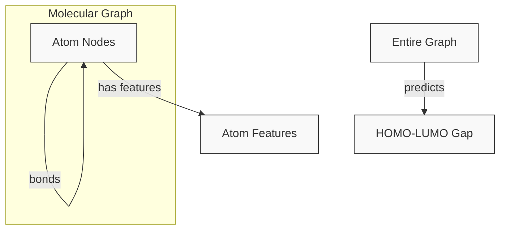
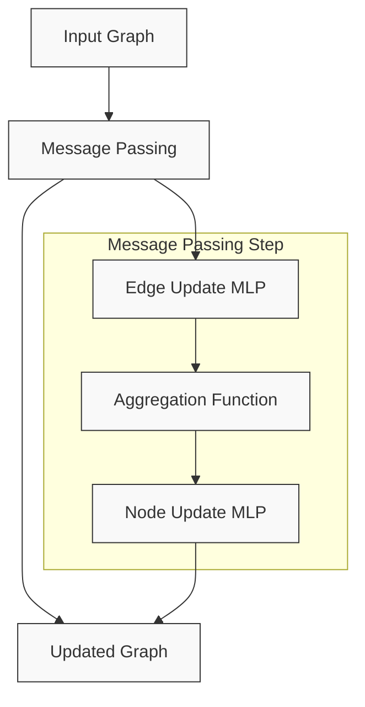
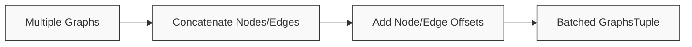

<!-- source: DeepWiki mcp.deepwiki.com · repo google-deepmind/deepmind-research · page 5.4 Graph Representation Learning · fetched 2026-10-26 -->

# Graph Representation Learning

Relevant source files

The following files were used as context for generating this wiki page:

- [learning_to_simulate/README.md](learning_to_simulate/README.md)
- [learning_to_simulate/connectivity_utils.py](learning_to_simulate/connectivity_utils.py)
- [learning_to_simulate/download_dataset.sh](learning_to_simulate/download_dataset.sh)
- [learning_to_simulate/graph_network.py](learning_to_simulate/graph_network.py)
- [learning_to_simulate/images/water_ramps_rollout.gif](learning_to_simulate/images/water_ramps_rollout.gif)
- [learning_to_simulate/learned_simulator.py](learning_to_simulate/learned_simulator.py)
- [learning_to_simulate/model_demo.py](learning_to_simulate/model_demo.py)
- [learning_to_simulate/noise_utils.py](learning_to_simulate/noise_utils.py)
- [learning_to_simulate/reading_utils.py](learning_to_simulate/reading_utils.py)
- [learning_to_simulate/render_rollout.py](learning_to_simulate/render_rollout.py)
- [learning_to_simulate/requirements.txt](learning_to_simulate/requirements.txt)
- [learning_to_simulate/run.sh](learning_to_simulate/run.sh)
- [learning_to_simulate/train.py](learning_to_simulate/train.py)
- [mmv/utils/ucf101_dataset.py](mmv/utils/ucf101_dataset.py)
- [ogb_lsc/README.md](ogb_lsc/README.md)
- [ogb_lsc/mag/README.md](ogb_lsc/mag/README.md)
- [ogb_lsc/mag/config.py](ogb_lsc/mag/config.py)
- [ogb_lsc/mag/csr_builder.py](ogb_lsc/mag/csr_builder.py)
- [ogb_lsc/mag/data_utils.py](ogb_lsc/mag/data_utils.py)
- [ogb_lsc/mag/datasets.py](ogb_lsc/mag/datasets.py)
- [ogb_lsc/mag/download_mag.py](ogb_lsc/mag/download_mag.py)
- [ogb_lsc/mag/ensemble_predictions.py](ogb_lsc/mag/ensemble_predictions.py)
- [ogb_lsc/mag/requirements.txt](ogb_lsc/mag/requirements.txt)
- [ogb_lsc/pcq/README.md](ogb_lsc/pcq/README.md)
- [ogb_lsc/pcq/requirements.txt](ogb_lsc/pcq/requirements.txt)
- [physics_planning_games/board_games/go_logic.py](physics_planning_games/board_games/go_logic.py)
- [physics_planning_games/board_games/tic_tac_toe_logic.py](physics_planning_games/board_games/tic_tac_toe_logic.py)

This document provides an overview of the graph representation learning techniques and systems implemented in the DeepMind Research repository. Graph representation learning involves techniques for learning meaningful vector representations of nodes, edges, or entire graphs to enable various downstream machine learning tasks. This page focuses on the graph neural network (GNN) implementations and applications within the repository, particularly for physics simulation and large-scale graph challenges.

For information about specific reinforcement learning systems that may use graphs, see the Reinforcement Learning Systems page [RL Systems](#3).

## Overview of Graph Neural Networks in the Repository

Graph Neural Networks (GNNs) are a class of neural networks designed to process graph-structured data. Within the DeepMind Research repository, GNNs are used for several key applications:

1. Physics simulation using learned graph-based dynamics
2. Large-scale graph representation for academic citation networks
3. Molecular property prediction for quantum chemistry

Sources: [learning_to_simulate/README.md:1-111](), [ogb_lsc/README.md:1-31](), [learning_to_simulate/graph_network.py:16-33]()

## Core Graph Neural Network Architecture

The repository implements a variant of the message-passing neural network paradigm, primarily through the `EncodeProcessDecode` architecture. This serves as the foundation for various graph-based applications.

The `EncodeProcessDecode` class in [learning_to_simulate/graph_network.py:50-182]() is the primary implementation, which:

1. Takes a graph with node and edge features
2. Encodes these features using MLPs
3. Processes the encoded features through multiple rounds of message passing
4. Decodes the final node representations to produce the desired output

Sources: [learning_to_simulate/graph_network.py:34-182]()

## Learning to Simulate Complex Physics with Graph Networks

One of the main applications of graph representation learning in the repository is learning to simulate complex physics. The system represents particles as nodes in a graph, with interactions between nearby particles represented as edges.

### The Learned Simulator

The `LearnedSimulator` class serves as the core of the physics simulation system:

Key components:

1. **Encoder Preprocessor**: Extracts features from particle position sequences and builds graph connectivity based on proximity
2. **Graph Neural Network**: Processes the graph to predict normalized acceleration
3. **Decoder Postprocessor**: Converts predicted accelerations to velocity and position updates

The simulator is trained to predict the positions of particles in the next timestep, given a sequence of previous positions.

Sources: [learning_to_simulate/learned_simulator.py:37-265](), [learning_to_simulate/train.py:82-132]()

### Graph Construction and Connectivity

The physics simulator determines connectivity between particles based on spatial proximity:

The `compute_connectivity_for_batch_pyfunc` function in [learning_to_simulate/connectivity_utils.py:106-118]() creates edges between particles within a specified radius, enabling the simulation of local interactions.

Sources: [learning_to_simulate/connectivity_utils.py:1-118]()

### Training and Evaluation

The system is trained by:

1. Adding noise to input position sequences
2. Using the model to predict the next position
3. Computing the loss between predicted and target positions
4. Focusing the loss on non-kinematic (movable) particles

The training process can be visualized:

The system supports both one-step prediction and rollout evaluation, where predictions are recursively fed back as inputs to simulate longer trajectories.

Sources: [learning_to_simulate/train.py:166-223](), [learning_to_simulate/train.py:219-266]()

## OGB Large-Scale Challenge Implementations

The repository includes implementations for two tracks of the Open Graph Benchmark Large-Scale Challenge (OGB-LSC):

### MAG240M Academic Graph

The MAG240M dataset represents a heterogeneous academic graph with 240M+ nodes:

The implementation uses:
- Graph neural networks with deep message passing
- Node feature embeddings derived from paper content
- Self-supervision techniques for improved learning

The approach employs a subsampling strategy to handle the massive scale of the graph, creating local subgraphs around target nodes.

Sources: [ogb_lsc/mag/README.md:1-148](), [ogb_lsc/mag/data_utils.py:16-492]()

### PCQM4M Quantum Chemistry

The PCQM4M track focuses on molecular property prediction, representing molecules as graphs:

The implementation leverages:
- Graph neural networks to process molecular structures
- Position features from molecular conformers
- Ensemble techniques for robust predictions

Sources: [ogb_lsc/pcq/README.md:1-118]()

## Common Graph Neural Network Components

### Message Passing Architecture

The core of the graph neural networks is the message passing paradigm:

The implementation in [learning_to_simulate/graph_network.py:124-127]() uses the `InteractionNetwork` from the Graph Nets library, which:

1. Updates edge features based on connected nodes
2. Aggregates messages from edges to nodes
3. Updates node features based on aggregated messages

Multiple rounds of message passing enable information to flow across the graph.

Sources: [learning_to_simulate/graph_network.py:43-182](), [ogb_lsc/mag/data_utils.py:284-297]()

### Graph Batching and Processing

The repository includes utilities for efficiently handling batches of graphs:

The `batch_concat` function in [learning_to_simulate/train.py:148-170]() provides a custom implementation for batching graphs, while the OGB-LSC implementations use more specialized approaches for large-scale graphs.

Sources: [learning_to_simulate/train.py:148-170](), [ogb_lsc/mag/datasets.py:44-156]()

## Applications and Performance

The graph representation learning approaches in this repository have demonstrated strong performance in their respective domains:

1. **Physics Simulation**: Accurately predicts particle dynamics for various materials (water, sand, goop) in different scenarios
2. **MAG240M-LSC**: Achieved competitive performance in predicting paper subject areas using graph structure and content features
3. **PCQM4M-LSC**: Demonstrated strong performance in predicting quantum chemical properties of molecules

These systems show how graph neural networks can be effectively applied to diverse domains by leveraging the natural graph structure of many real-world problems.

Sources: [learning_to_simulate/README.md:60-99](), [ogb_lsc/mag/README.md:23-34](), [ogb_lsc/pcq/README.md:25-34]()

## Conclusion

The Graph Representation Learning systems in the DeepMind Research repository showcase versatile applications of graph neural networks to physics simulation and large-scale graph problems. The modular design of the `EncodeProcessDecode` architecture and specific implementations for each domain demonstrate how graph-based approaches can be adapted to different types of data and tasks.

The implementations highlight the power of representing structured data as graphs and using specialized neural network architectures to process these graphs, enabling applications ranging from particle physics to academic document classification and molecular property prediction.