# Page: Overview

# Overview

<details>
<summary>Relevant source files</summary>

The following files were used as context for generating this wiki page:

- [.travis.yml](.travis.yml)
- [README.md](README.md)
- [continual_learning/README.md](continual_learning/README.md)
- [continual_learning/encoders_and_ensembles.ipynb](continual_learning/encoders_and_ensembles.ipynb)
- [neural_mip_solving/README.md](neural_mip_solving/README.md)
- [nfnets/run.sh](nfnets/run.sh)
- [nowcasting/Open_sourced_dataset_and_model_snapshot_for_precipitation_nowcasting.ipynb](nowcasting/Open_sourced_dataset_and_model_snapshot_for_precipitation_nowcasting.ipynb)
- [nowcasting/README.md](nowcasting/README.md)
- [pitfalls_static_language_models/README.md](pitfalls_static_language_models/README.md)

</details>


This document introduces the DeepMind Research repository, a collection of code implementations and research artifacts accompanying DeepMind's publications across diverse areas of artificial intelligence research.

## Purpose and Scope

The DeepMind Research repository contains implementations, code examples, and research artifacts that accompany DeepMind publications. Its primary purpose is to enable the broader research community to engage with DeepMind's work and build upon it, with the ultimate goal of accelerating scientific progress in artificial intelligence and related fields.

In addition to the projects in this repository, DeepMind also releases open-source environments, datasets, and code through other repositories, such as [Deep Q-Network](#), [Differential Neural Computer](#), [DeepMind Lab](#), and [StarCraft II](#).

For details about the repository structure and organization, see [Repository Structure](#1.1). For information on setting up and running examples, see [Getting Started](#1.2).

Sources: [README.md:1-23]()

## Repository Organization

The repository follows a simple flat organization where each project has its own top-level directory containing all the necessary code, documentation, and resources. The continuous integration pipeline (via Travis CI) ensures that selected projects remain functional across updates.

### Repository Structure Diagram

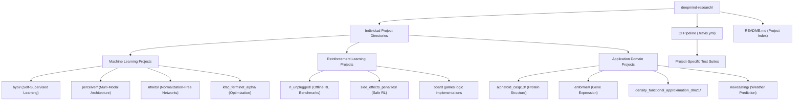

Sources: [README.md:25-95](), [.travis.yml:1-36]()

## Research Areas

The repository encompasses a wide range of AI research areas, organized into several major categories:

### Research Categories Overview

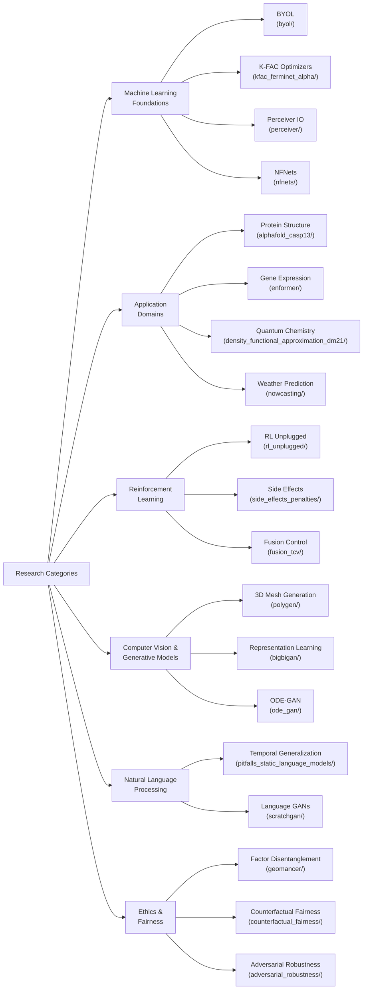

Sources: [README.md:25-95]()

## Major Project Categories

### Machine Learning Foundations

This category includes fundamental machine learning techniques, architectures, and training methodologies:

- **Bootstrap Your Own Latent (BYOL)**: A self-supervised learning method for pre-training visual representations without requiring negative examples
- **Perceiver IO**: A general architecture for processing structured inputs and outputs using attention mechanisms
- **Normalizer-Free Networks (NFNets)**: Techniques for training deep neural networks without normalization layers
- **K-FAC Optimizers**: Implementation of Kronecker-factored approximate curvature optimization for neural networks

Sources: [README.md:63-65](), [README.md:35-36](), [README.md:49-50](), [README.md:45-46]()

### Application Domains

Projects applying machine learning to scientific domains and real-world problems:

- **AlphaFold CASP13**: Protein structure prediction system used in the CASP13 competition
- **Enformer**: A model for gene expression prediction that integrates long-range interactions in genomic sequences
- **DM21 Functionals**: Density functional approximation methods for quantum chemistry
- **Nowcasting**: Deep generative models for precipitation forecasting

Sources: [README.md:75-76](), [README.md:47-48](), [README.md:28-29](), [README.md:31-32]()

### Reinforcement Learning

Algorithms, environments, and benchmarks for reinforcement learning research:

- **RL Unplugged**: Datasets and benchmarks for offline reinforcement learning
- **Side Effects Penalties**: Approaches to mitigating unintended side effects in reinforcement learning agents
- **Magnetic Tokamak Control**: Application of deep reinforcement learning to nuclear fusion plasma control

Sources: [README.md:66-67](), [README.md:84-85](), [README.md:27-28]()

### Computer Vision and Generative Models

Projects related to computer vision, image processing, and generative modeling:

- **PolyGen**: Autoregressive generative model for 3D meshes
- **BigBiGAN**: Large-scale adversarial representation learning
- **ODE-GAN**: Training GANs by solving ordinary differential equations

Sources: [README.md:62-63](), [README.md:82-83](), [README.md:55-56]()

### Natural Language Processing

Research on language models and text generation:

- **Temporal Generalization in Language Models**: Assessing how language models generalize to future data
- **ScratchGAN**: Methods for training language GANs from scratch

Sources: [README.md:29-30](), [README.md:78-79]()

### Ethics and Fairness

Research addressing fairness, interpretability, and ethical considerations in AI:

- **Geomancer**: Disentangling factors of variation using subspace diffusion
- **Counterfactual Fairness**: Methods for ensuring fairness in machine learning models
- **Adversarial Robustness**: Techniques for evaluating and improving model robustness against adversarial attacks

Sources: [README.md:67-68](), [README.md:70-71](), [README.md:50-51]()

## Project Integration and Relationships

The following diagram illustrates how different projects relate to each other and integrate across research domains:

```mermaid
graph TD
    Domains["Research Domains"] --> ML["Core ML Technology"]
    Domains --> Applications["Applied AI"]
    
    ML --> Techniques["Learning Techniques"]
    ML --> Architecture["Model Architectures"]
    ML --> Optimization["Optimization Methods"]
    
    Applications --> Scientific["Scientific Applications"]
    Applications --> Systems["System Design"]
    Applications --> Benchmarks["Benchmarks & Datasets"]
    
    Techniques --> BYOL["byol/\n(Self-Supervised Learning)"]
    Techniques --> ODE["ode_gan/\n(ODE-based Training)"]
    Techniques --> Geomancer["geomancer/\n(Disentanglement)"]
    
    Architecture --> Perceiver["perceiver/\n(Multi-Modal Processing)"]
    Architecture --> NFNets["nfnets/\n(Normalization-Free)"]
    Architecture --> MeshGraphNets["meshgraphnets/\n(Graph Networks)"]
    
    Optimization --> KFAC["kfac_ferminet_alpha/\n(K-FAC Optimizer)"]
    Optimization --> Adversarial["adversarial_robustness/\n(Robust Training)"]
    
    Scientific --> AlphaFold["alphafold_casp13/\n(Protein Structure)"]
    Scientific --> Enformer["enformer/\n(Genomics)"]
    Scientific --> DM21["density_functional_approximation_dm21/\n(Quantum Chemistry)"]
    Scientific --> Nowcasting["nowcasting/\n(Weather Prediction)"]
    
    Systems --> RLUnplugged["rl_unplugged/\n(Offline RL)"]
    Systems --> Fusion["fusion_tcv/\n(Plasma Control)"]
    
    Benchmarks --> Pitfalls["pitfalls_static_language_models/\n(NLP Evaluation)"]
    Benchmarks --> OGB["ogb_lsc/\n(Graph Benchmarks)"]
```

Sources: [README.md:25-95]()

## Disclaimer

As noted in the repository: "This is not an officially supported Google product."

Sources: [README.md:96-98]()

---

# Page: Repository Structure

# Repository Structure

<details>
<summary>Relevant source files</summary>

The following files were used as context for generating this wiki page:

- [.travis.yml](.travis.yml)
- [README.md](README.md)
- [continual_learning/README.md](continual_learning/README.md)
- [continual_learning/encoders_and_ensembles.ipynb](continual_learning/encoders_and_ensembles.ipynb)
- [neural_mip_solving/README.md](neural_mip_solving/README.md)
- [nfnets/run.sh](nfnets/run.sh)
- [nowcasting/Open_sourced_dataset_and_model_snapshot_for_precipitation_nowcasting.ipynb](nowcasting/Open_sourced_dataset_and_model_snapshot_for_precipitation_nowcasting.ipynb)
- [nowcasting/README.md](nowcasting/README.md)
- [pitfalls_static_language_models/README.md](pitfalls_static_language_models/README.md)

</details>


## Purpose and Scope

This document describes the structural organization of the DeepMind Research repository, including how individual projects are arranged, the continuous integration pipeline, and common patterns across projects. This page focuses on the technical layout of the codebase rather than its research content.

For information about how to set up and run the projects in this repository, see [Getting Started](#1.2).

Sources: [README.md:1-23]()

## Repository Overview

The DeepMind Research repository follows a flat organization structure containing multiple independent research projects, each residing in its own top-level directory.

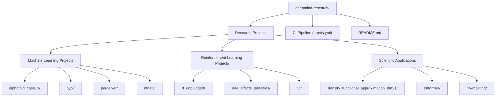

The repository contains over 60 research projects covering various machine learning areas, from protein structure prediction (AlphaFold) to self-supervised learning (BYOL) and reinforcement learning techniques. Each directory encapsulates a distinct research project corresponding to a published paper.

The project README in the root directory provides a chronologically ordered list of all projects, each with a link to the project directory and its associated academic publication.

Sources: [README.md:25-95]()

## Project Structure

Individual projects generally follow a consistent directory structure, though the exact organization may vary based on project needs.

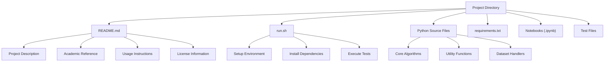

### Common Components in Projects

1. **README.md**: Each project includes documentation describing the project, linking to the corresponding research paper, and providing usage instructions.

2. **run.sh**: A shell script that sets up the environment, installs dependencies, and runs tests. This script is executed by the CI pipeline to verify project functionality.

3. **Python Source Files**: Implementation of algorithms and models from the research paper. These may be organized in different ways depending on project complexity.

4. **requirements.txt**: Lists the Python dependencies required to run the project.

5. **Jupyter Notebooks**: Many projects include notebooks that demonstrate how to use the code, such as in `nowcasting/Open_sourced_dataset_and_model_snapshot_for_precipitation_nowcasting.ipynb`.

Below is an example of a typical run.sh script from the nfnets project:

```bash
#!/bin/sh
# Set up a virtual environment
python3 -m venv /tmp/nfnets_venv
source /tmp/nfnets_venv/bin/activate
pip3 install --upgrade pip setuptools wheel
pip3 install -r nfnets/requirements.txt

# Run tests
python3 -m nfnets.test
```

Sources: [nowcasting/README.md:1-15](), [nfnets/run.sh:1-23](), [continual_learning/README.md:1-32]()

## Continuous Integration Pipeline

The repository employs Travis CI for continuous integration testing, configured through the `.travis.yml` file at the repository root.

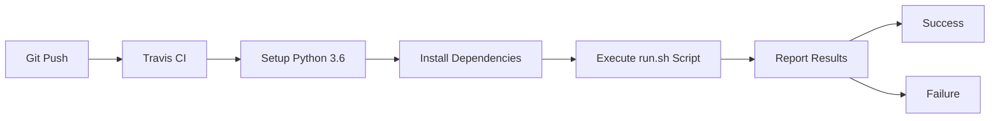

The CI workflow for each project follows these steps:

1. **Environment Setup**: Configures a Python 3.6 environment on Ubuntu Trusty
2. **Dependency Installation**: Installs required packages via pip
3. **Test Execution**: Runs the project's `run.sh` script
4. **Result Reporting**: Reports success or failure of the tests

The `.travis.yml` file specifies which projects are tested in the CI pipeline:

```yaml
env:
  matrix:
    - PROJECT="adversarial_robustness"
    # - PROJECT="cs_gan"  # TODO(b/184845450): Fix and re-enable
    - PROJECT="gated_linear_networks"
    - PROJECT="geomancer"
    - PROJECT="hierarchical_probabilistic_unet"
    - PROJECT="iodine"
    - PROJECT="kfac_ferminet_alpha"
    - PROJECT="learning_to_simulate"
    - PROJECT="nfnets"
    - PROJECT="option_keyboard"
    - PROJECT="sketchy"
    - PROJECT="tandem_dqn"
    - PROJECT="transporter"
    - PROJECT="tvt"
    - PROJECT="unsupervised_adversarial_training"
    - PROJECT="meshgraphnets"
```

Not all projects are included in the CI pipeline; some may have more complex dependencies or test requirements, while others may be temporarily disabled due to issues (as noted in the commented-out entries).

Sources: [.travis.yml:1-36]()

## Dataset Management

Many projects in the repository work with datasets, which are typically handled in one of several ways:

1. **Reference to External Datasets**: Projects provide instructions for downloading datasets from external sources
2. **Dataset Loaders**: Code that automatically downloads and processes required datasets
3. **Cloud Storage References**: Links to datasets stored in Google Cloud Storage buckets

For example, the `nowcasting` project uses Google Cloud Storage for its dataset:

```python
# Example subset (publicly accessible)
EXAMPLE_DATASET_BUCKET_PATH = "gs://dm-nowcasting-example-data/datasets/nowcasting_open_source_osgb/nimrod_osgb_1000m_yearly_splits/radar/20200718"

# Full dataset (requester-pays)
FULL_DATASET_BUCKET_PATH = "gs://dm-nowcasting/datasets/nowcasting_open_source_osgb/nimrod_osgb_1000m_yearly_splits/radar/20200718"
```

Similarly, the `pitfalls_static_language_models` project provides dataset splits via Google Cloud Storage with detailed documentation on their structure and usage.

Each project that uses datasets typically includes documentation describing the dataset format, access methods, and any preprocessing steps required.

Sources: [nowcasting/Open_sourced_dataset_and_model_snapshot_for_precipitation_nowcasting.ipynb:158-171](), [neural_mip_solving/README.md:20-25](), [pitfalls_static_language_models/README.md:8-44]()

## Licensing Information

Projects in the repository generally use one of the following licenses:

1. **Apache License, Version 2.0**: For most code
2. **Creative Commons Attribution 4.0 International License**: For datasets and some model snapshots

Each project typically specifies its license in the README.md file. The repository itself contains a disclaimer noting: "This is not an official Google product."

Sources: [README.md:96-98](), [nowcasting/README.md:12-45](), [continual_learning/encoders_and_ensembles.ipynb:3-22]()

---

# Page: Getting Started

# Getting Started

<details>
<summary>Relevant source files</summary>

The following files were used as context for generating this wiki page:

- [.travis.yml](.travis.yml)
- [README.md](README.md)
- [adversarial_robustness/README.md](adversarial_robustness/README.md)
- [adversarial_robustness/iclrw2021data/README.md](adversarial_robustness/iclrw2021data/README.md)
- [adversarial_robustness/iclrw2021doing/README.md](adversarial_robustness/iclrw2021doing/README.md)
- [adversarial_robustness/jax/attacks.py](adversarial_robustness/jax/attacks.py)
- [adversarial_robustness/jax/datasets.py](adversarial_robustness/jax/datasets.py)
- [adversarial_robustness/jax/eval.py](adversarial_robustness/jax/eval.py)
- [adversarial_robustness/jax/experiment_test.py](adversarial_robustness/jax/experiment_test.py)
- [adversarial_robustness/jax/model_zoo.py](adversarial_robustness/jax/model_zoo.py)
- [adversarial_robustness/jax/train.py](adversarial_robustness/jax/train.py)
- [adversarial_robustness/pytorch/README.md](adversarial_robustness/pytorch/README.md)
- [adversarial_robustness/pytorch/eval.py](adversarial_robustness/pytorch/eval.py)
- [adversarial_robustness/pytorch/model_zoo.py](adversarial_robustness/pytorch/model_zoo.py)
- [adversarial_robustness/requirements.txt](adversarial_robustness/requirements.txt)
- [adversarial_robustness/run.sh](adversarial_robustness/run.sh)
- [continual_learning/README.md](continual_learning/README.md)
- [continual_learning/encoders_and_ensembles.ipynb](continual_learning/encoders_and_ensembles.ipynb)
- [neural_mip_solving/README.md](neural_mip_solving/README.md)
- [nfnets/run.sh](nfnets/run.sh)
- [nowcasting/Open_sourced_dataset_and_model_snapshot_for_precipitation_nowcasting.ipynb](nowcasting/Open_sourced_dataset_and_model_snapshot_for_precipitation_nowcasting.ipynb)
- [nowcasting/README.md](nowcasting/README.md)
- [pitfalls_static_language_models/README.md](pitfalls_static_language_models/README.md)

</details>


This page provides instructions for setting up and running the DeepMind Research repository, which contains implementations and illustrative code accompanying DeepMind publications. For information about the overall structure and organization of the repository, see [Repository Structure](#1.1).

## Prerequisites

Before you begin working with the DeepMind Research repository, ensure you have the following prerequisites installed:

- Python 3.6 or higher
- Git
- pip (Python package installer)

The repository contains multiple independent research projects, each with its own set of dependencies. Most projects use common machine learning libraries like TensorFlow, JAX, and PyTorch.

Sources: [README.md:1-23](), [adversarial_robustness/requirements.txt:1-64]()

## Repository Setup

### Cloning the Repository

To get started with DeepMind Research, clone the repository from GitHub:

```bash
git clone https://github.com/google-deepmind/deepmind-research.git
cd deepmind-research
```

### Project Structure

The DeepMind Research repository is organized as a collection of independent projects, each corresponding to a specific research paper or area.

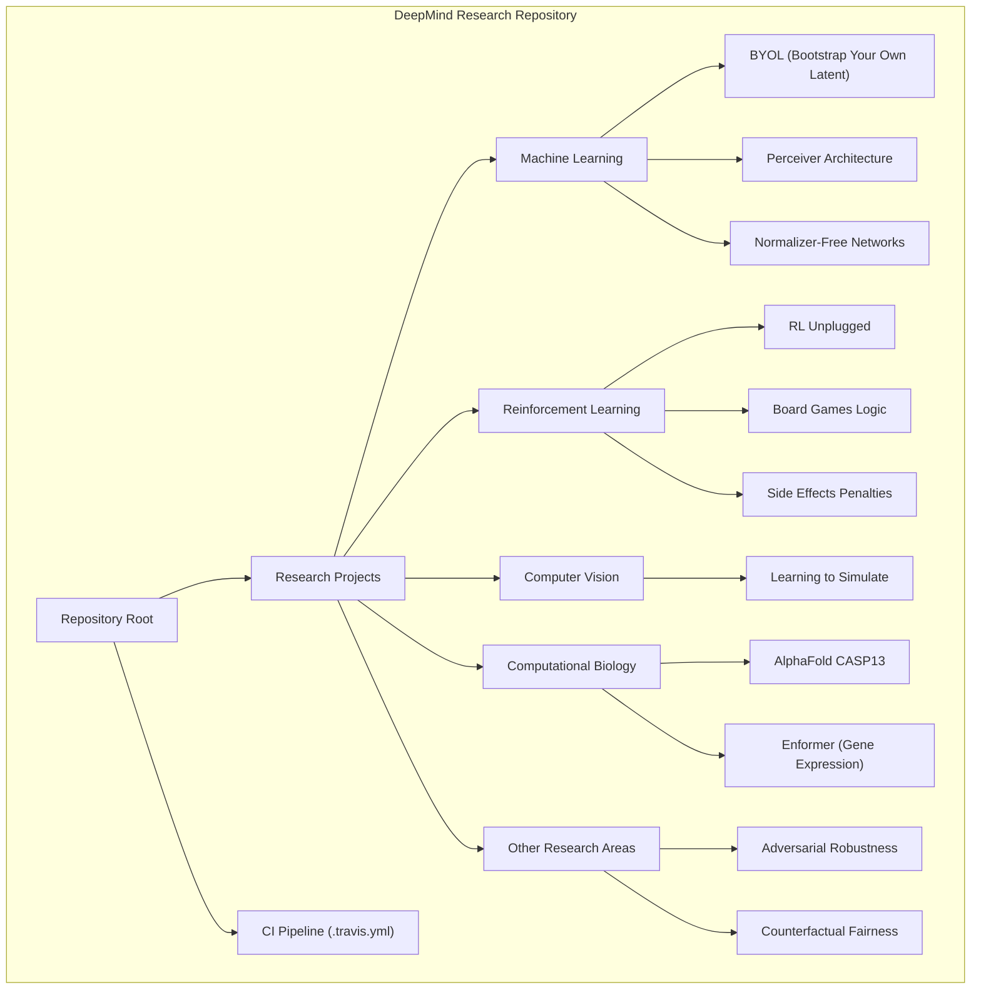

Sources: [README.md:25-93](), [.travis.yml:1-36]()

## Running Examples

Most projects in the DeepMind Research repository follow a similar pattern for setup and execution. Each project typically contains:

1. A README.md file with project-specific instructions
2. A run.sh script that sets up the environment and runs tests
3. Python code implementing the research

### Using Project-Specific Run Scripts

Many projects include a `run.sh` script that creates a virtual environment, installs dependencies, and runs tests. Here's a typical workflow:

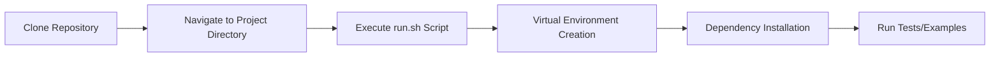

For example, to run the Adversarial Robustness project:

```bash
# Run from the parent directory
sh adversarial_robustness/run.sh
```

After running the setup script, you can activate the created virtual environment:

```bash
source /tmp/adversarial_robustness_venv/bin/activate
```

Sources: [adversarial_robustness/run.sh:1-44](), [nfnets/run.sh:1-23]()

### Manual Setup

If a project doesn't have a run.sh script, you can set up a virtual environment manually:

```bash
# Navigate to the project directory
cd project_name

# Create a virtual environment
python -m venv venv

# Activate the virtual environment
source venv/bin/activate  # On Windows: venv\Scripts\activate

# Install dependencies
pip install -r requirements.txt

# Run the project's main script
python main.py  # or other entry point
```

## Common Dependencies

The projects in the DeepMind Research repository use various dependencies, but some are common across many projects:

| Dependency | Purpose | Common Version |
|------------|---------|----------------|
| TensorFlow | Machine learning framework | 2.5.0 |
| JAX | Numerical computing with autodiff | 0.2.x |
| PyTorch | Deep learning framework | 1.9.0 |
| NumPy | Numerical computing | 1.19.x |
| Haiku | Neural network library (DeepMind) | 0.0.4 |
| Optax | Optimization library (DeepMind) | 0.0.8 |
| Chex | Testing utilities for JAX (DeepMind) | 0.0.7 |

Sources: [adversarial_robustness/requirements.txt:1-64]()

## Example Projects

The repository contains numerous research projects spanning different domains. Here's a selection of notable projects you can explore:

| Project | Description | Domain |
|---------|-------------|--------|
| AlphaFold CASP13 | Protein structure prediction | Computational Biology |
| Perceiver | General architecture for structured inputs & outputs | Machine Learning |
| BYOL | Self-supervised learning method | Computer Vision |
| RL Unplugged | Benchmarks for offline reinforcement learning | Reinforcement Learning |
| Adversarial Robustness | Improving model robustness against adversarial attacks | Security |
| NFNets | Normalizer-Free Networks for improved signal propagation | Machine Learning |
| Learning to Simulate | Graph-based approach to learning complex physics simulations | Physics |
| Enformer | Gene expression prediction model | Genomics |

Sources: [README.md:25-93]()

## Project-Specific Examples

### Adversarial Robustness Example

The Adversarial Robustness project provides pre-trained models and evaluation code for robust neural networks:

```bash
# After setting up the environment
cd adversarial_robustness/jax
python eval.py --ckpt=${PATH_TO_CHECKPOINT} --depth=70 --width=16 --dataset=cifar10
```

This will evaluate a pre-trained WideResNet model on the CIFAR-10 dataset.

Sources: [adversarial_robustness/README.md:30-99](), [adversarial_robustness/jax/eval.py:1-141]()

### Nowcasting Example

The Nowcasting project provides a precipitation prediction model:

```bash
# After setting up the environment
python -m nowcasting.Open_sourced_dataset_and_model_snapshot_for_precipitation_nowcasting
```

This will run the Colab notebook for precipitation nowcasting.

Sources: [nowcasting/README.md:1-46]()

## Continuous Integration

The repository uses Travis CI for continuous integration testing of key projects:

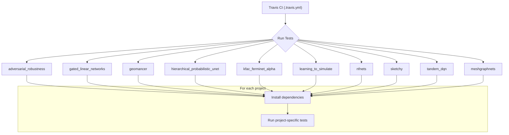

Sources: [.travis.yml:1-36]()

## Troubleshooting

Here are some common issues you might encounter when working with the repository:

1. **GPU Support**: Some projects may require GPU support for efficient training. You may need to install GPU-specific versions of libraries like JAX or TensorFlow.

2. **Dependencies Conflicts**: Due to the diverse nature of the projects, you might encounter dependency conflicts. It's recommended to use separate virtual environments for each project.

3. **Memory Issues**: Some models may require substantial memory. For such projects, consider using machines with adequate RAM or GPU memory.

## Next Steps

After setting up the repository and familiarizing yourself with its structure, here are some next steps:

1. Explore projects related to your research interests from the main README.md
2. Read the project-specific documentation in the respective directories
3. Run examples and modify them for your needs
4. Consider contributing to the repository if you make improvements

For specific research areas, you might want to check out:
- Machine Learning frameworks: [Major Projects](#2)
- Reinforcement Learning systems: [RL Systems](#3)
- Computational Biology applications: [Application Domains](#5)

Sources: [README.md:1-98]()

---

# Page: Major Projects

# Major Projects

<details>
<summary>Relevant source files</summary>

The following files were used as context for generating this wiki page:

- [.travis.yml](.travis.yml)
- [README.md](README.md)
- [alphafold_casp13/README.md](alphafold_casp13/README.md)
- [alphafold_casp13/run_eval.sh](alphafold_casp13/run_eval.sh)
- [continual_learning/README.md](continual_learning/README.md)
- [continual_learning/encoders_and_ensembles.ipynb](continual_learning/encoders_and_ensembles.ipynb)
- [neural_mip_solving/README.md](neural_mip_solving/README.md)
- [nfnets/run.sh](nfnets/run.sh)
- [nowcasting/Open_sourced_dataset_and_model_snapshot_for_precipitation_nowcasting.ipynb](nowcasting/Open_sourced_dataset_and_model_snapshot_for_precipitation_nowcasting.ipynb)
- [nowcasting/README.md](nowcasting/README.md)
- [perceiver/README.md](perceiver/README.md)
- [perceiver/colabs/imagenet_classification.ipynb](perceiver/colabs/imagenet_classification.ipynb)
- [perceiver/colabs/masked_language_modelling.ipynb](perceiver/colabs/masked_language_modelling.ipynb)
- [perceiver/colabs/optical_flow.ipynb](perceiver/colabs/optical_flow.ipynb)
- [perceiver/colabs/video_autoencoding.ipynb](perceiver/colabs/video_autoencoding.ipynb)
- [perceiver/requirements.txt](perceiver/requirements.txt)
- [perceiver/train/autoaugment.py](perceiver/train/autoaugment.py)
- [perceiver/train/dataset.py](perceiver/train/dataset.py)
- [perceiver/train/launch_local.sh](perceiver/train/launch_local.sh)
- [pitfalls_static_language_models/README.md](pitfalls_static_language_models/README.md)

</details>


This page provides an overview of the significant research projects in the DeepMind Research repository. These projects represent the core contributions across multiple domains including computer vision, natural language processing, reinforcement learning, protein structure prediction, and more. For information about getting started with the repository, see [Getting Started](#1.2).

## Repository Overview

The DeepMind Research repository contains implementations and illustrative code to accompany DeepMind publications. The projects span a wide range of machine learning approaches and applications, from fundamental research to domain-specific applications.

```mermaid
graph TD
    classDef primary stroke-width:2px
    classDef secondary stroke-width:1.5px

    Root["DeepMind Research"] --> MLFrameworks["Machine Learning Frameworks"]
    Root --> ApplicationDomains["Application Domains"] 
    Root --> RLSystems["Reinforcement Learning"]

    MLFrameworks --> SelfSupervised["Self-Supervised Learning"]
    MLFrameworks --> MultiModal["Multi-Modal Models"]
    MLFrameworks --> Optimization["Optimization Methods"]
    MLFrameworks --> Robustness["Robustness & Reliability"]

    SelfSupervised --> BYOL["Bootstrap Your Own Latent (BYOL)"]
    MultiModal --> Perceiver["Perceiver IO Architecture"]
    Optimization --> KFAC["K-FAC Optimizer"]
    Optimization --> NFNets["Normalizer-Free Networks"]
    Robustness --> AdvRobustness["Adversarial Robustness"]

    ApplicationDomains --> Genomics["Genomics"]
    ApplicationDomains --> ProteinStructure["Protein Structure Prediction"]
    ApplicationDomains --> QuantumChem["Quantum Chemistry"]
    ApplicationDomains --> Forecasting["Forecasting"]

    Genomics --> Enformer["Enformer: Gene Expression"]
    ProteinStructure --> AlphaFold["AlphaFold CASP13"]
    QuantumChem --> DM21["DM21 Functionals"]
    Forecasting --> Nowcasting["Precipitation Nowcasting"]

    RLSystems --> RLUnplugged["RL Unplugged"]
    RLSystems --> PhysicsSim["Physics Simulation"]
    RLSystems --> SideEffects["Side Effects Penalties"]

    PhysicsSim --> LearnSim["Learning to Simulate"]
    
    class AlphaFold,Perceiver,BYOL,DM21,RLUnplugged,Enformer,Nowcasting primary
    class NFNets,KFAC,LearnSim,AdvRobustness,SideEffects secondary
```

Sources: [README.md:1-98]()

## Key Projects by Category

### Self-Supervised Learning

#### Bootstrap Your Own Latent (BYOL)

BYOL is a self-supervised learning method that learns image representations without requiring labeled data. The approach uses two neural networks that learn from each other - an online network trained to predict the target network's representation, while the target network is an exponential moving average of the online network.

Sources: [README.md:63]()

### Multi-Modal Architectures

#### Perceiver and Perceiver IO

Perceiver is a general architecture designed to handle different kinds of data inputs including images, video, audio, 3D point clouds, and language. Unlike traditional Transformers that have quadratic complexity with input size, Perceiver maps inputs to a small latent space where processing is more efficient.

Perceiver IO extends this architecture to handle arbitrary outputs in addition to arbitrary inputs. This makes it suitable for tasks like classification, language modeling, optical flow prediction, and multimodal video autoencoding.

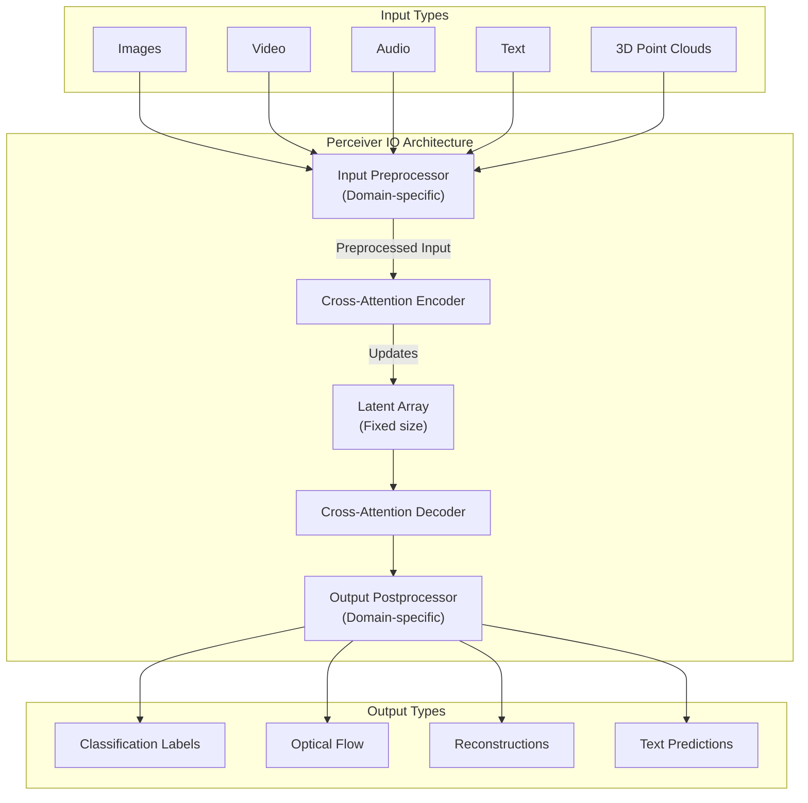

Perceiver IO application examples:
- Masked language modeling using byte-level inputs
- Optical flow prediction from video
- ImageNet classification
- Video autoencoding

Sources: [perceiver/README.md:1-116](), [perceiver/colabs/masked_language_modelling.ipynb:1-270](), [perceiver/colabs/optical_flow.ipynb:1-370](), [perceiver/colabs/imagenet_classification.ipynb:1-1096](), [perceiver/colabs/video_autoencoding.ipynb:1-361]()

### Optimization Methods

#### K-FAC (Kronecker-Factored Approximate Curvature)

K-FAC is an optimization technique that approximates the natural gradient using Kronecker-factored curvature matrices, allowing for more efficient optimization of deep neural networks.

Sources: [README.md:45]()

#### Normalizer-Free Networks (NFNets)

NFNets are deep learning architectures designed to close the performance gap in unnormalized ResNets by focusing on signal propagation characteristics. They enable training deep neural networks without normalization layers.

Sources: [README.md:49](), [nfnets/run.sh:1-23]()

### Genomics and Biological Applications

#### Enformer

Enformer is a model for gene expression prediction that integrates long-range interactions using attention mechanisms. It effectively models the relationship between DNA sequences and gene expression levels.

Sources: [README.md:47]()

#### AlphaFold CASP13

AlphaFold CASP13 is DeepMind's protein structure prediction system that participated in the CASP13 competition. It uses a deep learning approach to predict protein contact maps from sequence information.

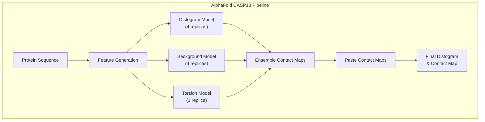

The system consists of multiple components:
- Distogram prediction model (4 replicas)
- Background distogram model (4 replicas)
- Torsion prediction model
- Ensemble mechanism to combine predictions
- Contact map generation from distograms

Sources: [alphafold_casp13/README.md:1-438](), [alphafold_casp13/run_eval.sh:1-104]()

### Quantum Chemistry

#### DM21 Density Functionals

DM21 is a project focused on density functional approximation for quantum chemistry, providing interfaces to computational chemistry libraries like PySCF.

Sources: [README.md:28]()

### Forecasting Systems

#### Precipitation Nowcasting

This project uses deep generative models to forecast near-term precipitation patterns (nowcasting) from radar data. The system can generate realistic, physically plausible precipitation forecasts.

Sources: [nowcasting/README.md:1-46](), [nowcasting/Open_sourced_dataset_and_model_snapshot_for_precipitation_nowcasting.ipynb:1-361]()

### Reinforcement Learning Systems

#### RL Unplugged

RL Unplugged provides a collection of benchmarks and datasets for offline reinforcement learning research. It includes data from various environments like Atari games, DeepMind Control Suite, and more.

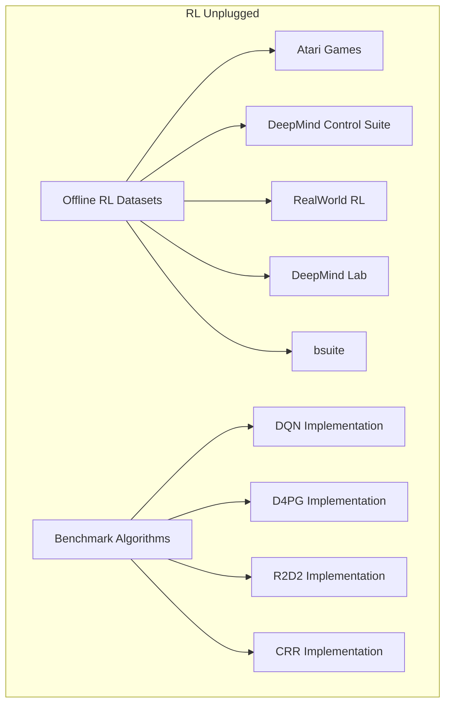

Sources: [README.md:66]()

#### Learning to Simulate

This project introduces a graph-based approach to learning complex physics simulations, enabling generalization to different physical systems and scenarios.

Sources: [README.md:60]()

#### Side Effects Penalties

This research explores methods to mitigate unintended side effects in reinforcement learning systems, by designing penalty functions that discourage behaviors with harmful side effects.

Sources: [README.md:84]()

## Timeline and Publication Impact

The table below summarizes key projects with their associated publications and impact:

| Project | Year | Related Publication | Key Contribution |
|---------|------|---------------------|------------------|
| AlphaFold CASP13 | 2020 | Nature | Revolutionary approach to protein structure prediction |
| BYOL | 2020 | NeurIPS | Self-supervised learning without negative pairs |
| Perceiver | 2021 | ICML | General perception architecture with iterative attention |
| Perceiver IO | 2021 | arXiv | Extended Perceiver with structured outputs |
| NFNets | 2021 | ICLR | Normalizer-free networks with improved performance |
| Enformer | 2021 | Nature Methods | Gene expression prediction with long-range interactions |
| Nowcasting | 2021 | Nature | Precipitation forecasting with deep generative models |
| DM21 | 2021 | Science | Pushing frontiers of density functionals |
| RL Unplugged | 2020 | - | Benchmarks for offline reinforcement learning |
| Learning to Simulate | 2020 | ICML | Graph networks for physics simulation |

Sources: [README.md:25-90]()

## Project Integration

Many of the projects in the repository are interconnected, sharing common approaches or building upon each other's results:

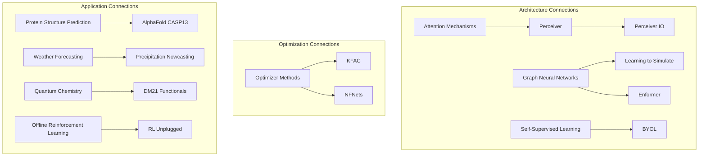

Sources: [README.md:1-98]()

## Continuous Integration and Testing

The repository includes a continuous integration setup using Travis CI, ensuring code quality and reproducibility:

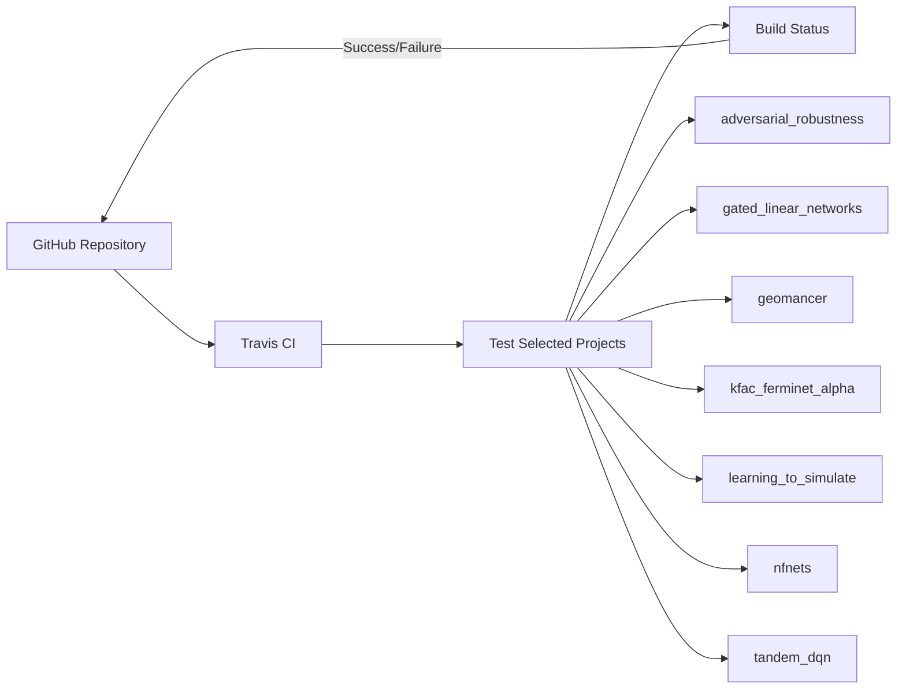

The CI pipeline helps ensure that the main components of the repository remain functional and compatible.

Sources: [.travis.yml:1-36]()

## Development and Contribution Guidelines

The repository is designed to be accessible to researchers who want to build upon DeepMind's work. Each project typically includes:

1. A README file with an overview of the project
2. Code implementation of the core algorithms
3. Example scripts for running the algorithms
4. Where applicable, links to pre-trained models and datasets

For more details on how to use and contribute to the repository, see the [Repository Structure](#1.1) page.

Sources: [README.md:1-98]()

---

# Page: AlphaFold CASP13

# AlphaFold CASP13

<details>
<summary>Relevant source files</summary>

The following files were used as context for generating this wiki page:

- [alphafold_casp13/README.md](alphafold_casp13/README.md)
- [alphafold_casp13/asa_output.py](alphafold_casp13/asa_output.py)
- [alphafold_casp13/contacts.py](alphafold_casp13/contacts.py)
- [alphafold_casp13/contacts_dataset.py](alphafold_casp13/contacts_dataset.py)
- [alphafold_casp13/contacts_experiment.py](alphafold_casp13/contacts_experiment.py)
- [alphafold_casp13/contacts_network.py](alphafold_casp13/contacts_network.py)
- [alphafold_casp13/distogram_io.py](alphafold_casp13/distogram_io.py)
- [alphafold_casp13/ensemble_contact_maps.py](alphafold_casp13/ensemble_contact_maps.py)
- [alphafold_casp13/parsers.py](alphafold_casp13/parsers.py)
- [alphafold_casp13/paste_contact_maps.py](alphafold_casp13/paste_contact_maps.py)
- [alphafold_casp13/run_eval.sh](alphafold_casp13/run_eval.sh)
- [alphafold_casp13/secstruct.py](alphafold_casp13/secstruct.py)
- [alphafold_casp13/two_dim_convnet.py](alphafold_casp13/two_dim_convnet.py)
- [alphafold_casp13/two_dim_resnet.py](alphafold_casp13/two_dim_resnet.py)

</details>


## Purpose and Scope

This document details the AlphaFold 1 system used in the CASP13 competition (2018), focusing on its contact prediction network. This is the original version of AlphaFold and is completely different from AlphaFold 2 used in CASP14 (2020). The system described here is designed specifically for predicting protein structures in the CASP13 dataset and **cannot be used to predict structure of arbitrary protein sequences**.

The document covers the architecture of the contact prediction network, the inference process, and how different model components work together to produce distance histograms (distograms) and contact maps.

Sources: [alphafold_casp13/README.md:1-18]()

## System Overview

AlphaFold CASP13 is a protein structure prediction system that uses deep learning to predict distograms (distance histograms between residue pairs) and then derives contact maps from these distograms. The system consists of three main neural network models:

1. **Distogram Model** - Predicts distributions over inter-residue distances
2. **Background Distogram Model** - Provides additional distogram predictions for ensembling
3. **Torsion Model** - Predicts torsion angles for residues

These models work together through an ensemble and paste methodology to produce the final contact prediction output.

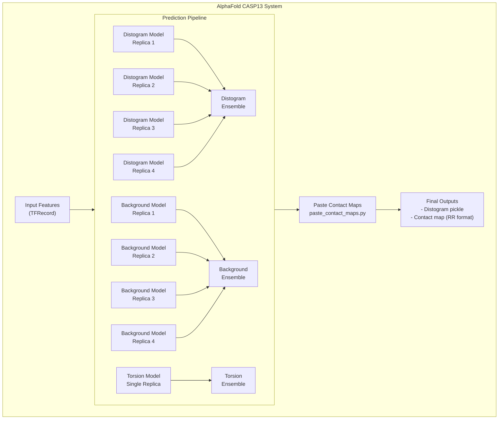

Sources: [alphafold_casp13/README.md:123-178](), [alphafold_casp13/run_eval.sh:19-102]()

## Architecture Components

### ContactsNet: The Core Neural Network

The central prediction engine is `ContactsNet`, which processes protein features to generate distogram predictions. It employs deep residual networks with 2D convolutions to capture spatial relationships between residues.

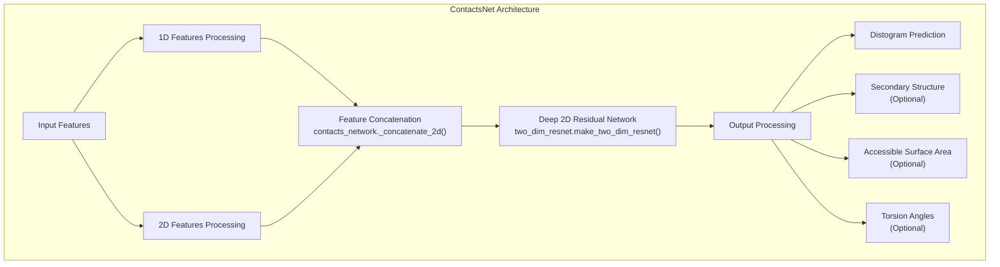

Sources: [alphafold_casp13/contacts_network.py:41-439](), [alphafold_casp13/two_dim_resnet.py:119-201]()

### Input Features and Data Processing

The system uses a variety of protein features encoded in TFRecord format. Key features include:

- Amino acid sequence information (`aatype`, `sequence`)
- Evolutionary information (`hmm_profile`, `pseudolikelihood`, etc.)
- Position information (`residue_index`)
- Covariation signals (`gap_matrix`, `pseudo_frob`, etc.)

These features are normalized using statistics from a reference dataset before being fed into the neural network.

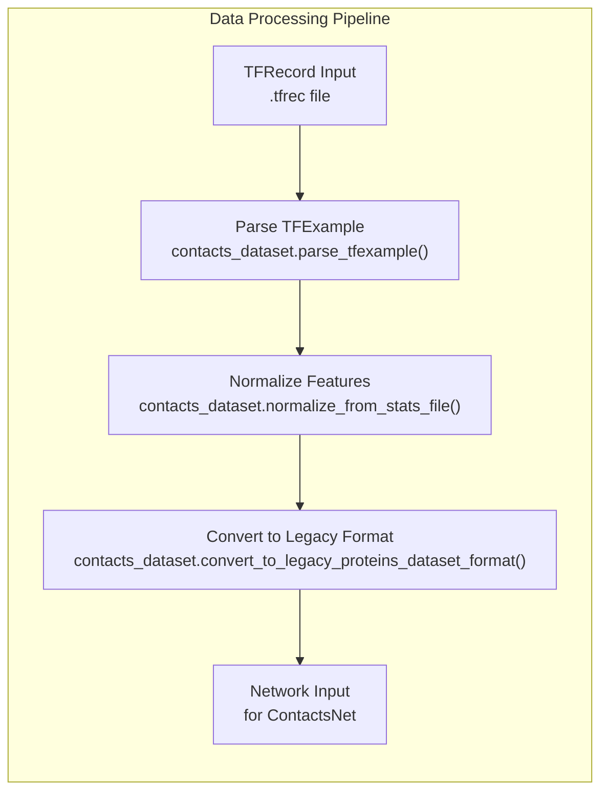

Sources: [alphafold_casp13/README.md:74-433](), [alphafold_casp13/contacts_dataset.py:143-363]()

## Inference Process

The inference process is orchestrated by the `run_eval.sh` script, which performs the following steps:

1. **Model Evaluation**: Run multiple replicas of the distogram, background, and torsion models
2. **Ensembling**: Combine outputs from different replicas using `ensemble_contact_maps.py`
3. **Pasting**: Integrate predictions from different crop sizes using `paste_contact_maps.py`
4. **Final Output**: Generate distogram pickle files and contact maps in RR format

During inference, the system divides the protein into crops of different sizes, processes each crop separately, and then combines the results to generate the full prediction.

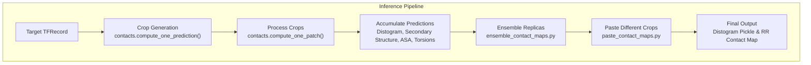

Sources: [alphafold_casp13/contacts.py:93-370](), [alphafold_casp13/run_eval.sh:38-102]()

### Cropping and Ensembling Strategy

The system uses a cropping strategy to handle proteins of different lengths:

1. The protein is divided into overlapping crops of different sizes (64×64, 128×128, 256×256)
2. Each crop is processed independently by the neural network
3. Predictions from different crops are weighted and averaged
4. The final prediction is assembled by pasting these crops together

This approach enables the model to capture both local and global contexts while managing computational resources effectively.

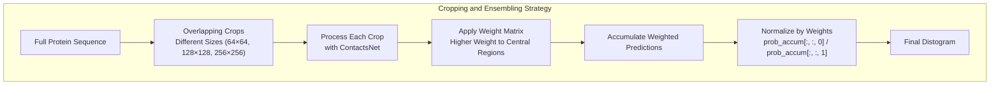

Sources: [alphafold_casp13/contacts.py:172-288](), [alphafold_casp13/paste_contact_maps.py:15-201]()

## Distogram Output and Interpretation

The main output of the system is a distogram - a distance histogram for each pair of residues. Each histogram is discretized into bins representing different distance ranges.

The distogram is stored as a Python pickle file with the following structure:
- `min_range`: Minimum distance range in Angstroms
- `max_range`: Maximum distance range in Angstroms
- `num_bins`: Number of distance bins
- `sequence`: Amino acid sequence
- `domain`: Target name
- `probs`: A 3D array of shape `[L, L, num_bins]` containing the probabilities

Contact maps are derived from distograms by summing probabilities over bins corresponding to distances less than 8 Angstroms.

| Field | Description |
|-------|-------------|
| `min_range` | Minimum distance range in Angstroms |
| `max_range` | Maximum distance range in Angstroms |
| `num_bins` | Number of distance bins |
| `sequence` | Target amino acid sequence |
| `domain` | Target name |
| `probs` | 3D array with shape `[L, L, num_bins]` containing distance probabilities |

Sources: [alphafold_casp13/README.md:180-200](), [alphafold_casp13/distogram_io.py:57-84]()

## Neural Network Architecture Details

The neural network in AlphaFold CASP13 is a deep 2D convolutional network with residual connections. Its key components include:

### 1. Feature Processing

- **1D Features**: Sequence-based features processed per residue
- **2D Features**: Pairwise features between residues
- **Feature Concatenation**: Combines 1D and 2D features with positional encodings

### 2. Residual Blocks

The network uses separable residual blocks with the following structure:
1. Batch normalization (optional)
2. ELU activation
3. 1×1 convolution to reduce channel dimension
4. 3×3 convolution (standard or separable)
5. 1×1 convolution to restore channel dimension
6. Skip connection from input to output

```mermaid
flowchart TD
    subgraph "Residual Block Architecture"
        Input["Input"] --> BN["Batch Normalization\n(Optional)"]
        BN --> Activation["ELU Activation"]
        Activation --> Conv1["1×1 Convolution\nReduce Channels"]
        Conv1 --> Conv3["3×3 Convolution"]
        Conv3 --> Conv2["1×1 Convolution\nRestore Channels"]
        
        Input --> Skip["Skip Connection"]
        
        Conv2 --> Add(("+"))
        Skip --> Add
        
        Add --> Output["Output"]
    end
```

Sources: [alphafold_casp13/two_dim_resnet.py:22-116](), [alphafold_casp13/two_dim_convnet.py:102-137]()

### 3. Output Layers

The network can produce multiple outputs:
- **Distogram**: Main output for distance prediction
- **Secondary Structure**: Optional prediction of 8-class secondary structure
- **Accessible Surface Area (ASA)**: Optional prediction of solvent accessibility
- **Torsion Angles**: Optional prediction of backbone torsion angles

Sources: [alphafold_casp13/contacts_network.py:431-438](), [alphafold_casp13/secstruct.py:44-64](), [alphafold_casp13/asa_output.py:19-33]()

## Integration with DeepMind Research Repository

AlphaFold CASP13 is a standalone component within the broader DeepMind Research repository. It represents the first generation of AlphaFold technology focused on contact prediction for protein structure determination.

```mermaid
flowchart TD
    subgraph "DeepMind Research Repository Structure"
        Root["DeepMind Research Repository"] --> Apps["Application Domains"]
        Apps --> ProteinStructure["Protein Structure Prediction"]
        ProteinStructure --> AlphaFold["AlphaFold CASP13"]
        ProteinStructure --> Other["Other Protein Structure Tools"]
        
        AlphaFold --> DistogramModel["Distogram Model"]
        AlphaFold --> BackgroundModel["Background Model"]
        AlphaFold --> TorsionModel["Torsion Model"]
        AlphaFold --> Utilities["Utilities\n- ensemble_contact_maps.py\n- paste_contact_maps.py\n- distogram_io.py"]
    end
```

## Running the System

To run AlphaFold CASP13 on a CASP13 dataset target:

1. **Setup Environment**: Install dependencies in a Python virtual environment
2. **Configure Models**: Set paths to the distogram, background, and torsion models
3. **Specify Target**: Set the target name and path to its TFRecord file
4. **Run Evaluation**: Execute the `run_eval.sh` script to generate predictions

The complete pipeline is automated in the `run_eval.sh` script, which runs all models in parallel, ensembles their outputs, and produces the final predictions.

Sources: [alphafold_casp13/README.md:20-58](), [alphafold_casp13/run_eval.sh:19-102]()

## Limitations

It's important to note the following limitations of the AlphaFold CASP13 system:

1. It can only be used to predict structures on the CASP13 dataset
2. The feature generation code is not included as it depends on DeepMind's internal infrastructure
3. The system is not compatible with arbitrary protein sequences
4. It only works on Linux operating systems
5. It requires TensorFlow 1.14 (not compatible with TensorFlow 2.0+)

Sources: [alphafold_casp13/README.md:20-29](), [alphafold_casp13/README.md:32-43]()

---

# Page: Perceiver Architecture

# Perceiver Architecture

<details>
<summary>Relevant source files</summary>

The following files were used as context for generating this wiki page:

- [perceiver/README.md](perceiver/README.md)
- [perceiver/colabs/imagenet_classification.ipynb](perceiver/colabs/imagenet_classification.ipynb)
- [perceiver/colabs/masked_language_modelling.ipynb](perceiver/colabs/masked_language_modelling.ipynb)
- [perceiver/colabs/optical_flow.ipynb](perceiver/colabs/optical_flow.ipynb)
- [perceiver/colabs/video_autoencoding.ipynb](perceiver/colabs/video_autoencoding.ipynb)
- [perceiver/requirements.txt](perceiver/requirements.txt)
- [perceiver/train/autoaugment.py](perceiver/train/autoaugment.py)
- [perceiver/train/dataset.py](perceiver/train/dataset.py)
- [perceiver/train/launch_local.sh](perceiver/train/launch_local.sh)

</details>


## Purpose and Scope

This document describes the Perceiver and Perceiver IO architecture, a general-purpose neural network design that can process many types of data (images, video, audio, 3D point clouds, language, multimodal combinations) with minimal domain-specific adaptations. Unlike Transformers, which have quadratic complexity in relation to input size, Perceiver achieves linear computational complexity by mapping inputs to a small latent space where processing becomes input-size independent.

The document covers:
- The core architecture of Perceiver and Perceiver IO
- Key components and their interactions
- Domain-specific processors for different data types
- Implementation details and configuration options
- Example applications

Sources: [perceiver/README.md:1-34]()

## Architecture Overview

Perceiver consists of three main components:

1. **Input Processing**: Domain-specific processors convert various input types into a format suitable for the model
2. **Latent Processing**: Cross-attention maps inputs to a fixed-size latent array, which is then processed by self-attention
3. **Output Processing** (Perceiver IO): Maps from the latent space to output formats using query-based decoding

```mermaid
graph TD
    subgraph "Input Processing"
        RawInput["Raw Input\n(Any Modality)"] --> InputProc["Domain-Specific\nInput Processor"]
        InputProc --> InputFeatures["Input Features\n+ Position Encoding"]
    end
    
    subgraph "Latent Processing"
        InputFeatures --> CrossAttn["Cross-Attention\n(Input → Latent)"]
        LatentArray["Latent Array\n(Learned, Fixed Size)"] --> CrossAttn
        CrossAttn --> LatentFeatures["Latent Features"]
        LatentFeatures --> SelfAttn["Self-Attention Blocks\n(Multiple Layers)"]
        SelfAttn --> ProcessedLatent["Processed Latent"]
    end
    
    subgraph "Output Processing (Perceiver IO)"
        ProcessedLatent --> OutCrossAttn["Output Cross-Attention"]
        OutputQueries["Task-Specific\nOutput Queries"] --> OutCrossAttn
        OutCrossAttn --> OutputFeatures["Output Features"]
        OutputFeatures --> OutputProc["Task-Specific\nOutput Processor"]
        OutputProc --> FinalOutput["Final Output"]
    end
```

Sources: [perceiver/README.md:3-34](), [perceiver/colabs/masked_language_modelling.ipynb:160-168](), [perceiver/colabs/optical_flow.ipynb:109-152]()

### Key Innovations

1. **Fixed-Size Latent Space**: By limiting computation to a fixed-size latent array, processing cost remains constant regardless of input size
2. **Cross-Attention for Input/Output Mapping**: Flexibly maps between arbitrary input/output spaces and the latent space
3. **Modality-Agnostic Processing**: The core latent processing remains constant regardless of input type
4. **Flexible Output Structure**: Perceiver IO can produce outputs with arbitrary structure through query-based decoding

Sources: [perceiver/README.md:10-25]()

## Code Structure and Components

The implementation is organized into two main files:

```mermaid
classDiagram
    class Perceiver {
        +input_preprocessor
        +encoder: PerceiverEncoder
        +decoder
        +output_postprocessor
        +__call__(inputs, is_training)
    }
    
    class PerceiverEncoder {
        +num_self_attends_per_block
        +num_blocks
        +z_index_dim
        +num_z_channels
        +__call__(inputs, z, input_mask)
    }
    
    class InputProcessors {
        <<Interface>>
        +ImagePreprocessor
        +AudioPreprocessor
        +MultimodalPreprocessor
    }
    
    class Decoders {
        <<Interface>>
        +BasicDecoder
        +ClassificationDecoder
        +FlowDecoder
    }
    
    Perceiver --> PerceiverEncoder: uses
    Perceiver --> InputProcessors: uses
    Perceiver --> Decoders: uses
```

Sources: [perceiver/README.md:27-31]()

### Core Components

#### 1. The Main Perceiver Class

The `Perceiver` class is the main entry point for using the model. It combines an encoder, decoder, and optional input/output processors.

```python
class Perceiver:
  def __init__(self,
               encoder,
               decoder,
               input_preprocessor=None,
               output_postprocessor=None):
    # ...

  def __call__(self,
               inputs,
               is_training,
               subsampled_output_points=None,
               input_mask=None,
               query_mask=None):
    # ...
```

Sources: [perceiver/colabs/imagenet_classification.ipynb:212-224](), [perceiver/colabs/masked_language_modelling.ipynb:162-166]()

#### 2. Perceiver Encoder

The `PerceiverEncoder` maps inputs to the latent space and processes them using self-attention blocks:

```python
class PerceiverEncoder:
  def __init__(self,
               num_self_attends_per_block,
               num_blocks,
               z_index_dim,
               num_z_channels,
               num_cross_attend_heads,
               num_self_attend_heads,
               # other parameters...
               ):
    # ...
```

Key configuration parameters:
- `num_self_attends_per_block`: Number of self-attention layers per block
- `num_blocks`: Number of transformer blocks
- `z_index_dim`: Number of latent array indices
- `num_z_channels`: Number of channels in the latent array

Sources: [perceiver/colabs/optical_flow.ipynb:110-123](), [perceiver/colabs/masked_language_modelling.ipynb:95-108](), [perceiver/colabs/imagenet_classification.ipynb:110-120]()

#### 3. Input Processors

Input processors handle different data modalities and add appropriate position encodings:

```mermaid
graph TD
    subgraph "Input Processors"
        direction LR
        ImagePreprocessor["ImagePreprocessor"] --> prep_image["Image → Features"]
        AudioPreprocessor["AudioPreprocessor"] --> prep_audio["Audio → Features"]
        MultimodalPreprocessor["MultimodalPreprocessor"] --> prep_multi["Multiple Modalities → Features"]
    end
    
    subgraph "Position Encodings"
        direction LR
        FourierPosEnc["Fourier Position\nEncoding"] 
        TrainablePosEnc["Trainable Position\nEncoding"]
    end
    
    ImagePreprocessor --> FourierPosEnc
    ImagePreprocessor --> TrainablePosEnc
    AudioPreprocessor --> FourierPosEnc
```

Major input processors include:
- `ImagePreprocessor`: Handles images with options for position encoding and preprocessing
- `AudioPreprocessor`: Processes audio data, often using patch-based approaches
- `MultimodalPreprocessor`: Combines inputs from multiple modalities

Sources: [perceiver/colabs/optical_flow.ipynb:96-108](), [perceiver/colabs/video_autoencoding.ipynb:406-432](), [perceiver/colabs/imagenet_classification.ipynb:134-147]()

#### 4. Decoders (Perceiver IO)

Perceiver IO uses query-based decoding to generate outputs:

- `ClassificationDecoder`: For classification tasks (outputs class logits)
- `FlowDecoder`: For optical flow prediction (outputs flow fields)
- `BasicDecoder`: General decoder for various tasks

```python
# Example decoder configuration for ImageNet classification
decoder = ClassificationDecoder(
    num_classes=1000,  # Number of output classes
    num_z_channels=1024,  # Must match encoder's latent dimension
    use_query_residual=True,
)
```

Sources: [perceiver/colabs/imagenet_classification.ipynb:216-219](), [perceiver/colabs/optical_flow.ipynb:125-139]()

## Applications and Examples

The repository includes examples of Perceiver IO applied to various tasks:

### 1. Masked Language Modeling

Works directly with bytes rather than tokens, handling masked language modeling similar to BERT but on raw bytes.

```python
encoder_config = dict(
    num_self_attends_per_block=26,
    num_blocks=1,
    z_index_dim=256,
    num_z_channels=1280,
    # ...
)

decoder_config = dict(
    output_num_channels=1280,
    position_encoding_type='trainable',
    output_index_dims=MAX_SEQ_LEN,  # 2048
    # ...
)
```

Sources: [perceiver/colabs/masked_language_modelling.ipynb:94-124]()

### 2. Optical Flow

Predicts motion between video frames, demonstrating Perceiver's ability to handle spatial data.

```python
encoder = perceiver.PerceiverEncoder(
    num_self_attends_per_block=24,
    num_blocks=1,
    z_index_dim=2048,
    num_cross_attend_heads=1,
    # ...
)

decoder = perceiver.FlowDecoder(
    TRAIN_SIZE,
    rescale_factor=100.0,
    use_query_residual=False,
    output_num_channels=2,
    # ...
)
```

Sources: [perceiver/colabs/optical_flow.ipynb:110-139]()

### 3. Image Classification

Achieves competitive results on ImageNet classification with different preprocessing strategies:

- Learned position encoding with 1x1 convolution
- Fourier position encoding with raw pixels
- Fourier position encoding with convolutional preprocessing

```python
# Example model configurations
conv_maxpool_configs = dict(
    input_preprocessor=dict(
        position_encoding_type='fourier',
        fourier_position_encoding_kwargs=dict(
            concat_pos=True,
            max_resolution=(56, 56),
            num_bands=64,
            sine_only=False
        ),
        prep_type='conv',
    ),
    encoder=dict(
        # encoder configuration...
    ),
    decoder=dict(
        # decoder configuration...
    )
)
```

Sources: [perceiver/colabs/imagenet_classification.ipynb:91-204]()

### 4. Video Autoencoding with Audio

Demonstrates multimodal capabilities by processing both video and audio streams:

```python
input_preprocessor = io_processors.MultimodalPreprocessor(
    min_padding_size=4,
    modalities={
        'audio': io_processors.AudioPreprocessor(
            # audio preprocessor config...
        ),
        'image': io_processors.ImagePreprocessor(
            # image preprocessor config...
        ),
    }
)
```

Sources: [perceiver/colabs/video_autoencoding.ipynb:406-432]()

## Usage Guide

### Basic Usage Pattern

1. Select appropriate input processors for your data
2. Configure the encoder with desired parameters
3. Choose a decoder suitable for your task
4. Combine them into a Perceiver model
5. Apply the model to your inputs

```python
# Example for image classification
input_preprocessor = io_processors.ImagePreprocessor(
    position_encoding_type='fourier',
    prep_type='conv',
    # other parameters...
)

encoder = perceiver.PerceiverEncoder(
    num_self_attends_per_block=6,
    num_blocks=8,
    # other parameters...
)

decoder = perceiver.ClassificationDecoder(
    num_classes=1000,
    # other parameters...
)

model = perceiver.Perceiver(
    encoder=encoder,
    decoder=decoder,
    input_preprocessor=input_preprocessor
)

# Apply the model
outputs = model(inputs, is_training=False)
```

Sources: [perceiver/colabs/imagenet_classification.ipynb:212-224]()

### Installing and Running Examples

The repository includes several example notebooks (Colabs) demonstrating different applications:

1. Clone the repository and install dependencies:
```bash
git clone https://github.com/google-deepmind/deepmind-research.git
cd deepmind-research
pip install -r perceiver/requirements.txt
```

2. Run one of the provided examples:
   - Language modeling: `perceiver/colabs/masked_language_modelling.ipynb`
   - Optical flow: `perceiver/colabs/optical_flow.ipynb`
   - Image classification: `perceiver/colabs/imagenet_classification.ipynb`
   - Video autoencoding: `perceiver/colabs/video_autoencoding.ipynb`

3. Train a model using the provided script:
```bash
perceiver/train/launch_local.sh
```

Sources: [perceiver/README.md:36-78](), [perceiver/requirements.txt:1-20](), [perceiver/train/launch_local.sh:1-21]()

## Performance Considerations

- **Computational Efficiency**: Linear in input/output size, with most processing in the fixed-size latent space
- **Memory Usage**: Significantly lower than Transformers for large inputs
- **Configuration Trade-offs**:
  - Larger latent array (`z_index_dim`, `num_z_channels`) provides more capacity but requires more computation
  - More attention layers (`num_self_attends_per_block`, `num_blocks`) increase model capacity but also training time
  - Choice of position encoding affects model's ability to capture spatial/temporal relationships

Sources: [perceiver/README.md:19-25]()

## References

Perceiver and Perceiver IO are based on research papers:

1. Andrew Jaegle, et al. *Perceiver: General Perception with Iterative Attention*. ICML 2021.
   https://arxiv.org/abs/2103.03206

2. Andrew Jaegle, et al. *Perceiver IO: A General Architecture for Structured Inputs & Outputs*.
   arXiv, 2021.
   https://arxiv.org/abs/2107.14795

Sources: [perceiver/README.md:103-115]()

---

# Page: Bootstrap Your Own Latent (BYOL)

# Bootstrap Your Own Latent (BYOL)

<details>
<summary>Relevant source files</summary>

The following files were used as context for generating this wiki page:

- [adversarial_robustness/jax/utils.py](adversarial_robustness/jax/utils.py)
- [byol/byol_experiment.py](byol/byol_experiment.py)
- [byol/eval_experiment.py](byol/eval_experiment.py)
- [byol/utils/optimizers.py](byol/utils/optimizers.py)
- [perceiver/bytes_tokenizer.py](perceiver/bytes_tokenizer.py)
- [perceiver/io_processors.py](perceiver/io_processors.py)
- [perceiver/io_processors_test.py](perceiver/io_processors_test.py)
- [perceiver/train/experiment.py](perceiver/train/experiment.py)
- [perceiver/train/utils.py](perceiver/train/utils.py)
- [physics_inspired_models/integrators.py](physics_inspired_models/integrators.py)
- [physics_inspired_models/metrics.py](physics_inspired_models/metrics.py)

</details>


Bootstrap Your Own Latent (BYOL) is a self-supervised learning approach for training image representations without using negative samples. This document covers the implementation of BYOL in the DeepMind Research repository, focusing on the training method, architecture, and evaluation approaches.

## Overview and Purpose

BYOL learns high-quality visual representations by predicting the outputs of a target network from an online network, where both networks process differently augmented views of the same image. Unlike contrastive methods, BYOL doesn't require negative examples and still achieves competitive performance.

This implementation provides:
- A complete self-supervised pretraining pipeline for image representations 
- Linear evaluation and fine-tuning mechanisms to test the learned representations
- A specialized LARS optimizer for large-batch training

Sources: [byol/byol_experiment.py:16-19]()

## Architecture and Components

BYOL consists of two networks (online and target) that process different augmented views of the same images.

```mermaid
graph TD
    subgraph "BYOL Architecture"
        Input["Input Image"] --> |"Augmentation"| View1["View 1"]
        Input --> |"Augmentation"| View2["View 2"]
        
        View1 --> OnlineEnc["Online Encoder"]
        View2 --> TargetEnc["Target Encoder"]
        
        OnlineEnc --> OnlineProj["Online Projector"]
        TargetEnc --> TargetProj["Target Projector"]
        
        OnlineProj --> Predictor["Online Predictor"]
        
        Predictor --> |"Prediction"| Loss["Regression Loss"]
        TargetProj --> |"Target (stop_gradient)"| Loss
        
        Loss --> |"Backpropagation"| OnlineUpdate["Update Online Network"]
        OnlineUpdate --> |"EMA Update"| TargetUpdate["Update Target Network"]
    end
```

Key components:
1. **Encoder**: A backbone neural network (typically ResNet) that extracts representations from images
2. **Projector**: An MLP that maps encoder representations to a latent space
3. **Predictor**: An MLP that predicts the target network's projections
4. **Target Network**: Updated as an exponential moving average (EMA) of the online network

The network architecture is defined in the `_forward` method, which constructs the encoder, projector, and predictor:

Sources: [byol/byol_experiment.py:116-187]()

## BYOL State and Training Pipeline

### State Management

BYOL maintains a structured state containing all model parameters and optimization state:

```mermaid
classDiagram
    class ByolExperimentState {
        online_params: hk.Params
        target_params: hk.Params
        online_state: hk.State
        target_state: hk.State
        opt_state: optimizers.LarsState
    }
    
    class ForwardFunction {
        +apply(params, state, inputs, is_training) Outputs
    }
    
    ByolExperimentState -- ForwardFunction: used by
```

Sources: [byol/byol_experiment.py:44-52]()

### Training Pipeline

The training process follows these steps:

1. Initialize online and target networks with different random seeds
2. For each batch:
   - Generate two augmented views of each image
   - Forward both views through respective networks
   - Compute representation loss between predictions and target projections
   - Update online network using gradients
   - Update target network using EMA of online parameters

The core training logic is in the `_update_fn` method:

Sources: [byol/byol_experiment.py:293-351]()

### Loss Function

BYOL uses a symmetric regression loss:

```mermaid
graph LR
    subgraph "BYOL Loss Calculation"
        PV1["Prediction View1"] --> Loss1["Loss 1"]
        TPV2["Target Projection View2"] --> |"stop_gradient"| Loss1
        
        PV2["Prediction View2"] --> Loss2["Loss 2"]
        TPV1["Target Projection View1"] --> |"stop_gradient"| Loss2
        
        Loss1 --> TotalLoss["Total Loss"]
        Loss2 --> TotalLoss
    end
```

The loss computation is implemented in the `loss_fn` method:

Sources: [byol/byol_experiment.py:197-286]()

## LARS Optimizer

BYOL uses a Layer-wise Adaptive Rate Scaling (LARS) optimizer, which scales the learning rate per layer based on the ratio of weight norm to gradient norm. This enables stable training with large batch sizes.

```mermaid
graph TD
    subgraph "LARS Optimizer Components"
        Grads["Gradients"] --> |"Weight Decay"| WeightDecay["Add Weight Decay"]
        WeightDecay --> LARS["Scale by LARS"]
        LARS --> LR["Scale by Learning Rate"]
    end
```

The LARS optimizer implementation:

Sources: [byol/utils/optimizers.py:61-188]()

## Evaluation Mechanisms

BYOL provides two methods for evaluating learned representations:

1. **Linear Evaluation**: Freeze the backbone and train only a linear classifier
2. **Fine-tuning**: Train both the backbone and a linear classifier

```mermaid
graph TD
    subgraph "BYOL Evaluation Pipeline"
        PretrainedCheckpoint["Pretrained BYOL Checkpoint"] --> |"Load Backbone Params"| Evaluation
        
        subgraph Evaluation
            Input["Images"] --> Backbone["Encoder Backbone"]
            Backbone --> |"Embeddings"| Classifier["Linear Classifier"]
            Classifier --> |"Logits"| Loss["Classification Loss"]
            Loss --> |"Backpropagation"| UpdateClassifier["Update Classifier"]
            
            ToggleFreeze["Toggle Freeze Backbone"] -.- |"If fine-tuning"| UpdateBackbone["Update Backbone"]
            Loss --> |"If fine-tuning"| UpdateBackbone
        end
        
        Evaluation --> EvalMetrics["Evaluation Metrics"]
    end
```

The evaluation implementation is in the `EvalExperiment` class:

Sources: [byol/eval_experiment.py:51-477]()

## Implementation Details

### Target Network EMA Updates

The target network is updated using an EMA schedule that gradually increases the momentum parameter:

```python
tau = schedules.target_ema(
    global_step,
    base_ema=self._base_target_ema,
    max_steps=self._max_steps)
target_params = jax.tree_map(lambda x, y: x + (1 - tau) * (y - x),
                              target_params, online_params)
```

Sources: [byol/byol_experiment.py:338-343]()

### Learning Rate Schedule

BYOL uses a carefully designed learning rate schedule to ensure stable training:

```python
learning_rate = schedules.learning_schedule(
    global_step,
    batch_size=self._batch_size,
    total_steps=self._max_steps,
    **self._lr_schedule_config)
```

Sources: [byol/byol_experiment.py:327-332]()

## Usage Examples

### Training a BYOL Model

To train a new BYOL model:

1. Create a `ByolExperiment` instance with appropriate configuration
2. Run the training loop, calling `step()` for each iteration
3. Save checkpoints periodically

Example usage pattern:

```python
experiment = ByolExperiment(
    random_seed=42,
    num_classes=1000,
    batch_size=1024,
    max_steps=1000000,
    enable_double_transpose=True,
    base_target_ema=0.996,
    network_config={...},
    optimizer_config={...},
    lr_schedule_config={...},
    evaluation_config={...},
    checkpointing_config={...}
)

for step in range(max_steps):
    metrics = experiment.step(global_step=step, rng=rng)
    experiment.save_checkpoint(step, rng)
    
    # Periodically evaluate
    if step % eval_interval == 0:
        eval_metrics = experiment.evaluate(global_step=step)
```

Sources: [byol/byol_experiment.py:395-410]()

### Evaluating a Pretrained Model

To evaluate a pretrained BYOL model:

1. Create an `EvalExperiment` instance pointing to the checkpoint
2. Choose whether to freeze the backbone (linear evaluation) or allow fine-tuning
3. Train the evaluation model and assess performance

Example usage pattern:

```python
eval_experiment = EvalExperiment(
    random_seed=42,
    num_classes=1000,
    batch_size=256,
    max_steps=10000,
    enable_double_transpose=True,
    checkpoint_to_evaluate='/path/to/byol/checkpoint',
    allow_train_from_scratch=False,
    freeze_backbone=True,  # For linear evaluation
    network_config={...},
    optimizer_config={...},
    lr_schedule_config={...},
    evaluation_config={...},
    checkpointing_config={...}
)

for step in range(max_steps):
    metrics = eval_experiment.step(global_step=step, rng=rng)
    
# Final evaluation
final_metrics = eval_experiment.evaluate(global_step=step)
```

Sources: [byol/eval_experiment.py:161-186]()

## Performance Metrics

The implementation tracks several metrics during both training and evaluation:

- Representation loss: The core self-supervised objective
- Classification loss: From the auxiliary classifier during pretraining
- Top-1 and Top-5 accuracy: For evaluating representation quality

Sources: [byol/byol_experiment.py:276-283](), [byol/eval_experiment.py:435-442]()

---

# Page: DM21 Functionals

# DM21 Functionals

<details>
<summary>Relevant source files</summary>

The following files were used as context for generating this wiki page:

- [density_functional_approximation_dm21/.bazelrc](density_functional_approximation_dm21/.bazelrc)
- [density_functional_approximation_dm21/.bazelversion](density_functional_approximation_dm21/.bazelversion)
- [density_functional_approximation_dm21/README.md](density_functional_approximation_dm21/README.md)
- [density_functional_approximation_dm21/WORKSPACE.bazel](density_functional_approximation_dm21/WORKSPACE.bazel)
- [density_functional_approximation_dm21/external/tf_bazel.patch](density_functional_approximation_dm21/external/tf_bazel.patch)
- [density_functional_approximation_dm21/requirements.txt](density_functional_approximation_dm21/requirements.txt)
- [density_functional_approximation_dm21/requirements_aot_compilation.txt](density_functional_approximation_dm21/requirements_aot_compilation.txt)

</details>


This document describes the DM21 (DeepMind 21) family of exchange-correlation functionals for quantum chemistry calculations, provided as a PySCF interface within the DeepMind Research repository. These functionals are implemented as neural networks and designed to address the fractional electron problem in density functional theory (DFT). For information about other quantum chemistry components, see [Quantum Chemistry](#5.2).

## Overview

The DM21 functionals represent a neural network-based approach to density functional approximation. They integrate with the PySCF quantum chemistry framework to enable accurate electronic structure calculations, particularly for systems where traditional functionals struggle with fractional electron behavior.

```mermaid
graph TD
    subgraph "DM21 Functional System"
        NeuralNumInt["dm21.NeuralNumInt Class"]
        Functional["dm21.Functional Enum"]
        DM21["DM21 (molecules, fractional charge & spin)"]
        DM21m["DM21m (molecules only)"]
        DM21mc["DM21mc (molecules & fractional charge)"]
        DM21mu["DM21mu (molecules & electron gas)"]
        
        Functional --> DM21
        Functional --> DM21m
        Functional --> DM21mc
        Functional --> DM21mu
        
        DM21 --> NeuralNumInt
        DM21m --> NeuralNumInt
        DM21mc --> NeuralNumInt
        DM21mu --> NeuralNumInt
    end
    
    subgraph "Integration Points"
        PySCF["PySCF DFT Framework"]
        CPP["C++ Interface"]
        Export["export_saved_model.py"]
        
        NeuralNumInt --> PySCF
        NeuralNumInt --> Export
        Export --> CPP
    end
```

Sources: [density_functional_approximation_dm21/README.md:1-6]()

## Functional Variants

The DM21 system provides four neural network functional variants, each trained with different constraints:

| Functional | Training Dataset | Additional Constraints |
|------------|------------------|------------------------|
| `DM21`     | Molecules        | Fractional charge and fractional spin |
| `DM21m`    | Molecules only   | None |
| `DM21mc`   | Molecules        | Fractional charge |
| `DM21mu`   | Molecules        | Electron gas |

Each variant is accessible through the `dm21.Functional` enum in the interface.

Sources: [density_functional_approximation_dm21/README.md:103-109]()

## PySCF Integration

The DM21 functionals integrate with PySCF through a custom numerical integration class that handles the evaluation of exchange-correlation energy and potential over a real-space grid.

```mermaid
sequenceDiagram
    participant User
    participant Molecule["gto.Mole()"]
    participant Solver["dft.RKS/UKS()"]
    participant DM21["dm21.NeuralNumInt"]
    
    User->>Molecule: "Define molecule (atom, basis)"
    User->>Molecule: "mol.build()"
    User->>Solver: "Create solver (mf = dft.RKS(mol))"
    User->>DM21: "Create neural integrator with functional"
    User->>Solver: "mf._numint = dm21.NeuralNumInt(dm21.Functional.DM21)"
    User->>Solver: "Run calculation (mf.kernel())"
    Solver->>DM21: "Evaluate XC energy/potential on grid"
    DM21-->>Solver: "Return results"
    Solver-->>User: "Return final energy"
```

### Basic Usage

Unlike conventional functionals in PySCF that are specified using `mf.xc = 'functional_name'`, DM21 functionals require replacing the numerical integration object:

```python
import density_functional_approximation_dm21 as dm21
from pyscf import gto
from pyscf import dft

# Create the molecule
mol = gto.Mole()
mol.atom = 'Ne 0.0 0.0 0.0'
mol.basis = 'cc-pVDZ'
mol.build()

# Create DFT solver and insert DM21 functional
mf = dft.RKS(mol)
mf._numint = dm21.NeuralNumInt(dm21.Functional.DM21)

# Run calculation
mf.kernel()
```

Sources: [density_functional_approximation_dm21/README.md:50-96]()

### Best Practices

For optimal convergence with the neural functionals:

1. **Initialize with a conventional functional**: Start with a cheaper functional like B3LYP to get close to the solution
2. **Relax convergence tolerances**: Neural networks operate at single precision, making tight convergence difficult
3. **Use proper spin handling**: For open-shell systems, use UKS instead of RKS

Example implementation with best practices:

```python
# Create appropriate solver based on spin
if mol.spin == 0:
    mf = dft.RKS(mol)
else:
    mf = dft.UKS(mol)

# Start with B3LYP to get close to solution
mf.xc = 'B3LYP'
mf.run()
dm0 = mf.make_rdm1()

# Switch to DM21
mf._numint = dm21.NeuralNumInt(dm21.Functional.DM21)
# Relax convergence tolerances
mf.conv_tol = 1E-6
mf.conv_tol_grad = 1E-3
# Run with initial density from B3LYP
energy = mf.kernel(dm0=dm0)
```

Sources: [density_functional_approximation_dm21/README.md:116-189]()

## C++ Integration

The DM21 functionals can be used from C++ applications through two methods:

1. **TensorFlow C++ API**: Load the SavedModel using TensorFlow's C++ library
2. **Ahead-of-Time (AOT) Compilation**: Compile the model into a standalone library with fixed dimensions

The AOT compilation approach creates a more portable solution without runtime TensorFlow dependencies.

```mermaid
graph TD
    subgraph "C++ Deployment Process"
        PythonModel["Python DM21 Model"]
        ExportTool["export_saved_model.py"]
        SavedModel["Saved TensorFlow Model"]
        CompileTool["saved_model_cli aot_compile_cpu"]
        Interface["Generated Files:<br/>dm21.h<br/>dm21.o<br/>dm21_metadata.o"]
        CppApp["C++ Application<br/>(dm21::functional)"]
        
        PythonModel --> ExportTool
        ExportTool --> SavedModel
        SavedModel --> CompileTool
        CompileTool --> Interface
        Interface --> CppApp
    end
```

### Export Process

1. Export the functional and derivatives:
   ```bash
   export_saved_model.py --functional=DM21 \
                         --out_dir=/path/to/export/DM21 \
                         --batch_size=1000
   ```

2. Compile using `saved_model_cli`:
   ```bash
   saved_model_cli aot_compile_cpu \
                 --dir /path/to/export/DM21 \
                 --output_prefix /path/to/compiled/DM21/dm21 \
                 --cpp_class dm21::functional \
                 --tag_set '' \
                 --signature_def_key default
   ```

3. The compilation generates:
   - `dm21.h`: Header defining the C++ interface
   - `dm21_metadata.o`, `dm21.o`: Object files
   - `dm21_makefile.inc`: Makefile snippet with compilation flags

For building C++ applications that use the compiled functional, Bazel is the recommended build system.

Sources: [density_functional_approximation_dm21/README.md:191-203](), [density_functional_approximation_dm21/README.md:208-237]()

## Building from Source

The DM21 functionals can be installed as a Python package:

1. **Direct installation**:
   ```bash
   python3 -m venv ~/venv/DM21
   source ~/venv/DM21/bin/activate
   pip install git+git://github.com/deepmind/deepmind-research.git#subdirectory=density_functional_approximation_dm21
   ```

2. **Local installation** (after cloning the repository):
   ```bash
   git clone https://github.com/deepmind/deepmind-research.git
   cd deepmind-research/density_functional_approximation_dm21
   python3 -m venv ~/venv/DM21
   source ~/venv/DM21/bin/activate
   pip install .
   ```

3. **Run tests**:
   ```bash
   pip install '.[testing]'
   py.test
   ```

Note: Using PySCF 2.0 or later enables more efficient calculation of local Hartree-Fock features, resulting in significant speed improvements.

Sources: [density_functional_approximation_dm21/README.md:8-48](). [density_functional_approximation_dm21/requirements.txt:1-10]()

## Implementation Notes

The DM21 functionals:

1. Operate on grid points independently, which allows for fixed-dimension AOT compilation without restricting system size
2. Run in single precision, which is why relaxed convergence tolerances are recommended
3. Return results with D3 dispersion corrections when used for benchmarking
4. Are licensed under the Apache 2.0 License (code) and Creative Commons Attribution 4.0 International License (model parameters)

Sources: [density_functional_approximation_dm21/README.md:103-109](), [density_functional_approximation_dm21/README.md:296-302]()

---

# Page: Learning to Simulate

# Learning to Simulate

<details>
<summary>Relevant source files</summary>

The following files were used as context for generating this wiki page:

- [learning_to_simulate/README.md](learning_to_simulate/README.md)
- [learning_to_simulate/connectivity_utils.py](learning_to_simulate/connectivity_utils.py)
- [learning_to_simulate/download_dataset.sh](learning_to_simulate/download_dataset.sh)
- [learning_to_simulate/graph_network.py](learning_to_simulate/graph_network.py)
- [learning_to_simulate/images/water_ramps_rollout.gif](learning_to_simulate/images/water_ramps_rollout.gif)
- [learning_to_simulate/learned_simulator.py](learning_to_simulate/learned_simulator.py)
- [learning_to_simulate/model_demo.py](learning_to_simulate/model_demo.py)
- [learning_to_simulate/noise_utils.py](learning_to_simulate/noise_utils.py)
- [learning_to_simulate/reading_utils.py](learning_to_simulate/reading_utils.py)
- [learning_to_simulate/render_rollout.py](learning_to_simulate/render_rollout.py)
- [learning_to_simulate/requirements.txt](learning_to_simulate/requirements.txt)
- [learning_to_simulate/run.sh](learning_to_simulate/run.sh)
- [learning_to_simulate/train.py](learning_to_simulate/train.py)
- [mmv/utils/ucf101_dataset.py](mmv/utils/ucf101_dataset.py)

</details>


This document explains the "Learning to Simulate" system, which uses graph neural networks to model complex physics simulations. The system is designed to learn physics directly from data rather than encoding physical laws explicitly, enabling simulation of materials like water, sand, and other complex substances.

For information about graph representation learning more broadly, see [Graph Representation Learning](#5.4).

## Overview

Learning to Simulate implements a graph-based physics simulation framework based on the paper ["Learning to Simulate Complex Physics with Graph Networks"](https://arxiv.org/abs/2002.09405) from ICML 2020. The system represents physical systems as graphs of particles, where nodes correspond to particles and edges represent their interactions within a specified radius. A graph neural network processes this representation to predict how these particles will move over time.

Key capabilities include:
- Learning physical dynamics from data without explicit physical laws
- Handling different material types in a unified framework
- Supporting both 2D and 3D simulations
- Generating rollout trajectories for visualization

## System Architecture

The system follows an encoder-processor-decoder architecture built around graph neural networks:

**System Architecture Diagram**
```mermaid
graph TD
    subgraph "Learning to Simulate Architecture"
        Input["Input Position Sequence"] --> Encoder["LearnedSimulator._encoder_preprocessor"]
        Encoder --> Graph["GraphsTuple Representation"]
        Graph --> Processor["EncodeProcessDecode"]
        Processor --> ProcessedGraph["Processed GraphsTuple"]
        ProcessedGraph --> Decoder["LearnedSimulator._decoder_postprocessor"]
        Decoder --> Output["Predicted Acceleration"]
        Output --> Integration["Euler Integration"]
        Integration --> NextPos["Next Position"]
    end
```

Sources: [learning_to_simulate/learned_simulator.py:38-246]()(learning_to_simulate/learned_simulator.py:38-246)(), [learning_to_simulate/graph_network.py:50-182]()

### Data Representation

Physical systems are modeled as collections of particles with the following properties:

- Position sequences (previous positions over multiple timesteps)
- Velocities (derived from position differences)
- Particle types (e.g., water, sand, boundary)
- Connectivity based on proximity

The input to the model is a sequence of positions for each particle, typically spanning 6 timesteps, with the model predicting the position at the next timestep.

Sources: [learning_to_simulate/learned_simulator.py:84-111]()(learning_to_simulate/learned_simulator.py:84-111)(), [learning_to_simulate/train.py:71-78]()

### Graph Construction

The system constructs a graph representation as follows:

**Graph Construction Diagram**
```mermaid
graph LR
    subgraph "Graph Construction"
        Positions["Particle Positions"] --> Connectivity["compute_connectivity_for_batch_pyfunc"]
        Connectivity --> Graph["Graph Structure"]
        Positions --> NodeFeatures["Node Features:<br/>- Velocities<br/>- Boundary Distances<br/>- Particle Types"]
        Positions --> EdgeFeatures["Edge Features:<br/>- Relative Displacements<br/>- Relative Distances"]
        Graph --> GraphsTuple["GraphsTuple:<br/>- nodes<br/>- edges<br/>- senders<br/>- receivers<br/>- n_node<br/>- n_edge<br/>- globals"]
        NodeFeatures --> GraphsTuple
        EdgeFeatures --> GraphsTuple
        Context["Global Context"] --> GraphsTuple
    end
```

Sources: [learning_to_simulate/learned_simulator.py:114-186]()(learning_to_simulate/learned_simulator.py:114-186)(), [learning_to_simulate/connectivity_utils.py:24-118]()

## Core Components

### LearnedSimulator

The `LearnedSimulator` class serves as the central component that integrates all aspects of the simulation system:

**LearnedSimulator Components**
```mermaid
classDiagram
    class LearnedSimulator {
        +__init__(num_dimensions, connectivity_radius, graph_network_kwargs, boundaries, normalization_stats, num_particle_types, particle_type_embedding_size)
        +_build(position_sequence, n_particles_per_example, global_context, particle_types)
        +_encoder_preprocessor(position_sequence, n_node, global_context, particle_types)
        +_decoder_postprocessor(normalized_acceleration, position_sequence)
        +get_predicted_and_target_normalized_accelerations(next_position, position_sequence_noise, position_sequence, n_particles_per_example, global_context, particle_types)
        +_inverse_decoder_postprocessor(next_position, position_sequence)
    }
```

Key functionalities:
- `_encoder_preprocessor`: Converts particle data into a graph representation
- `_decoder_postprocessor`: Applies Euler integration to predict next positions
- `get_predicted_and_target_normalized_accelerations`: Handles noise addition and computes training targets

Sources: [learning_to_simulate/learned_simulator.py:37-260]()(learning_to_simulate/learned_simulator.py:37-260)()

### EncodeProcessDecode

The `EncodeProcessDecode` class implements the graph neural network that models particle interactions:

**EncodeProcessDecode Components**
```mermaid
classDiagram
    class EncodeProcessDecode {
        +__init__(latent_size, mlp_hidden_size, mlp_num_hidden_layers, num_message_passing_steps, output_size, reducer)
        +_build(input_graph)
        +_networks_builder()
        +_encode(input_graph)
        +_process(latent_graph_0)
        +_process_step(processor_network_k, latent_graph_prev_k)
        +_decode(latent_graph)
    }
```

Key steps:
1. `_encode`: Independently encodes node and edge features
2. `_process`: Performs multiple rounds of message passing
3. `_decode`: Maps node representations to output accelerations

Sources: [learning_to_simulate/graph_network.py:50-182]()(learning_to_simulate/graph_network.py:50-182)()

## Training Process

The training process has several key components:

**Training Process Diagram**
```mermaid
flowchart TD
    Data["TFRecord Dataset"] --> Parse["parse_serialized_simulation_example"]
    Parse --> Split["split_trajectory"]
    Split --> Batch["batch_concat"]
    Batch --> Model["LearnedSimulator"]
    Model --> Loss["MSE Loss"]
    Loss --> Optimizer["Adam Optimizer"]
    Optimizer --> Update["Update Model Parameters"]
    
    subgraph "Noise Addition"
        InputPos["Input Positions"] --> AddNoise["get_random_walk_noise_for_position_sequence"]
        AddNoise --> NoisyPos["Noisy Positions"]
        NoisyPos --> Model
    end
```

The key steps:
1. Load and parse trajectory data from TFRecord files
2. Split trajectories into windows of 7 timesteps (6 input + 1 target)
3. Add noise to positions using a random walk
4. Predict accelerations using the `LearnedSimulator`
5. Compute loss for non-kinematic (movable) particles
6. Update model parameters using Adam optimizer

Sources: [learning_to_simulate/train.py:173-383]()(learning_to_simulate/train.py:173-383)(), [learning_to_simulate/noise_utils.py:23-53]()

## Datasets

The system supports a variety of physics simulation datasets:

| Dataset | Description | Dimensionality |
|---------|-------------|----------------|
| WaterDrop | Water droplet simulation | 2D |
| Water | General water simulation | 2D |
| Sand | Granular material simulation | 2D |
| Goop | Viscous material simulation | 2D |
| MultiMaterial | Multiple materials interacting | 2D |
| WaterRamps, SandRamps | Simulations with obstacle ramps | 2D |
| FluidShake, FluidShakeBox | Fluid in shaking containers | 2D |
| Water-3D, Sand-3D, Goop-3D | Three-dimensional simulations | 3D |

Each dataset includes:
- Position trajectories for particles
- Particle type information
- Metadata with normalization statistics and simulation boundaries

Datasets can be downloaded using the provided script:
```bash
bash ./learning_to_simulate/download_dataset.sh [DATASET_NAME] [OUTPUT_DIR]
```

Sources: [learning_to_simulate/README.md:60-98]()(learning_to_simulate/README.md:60-98)(), [learning_to_simulate/download_dataset.sh:1-33]()

## Rollout Generation and Visualization

The system can generate rollout trajectories by repeatedly applying the learned model:

**Rollout Process Diagram**
```mermaid
flowchart TD
    Initial["Initial Position Sequence"] --> Step1["First Prediction Step"]
    Step1 --> Append["Append to Trajectory"]
    Append --> Step2["Next Prediction Step"]
    Step2 --> Append
    Append --> Final["Complete Rollout"]
    Final --> Visualize["render_rollout.py"]
    
    subgraph "Single Prediction Step"
        PrevPos["Previous Positions"] --> SimStep["LearnedSimulator"]
        SimStep --> NextPos["Next Position"]
        NextPos --> ShiftWindow["Shift Position Window"]
    end
```

Key steps:
1. Start with an initial sequence of positions
2. Predict the next position using the learned model
3. Update the input sequence by shifting the window and adding the new position
4. Repeat for the desired number of steps
5. Visualize the resulting trajectory

The `render_rollout.py` script provides visualization of the generated trajectories, showing the comparison between ground truth and model predictions.

Sources: [learning_to_simulate/train.py:219-269]()(learning_to_simulate/train.py:219-269)(), [learning_to_simulate/render_rollout.py:28-102]()

## Usage Examples

### Training a Model

```bash
python -m learning_to_simulate.train \
    --data_path=/tmp/datasets/WaterRamps \
    --model_path=/tmp/models/WaterRamps
```

### Generating Rollouts

```bash
python -m learning_to_simulate.train \
    --mode="eval_rollout" \
    --data_path=/tmp/datasets/WaterRamps \
    --model_path=/tmp/models/WaterRamps \
    --output_path=/tmp/rollouts/WaterRamps
```

### Visualizing Results

```bash
python -m learning_to_simulate.render_rollout \
    --rollout_path=/tmp/rollouts/WaterRamps/rollout_test_0.pkl
```

Sources: [learning_to_simulate/README.md:24-58]()(learning_to_simulate/README.md:24-58)()

## Implementation Details

### Connectivity Computation

The system computes connectivity between particles using:
- K-d tree for efficient nearest neighbor queries
- A specified connectivity radius
- Support for batched graphs

```python
senders, receivers, n_edge = connectivity_utils.compute_connectivity_for_batch_pyfunc(
    positions, n_node, connectivity_radius)
```

Sources: [learning_to_simulate/connectivity_utils.py:24-118]()(learning_to_simulate/connectivity_utils.py:24-118)()

### Noise Addition

During training, noise is added to the input positions to improve robustness:

```python
velocity_sequence_noise = tf.random.normal(
    tf.shape(velocity_sequence),
    stddev=noise_std_last_step / num_velocities ** 0.5,
    dtype=position_sequence.dtype)
velocity_sequence_noise = tf.cumsum(velocity_sequence_noise, axis=1)
```

The noise follows a random walk pattern, with the magnitude controlled by a noise standard deviation parameter.

Sources: [learning_to_simulate/noise_utils.py:23-53]()(learning_to_simulate/noise_utils.py:23-53)()

### Data Reading

The system reads data from TFRecord files containing serialized simulation examples:

```python
context, parsed_features = tf.io.parse_single_sequence_example(
    example_proto,
    context_features=_CONTEXT_FEATURES,
    sequence_features=feature_description)
```

Each example includes:
- Position trajectories
- Particle types
- Optional global context features

Sources: [learning_to_simulate/reading_utils.py:59-106]()(learning_to_simulate/reading_utils.py:59-106)())

## Conclusion

The Learning to Simulate system demonstrates how graph neural networks can be used to learn complex physics from data. By representing physical systems as graphs of interacting particles, the model captures both local and global dynamics, enabling accurate simulation of diverse materials and scenarios.

This approach offers advantages over traditional physics simulation methods, particularly for complex materials where analytical models are difficult to derive. The system's ability to handle different materials, 2D and 3D simulations, and complex scenarios makes it a versatile tool for physics-based machine learning applications.

---

# Page: Enformer

# Enformer

<details>
<summary>Relevant source files</summary>

The following files were used as context for generating this wiki page:

- [enformer/README.md](enformer/README.md)
- [enformer/attention_module.py](enformer/attention_module.py)
- [enformer/enformer-training.ipynb](enformer/enformer-training.ipynb)
- [enformer/enformer-usage.ipynb](enformer/enformer-usage.ipynb)
- [enformer/enformer.py](enformer/enformer.py)
- [enformer/enformer_test.py](enformer/enformer_test.py)
- [enformer/requirements.txt](enformer/requirements.txt)
- [gated_linear_networks/colabs/README.md](gated_linear_networks/colabs/README.md)
- [gated_linear_networks/colabs/dendritic_gated_network.ipynb](gated_linear_networks/colabs/dendritic_gated_network.ipynb)

</details>


## Purpose and Scope

This document describes Enformer, a deep learning model for gene expression prediction that integrates long-range interactions in DNA sequences. Enformer is designed to predict gene expression levels from DNA sequence by capturing regulatory elements up to 100kb away from genes, providing a significant improvement over previous models with more limited receptive fields.

The document covers the model architecture, implementation details, usage for inference, and applications like variant effect prediction. For information about training the model, see the training notebook included in the repository.

Sources: [enformer/README.md:1-15](), [enformer/enformer.py:14-27]()

## Overview

Enformer ("Enhanced Performer") is a sequence-to-function model that predicts gene expression and chromatin profiles from DNA sequence. It was developed to address the limitations of previous models by incorporating a larger receptive field to capture distal regulatory elements that influence gene expression.

Key capabilities of Enformer include:
- Gene expression prediction from DNA sequences
- Chromatin accessibility and histone mark profile prediction
- Variant effect prediction to assess the impact of genetic variants on gene expression

The model takes a 196,608 base pair DNA sequence as input and makes predictions for the central 114,688 base pairs, with outputs corresponding to 128 base pair windows.

Sources: [enformer/README.md:3-14](), [enformer/enformer.py:37-40](), [enformer/README.md:79-101]()

## System Architecture

The Enformer architecture combines convolutional neural networks for local feature extraction with Transformer layers for capturing long-range interactions.

### Enformer Architecture Diagram

```mermaid
flowchart TD
    subgraph "Enformer Model"
        DNA["DNA Sequence Input\n196,608 bp"] --> Stem
        Stem --> ConvTower["Convolutional Tower"]
        ConvTower --> Transformer["Transformer Layers"]
        Transformer --> TargetCrop["Target Length Crop\n(to 896 bins)"]
        TargetCrop --> FinalPointwise["Final Pointwise Conv"]
        FinalPointwise --> Heads["Prediction Heads"]
        Heads --> HumanHead["Human Head\n(5,313 tracks)"]
        Heads --> MouseHead["Mouse Head\n(1,643 tracks)"]
    end
```

### Key Components

- **Input**: One-hot encoded DNA sequence (A,C,G,T) of length 393,216 bp
- **Processing Core**: Stem + Convolutional Tower + Transformer
- **Output**: Predictions for 896 bins (each representing 128 bp) for both human and mouse
  - Human output shape: [batch_size, 896, 5313]
  - Mouse output shape: [batch_size, 896, 1643]

The model is optimized to make predictions for the central region of the input sequence, allowing it to incorporate context from flanking regions.

Sources: [enformer/enformer.py:42-177](), [enformer/README.md:79-101]()

## Detailed Architecture

```mermaid
flowchart TD
    Input["DNA Sequence\nOne-hot encoded [N, 393,216, 4]"] --> Stem
    
    subgraph "Stem"
        Conv1["Conv1D (15, 768 filters)"] --> Residual1["Residual Block"]
        Residual1 --> Pool1["Pooling (2×)"]
    end
    
    subgraph "Convolutional Tower"
        Block1["Conv Block 1\n768→896 filters"] --> Pool2["Pooling (2×)"]
        Pool2 --> Block2["Conv Block 2\n896→1024 filters"] --> Pool3["Pooling (2×)"]
        Pool3 --> Block3["Conv Block 3\n1024→1152 filters"] --> Pool4["Pooling (2×)"]
        Pool4 --> Block4["Conv Block 4\n1152→1280 filters"] --> Pool5["Pooling (2×)"]
        Pool5 --> Block5["Conv Block 5\n1280→1408 filters"] --> Pool6["Pooling (2×)"]
        Pool6 --> Block6["Conv Block 6\n1408→1536 filters"] --> Pool7["Pooling (2×)"]
    end
    
    subgraph "Transformer"
        TransformerLayers["11 Transformer Layers\nMulti-head Attention (8 heads)"]
    end
    
    subgraph "Final Processing"
        TargetCrop["Target Length Crop\n(to 896)"] --> FinalPointwise["Final Pointwise Conv\n1536→3072"]
        FinalPointwise --> Dropout["Dropout"] --> GELU["GELU Activation"]
    end
    
    subgraph "Heads"
        HumanHead["Human Head\nLinear → Softplus\n[N, 896, 5313]"]
        MouseHead["Mouse Head\nLinear → Softplus\n[N, 896, 1643]"]
    end
    
    Stem --> ConvTower
    ConvTower --> Transformer
    Transformer --> TargetCrop
    GELU --> HumanHead
    GELU --> MouseHead
```

Sources: [enformer/enformer.py:42-177](), [enformer/attention_module.py:66-101](), [enformer/README.md:97-101]()

## Model Components in Detail

### 1. Input Processing

Enformer takes a one-hot encoded DNA sequence as input. The sequence has length 393,216 base pairs, with each position encoded as a 4-element vector representing the nucleotides (A, C, G, T). However, only the central 196,608 base pairs are processed by the model, with the rest being cropped internally.

```
Input shape: [batch_size, 393,216, 4]
```

Sources: [enformer/README.md:79-101](), [enformer/enformer.py:37-40]()

### 2. Stem and Convolutional Tower

The stem consists of:
- Initial 1D convolution with kernel size 15 and 768 filters
- Residual block with pointwise convolution
- Pooling operation (max or attention-based)

The convolutional tower contains 6 blocks, each with:
- 1D convolution with kernel size 5
- Residual connection with pointwise convolution 
- Pooling operation that reduces sequence length by 2×

The number of filters increases exponentially through the tower (768→896→1024→1152→1280→1408→1536).

Sources: [enformer/enformer.py:100-115](), [enformer/enformer.py:233-241]()

### 3. Transformer Module

The transformer module consists of 11 transformer layers, each with:
- Multi-head attention (8 heads) with relative positional encodings
- Layer normalization
- MLP with ReLU activation and dropout

The transformer enables the model to capture long-range interactions between distant parts of the sequence, which is crucial for modeling the effects of distal regulatory elements.

Sources: [enformer/enformer.py:117-137](), [enformer/attention_module.py:104-280]()

### 4. Target Length Crop and Final Processing

After the transformer, the sequence is cropped to the target length of 896 positions:
- Each position represents a 128bp window
- A final pointwise convolution doubles the channel dimension
- GELU activation is applied

Sources: [enformer/enformer.py:139-144](), [enformer/enformer.py:186-204]()

### 5. Prediction Heads

The model has two separate prediction heads:
- Human head: Predicts 5,313 regulatory tracks
- Mouse head: Predicts 1,643 regulatory tracks

Each head consists of a linear projection followed by a softplus activation function.

Sources: [enformer/enformer.py:154-160](), [enformer/README.md:97-117]()

## Data Flow for Inference

```mermaid
sequenceDiagram
    participant User
    participant Model as Enformer Model
    participant Outputs as Prediction Outputs
    
    User->>Model: One-hot encoded DNA sequence<br>[batch_size, 393,216, 4]
    Note over Model: Process through Enformer architecture
    Model->>Outputs: Human predictions<br>[batch_size, 896, 5313]
    Model->>Outputs: Mouse predictions<br>[batch_size, 896, 1643]
    User->>Outputs: Extract predictions for<br>specific genomic tracks
```

Sources: [enformer/README.md:79-101](), [enformer/enformer.py:171-183]()

## Running Inference

The simplest way to perform inference is to load the model via TensorFlow Hub and provide a properly formatted input sequence:

```python
import tensorflow as tf
import tensorflow_hub as hub

enformer = hub.Module('https://tfhub.dev/deepmind/enformer/1')

SEQ_LENGTH = 393_216

# Numpy array [batch_size, SEQ_LENGTH, 4] one hot encoded in order 'ACGT'
inputs = tf.zeros((1, SEQ_LENGTH, 4), dtype=tf.float32)
predictions = enformer.predict_on_batch(inputs)
predictions['human'].shape  # [batch_size, 896, 5313]
predictions['mouse'].shape  # [batch_size, 896, 1643]
```

The `one_hot_encode` function provided in `enformer.py` can be used to convert DNA sequences into the required format:

```python
# Example using one_hot_encode
sequence = "ACGTACGT..." # DNA sequence string
one_hot = enformer.one_hot_encode(sequence)
```

Sources: [enformer/README.md:77-101](), [enformer/enformer.py:171-183](), [enformer/enformer.py:313-325]()

## Output Interpretation

For each 128bp window in the central region, Enformer predicts values for every track. The mapping from track index to track name is found in the corresponding targets file from the Basenji dataset.

```python
import pandas as pd
targets_txt = 'https://raw.githubusercontent.com/calico/basenji/0.5/manuscripts/cross2020/targets_human.txt'
df_targets = pd.read_csv(targets_txt, sep='\t')
df_targets.shape  # (5313, 8) With rows matching output shape
```

The target files contain metadata for each track, including:
- Tissue/cell type
- Experiment type (e.g., DNase-seq, ChIP-seq)
- Description

Sources: [enformer/README.md:104-117]()

## Variant Effect Prediction

Enformer can predict the effect of genetic variants on gene expression by comparing predictions for reference and alternate sequences:

### Variant Effect Analysis Flow

```mermaid
flowchart TD
    Variant["Genetic Variant"] --> RefSeq["Extract Reference Sequence<br>around variant"]
    Variant --> AltSeq["Generate Alternate Sequence<br>with variant"]
    
    RefSeq --> RefOneHot["One-hot encode<br>reference sequence"]
    AltSeq --> AltOneHot["One-hot encode<br>alternate sequence"]
    
    RefOneHot --> EnformerRef["Enformer prediction<br>for reference sequence"]
    AltOneHot --> EnformerAlt["Enformer prediction<br>for alternate sequence"]
    
    EnformerRef --> Subtract["Compute difference:<br>alt - ref predictions"]
    EnformerAlt --> Subtract
    
    Subtract --> SAD["SNP Activity Difference<br>(SAD) scores"]
    
    SAD --> Analysis["Interpret effect on<br>gene expression"]
```

Pre-computed variant effect scores for frequent variants (MAF>0.5%) from the 1000 Genomes Project are available for download.

Sources: [enformer/README.md:38-77](), [enformer/enformer-usage.ipynb]()

## Requirements and Dependencies

To run Enformer, you need the following dependencies:
- dm-sonnet (2.0.0)
- kipoiseq (0.5.2)
- numpy (1.19.5)
- pandas (1.2.3)
- tensorflow (2.4.1)
- tensorflow-hub (0.11.0)

Sources: [enformer/README.md:16-27](), [enformer/requirements.txt:1-7]()

## Additional Resources

For further examples and detailed usage, refer to the following notebooks:

1. **enformer-usage.ipynb**: Shows how to:
   - Make predictions with pre-trained Enformer
   - Compute contribution scores
   - Predict the effect of genetic variants
   - Score multiple variants in a VCF

2. **enformer-training.ipynb**: Shows how to:
   - Set up training data
   - Train the model
   - Evaluate the model
   - Restore the model from a checkpoint for fine-tuning

Sources: [enformer/README.md:127-148]()

---

# Page: Reinforcement Learning Systems

# Reinforcement Learning Systems

<details>
<summary>Relevant source files</summary>

The following files were used as context for generating this wiki page:

- [rl_unplugged/README.md](rl_unplugged/README.md)
- [rl_unplugged/atari.py](rl_unplugged/atari.py)
- [rl_unplugged/atari_dqn.ipynb](rl_unplugged/atari_dqn.ipynb)
- [rl_unplugged/atari_example.py](rl_unplugged/atari_example.py)
- [rl_unplugged/bsuite.ipynb](rl_unplugged/bsuite.ipynb)
- [rl_unplugged/dm_control_suite.py](rl_unplugged/dm_control_suite.py)
- [rl_unplugged/dm_control_suite_crr.ipynb](rl_unplugged/dm_control_suite_crr.ipynb)
- [rl_unplugged/dm_control_suite_d4pg.ipynb](rl_unplugged/dm_control_suite_d4pg.ipynb)
- [rl_unplugged/dm_control_suite_example.py](rl_unplugged/dm_control_suite_example.py)
- [rl_unplugged/dmlab_r2d2.ipynb](rl_unplugged/dmlab_r2d2.ipynb)
- [rl_unplugged/images/tasks.png](rl_unplugged/images/tasks.png)
- [rl_unplugged/networks.py](rl_unplugged/networks.py)
- [rl_unplugged/requirements.txt](rl_unplugged/requirements.txt)
- [rl_unplugged/rwrl.py](rl_unplugged/rwrl.py)
- [rl_unplugged/rwrl_d4pg.ipynb](rl_unplugged/rwrl_d4pg.ipynb)
- [rl_unplugged/rwrl_example.py](rl_unplugged/rwrl_example.py)
- [scratchgan/experiment.py](scratchgan/experiment.py)
- [scratchgan/generators.py](scratchgan/generators.py)
- [scratchgan/losses.py](scratchgan/losses.py)
- [scratchgan/reader.py](scratchgan/reader.py)
- [scratchgan/utils.py](scratchgan/utils.py)

</details>


This document provides a technical overview of reinforcement learning systems in the DeepMind Research repository, focusing on the RL Unplugged suite of benchmarks for offline reinforcement learning. Offline RL refers to learning from fixed datasets without additional environment interaction during training.

## Overview of RL Unplugged

RL Unplugged is a collection of benchmark datasets designed to facilitate research on offline reinforcement learning across diverse domains. It addresses several key challenges in reinforcement learning:

- High-dimensional action spaces (e.g., 56-dimensional actions in humanoid locomotion)
- High-dimensional observations
- Partial observability with egocentric vision
- Exploration difficulty using state-of-the-art algorithms to generate data
- Real-world challenges including stochasticity and constraints

```mermaid
graph TD
    RLUnplugged["RL Unplugged Benchmark Suite"] --> Datasets
    RLUnplugged --> Environments
    RLUnplugged --> Algorithms
    
    Datasets --> AtariDS["Atari Datasets"]
    Datasets --> ControlSuiteDS["DM Control Suite Datasets"]
    Datasets --> LocomotionDS["DM Locomotion Datasets"]
    Datasets --> RWRLDS["Real World RL Datasets"]
    Datasets --> DMLabDS["DeepMind Lab Datasets"]
    Datasets --> BsuiteDS["Bsuite Datasets"]
    
    Environments --> AtariEnv["Atari Environments"]
    Environments --> ControlSuiteEnv["DM Control Suite Environments"]
    Environments --> RWRLEnv["Real World RL Environments"]
    Environments --> DMLabEnv["DeepMind Lab Environments"]
    Environments --> BsuiteEnv["Bsuite Environments"]
    
    Algorithms --> DQN["DQN (Discrete Actions)"]
    Algorithms --> D4PG["D4PG (Continuous Actions)"]
    Algorithms --> CRR["CRR (Continuous Actions)"]
    Algorithms --> R2D2["R2D2 (Memory-Based)"]
```

Sources: [rl_unplugged/README.md:1-125](rl_unplugged/README.md:1-125)

## Dataset Structure and Components

### Available Datasets

The RL Unplugged suite includes:

| Dataset | Description | Action Space | Key Challenges |
|---------|-------------|--------------|----------------|
| Atari | 46 Atari games, data from DQN training | Discrete | High-dimensional observations |
| DM Control Suite | 9 continuous control tasks | Continuous | Standard benchmark tasks |
| DM Locomotion | Humanoid and rodent tasks | Continuous (56D for humanoid) | High-DoF control with rich observations |
| Real World RL | Tasks with real-world challenges | Continuous | Stochasticity, delays, constraints |
| DeepMind Lab | 3D navigation tasks | Discrete | Partial observability, memory |
| Bsuite | Simple diagnostic tasks | Discrete | Controlled stochasticity levels |

Sources: [rl_unplugged/README.md:29-123](rl_unplugged/README.md:29-123), [rl_unplugged/dm_control_suite.py:1-50](rl_unplugged/dm_control_suite.py:1-50)

### Data Format

Datasets are stored as TFRecord files containing serialized TensorFlow Examples. The structure varies slightly between domains but typically follows either:

- **SARS format**: (State, Action, Reward, Next State)
- **SARSA format**: (State, Action, Reward, Next State, Next Action)

For example, Atari datasets contain:
```
o_t: Observation at time t (84x84x4 stacked frames)
a_t: Action at time t
r_t: Reward after a_t
d_t: Discount factor
o_tp1: Observation at time t+1
a_tp1: Action at time t+1
```

Sources: [rl_unplugged/atari.py:14-37](rl_unplugged/atari.py:14-37)

## Core System Architecture

The RL Unplugged system has a consistent architecture across different domains:

```mermaid
graph LR
    TFRecords["TFRecord Files"] --> |"parse_examples"| DatasetFuncs["Dataset Loading Functions"]
    DatasetFuncs --> |"map/batch"| TFDataset["TF Dataset Objects"]
    TFDataset --> |"convert to Reverb"| ReverbSamples["Replay Samples"]
    ReverbSamples --> Learner["RL Agent Learner"]
    
    Environment --> |"observation/action specs"| Learner
    Learner --> |"update"| Networks["Policy/Value Networks"]
    Networks --> Actor["Evaluation Actor"]
    Environment --> |"observations"| Actor
    Actor --> |"actions"| Environment
```

Sources: [rl_unplugged/atari_dqn.ipynb:89-187](rl_unplugged/atari_dqn.ipynb:89-187), [rl_unplugged/dm_control_suite_d4pg.ipynb:184-221](rl_unplugged/dm_control_suite_d4pg.ipynb:184-221)

### Code Entity Mapping

The following diagram maps conceptual entities to actual code components:

```mermaid
graph TB
    subgraph "Dataset Loading"
        AtariDS["atari.dataset()"]
        ControlDS["dm_control_suite.dataset()"]
        RWRLDS["rwrl.dataset()"]
    end
    
    subgraph "Environment Creation" 
        AtariEnv["atari.environment()"]
        ControlEnv["task.environment"]
        RWRLEnv["rwrl_envs.load()"]
    end
    
    subgraph "Agent Implementation"
        DQNAgent["dqn.DQNLearner"]
        D4PGAgent["d4pg.D4PGLearner"]
        CRRAgent["crr.CRRLearner"]
        R2D2Agent["r2d2.R2D2Learner"]
    end
    
    subgraph "Network Architectures"
        CNN["snt.Conv2D + snt.Flatten"]
        MLP["networks.LayerNormMLP"]
        LSTM["snt.LSTM"]
        ActorCritic["networks.CriticMultiplexer"]
    end
```

Sources: [rl_unplugged/atari_dqn.ipynb:239-251](rl_unplugged/atari_dqn.ipynb:239-251), [rl_unplugged/dm_control_suite_d4pg.ipynb:304-347](rl_unplugged/dm_control_suite_d4pg.ipynb:304-347)

## Key Components

### Environment Wrappers

Environment wrappers provide a standardized interface across different domains:

```python
# Atari environment
environment = atari.environment(game='Pong')

# Control Suite environment
task = dm_control_suite.ControlSuite(task_name='cartpole_swingup')
environment = task.environment

# RWRL environment
environment = rwrl_envs.load(domain_name='cartpole', 
                            task_name='realworld_swingup')
```

These wrappers handle observations, actions, and rewards consistently across different environments.

Sources: [rl_unplugged/atari.py:247-253](rl_unplugged/atari.py:247-253), [rl_unplugged/dm_control_suite.py:504-516](rl_unplugged/dm_control_suite.py:504-516)

### Dataset Loading

Each domain has a corresponding dataset loading function that:
1. Reads TFRecord files
2. Parses serialized examples
3. Converts data to the appropriate format (e.g., Reverb replay samples)
4. Batches data for training

```python
# Atari dataset loading
dataset = atari.dataset(path='/tmp/atari', 
                       game='Pong', 
                       run=1, 
                       num_shards=1)

# Control Suite dataset loading
dataset = dm_control_suite.dataset(
    root_path='/tmp',
    data_path=task.data_path,
    shapes=task.shapes,
    uint8_features=task.uint8_features,
    num_shards=num_shards)
```

Sources: [rl_unplugged/atari.py:188-204](rl_unplugged/atari.py:188-204), [rl_unplugged/dm_control_suite.py:785-830](rl_unplugged/dm_control_suite.py:785-830)

### Network Architectures

The system supports various neural network architectures for different domains:

- **Discrete Actions (Atari)**:
  - Convolutional networks for image processing
  - MLP heads for Q-value prediction

- **Continuous Control**:
  - Actor networks with tanh output scaling
  - Critic networks with action-conditioned value prediction
  - Distributional value representations

Sources: [rl_unplugged/atari_dqn.ipynb:239-251](rl_unplugged/atari_dqn.ipynb:239-251), [rl_unplugged/dm_control_suite_d4pg.ipynb:304-323](rl_unplugged/dm_control_suite_d4pg.ipynb:304-323)

### Agent Implementations

RL Unplugged includes implementations of several offline RL algorithms:

| Algorithm | Purpose | Key Features |
|-----------|---------|--------------|
| DQN | Discrete action spaces | Q-learning with target networks |
| D4PG | Continuous control | Distributional critic, deterministic policy |
| CRR | Continuous control | Critic-regularized regression |
| R2D2 | Memory-dependent tasks | Recurrent networks with experience replay |

Sources: [rl_unplugged/atari_dqn.ipynb:263-275](rl_unplugged/atari_dqn.ipynb:263-275), [rl_unplugged/dm_control_suite_d4pg.ipynb:339-347](rl_unplugged/dm_control_suite_d4pg.ipynb:339-347)

## Training and Evaluation Pipeline

The training and evaluation pipeline follows a standard pattern:

1. **Load Dataset**:
   ```python
   dataset = domain_module.dataset(...)
   ```

2. **Create Environment**:
   ```python
   environment = domain_module.environment(...)
   ```

3. **Define Networks**:
   ```python
   network = snt.Sequential([...])
   ```

4. **Create Learner**:
   ```python
   learner = algorithm.Learner(network=network, dataset=dataset, ...)
   ```

5. **Train Agent**:
   ```python
   for _ in range(num_steps):
       learner.step()
   ```

6. **Evaluate Policy**:
   ```python
   actor = actors.FeedForwardActor(policy_network)
   loop = acme.EnvironmentLoop(environment, actor, logger)
   loop.run(num_episodes)
   ```

Sources: [rl_unplugged/atari_dqn.ipynb:286-323](rl_unplugged/atari_dqn.ipynb:286-323), [rl_unplugged/dm_control_suite_d4pg.ipynb:353-385](rl_unplugged/dm_control_suite_d4pg.ipynb:353-385)

## Reinforcement Learning Algorithms

### Deep Q-Network (DQN)

```mermaid
graph TD
    Observation --> |"input"| ConvLayers["Convolutional Layers"]
    ConvLayers --> FCLayers["Fully Connected Layers"]
    FCLayers --> QValues["Q-Values (one per action)"]
    QValues --> |"argmax"| Action
    
    subgraph "DQN Training"
        ReplayBuffer["Replay Buffer"] --> |"sample"| BatchData["Batch of Transitions"]
        BatchData --> |"compute target"| TargetNetwork["Target Q-Network"]
        BatchData --> |"predict"| OnlineNetwork["Online Q-Network"]
        TargetNetwork --> |"target values"| TDLoss["TD Loss"]
        OnlineNetwork --> |"predicted values"| TDLoss
        TDLoss --> |"gradient descent"| UpdateNetwork["Update Online Network"]
        UpdateNetwork --> |"periodic copy"| TargetNetwork
    end
```

Sources: [rl_unplugged/atari_dqn.ipynb:239-251](rl_unplugged/atari_dqn.ipynb:239-251), [rl_unplugged/atari_dqn.ipynb:263-275](rl_unplugged/atari_dqn.ipynb:263-275)

### Distributed Distributional DDPG (D4PG)

```mermaid
graph TD
    Observation --> PolicyNetwork["Policy Network"]
    PolicyNetwork --> |"tanh output"| Action
    
    subgraph "D4PG Training"
        Observation --> |"input"| CriticMux["Critic Multiplexer"]
        Action --> |"input"| CriticMux
        CriticMux --> CriticNetwork["Critic Network"]
        CriticNetwork --> ValueDist["Value Distribution"]
        
        BatchData["Batch of Transitions"] --> |"compute target"| TargetNetworks["Target Networks"]
        BatchData --> |"predict"| ActorCriticNetworks["Actor-Critic Networks"]
        
        TargetNetworks --> CriticLoss["Critic Loss"]
        ActorCriticNetworks --> CriticLoss
        CriticLoss --> |"update"| CriticNetwork
        
        ActorCriticNetworks --> PolicyLoss["Policy Loss (DDPG)"]
        PolicyLoss --> |"update"| PolicyNetwork
    end
```

Sources: [rl_unplugged/dm_control_suite_d4pg.ipynb:304-323](rl_unplugged/dm_control_suite_d4pg.ipynb:304-323), [rl_unplugged/dm_control_suite_d4pg.ipynb:339-347](rl_unplugged/dm_control_suite_d4pg.ipynb:339-347)

## Examples and Usage

### Atari DQN Example

```python
# Load dataset
dataset = atari.dataset(path='/tmp/atari', game='Pong', run=1, num_shards=1)
dataset = dataset.map(discard_extras).batch(batch_size)

# Create environment
environment = atari.environment(game='Pong')

# Create network
network = snt.Sequential([
    lambda x: tf.image.convert_image_dtype(x, tf.float32),
    snt.Conv2D(32, [8, 8], [4, 4]),
    tf.nn.relu,
    snt.Conv2D(64, [4, 4], [2, 2]),
    tf.nn.relu,
    snt.Conv2D(64, [3, 3], [1, 1]),
    tf.nn.relu,
    snt.Flatten(),
    snt.nets.MLP([512, num_actions])
])

# Create learner
learner = dqn.DQNLearner(
    network=network,
    target_network=copy.deepcopy(network),
    discount=0.99,
    learning_rate=3e-4,
    dataset=dataset)

# Train and evaluate
for _ in range(num_steps):
    learner.step()

policy_network = snt.Sequential([
    network,
    lambda q: tf.argmax(q, axis=-1),
])
actor = actors.FeedForwardActor(policy_network)
loop = acme.EnvironmentLoop(environment, actor, logger)
loop.run(num_episodes)
```

Sources: [rl_unplugged/atari_dqn.ipynb:155-187](rl_unplugged/atari_dqn.ipynb:155-187), [rl_unplugged/atari_dqn.ipynb:239-251](rl_unplugged/atari_dqn.ipynb:239-251), [rl_unplugged/atari_dqn.ipynb:263-275](rl_unplugged/atari_dqn.ipynb:263-275), [rl_unplugged/atari_dqn.ipynb:286-323](rl_unplugged/atari_dqn.ipynb:286-323)

### Control Suite D4PG Example

```python
# Load dataset
task = dm_control_suite.ControlSuite(task_name='cartpole_swingup')
environment = task.environment
dataset = dm_control_suite.dataset(
    root_path='/tmp',
    data_path=task.data_path,
    shapes=task.shapes,
    uint8_features=task.uint8_features,
    num_shards=num_shards)
dataset = dataset.map(discard_extras).batch(batch_size)

# Create networks
action_spec = environment_spec.actions
policy_network = snt.Sequential([
    tf2_utils.batch_concat,
    networks.LayerNormMLP(layer_sizes=(300, 200, action_size)),
    networks.TanhToSpec(spec=action_spec)])

critic_network = snt.Sequential([
    networks.CriticMultiplexer(
        observation_network=tf2_utils.batch_concat,
        action_network=tf.identity,
        critic_network=networks.LayerNormMLP(
            layer_sizes=(400, 300),
            activate_final=True)),
    networks.DiscreteValuedHead(vmin=-150., vmax=150., num_atoms=51)])

# Create learner
learner = d4pg.D4PGLearner(
    policy_network=policy_network,
    critic_network=critic_network,
    target_policy_network=copy.deepcopy(policy_network),
    target_critic_network=copy.deepcopy(critic_network),
    dataset=dataset,
    discount=0.99,
    target_update_period=100)

# Train and evaluate
for _ in range(num_steps):
    learner.step()

actor = actors.FeedForwardActor(policy_network)
loop = acme.EnvironmentLoop(environment, actor, logger)
loop.run(num_episodes)
```

Sources: [rl_unplugged/dm_control_suite_d4pg.ipynb:257-283](rl_unplugged/dm_control_suite_d4pg.ipynb:257-283), [rl_unplugged/dm_control_suite_d4pg.ipynb:304-323](rl_unplugged/dm_control_suite_d4pg.ipynb:304-323), [rl_unplugged/dm_control_suite_d4pg.ipynb:339-347](rl_unplugged/dm_control_suite_d4pg.ipynb:339-347), [rl_unplugged/dm_control_suite_d4pg.ipynb:367-385](rl_unplugged/dm_control_suite_d4pg.ipynb:367-385)

## Summary

RL Unplugged provides a comprehensive suite of benchmarks for offline reinforcement learning research. It includes datasets from diverse domains, environment implementations, and reference algorithm implementations. The unified interface makes it easy to compare different algorithms and adapt them to new tasks.

Sources: [rl_unplugged/README.md:4-26](rl_unplugged/README.md:4-26)

---

# Page: RL Unplugged

# RL Unplugged

<details>
<summary>Relevant source files</summary>

The following files were used as context for generating this wiki page:

- [rl_unplugged/README.md](rl_unplugged/README.md)
- [rl_unplugged/atari.py](rl_unplugged/atari.py)
- [rl_unplugged/atari_dqn.ipynb](rl_unplugged/atari_dqn.ipynb)
- [rl_unplugged/atari_example.py](rl_unplugged/atari_example.py)
- [rl_unplugged/bsuite.ipynb](rl_unplugged/bsuite.ipynb)
- [rl_unplugged/dm_control_suite.py](rl_unplugged/dm_control_suite.py)
- [rl_unplugged/dm_control_suite_crr.ipynb](rl_unplugged/dm_control_suite_crr.ipynb)
- [rl_unplugged/dm_control_suite_d4pg.ipynb](rl_unplugged/dm_control_suite_d4pg.ipynb)
- [rl_unplugged/dm_control_suite_example.py](rl_unplugged/dm_control_suite_example.py)
- [rl_unplugged/dmlab_r2d2.ipynb](rl_unplugged/dmlab_r2d2.ipynb)
- [rl_unplugged/images/tasks.png](rl_unplugged/images/tasks.png)
- [rl_unplugged/networks.py](rl_unplugged/networks.py)
- [rl_unplugged/requirements.txt](rl_unplugged/requirements.txt)
- [rl_unplugged/rwrl.py](rl_unplugged/rwrl.py)
- [rl_unplugged/rwrl_d4pg.ipynb](rl_unplugged/rwrl_d4pg.ipynb)
- [rl_unplugged/rwrl_example.py](rl_unplugged/rwrl_example.py)
- [scratchgan/experiment.py](scratchgan/experiment.py)
- [scratchgan/generators.py](scratchgan/generators.py)
- [scratchgan/losses.py](scratchgan/losses.py)
- [scratchgan/reader.py](scratchgan/reader.py)
- [scratchgan/utils.py](scratchgan/utils.py)

</details>


RL Unplugged is a suite of benchmarks for offline reinforcement learning (RL). It provides standardized datasets collected from a variety of environments to facilitate research in RL methods that learn from pre-collected data rather than through active environment interaction. The suite is designed to enable easy comparison of offline RL algorithms across diverse domains, focusing on challenging aspects such as high-dimensional action spaces, high-dimensional observations, partial observability, and difficulty of exploration.

## System Overview

RL Unplugged consists of several components:
1. Dataset collections from various environments
2. Environment implementations for evaluation
3. Dataset loading utilities
4. Example implementations of offline RL algorithms
5. Evaluation methodologies

```mermaid
graph TD
    subgraph "RL_Unplugged_System"
        Datasets["Datasets"]
        Environments["Environment Implementations"]
        DataLoaders["Dataset Loaders"]
        AgentExamples["Agent Examples"]
    end
    
    Datasets --> Atari["Atari Games"]
    Datasets --> DM_Control["DM Control Suite"]
    Datasets --> DM_Locomotion["DM Locomotion"]
    Datasets --> RWRL["RealWorld RL"]
    Datasets --> DM_Lab["DeepMind Lab"]
    Datasets --> BSuite["bsuite"]
    
    DataLoaders --> AtariLoader["atari.dataset()"]
    DataLoaders --> DMControlLoader["dm_control_suite.dataset()"]
    DataLoaders --> RWRLLoader["rwrl.dataset()"]
    
    AgentExamples --> DQN["DQN (Discrete)"]
    AgentExamples --> D4PG["D4PG (Continuous)"]
    AgentExamples --> R2D2["R2D2 (Memory-based)"]
    AgentExamples --> CRR["CRR (Continuous)"]
    
    Environments --> AtariEnv["Atari Environments"]
    Environments --> DMControlEnv["DM Control Suite Environments"]
    Environments --> CmuThirdParty["Humanoid Locomotion"]
    Environments --> Rodent["Rodent Locomotion"]
    Environments --> RWRLEnv["RWRL Environments"]
    Environments --> DMLabEnv["DM Lab Environments"]
    Environments --> BSuiteEnv["bsuite Environments"]
```

Sources: [rl_unplugged/README.md:1-124](). [rl_unplugged/dm_control_suite.py:13-27](), [rl_unplugged/atari.py:14-37](), [rl_unplugged/rwrl.py:14-37]()

## Dataset Domains

### Atari Dataset

The Atari dataset contains gameplay sequences from 46 Atari games. The data was generated by running an online DQN agent and recording transitions from its replay buffer during training. For each game, the dataset includes data from five runs with 50 million transitions each, using sticky actions as described by Machado et al. (2018).

Each transition contains:
- Observation at time t (84x84x4 stacked frames)
- Action taken at time t
- Reward at time t
- Discount at time t
- Observation at time t+1
- Action at time t+1
- Extra metadata (episode ID, episode return)

The API provides utilities to load this data for offline learning algorithms with discrete action spaces.

Sources: [rl_unplugged/README.md:29-44](), [rl_unplugged/atari.py:14-37](), [rl_unplugged/atari_example.py:14-53]()

### DeepMind Control Suite Dataset

These datasets cover 9 tasks from the DeepMind Control Suite, implemented in MuJoCo. Most datasets were generated using D4PG, except for "Manipulator insert ball" and "Manipulator insert peg" which used V-MPO as D4PG couldn't solve these tasks. 

Each transition contains:
- Observation at time t (proprioceptive features)
- Action at time t (continuous)
- Reward at time t
- Discount at time t
- Observation at time t+1

The dataset is designed for evaluating offline RL algorithms in continuous control domains.

Sources: [rl_unplugged/README.md:61-76](), [rl_unplugged/dm_control_suite.py:14-27](), [rl_unplugged/dm_control_suite_example.py:14-70]()

### DeepMind Locomotion Dataset

The locomotion tasks feature challenging high-dimensional continuous control problems involving the CMU Humanoid and a virtual rodent. These tasks emphasize perception from rich egocentric observations.

Tasks include:
- Humanoid corridor navigation
- Humanoid navigation with walls
- Humanoid navigation with gaps
- Rodent escape
- Rodent corridor with gaps
- Rodent target touching
- Rodent maze navigation

The dataset is particularly challenging due to the high degrees of freedom in the action spaces (56-dimensional for humanoid tasks).

Sources: [rl_unplugged/README.md:46-60](), [rl_unplugged/dm_control_suite.py:51-689]()

### RealWorld RL Dataset

This dataset represents state-action-reward-state (SARS) transitions collected from a partially online trained agent as described in the RealWorld RL paper. It includes 8 datasets across cartpole, walker, quadruped, and humanoid tasks, each with different levels of environmental challenge.

Sources: [rl_unplugged/README.md:78-86](), [rl_unplugged/rwrl.py:14-37](), [rl_unplugged/rwrl_example.py:14-50]()

### DeepMind Lab Dataset

The DeepMind Lab dataset contains data from several levels of the partially observable DeepMind Lab suite. The data was collected by training distributed R2D2 agents from scratch on individual tasks. Datasets are available for five different levels, with additional "snapshot" datasets for one level with different exploration parameters.

Sources: [rl_unplugged/README.md:88-106](), [rl_unplugged/dmlab_r2d2.ipynb:93-367]()

### bsuite Dataset

The bsuite datasets were collected by training DQN agents with default settings on three tasks: cartpole, catch, and mountain_car. The environments were converted from deterministic to stochastic by randomly replacing the agent's action with a uniformly sampled action with a controllable probability (0, 0.1, 0.2, 0.3, 0.4, 0.5).

These datasets are deliberately lightweight and designed for rapid experimentation with offline RL algorithms.

Sources: [rl_unplugged/README.md:108-123](), [rl_unplugged/bsuite.ipynb:97-216]()

## Data Loading Architecture

RL Unplugged provides a unified data loading API that makes it easy to work with all datasets in the suite once a general pipeline has been established. The data loading process follows a similar pattern across all domains:

```mermaid
graph TD
    TFRecords["TFRecord Files (GCS)"] --> DataLoaders["Dataset Loaders"]
    
    DataLoaders --> AtariLoader["atari.dataset()"]
    DataLoaders --> DMCLoader["dm_control_suite.dataset()"] 
    DataLoaders --> RWRLLoader["rwrl.dataset()"]
    
    AtariLoader --> ParseTFExample["Parse TFExample"]
    DMCLoader --> ParseTFExample
    RWRLLoader --> ParseTFExample
    
    ParseTFExample --> BuildReplay["Create Reverb ReplaySample"]
    
    BuildReplay --> TFDataBatch["Batched TF Dataset"]
    
    TFDataBatch --> Agent["Agent Learning"]
    
    subgraph "Loading Process"
        direction TB
        Parse["1. Parse raw files"]
        Extract["2. Extract features"]
        Transform["3. Transform to transitions"]
        Batch["4. Batch transitions"]
        Sample["5. Create replay samples"]
    end
```

Sources: [rl_unplugged/atari.py:104-204](), [rl_unplugged/dm_control_suite.py:692-830](), [rl_unplugged/rwrl.py:110-180]()

### Atari Data Loading

For Atari datasets, the `atari.dataset()` function loads TFRecord files and processes them into Reverb replay samples. The key processing steps include:

1. Decoding PNG frames into tensor observations
2. Extracting action, reward, and discount information
3. Creating replay samples with the SARSA structure required by agents
4. Batching and shuffling for training

Sources: [rl_unplugged/atari.py:108-204](), [rl_unplugged/atari_example.py:14-53]()

### Control Suite Data Loading

The loading process for Control Suite data follows a similar pattern but handles the specifics of continuous control data:

1. Processing raw data from TFRecord files
2. Parsing observation, action, reward, and discount information
3. Building either SARSA samples (for value-based methods) or sequence samples (for recurrent methods)
4. Applying appropriate padding and batching

Sources: [rl_unplugged/dm_control_suite.py:692-830](), [rl_unplugged/dm_control_suite_example.py:14-70]()

### Environment Classes

```mermaid
graph TD
    subgraph "Environment Classes"
        ControlSuite["ControlSuite Class"]
        CmuThirdParty["CmuThirdParty Class"]
        Rodent["Rodent Class"]
    end
    
    ControlSuite --> shapes["shapes property"]
    ControlSuite --> data_path["data_path property"]
    ControlSuite --> environment["environment property"]
    
    CmuThirdParty --> human_shapes["shapes property"]
    CmuThirdParty --> human_path["data_path property"]
    CmuThirdParty --> human_env["environment property"]
    
    Rodent --> rodent_shapes["shapes property"]
    Rodent --> rodent_path["data_path property"]
    Rodent --> rodent_env["environment property"]
    
    environment --> NormWrapper["NormilizeActionSpecWrapper"]
    human_env --> FilterWrapper["FilterObservationsWrapper"]
    rodent_env --> MujocoWrapper["MujocoActionNormalizer"]
    
    NormWrapper --> SinglePrec["SinglePrecisionWrapper"]
    FilterWrapper --> SinglePrec
    MujocoWrapper --> SinglePrec
```

Sources: [rl_unplugged/dm_control_suite.py:346-690]()

## Example Agent Implementations

RL Unplugged provides example implementations of several offline RL algorithms for different tasks:

### DQN for Atari

The DQN implementation demonstrates how to train a Q-learning agent on Atari data. It uses:
- A convolutional network architecture for processing image observations
- The DQN learning algorithm with importance sampling
- Evaluation against the actual Atari environment

Sources: [rl_unplugged/atari_dqn.ipynb:32-386]()

### D4PG for Control Suite and RWRL

The D4PG (Distributed Distributional Deterministic Policy Gradients) examples show how to train a continuous control agent on the DeepMind Control Suite and RealWorld RL datasets:
- Policy and critic network architectures for continuous control
- Distributional value function representation
- Evaluation on the corresponding environments

Sources: [rl_unplugged/dm_control_suite_d4pg.ipynb:31-450](), [rl_unplugged/rwrl_d4pg.ipynb:31-584]()

### CRR for Control Suite

The CRR (Critic Regularized Regression) notebook demonstrates a more recent offline RL algorithm specialized for continuous control tasks:
- Advanced policy improvement with critic regularization
- Network architectures for the Control Suite
- Evaluation methodology

Sources: [rl_unplugged/dm_control_suite_crr.ipynb:31-449]()

### R2D2 for DeepMind Lab

The R2D2 (Recurrent Replay Distributed DQN) example shows how to train a memory-based agent on partially observable environments from DeepMind Lab:
- Recurrent network architecture
- Replay of sequential data
- Integration with DeepMind Lab environments

Sources: [rl_unplugged/dmlab_r2d2.ipynb:93-367]()

## Network Architectures

RL Unplugged provides several network architectures for dealing with different types of observations:

```mermaid
graph TD
    subgraph "Networks Module"
        ControlNetwork["ControlNetwork Class"]
    end
    
    ControlNetwork --> proprio_encoder["_proprio_encoder"]
    ControlNetwork --> call_method["__call__ method"]
    
    proprio_encoder --> LayerNormMLP["acme_networks.LayerNormMLP"]
    call_method --> batch_concat["tf2_utils.batch_concat"]
    
    subgraph "Domain-Specific Networks"
        AtariCNN["AtariCNN (from examples)"]
        ControlMLP["LayerNormMLP (from examples)"]
        LSTMR2D2["LSTM (from R2D2 example)"]
    end
    
    AtariCNN --> Conv2D["Conv2D layers"]
    ControlMLP --> MLP["MLP layers"]
    LSTMR2D2 --> RecurrentCore["RecurrentCore"]
```

Sources: [rl_unplugged/networks.py:14-92](), [rl_unplugged/atari_dqn.ipynb:239-250](), [rl_unplugged/dm_control_suite_d4pg.ipynb:304-347](), [rl_unplugged/dmlab_r2d2.ipynb:467-539]()

## Using RL Unplugged

To use RL Unplugged in your own research:

1. Install the required dependencies:
   ```
   pip install -r requirements.txt
   ```

2. Download the datasets from Google Cloud Storage:
   ```
   gsutil cp gs://rl_unplugged/[dataset_path] /tmp/dataset/
   ```

3. Load the dataset using the appropriate function:
   ```python
   dataset = rl_unplugged.[domain].dataset(...)
   ```

4. Create the corresponding environment for evaluation:
   ```python
   env = rl_unplugged.[domain].environment(...)
   ```

5. Train your offline RL algorithm on the dataset and evaluate on the environment

See the example notebooks for more detailed implementations of this workflow.

Sources: [rl_unplugged/README.md:125-147](), [rl_unplugged/requirements.txt:1-58](), [rl_unplugged/atari_example.py:14-53](), [rl_unplugged/dm_control_suite_example.py:14-70](), [rl_unplugged/rwrl_example.py:14-50]()

## Performance Metrics

The standard performance metrics for evaluating algorithms trained on RL Unplugged datasets include:

| Dataset | Metric | Baseline Methods |
|---------|--------|------------------|
| Atari | Mean episode return | DQN, BCQ |
| Control Suite | Mean episode return | D4PG, CRR, BCQ |
| Locomotion | Mean episode return | D4PG, CRR, BC |
| RWRL | Mean episode return | D4PG, BCQ |
| DeepMind Lab | Mean episode return | R2D2, BC |
| bsuite | Mean episode return | DQN, BC |

When reporting results on RL Unplugged, it's important to evaluate on multiple environments within each domain and provide details of the training procedure to ensure fair comparison.

Sources: [rl_unplugged/README.md:149-164]()

---

# Page: Board Games Logic

# Board Games Logic

<details>
<summary>Relevant source files</summary>

The following files were used as context for generating this wiki page:

- [ogb_lsc/README.md](ogb_lsc/README.md)
- [ogb_lsc/mag/README.md](ogb_lsc/mag/README.md)
- [ogb_lsc/mag/config.py](ogb_lsc/mag/config.py)
- [ogb_lsc/mag/csr_builder.py](ogb_lsc/mag/csr_builder.py)
- [ogb_lsc/mag/data_utils.py](ogb_lsc/mag/data_utils.py)
- [ogb_lsc/mag/datasets.py](ogb_lsc/mag/datasets.py)
- [ogb_lsc/mag/download_mag.py](ogb_lsc/mag/download_mag.py)
- [ogb_lsc/mag/ensemble_predictions.py](ogb_lsc/mag/ensemble_predictions.py)
- [ogb_lsc/mag/requirements.txt](ogb_lsc/mag/requirements.txt)
- [ogb_lsc/pcq/README.md](ogb_lsc/pcq/README.md)
- [ogb_lsc/pcq/requirements.txt](ogb_lsc/pcq/requirements.txt)
- [physics_planning_games/board_games/go_logic.py](physics_planning_games/board_games/go_logic.py)
- [physics_planning_games/board_games/tic_tac_toe_logic.py](physics_planning_games/board_games/tic_tac_toe_logic.py)

</details>


This document describes the board games logic implementation in the DeepMind research repository. The module provides implementations of classic board games (Tic-Tac-Toe and Go) that can be used for AI research, particularly in reinforcement learning contexts. It offers game state representation, move validation, and opponent implementations of varying skill levels.

## Overview

The board games logic module is part of the `physics_planning_games` package and provides a foundation for AI agents to interact with classic board games. It leverages the OpenSpiel framework and follows a consistent interface pattern, allowing different games to be used interchangeably in higher-level systems.

```mermaid
graph TD
    subgraph "Board Games Logic Module"
        A["logic_base.OpenSpielBasedLogic"] --> B["TicTacToeGameLogic"]
        A --> C["GoGameLogic"]
        D["logic_base.Opponent"] --> E["TicTacToeRandomOpponent"]
        D --> F["TicTacToeMixtureOpponent"]
        D --> G["TicTacToeOptimalOpponent"]
        D --> H["GoRandomOpponent"]
        D --> I["GoGTPOpponent"]
    end

    subgraph "Dependencies"
        J["OpenSpiel Library"] --> A
        K["GnuGo"] --> I
    end

    subgraph "Using Systems"
        L["Reinforcement Learning Agents"]
        M["Physical Manipulation Tasks"]
    end

    B --> L
    C --> L
    B --> M
    C --> M
```

Sources: [physics_planning_games/board_games/tic_tac_toe_logic.py:16-33](https://github.com/google-deepmind/deepmind-research/blob/master/physics_planning_games/board_games/tic_tac_toe_logic.py), [physics_planning_games/board_games/go_logic.py:16-29](https://github.com/google-deepmind/deepmind-research/blob/master/physics_planning_games/board_games/go_logic.py)

## Class Hierarchy and Data Types

The module organizes game implementations around a common inheritance structure:

```mermaid
classDiagram
    class OpenSpielBasedLogic {
        +open_spiel_state
        +reset()
        +get_board_state()
        +apply(player, action)
        +is_game_over
    }
    
    class TicTacToeGameLogic {
        +reset()
        +get_board_state()
        +apply(player, action)
    }
    
    class GoGameLogic {
        -_board_size
        -_komi
        -_gtp_player
        +reset()
        +get_board_state()
        +apply(player, action)
        +show_board()
    }
    
    class Opponent {
        +reset()
        +policy(game_logic, random_state)
    }
    
    class SingleMarkerAction {
        +row
        +col
    }
    
    class GoMarkerAction {
        +row
        +col
        +pass_action
    }
    
    OpenSpielBasedLogic <|-- TicTacToeGameLogic
    OpenSpielBasedLogic <|-- GoGameLogic
    
    Opponent <|-- TicTacToeRandomOpponent
    Opponent <|-- TicTacToeMixtureOpponent
    Opponent <|-- TicTacToeOptimalOpponent
    Opponent <|-- GoRandomOpponent
    Opponent <|-- GoGTPOpponent
    
    TicTacToeGameLogic -- SingleMarkerAction : "uses"
    GoGameLogic -- GoMarkerAction : "uses"
```

Sources: [physics_planning_games/board_games/tic_tac_toe_logic.py:33-91](), [physics_planning_games/board_games/go_logic.py:33-446]()

The module defines two specialized named tuple types to represent game actions:

| Action Type | Structure | Purpose |
|-------------|-----------|---------|
| `SingleMarkerAction` | `row`, `col` | Represents a Tic-Tac-Toe move placement |
| `GoMarkerAction` | `row`, `col`, `pass_action` | Represents a Go stone placement or pass move |

Sources: [physics_planning_games/board_games/tic_tac_toe_logic.py:28-29](), [physics_planning_games/board_games/go_logic.py:32-33]()

## TicTacToe Implementation

The `TicTacToeGameLogic` class provides a comprehensive implementation of the classic 3×3 Tic-Tac-Toe game.

### Game State Representation

The Tic-Tac-Toe game state is represented as a 3×3×3 boolean array:
- First plane: unmarked squares
- Second plane: X's (player 0)
- Third plane: O's (player 1)

```mermaid
graph TD
    subgraph "TicTacToe Board State"
        BS["get_board_state()"] --> A["3×3×3 Boolean Array"]
    end
    
    subgraph "Board Planes"
        A --> P1["Plane 0: Empty Squares"]
        A --> P2["Plane 1: X Markers (Player 0)"]
        A --> P3["Plane 2: O Markers (Player 1)"]
    end
    
    subgraph "OpenSpiel Integration"
        OS["_open_spiel_state"] --> BS
        OS --> M["apply() - Move Validation"]
        OS --> T["is_terminal() - Game Over Detection"]
    end
```

Sources: [physics_planning_games/board_games/tic_tac_toe_logic.py:56-69]()

### Opponent Implementations

The module includes three opponent implementations for Tic-Tac-Toe:

| Opponent Class | Description | Implementation Method |
|----------------|-------------|------------------------|
| `TicTacToeRandomOpponent` | Makes random legal moves | Selects randomly from available legal actions |
| `TicTacToeMixtureOpponent` | Combines random and optimal moves | Uses mixture probability to choose between random and optimal opponents |
| `TicTacToeOptimalOpponent` | Makes optimal moves | Uses minimax search algorithm |

The core of the optimal opponent is the `tic_tac_toe_minimax` function which implements the minimax search algorithm to find the best possible move:

```python
def tic_tac_toe_minimax(state, random_state):
  """Tree search from the world_state in order to find the optimal action."""
  # Find all legal actions
  legal_actions = state.legal_actions()
  best_actions = []
  best_value = -100

  # Evaluate each possible action
  for action in legal_actions:
    state_after_action = state.clone()
    state_after_action.apply_action(action)
    value, _ = minimax.expectiminimax(state_after_action, 100, None,
                                    current_player)
    # Track best actions (there may be multiple equally good ones)
    if value > best_value:
      best_value = value
      best_actions = [action]
    elif value == best_value:
      best_actions.append(action)

  # Choose randomly among the best actions
  action = random_state.choice(best_actions)
  return open_spiel_move_to_single_marker_action(action)
```

Sources: [physics_planning_games/board_games/tic_tac_toe_logic.py:94-167](), [physics_planning_games/board_games/tic_tac_toe_logic.py:227-265]()

## Go Implementation

The `GoGameLogic` class provides a more complex board game implementation with configurable board size (typically 9×9 or 19×19).

### Game State Representation

The Go game state is represented as a boolean array with dimensions `(board_size, board_size, 4)`:
- First plane: unmarked squares
- Second plane: black stones (player 0)
- Third plane: white stones (player 1)
- Fourth plane: komi indicator (showing whether white is to play)

```mermaid
graph TD
    subgraph "Go Game Logic Components"
        GGL["GoGameLogic"] --> BS["get_board_state()"]
        GGL --> OS["_open_spiel_state"]
        GGL --> GTP["_gtp_player (GnuGo Interface)"]
    end
    
    subgraph "Board State"
        BS --> A["board_size × board_size × 4 Boolean Array"]
        A --> P1["Plane 0: Empty Squares"]
        A --> P2["Plane 1: Black Stones (Player 0)"]
        A --> P3["Plane 2: White Stones (Player 1)"]
        A --> P4["Plane 3: Komi Indicator"]
    end
    
    subgraph "Move Processing"
        MP["apply(player, action)"] --> V["Validate Move"]
        V --> SP["Update OpenSpiel State"]
        SP --> GT["Update GTP State"]
    end
    
    GGL --> MP
```

Sources: [physics_planning_games/board_games/go_logic.py:382-395]()

### GTP (Go Text Protocol) Interface

A key feature of the Go implementation is the integration with external Go programs through the GTP (Go Text Protocol) interface. This enables communication with established Go engines like GnuGo for move generation or evaluation.

```mermaid
classDiagram
    class Gtp {
        +stones
        +moves
        +comments
        +board_size
        +komi
        +set_board_size(size)
        +set_komi(komi)
        +make_move(move)
        +generate_move(color)
        +board()
        +gtp_command(command, log)*
    }
    
    class GoEngine {
        +p: subprocess.Popen
        +gtp_command(command, log)
    }
    
    class GoGameLogic {
        -_gtp_player: GoEngine
        +apply(player, action)
    }
    
    Gtp <|-- GoEngine
    GoGameLogic --> GoEngine : "uses"
```

The GTP interface enables the system to:
1. Set up board configurations
2. Apply moves to the external engine
3. Request move suggestions from external engines
4. Query board state

Sources: [physics_planning_games/board_games/go_logic.py:163-338](), [physics_planning_games/board_games/go_logic.py:347-368]()

### Opponent Implementations

The Go module provides two opponent implementations:

| Opponent Class | Description | Implementation Method |
|----------------|-------------|------------------------|
| `GoRandomOpponent` | Makes random legal moves | Selects randomly from available legal actions |
| `GoGTPOpponent` | Uses external Go engine | Communicates with GnuGo through GTP interface, with option to mix random moves |

The `GoGTPOpponent` is particularly interesting as it leverages existing strong Go-playing programs through the GTP interface to provide challenging opponents:

```python
def policy(self, game_logic, player, random_state):
  """Return policy action."""
  if random_state.rand() < self._mixture_p:
    return gen_random_move(game_logic, random_state)
  else:
    return gen_move(game_logic, player)
```

Sources: [physics_planning_games/board_games/go_logic.py:471-525]()

## Usage Examples

### TicTacToe Example

```python
# Initialize the game
game_logic = TicTacToeGameLogic()

# Create an opponent (20% random, 80% optimal)
opponent = TicTacToeMixtureOpponent(mixture_p=0.2)  

# Make a move (center of the board)
action = SingleMarkerAction(row=1, col=1)
game_logic.apply(player=0, action=action)

# Get opponent's move
random_state = np.random.RandomState(42)
opponent_action = opponent.policy(game_logic, random_state)
game_logic.apply(player=1, action=opponent_action)

# Get board state
board_state = game_logic.get_board_state()
```

### Go Example

```python
# Initialize the game with a 9x9 board
game_logic = GoGameLogic(board_size=9, gnugo_level=1)

# Create an opponent (10% random, 90% GnuGo)
opponent = GoGTPOpponent(board_size=9, mixture_p=0.1)

# Make a move (center of the board)
action = GoMarkerAction(row=4, col=4, pass_action=False)
game_logic.apply(player=0, action=action)

# Get opponent's move
random_state = np.random.RandomState(42)
opponent_action = opponent.policy(game_logic, player=1, random_state=random_state)
game_logic.apply(player=1, action=opponent_action)

# Display the board
game_logic.show_board()
```

Sources: [physics_planning_games/board_games/tic_tac_toe_logic.py:33-91](), [physics_planning_games/board_games/go_logic.py:340-446]()

## Integration with OpenSpiel

Both game implementations are built on top of the OpenSpiel framework, which provides a common interface for various games. The games use OpenSpiel's state representation, action validation, and game tree search algorithms:

| OpenSpiel Feature | Usage in Board Games Logic |
|-------------------|----------------------------|
| `State` objects | Maintain game state and rules |
| `legal_actions()` | Determine valid moves |
| `apply_action()` | Update game state when moves are made |
| `observation_tensor()` | Generate board state representations |
| `minimax` algorithms | Implement optimal opponents |

Sources: [physics_planning_games/board_games/tic_tac_toe_logic.py:42-44](), [physics_planning_games/board_games/go_logic.py:369-370]()

## Utilities and Helper Functions

The module includes several utility functions for converting between different representations of game states and moves:

- For Tic-Tac-Toe:
  - `numpy_array_to_open_spiel_state`: Converts NumPy array to OpenSpiel state
  - `open_spiel_move_to_single_marker_action`: Converts OpenSpiel move to `SingleMarkerAction`

- For Go:
  - `_go_marker_to_int`: Converts `GoMarkerAction` to integer representation
  - `_int_to_go_marker`: Converts integer to `GoMarkerAction`
  - `_go_marker_to_str`: Converts `GoMarkerAction` to string representation
  - `_str_to_go_marker`: Converts string to `GoMarkerAction`

These utility functions enable seamless interoperability between different components of the system and external tools.

Sources: [physics_planning_games/board_games/tic_tac_toe_logic.py:170-196](), [physics_planning_games/board_games/go_logic.py:41-107]()

---

# Page: Side Effects Penalties

# Side Effects Penalties

<details>
<summary>Relevant source files</summary>

The following files were used as context for generating this wiki page:

- [side_effects_penalties/README.md](side_effects_penalties/README.md)
- [side_effects_penalties/__init__.py](side_effects_penalties/__init__.py)
- [side_effects_penalties/agent.py](side_effects_penalties/agent.py)
- [side_effects_penalties/agent_with_penalties.py](side_effects_penalties/agent_with_penalties.py)
- [side_effects_penalties/file_loading.py](side_effects_penalties/file_loading.py)
- [side_effects_penalties/plot_results.ipynb](side_effects_penalties/plot_results.ipynb)
- [side_effects_penalties/requirements.txt](side_effects_penalties/requirements.txt)
- [side_effects_penalties/results_summary.py](side_effects_penalties/results_summary.py)
- [side_effects_penalties/run_experiment.py](side_effects_penalties/run_experiment.py)
- [side_effects_penalties/side_effects_penalty.py](side_effects_penalties/side_effects_penalty.py)
- [side_effects_penalties/side_effects_penalty_test.py](side_effects_penalties/side_effects_penalty_test.py)
- [side_effects_penalties/training.py](side_effects_penalties/training.py)

</details>


## Purpose and Scope

The Side Effects Penalties system provides a framework for mitigating unintended side effects in reinforcement learning agents. Instead of explicitly penalizing all possible side effects, the system gives agents a general penalty for impacting the environment beyond what's necessary to complete their tasks. 

This page documents the implementation of various side effects penalties in tabular Q-learning agents within the DeepMind Research repository. Each penalty consists of a deviation measure, a baseline state, and other configurable parameters.

For broader information about Reinforcement Learning systems in the repository, see [Reinforcement Learning Systems](#3). For information about the board games logic implementation specifically, see [Board Games Logic](#3.2).

## Overview of Side Effects

```mermaid
graph TD
    A["Agent Action"] --> B["Environment Change"]
    B --> C["Intended Effects"]
    B --> D["Side Effects"]
    D --> E["Harmful/Undesirable Changes"]
    
    F["RL Objective"] --> G["Maximize Reward"]
    G --> H["May Ignore Side Effects"]
    
    I["Side Effects Penalty"] --> J["Modified Reward = Original Reward - Penalty"]
    J --> K["Discourages Unnecessary Environment Impact"]
```

Sources: [side_effects_penalties/README.md:1-3](). [side_effects_penalties/agent_with_penalties.py:116-119]()

The Side Effects Penalties system introduces a principled approach to mitigating unintended consequences of agent actions by measuring deviation from some baseline state. This approach doesn't require explicitly anticipating every possible side effect, making it more generalizable and scalable.

## System Architecture

```mermaid
graph TD
    subgraph "Core Components"
        SE["SideEffectPenalty"] --> DM["DeviationMeasure"]
        SE --> BL["Baseline"]
        
        DM --> |"Implementations"| DM1["NoDeviation"]
        DM --> |"Implementations"| DM2["Reachability"]
        DM --> |"Implementations"| DM3["UVFAReachability"]
        DM --> |"Implementations"| DM4["AttainableUtility"]
        
        BL --> |"Implementations"| BL1["StartBaseline"]
        BL --> |"Implementations"| BL2["InactionBaseline"]
        BL --> |"Implementations"| BL3["StepwiseBaseline"]
    end
    
    subgraph "Integration"
        Agent["QLearningSE"] --> |"Uses"| SE
        Agent --> |"Extends"| BaseAgent["QLearning"]
        
        Train["run_agent()"] --> |"Creates"| Agent
        Experiment["run_experiment()"] --> |"Calls"| Train
    end
```

Sources: [side_effects_penalties/side_effects_penalty.py:46-196](), [side_effects_penalties/agent_with_penalties.py:26-119](), [side_effects_penalties/training.py:74-140]()

The system is composed of several key components:

1. **Baseline**: Defines the reference state against which environmental changes are measured
2. **DeviationMeasure**: Computes the deviation between the current state and the baseline state
3. **SideEffectPenalty**: Combines the baseline and deviation measure to compute the penalty
4. **QLearningSE**: Q-learning agent that incorporates the side effects penalty

## Penalty Components

### Baselines

```mermaid
classDiagram
    class Baseline {
        <<abstract>>
        +__init__(start_timestep, exact, env, timestep_to_state)
        +calculate()* 
        +sample(state)
        +reset()
        +rollout_func*
        +baseline_state
    }
    
    class StartBaseline {
        +calculate()
        +rollout_func
    }
    
    class InactionBaseline {
        +calculate(prev_state, action, current_state)
        +rollout_func
    }
    
    class StepwiseBaseline {
        +calculate(prev_state, action, current_state)
        +_inaction_rollout(state)
        +parallel_inaction_rollouts(s1, s2)
        +rollout_func
    }
    
    Baseline <|-- StartBaseline
    Baseline <|-- InactionBaseline
    Baseline <|-- StepwiseBaseline
```

Sources: [side_effects_penalties/side_effects_penalty.py:47-195]()

The `Baseline` abstract class provides the interface for computing baseline states. There are three implementations:

1. **StartBaseline**: Uses the starting state of the episode as the baseline
2. **InactionBaseline**: Uses the state that would result from taking no-ops from the starting state
3. **StepwiseBaseline**: Uses the state that would result from taking a no-op from the current state

Each baseline computes a reference state that represents what the environment would look like without the agent's intervention or with minimal intervention.

### Deviation Measures

```mermaid
classDiagram
    class DeviationMeasure {
        <<abstract>>
        +calculate()*
        +update()*
    }
    
    class NoDeviation {
        +calculate(*unused_args)
        +update(*unused_args)
    }
    
    class ReachabilityMixin {
        +calculate(current_state, baseline_state, rollout_func)
        +_rollout_values(chain)
    }
    
    class Reachability {
        +__init__(value_discount, dev_fun, discount)
        +update(prev_state, current_state, action)
        +discount
    }
    
    class UVFAReachability {
        +__init__(value_discount, dev_fun, discount, state_size, ...)
        +calculate(current_state, baseline_state, rollout_func)
        +update(prev_state, current_state, action)
    }
    
    class AttainableUtilityMixin {
        +calculate(current_state, baseline_state, rollout_func)
        +_rollout_values(chain)
        +_set_util_funs(util_funs)
        +_utility(u, state)
    }
    
    class AttainableUtility {
        +__init__(value_discount, dev_fun, util_funs, discount)
        +update(prev_state, current_state, action)
    }
    
    DeviationMeasure <|-- NoDeviation
    DeviationMeasure <|-- Reachability
    DeviationMeasure <|-- UVFAReachability
    DeviationMeasure <|-- AttainableUtility
    
    Reachability --|> ReachabilityMixin
    UVFAReachability --|> ReachabilityMixin
    AttainableUtility --|> AttainableUtilityMixin
```

Sources: [side_effects_penalties/side_effects_penalty.py:198-602]()

The `DeviationMeasure` abstract class provides the interface for measuring deviations between states. The implemented measures are:

1. **NoDeviation**: Returns zero penalty (baseline implementation)
2. **Reachability**: Measures how difficult it is to reach the baseline state from the current state
3. **UVFAReachability**: Approximates reachability using a Universal Value Function Approximator (neural network)
4. **AttainableUtility**: Measures the difference in attainable utility between the current and baseline states

Each deviation measure computes how much the current state differs from the baseline state, which represents the impact of the agent's actions on the environment.

### Side Effect Penalty

```mermaid
graph TD
    SideEffectPenalty["SideEffectPenalty"] --> |"uses"| Baseline["Baseline"]
    SideEffectPenalty --> |"uses"| DeviationMeasure["DeviationMeasure"]
    
    SideEffectPenalty --> |"methods"| Calculate["calculate(prev_state, action, current_state)"]
    SideEffectPenalty --> |"methods"| Reset["reset()"]
    
    Calculate --> |"calls"| BaselineCalc["baseline.calculate()"]
    Calculate --> |"calls"| DeviationCalc["dev_measure.calculate()"]
    
    SideEffectPenalty --> |"parameters"| Beta["beta: penalty weight"]
    SideEffectPenalty --> |"parameters"| NonterminalWeight["nonterminal_weight: penalty weight for non-terminal states"]
    SideEffectPenalty --> |"parameters"| InseparableRollout["use_inseparable_rollout: whether to use parallel rollouts"]
```

Sources: [side_effects_penalties/side_effects_penalty.py:613-682]()

The `SideEffectPenalty` class combines a baseline and a deviation measure to compute the penalty for side effects. It has the following key parameters:

- `beta`: Weight (scaling factor) for the impact penalty
- `nonterminal_weight`: Penalty weight on non-terminal states
- `use_inseparable_rollout`: Whether to compute the penalty as the average of deviations over parallel inaction rollouts

## Agent Integration

```mermaid
classDiagram
    class QLearning {
        +__init__(actions, alpha, epsilon, q_initialisation, discount)
        +begin_episode()
        +step(timestep)
        +_calculate_reward(timestep, unused_state)
        +_update(timestep, state)
        +end_episode(timestep)
        +value_function
    }
    
    class QLearningSE {
        +__init__(actions, alpha, epsilon, q_initialisation, baseline, dev_measure, ...)
        +begin_episode()
        +_calculate_reward(timestep, state)
    }
    
    QLearning <|-- QLearningSE
    
    QLearningSE --> SideEffectPenalty
```

Sources: [side_effects_penalties/agent.py:68-151](), [side_effects_penalties/agent_with_penalties.py:26-119]()

The `QLearningSE` class extends the base `QLearning` agent to incorporate side effects penalties. The key modifications include:

1. Initializing a `SideEffectPenalty` object based on the provided baseline and deviation measure
2. Overriding `begin_episode()` to reset the penalty at the start of each episode
3. Overriding `_calculate_reward()` to subtract the side effects penalty from the original reward

This integration allows the agent to learn policies that achieve the task while minimizing unnecessary environment changes.

## Penalty Types and Configuration

The Side Effects Penalties system implements several approaches described in research papers:

### Baseline Types

| Baseline Type | Description | Implementation |
|---------------|-------------|----------------|
| Starting state (`start`) | Uses the initial state as baseline | `StartBaseline` |
| Inaction (`inaction`) | Uses the state resulting from taking no-ops from start | `InactionBaseline` |
| Stepwise inaction with rollouts (`stepwise`) | Uses the state one no-op after current state with rollouts | `StepwiseBaseline` |
| Stepwise inaction without rollouts (`step_noroll`) | Same as stepwise but without inaction rollouts | `StepwiseBaseline(use_rollouts=False)` |

### Deviation Measures

| Deviation Measure | Description | Implementation |
|-------------------|-------------|----------------|
| None (`none`) | No penalty | `NoDeviation` |
| Unreachability (`reach`) | Measures difficulty to reach baseline state from current state | `Reachability` |
| Relative reachability (`rel_reach`) | Considers difference in reachability of all states | `Reachability` with `dev_fun` |
| Attainable utility (`att_util`) | Measures difference in attainable utility | `AttainableUtility` |
| UVFA relative reachability (`uvfa_rel_reach`) | Neural network approximation of relative reachability | `UVFAReachability` |

### Summary Functions

| Summary Function | Description | Implementation |
|------------------|-------------|----------------|
| Truncation (`truncation`) | max(0, x) | `lambda diff: np.maximum(0, diff)` |
| Absolute (`absolute`) | \|x\| | `np.abs` |

Sources: [side_effects_penalties/README.md:20-36](), [side_effects_penalties/agent_with_penalties.py:67-74]()

## Usage and Experiments

The Side Effects Penalties system can be used through the `run_experiment.py` script, which provides a command-line interface for running experiments with different penalty configurations:

```
python -m side_effects_penalties.run_experiment -baseline <X> -dev_measure <Y> -env_name <Z> -suffix <S>
```

Key command-line arguments:

- `-baseline`: Baseline state (`start`, `inaction`, `stepwise`, `step_noroll`)
- `-dev_measure`: Deviation measure (`none`, `reach`, `rel_reach`, `att_util`, `uvfa_rel_reach`)
- `-dev_fun`: Summary function (`truncation` or `absolute`)
- `-discount`: Discount factor for rewards
- `-value_discount`: Discount factor for the deviation measure value function
- `-beta`: Weight for the side effects penalty
- `-nonterminal`: Penalty for non-terminal states relative to terminal states
- `-env_name`: Environment name (e.g., `box`, `vase`, `sushi_goal`)

```mermaid
flowchart TD
    RunExperiment["run_experiment()"] --> RunAgent["run_agent()"]
    RunAgent --> CreateAgent["Create QLearningSE agent"]
    RunAgent --> RunLoop["run_loop(agent, env, ...)"]
    
    CreateAgent --> CreateBaseline["Create baseline object"]
    CreateAgent --> CreateDevMeasure["Create deviation measure"]
    CreateAgent --> CreatePenalty["Create SideEffectPenalty"]
    
    RunLoop --> BeginEpisode["agent.begin_episode()"]
    RunLoop --> AgentStep["agent.step(timestep)"]
    RunLoop --> EndEpisode["agent.end_episode(timestep)"]
    
    AgentStep --> CalculateReward["_calculate_reward()"]
    CalculateReward --> PenaltyCalculate["impact_penalty.calculate()"]
```

Sources: [side_effects_penalties/run_experiment.py:74-159](), [side_effects_penalties/training.py:47-140]()

## Example Environments

The Side Effects Penalties system includes several test environments from the AI Safety Gridworlds suite:

1. **Box**: A simple environment with a box that can be moved
2. **Vase**: An environment with a vase that can be broken
3. **Sushi**: A conveyor belt environment with sushi

These environments are designed to test different aspects of side effects mitigation, such as reversible vs. irreversible changes, and direct vs. indirect effects.

Sources: [side_effects_penalties/training.py:26-44](), [side_effects_penalties/side_effects_penalty_test.py:30-32]()

## Conclusion

The Side Effects Penalties system provides a flexible framework for implementing and experimenting with different approaches to mitigating unintended side effects in reinforcement learning. By combining various baselines and deviation measures, researchers can explore different trade-offs and find effective solutions for specific problem domains.

The system is part of ongoing research into building safer AI systems that act in accordance with human values and avoid unnecessary disruptions to their environments.

---

# Page: Machine Learning Techniques

# Machine Learning Techniques

<details>
<summary>Relevant source files</summary>

The following files were used as context for generating this wiki page:

- [kfac_ferminet_alpha/__init__.py](kfac_ferminet_alpha/__init__.py)
- [kfac_ferminet_alpha/curvature_blocks.py](kfac_ferminet_alpha/curvature_blocks.py)
- [kfac_ferminet_alpha/distributions.py](kfac_ferminet_alpha/distributions.py)
- [kfac_ferminet_alpha/estimator.py](kfac_ferminet_alpha/estimator.py)
- [kfac_ferminet_alpha/example.py](kfac_ferminet_alpha/example.py)
- [kfac_ferminet_alpha/layers_and_loss_tags.py](kfac_ferminet_alpha/layers_and_loss_tags.py)
- [kfac_ferminet_alpha/loss_functions.py](kfac_ferminet_alpha/loss_functions.py)
- [kfac_ferminet_alpha/optimizer.py](kfac_ferminet_alpha/optimizer.py)
- [kfac_ferminet_alpha/requirements.txt](kfac_ferminet_alpha/requirements.txt)
- [kfac_ferminet_alpha/run.sh](kfac_ferminet_alpha/run.sh)
- [kfac_ferminet_alpha/utils.py](kfac_ferminet_alpha/utils.py)
- [nfnets/README.md](nfnets/README.md)
- [nfnets/base.py](nfnets/base.py)
- [nfnets/experiment.py](nfnets/experiment.py)
- [nfnets/experiment_nfnets.py](nfnets/experiment_nfnets.py)
- [nfnets/fixup_resnet.py](nfnets/fixup_resnet.py)
- [nfnets/nf_resnet.py](nfnets/nf_resnet.py)
- [nfnets/nfnet.py](nfnets/nfnet.py)
- [nfnets/optim.py](nfnets/optim.py)
- [nfnets/skipinit_resnet.py](nfnets/skipinit_resnet.py)
- [nfnets/test.py](nfnets/test.py)

</details>


This page provides an overview of the core machine learning optimization and network architecture techniques implemented in the DeepMind Research repository. It focuses on two main components: K-FAC (Kronecker-Factored Approximate Curvature) optimization and Normalizer-Free Networks (NFNets), along with their accompanying optimization methods. For specific application domains that use these techniques, see [Application Domains](#5).

## 1. Optimization Methods

The repository implements several advanced optimization techniques designed to improve neural network training efficiency and performance.

### 1.1 K-FAC (Kronecker-Factored Approximate Curvature)

K-FAC is a second-order optimization technique that approximates the Fisher Information Matrix using Kronecker products of smaller matrices. This provides a more efficient curvature estimate than first-order methods while being computationally feasible for large models.

```mermaid
flowchart TD
    subgraph "K-FAC Architecture"
        Optimizer["Optimizer Class"] --> |"manages"| CurvEstimator["CurvatureEstimator"]
        CurvEstimator --> |"manages multiple"| CurvBlocks["CurvatureBlocks"]
        CurvBlocks --> DenseFactor["DenseTwoKroneckerFactored"]
        CurvBlocks --> DiagFactor["NaiveDiagonal"]
        CurvBlocks --> ScaleShift["ScaleAndShiftDiagonal"]
        
        Optimizer --> |"performs"| Optimization["Optimization Step"]
        Optimization --> |"computes"| Direction["Direction Proposal"]
        Direction --> |"uses"| Preconditioning["Curvature Matrix Preconditioning"]
        Preconditioning --> |"applies"| MatInv["Matrix Inverse/Power"]
        
        TagGraph["Tag Graph Matcher"] --> |"identifies"| LayerTags["Layer Tags in Computation Graph"]
        LayerTags --> |"associate with"| CurvBlocks
    end
```

K-FAC uses a computational graph tagging system to identify layer structures automatically. It approximates the curvature matrix using block-diagonal approximations where each block corresponds to parameters of a specific layer.

Key components:

- **Optimizer**: Manages the optimization process, including learning rate scheduling, momentum, and damping
- **CurvatureEstimator**: Maintains the approximation of the Fisher Information Matrix
- **CurvatureBlocks**: Represent layer-specific curvature approximations using different factorization techniques

The optimizer performs the following steps during training:
1. Update curvature matrix estimation using model outputs
2. Periodically update inverse curvature estimates
3. Compute preconditioned gradients using the curvature inverse
4. Apply momentum and learning rate schedules
5. Update parameters

Sources: [kfac_ferminet_alpha/optimizer.py:34-487](), [kfac_ferminet_alpha/estimator.py:36-340](), [kfac_ferminet_alpha/curvature_blocks.py:29-100]()

### 1.2 Custom Optimizers for NFNets

The repository includes specialized optimizers designed specifically for Normalizer-Free Networks.

```mermaid
flowchart TD
    subgraph "NFNet Optimizers"
        BaseOpt["Optimizer Base Class"] --> SGD["SGD"]
        BaseOpt --> Adam["Adam"]
        BaseOpt --> RMSProp["RMSProp"]
        BaseOpt --> Fromage["Fromage"]
        BaseOpt --> SGD_AGC["SGD with AGC<br>(Adaptive Gradient Clipping)"]
        
        SGD --> |"uses"| Momentum["Momentum / Nesterov"]
        Adam --> |"uses"| ExpMovingAvg["Exponential Moving Averages"]
        SGD_AGC --> |"incorporates"| GradClipping["Unitwise Gradient Clipping"]
        
        BaseOpt --> |"supports"| ParamGroups["Parameter Groups"]
        BaseOpt --> |"supports"| LRSchedulers["Learning Rate Schedulers"]
        
        LRSchedulers --> CosineDecay["CosineDecay"]
        LRSchedulers --> WarmupCosine["WarmupCosineDecay"]
        LRSchedulers --> WarmupExp["WarmupExpDecay"]
    end
```

Notable optimizers include:

- **SGD with AGC (Adaptive Gradient Clipping)**: Performs unitwise gradient clipping based on parameter magnitudes, which is crucial for training Normalizer-Free Networks
- **Adam**: Implements the Adam optimizer with additional features like decoupled weight decay (AdamW)
- **Schedulers**: Various learning rate scheduling techniques including cosine decay with warmup

Sources: [nfnets/optim.py:25-134](), [nfnets/optim.py:226-499](), [nfnets/optim.py:164-223]()

## 2. Normalizer-Free Networks (NFNets)

NFNets are a family of neural network architectures designed to operate without batch normalization while achieving state-of-the-art performance.

### 2.1 Architecture and Principles

NFNets replace batch normalization with carefully designed architectural components and training techniques that maintain stable signal propagation.

```mermaid
flowchart TD
    subgraph "NFNet Architecture"
        Input["Input Image"] --> Stem["Stem: 4 Convolutions"]
        Stem --> |"outputs"| StemFeatures["Stem Features"]
        
        StemFeatures --> |"feeds into"| Blocks["NFBlocks (multiple stages)"]
        Blocks --> |"uses"| WSConv["Weight-Standardized Convolutions"]
        Blocks --> |"incorporates"| SE["Squeeze-Excite Modules"]
        Blocks --> |"applies"| StochDepth["Stochastic Depth"]
        Blocks --> |"uses"| SkipConns["Skip Connections"]
        Blocks --> |"scales by"| AlphaParam["Alpha Parameter"]
        
        Blocks --> |"feeds into"| FinalConv["Final Convolution"]
        FinalConv --> |"followed by"| AvgPool["Global Average Pooling"]
        AvgPool --> |"feeds"| FC["Fully Connected Layer"]
        FC --> |"produces"| Output["Classification Logits"]
        
        AlphaParam --> |"controls"| SignalProp["Signal Propagation"]
    end
```

Key features of NFNets:

- **Weight-Standardized Convolutions**: Replace batch normalization by standardizing weights in convolutional layers
- **Signal Scaling**: Careful scaling of residual connections using the alpha parameter
- **Adaptive Gradient Clipping**: Controls the update step size based on parameter magnitudes
- **Squeeze-Excite Modules**: Channel attention mechanism to improve representation power

NFNets come in various configurations (F0-F7) with different depths and widths, suitable for different computational budgets.

Sources: [nfnets/nfnet.py:30-176](), [nfnets/base.py:121-138](), [nfnets/base.py:51-96]()

### 2.2 NFBlock: The Building Block

The core building block of NFNets is the NFBlock, which incorporates several innovative components for stable training without normalization.

```mermaid
flowchart LR
    subgraph "NFBlock Structure"
        Input["Input"] --> |"scaled by beta"| ScaledInput["Scaled Input"]
        ScaledInput --> |"shortcut branch"| Shortcut["Shortcut Connection"]
        ScaledInput --> |"main branch"| Conv0["1x1 Expansion Conv"]
        Conv0 --> Conv1["3x3 Conv (strided if needed)"]
        Conv1 --> Conv2["1x1 Projection Conv"]
        Conv2 --> |"optional"| SE["Squeeze-Excite"]
        SE --> |"optional"| StochDepth["Stochastic Depth"]
        StochDepth --> |"scaled by skip_gain"| SkipGain["Skip Gain"]
        SkipGain --> |"scaled by alpha"| ScaledOutput["Scaled Output"]
        Shortcut --> |"add"| Addition(("+"))
        ScaledOutput --> Addition
        Addition --> Output["Output"]
    end
```

Key components of NFBlock:

- **Beta Scaling**: Input scaling to ensure each block sees normalized inputs
- **Alpha Scaling**: Controls the contribution of the residual path
- **Skip Gain**: Initially zero parameter that allows for stable initialization
- **Weight-Standardized Convolutions**: Control signal magnification through careful weight standardization

Sources: [nfnets/nfnet.py:176-277](), [nfnets/base.py:121-138]()

## 3. Training and Optimization Workflow

The ML techniques operate together in a comprehensive training and optimization workflow.

```mermaid
flowchart TD
    subgraph "Training Workflow"
        Input["Model Inputs"] --> Forward["Forward Pass"]
        Forward --> Loss["Loss Computation"]
        Loss --> Grads["Gradient Computation"]
        
        subgraph "KFAC Optimization"
            Grads --> KFACPrecon["KFAC Preconditioning"]
            KFACPrecon --> |"update"| CurvEstimate["Curvature Estimation"]
            CurvEstimate --> |"computes"| InvCurv["Inverse Curvature"]
            InvCurv --> |"applied to"| PreconGrads["Preconditioned Gradients"]
        end
        
        subgraph "NFNet Optimization"
            Grads --> UnitNorm["Compute Unit-wise Norms"]
            UnitNorm --> |"compare"| ParamNorm["Parameter Norms"]
            ParamNorm --> |"determine"| ClipThresh["Clipping Threshold"]
            ClipThresh --> |"applied to"| ClippedGrads["Clipped Gradients"]
        end
        
        PreconGrads --> |"or"| ClippedGrads --> |"with"| Momentum["Momentum"]
        Momentum --> |"and"| LRSchedule["Learning Rate Schedule"]
        LRSchedule --> ParamUpdate["Parameter Update"]
        ParamUpdate --> NextIter["Next Iteration"]
    end
```

The workflow combines:

1. **Forward pass** through the network architecture (e.g., NFNet variants)
2. **Loss computation** and gradient calculation
3. **Optimization step** using either:
   - KFAC with curvature estimation and preconditioning
   - First-order methods with adaptive gradient clipping
4. **Parameter updates** with learning rate scheduling

Sources: [kfac_ferminet_alpha/optimizer.py:330-487](), [nfnets/experiment.py:166-308](), [nfnets/experiment_nfnets.py:102-134]()

## 4. Implementation Components

### 4.1 K-FAC Implementation

The K-FAC implementation consists of several interacting components:

| Component | Purpose | Key Implementation |
|-----------|---------|-------------------|
| `Optimizer` | Main optimization class that orchestrates the K-FAC algorithm | `kfac_ferminet_alpha/optimizer.py` |
| `CurvatureEstimator` | Manages curvature approximation and inverse computation | `kfac_ferminet_alpha/estimator.py` |
| `CurvatureBlock` | Abstract class for different factorization strategies | `kfac_ferminet_alpha/curvature_blocks.py` |
| `TwoKroneckerFactored` | Implements Kronecker factorization for dense layers | `kfac_ferminet_alpha/curvature_blocks.py` |
| `TagGraphMatcher` | Identifies layer structures in the computation graph | `kfac_ferminet_alpha/tag_graph_matcher.py` |
| `LayerTag` | Marks specific layer types in the computation graph | `kfac_ferminet_alpha/layers_and_loss_tags.py` |

The K-FAC optimizer provides several configuration options:
- Damping parameters to control curvature conditioning
- Momentum and learning rate schedules
- Curvature matrix update frequency
- Norm constraints for update steps

Sources: [kfac_ferminet_alpha/optimizer.py:34-95](), [kfac_ferminet_alpha/estimator.py:36-49](), [kfac_ferminet_alpha/curvature_blocks.py:29-100]()

### 4.2 NFNet Optimization Components

The NFNet optimization system includes:

| Component | Purpose | Key Implementation |
|-----------|---------|-------------------|
| `Optimizer` base class | Abstract base for all optimizers with shared functionality | `nfnets/optim.py:25-134` |
| `SGD_AGC` | SGD with adaptive gradient clipping for NFNets | `nfnets/optim.py:462-499` |
| `Schedule` | Base class for learning rate scheduling | `nfnets/optim.py:164-167` |
| `WarmupCosineDecay` | Cosine decay with linear warmup period | `nfnets/optim.py:181-200` |
| `WSConv2D` | Weight-standardized convolution implementation | `nfnets/base.py:121-154` |
| `NFBlock` | Core building block of NFNet architectures | `nfnets/nfnet.py:176-277` |

The adaptive gradient clipping technique is particularly important for NFNets, as it enables stable training without normalization by:
1. Computing unitwise gradient norms
2. Comparing them to parameter norms
3. Clipping gradients that exceed a specified ratio
4. Enabling larger learning rates without instability

Sources: [nfnets/optim.py:462-499](), [nfnets/base.py:121-154](), [nfnets/experiment_nfnets.py:102-134]()

## 5. Extensibility and Customization

Both K-FAC and NFNet implementations are designed for extensibility:

### 5.1 Extending K-FAC

K-FAC can be extended by:
- Creating new `CurvatureBlock` implementations for different layer types
- Registering new layer tags for automatic identification
- Customizing damping and learning rate schedules

Example of registering a new curvature block:

```python
@utils.Stateful.infer_class_state
class CustomCurvatureBlock(CurvatureBlock):
    # Implementation of required methods
    
# Register with the system
set_default_tag_to_block("custom_tag", CustomCurvatureBlock)
```

Sources: [kfac_ferminet_alpha/curvature_blocks.py:477-496](), [kfac_ferminet_alpha/layers_and_loss_tags.py:28-194]()

### 5.2 Customizing NFNets

NFNets and their optimization can be customized by:
- Creating new model variants with different depth and width patterns
- Implementing custom optimizers based on the provided base classes
- Creating new learning rate schedulers

The model variant dictionary can be extended for custom architectures:

```python
nfnet_params.update(**{
    'CustomVariant': {
        'width': [256, 512, 1536, 1536], 'depth': [2, 4, 12, 6],
        'train_imsize': 224, 'test_imsize': 320,
        'drop_rate': 0.3
    },
})
```

Sources: [nfnets/base.py:51-96](), [nfnets/optim.py:25-134](), [nfnets/optim.py:164-200]()

## 6. Performance Considerations

### 6.1 K-FAC Performance Tradeoffs

K-FAC makes several performance tradeoffs:

| Feature | Performance Impact | Implementation |
|---------|-------------------|----------------|
| Inverse update period | Controls computation vs. accuracy tradeoff | `kfac_ferminet_alpha/optimizer.py:433-439` |
| Damping parameter | Affects numerical stability and convergence | `kfac_ferminet_alpha/optimizer.py:433-439` |
| Curvature EMA decay | Controls stability of curvature estimates | `kfac_ferminet_alpha/optimizer.py:423-430` |
| Multi-device support | Enables distributed computation | `kfac_ferminet_alpha/optimizer.py:268-279` |

Sources: [kfac_ferminet_alpha/optimizer.py:433-439](), [kfac_ferminet_alpha/optimizer.py:423-430](), [kfac_ferminet_alpha/optimizer.py:268-279]()

### 6.2 NFNet Performance Considerations

NFNets include performance optimizations:

| Feature | Performance Impact | Implementation |
|---------|-------------------|----------------|
| Adaptive Gradient Clipping | Enables larger learning rates | `nfnets/optim.py:484-498` |
| Stochastic Depth | Improves regularization and training efficiency | `nfnets/base.py:202-220` |
| Weight Standardization | Replaces batch normalization | `nfnets/base.py:121-154` |
| Squeeze-Excite ratio | Controls attention mechanism complexity | `nfnets/base.py:177-199` |

Sources: [nfnets/optim.py:484-498](), [nfnets/base.py:202-220](), [nfnets/base.py:121-154](), [nfnets/base.py:177-199]()

## 7. References

For more detailed information about these techniques:

- **K-FAC**: "Optimizing Neural Networks with Kronecker-factored Approximate Curvature" by James Martens and Roger Grosse
- **NFNets**: "High-Performance Large-Scale Image Recognition Without Normalization" by Andrew Brock, Soham De, Samuel L. Smith, and Karen Simonyan

The repository also includes experimental scripts and tests demonstrating the usage of these techniques:

- K-FAC example: `kfac_ferminet_alpha/example.py`
- NFNet experiments: `nfnets/experiment.py` and `nfnets/experiment_nfnets.py`

---

# Page: K-FAC Optimization

# K-FAC Optimization

<details>
<summary>Relevant source files</summary>

The following files were used as context for generating this wiki page:

- [kfac_ferminet_alpha/__init__.py](kfac_ferminet_alpha/__init__.py)
- [kfac_ferminet_alpha/curvature_blocks.py](kfac_ferminet_alpha/curvature_blocks.py)
- [kfac_ferminet_alpha/distributions.py](kfac_ferminet_alpha/distributions.py)
- [kfac_ferminet_alpha/estimator.py](kfac_ferminet_alpha/estimator.py)
- [kfac_ferminet_alpha/example.py](kfac_ferminet_alpha/example.py)
- [kfac_ferminet_alpha/layers_and_loss_tags.py](kfac_ferminet_alpha/layers_and_loss_tags.py)
- [kfac_ferminet_alpha/loss_functions.py](kfac_ferminet_alpha/loss_functions.py)
- [kfac_ferminet_alpha/optimizer.py](kfac_ferminet_alpha/optimizer.py)
- [kfac_ferminet_alpha/requirements.txt](kfac_ferminet_alpha/requirements.txt)
- [kfac_ferminet_alpha/run.sh](kfac_ferminet_alpha/run.sh)
- [kfac_ferminet_alpha/tag_graph_matcher.py](kfac_ferminet_alpha/tag_graph_matcher.py)
- [kfac_ferminet_alpha/tests/graph_matcher_test.py](kfac_ferminet_alpha/tests/graph_matcher_test.py)
- [kfac_ferminet_alpha/tests/tracer_test.py](kfac_ferminet_alpha/tests/tracer_test.py)
- [kfac_ferminet_alpha/tracer.py](kfac_ferminet_alpha/tracer.py)
- [kfac_ferminet_alpha/utils.py](kfac_ferminet_alpha/utils.py)

</details>


This document describes the Kronecker-Factored Approximate Curvature (K-FAC) implementation in DeepMind's research repository. K-FAC is a second-order optimization method that approximates the natural gradient for more efficient training of neural networks.

## Overview

K-FAC approximates the Fisher Information Matrix (FIM) using a block-diagonal structure where each block corresponds to a layer in the neural network. Each block is further approximated as a Kronecker product of two smaller matrices, making it computationally feasible to invert the approximated FIM and use it for optimization.

```mermaid
graph TD
    classDef default fill:white,stroke:#333,stroke-width:1px;
    
    subgraph "K-FAC Optimization Workflow"
        A["Model Function"] --> B["Tagged Function"]
        B --> C["Curvature Estimation"]
        C --> D["Inverse Computation"]
        D --> E["Preconditioned Gradient"]
        E --> F["Parameter Update"]
        F --> A
    end
```

Sources:
[kfac_ferminet_alpha/optimizer.py:39-106](kfac_ferminet_alpha/optimizer.py:39-106)
[kfac_ferminet_alpha/optimizer.py:107-187](kfac_ferminet_alpha/optimizer.py:107-187)

## Architecture

The K-FAC implementation consists of several core components working together to provide efficient second-order optimization.

```mermaid
graph TD
    classDef default fill:white,stroke:#333,stroke-width:1px;
    
    A["Optimizer"] --> B["CurvatureEstimator"]
    B --> C["TagGraphMatcher"]
    B --> D["CurvatureBlocks"]
    D --> E["NaiveDiagonal"]
    D --> F["TwoKroneckerFactored"]
    F --> G["DenseTwoKroneckerFactored"]
    F --> H["ScaleAndShiftDiagonal"]
    D --> I["ScaleAndShiftFull"]
    A --> J["TraceModule"]
```

Sources:
[kfac_ferminet_alpha/optimizer.py:34-69](kfac_ferminet_alpha/optimizer.py:34-69)
[kfac_ferminet_alpha/estimator.py:36-48](kfac_ferminet_alpha/estimator.py:36-48)
[kfac_ferminet_alpha/curvature_blocks.py:29-100](kfac_ferminet_alpha/curvature_blocks.py:29-100)

### Core Components

#### 1. Optimizer

The `Optimizer` class is the main interface for using K-FAC. It manages the optimization process, including parameter updates, scheduling of learning rates, momentum, and damping.

```mermaid
flowchart LR
    classDef default fill:white,stroke:#333,stroke-width:1px;
    
    subgraph "Optimizer"
        A["init()"] --> B["finalize()"]
        B --> C["step()"]
        C --> D["propose_directions()"]
        D --> E["multiply_matpower()"]
        D --> F["velocities_and_delta()"]
    end
```

Sources:
[kfac_ferminet_alpha/optimizer.py:34-487](kfac_ferminet_alpha/optimizer.py:34-487)
[kfac_ferminet_alpha/optimizer.py:488-597](kfac_ferminet_alpha/optimizer.py:488-597)

#### 2. Curvature Estimator

The `CurvatureEstimator` class handles the approximation of the curvature matrix (Fisher or Generalized Gauss-Newton) for the model. It supports various estimation modes, manages curvature blocks, and provides methods for computing matrix-vector products.

| Estimation Mode | Description |
|-----------------|-------------|
| `fisher_gradients` | Basic estimation using gradients (default) |
| `fisher_empirical` | Using the data's distribution for targets |
| `fisher_exact` | Exact computation using one-hot vectors |
| `fisher_curvature_prop` | Uses random vectors and half-factors |
| `ggn_exact` | Exact Generalized Gauss-Newton matrix |
| `ggn_curvature_prop` | Approximation of GGN using curvature propagation |

Sources:
[kfac_ferminet_alpha/estimator.py:36-170](kfac_ferminet_alpha/estimator.py:36-170)
[kfac_ferminet_alpha/estimator.py:171-234](kfac_ferminet_alpha/estimator.py:171-234)
[kfac_ferminet_alpha/estimator.py:235-340](kfac_ferminet_alpha/estimator.py:235-340)

#### 3. Curvature Blocks

Curvature blocks implement different approximation strategies for different types of layers or operations in the neural network. The base class `CurvatureBlock` defines the interface, with specialized implementations for common layer types.

```mermaid
classDiagram
    classDef default fill:white,stroke:#333,stroke-width:1px;
    
    class CurvatureBlock {
        <<abstract>>
        +init(rng)
        +update_curvature_matrix_estimate()
        +update_curvature_inverse_estimate()
        +multiply_matpower()
    }
    
    class NaiveDiagonal {
        +diagonal_factor
        +update_curvature_matrix_estimate()
        +multiply_matpower()
    }
    
    class TwoKroneckerFactored {
        <<abstract>>
        +inputs_factor
        +outputs_factor
        +input_size()
        +output_size()
        +update_curvature_matrix_estimate()
    }
    
    class DenseTwoKroneckerFactored {
        +input_size()
        +output_size()
        +update_curvature_matrix_estimate()
    }
    
    class ScaleAndShiftDiagonal {
        +scale_factor
        +shift_factor
        +has_scale
        +has_shift
        +update_curvature_matrix_estimate()
    }
    
    CurvatureBlock <|-- NaiveDiagonal
    CurvatureBlock <|-- TwoKroneckerFactored
    CurvatureBlock <|-- ScaleAndShiftDiagonal
    TwoKroneckerFactored <|-- DenseTwoKroneckerFactored
```

Sources:
[kfac_ferminet_alpha/curvature_blocks.py:29-100](kfac_ferminet_alpha/curvature_blocks.py:29-100)
[kfac_ferminet_alpha/curvature_blocks.py:106-150](kfac_ferminet_alpha/curvature_blocks.py:106-150)
[kfac_ferminet_alpha/curvature_blocks.py:154-243](kfac_ferminet_alpha/curvature_blocks.py:154-243)
[kfac_ferminet_alpha/curvature_blocks.py:246-276](kfac_ferminet_alpha/curvature_blocks.py:246-276)
[kfac_ferminet_alpha/curvature_blocks.py:279-379](kfac_ferminet_alpha/curvature_blocks.py:279-379)

#### 4. Tag Graph Matcher

The `tag_graph_matcher` module identifies patterns in the computation graph and associates them with appropriate curvature blocks. It supports automatic registration of tags for common layer types.

```mermaid
flowchart TD
    classDef default fill:white,stroke:#333,stroke-width:1px;
    
    A["Model Function"] --> B["auto_register_tags()"]
    B --> C["create_digraph()"]
    C --> D["match_pattern()"]
    D --> E["Tagged Function"]
    
    subgraph "Registered Patterns"
        F["dense_with_bias"]
        G["dense_no_bias"]
        H["conv2d_with_bias"]
        I["conv2d_no_bias"]
        J["scale_and_shift"]
    end
```

Sources:
[kfac_ferminet_alpha/tag_graph_matcher.py:38-141](kfac_ferminet_alpha/tag_graph_matcher.py:38-141)
[kfac_ferminet_alpha/tag_graph_matcher.py:462-609](kfac_ferminet_alpha/tag_graph_matcher.py:462-609)
[kfac_ferminet_alpha/tag_graph_matcher.py:666-755](kfac_ferminet_alpha/tag_graph_matcher.py:666-755)

## Key Concepts

### 1. Automatic Tagging

One of the key features of this K-FAC implementation is automatic tagging of layers in the computation graph. This allows the optimizer to identify different types of operations and apply appropriate curvature approximations.

```mermaid
flowchart LR
    classDef default fill:white,stroke:#333,stroke-width:1px;
    
    A["Model Function"] --> B["Graph Analysis"]
    B --> C["Pattern Matching"]
    C --> D["Layer Tagging"]
    D --> |"dense_tag"| E["DenseTwoKroneckerFactored"]
    D --> |"generic_tag"| F["NaiveDiagonal"]
    D --> |"scale_and_shift_tag"| G["ScaleAndShiftDiagonal"]
    D --> |"conv2d_tag"| H["Custom Block"]
```

Sources:
[kfac_ferminet_alpha/tag_graph_matcher.py:462-609](kfac_ferminet_alpha/tag_graph_matcher.py:462-609)
[kfac_ferminet_alpha/curvature_blocks.py:477-496](kfac_ferminet_alpha/curvature_blocks.py:477-496)

### 2. Kronecker Factorization

K-FAC approximates the Fisher Information Matrix using Kronecker products, which enables efficient inversion and multiplication operations.

For a dense layer with input `x` and output `y = Wx + b`, the Fisher block is approximated as:

```
F ≈ E[xx^T] ⊗ E[gg^T]
```

where `g` is the gradient of the loss with respect to the pre-activation output, and `⊗` denotes the Kronecker product.

Sources:
[kfac_ferminet_alpha/curvature_blocks.py:154-243](kfac_ferminet_alpha/curvature_blocks.py:154-243)
[kfac_ferminet_alpha/curvature_blocks.py:246-276](kfac_ferminet_alpha/curvature_blocks.py:246-276)

### 3. Damping and Scheduling

The implementation supports damping of the Fisher matrix to ensure numerical stability and improve optimization performance. It also supports scheduling of learning rates, momentum, and damping.

| Parameter | Description |
|-----------|-------------|
| `learning_rate_schedule` | Schedule for learning rate |
| `momentum_schedule` | Schedule for momentum |
| `damping_schedule` | Schedule for damping parameter |
| `min_damping` | Minimum value for damping |
| `max_damping` | Maximum value for damping |
| `norm_constraint` | Optional constraint on the update norm |

Sources:
[kfac_ferminet_alpha/optimizer.py:96-106](kfac_ferminet_alpha/optimizer.py:96-106)
[kfac_ferminet_alpha/optimizer.py:107-116](kfac_ferminet_alpha/optimizer.py:107-116)

## Usage

### Initialization

To use the K-FAC optimizer, you need to:

1. Define your model and loss function
2. Create the optimizer with appropriate settings
3. Initialize the optimizer state
4. Use the `step` method for optimization

```python
# Example initialization
optim = kfac_ferminet_alpha.Optimizer(
    value_and_grad_func=jax.value_and_grad(loss_func, has_aux=True),
    l2_reg=1e-3,
    value_func_has_aux=True,
    value_func_has_state=False,
    value_func_has_rng=False,
    learning_rate_schedule=None,
    momentum_schedule=None,
    damping_schedule=None,
    norm_constraint=1.0,
    num_burnin_steps=10,
)

# Initialize optimizer state
opt_state = optim.init(params, rng_key, example_batch, func_state)
```

Sources:
[kfac_ferminet_alpha/example.py:132-144](kfac_ferminet_alpha/example.py:132-144)
[kfac_ferminet_alpha/example.py:147-147](kfac_ferminet_alpha/example.py:147-147)

### Optimization Loop

```python
# Optimization loop
for step in range(num_steps):
    params, opt_state, stats = optim.step(
        params,
        opt_state,
        rng_key,
        data_iterator,
        learning_rate=learning_rate,
        momentum=momentum,
        damping=damping
    )
```

Sources:
[kfac_ferminet_alpha/example.py:149-167](kfac_ferminet_alpha/example.py:149-167)

## Customization

### Custom Curvature Blocks

You can create custom curvature blocks by extending the `CurvatureBlock` class and implementing the required methods. You can then associate these blocks with specific layer types using the `layer_tag_to_block_cls` parameter of the optimizer.

```python
# Example of custom block mapping
custom_block_mapping = {
    "dense_tag": MyCustomDenseBlock,
    "conv2d_tag": MyCustomConvBlock,
}

optim = kfac_ferminet_alpha.Optimizer(
    # Other parameters...
    layer_tag_to_block_cls=custom_block_mapping,
)
```

Sources:
[kfac_ferminet_alpha/curvature_blocks.py:29-100](kfac_ferminet_alpha/curvature_blocks.py:29-100)
[kfac_ferminet_alpha/optimizer.py:129-133](kfac_ferminet_alpha/optimizer.py:129-133)

### Custom Layer Registration

You can register custom layer patterns for automatic tagging using the `register_function` in the `tag_graph_matcher` module.

Sources:
[kfac_ferminet_alpha/tag_graph_matcher.py:617-664](kfac_ferminet_alpha/tag_graph_matcher.py:617-664)
[kfac_ferminet_alpha/tag_graph_matcher.py:666-755](kfac_ferminet_alpha/tag_graph_matcher.py:666-755)

## Technical Details

### Estimation Modes

The K-FAC implementation supports several estimation modes for the curvature matrix:

1. `fisher_gradients` - Estimates Fisher using gradients (default)
2. `fisher_empirical` - Uses the data's distribution for targets
3. `fisher_exact` - Computes exact Fisher using one-hot vectors
4. `fisher_curvature_prop` - Uses random vectors and half-factors
5. `ggn_exact` - Computes exact Generalized Gauss-Newton matrix
6. `ggn_curvature_prop` - Approximates GGN using curvature propagation

Sources:
[kfac_ferminet_alpha/estimator.py:41-116](kfac_ferminet_alpha/estimator.py:41-116)
[kfac_ferminet_alpha/estimator.py:236-322](kfac_ferminet_alpha/estimator.py:236-322)

### Multi-device Support

The implementation supports distributed computation across multiple devices using JAX's `pmap`. This can be enabled by setting the `multi_device` parameter to `True` in the optimizer.

Sources:
[kfac_ferminet_alpha/optimizer.py:156-162](kfac_ferminet_alpha/optimizer.py:156-162)
[kfac_ferminet_alpha/optimizer.py:267-279](kfac_ferminet_alpha/optimizer.py:267-279)

## Conclusion

The K-FAC optimizer implementation in DeepMind's research repository provides a flexible and efficient framework for second-order optimization of neural networks. It supports various approximation strategies, automatic layer detection, and multi-device computation.

By leveraging Kronecker-factored approximations of the Fisher Information Matrix, K-FAC can achieve faster convergence than first-order methods while maintaining reasonable computational complexity.

---

# Page: Adversarial Robustness

# Adversarial Robustness

<details>
<summary>Relevant source files</summary>

The following files were used as context for generating this wiki page:

- [adversarial_robustness/README.md](adversarial_robustness/README.md)
- [adversarial_robustness/iclrw2021data/README.md](adversarial_robustness/iclrw2021data/README.md)
- [adversarial_robustness/iclrw2021doing/README.md](adversarial_robustness/iclrw2021doing/README.md)
- [adversarial_robustness/jax/attacks.py](adversarial_robustness/jax/attacks.py)
- [adversarial_robustness/jax/datasets.py](adversarial_robustness/jax/datasets.py)
- [adversarial_robustness/jax/eval.py](adversarial_robustness/jax/eval.py)
- [adversarial_robustness/jax/experiment.py](adversarial_robustness/jax/experiment.py)
- [adversarial_robustness/jax/experiment_test.py](adversarial_robustness/jax/experiment_test.py)
- [adversarial_robustness/jax/model_zoo.py](adversarial_robustness/jax/model_zoo.py)
- [adversarial_robustness/jax/train.py](adversarial_robustness/jax/train.py)
- [adversarial_robustness/pytorch/README.md](adversarial_robustness/pytorch/README.md)
- [adversarial_robustness/pytorch/eval.py](adversarial_robustness/pytorch/eval.py)
- [adversarial_robustness/pytorch/model_zoo.py](adversarial_robustness/pytorch/model_zoo.py)
- [adversarial_robustness/requirements.txt](adversarial_robustness/requirements.txt)
- [adversarial_robustness/run.sh](adversarial_robustness/run.sh)
- [nfnets/agc_optax.py](nfnets/agc_optax.py)
- [ogb_lsc/mag/batching_utils.py](ogb_lsc/mag/batching_utils.py)
- [ogb_lsc/mag/experiment.py](ogb_lsc/mag/experiment.py)
- [ogb_lsc/pcq/batching_utils.py](ogb_lsc/pcq/batching_utils.py)
- [ogb_lsc/pcq/experiment.py](ogb_lsc/pcq/experiment.py)

</details>


## Purpose and Scope

This document describes the adversarial robustness framework in the DeepMind research repository, which provides tools for training and evaluating neural networks that are robust against adversarial examples. The framework includes implementations of various adversarial attacks, defense mechanisms, pre-trained models, and training pipelines. It specifically focuses on models trained using techniques from three key publications:

1. "Uncovering the Limits of Adversarial Training against Norm-Bounded Adversarial Examples" (Gowal et al., 2020)
2. "Fixing Data Augmentation to Improve Adversarial Robustness" (Rebuffi et al., 2021) 
3. "Improving Robustness using Generated Data" (Gowal et al., 2021)

The framework supports both JAX and PyTorch implementations, with a primary focus on CIFAR-10, CIFAR-100, and MNIST datasets. This document focuses on the technical implementation details rather than the theoretical aspects of adversarial robustness.

Sources: [adversarial_robustness/README.md:1-14]()

## System Architecture

### High-Level Components

```mermaid
flowchart TD
    classDef mainComponent stroke-width:2px

    subgraph "Training Pipeline"
        TrainingConfig["Training Configuration"]
        DataLoader["Dataset Loader"]
        ModelDef["Model Definition"]
        AttackGen["Attack Generator"]
        LossCompute["Loss Computation"]
        Optimizer["Optimizer"]
    end

    subgraph "Evaluation Pipeline"
        EvalConfig["Evaluation Configuration"]
        EvalDataLoader["Test Data Loader"]
        EvalAttack["Evaluation Attack"]
        Metrics["Metrics Computation"]
    end

    subgraph "Models"
        WRN["WideResNet"]
        PreActResNet["PreActResNet"]
    end

    subgraph "Attacks"
        UntargetedAttack["UntargetedAttack"]
        PGD["PGD"]
        Optimizers["Step Optimizers\n(SGD, Adam, FGSM)"]
        LossFunctions["Loss Functions"]
    end

    subgraph "Datasets"
        CIFAR10["CIFAR-10"]
        CIFAR100["CIFAR-100"]
        MNIST["MNIST"] 
        GeneratedData["Generated DDPM Data"]
    end

    DataLoader --> CIFAR10
    DataLoader --> CIFAR100
    DataLoader --> MNIST
    DataLoader --> GeneratedData
    
    TrainingConfig --> ModelDef
    ModelDef --> WRN
    ModelDef --> PreActResNet
    
    TrainingConfig --> AttackGen
    AttackGen --> UntargetedAttack
    UntargetedAttack --> PGD
    PGD --> Optimizers
    UntargetedAttack --> LossFunctions
    
    DataLoader --> LossCompute
    AttackGen --> LossCompute
    ModelDef --> LossCompute
    LossCompute --> Optimizer
    
    EvalConfig --> EvalDataLoader
    EvalConfig --> EvalAttack
    EvalAttack --> UntargetedAttack
    EvalDataLoader --> Metrics
    EvalAttack --> Metrics
    
    class WRN,UntargetedAttack,PGD,DataLoader,LossCompute mainComponent
```

Sources: [adversarial_robustness/jax/experiment.py:15-151](), [adversarial_robustness/jax/attacks.py:15-83](), [adversarial_robustness/jax/model_zoo.py:15-144]()

### Adversarial Attack Implementation

```mermaid
flowchart LR
    classDef mainClass stroke-width:2px
    
    subgraph "Attack Components"
        UntargetedAttack["UntargetedAttack\nClass"]
        OptimizeFn["optimize_fn\n(PGD)"]
        LossFn["loss_fn\n(Cross-entropy, KL, Margin)"]
    end
    
    subgraph "PGD Implementation"
        PGD["PGD\nClass"]
        Optimizer["Step Optimizer"]
        Initialize["initialize_fn"]
        Project["project_fn"]
    end
    
    subgraph "Step Optimizers"
        SGD["SGD"]
        IteratedFGSM["IteratedFGSM"]
        Adam["Adam"]
    end
    
    subgraph "Loss Functions"
        CrossEntropy["untargeted_cross_entropy"]
        KLDivergence["untargeted_kl_divergence"]
        Margin["untargeted_margin"]
    end
    
    UntargetedAttack --> OptimizeFn
    UntargetedAttack --> LossFn
    
    OptimizeFn --> PGD
    
    PGD --> Optimizer
    PGD --> Initialize
    PGD --> Project
    
    Optimizer --> SGD
    Optimizer --> IteratedFGSM
    Optimizer --> Adam
    
    LossFn --> CrossEntropy
    LossFn --> KLDivergence
    LossFn --> Margin
    
    class UntargetedAttack,PGD mainClass
```

Sources: [adversarial_robustness/jax/attacks.py:84-311]()

## Adversarial Attacks

The framework provides a flexible implementation of adversarial attacks, with the primary approach being Projected Gradient Descent (PGD) with various optimization methods.

### Attack Configuration

The main attack class `UntargetedAttack` combines an optimization function with a loss function to create adversarial examples. The typical usage pattern is:

```python
# Example of attack configuration (from experiment.py)
epsilon = 8 / 255  # Perturbation radius for inputs between 0 and 1
eval_attack = attacks.UntargetedAttack(
    attacks.PGD(
        attacks.Adam(optax.piecewise_constant_schedule(
            init_value=.1,
            boundaries_and_scales={20: .1, 30: .01})),
        num_steps=40,
        initialize_fn=attacks.linf_initialize_fn(epsilon),
        project_fn=attacks.linf_project_fn(epsilon, bounds=(0., 1.))),
    loss_fn=attacks.untargeted_margin)
```

### Loss Functions

The framework supports three main loss functions for adversarial attacks:

| Loss Function | Description | Purpose |
|---------------|-------------|---------|
| `untargeted_cross_entropy` | Maximizes the cross-entropy of the true class | Make the true class less likely |
| `untargeted_kl_divergence` | Maximizes KL divergence from target distribution | Maximize distance from clean predictions |
| `untargeted_margin` | Maximizes difference between highest non-true logit and true logit | Create adversarial misclassification |

### Step Optimizers

The following optimization methods are implemented:

| Optimizer | Description |
|-----------|-------------|
| `SGD` | Vanilla gradient descent with optional normalization |
| `IteratedFGSM` | Fast Gradient Sign Method with iterative steps |
| `Adam` | Adam optimizer with configurable parameters |

Sources: [adversarial_robustness/jax/attacks.py:84-311](), [adversarial_robustness/jax/experiment.py:86-107]()

## Training Pipeline

The training pipeline is implemented as a JAXline experiment, with the main components defined in `experiment.py`.

### Training Workflow

```mermaid
flowchart TD
    Init["Model Initialization"]
    DataLoad["Load Data Batches\n(supervised/extra)"]
    AdversarialGen["Generate Adversarial Examples\n(if training.attack is set)"]
    LossCalc["Calculate Loss\n(TRADES or Cross-entropy)"]
    GradComp["Compute Gradients"]
    ParamUpdate["Update Parameters"]
    SWA["Stochastic Weight Averaging\n(if enabled)"]
    Eval["Optional Evaluation"]
    
    Init --> DataLoad
    DataLoad --> AdversarialGen
    AdversarialGen --> LossCalc
    LossCalc --> GradComp
    GradComp --> ParamUpdate
    ParamUpdate --> SWA
    SWA --> Eval
    Eval --> DataLoad
```

Sources: [adversarial_robustness/jax/experiment.py:193-242](), [adversarial_robustness/jax/experiment.py:244-342]()

### Key Training Components

1. **Model Configuration**: Primarily uses WideResNet with configurable depth and width
   ```python
   model_ctor = model_zoo.WideResNet
   model_kwargs = dict(
       num_classes=num_classes,
       depth=28,
       width=10,
       activation='swish')
   ```

2. **Loss Functions**: 
   - Standard cross-entropy loss for clean examples
   - TRADES loss for adversarial training, which balances between standard performance and robustness

3. **Data Augmentation**:
   - CutMix can be enabled via the `use_cutmix` flag
   - Generated data can be incorporated through the `extra_data_path` parameter

4. **Adversarial Training**:
   - Uses a configurable attack during training
   - Default is a 10-step PGD with Adam optimizer

5. **Stochastic Weight Averaging (SWA)**:
   - Used to improve generalization
   - Controlled by the `swa_decay` parameter

Sources: [adversarial_robustness/jax/experiment.py:44-150](), [adversarial_robustness/jax/experiment.py:300-341]()

## Models

The framework primarily uses WideResNet architectures but also supports PreActResNet.

### WideResNet Architecture

```mermaid
flowchart TD
    Input["Input Image"]
    InitConv["Initial Convolution\n(16 channels)"]
    Block1["Block Group 1\n(16 * width channels)"]
    Block2["Block Group 2\n(32 * width channels)"]
    Block3["Block Group 3\n(64 * width channels)"]
    BN["Batch Normalization"]
    Activation["Activation\n(ReLU or Swish)"]
    AvgPool["Global Average Pooling"]
    Linear["Linear Layer\n(num_classes outputs)"]
    Output["Output Logits"]
    
    Input --> InitConv
    InitConv --> Block1
    Block1 --> Block2
    Block2 --> Block3
    Block3 --> BN
    BN --> Activation
    Activation --> AvgPool
    AvgPool --> Linear
    Linear --> Output
```

### Model Parameters

Various model configurations are available with different depth and width parameters:

| Architecture | Depth | Width | Parameters | Used For |
|--------------|-------|-------|------------|----------|
| WRN-70-16    | 70    | 16    | ~267M      | Top performance |
| WRN-34-20    | 34    | 20    | ~46M       | Strong baseline |
| WRN-28-10    | 28    | 10    | ~36M       | Standard baseline |
| ResNet-18    | 18    | -     | ~11M       | Lightweight option |

Sources: [adversarial_robustness/jax/model_zoo.py:15-144](), [adversarial_robustness/pytorch/model_zoo.py:15-114](), [adversarial_robustness/pytorch/model_zoo.py:114-271]()

## Evaluation

Evaluation is conducted using both clean and adversarial examples, with metrics tracking standard and robust accuracy.

### Evaluation Process

```mermaid
flowchart LR
    LoadModel["Load Model Parameters"]
    LoadData["Load Test Dataset"]
    EvalClean["Evaluate on\nClean Examples"]
    GenAdv["Generate Adversarial\nExamples"]
    EvalAdv["Evaluate on\nAdversarial Examples"]
    Metrics["Compute Metrics\n(Accuracy, Robust Accuracy)"]
    
    LoadModel --> EvalClean
    LoadData --> EvalClean
    LoadModel --> GenAdv
    LoadData --> GenAdv
    GenAdv --> EvalAdv
    EvalClean --> Metrics
    EvalAdv --> Metrics
```

### Default Evaluation Attack

The default evaluation attack is a 40-step PGD attack with the margin loss:

```python
eval_attack = attacks.UntargetedAttack(
    attacks.PGD(
        attacks.Adam(learning_rate_fn=optax.piecewise_constant_schedule(
            init_value=.1,
            boundaries_and_scales={20: .1, 30: .01})),
        num_steps=40,
        initialize_fn=attacks.linf_initialize_fn(epsilon),
        project_fn=attacks.linf_project_fn(epsilon, bounds=(0., 1.))),
    loss_fn=attacks.untargeted_margin)
```

### Evaluation Command

Models can be evaluated using the provided `eval.py` script:

```bash
python3 eval.py \
  --ckpt=${PATH_TO_CHECKPOINT} --depth=70 --width=16 --dataset=cifar10
```

Sources: [adversarial_robustness/jax/eval.py:15-141](), [adversarial_robustness/jax/experiment.py:350-407](), [adversarial_robustness/README.md:85-96]()

## Pre-trained Models

The repository provides a variety of pre-trained models with different configurations.

### Model Performance

| Dataset | Norm | Radius | Architecture | Extra Data | Clean | Robust | 
|---------|------|--------|--------------|-----------|-------|--------|
| CIFAR-10 | ℓ∞ | 8/255 | WRN-70-16 | ✓ | 91.10% | 65.88% |
| CIFAR-10 | ℓ∞ | 8/255 | WRN-28-10 | ✓ | 89.48% | 62.80% |
| CIFAR-10 | ℓ∞ | 8/255 | WRN-70-16 | ✗ | 85.29% | 57.20% |
| CIFAR-10 | ℓ2 | 128/255 | WRN-70-16 | ✓ | 94.74% | 80.53% |
| CIFAR-100 | ℓ∞ | 8/255 | WRN-70-16 | ✓ | 69.15% | 36.88% |
| MNIST | ℓ∞ | 0.3 | WRN-28-10 | ✗ | 99.26% | 96.34% |

*Additional models from "Fixing Data Augmentation" and "Improving Robustness using Generated Data" are also available.*

### Model Formats

All models are provided in two formats:
1. JAX format (`.npy` files)
2. PyTorch format (`.pt` files)

Sources: [adversarial_robustness/README.md:26-61]()

## Datasets

### Standard Datasets

The framework primarily uses:
- CIFAR-10
- CIFAR-100
- MNIST

### Generated Datasets

In addition to standard datasets, the framework also utilizes generated data created using Denoising Diffusion Probabilistic Models (DDPM):

| Dataset | Model | Size | Description |
|---------|-------|------|-------------|
| CIFAR-10 | DDPM | 1M | Generated samples using DDPM trained on CIFAR-10 |
| CIFAR-100 | DDPM | 1M | Generated samples using DDPM trained on CIFAR-100 |
| SVHN | DDPM | 1M | Generated samples using DDPM trained on SVHN |

These generated datasets are used to improve robustness without requiring external data.

### Data Processing

The framework includes standard preprocessing functions for each dataset:
- Random cropping with 4-pixel padding
- Random horizontal flipping
- Normalization with dataset-specific means and standard deviations

Sources: [adversarial_robustness/README.md:123-157](), [adversarial_robustness/jax/datasets.py:15-181]()

## Running the Framework

### Installation

```bash
# Run from the parent directory
sh adversarial_robustness/run.sh
```

This will create a virtual environment and install all necessary dependencies.

### Training a Model

Models can be trained using the JAXline training pipeline:

```bash
cd jax
python3 train.py --config=experiment.py
```

Training configuration can be modified by editing the `get_config()` function in `experiment.py`.

### Evaluating a Model

```bash
cd jax
python3 eval.py \
  --ckpt=${PATH_TO_CHECKPOINT} --depth=70 --width=16 --dataset=cifar10
```

For PyTorch models:

```bash
cd pytorch
python3 eval.py \
  --ckpt=${PATH_TO_CHECKPOINT} --depth=70 --width=16 --dataset=cifar10
```

Sources: [adversarial_robustness/README.md:63-121](), [adversarial_robustness/run.sh:1-44]()

---

# Page: Normalizer-Free Networks

# Normalizer-Free Networks

<details>
<summary>Relevant source files</summary>

The following files were used as context for generating this wiki page:

- [nfnets/README.md](nfnets/README.md)
- [nfnets/base.py](nfnets/base.py)
- [nfnets/experiment.py](nfnets/experiment.py)
- [nfnets/experiment_nfnets.py](nfnets/experiment_nfnets.py)
- [nfnets/fixup_resnet.py](nfnets/fixup_resnet.py)
- [nfnets/nf_resnet.py](nfnets/nf_resnet.py)
- [nfnets/nfnet.py](nfnets/nfnet.py)
- [nfnets/optim.py](nfnets/optim.py)
- [nfnets/skipinit_resnet.py](nfnets/skipinit_resnet.py)
- [nfnets/test.py](nfnets/test.py)

</details>


This document describes the Normalizer-Free Networks implementation within the DeepMind research repository. Normalizer-Free Networks (NFNets) are a family of neural network architectures designed to achieve high performance without using normalization layers like BatchNorm. This page focuses on the implementation and technical details of these networks, including optimization techniques specifically designed for normalization-free training.

## Architectural Overview

Normalizer-Free Networks use specialized techniques to maintain signal propagation stability without normalization layers:

```mermaid
graph TD
    NFNets["Normalizer-Free Networks"] --> Models["Model Architectures"]
    NFNets --> Optimization["Optimization Techniques"]
    NFNets --> SignalProp["Signal Propagation"]
    
    Models --> NFNet["NFNet (F-series)"]
    Models --> NFResNet["NF-ResNet"]
    Models --> SkipInit["SkipInit ResNet"]
    Models --> Fixup["Fixup ResNet"]
    
    Optimization --> AGC["Adaptive Gradient Clipping"]
    Optimization --> WSConv["Weight-Standardized Convolution"]
    
    SignalProp --> Alpha["Alpha Scaling"]
    SignalProp --> Beta["Beta Scaling"]
    SignalProp --> SkipGain["Skip Gain Parameter"]
```

Sources: [nfnets/nfnet.py](), [nfnets/nf_resnet.py](), [nfnets/skipinit_resnet.py](), [nfnets/fixup_resnet.py]()

The implementation includes several model variants, each approaching normalization-free training in a distinct way:

| Model | Approach | Key Technique |
|-------|----------|---------------|
| NFNet | Advanced architecture with signal propagation control | Weight standardization + AGC |
| NF-ResNet | Modified ResNet with signal propagation parameters | Alpha/beta scaling + skip gain |
| SkipInit ResNet | ResNet with zero-initialized skip connections | Skip gain parameter |
| Fixup ResNet | ResNet with careful initialization scheme | Fixed-up initialization |

## Core Components

### Weight-Standardized Convolution

The foundation of NFNets is the `WSConv2D` class which implements weight-standardized convolutions:

```mermaid
graph LR
    Input["Input"] --> Conv["WSConv2D"]
    W["Weights"] --> Mean["Calculate Mean"]
    W --> Var["Calculate Variance"]
    Mean --> Stand["Standardize Weights"]
    Var --> Stand
    Stand --> Scale["Scale by Gain"]
    Scale --> ConvOp["Convolution Operation"]
    Input --> ConvOp
    ConvOp --> Bias["Add Bias"]
    Bias --> Output["Output"]
```

Sources: [nfnets/base.py:121-154]()

Weight standardization normalizes the weights instead of activations:
1. Compute mean and variance of weights
2. Standardize: `(w - mean) * gain / sqrt(N * var)`
3. Apply convolution with standardized weights
4. Add learnable bias

### Normalizer-Free Block

The NFBlock is the fundamental building block of these networks:

```mermaid
graph TD
    Input["Input"] --> Beta["× Beta"] 
    Beta --> Act0["Activation"] --> Conv0["Conv 1×1"]
    Conv0 --> Act1["Activation"] --> Conv1["Grouped Conv N×N"]
    Input --> ShortcutPath["Shortcut Path (with optional projection)"]
    Conv1 --> Act2["Activation"]
    Act2 --> Conv1b["Optional Second Conv N×N"]
    Conv1b --> Act3["Activation"] --> Conv2["Conv 1×1"]
    Conv2 --> SE["Squeeze-Excite Module"]
    SE --> SkipGain["× Skip Gain (initialized to 0)"] --> AlphaScale["× Alpha"]
    ShortcutPath --> Add(("+"))
    AlphaScale --> Add
    Add --> Output["Output"]
```

Sources: [nfnets/nfnet.py:176-272](), [nfnets/nf_resnet.py:132-212]()

Key features of the NFBlock:
- **Beta scaling** (parameter value at input) to control signal magnitude
- **Activation-first** design where activation precedes convolution
- **Squeeze-excite attention** for channel-wise feature recalibration
- **Skip gain** (zero-initialized parameter) to stabilize training
- **Alpha scaling** (parameter value) to control residual branch contribution
- **Stochastic depth** for regularization in deeper models

## Optimization Techniques

### Adaptive Gradient Clipping (AGC)

A critical innovation in NFNets is the Adaptive Gradient Clipping (AGC) technique implemented in the `SGD_AGC` optimizer:

```mermaid
graph TB
    Params["Parameters"] --> UnitNorm["Unit-wise Parameter Norm"]
    Grads["Gradients"] --> GradNorm["Unit-wise Gradient Norm"]
    UnitNorm --> MaxNorm["Max Norm = Param Norm × Clipping"]
    GradNorm --> Compare["Compare: Grad Norm > Max Norm?"]
    MaxNorm --> Compare
    Compare --> Condition{"Need Clipping?"}
    Condition -->|"Yes"| Clip["Scale Gradients"]
    Condition -->|"No"| NoClip["Keep Original Gradients"]
    Clip --> OptStep["Apply Optimizer Update"]
    NoClip --> OptStep
    OptStep --> UpdatedParams["Updated Parameters"]
```

Sources: [nfnets/optim.py:462-499](), [nfnets/optim.py:440-459]()

AGC functionality:
1. For each parameter tensor, compute its unit-wise norm and the norm of its gradient
2. If `grad_norm > param_norm * clipping_threshold`, rescale the gradient
3. Perform the standard optimizer update with the (potentially) clipped gradient

The unit-wise approach (per-filter for convolutions, per-neuron for linear layers) prevents exploding gradients while being more granular than global clipping.

### Learning Rate Schedules

NFNets use specialized learning rate schedules implemented in the `optim.py` module:

```mermaid
graph LR
    Schedule["LR Schedules"] --> Cosine["CosineDecay"]
    Schedule --> WarmupCos["WarmupCosineDecay"]
    Schedule --> WarmupExp["WarmupExpDecay"]
    
    Cosine --> LR1["LR = min_val + 0.5 * (max_val - min_val) * (1 + cos(π × itr/steps))"]
    WarmupCos --> LR2["Linear warmup + cosine decay"]
    WarmupExp --> LR3["Linear warmup + exponential decay"]
```

Sources: [nfnets/optim.py:164-223]()

The schedules include:
- **CosineDecay**: Standard cosine learning rate decay
- **WarmupCosineDecay**: Cosine decay with linear warmup period
- **WarmupExpDecay**: Exponential decay with linear warmup period

## Model Variants

### NFNet (F-series)

The F-series NFNet models are the highest performing variants in the family:

```mermaid
graph TD
    NFNet["NFNet"] --> Stem["4-layer Stem:\n16→32→64→ch Conv"]
    Stem --> Stage1["Stage 1: Blocks at Width 1"]
    Stage1 --> Stage2["Stage 2: Blocks at Width 2"]
    Stage2 --> Stage3["Stage 3: Blocks at Width 3"]
    Stage3 --> Stage4["Stage 4: Blocks at Width 4"]
    Stage4 --> FinalConv["Final 1×1 Conv with Expanded Channels"]
    FinalConv --> Pool["Global Average Pooling"]
    Pool --> Dropout["Dropout (optional)"]
    Dropout --> FC["Fully Connected Layer"]
    FC --> Output["Class Logits"]
```

Sources: [nfnets/nfnet.py:30-173](), [nfnets/base.py:53-96]()

Key characteristics of F-series models:
- 4-layer convolutional stem
- 4 stages of NFBlocks with increasing width and varying depth
- SE module in each block
- Stochastic depth with linearly increasing drop rate
- Advanced architecture features (grouped convolutions, double 3×3 convs)

Available F-series variants:

| Model | Width Pattern | Depth Pattern | Parameters | ImageNet Top-1 |
|-------|--------------|--------------|------------|---------------|
| F0    | [256,512,1536,1536] | [1,2,6,3]   | 71.5M      | 83.6%         |
| F1    | [256,512,1536,1536] | [2,4,12,6]  | 132.6M     | 84.7%         |
| F2    | [256,512,1536,1536] | [3,6,18,9]  | 193.8M     | 85.1%         |
| F3    | [256,512,1536,1536] | [4,8,24,12] | 254.9M     | 85.7%         |
| F4    | [256,512,1536,1536] | [5,10,30,15]| 316.1M     | 85.9%         |
| F5    | [256,512,1536,1536] | [6,12,36,18]| 377.2M     | 86.0%         |

### NF-ResNet

The NF-ResNet model adapts the traditional ResNet architecture to work without normalization:

```mermaid
graph TD
    NFResNet["NF-ResNet"] --> InitConv["Initial Conv 7×7"]
    InitConv --> MaxPool["Max Pooling 3×3"]
    MaxPool --> Stage1["Stage 1: NFResBlocks"]
    Stage1 --> Stage2["Stage 2: NFResBlocks"] 
    Stage2 --> Stage3["Stage 3: NFResBlocks"]
    Stage3 --> Stage4["Stage 4: NFResBlocks"]
    Stage4 --> AvgPool["Global Average Pooling"]
    AvgPool --> FC["Fully Connected Layer"]
    FC --> Output["Class Logits"]
```

Sources: [nfnets/nf_resnet.py:24-129](), [nfnets/nf_resnet.py:132-212]()

NF-ResNet features:
- Similar structure to standard ResNet
- Replaces BatchNorm with weight standardization
- Uses beta/alpha scaling and skip gain for signal propagation
- Supports stochastic depth for regularization

## Training and Usage

### Experiment Framework

The repository includes a complete training framework for NFNets:

```mermaid
graph TB
    Config["Experiment Config"] --> ExpClass["Experiment Class"]
    ExpClass --> Train["Training Pipeline"]
    ExpClass --> Eval["Evaluation Pipeline"]
    
    Train --> DataPipeline["ImageNet Data Pipeline"]
    Train --> ModelInit["Model Initialization"]
    Train --> OptSetup["AGC-enabled Optimizer Setup"]
    Train --> TrainLoop["Training Loop"]
    
    Eval --> EvalDataset["Test Dataset"]
    Eval --> MetricCalc["Metric Calculation"]
    Eval --> EMA["EMA Model Evaluation"]
```

Sources: [nfnets/experiment.py:116-384](), [nfnets/experiment_nfnets.py:102-133]()

The experiment system features:
- JAXline-based training framework
- Support for multiple model variants
- Integration with ImageNet data pipeline
- Configurable optimization settings
- Exponential moving average (EMA) of weights
- Performance metrics tracking

### Optimizer Configuration

When training NFNets, proper optimizer configuration is crucial:

```mermaid
graph LR
    Params["Model Parameters"] --> ParamGroups["Parameter Groups"]
    ParamGroups --> GainsBiases["Gains & Biases:\nNo Weight Decay"]
    ParamGroups --> FCWeights["FC Weights:\nNo Clipping"]
    ParamGroups --> ConvWeights["Conv Weights:\nAGC + Weight Decay"]
    
    GainsBiases --> SGD_AGC["SGD_AGC Optimizer"]
    FCWeights --> SGD_AGC
    ConvWeights --> SGD_AGC
    SGD_AGC --> LRSchedule["Learning Rate Schedule"]
```

Sources: [nfnets/experiment_nfnets.py:105-133](), [nfnets/optim.py:462-499]()

Key configuration aspects:
1. Separate parameter groups with different AGC settings:
   - No weight decay for bias parameters and gains
   - No AGC clipping for FC layer weights
   - Full AGC + weight decay for convolutional weights
2. Learning rate scheduling with warmup
3. Stochastic depth with increasing rate
4. Higher weight decay for larger models

## Usage Example

To use a pre-trained NFNet model:

```python
import haiku as hk
from nfnets import NFNet, utils

# Define the forward pass
def forward(x, is_training=False):
    model = NFNet(num_classes=1000, variant='F0', width=1.0, se_ratio=0.5,
                  alpha=0.2, stochdepth_rate=0.25)
    return model(x, is_training=is_training)

# Create the model
model = hk.transform_with_state(forward)

# Load the pre-trained weights
params = utils.load_haiku_file('F0_haiku.npz')

# Run inference
logits, _ = model.apply(params, state={}, rng=None, x=images, is_training=False)
```

To train with AGC:

```python
from nfnets import optim

# Group parameters for optimal AGC behavior
def param_filter(module_name, name, value):
    return name in ['scale', 'offset', 'b'] or 'gain' in name or 'bias' in name

gains_biases, weights = hk.data_structures.partition(param_filter, params)
fc_filter = lambda mod, name, val: 'linear' in mod and 'squeeze_excite' not in mod
fc_weights, conv_weights = hk.data_structures.partition(fc_filter, weights)

# Initialize optimizer with parameter groups
optimizer = optim.SGD_AGC([
    {'params': gains_biases, 'weight_decay': None},
    {'params': fc_weights, 'clipping': None},
    {'params': conv_weights}
], lr=0.1, momentum=0.9, nesterov=True, weight_decay=2e-5, clipping=0.01)
```

Sources: [nfnets/experiment_nfnets.py:105-133](), [nfnets/README.md:38-46]()

---

# Page: Application Domains

# Application Domains

<details>
<summary>Relevant source files</summary>

The following files were used as context for generating this wiki page:

- [alphafold_casp13/README.md](alphafold_casp13/README.md)
- [alphafold_casp13/run_eval.sh](alphafold_casp13/run_eval.sh)
- [density_functional_approximation_dm21/.bazelrc](density_functional_approximation_dm21/.bazelrc)
- [density_functional_approximation_dm21/.bazelversion](density_functional_approximation_dm21/.bazelversion)
- [density_functional_approximation_dm21/README.md](density_functional_approximation_dm21/README.md)
- [density_functional_approximation_dm21/WORKSPACE.bazel](density_functional_approximation_dm21/WORKSPACE.bazel)
- [density_functional_approximation_dm21/external/tf_bazel.patch](density_functional_approximation_dm21/external/tf_bazel.patch)
- [density_functional_approximation_dm21/requirements.txt](density_functional_approximation_dm21/requirements.txt)
- [density_functional_approximation_dm21/requirements_aot_compilation.txt](density_functional_approximation_dm21/requirements_aot_compilation.txt)
- [enformer/README.md](enformer/README.md)
- [enformer/attention_module.py](enformer/attention_module.py)
- [enformer/enformer-training.ipynb](enformer/enformer-training.ipynb)
- [enformer/enformer-usage.ipynb](enformer/enformer-usage.ipynb)
- [enformer/enformer.py](enformer/enformer.py)
- [enformer/enformer_test.py](enformer/enformer_test.py)
- [enformer/requirements.txt](enformer/requirements.txt)
- [gated_linear_networks/colabs/README.md](gated_linear_networks/colabs/README.md)
- [gated_linear_networks/colabs/dendritic_gated_network.ipynb](gated_linear_networks/colabs/dendritic_gated_network.ipynb)

</details>


This page provides an overview of the specialized application areas in the DeepMind Research repository, focusing on how machine learning techniques are applied to solve problems in specific scientific domains. The repository showcases DeepMind's approach to developing both general-purpose and domain-specific machine learning solutions for real-world scientific challenges.

## Overview of Application Domains

The repository contains implementations for several key application domains:

```mermaid
graph TD
    subgraph "Application Domains"
        CB["Computational Biology"]
        QC["Quantum Chemistry"]
        FR["Fairness & Representation Learning"]
        GRL["Graph Representation Learning"]
    end

    CB --> AP["AlphaFold CASP13<br>Protein Structure Prediction"]
    CB --> EN["Enformer<br>Gene Expression Prediction"]
    QC --> DM["DM21 Functionals<br>Quantum Chemistry Modeling"]
    FR --> GM["Geomancer<br>Disentangling Factors"]
    FR --> CF["Counterfactual Fairness"]
    GRL --> LS["Learning to Simulate"]
    GRL --> OG["OGB-LSC Entries"]
```

Sources: [alphafold_casp13/README.md](), [enformer/README.md](), [density_functional_approximation_dm21/README.md]()

## Computational Biology

DeepMind has made significant contributions to computational biology, with machine learning models that tackle important problems in protein structure prediction and gene expression.

### AlphaFold CASP13

AlphaFold CASP13 (also known as AlphaFold 1) was DeepMind's entry into the CASP13 competition (2018). This implementation focuses on contact prediction in protein structures, which is a critical step in predicting the 3D structure of proteins from their amino acid sequences.

```mermaid
graph TD
    subgraph "AlphaFold CASP13 Pipeline"
        input["Protein Sequence Features"]
        dist["Distogram Model<br>(4 replicas)"]
        bg["Background Model<br>(4 replicas)"]
        tor["Torsion Model<br>(1 replica)"]
        ens["Ensemble Predictions"]
        paste["Paste Contact Maps"]
        output["Final Contact Map"]
    end
    
    input -->|"Target.tfrec"| dist
    input -->|"Target.tfrec"| bg
    input -->|"Target.tfrec"| tor
    
    dist --> distOut["Distogram Predictions"]
    bg --> bgOut["Background Distogram"]
    tor --> torOut["Torsion Predictions"]
    
    distOut --> ens
    bgOut --> ens
    torOut --> ens
    
    ens --> paste
    paste --> output
```

The system predicts:
- Distograms (distance histograms between amino acid residues)
- Background distograms (provides context for the main prediction)
- Torsion angles (geometric properties of the protein backbone)

Key components:
- The `run_eval.sh` script orchestrates the entire prediction pipeline
- Multiple model replicas are used for ensembling to improve accuracy
- Contact maps are generated from distograms in the final step

Note that this is the original AlphaFold from 2018, which is completely different from AlphaFold 2 used in CASP14 (2020).

Sources: [alphafold_casp13/README.md](), [alphafold_casp13/run_eval.sh]()

### Enformer

Enformer is a deep learning model for gene expression prediction that can effectively model long-range interactions in genomic sequences. It represents a significant advance over previous methods by capturing regulatory elements that can be located far from genes they control.

```mermaid
graph TD
    subgraph "Enformer Architecture"
        input["DNA Sequence<br>(393,216 bp)"]
        stem["Stem<br>Convolutional Layers"]
        convTower["Convolutional Tower<br>(6 blocks)"]
        transformer["Transformer<br>(11 layers, 8 heads)"]
        crop["Target Length Crop<br>(896 bins)"]
        pointwise["Final Pointwise<br>Layers"]
        heads["Prediction Heads<br>(human: 5,313 tracks<br>mouse: 1,643 tracks)"]
    end
    
    input --> stem
    stem --> convTower
    convTower --> transformer
    transformer --> crop
    crop --> pointwise
    pointwise --> heads
```

The architecture consists of:
- A DNA sequence input of length 393,216 base pairs
- Initial convolutional layers (stem) followed by a convolutional tower
- A transformer module with 11 layers and 8 attention heads
- Output heads for human (5,313 tracks) and mouse (1,643 tracks) gene expression

Applications:
- Predicting gene expression from DNA sequence
- Computing contribution scores to understand regulatory elements
- Predicting the effect of genetic variants on gene expression

Enformer can be used both for basic prediction tasks and for analyzing the impact of genetic variants on gene regulation, which has implications for understanding disease mechanisms.

Sources: [enformer/README.md](), [enformer/enformer.py:42-184](), [enformer/attention_module.py]()

## Quantum Chemistry

### DM21 Functionals

The DM21 (DeepMind 21) family of exchange-correlation functionals provides improved accuracy for quantum chemistry calculations using density functional theory (DFT). These functionals address the "fractional electron problem" in DFT, leading to more accurate predictions of molecular properties.

```mermaid
graph TD
    subgraph "DM21 Functionals System"
        input["Molecular Structure"]
        pyscf["PySCF Interface"]
        dm21["DM21 Neural Functional"]
        variants["Functional Variants<br>DM21, DM21m, DM21mc, DM21mu"]
        output["Energy & Properties"]
        
        aot["AOT Compilation<br>for C++ Integration"]
        standalone["Standalone Library"]
    end
    
    input --> pyscf
    pyscf --> dm21
    dm21 --> variants
    variants --> output
    
    dm21 --> aot
    aot --> standalone
```

The DM21 system provides:
- A neural network-based exchange-correlation functional
- Integration with PySCF, a Python-based quantum chemistry package
- Multiple variants with different training constraints:
  - `DM21`: Trained on molecules dataset with fractional charge and spin constraints
  - `DM21m`: Trained only on molecules dataset
  - `DM21mc`: Trained on molecules with fractional charge constraints
  - `DM21mu`: Trained on molecules with electron gas constraints
- Ahead-of-time compilation for integration with C++ applications

Key improvement over traditional methods:
- Improved accuracy for molecular properties
- Better handling of fractional electron systems
- Compatibility with standard quantum chemistry workflows

Sources: [density_functional_approximation_dm21/README.md](), [density_functional_approximation_dm21/requirements.txt]()

## Fairness and Representation Learning

DeepMind Research includes several projects focused on fairness and ethical considerations in machine learning, with implementation of methods for achieving fairness and disentangling factors of representation.

### Geomancer

Geomancer provides a framework for disentangling factors of variation in data, with applications in fairness and interpretability. It uses geometric techniques to identify and separate different sources of variation in complex datasets.

### Counterfactual Fairness

This component implements methods for achieving fairness through counterfactual reasoning, which involves reasoning about what would have happened under different circumstances. This approach helps in creating ML systems that make fair predictions across different demographic groups.

Sources: The section on Fairness systems is referenced in the repository structure diagram but detailed code files were not included in the provided list.

## Graph Representation Learning

The repository contains several implementations related to graph neural networks and their applications in different domains.

### Learning to Simulate

This component focuses on using graph-based approaches to learn complex physics simulations. Graph neural networks are particularly well-suited for this task because they can model complex interactions between entities in a simulation.

### OGB Large-Scale Challenge (OGB-LSC)

These are entries for the Open Graph Benchmark Large-Scale Challenge, which tests graph neural network methods on large-scale, real-world graph datasets. This demonstrates the application of graph representation learning to large-scale problems.

Sources: The section on Graph Neural Networks is referenced in the repository structure diagram but detailed code files were not included in the provided list.

## Implementation Details and Technical Integration

```mermaid
graph TB
    subgraph "DeepMind Research Implementation Architecture"
        AI["Application Interfaces"]
        ML["ML Models & Techniques"]
        SC["Scientific Components"]
    end
    
    AI --> TFHub["TensorFlow Hub Interface"]
    AI --> PYSCF["PySCF Integration"]
    AI --> API["Python APIs"]
    
    ML --> ENF["Enformer<br>enformer.py"]
    ML --> AFA["AlphaFold<br>run_eval.sh"]
    ML --> DM21["DM21 Functional<br>neural_numint.py"]
    
    SC --> QCS["Quantum Chemistry Solvers"]
    SC --> GSP["Genomic Sequence Processing"]
    SC --> PSP["Protein Structure Prediction"]
    
    TFHub --> ENF
    API --> ENF
    API --> AFA
    
    PYSCF --> DM21
    
    ENF --> GSP
    AFA --> PSP
    DM21 --> QCS
```

Sources: [enformer/README.md](), [alphafold_casp13/README.md](), [density_functional_approximation_dm21/README.md]()

## Deployment and Usage

The applications in the DeepMind Research repository are provided with different interfaces for deployment and usage:

| Application | Primary Interface | Deployment Options | Example Usage |
|-------------|------------------|-------------------|---------------|
| Enformer | TensorFlow Hub | Python API, TFHub | Gene expression prediction, variant effect analysis |
| AlphaFold CASP13 | Command-line script | Python scripts | Protein contact prediction for CASP13 targets |
| DM21 Functionals | PySCF integration | Python API, C++ library | Quantum chemistry calculations |
| Graph Neural Networks | Python API | Python | Simulation, graph property prediction |
| Fairness Models | Python API | Python | Fair machine learning applications |

Each application includes example code and notebooks that demonstrate how to use the models for their intended purposes. The implementations are designed to be adaptable to different research and application contexts while maintaining compatibility with standard tools in their respective domains.

Sources: [enformer/enformer-usage.ipynb](), [alphafold_casp13/run_eval.sh](), [density_functional_approximation_dm21/README.md]()

---

# Page: Computational Biology

# Computational Biology

<details>
<summary>Relevant source files</summary>

The following files were used as context for generating this wiki page:

- [alphafold_casp13/README.md](alphafold_casp13/README.md)
- [alphafold_casp13/asa_output.py](alphafold_casp13/asa_output.py)
- [alphafold_casp13/contacts.py](alphafold_casp13/contacts.py)
- [alphafold_casp13/contacts_dataset.py](alphafold_casp13/contacts_dataset.py)
- [alphafold_casp13/contacts_experiment.py](alphafold_casp13/contacts_experiment.py)
- [alphafold_casp13/contacts_network.py](alphafold_casp13/contacts_network.py)
- [alphafold_casp13/distogram_io.py](alphafold_casp13/distogram_io.py)
- [alphafold_casp13/ensemble_contact_maps.py](alphafold_casp13/ensemble_contact_maps.py)
- [alphafold_casp13/parsers.py](alphafold_casp13/parsers.py)
- [alphafold_casp13/paste_contact_maps.py](alphafold_casp13/paste_contact_maps.py)
- [alphafold_casp13/run_eval.sh](alphafold_casp13/run_eval.sh)
- [alphafold_casp13/secstruct.py](alphafold_casp13/secstruct.py)
- [alphafold_casp13/two_dim_convnet.py](alphafold_casp13/two_dim_convnet.py)
- [alphafold_casp13/two_dim_resnet.py](alphafold_casp13/two_dim_resnet.py)
- [enformer/README.md](enformer/README.md)
- [enformer/attention_module.py](enformer/attention_module.py)
- [enformer/enformer-training.ipynb](enformer/enformer-training.ipynb)
- [enformer/enformer-usage.ipynb](enformer/enformer-usage.ipynb)
- [enformer/enformer.py](enformer/enformer.py)
- [enformer/enformer_test.py](enformer/enformer_test.py)
- [enformer/requirements.txt](enformer/requirements.txt)
- [gated_linear_networks/colabs/README.md](gated_linear_networks/colabs/README.md)
- [gated_linear_networks/colabs/dendritic_gated_network.ipynb](gated_linear_networks/colabs/dendritic_gated_network.ipynb)

</details>


This page provides an overview of the computational biology systems in the DeepMind Research repository. The systems covered here focus on protein structure prediction and gene expression analysis - two fundamental problems in computational biology. For machine learning techniques used in these systems, see [Machine Learning Techniques](#4).

## Overview of Computational Biology Systems

The DeepMind Research repository contains two major computational biology systems:

1. **AlphaFold CASP13** (also known as AlphaFold 1) - A system for protein structure prediction using deep learning
2. **Enformer** - A transformer-based model for gene expression prediction from DNA sequences

These systems represent DeepMind's contributions to solving fundamental problems in computational biology using advanced machine learning techniques.

```mermaid
graph TD
    subgraph "DeepMind Computational Biology Systems"
        AF["AlphaFold CASP13"] --> |"Predicts"| PS["Protein Structure"]
        AF --> |"Outputs"| CM["Contact Maps"]
        AF --> |"Predicts"| SS["Secondary Structure"]
        
        EN["Enformer"] --> |"Predicts"| GE["Gene Expression"]
        EN --> |"Uses"| LRI["Long-Range Interactions"]
        EN --> |"Outputs"| GT["Human/Mouse Gene Tracks"]
    end
```

Sources: [alphafold_casp13/README.md:1-20](), [enformer/README.md:1-15]()

## AlphaFold CASP13 (AlphaFold 1)

AlphaFold CASP13 is a protein structure prediction system used in the CASP13 competition (2018). It's important to note that this is **not** the same as AlphaFold 2 used in CASP14 (2020), which is available in a separate repository.

### System Architecture and Components

AlphaFold CASP13 predicts protein structure through several key components:

1. **Distogram Prediction**: Predicts a probability distribution of distances between residue pairs
2. **Contact Prediction**: Derived from the distogram by summing probabilities below a distance threshold
3. **Secondary Structure Prediction**: Predicts the protein's secondary structure elements
4. **Accessible Surface Area (ASA) Prediction**: Predicts solvent exposure of residues
5. **Torsion Angle Prediction**: Predicts backbone torsion angles

```mermaid
graph TD
    Input["Input Features"] --> Feature1D["1D Features<br>(Sequence, Profile, HMM)"]
    Input --> Feature2D["2D Features<br>(Coevolution, Pseudolikelihood)"]
    
    Feature1D --> ConvNetwork["ContactsNet<br>Neural Network"]
    Feature2D --> ConvNetwork
    
    ConvNetwork --> Distogram["Distogram Prediction"]
    ConvNetwork --> SecStruct["Secondary Structure"]
    ConvNetwork --> ASA["Accessible Surface Area"]
    ConvNetwork --> Torsion["Torsion Angles"]
    
    Distogram --> Ensemble["ensemble_contact_maps.py<br>Ensembling"]
    Ensemble --> Paste["paste_contact_maps.py<br>Map Pasting"]
    Paste --> FinalContact["Final Contact Map"]
```

Sources: [alphafold_casp13/contacts_network.py:41-195](), [alphafold_casp13/contacts_experiment.py:33-70](), [alphafold_casp13/secstruct.py:14-66](), [alphafold_casp13/asa_output.py:15-33]()

### Prediction Workflow

The contact prediction workflow involves multiple steps executed by the `run_eval.sh` script:

1. **Feature Processing**: Process the input protein sequence to generate features
2. **Multiple Model Inference**: Run multiple models on the features:
   - 4 replicas of the distogram model
   - 4 replicas of the background model
   - 1 replica of the torsion model
3. **Ensembling**: Combine outputs from replicas using `ensemble_contact_maps.py`
4. **Pasting**: Combine predictions from different crops to get the full contact map using `paste_contact_maps.py`

```mermaid
sequenceDiagram
    participant I as "Input (Target Protein)"
    participant D as "Distogram Models<br>(4 Replicas)"
    participant B as "Background Models<br>(4 Replicas)"
    participant T as "Torsion Model<br>(1 Replica)"
    participant E as "Ensemble Function"
    participant P as "Paste Contact Maps"
    participant O as "Output Files"
    
    I->>D: Target Features (.tfrec)
    I->>B: Target Features (.tfrec)
    I->>T: Target Features (.tfrec)
    
    D->>E: Distogram Predictions
    B->>E: Background Predictions
    T->>E: Torsion Predictions
    
    E->>P: Ensembled Predictions (.pickle)
    P->>O: Final Contact Map (.rr)
    P->>O: Distance Histogram (.pickle)
```

Sources: [alphafold_casp13/run_eval.sh:19-103](), [alphafold_casp13/contacts.py:14-393](), [alphafold_casp13/ensemble_contact_maps.py:15-124](), [alphafold_casp13/paste_contact_maps.py:14-201]()

### Data Format and Features

AlphaFold CASP13 uses a rich set of protein features including:

| Feature Type | Description | Shape |
|-------------|-------------|-------|
| `aatype` | One-hot encoding of amino acid types | `[num_residues, 21]` |
| `hmm_profile` | HHBlits HMM profile | `[num_residues, 30]` |
| `deletion_probability` | Fraction of sequences with deletion at this position | `[num_residues, 1]` |
| `gap_matrix` | Covariation signal from gapped states | `[num_residues, num_residues, 1]` |
| `non_gapped_profile` | Profile from amino acids only | `[num_residues, 21]` |
| `pseudo_frob` | Frobenius norm of pseudolikelihood | `[num_residues, num_residues, 1]` |
| `pseudolikelihood` | MSA pseudolikelihood computation weights | `[num_residues, num_residues, 484]` |

The output distogram is stored as a Python pickle file containing:
- `min_range`: Minimum range in Angstroms
- `max_range`: Maximum range in Angstroms
- `num_bins`: Number of distance bins
- `sequence`: Target amino acid sequence
- `probs`: Probability distribution of shape `[L, L, num_bins]` (where L is sequence length)

Sources: [alphafold_casp13/README.md:180-255](), [alphafold_casp13/contacts_dataset.py:32-83](), [alphafold_casp13/distogram_io.py:57-83]()

## Enformer Model

Enformer is a deep learning model for predicting gene expression from DNA sequence by integrating long-range interactions.

### Model Architecture

The Enformer architecture consists of several key components:

1. **Input Processing**: Processes DNA sequences of length 196,608 bp
2. **Convolutional Stem**: Initial feature extraction with convolutional layers
3. **Convolutional Tower**: Hierarchical feature extraction with residual blocks
4. **Transformer**: 11 transformer layers to capture long-range interactions
5. **Output Heads**: Predict gene expression for human (5,313 tracks) and mouse (1,643 tracks)

```mermaid
graph TD
    Input["DNA Sequence<br>(196,608 bp)"] --> OneHot["one_hot_encode()<br>One-hot Encoding"]
    
    OneHot --> Stem["Stem<br>Conv1D + Residual + Pooling"]
    Stem --> ConvTower["Convolutional Tower<br>(6 Blocks with Pooling)"]
    
    ConvTower --> Transformer["Transformer<br>(11 Layers with<br>MultiheadAttention)"]
    
    Transformer --> Crop["TargetLengthCrop1D<br>(896 bins × 128 bp)"]
    Crop --> Final["Final Pointwise<br>Conv + Dropout + GELU"]
    
    Final --> HumanHead["Human Head<br>(5,313 Tracks)"]
    Final --> MouseHead["Mouse Head<br>(1,643 Tracks)"]
```

Sources: [enformer/enformer.py:38-177](), [enformer/attention_module.py:58-105]()

### Enformer Components in Detail

#### Transformer Block

The transformer implementation in Enformer uses multi-head attention with relative positional encodings:

```mermaid
graph TD
    Input["Input Features"] --> LN1["LayerNorm"]
    LN1 --> MHA["MultiheadAttention<br>(8 Heads)"]
    MHA --> DO1["Dropout"]
    DO1 --> Add1["+ Input<br>(Residual Connection)"]
    
    Add1 --> LN2["LayerNorm"]
    LN2 --> Linear1["Linear<br>(channels × 2)"]
    Linear1 --> DO2["Dropout"]
    DO2 --> ReLU["ReLU"]
    ReLU --> Linear2["Linear<br>(channels)"]
    Linear2 --> DO3["Dropout"]
    DO3 --> Add2["+ Add1<br>(Residual Connection)"]
    
    Add2 --> Output["Output"]
```

Sources: [enformer/attention_module.py:66-101](), [enformer/enformer.py:117-152]()

#### Prediction Workflow

The gene expression prediction workflow:

1. **Sequence Input**: DNA sequence of length 393,216 bp (central 196,608 bp used)
2. **Model Forward Pass**: Process through Enformer architecture
3. **Output**: Gene expression predictions for 896 bins (each 128 bp) for human and mouse tracks

```mermaid
sequenceDiagram
    participant I as "Input DNA Sequence"
    participant E as "Enformer Model"
    participant H as "Human Predictions"
    participant M as "Mouse Predictions"
    
    I->>E: one_hot_encode(sequence)
    Note over E: Conv Stem
    Note over E: Conv Tower
    Note over E: Transformer
    Note over E: Target Length Crop
    Note over E: Final Pointwise
    E->>H: predict_on_batch() → human tracks
    E->>M: predict_on_batch() → mouse tracks
```

Sources: [enformer/enformer.py:171-183](), [enformer/README.md:78-100]()

### Applications and Usage

Enformer can be used for:

1. **Gene Expression Prediction**: Predict gene expression from DNA sequence
2. **Variant Effect Prediction**: Assess the impact of genetic variants on gene expression
3. **Regulatory Element Analysis**: Identify and characterize gene regulatory elements

Pre-computed variant effect scores for frequent variants from the 1000 Genomes project are available for download.

The model can be loaded via TensorFlow Hub:

```python
enformer = hub.Module('https://tfhub.dev/deepmind/enformer/1')
inputs = tf.zeros((1, 393216, 4), dtype=tf.float32)  # One-hot encoded sequence
predictions = enformer.predict_on_batch(inputs)
predictions['human'].shape  # [1, 896, 5313]
predictions['mouse'].shape  # [1, 896, 1643]
```

Sources: [enformer/README.md:38-75](), [enformer/README.md:108-117]()

## Integration with Other Systems

Both computational biology systems are part of DeepMind's broader research initiatives and can be integrated with other systems:

```mermaid
graph TD
    subgraph "Computational Biology Systems"
        AF["AlphaFold CASP13"]
        EN["Enformer"]
    end
    
    subgraph "Machine Learning Techniques"
        CNN["Convolutional Networks"]
        TF["Transformer Models"]
        RESNET["ResNet Architecture"]
    end
    
    subgraph "Applications"
        PS["Protein Structure"]
        GP["Gene Prediction"]
        VA["Variant Analysis"]
    end
    
    AF --> CNN
    AF --> RESNET
    EN --> CNN
    EN --> TF
    
    AF --> PS
    EN --> GP
    EN --> VA
```

Sources: [alphafold_casp13/contacts_network.py:41-65](), [enformer/enformer.py:42-53]()

## Summary

DeepMind Research provides two sophisticated computational biology systems:

1. **AlphaFold CASP13** for protein structure prediction through contact maps and related structural properties
2. **Enformer** for gene expression prediction by capturing long-range interactions in DNA

These systems represent significant contributions to computational biology through the application of advanced deep learning techniques.

---

# Page: Quantum Chemistry

# Quantum Chemistry

<details>
<summary>Relevant source files</summary>

The following files were used as context for generating this wiki page:

- [density_functional_approximation_dm21/.bazelrc](density_functional_approximation_dm21/.bazelrc)
- [density_functional_approximation_dm21/.bazelversion](density_functional_approximation_dm21/.bazelversion)
- [density_functional_approximation_dm21/README.md](density_functional_approximation_dm21/README.md)
- [density_functional_approximation_dm21/WORKSPACE.bazel](density_functional_approximation_dm21/WORKSPACE.bazel)
- [density_functional_approximation_dm21/external/tf_bazel.patch](density_functional_approximation_dm21/external/tf_bazel.patch)
- [density_functional_approximation_dm21/requirements.txt](density_functional_approximation_dm21/requirements.txt)
- [density_functional_approximation_dm21/requirements_aot_compilation.txt](density_functional_approximation_dm21/requirements_aot_compilation.txt)

</details>


This page documents the Quantum Chemistry subsystem in the DeepMind Research repository, specifically focusing on the DM21 (DeepMind 21) family of exchange-correlation functionals for density functional theory (DFT) calculations. This system provides a practical implementation of state-of-the-art neural network-based functional approximations for quantum chemistry calculations.

For information about protein structure prediction, see [Computational Biology](#5.1).

## Overview

The Quantum Chemistry module provides a series of density functional approximations called the DM21 family, which are designed to address certain limitations in existing quantum chemistry methods, particularly the "fractional electron problem." These functionals are implemented as neural networks and can be used with the PySCF quantum chemistry software package to perform accurate electronic structure calculations for molecules.

### DM21 Functional Family

The system includes four variants of the DM21 functional:

- **DM21**: Trained on molecules dataset, fractional charge, and fractional spin constraints
- **DM21m**: Trained on molecules dataset only
- **DM21mc**: Trained on molecules dataset and fractional charge constraints
- **DM21mu**: Trained on molecules dataset and electron gas constraints

Sources: [density_functional_approximation_dm21/README.md:103-109]()

## System Architecture

The DM21 functionals are implemented as a wrapper around PySCF's numerical integration capability, providing neural network-based evaluation of exchange-correlation energies and potentials.

### DM21 Functional System Architecture

```mermaid
graph TD
    User["User Code"] --> PySCF["PySCF Quantum Chemistry Library"]
    PySCF --> Standard["Standard XC Functionals"]
    PySCF --> DM21Interface["DM21 Interface (NeuralNumInt)"]
    DM21Interface --> TensorFlow["TensorFlow Backend"]
    DM21Interface --> Functionals["DM21 Functional Variants"]
    Functionals --> DM21["DM21 (with fractional constraints)"]
    Functionals --> DM21m["DM21m (molecules dataset only)"]
    Functionals --> DM21mc["DM21mc (with fractional charge)"]
    Functionals --> DM21mu["DM21mu (with electron gas constraints)"]
```

Sources: [density_functional_approximation_dm21/README.md:90-109]()

### Integration Flow

```mermaid
graph TD
    subgraph "PySCF Integration"
        mol["gto.Mole() - Molecule Definition"]
        dft["DFT Solver (RKS/UKS)"]
        numint["NeuralNumInt - DM21 Integration"]
        calc["Self-consistent Calculation"]
    end
    
    subgraph "DM21 Implementation"
        tf["TensorFlow Model"]
        checkpoint["Trained Neural Checkpoints"]
        grid["Real-space Grid Evaluation"]
        features["Local Hartree-Fock Features"]
    end
    
    mol --> dft
    dft --> numint
    numint --> calc
    numint --> tf
    tf --> grid
    features --> tf
    checkpoint --> tf
    calc --> results["Energy and Electron Density"]
```

Sources: [density_functional_approximation_dm21/README.md:72-89]()

## Installation and Usage

### Installation

The DM21 functionals can be installed via pip:

```
pip install git+git://github.com/deepmind/deepmind-research.git#subdirectory=density_functional_approximation_dm21
```

Alternatively, it can be installed from a local repository after cloning:

```
git clone https://github.com/deepmind/deepmind-research.git
cd deepmind-research/density_functional_approximation_dm21
pip install .
```

Sources: [density_functional_approximation_dm21/README.md:8-40]()

### Basic Usage

The following example demonstrates how to use DM21 functional with PySCF:

```python
import density_functional_approximation_dm21 as dm21
from pyscf import gto
from pyscf import dft

# Create the molecule of interest and select the basis set
mol = gto.Mole()
mol.atom = 'Ne 0.0 0.0 0.0'
mol.basis = 'cc-pVDZ'
mol.build()

# Create a DFT solver and insert the DM21 functional into the solver
mf = dft.RKS(mol)
mf._numint = dm21.NeuralNumInt(dm21.Functional.DM21)

# Run the DFT calculation
mf.kernel()
```

Unlike conventional functionals which are specified using `mf.xc = <functional name>`, the DM21 functionals are inserted by replacing the numerical integrator with `dm21.NeuralNumInt`.

Sources: [density_functional_approximation_dm21/README.md:50-101]()

### Best Practices

For practical calculations, the documentation recommends:

1. Starting with a cheaper functional (e.g., B3LYP) to get an initial density
2. Relaxing convergence tolerances (recommended: `conv_tol = 1E-6`, `conv_tol_grad = 1E-3`)
3. Using the initial density as input to DM21 calculation
4. Applying D3 corrections for dispersion effects

Sources: [density_functional_approximation_dm21/README.md:116-189]()

## Example Calculation

The following code demonstrates a practical atomization energy calculation for methane using DM21:

```python
import density_functional_approximation_dm21 as dm21
from pyscf import gto
from pyscf import dft

# Methane molecule definition
methane = gto.Mole()
methane.atom = """H 0.0 0.0 0.0
                  C 0.0 0.0 1.087900000000
                  H 1.025681956337 0.0 1.450533333333
                  H -0.512840978169 0.888266630391 1.450533333333
                  H -0.512840978169 -0.888266630391 1.450533333333"""
methane.basis = 'def2-qzvp'
methane.build()

# Individual atoms for atomization energy
carbon = gto.Mole()
carbon.atom = 'C 0.0 0.0 0.0'
carbon.basis = 'def2-qzvp'
carbon.spin = 2  # Carbon has 4 unpaired electrons
carbon.build()

hydrogen = gto.Mole()
hydrogen.atom = 'H 0.0 0.0 0.0'
hydrogen.basis = 'def2-qzvp'
hydrogen.spin = 1  # Hydrogen has 1 unpaired electron
hydrogen.build()

# Calculate energies for all systems
energies = []
for mol in [methane, carbon, hydrogen]:
  # Create appropriate DFT solver based on spin
  if mol.spin == 0:
    mf = dft.RKS(mol)  # Restricted Kohn-Sham for closed-shell
  else:
    mf = dft.UKS(mol)  # Unrestricted Kohn-Sham for open-shell
    
  # Start with B3LYP for initial density
  mf.xc = 'B3LYP'
  mf.run()
  dm0 = mf.make_rdm1()
  
  # Switch to DM21 functional
  mf._numint = dm21.NeuralNumInt(dm21.Functional.DM21)
  mf.conv_tol = 1E-6
  mf.conv_tol_grad = 1E-3
  energy = mf.kernel(dm0=dm0)
  energies.append(energy)
```

After calculation, the atomization energy can be derived from these energies and corrected with D3(BJ) dispersion correction.

Sources: [density_functional_approximation_dm21/README.md:130-185]()

## C++ Integration

### C++ Usage Options

The DM21 functionals can be used from C++ in two ways:

1. Loading the SavedModel using TensorFlow's C++ API (requires TensorFlow library dependency)
2. Compiling the model ahead-of-time (AOT) into a standalone library

Sources: [density_functional_approximation_dm21/README.md:192-203]()

### AOT Compilation Process

```mermaid
graph LR
    export["export_saved_model.py"] -->|"--functional=DM21"| savedmodel["SavedModel Export"]
    savedmodel --> CLI["saved_model_cli aot_compile_cpu"]
    CLI --> Headers["C++ Headers"]
    CLI --> Objects["Object Files"]
    Headers --> AppCode["C++ Application"]
    Objects --> AppCode
    AppCode --> Binary["Compiled Binary"]
```

The AOT compilation process generates C++ headers and object files that can be linked into a C++ application without requiring a runtime dependency on TensorFlow.

Sources: [density_functional_approximation_dm21/README.md:239-283]()

## Technical Implementation Details

### Required Dependencies

The DM21 functionals have the following core dependencies:

| Dependency | Version | Purpose |
|------------|---------|---------|
| PySCF | 2.1.1+ | Quantum chemistry framework |
| TensorFlow | 2.11.0 | Neural network backend |
| NumPy | 1.24.1 | Numerical operations |
| h5py | 3.8.0 | Checkpoint handling |
| scipy | 1.9.3 | Scientific computing |

Sources: [density_functional_approximation_dm21/requirements.txt:1-9]()

### System Components

The DM21 system consists of the following key components:

1. **NeuralNumInt class**: Wrapper around PySCF's numerical integrator that handles the neural network evaluation
2. **Functional enum**: Defines the available functional variants (DM21, DM21m, DM21mc, DM21mu)
3. **Pre-trained checkpoints**: Neural network weights for each functional variant
4. **Model export tools**: Utilities for exporting models for C++ usage

### Performance Considerations

The documentation notes several important performance considerations:

1. PySCF 2.0+ enables more efficient calculation of local Hartree-Fock features
2. The neural functionals run at single precision, making high convergence thresholds difficult to achieve
3. Using a cheaper functional for initial density improves convergence
4. Relaxed convergence tolerances are recommended for practical calculations

Sources: [density_functional_approximation_dm21/README.md:14-16](), [density_functional_approximation_dm21/README.md:116-125]()

## Scientific Background

The DM21 functionals are described in the scientific paper "Pushing the Frontiers of Density Functionals by Solving the Fractional Electron Problem" published in Science. The functionals are designed to address known limitations in existing density functional approximations, particularly related to the treatment of fractional electron numbers.

Sources: [density_functional_approximation_dm21/README.md:286-294]()

## License Information

The code for DM21 functionals is released under the Apache 2.0 License, while the model parameters (in the checkpoints subdirectory) are made available under the Creative Commons Attribution 4.0 International (CC BY 4.0) License.

Sources: [density_functional_approximation_dm21/README.md:296-302]()

---

# Page: Fairness and Representation Learning

# Fairness and Representation Learning

<details>
<summary>Relevant source files</summary>

The following files were used as context for generating this wiki page:

- [counterfactual_fairness/utils.py](counterfactual_fairness/utils.py)
- [counterfactual_fairness/variational.py](counterfactual_fairness/variational.py)
- [gated_linear_networks/examples/utils.py](gated_linear_networks/examples/utils.py)
- [geomancer/README.md](geomancer/README.md)
- [geomancer/geomancer.py](geomancer/geomancer.py)
- [geomancer/geomancer_test.py](geomancer/geomancer_test.py)
- [geomancer/run.sh](geomancer/run.sh)
- [geomancer/s3o4d.png](geomancer/s3o4d.png)
- [geomancer/setup.py](geomancer/setup.py)
- [geomancer/train.py](geomancer/train.py)
- [mmv/models/types.py](mmv/models/types.py)
- [ogb_lsc/pcq/model.py](ogb_lsc/pcq/model.py)

</details>


## Purpose and Scope

This document details the fairness and representation learning systems within the DeepMind research repository. It covers algorithms and implementations for learning disentangled representations and ensuring fairness in machine learning models. The primary focus is on two key systems: GEOMANCER (Geometric Manifold Component Estimator) for disentangling factors of variation in data, and Counterfactual Fairness approaches for building fair representations in machine learning models.

## Overview of Fairness and Representation Learning Systems

The repository contains implementations of advanced techniques for representation learning with a focus on disentanglement and fairness. These approaches aim to identify and separate the underlying factors of variation in data, which is valuable for creating fair, interpretable, and robust machine learning models.

```mermaid
flowchart TD
    subgraph "Fairness and Representation Learning"
        GEOMANCER["GEOMANCER<br>(Geometric Manifold Component Estimator)"]
        CFairness["Counterfactual Fairness"]
        
        GEOMANCER --> |"uses"| ManifoldLearning["Manifold Learning<br>Algorithms"]
        GEOMANCER --> |"provides"| S3O4D["Stanford 3D Objects<br>for Disentangling (S3O4D)"]
        
        CFairness --> |"uses"| MMDLoss["Maximum Mean<br>Discrepancy Loss"]
        CFairness --> |"implements"| VarInference["Variational<br>Inference"]
    end
```

Sources: [geomancer/README.md:1-193](), [counterfactual_fairness/utils.py:169-236](), [counterfactual_fairness/variational.py:1-87]()

## GEOMANCER: Geometric Manifold Component Estimator

GEOMANCER is a nonparametric algorithm for disentangling factors of variation in data. Unlike deep learning-based disentanglement methods (like β-VAE), GEOMANCER focuses on identifying subspaces around each data point that correspond to different factors of variation, making it especially suitable for data with multi-dimensional factors like 3D rotations.

### Core Algorithm and Components

```mermaid
flowchart TD
    subgraph "GEOMANCER Pipeline"
        data["Input Data"]
        kNN["k-Nearest<br>Neighbors Graph<br>(make_nearest_neighbors_graph)"]
        tangents["Tangent Computation<br>(make_tangents)"]
        connection["Connection Matrix<br>(make_connection)"]
        laplacian["Graph Connection<br>Laplacian<br>(make_laplacian)"]
        eigvec["Eigenvector<br>Computation"]
        cluster["Subspace Clustering<br>(cluster_subspaces)"]
        eval["Evaluation<br>(eval_aligned/<br>eval_unaligned)"]
        
        data --> kNN
        kNN --> tangents
        tangents --> connection
        connection --> laplacian
        laplacian --> eigvec
        eigvec --> cluster
        cluster --> eval
    end
```

Sources: [geomancer/geomancer.py:29-318](), [geomancer/README.md:25-93]()

The GEOMANCER algorithm works through the following process:

1. **Nearest Neighbors Graph Construction**: The algorithm first constructs a k-nearest neighbors graph using the `make_nearest_neighbors_graph` function.
2. **Tangent Space Computation**: For each point, it computes the local tangent space using the `make_tangents` function.
3. **Connection Matrix**: The algorithm builds connection matrices between tangent spaces of neighboring points via `make_connection`.
4. **Second-order Graph Laplacian**: It then constructs a 2nd-order graph connection Laplacian with `make_laplacian`.
5. **Spectral Decomposition**: Computes eigenvectors of the Laplacian.
6. **Subspace Clustering**: Finally, it clusters the eigenvectors to identify separate subspaces representing different factors of variation using `cluster_subspaces`.

### Stanford 3D Objects for Disentangling (S3O4D) Dataset

The Stanford 3D Objects for Disentangling (S3O4D) dataset is designed specifically for research on disentanglement. It contains 100,000 renderings each of Bunny and Dragon objects from the Stanford 3D Scanning Repository under varying illumination and rotation conditions.

```mermaid
flowchart TD
    subgraph "S3O4D Dataset Structure"
        S3O4D["Stanford 3D Objects<br>for Disentangling"]
        S3O4D --> bunny["Bunny Renderings<br>(100,000 images)"]
        S3O4D --> dragon["Dragon Renderings<br>(100,000 images)"]
        
        subgraph "Latent Factors"
            illumination["Illumination<br>(3-vector, unit norm)"]
            rotation["Rotation<br>(quaternion + 3x3 matrix)"]
        end
        
        bunny --> illumination
        bunny --> rotation
        dragon --> illumination
        dragon --> rotation
    end
```

Sources: [geomancer/README.md:94-173]()

Key features of the S3O4D dataset:

- Images are rendered with uniformly sampled illumination from the 2-sphere and 3D rotations
- True latent states (illumination and rotation parameters) are provided with the images
- Unlike other datasets, S3O4D contains the *full manifold* of 3D rotations, not just azimuth/elevation
- Available through TensorFlow Datasets or directly from Google Cloud

### Usage Example

GEOMANCER can be used to identify the disentangled subspaces in data with the following simplified workflow:

```python
import numpy as np
import geomancer

# Generate or load data
data = ...  # Shape: [num_points, data_dimension]

# Run GEOMANCER with manifold dimension k
components, spectrum = geomancer.fit(data, k=4)

# Evaluate results if ground truth is available
if aligned_ground_truth_available:
    errors = geomancer.eval_aligned(components, ground_truth_tangents)
else:
    errors = geomancer.eval_unaligned(data, components, 
                                     ground_truth_data, ground_truth_tangents)
```

Sources: [geomancer/README.md:36-62](), [geomancer/train.py:141-198]()

## Counterfactual Fairness

The Counterfactual Fairness system implements fairness-aware machine learning using causal models and variational inference. It focuses on ensuring that predictions remain consistent in counterfactual scenarios where protected attributes are changed.

### System Architecture

```mermaid
flowchart TD
    subgraph "Counterfactual Fairness Components"
        CFModel["Counterfactual Fairness Model"]
        VarDist["Variational Distribution<br>(Variational class)"]
        MMDLoss["MMD Loss<br>(mmd_loss function)"]
        Utils["Utility Functions"]
        
        CFModel --> |"uses"| VarDist
        CFModel --> |"optimizes with"| MMDLoss
        CFModel --> |"leverages"| Utils
        
        subgraph "Maximum Mean Discrepancy"
            MMDComp["MMD Computation"]
            RFF["Random Fourier Features"]
            
            MMDComp --> RFF
        end
        
        MMDLoss --> MMDComp
    end
```

Sources: [counterfactual_fairness/utils.py:169-278](), [counterfactual_fairness/variational.py:1-87]()

### Maximum Mean Discrepancy (MMD) Loss

The MMD loss is a key component that measures the distance between two probability distributions. It's used to enforce fairness by ensuring that representations for different protected groups are similar. The implementation offers:

1. **FastMMD Approximation**: Using Random Fourier Features for efficient computation in `mmd_loss`
2. **Exact MMD Calculation**: For smaller datasets or higher precision in `mmd_loss_exact`

The core MMD loss function takes:
- A distribution (whose samples will be compared)
- A boolean array indicating which elements correspond to class A vs. B
- Number of samples to draw from the distribution
- Random seed
- Kernel parameters

Sources: [counterfactual_fairness/utils.py:169-236](), [counterfactual_fairness/utils.py:238-278]()

### Variational Inference

The `Variational` class implements the variational distribution q(H | *O) where H is a continuous random variable. This is used to learn fair representations through variational inference:

```mermaid
flowchart TD
    subgraph "Variational Module Structure"
        Inputs["Input Variables *O"]
        VarModule["Variational Module"]
        Network["Neural Network<br>(linear_layers + activation)"]
        MeanVar["Mean & Log Variance<br>Computation"]
        NormalDist["Normal Distribution<br>q(H | *O)"]
        
        Inputs --> VarModule
        VarModule --> Network
        Network --> MeanVar
        MeanVar --> |"parameterizes"| NormalDist
    end
```

Sources: [counterfactual_fairness/variational.py:27-87]()

The Variational module:
1. Takes input features and concatenates them
2. Passes them through common hidden layers
3. Splits into separate pathways for mean and log variance
4. Constructs a normal distribution using these parameters

### Utility Functions

The system includes several utility functions for working with distributions and evaluating models:

- **Multinomial Mode/Class Functions**: Compute modes and classes of multinomial distributions
- **Distribution Sampling**: Utilities for sampling from batched distributions
- **Log Probability**: Functions to compute log probabilities in a consistent manner

Sources: [counterfactual_fairness/utils.py:45-118](), [counterfactual_fairness/utils.py:139-155](), [counterfactual_fairness/utils.py:281-313]()

### Dataset Preparation

For dataset handling, the system provides:

- **get_dataset**: Converts pandas DataFrames into TensorFlow Datasets with appropriate preprocessing
- **Category Encoding**: Automatically converts categorical variables to numeric codes

Sources: [counterfactual_fairness/utils.py:29-42]()

## Integration with Other Systems

The fairness and representation learning systems connect with other components in the DeepMind research repository:

```mermaid
flowchart TD
    subgraph "Repository Integration"
        FairRep["Fairness and<br>Representation Learning"]
        GraphNets["Graph Neural<br>Networks"]
        SelfSup["Self-Supervised<br>Learning"]
        ML["Other ML<br>Techniques"]
        
        FairRep --> |"informs"| GraphNets
        FairRep --> |"complements"| SelfSup
        FairRep <--> |"shares utilities with"| ML
        
        subgraph "Applications"
            Genomics["Genomics"]
            Vision["Computer Vision"]
            RL["Reinforcement<br>Learning"]
        end
        
        FairRep --> |"applications in"| Vision
        FairRep --> |"concepts used in"| RL
        FairRep --> |"techniques applied to"| Genomics
    end
```

Sources: [geomancer/README.md:1-193](), [counterfactual_fairness/utils.py:1-313](), [ogb_lsc/pcq/model.py:145-526]()

## Further Development

For further development and research:

1. **GEOMANCER**: Can be extended to handle more complex manifolds and higher dimensional data
2. **Counterfactual Fairness**: Could be integrated with other ML frameworks and extended to handle more types of fairness constraints
3. **Combined Approaches**: Future work might combine disentanglement with explicit fairness objectives

The systems provide a foundation for further research into interpretable, fair, and disentangled representations in machine learning.

---

# Page: Graph Representation Learning

# Graph Representation Learning

<details>
<summary>Relevant source files</summary>

The following files were used as context for generating this wiki page:

- [learning_to_simulate/README.md](learning_to_simulate/README.md)
- [learning_to_simulate/connectivity_utils.py](learning_to_simulate/connectivity_utils.py)
- [learning_to_simulate/download_dataset.sh](learning_to_simulate/download_dataset.sh)
- [learning_to_simulate/graph_network.py](learning_to_simulate/graph_network.py)
- [learning_to_simulate/images/water_ramps_rollout.gif](learning_to_simulate/images/water_ramps_rollout.gif)
- [learning_to_simulate/learned_simulator.py](learning_to_simulate/learned_simulator.py)
- [learning_to_simulate/model_demo.py](learning_to_simulate/model_demo.py)
- [learning_to_simulate/noise_utils.py](learning_to_simulate/noise_utils.py)
- [learning_to_simulate/reading_utils.py](learning_to_simulate/reading_utils.py)
- [learning_to_simulate/render_rollout.py](learning_to_simulate/render_rollout.py)
- [learning_to_simulate/requirements.txt](learning_to_simulate/requirements.txt)
- [learning_to_simulate/run.sh](learning_to_simulate/run.sh)
- [learning_to_simulate/train.py](learning_to_simulate/train.py)
- [mmv/utils/ucf101_dataset.py](mmv/utils/ucf101_dataset.py)
- [ogb_lsc/README.md](ogb_lsc/README.md)
- [ogb_lsc/mag/README.md](ogb_lsc/mag/README.md)
- [ogb_lsc/mag/config.py](ogb_lsc/mag/config.py)
- [ogb_lsc/mag/csr_builder.py](ogb_lsc/mag/csr_builder.py)
- [ogb_lsc/mag/data_utils.py](ogb_lsc/mag/data_utils.py)
- [ogb_lsc/mag/datasets.py](ogb_lsc/mag/datasets.py)
- [ogb_lsc/mag/download_mag.py](ogb_lsc/mag/download_mag.py)
- [ogb_lsc/mag/ensemble_predictions.py](ogb_lsc/mag/ensemble_predictions.py)
- [ogb_lsc/mag/requirements.txt](ogb_lsc/mag/requirements.txt)
- [ogb_lsc/pcq/README.md](ogb_lsc/pcq/README.md)
- [ogb_lsc/pcq/requirements.txt](ogb_lsc/pcq/requirements.txt)
- [physics_planning_games/board_games/go_logic.py](physics_planning_games/board_games/go_logic.py)
- [physics_planning_games/board_games/tic_tac_toe_logic.py](physics_planning_games/board_games/tic_tac_toe_logic.py)

</details>


This document provides an overview of the graph representation learning techniques and systems implemented in the DeepMind Research repository. Graph representation learning involves techniques for learning meaningful vector representations of nodes, edges, or entire graphs to enable various downstream machine learning tasks. This page focuses on the graph neural network (GNN) implementations and applications within the repository, particularly for physics simulation and large-scale graph challenges.

For information about specific reinforcement learning systems that may use graphs, see the Reinforcement Learning Systems page [RL Systems](#3).

## Overview of Graph Neural Networks in the Repository

Graph Neural Networks (GNNs) are a class of neural networks designed to process graph-structured data. Within the DeepMind Research repository, GNNs are used for several key applications:

1. Physics simulation using learned graph-based dynamics
2. Large-scale graph representation for academic citation networks
3. Molecular property prediction for quantum chemistry

```mermaid
graph TD
    classDef default fill:#f9f9f9,stroke:#333,stroke-width:1px

    A["Graph Representation Learning"] --> B["Physics Simulation"]
    A --> C["OGB Large-Scale Challenge"]
    A --> D["Common GNN Components"]
    
    B --> B1["Particle-based Simulation"]
    B --> B2["EncodeProcessDecode Architecture"]
    
    C --> C1["MAG240M Academic Graph"]
    C --> C2["PCQM4M Quantum Chemistry"]
    
    D --> D1["Message Passing Layers"]
    D --> D2["Node/Edge Encoders"]
    D --> D3["Graph Construction"]
```

Sources: [learning_to_simulate/README.md:1-111](), [ogb_lsc/README.md:1-31](), [learning_to_simulate/graph_network.py:16-33]()

## Core Graph Neural Network Architecture

The repository implements a variant of the message-passing neural network paradigm, primarily through the `EncodeProcessDecode` architecture. This serves as the foundation for various graph-based applications.

```mermaid
graph TD
    classDef default fill:#f9f9f9,stroke:#333,stroke-width:1px

    Input["Input Graph"] --> Encoder["Encoder Network"]
    Encoder --> MP["Message Passing Layers"]
    MP --> Decoder["Decoder Network"]
    Decoder --> Output["Output Features"]
    
    subgraph "EncodeProcessDecode"
        Encoder
        MP
        Decoder
    end
    
    MP --> MP1["Message Passing Step 1"]
    MP --> MP2["Message Passing Step 2"]
    MP --> MP3["..."]
    MP --> MPn["Message Passing Step n"]
    
    MP1 --> EdgeModel1["Edge MLP"]
    MP1 --> NodeModel1["Node MLP"]
    EdgeModel1 --> NodeModel1
```

The `EncodeProcessDecode` class in [learning_to_simulate/graph_network.py:50-182]() is the primary implementation, which:

1. Takes a graph with node and edge features
2. Encodes these features using MLPs
3. Processes the encoded features through multiple rounds of message passing
4. Decodes the final node representations to produce the desired output

Sources: [learning_to_simulate/graph_network.py:34-182]()

## Learning to Simulate Complex Physics with Graph Networks

One of the main applications of graph representation learning in the repository is learning to simulate complex physics. The system represents particles as nodes in a graph, with interactions between nearby particles represented as edges.

### The Learned Simulator

The `LearnedSimulator` class serves as the core of the physics simulation system:

```mermaid
flowchart TD
    classDef default fill:#f9f9f9,stroke:#333,stroke-width:1px

    Input["Input: Particle Positions Sequence"] --> Preprocess["Encoder Preprocessor"]
    Preprocess --> GNN["EncodeProcessDecode GNN"]
    GNN --> Postprocess["Decoder Postprocessor"]
    Postprocess --> Output["Output: Next Position Prediction"]
    
    subgraph "LearnedSimulator"
        Preprocess
        GNN
        Postprocess
    end
    
    Preprocess --> Features["Extract Features:
                           - Velocity
                           - Boundary Distances
                           - Particle Types"]
    Preprocess --> Connectivity["Compute Connectivity:
                                - Build Edges between
                                  Nearby Particles"]
    
    Postprocess --> NormalizedAccel["Normalized Acceleration"]
    Postprocess --> Velocity["Compute New Velocity"]
    Postprocess --> Position["Compute New Position"]
```

Key components:

1. **Encoder Preprocessor**: Extracts features from particle position sequences and builds graph connectivity based on proximity
2. **Graph Neural Network**: Processes the graph to predict normalized acceleration
3. **Decoder Postprocessor**: Converts predicted accelerations to velocity and position updates

The simulator is trained to predict the positions of particles in the next timestep, given a sequence of previous positions.

Sources: [learning_to_simulate/learned_simulator.py:37-265](), [learning_to_simulate/train.py:82-132]()

### Graph Construction and Connectivity

The physics simulator determines connectivity between particles based on spatial proximity:

```mermaid
flowchart LR
    classDef default fill:#f9f9f9,stroke:#333,stroke-width:1px

    A["Particle Positions"] --> B["KDTree Spatial Indexing"]
    B --> C["Query Radius r"]
    C --> D["Edge List (Senders, Receivers)"]
    D --> E["Graph with Connectivity"]
    
    subgraph "compute_connectivity"
        B
        C
        D
    end
```

The `compute_connectivity_for_batch_pyfunc` function in [learning_to_simulate/connectivity_utils.py:106-118]() creates edges between particles within a specified radius, enabling the simulation of local interactions.

Sources: [learning_to_simulate/connectivity_utils.py:1-118]()

### Training and Evaluation

The system is trained by:

1. Adding noise to input position sequences
2. Using the model to predict the next position
3. Computing the loss between predicted and target positions
4. Focusing the loss on non-kinematic (movable) particles

The training process can be visualized:

```mermaid
flowchart TD
    classDef default fill:#f9f9f9,stroke:#333,stroke-width:1px

    Input["Input Sequence with Noise"] --> Simulator["Learned Simulator"]
    Simulator --> PredAccel["Predicted Normalized Acceleration"]
    
    TargetPos["Target Position"] --> InvDecoder["Inverse Decoder"]
    InvDecoder --> TargetAccel["Target Normalized Acceleration"]
    
    PredAccel --> Loss["MSE Loss"]
    TargetAccel --> Loss
    
    Loss --> Update["Update Model Parameters"]
```

The system supports both one-step prediction and rollout evaluation, where predictions are recursively fed back as inputs to simulate longer trajectories.

Sources: [learning_to_simulate/train.py:166-223](), [learning_to_simulate/train.py:219-266]()

## OGB Large-Scale Challenge Implementations

The repository includes implementations for two tracks of the Open Graph Benchmark Large-Scale Challenge (OGB-LSC):

### MAG240M Academic Graph

The MAG240M dataset represents a heterogeneous academic graph with 240M+ nodes:

```mermaid
graph TD
    classDef default fill:#f9f9f9,stroke:#333,stroke-width:1px

    Paper["Paper Nodes"] -->|"cites"| Paper
    Author["Author Nodes"] -->|"writes"| Paper
    Author -->|"affiliated with"| Institution["Institution Nodes"]
    
    subgraph "MAG240M Graph"
        Paper
        Author
        Institution
    end
    
    Paper -->|"has features"| Features["BERT Embeddings"]
    Paper -->|"has label"| Label["Subject Area"]
```

The implementation uses:
- Graph neural networks with deep message passing
- Node feature embeddings derived from paper content
- Self-supervision techniques for improved learning

The approach employs a subsampling strategy to handle the massive scale of the graph, creating local subgraphs around target nodes.

Sources: [ogb_lsc/mag/README.md:1-148](), [ogb_lsc/mag/data_utils.py:16-492]()

### PCQM4M Quantum Chemistry

The PCQM4M track focuses on molecular property prediction, representing molecules as graphs:

```mermaid
graph TD
    classDef default fill:#f9f9f9,stroke:#333,stroke-width:1px

    Atom["Atom Nodes"] -->|"bonds"| Atom
    
    subgraph "Molecular Graph"
        Atom
    end
    
    Atom -->|"has features"| Features["Atom Features"]
    Graph["Entire Graph"] -->|"predicts"| Property["HOMO-LUMO Gap"]
```

The implementation leverages:
- Graph neural networks to process molecular structures
- Position features from molecular conformers
- Ensemble techniques for robust predictions

Sources: [ogb_lsc/pcq/README.md:1-118]()

## Common Graph Neural Network Components

### Message Passing Architecture

The core of the graph neural networks is the message passing paradigm:

```mermaid
flowchart TD
    classDef default fill:#f9f9f9,stroke:#333,stroke-width:1px

    Input["Input Graph"] --> MP["Message Passing"]
    MP --> Output["Updated Graph"]
    
    subgraph "Message Passing Step"
        EdgeUpdate["Edge Update MLP"]
        NodeUpdate["Node Update MLP"]
        Aggregate["Aggregation Function"]
        
        EdgeUpdate --> Aggregate
        Aggregate --> NodeUpdate
    end
    
    MP --> EdgeUpdate
    NodeUpdate --> Output
```

The implementation in [learning_to_simulate/graph_network.py:124-127]() uses the `InteractionNetwork` from the Graph Nets library, which:

1. Updates edge features based on connected nodes
2. Aggregates messages from edges to nodes
3. Updates node features based on aggregated messages

Multiple rounds of message passing enable information to flow across the graph.

Sources: [learning_to_simulate/graph_network.py:43-182](), [ogb_lsc/mag/data_utils.py:284-297]()

### Graph Batching and Processing

The repository includes utilities for efficiently handling batches of graphs:

```mermaid
flowchart LR
    classDef default fill:#f9f9f9,stroke:#333,stroke-width:1px

    Graphs["Multiple Graphs"] --> Concat["Concatenate Nodes/Edges"]
    Concat --> Offsets["Add Node/Edge Offsets"]
    Offsets --> Batch["Batched GraphsTuple"]
```

The `batch_concat` function in [learning_to_simulate/train.py:148-170]() provides a custom implementation for batching graphs, while the OGB-LSC implementations use more specialized approaches for large-scale graphs.

Sources: [learning_to_simulate/train.py:148-170](), [ogb_lsc/mag/datasets.py:44-156]()

## Applications and Performance

The graph representation learning approaches in this repository have demonstrated strong performance in their respective domains:

1. **Physics Simulation**: Accurately predicts particle dynamics for various materials (water, sand, goop) in different scenarios
2. **MAG240M-LSC**: Achieved competitive performance in predicting paper subject areas using graph structure and content features
3. **PCQM4M-LSC**: Demonstrated strong performance in predicting quantum chemical properties of molecules

These systems show how graph neural networks can be effectively applied to diverse domains by leveraging the natural graph structure of many real-world problems.

Sources: [learning_to_simulate/README.md:60-99](), [ogb_lsc/mag/README.md:23-34](), [ogb_lsc/pcq/README.md:25-34]()

## Conclusion

The Graph Representation Learning systems in the DeepMind Research repository showcase versatile applications of graph neural networks to physics simulation and large-scale graph problems. The modular design of the `EncodeProcessDecode` architecture and specific implementations for each domain demonstrate how graph-based approaches can be adapted to different types of data and tasks.

The implementations highlight the power of representing structured data as graphs and using specialized neural network architectures to process these graphs, enabling applications ranging from particle physics to academic document classification and molecular property prediction.