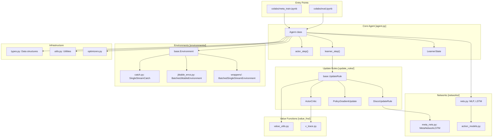
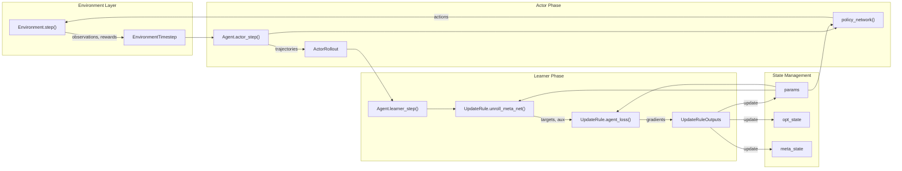
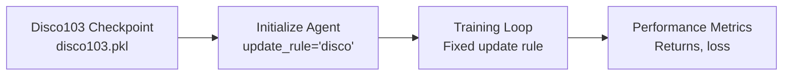
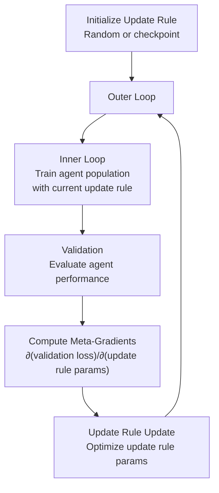

<!-- source: DeepWiki mcp.deepwiki.com · repo google-deepmind/disco_rl · page 1 Overview · fetched 2026-10-26 -->

# Overview

<details>
<summary>Relevant source files</summary>

The following files were used as context for generating this wiki page:

- [README.md](README.md)

</details>


## Purpose and Scope

This document provides a high-level introduction to DiscoRL, a JAX-based research framework for discovering and evaluating reinforcement learning algorithms. It explains the system's architecture, core concepts, and operational modes. For step-by-step usage instructions, see the [Getting Started](#2) guide. For detailed component documentation, see [Core Architecture](#3).

**Sources**: [README.md:1-94]()

## What is DiscoRL?

DiscoRL (Discovering Reinforcement Learning) is a minimal JAX harness that implements a meta-learning framework for discovering novel reinforcement learning update rules. The system was used to discover **Disco103**, a state-of-the-art RL algorithm published in Nature (2025).

The framework supports two primary operational modes:

| Mode | Purpose | Entry Point | Description |
|------|---------|-------------|-------------|
| **Meta-Evaluation** | Apply discovered rules | `colabs/eval.ipynb` | Train agents using pre-discovered update rules (e.g., Disco103) with fixed parameters |
| **Meta-Training** | Discover new rules | `colabs/meta_train.ipynb` | Learn new update rules from scratch using bi-level optimization |

The system provides original meta-learned weights for Disco103 and a modular architecture that allows researchers to compare discovered algorithms against standard baselines like Actor-Critic and Policy Gradient.

**Sources**: [README.md:1-17]()

## System Architecture

### High-Level Module Organization



**Diagram: Main modules and their relationships in DiscoRL**

The system is organized into six primary layers:

1. **Entry Points**: Jupyter notebooks that demonstrate meta-evaluation and meta-training workflows
2. **Core Agent**: The `Agent` class orchestrates training by coordinating actor rollouts and learner updates
3. **Update Rules**: Pluggable implementations of RL algorithms (Disco103, Actor-Critic, Policy Gradient)
4. **Networks**: Neural network architectures including policy networks and meta-networks
5. **Environments**: Batched environment interface with CPU and JAX-jittable implementations
6. **Infrastructure**: Shared types, utilities, and optimizers

**Sources**: [README.md:37-56](), [agent.py](), [update_rules/](), [networks/](), [environments/]()

### Data Flow Architecture



**Diagram: Data flow through the training loop**

Training proceeds through a cycle where:

1. **Environment** produces `EnvironmentTimestep` containing observations and rewards
2. **Actor** uses the policy network to select actions and collect trajectories into `ActorRollout`
3. **Learner** processes rollouts through two phases:
   - `unroll_meta_net()`: Computes learning targets and auxiliary outputs
   - `agent_loss()`: Calculates per-step losses and gradients
4. **State Update**: Parameters, optimizer state, and meta-state are updated

For details on the `Agent` class, see [Agent System](#3.1). For update rule implementations, see [Update Rules](#3.3).

**Sources**: [agent.py](), [types.py](), [update_rules/base.py]()

## Core Concepts

### Meta-Training vs Meta-Evaluation

DiscoRL operates in two distinct modes that serve different research purposes:

**Meta-Evaluation Mode**

In meta-evaluation, the system evaluates a fixed, pre-discovered update rule (typically Disco103) by training agents on target tasks:



**Diagram: Meta-evaluation workflow**

- Update rule parameters are **frozen**
- Only agent policy parameters are trained
- Measures how well the discovered algorithm performs on the task
- Uses a single training loop with actor rollouts and learner updates

**Meta-Training Mode**

In meta-training, the system discovers new update rules through bi-level optimization:



**Diagram: Meta-training workflow**

- Update rule parameters are **learned**
- Inner loop: Train agent policies using current update rule
- Outer loop: Update the update rule based on agent performance
- Requires multiple agent populations for gradient estimation
- Optimizes update rules to produce agents that learn efficiently

For detailed tutorials, see [Meta-Evaluation Tutorial](#2.1) and [Meta-Training Tutorial](#2.2).

**Sources**: [colabs/eval.ipynb](), [colabs/meta_train.ipynb](), [README.md:10-15]()

### Update Rule Plugin Architecture

DiscoRL implements a **plugin architecture** that allows different RL algorithms to be swapped seamlessly. All update rules implement the `base.UpdateRule` interface:

| Component | Role | Key Methods |
|-----------|------|-------------|
| `base.UpdateRule` | Abstract interface | `init_params()`, `init_meta_state()`, `unroll_meta_net()`, `agent_loss()` |
| `DiscoUpdateRule` | Disco103 implementation | Uses `MetaNetworkLSTM` for learned components |
| `ActorCritic` | Baseline algorithm | Uses V-trace advantages with EMA normalization |
| `PolicyGradientUpdate` | Baseline algorithm | Simple policy gradient with advantages |

The `Agent` class selects an update rule by name during initialization:

```python
# From agent.py
agent = Agent(
    update_rule_name='disco',  # Options: 'disco', 'actor_critic', 'policy_gradient'
    # ... other parameters
)
```

Each update rule is responsible for:

1. **Initialization**: Creating learnable parameters and meta-state
2. **Target Computation**: Computing learning targets via `unroll_meta_net()`
3. **Loss Calculation**: Computing per-step losses via `agent_loss()`
4. **Output Specification**: Defining auxiliary outputs via `flat_output_spec()`

This design enables researchers to:
- Compare discovered algorithms against baselines using identical infrastructure
- Implement new update rules by subclassing `base.UpdateRule`
- Meta-train update rules without modifying the core agent logic

For detailed documentation, see [Update Rules](#3.3).

**Sources**: [agent.py](), [update_rules/base.py](), [update_rules/disco.py](), [update_rules/actor_critic.py](), [update_rules/policy_gradient.py]()

### Key Data Structures

DiscoRL uses strongly-typed data structures defined in `types.py` to enforce contracts between components:

| Type | Purpose | Key Fields |
|------|---------|------------|
| `EnvironmentTimestep` | Environment observations | `observation`, `reward`, `is_first`, `is_last` |
| `ActorRollout` | Actor trajectory data | `timesteps`, `action_tm1`, `logits_tm1`, `value_tm1` |
| `UpdateRuleInputs` | Inputs to update rules | `rollout`, `meta_state`, `params`, `rng` |
| `UpdateRuleOutputs` | Update rule results | `loss`, `aux`, `meta_state`, `metrics` |
| `LearnerState` | Agent training state | `params`, `opt_state`, `meta_state` |
| `MetaParams` | Meta-learned parameters | `input_transforms`, `lstm_params` (for Disco) |

These structures flow through the system as shown in the data flow diagram above. The clear separation between environment state, actor outputs, and learner inputs enables modular testing and debugging.

**Sources**: [types.py]()

## Repository Structure

```
disco_rl/
├── colabs/                      # Entry points and examples
│   ├── eval.ipynb              # Meta-evaluation tutorial
│   └── meta_train.ipynb        # Meta-training tutorial
├── disco_rl/
│   ├── agent.py                # Generic RL agent implementation
│   ├── types.py                # Core data structures
│   ├── utils.py                # Helper utilities
│   ├── optimizers.py           # Optimizer implementations
│   ├── environments/           # Environment interface and implementations
│   │   ├── base.py            # Abstract Environment class
│   │   ├── catch.py           # CPU-based Catch game
│   │   ├── jittable_envs.py   # JAX-jittable environments
│   │   └── wrappers/          # Batching and streaming wrappers
│   ├── networks/               # Neural network architectures
│   │   ├── nets.py            # MLP and LSTM policy networks
│   │   ├── meta_nets.py       # LSTM meta-networks for Disco
│   │   └── action_models.py   # Action-conditional models
│   ├── update_rules/           # RL algorithm implementations
│   │   ├── base.py            # UpdateRule interface
│   │   ├── disco.py           # Disco103 discovered rule
│   │   ├── actor_critic.py    # Actor-Critic baseline
│   │   └── policy_gradient.py # Policy Gradient baseline
│   └── value_fns/              # Value function utilities
│       ├── value_utils.py     # Advantage computation
│       └── v_trace.py         # V-trace implementation
└── checkpoints/                # Pre-trained weights
    └── disco103.pkl           # Disco103 meta-learned parameters
```

The modular structure reflects the plugin architecture: each major component (environments, networks, update rules) has its own directory with a base interface and multiple implementations.

**Sources**: [README.md:37-56]()

## System Characteristics

### JAX-Based Implementation

DiscoRL is built entirely in JAX, enabling:

- **JIT Compilation**: All performance-critical functions are JIT-compiled for speed
- **Automatic Differentiation**: Meta-gradients computed via `jax.grad`
- **Parallelization**: Multi-device training via `jax.pmap` and `jax.vmap`
- **Functional Programming**: Pure functions with explicit state management

For details on parallelization strategies, see [JAX Parallelization](#4.1).

### Haiku Neural Networks

All neural networks are implemented using [Haiku](https://github.com/deepmind/dm-haiku), DeepMind's neural network library for JAX. Haiku provides:

- Stateless neural network modules
- Functional parameter management
- Integration with JAX transformations

Networks are defined in `networks/nets.py` and `networks/meta_nets.py`.

### Batched Environments

All environments in DiscoRL are **batched by design**. The `base.Environment` interface requires a `batch_size` attribute, and all operations (step, reset) operate on batches of environment instances simultaneously. This design:

- Maximizes GPU/TPU utilization
- Simplifies vectorization via `jax.vmap`
- Enables efficient data collection for meta-training

See [Environments](#3.2) for implementation details.

**Sources**: [environments/base.py](), [networks/nets.py](), [networks/meta_nets.py]()

## Getting Started

To begin using DiscoRL:

1. **Installation**: Follow the [Getting Started](#2) guide to install dependencies
2. **Meta-Evaluation**: Work through the [Meta-Evaluation Tutorial](#2.1) to train agents with Disco103
3. **Meta-Training**: Explore the [Meta-Training Tutorial](#2.2) to discover new update rules
4. **Deep Dives**: Consult the [Core Architecture](#3) section for detailed component documentation

For architectural details about specific components:
- Agent and training loop: [Agent System](#3.1)
- Environment implementations: [Environments](#3.2)
- Update rule details: [Update Rules](#3.3)
- Network architectures: [Neural Networks](#3.4)

**Sources**: [README.md:19-58]()

---

