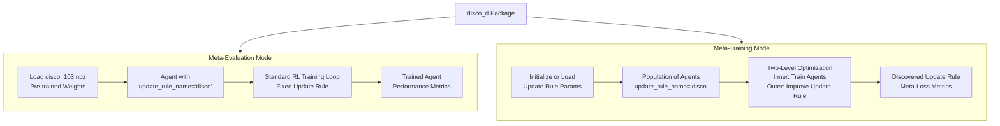
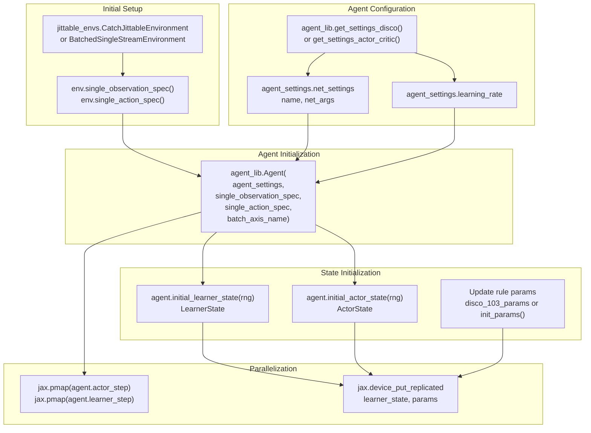
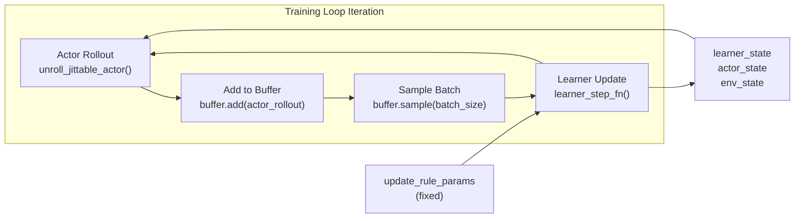
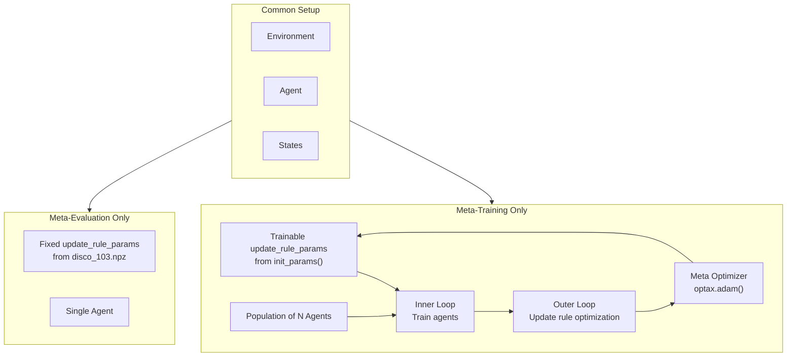
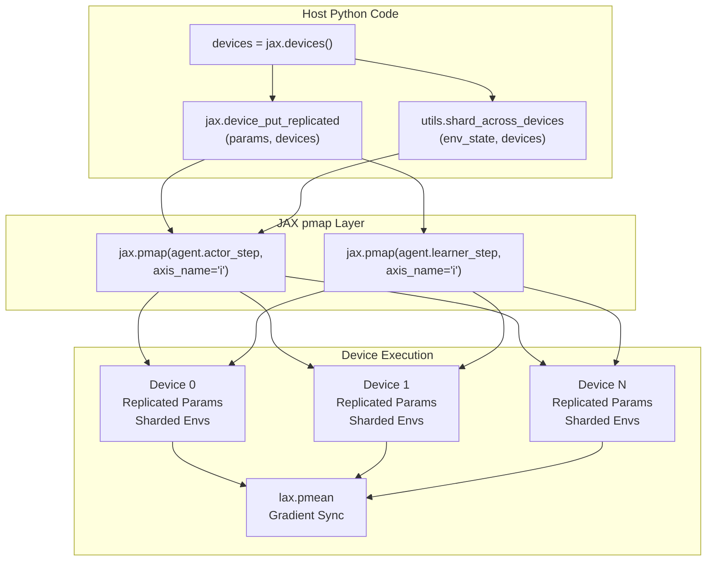

<!-- source: DeepWiki mcp.deepwiki.com · repo google-deepmind/disco_rl · page 2 Getting Started · fetched 2026-10-26 -->

# Getting Started

<details>
<summary>Relevant source files</summary>

The following files were used as context for generating this wiki page:

- [README.md](README.md)
- [colabs/eval.ipynb](colabs/eval.ipynb)

</details>


This page provides installation instructions and basic usage patterns for DiscoRL. It covers the two primary operational modes (meta-evaluation and meta-training) and demonstrates the minimal setup required to run experiments. For detailed walkthroughs of each mode, see [Meta-Evaluation Tutorial](#2.1) and [Meta-Training Tutorial](#2.2). For architectural details about the core components, see [Core Architecture](#3).

## Installation

DiscoRL can be installed from GitHub using pip. The package requires Python 3 and includes all necessary dependencies (JAX, Haiku, RLax, etc.).

**Virtual Environment Installation:**

```bash
python3 -m venv disco_rl_venv
source disco_rl_venv/bin/activate
pip install git+https://github.com/google-deepmind/disco_rl.git
```

**Google Colab Installation:**

```bash
!pip install git+https://github.com/google-deepmind/disco_rl.git
```

After installation, the package provides access to:
- `disco_rl.agent` - The `Agent` class for RL training
- `disco_rl.environments` - Environment implementations and interfaces
- `disco_rl.update_rules` - Update rule implementations (`disco`, `actor_critic`, `policy_gradient`)
- `disco_rl.networks` - Policy and meta-network architectures
- `disco_rl.types` - Data structures for rollouts and states

**Sources:** [README.md:19-33](), [colabs/eval.ipynb:20-48]()

## Operational Modes

DiscoRL supports two distinct operational modes that share the same infrastructure but serve different purposes.

### Operational Mode Overview



**Sources:** [README.md:9-15](), [colabs/eval.ipynb:8-14]()

### Meta-Evaluation Mode

Meta-evaluation uses a pre-discovered update rule (Disco103) to train an agent on an environment. This mode:
- Loads fixed update rule parameters from `disco_103.npz`
- Creates an `Agent` with `update_rule_name='disco'`
- Runs a standard RL training loop where the update rule is not modified
- Evaluates the discovered algorithm's performance

Entry point: `colabs/eval.ipynb`

**Sources:** [README.md:11-12](), [colabs/eval.ipynb:8-14]()

### Meta-Training Mode

Meta-training discovers new update rules through meta-learning. This mode:
- Initializes update rule parameters randomly or from a checkpoint
- Creates a population of agents for meta-gradient estimation
- Runs inner loops (agent training) and outer loops (update rule optimization)
- Produces new learned update rules

Entry point: `colabs/meta_train.ipynb`

**Sources:** [README.md:14-15]()

## Core Components Setup

The following diagram shows the key code entities required for basic setup in both modes:

### Component Initialization Flow



**Sources:** [colabs/eval.ipynb:89-138](), [colabs/eval.ipynb:296-319]()

## Meta-Evaluation Quick Start

This section demonstrates the minimal code pattern for meta-evaluation mode.

### Step 1: Download Disco103 Weights

```python
import numpy as np

# Download disco_103.npz from repository
disco_103_url = "https://raw.githubusercontent.com/google-deepmind/disco_rl/main/disco_rl/update_rules/weights/disco_103.npz"

# Unflatten the weight structure
def unflatten_params(flat_params):
    params = {}
    for key_wb in flat_params:
        key = '/'.join(key_wb.split('/')[:-1])
        params[key] = {'b': flat_params[f'{key}/b'], 'w': flat_params[f'{key}/w']}
    return params

with open('disco_103.npz', 'rb') as file:
    disco_103_params = unflatten_params(np.load(file))
```

**Sources:** [colabs/eval.ipynb:59-79]()

### Step 2: Create Environment and Agent

```python
from disco_rl.environments import jittable_envs
from disco_rl import agent as agent_lib

# Create environment
env = jittable_envs.CatchJittableEnvironment(
    batch_size=64,
    env_settings=jittable_envs.get_config_catch()
)

# Configure agent
agent_settings = agent_lib.get_settings_disco()
agent_settings.net_settings.name = 'mlp'
agent_settings.learning_rate = 1e-2

# Initialize agent
agent = agent_lib.Agent(
    agent_settings=agent_settings,
    single_observation_spec=env.single_observation_spec(),
    single_action_spec=env.single_action_spec(),
    batch_axis_name='i'
)
```

**Sources:** [colabs/eval.ipynb:89-135]()

### Step 3: Initialize States and Parallelize

```python
import jax

rng_key = jax.random.PRNGKey(0)
devices = tuple(jax.devices())

# Initialize states
env_state, ts = env.reset(rng_key)
learner_state = agent.initial_learner_state(rng_key)
actor_state = agent.initial_actor_state(rng_key)

# Replicate to devices
learner_state = jax.device_put_replicated(learner_state, devices)
actor_state = jax.device_put_replicated(actor_state, devices)
update_rule_params = jax.device_put_replicated(disco_103_params, devices)

# Create parallelized functions
actor_step_fn = jax.pmap(agent.actor_step, axis_name='i', devices=devices)
learner_step_fn = jax.pmap(agent.learner_step, axis_name='i', devices=devices)
```

**Sources:** [colabs/eval.ipynb:290-319]()

### Step 4: Training Loop Structure

The training loop consists of three phases:

1. **Actor Rollout**: Generate trajectories using `actor_step_fn`
2. **Buffer Management**: Store rollouts in a replay buffer
3. **Learner Update**: Sample from buffer and update parameters using `learner_step_fn`



**Sources:** [colabs/eval.ipynb:274-396]()

### Key Types and Data Structures

The following table shows the primary data structures used in the training loop:

| Type | Module | Purpose |
|------|--------|---------|
| `LearnerState` | `disco_rl.types` | Contains `params`, `opt_state`, `meta_state` |
| `ActorState` | `disco_rl.types` | Policy recurrent state for actor rollouts |
| `ActorRollout` | `disco_rl.types` | Trajectory data: observations, actions, rewards, discounts |
| `EnvironmentTimestep` | `disco_rl.types` | Single environment step: observation, reward, discount |
| `EnvState` | environments | Environment-specific state (game state + RNG) |

**Sources:** [colabs/eval.ipynb:38-46](), [disco_rl/types.py:1-100]()

## Meta-Training Quick Start

Meta-training follows a similar setup but includes additional components for meta-optimization.

### Key Differences from Meta-Evaluation



**Sources:** [README.md:14-15](), [colabs/meta_train.ipynb:1-50]()

### Population and Meta-Gradient Setup

Meta-training creates multiple agent instances for meta-gradient estimation:

1. Initialize a population of `N` agents with different random seeds
2. Run inner loops: Each agent trains for `num_inner_steps` using current update rule
3. Evaluate on validation rollouts to compute meta-loss
4. Calculate gradients of meta-loss with respect to update rule parameters
5. Average gradients across population and update the update rule

The meta-optimization loop modifies `update_rule_params` while the inner loop modifies each agent's `learner_state.params`.

**Sources:** [colabs/meta_train.ipynb:1-100]()

## Configuration Options

### Agent Settings

The `agent_lib.get_settings_disco()` function returns an `AgentSettings` object with the following key fields:

| Field | Purpose | Example Values |
|-------|---------|----------------|
| `update_rule_name` | Selects update rule implementation | `'disco'`, `'actor_critic'`, `'policy_gradient'` |
| `net_settings.name` | Policy network architecture | `'mlp'`, `'lstm'` |
| `net_settings.net_args` | Network hyperparameters | `dense=(512, 512)`, `lstm_size=128` |
| `learning_rate` | Optimizer learning rate | `1e-2`, `1e-3` |
| `entropy_cost` | Entropy regularization weight | `0.01` |

**Sources:** [colabs/eval.ipynb:102-115]()

### Environment Settings

For `CatchJittableEnvironment`:

```python
env_settings = jittable_envs.get_config_catch()
# Returns configuration with:
# - rows: 10
# - columns: 5
# - seed: random seed value
```

**Sources:** [colabs/eval.ipynb:93-96]()

## Replay Buffer Usage

DiscoRL includes a `SimpleReplayBuffer` implementation for off-policy training:

```python
from disco_rl import types

buffer = SimpleReplayBuffer(capacity=1024, seed=17)

# Add trajectories
buffer.add(actor_rollout)  # actor_rollout is types.ActorRollout

# Sample batch
learner_rollout = buffer.sample(batch_size=64)
```

The buffer:
- Stores `ActorRollout` objects
- Implements FIFO replacement when full
- Splits rollouts along batch dimension for storage
- Samples uniformly with replacement

**Sources:** [colabs/eval.ipynb:229-263]()

## Device Parallelization

DiscoRL uses JAX's `pmap` for data parallelism across TPUs/GPUs:



**Sources:** [colabs/eval.ipynb:296-314]()

### Replication vs Sharding

- **Replicated Data**: Model parameters and update rule parameters are identical across all devices using `jax.device_put_replicated()`
- **Sharded Data**: Environment states are distributed across devices using `utils.shard_across_devices()`, allowing different devices to simulate different environments
- **Synchronization**: Gradients are averaged across devices via `jax.lax.pmean` with `axis_name='i'`

**Sources:** [colabs/eval.ipynb:316-330]()

## Next Steps

After completing basic setup:

- **For detailed meta-evaluation workflow**: See [Meta-Evaluation Tutorial](#2.1) for complete walkthrough including rollout generation, buffer management, and metrics collection
- **For detailed meta-training workflow**: See [Meta-Training Tutorial](#2.2) for population setup, inner/outer loop mechanics, and meta-gradient computation
- **For architectural deep-dive**: See [Core Architecture](#3) for detailed documentation of `Agent`, environments, update rules, and networks
- **For JAX parallelization details**: See [JAX Parallelization](#4.1)

The two operational modes share most infrastructure, differing primarily in whether update rule parameters are fixed (meta-evaluation) or trainable (meta-training).

**Sources:** [README.md:35-58]()

---

