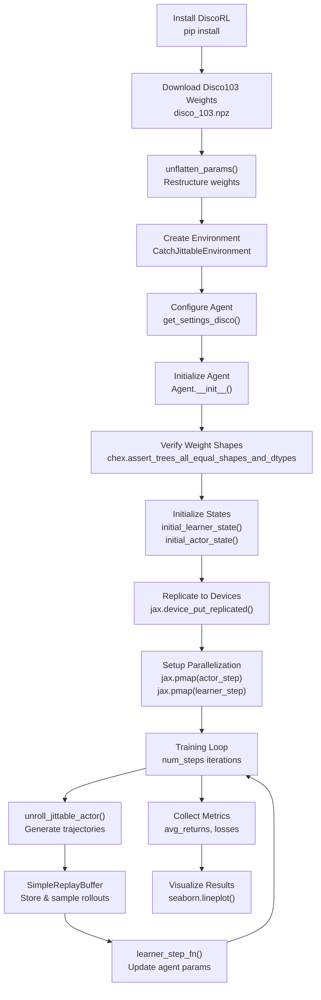
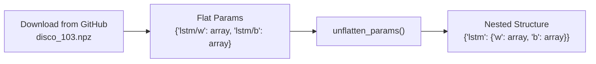
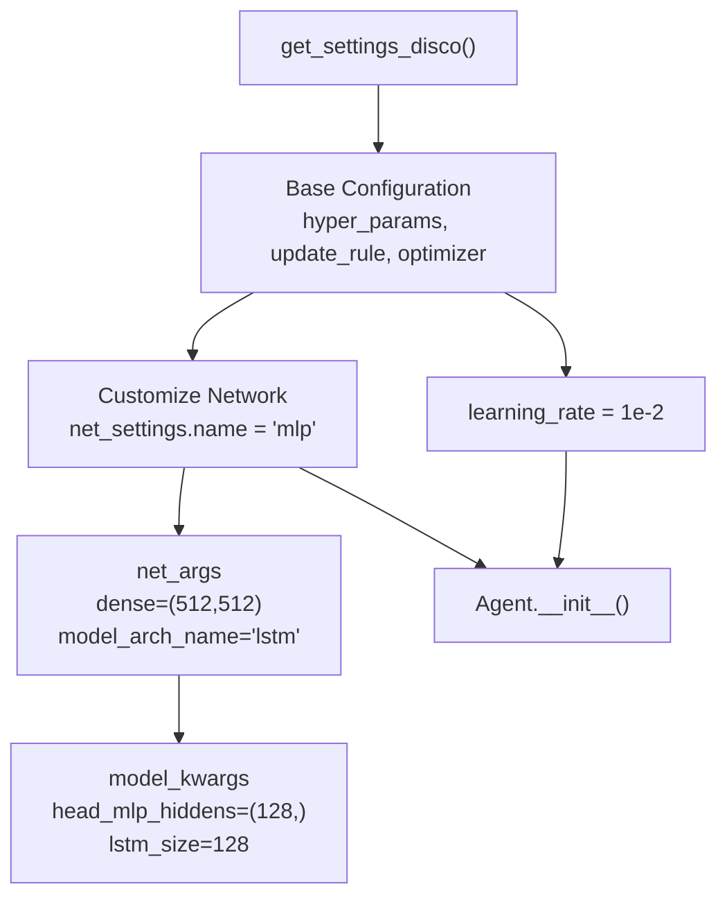
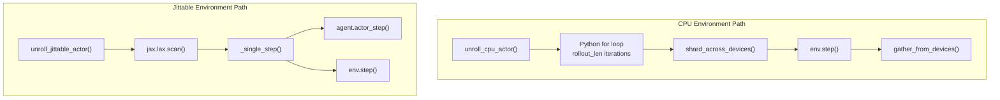
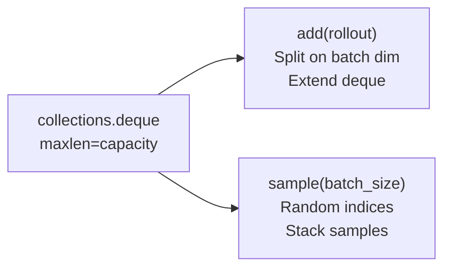
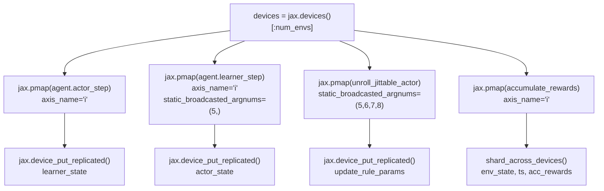
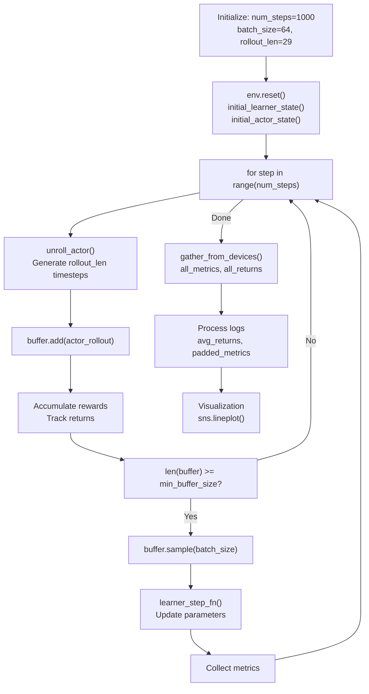
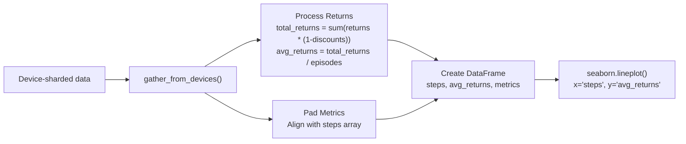
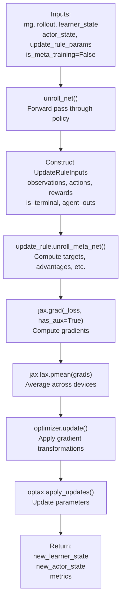
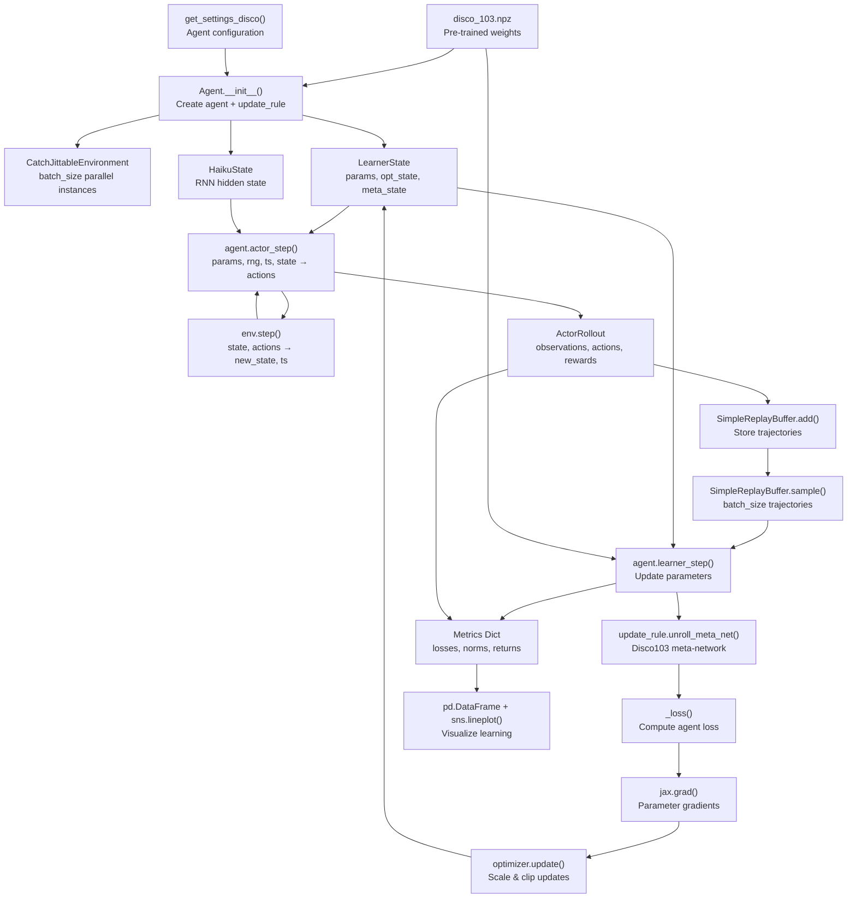

<!-- source: DeepWiki mcp.deepwiki.com · repo google-deepmind/disco_rl · page 2.1 Meta-Evaluation Tutorial · fetched 2026-10-26 -->

# Meta-Evaluation Tutorial

<details>
<summary>Relevant source files</summary>

The following files were used as context for generating this wiki page:

- [colabs/eval.ipynb](colabs/eval.ipynb)
- [disco_rl/agent.py](disco_rl/agent.py)

</details>


## Purpose and Scope

This tutorial demonstrates how to evaluate the pre-trained Disco103 update rule on the Catch environment. Meta-evaluation refers to using a fixed, pre-discovered update rule to train an RL agent, as opposed to meta-training where the update rule itself is being learned. This page walks through the complete evaluation pipeline including loading pre-trained weights, configuring the agent, setting up parallelization, running the training loop, and collecting metrics.

For information about meta-training update rules from scratch, see [Meta-Training Tutorial](#2.2). For details on the Agent class itself, see [Agent System](#3.1).

**Sources:** [colabs/eval.ipynb:1-14]()

## Overview: Evaluation Pipeline

The meta-evaluation pipeline involves several key stages that transform a pre-trained update rule into performance metrics on an environment:



**Sources:** [colabs/eval.ipynb:1-444]()

## Installation and Imports

The evaluation notebook begins with installation and importing necessary dependencies:

```python
!pip install git+https://github.com/google-deepmind/disco_rl.git
```

Key imports include:
- **JAX ecosystem**: `jax`, `jax.numpy`, `chex`, `optax`, `rlax`, `distrax`
- **DiscoRL core**: `disco_rl.agent`, `disco_rl.types`, `disco_rl.utils`
- **Environments**: `disco_rl.environments.jittable_envs`
- **Visualization**: `pandas`, `seaborn`

An `axis_name = 'i'` is defined for JAX parallelization via `jax.pmap`.

**Sources:** [colabs/eval.ipynb:20-48]()

## Loading Pre-Trained Disco103 Weights

The Disco103 weights are stored as a flat dictionary with keys like `"layer_name/w"` and `"layer_name/b"`. The `unflatten_params()` function restructures them into nested dictionaries:



The function groups parameters by layer:

```python
def unflatten_params(flat_params):
    params = {}
    for key_wb in flat_params:
        key = '/'.join(key_wb.split('/')[:-1])
        params[key] = {
            'b': flat_params[f'{key}/b'],
            'w': flat_params[f'{key}/w'],
        }
    return params
```

**Sources:** [colabs/eval.ipynb:54-83]()

## Environment Setup

The environment factory function creates a `CatchJittableEnvironment`:

| Component | Purpose |
|-----------|---------|
| `jittable_envs.CatchJittableEnvironment` | JAX-jittable Catch environment for efficient parallel execution |
| `jittable_envs.get_config_catch()` | Default configuration for Catch game |
| `batch_size` parameter | Number of parallel environment instances |

```python
def get_env(batch_size: int) -> base_env.Environment:
    return jittable_envs.CatchJittableEnvironment(
        batch_size=batch_size, 
        env_settings=jittable_envs.get_config_catch()
    )
```

A dummy environment with `batch_size=1` is created initially for agent initialization, which requires environment specs.

**Sources:** [colabs/eval.ipynb:89-100]()

## Agent Configuration

Agent settings are obtained via `agent_lib.get_settings_disco()` and customized:



### Key Configuration Parameters

| Parameter | Value | Purpose |
|-----------|-------|---------|
| `update_rule_name` | `'disco'` | Use Disco103 update rule |
| `net_settings.name` | `'mlp'` | MLP policy network type |
| `dense` | `(512, 512)` | Hidden layer sizes |
| `model_arch_name` | `'lstm'` | LSTM for recurrent state |
| `lstm_size` | `128` | LSTM hidden state size |
| `learning_rate` | `1e-2` | Optimizer learning rate |
| `head_w_init_std` | `1e-2` | Policy head initialization std |

The agent is initialized with:
- `single_observation_spec`: From environment
- `single_action_spec`: From environment  
- `batch_axis_name`: For JAX parallelization (`'i'`)

**Sources:** [colabs/eval.ipynb:85-138](), [disco_rl/agent.py:319-378]()

## Weight Verification

Before training, the notebook verifies that the downloaded Disco103 parameters match the agent's update rule specification:

```python
random_update_rule_params, _ = agent.update_rule.init_params(jax.random.PRNGKey(0))
if agent_settings.update_rule_name == 'disco':
    chex.assert_trees_all_equal_shapes_and_dtypes(
        random_update_rule_params, disco_103_params
    )
```

This ensures compatibility between the pre-trained weights and the agent architecture.

**Sources:** [colabs/eval.ipynb:124-134]()

## Actor Unrolling Functions

Two unroll functions are provided depending on environment type:



### unroll_cpu_actor()
For CPU environments, this function:
1. Iterates `rollout_len` times in a Python loop
2. Shards timesteps across devices
3. Calls `actor_step_fn` (pmapped)
4. Gathers actions back to CPU
5. Steps the environment
6. Stacks timesteps into `ActorRollout`

### unroll_jittable_actor()
For JAX-jittable environments, this function:
1. Uses `jax.lax.scan` for efficient unrolling
2. Defines `_single_step` inner function
3. Calls `agent.actor_step()` directly (not pmapped version)
4. Steps environment with jittable `env.step()`
5. Returns `ActorRollout` directly from scan

The jittable version is more efficient as the entire unroll is JIT-compiled.

**Sources:** [colabs/eval.ipynb:140-222]()

## Replay Buffer Implementation

The `SimpleReplayBuffer` class provides FIFO storage and sampling:



### Key Methods

| Method | Parameters | Returns | Purpose |
|--------|------------|---------|---------|
| `__init__` | `capacity`, `seed` | - | Initialize deque and RNG |
| `add` | `rollout: ActorRollout` | `None` | Split rollout on batch dim and store |
| `sample` | `batch_size: int` | `ActorRollout` | Random sample from buffer |
| `__len__` | - | `int` | Current buffer size |

The buffer uses `rlax.tree_split_leaves(rollout, axis=2)` to split rollouts along the batch dimension before storing individual trajectories.

**Sources:** [colabs/eval.ipynb:224-267]()

## Parallelization Setup

JAX's `pmap` enables data parallelism across multiple devices (TPUs/GPUs):



### Replication vs. Sharding

| Data | Strategy | Reason |
|------|----------|--------|
| `learner_state` | Replicated | Model parameters identical on all devices |
| `actor_state` | Replicated | Initial RNN state identical |
| `update_rule_params` | Replicated | Disco103 weights identical |
| `env_state` | Sharded | Different environment instances per device |
| `ts` (timesteps) | Sharded | Different observations per device |
| `acc_rewards` | Sharded | Track separate reward accumulation |

**Configuration:**
- `num_envs = batch_size // replay_ratio`
- `replay_ratio = 32` (learner samples 32x more than actor generates)
- `batch_size = 64` (total number of trajectories for learning)

**Sources:** [colabs/eval.ipynb:274-334]()

## Training Loop

The main training loop structure:



### Training Loop Parameters

| Parameter | Value | Purpose |
|-----------|-------|---------|
| `num_steps` | 1000 | Total training iterations |
| `batch_size` | 64 | Trajectories per learner update |
| `rollout_len` | 29 | Timesteps per trajectory |
| `replay_ratio` | 32 | Buffer samples per new trajectory |
| `buffer_capacity` | 1024 | Max trajectories in buffer |
| `min_buffer_size` | 64 | Minimum before learning starts |

### Loop Components

1. **Actor Phase:**
   - Split RNG for current step
   - Call `unroll_actor()` with current parameters
   - Add generated rollout to buffer
   - Accumulate episode returns

2. **Learner Phase (if buffer ready):**
   - Sample batch from replay buffer
   - Call `learner_step_fn()` with:
     - `rng_learner`: Split across devices
     - `learner_rollout`: Sampled trajectories
     - `learner_state`: Current params and optimizer state
     - `actor_state`: RNN state
     - `update_rule_params`: Disco103 weights
     - `is_meta_training=False`: Fixed update rule
   - Collect metrics dictionary

3. **Logging:**
   - Track `total_steps`, `all_rewards`, `all_discounts`, `all_returns`
   - Store metrics from learner updates

**Sources:** [colabs/eval.ipynb:269-399]()

## Metrics Collection and Processing

After training, metrics are gathered and processed:



### Processing Steps

1. **Gather from devices:**
   ```python
   all_metrics, all_rewards, all_discounts, all_returns = (
       utils.gather_from_devices((all_metrics, all_rewards, all_discounts, all_returns))
   )
   ```

2. **Calculate average returns:**
   - `total_returns = (all_returns * (1 - all_discounts)).sum()`
   - `total_episodes = (1 - all_discounts).sum()`
   - `avg_returns = total_returns / total_episodes`

3. **Pad metrics:**
   - Metrics only exist after buffer fills
   - Pad with `np.nan` for initial steps
   - `pad_width = len(all_steps) - len(all_metrics)`

4. **Create DataFrame:**
   ```python
   df = pd.DataFrame(dict(
       steps=all_steps,
       avg_returns=avg_returns,
       **padded_metrics,
   ))
   ```

### Available Metrics

From `agent.learner_step()`:
- `total_loss`: Combined loss value
- `global_gradient_norm`: L2 norm of gradients
- `global_update_norm`: L2 norm of parameter updates
- Update rule specific losses (e.g., `pi_cost`, `y_cost`, `z_cost` for Disco)

**Sources:** [colabs/eval.ipynb:402-443]()

## Learner Step Details

The `agent.learner_step()` method orchestrates parameter updates:



### Key Operations

1. **Network Unroll:** [disco_rl/agent.py:259-261]()
   - Forward pass through policy network
   - Computes logits, values for all timesteps

2. **Update Rule Application:** [disco_rl/agent.py:276-286]()
   - `update_rule.unroll_meta_net()` computes targets
   - For Disco103: runs meta-network LSTM
   - Returns `UpdateRuleOuts` and new meta state

3. **Loss Computation:** [disco_rl/agent.py:289-297]()
   - `jax.grad(self._loss)` computes parameter gradients
   - Loss combines update rule losses with masks
   - `has_aux=True` returns auxiliary outputs (metrics)

4. **Gradient Synchronization:** [disco_rl/agent.py:299-300]()
   - `jax.lax.pmean()` averages gradients across devices
   - Only happens if `batch_axis_name` is not None

5. **Parameter Update:** [disco_rl/agent.py:302-306]()
   - Optimizer applies transformations (clipping, Adam)
   - `optax.apply_updates()` adds updates to parameters

**Sources:** [disco_rl/agent.py:248-316]()

## Complete Evaluation Workflow

Putting it all together, here's the data flow through code entities:



**Sources:** [colabs/eval.ipynb:1-444](), [disco_rl/agent.py:1-421]()

## Key Differences from Meta-Training

This evaluation tutorial uses a **fixed** update rule (Disco103) with pre-trained weights. Key distinctions:

| Aspect | Meta-Evaluation | Meta-Training |
|--------|-----------------|---------------|
| Update rule params | Fixed (disco_103.npz) | Being optimized |
| `is_meta_training` flag | `False` | `True` |
| Gradient computation | Only agent params | Agent params + update rule params |
| Outer loop | None | Meta-optimizer updates update rule |
| Loss backprop | Through agent loss | Through agent + meta loss |

In evaluation, `agent.learner_step()` is called with `is_meta_training=False`, which prevents gradients from flowing through the update rule's computations. The update rule parameters remain constant throughout training.

**Sources:** [colabs/eval.ipynb:386](), [disco_rl/agent.py:234-236]()

---

