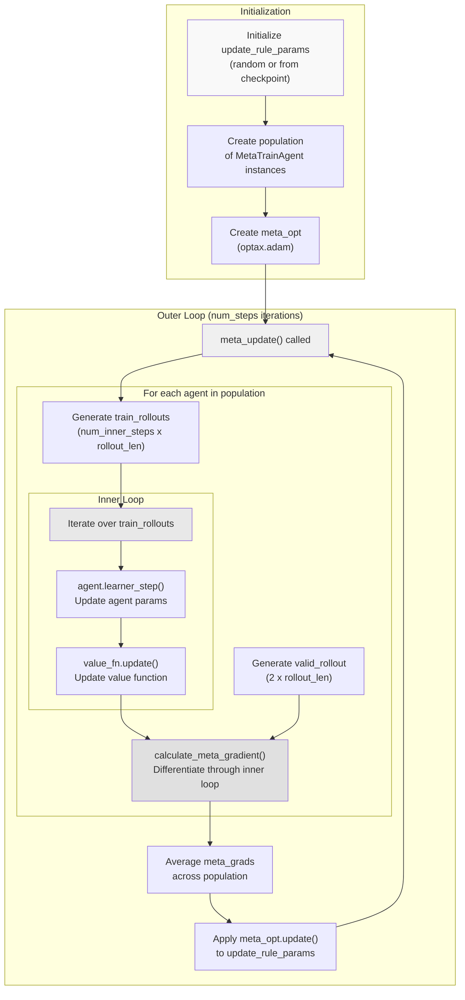
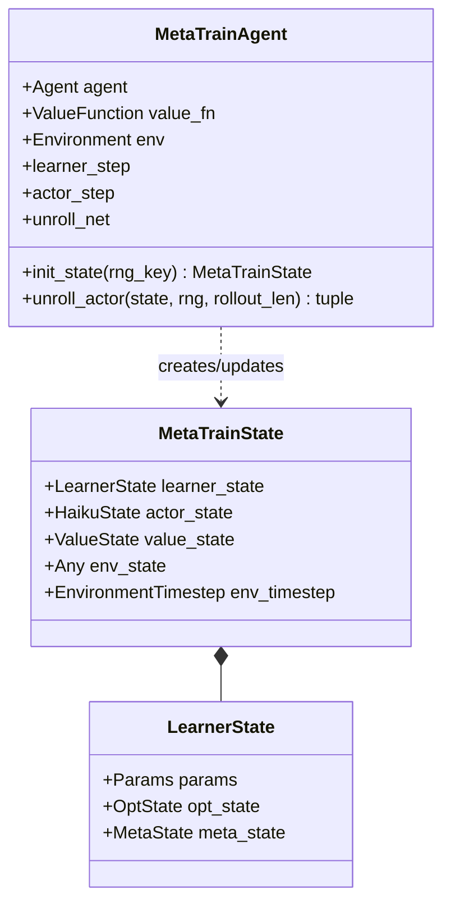
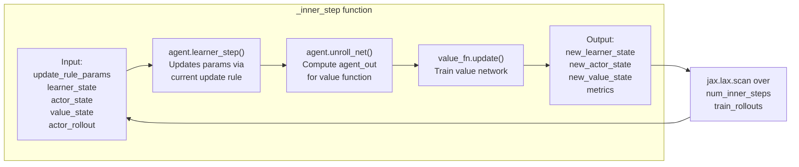
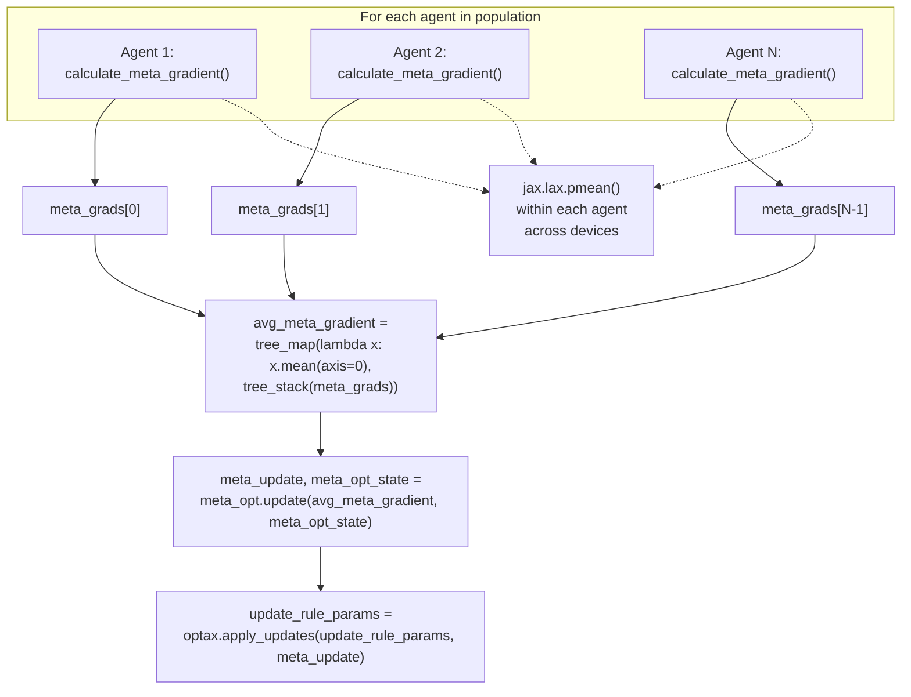
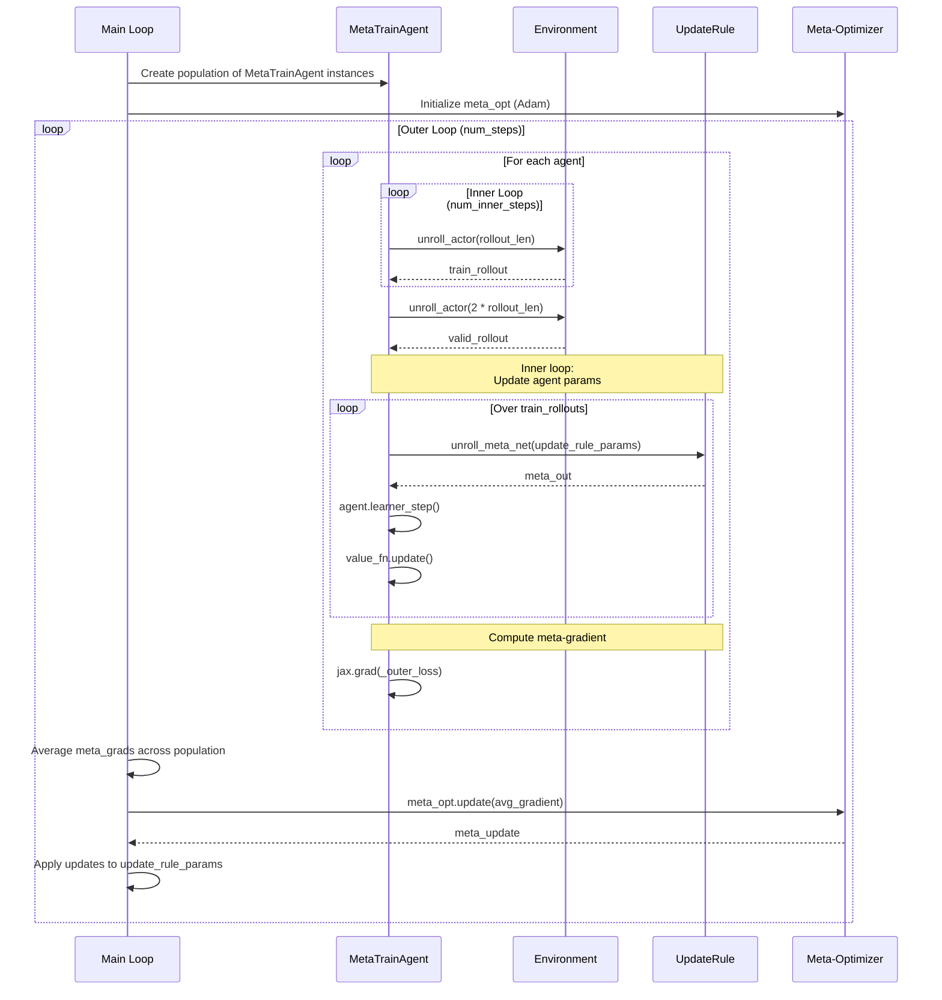

<!-- source: DeepWiki mcp.deepwiki.com · repo google-deepmind/disco_rl · page 2.2 Meta-Training Tutorial · fetched 2026-10-26 -->

# Meta-Training Tutorial

<details>
<summary>Relevant source files</summary>

The following files were used as context for generating this wiki page:

- [colabs/meta_train.ipynb](colabs/meta_train.ipynb)
- [disco_rl/agent.py](disco_rl/agent.py)

</details>


## Purpose and Scope

This tutorial provides a detailed walkthrough of meta-training update rules in DiscoRL, demonstrating how to discover or fine-tune reinforcement learning algorithms from scratch. Meta-training involves a two-level optimization process: an inner loop that trains agent parameters using a candidate update rule, and an outer loop that optimizes the update rule itself based on agent performance.

For evaluating pre-trained update rules like Disco103 on RL tasks, see [Meta-Evaluation Tutorial](#2.1). For technical details on the update rule system, see [Update Rules](#3.3).

**Sources**: [colabs/meta_train.ipynb:8-13]()

---

## Meta-Training Overview

Meta-training in DiscoRL discovers or refines update rules by optimizing their parameters to maximize agent performance across a population of training runs. The process involves:



**Diagram: Meta-Training Process Flow**

The outer loop optimizes `update_rule_params` (the parameters of the meta-network), while the inner loop trains `agent.learner_state.params` (the policy network parameters) using the current update rule. Meta-gradients flow backward through the inner loop to update the update rule.

**Sources**: [colabs/meta_train.ipynb:191-281](), [colabs/meta_train.ipynb:291-448](), [colabs/meta_train.ipynb:459-538]()

---

## Setup and Configuration

### Installation and Imports

Install DiscoRL and import required dependencies:

```python
!pip install git+https://github.com/google-deepmind/disco_rl.git
```

Key imports include `MetaTrainAgent`, `Agent`, and JAX parallelization utilities.

**Sources**: [colabs/meta_train.ipynb:20-54]()

### Loading Initial Update Rule Parameters

Meta-training can start from random initialization or pre-trained weights:

```python
# Option 1: Random initialization
random_update_rule_params, _ = agent.update_rule.init_params(jax.random.PRNGKey(1))
update_rule_params = random_update_rule_params

# Option 2: Load Disco103 checkpoint for fine-tuning
with open('disco_103.npz', 'rb') as file:
    disco_103_params = unflatten_params(np.load(file))
update_rule_params = disco_103_params
```

The `unflatten_params` function restructures the flat parameter dictionary into the nested format expected by Haiku networks.

**Sources**: [colabs/meta_train.ipynb:64-85](), [colabs/meta_train.ipynb:572-573]()

### Agent Configuration

Configure the agent using `get_settings_disco()` or create custom settings:

```python
agent_settings = agent_lib.get_settings_disco()
agent_settings.net_settings.name = 'mlp'
agent_settings.net_settings.net_args = dict(
    dense=(512, 512),
    model_arch_name='lstm',
    head_w_init_std=1e-2,
    model_kwargs=dict(
        head_mlp_hiddens=(256,),
        lstm_size=256,
    ),
)
agent_settings.learning_rate = 5e-4
```

Key settings include:
- `update_rule_name`: `'disco'`, `'actor_critic'`, or `'policy_gradient'`
- `net_settings`: Architecture of the policy network
- `learning_rate`: Learning rate for agent parameter updates
- `hyper_params`: Update rule hyperparameters (costs, discount factors, etc.)

**Sources**: [colabs/meta_train.ipynb:96-142](), [disco_rl/agent.py:319-378]()

### Meta-Training Hyperparameters

Configure the meta-training process:

| Parameter | Description | Example Value |
|-----------|-------------|---------------|
| `num_steps` | Number of outer loop iterations | 800 |
| `num_agents` | Population size | 2 |
| `rollout_len` | Steps per rollout | 16 |
| `num_inner_steps` | Inner loop iterations | 2 |
| `batch_size_per_device` | Environments per device | 32 |
| `meta_opt` learning rate | Meta-optimizer step size | 5e-4 |

**Sources**: [colabs/meta_train.ipynb:549-596]()

---

## Meta-Training Components

### MetaTrainState and MetaTrainAgent

The `MetaTrainState` dataclass bundles all state required for meta-training:



**Diagram: Meta-Training State Components**

- `learner_state`: Agent's trainable parameters, optimizer state, and update rule state
- `actor_state`: Recurrent network hidden states for policy
- `value_state`: Value function parameters and optimizer state
- `env_state`: Environment state (positions, velocities, etc.)
- `env_timestep`: Current environment observations and rewards

The `MetaTrainAgent` class wraps an `Agent` and `ValueFunction`, providing convenience methods for rollout generation and state initialization.

**Sources**: [colabs/meta_train.ipynb:194-281](), [disco_rl/agent.py:38-45]()

### Actor Rollout Generation

Generate trajectories using the current policy:

```python
def unroll_jittable_actor(
    params, actor_state, ts, env_state, rng, env, rollout_len, actor_step_fn
):
    def _single_step(carry, step_rng):
        env_state, ts, actor_state = carry
        actor_timestep, actor_state = actor_step_fn(params, step_rng, ts, actor_state)
        env_state, ts = env.step(env_state, actor_timestep.actions)
        return (env_state, ts, actor_state), actor_timestep
    
    (env_state, ts, actor_state), actor_rollout = jax.lax.scan(
        _single_step, (env_state, ts, actor_state), jax.random.split(rng, rollout_len)
    )
    return types.ActorRollout.from_timestep(actor_rollout), actor_state, ts, env_state
```

The function uses `jax.lax.scan` to efficiently unroll `rollout_len` steps, accumulating `ActorTimestep` objects into an `ActorRollout`. This is JIT-compiled for performance.

**Sources**: [colabs/meta_train.ipynb:154-181]()

### Inner Loop: Agent Parameter Updates

The inner loop trains agent parameters using the current update rule:



**Diagram: Inner Loop Step Function**

Key operations:
1. `agent.learner_step()` computes loss via `update_rule.agent_loss()` and updates parameters
2. `agent.unroll_net()` runs forward pass for value function training
3. `value_fn.update()` fits value network to observed returns
4. Process repeats for `num_inner_steps` rollouts

**Sources**: [colabs/meta_train.ipynb:308-336]()

### Outer Loop: Meta-Gradient Calculation

The outer loop optimizes update rule parameters by differentiating through the inner loop:

```python
def _outer_loss(update_rule_params, agent_state, train_rollouts, valid_rollout, rng):
    # Perform N inner steps
    (_, new_learner_state, new_actor_state, new_value_state), train_metrics = (
        jax.lax.scan(_inner_step, initial_states, (train_rollouts, learner_rngs))
    )
    
    # Run inference on validation rollout with updated params
    agent_rollout_on_valid, _ = hk.BatchApply(...)(valid_rollout.to_env_timestep())
    
    # Calculate meta-loss components
    pg_loss_per_step = utils.differentiable_policy_gradient_loss(...)
    reg_loss = entropy_regularizers + kl_regularizers
    meta_loss = pg_loss_per_step.mean() + reg_loss
    
    return meta_loss, (new_agent_state, train_metrics, meta_log)

# Calculate meta-gradients
meta_grads, outputs = jax.grad(_outer_loss, has_aux=True)(
    update_rule_params, agent_state, train_rollouts, valid_rollout, rng
)
```

**Meta-Loss Composition**:

| Component | Formula | Weight | Purpose |
|-----------|---------|--------|---------|
| Policy Gradient | `-advantages * log π(a\|s)` | 1.0 | Maximize validation returns |
| Policy Entropy | `-H[π]` | 1e-2 | Encourage exploration |
| Y/Z Entropy | `-H[Y], -H[Z]` | 1e-3 | Regularize auxiliary outputs |
| Target KL | `KL(π_target \|\| π_meta)` | 1e-2 | Stabilize meta-updates |
| Output Centering | `mean(dy)^2 + mean(dz)^2 + mean(dp)^2` | 1e-3 | Prevent drift |

The validation rollout is 2x longer than training rollouts to provide a robust estimate of generalization performance.

**Sources**: [colabs/meta_train.ipynb:338-448]()

### Population-Based Meta-Update

Meta-gradients are averaged across the population before updating:



**Diagram: Population-Based Meta-Gradient Averaging**

Each agent independently:
1. Generates `num_inner_steps` training rollouts
2. Performs inner loop updates
3. Evaluates on a validation rollout
4. Computes meta-gradients via `jax.grad(_outer_loss)`
5. Averages gradients across devices via `jax.lax.pmean`

Then all agent gradients are averaged at the population level before applying the meta-optimizer.

**Sources**: [colabs/meta_train.ipynb:459-538]()

---

## Running Meta-Training

### Parallelization Setup

Distribute computation across devices using `jax.pmap`:

```python
# Get available devices
devices = jax.devices()

# Create jitted meta-update function
jitted_meta_update = jax.pmap(meta_update, axis_name=axis_name, devices=devices)

# Replicate initial state to all devices
step_update_rule_params = jax.device_put_replicated(update_rule_params, devices)
step_meta_opt_state = jax.device_put_replicated(meta_opt_state, devices)
step_agents_states = jax.device_put_replicated(agents_states, devices)
```

Each device processes a replica of the population, and gradients are synchronized via `pmean` before parameter updates.

**Sources**: [colabs/meta_train.ipynb:594-614]()

### Training Loop

Execute the outer loop:

```python
for meta_step in tqdm.tqdm(range(num_steps)):
    rng, step_rngs = jax.random.split(rng)
    step_rngs = jax.random.split(step_rngs, len(devices))
    
    (
        step_update_rule_params,
        step_meta_opt_state,
        step_agents_states,
        metrics[meta_step],
        meta_log[meta_step],
    ) = jitted_meta_update(
        update_rule_params=step_update_rule_params,
        meta_opt_state=step_meta_opt_state,
        agents_states=step_agents_states,
        rng=step_rngs,
    )
    
    metrics[meta_step], meta_log[meta_step] = jax.device_get(
        (metrics[meta_step], meta_log[meta_step])
    )

# Gather results from devices
metrics, meta_log = utils.gather_from_devices((metrics, meta_log))
metrics, meta_log = jax.tree.map(lambda x: x.mean(0), (metrics, meta_log))
```

The first call triggers JIT compilation, which can take several minutes. Subsequent iterations execute quickly.

**Sources**: [colabs/meta_train.ipynb:607-641]()

---

## Monitoring Progress

### Key Metrics

Track these metrics to assess meta-training convergence:

| Metric | Interpretation |
|--------|----------------|
| `meta_loss` | Meta-objective value (lower is better) |
| `pg_loss` | Policy gradient component of meta-loss |
| `reg_loss` | Regularization penalties |
| `rewards` | Average reward during inner loop training |
| `pos_rewards` / `neg_rewards` | Count of positive/negative rewards (task-specific) |
| `meta_grad_norm` | Magnitude of meta-gradients |
| `meta_up_norm` | Magnitude of meta-parameter updates |

**Sources**: [colabs/meta_train.ipynb:510-537](), [colabs/meta_train.ipynb:652-668]()

### Visualization

Process and plot metrics using pandas and seaborn:

```python
# Extract metrics to DataFrame
meta_log_cpu = jax.device_get(meta_log)
steps = np.sort(np.unique(list(meta_log_cpu.keys())))
rows = []
for i in steps:
    for key in ('meta_grad_norm', 'meta_up_norm', 'meta_loss', 'rewards', ...):
        rows.append(dict(step=i, value=float(meta_log_cpu[i][key]), f=key))

df = pd.DataFrame(rows)

# Plot training curves
sns.relplot(
    data=df[df.f.isin(['meta_loss', 'rewards'])],
    x='step', y='value', kind='line', col='f', aspect=1.5
)
```

Look for:
- Decreasing `meta_loss` over time
- Increasing `rewards` during inner loop
- Stable gradient norms (not exploding or vanishing)

**Sources**: [colabs/meta_train.ipynb:652-714]()

---

## Complete Meta-Training Example



**Diagram: Meta-Training Sequence**

This sequence diagram illustrates the complete flow of data and control through one outer loop iteration, showing how agent rollouts, inner loop updates, and meta-gradient calculations coordinate to optimize the update rule.

**Sources**: [colabs/meta_train.ipynb:191-641]()

---

