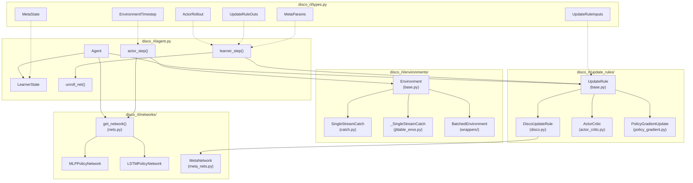
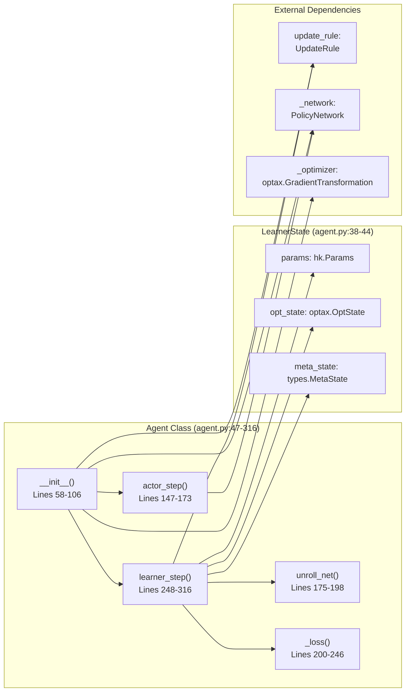
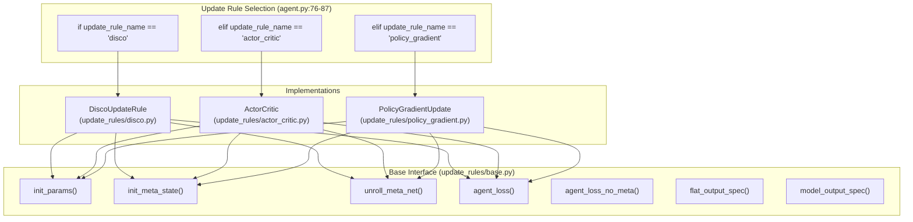
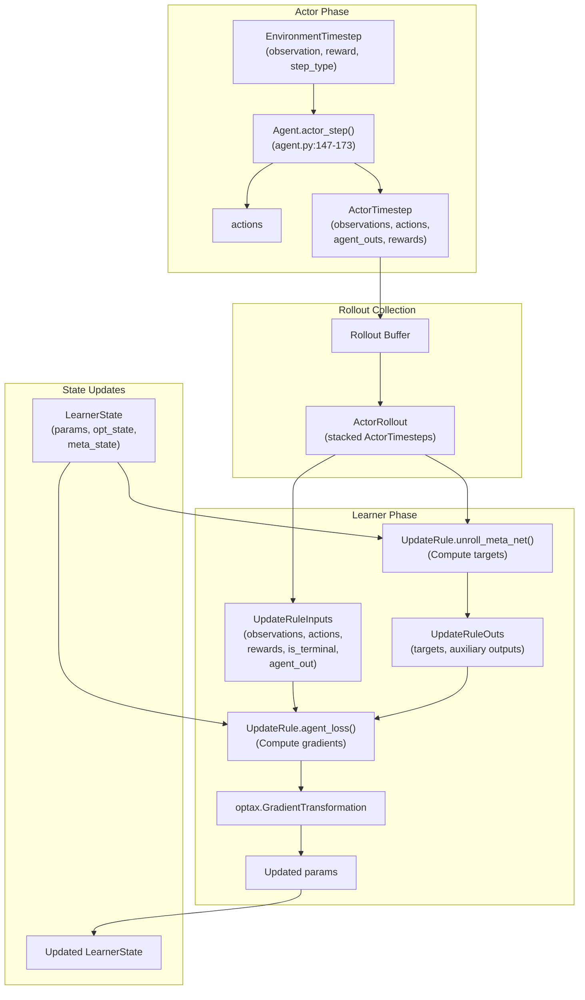
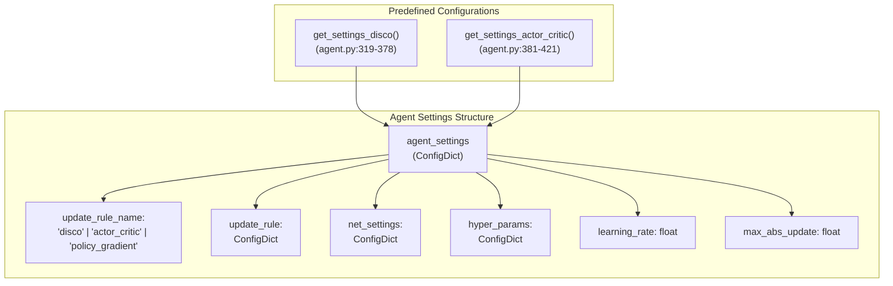

<!-- source: DeepWiki mcp.deepwiki.com · repo google-deepmind/disco_rl · page 3 Core Architecture · fetched 2026-10-26 -->

# Core Architecture

<details>
<summary>Relevant source files</summary>

The following files were used as context for generating this wiki page:

- [README.md](README.md)
- [disco_rl/agent.py](disco_rl/agent.py)

</details>


## Purpose and Scope

This document provides an architectural overview of the DiscoRL system, describing the main components and how they interact to enable both meta-evaluation and meta-training of reinforcement learning update rules. 

For detailed information about specific components, see:
- Agent implementation details: [Agent System](#3.1)
- Environment implementations: [Environments](#3.2)
- Update rule plugins: [Update Rules](#3.3)
- Network architectures: [Neural Networks](#3.4)
- Parallelization strategies: [JAX Parallelization](#4.1)

## System Overview

DiscoRL is built around a modular architecture with five primary components that interact through well-defined interfaces:



**Sources:** [disco_rl/agent.py:1-421](), [README.md:37-56]()

## Core Components

DiscoRL's architecture consists of five interconnected layers:

| Component | Purpose | Key Classes | File Location |
|-----------|---------|-------------|---------------|
| **Agent** | Orchestrates training loop, manages actor/learner split | `Agent`, `LearnerState` | [disco_rl/agent.py]() |
| **Update Rules** | Pluggable learning algorithms | `UpdateRule`, `DiscoUpdateRule`, `ActorCritic`, `PolicyGradientUpdate` | [disco_rl/update_rules/]() |
| **Environments** | Provide observations and process actions | `Environment`, `SingleStreamCatch`, `_SingleStreamCatch` | [disco_rl/environments/]() |
| **Neural Networks** | Policy and meta-network implementations | `MLPPolicyNetwork`, `LSTMPolicyNetwork`, `MetaNetwork` | [disco_rl/networks/]() |
| **Types** | Data structures for inter-component communication | `ActorRollout`, `UpdateRuleInputs`, `EnvironmentTimestep` | [disco_rl/types.py]() |

**Sources:** [README.md:37-56](), [disco_rl/agent.py:1-421]()

## Agent System

The `Agent` class serves as the central orchestrator, implementing the actor-learner architecture pattern:



### Key Responsibilities

1. **Initialization** [disco_rl/agent.py:58-106](): Creates update rule, neural network, and optimizer based on configuration
2. **Actor Step** [disco_rl/agent.py:147-173](): Performs inference to select actions given observations
3. **Learner Step** [disco_rl/agent.py:248-316](): Updates parameters using gradients from the update rule
4. **State Management**: Maintains `LearnerState` [disco_rl/agent.py:38-44]() containing parameters, optimizer state, and meta-state

**Sources:** [disco_rl/agent.py:38-316]()

## Update Rule Plugin System

The update rule system uses a plugin architecture where different learning algorithms implement the `UpdateRule` interface:



### Update Rule Interface Methods

| Method | Purpose | Inputs | Outputs |
|--------|---------|--------|---------|
| `init_params()` | Initialize learnable parameters | `rng` | `MetaParams` |
| `init_meta_state()` | Initialize recurrent state | `rng`, `params` | `MetaState` |
| `unroll_meta_net()` | Compute targets and auxiliary outputs | `meta_params`, `rollout`, `hyper_params` | `UpdateRuleOuts`, `MetaState` |
| `agent_loss()` | Compute per-step losses | `inputs`, `meta_out`, `hyper_params` | `loss`, `log_dict` |
| `flat_output_spec()` | Define network output structure | `action_spec` | Output specification |
| `model_output_spec()` | Define model-specific outputs | `action_spec` | Model specification |

**Sources:** [disco_rl/agent.py:76-87](), [disco_rl/update_rules/base.py]()

## Data Flow Architecture

The system follows a clear data flow pattern through the training loop:



### Data Type Definitions

The `types.py` module defines the data structures that flow between components:

| Type | Purpose | Key Fields |
|------|---------|------------|
| `EnvironmentTimestep` | Environment output | `observation`, `reward`, `step_type`, `discount` |
| `ActorTimestep` | Actor output | `observations`, `actions`, `agent_outs`, `rewards`, `discounts`, `states`, `logits` |
| `ActorRollout` | Trajectory segment | Stacked `ActorTimestep` over time dimension |
| `UpdateRuleInputs` | Update rule inputs | `observations`, `actions`, `rewards`, `is_terminal`, `behaviour_agent_out`, `agent_out` |
| `UpdateRuleOuts` | Update rule outputs | `y_target`, `z_target`, `pi_target`, `values` |
| `MetaParams` | Learnable update rule parameters | Haiku parameters for meta-network |
| `MetaState` | Recurrent update rule state | LSTM states, EMA statistics |

**Sources:** [disco_rl/types.py](), [disco_rl/agent.py:147-316]()

## Integration Pattern

The components integrate through a well-defined call sequence during training:

```mermaid
sequenceDiagram
    participant Env as Environment
    participant Agent as Agent
    participant Net as PolicyNetwork
    participant UR as UpdateRule
    participant Opt as Optimizer

    Note over Env,Opt: Actor Phase (unroll_length steps)
    loop for each timestep
        Env->>Agent: EnvironmentTimestep
        Agent->>Net: actor_step(params, obs)
        Net-->>Agent: agent_outs, actor_state
        Agent->>Env: actions
        Agent->>Agent: Store ActorTimestep
    end
    
    Note over Env,Opt: Learner Phase (single step)
    Agent->>Agent: Stack ActorTimesteps → ActorRollout
    Agent->>UR: unroll_meta_net(rollout, meta_params)
    UR-->>Agent: UpdateRuleOuts, new_meta_state
    Agent->>Net: unroll_net(params, rollout)
    Net-->>Agent: agent_outs
    Agent->>UR: agent_loss(inputs, meta_out)
    UR-->>Agent: loss_per_step
    Agent->>Agent: Compute total_loss, gradients
    Agent->>Opt: update(grads, opt_state)
    Opt-->>Agent: updates, new_opt_state
    Agent->>Agent: Apply updates → new_params
```

**Sources:** [disco_rl/agent.py:147-316]()

## Configuration and Settings

The agent is configured through `ConfigDict` objects that specify the update rule, network architecture, and hyperparameters:



### Configuration Factory Functions

DiscoRL provides pre-configured settings for each update rule:

- **`get_settings_disco()`** [disco_rl/agent.py:319-378](): Returns configuration for Disco103 with pre-tuned hyperparameters
- **`get_settings_actor_critic()`** [disco_rl/agent.py:381-421](): Returns configuration for Actor-Critic baseline

**Sources:** [disco_rl/agent.py:319-421]()

## Key Design Patterns

### 1. Actor-Learner Split

The agent separates action selection (`actor_step`) from parameter updates (`learner_step`), enabling asynchronous execution and parallelization:

- **Actor** [disco_rl/agent.py:147-173](): Performs fast inference using current parameters
- **Learner** [disco_rl/agent.py:248-316](): Performs gradient-based updates using accumulated rollouts

### 2. Plugin Architecture

Update rules implement a common interface, allowing easy substitution:

- Selection at initialization [disco_rl/agent.py:76-87]()
- Interface methods called through the base class
- No conditional logic in the training loop

### 3. Functional State Management

All state is explicitly passed and returned:

- `LearnerState` [disco_rl/agent.py:38-44]() contains all learnable state
- `MetaState` contains update rule-specific state
- No hidden global state or side effects

### 4. JAX-Friendly Design

The architecture is designed for JAX transformations:

- Pure functions throughout the training loop
- Explicit RNG threading
- Data structures compatible with `jax.tree` operations
- Support for `jax.pmap` through `batch_axis_name` parameter [disco_rl/agent.py:64]()

**Sources:** [disco_rl/agent.py:1-421]()

## Summary

DiscoRL's core architecture achieves modularity through:

1. **Clear separation of concerns**: Agent orchestrates, update rules compute losses, networks perform inference
2. **Well-defined interfaces**: `UpdateRule`, `Environment`, and policy network interfaces enable extensibility
3. **Explicit data flow**: All data structures are defined in `types.py` with clear ownership
4. **Configuration-driven**: Settings objects allow easy experimentation without code changes
5. **JAX-native design**: Functional programming patterns enable efficient parallelization

This design allows researchers to evaluate discovered algorithms like Disco103 against baselines using identical infrastructure, or to meta-train new update rules by simply implementing the `UpdateRule` interface.

**Sources:** [README.md:1-94](), [disco_rl/agent.py:1-421]()

---

