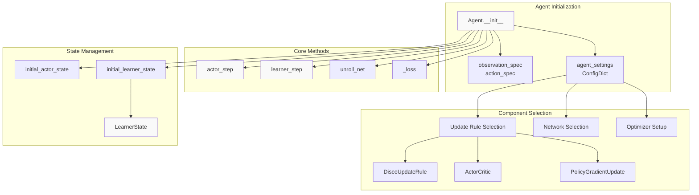
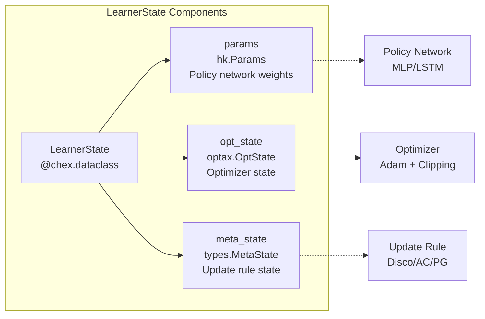
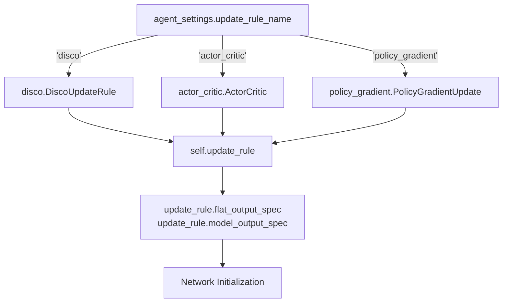
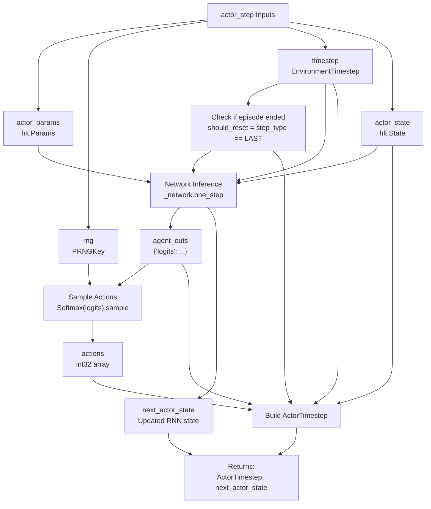
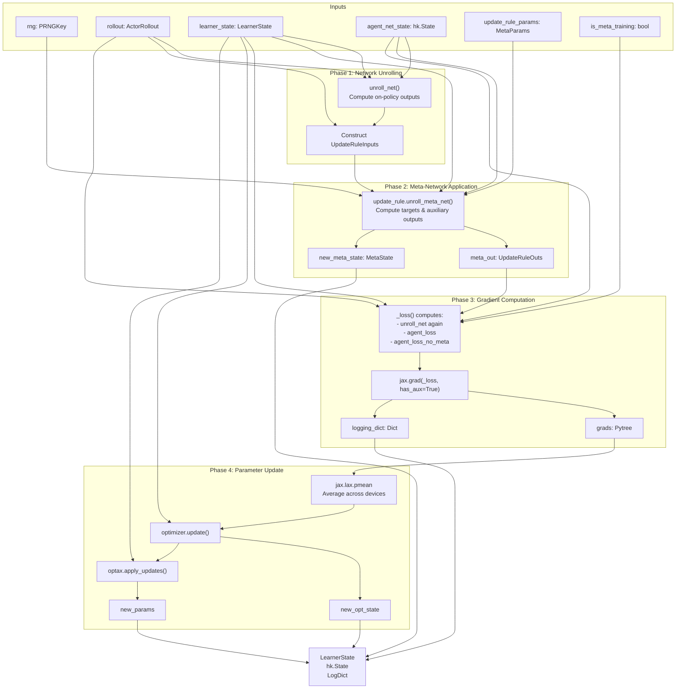
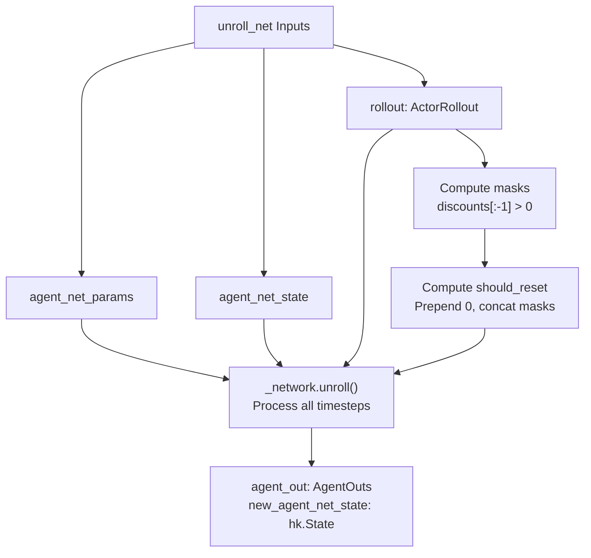
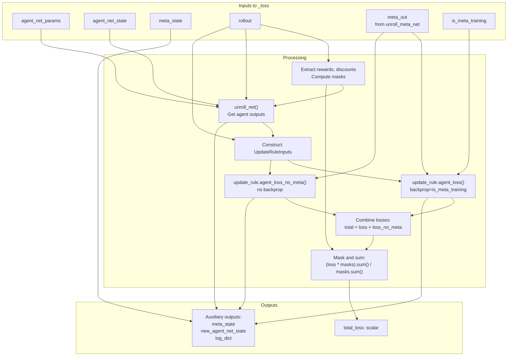
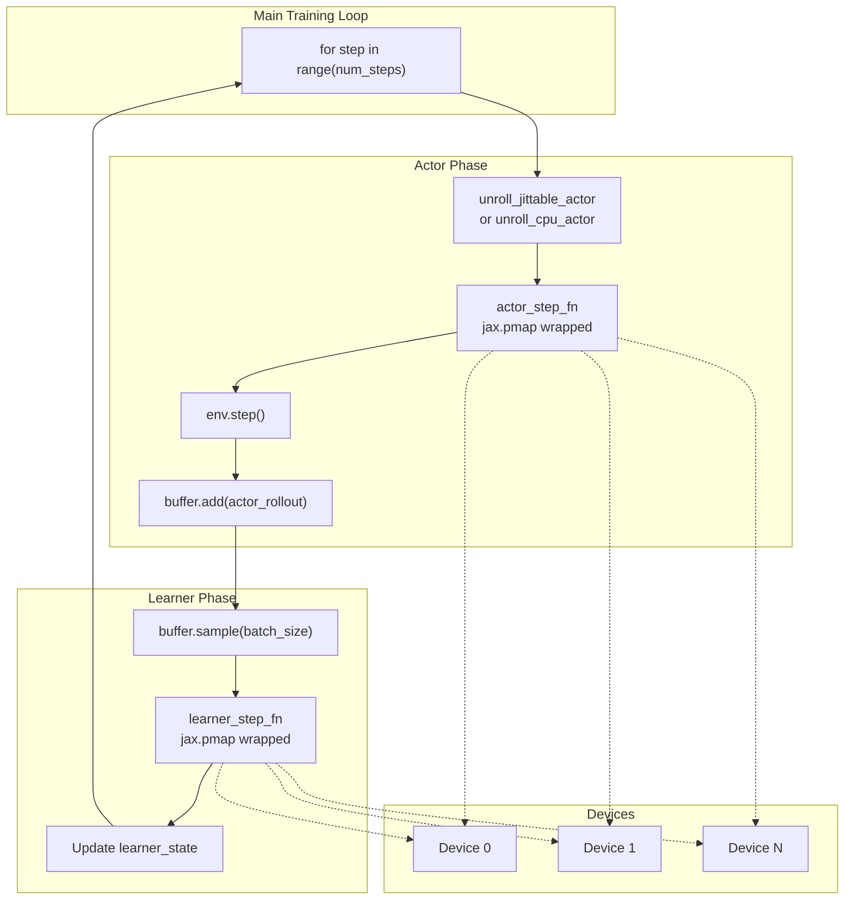

<!-- source: DeepWiki mcp.deepwiki.com · repo google-deepmind/disco_rl · page 3.1 Agent System · fetched 2026-10-26 -->

# Agent System

<details>
<summary>Relevant source files</summary>

The following files were used as context for generating this wiki page:

- [colabs/eval.ipynb](colabs/eval.ipynb)
- [disco_rl/agent.py](disco_rl/agent.py)

</details>


## Purpose and Scope

The Agent System provides the core orchestration layer for training reinforcement learning agents in DiscoRL. The `Agent` class ([disco_rl/agent.py]()), along with its `LearnerState` dataclass, manages the integration between policy networks, update rules, and the training infrastructure. It handles both inference (action selection) and learning (parameter updates) while maintaining compatibility with any update rule implementation.

For information about specific update rule implementations, see [Update Rules](#3.3). For details on policy network architectures, see [Neural Networks](#3.4). For environment interaction patterns, see [Environments](#3.2).

## Agent Class Overview

The `Agent` class serves as the primary interface for training RL agents. It is update-rule agnostic, allowing researchers to swap different learning algorithms while maintaining the same training infrastructure.



**Sources**: [disco_rl/agent.py:47-107]()

### Constructor Parameters

The `Agent.__init__` method requires the following parameters:

| Parameter | Type | Description |
|-----------|------|-------------|
| `single_observation_spec` | `types.Specs` | Specification for a single environment observation |
| `single_action_spec` | `types.ActionSpec` | Specification for a single action (must be scalar discrete) |
| `agent_settings` | `config_dict.ConfigDict` | Configuration including update rule, network, and optimizer settings |
| `batch_axis_name` | `str \| None` | Axis name for JAX parallelization (e.g., `'i'`) |

**Sources**: [disco_rl/agent.py:58-69]()

## LearnerState

The `LearnerState` dataclass encapsulates all learnable and optimizer state required for training:



**Definition**: [disco_rl/agent.py:38-45]()

| Field | Type | Description |
|-------|------|-------------|
| `params` | `hk.Params` | Haiku parameters for the policy network |
| `opt_state` | `optax.OptState` | Optimizer state (momentum buffers, step counts, etc.) |
| `meta_state` | `types.MetaState` | Update rule-specific state (e.g., EMA statistics, meta-network hidden states) |

**Sources**: [disco_rl/agent.py:38-45]()

## Initialization

### Update Rule Selection

The agent selects an update rule based on `agent_settings.update_rule_name`:



**Implementation**: [disco_rl/agent.py:75-88]()

### Network Initialization

The agent creates a policy network based on the update rule's output specifications:

```python
# From agent.py lines 91-99
flat_out_spec = self.update_rule.flat_output_spec(self.single_action_spec)
model_out_spec = self.update_rule.model_output_spec(self.single_action_spec)
self._network = nets.get_network(
    name=agent_settings.net_settings.name,
    action_spec=self.single_action_spec,
    out_spec=flat_out_spec,
    model_out_spec=model_out_spec,
    **agent_settings.net_settings.net_args,
)
```

**Sources**: [disco_rl/agent.py:91-99]()

### Optimizer Setup

The agent uses a standard optimizer chain:

| Component | Purpose |
|-----------|---------|
| `scale_by_adam_sg_denom()` | Custom Adam variant with square-gradient denominator |
| `clip(max_delta)` | Gradient clipping by maximum absolute update |
| `scale(-learning_rate)` | Apply learning rate with negative sign for descent |

**Implementation**: [disco_rl/agent.py:101-106]()

### Initial States

The agent provides two initialization methods:

**`initial_actor_state(rng)`** - Creates the initial recurrent state for the policy network:

```python
# Returns empty dict for feedforward networks, 
# or LSTM hidden state for recurrent networks
dummy_obs = self._dummy_obs(batch_size=1)
should_reset = self._dummy_should_reset(batch_size=1)
_, rnn_state = self._network.init(rng, dummy_obs, should_reset)
```

**Implementation**: [disco_rl/agent.py:123-132]()

**`initial_learner_state(rng_key)`** - Creates the initial `LearnerState`:

```python
# Initializes params, optimizer state, and meta state
params, _ = self._network.init(net_rng, dummy_obs, should_reset)
opt_state = self._optimizer.init(params)
meta_state = self.update_rule.init_meta_state(rng=state_rng, params=params)
```

**Implementation**: [disco_rl/agent.py:134-145]()

**Sources**: [disco_rl/agent.py:123-145]()

## Actor Step (Inference)

The `actor_step` method performs action selection during environment interaction:



**Key Steps**:
1. Determine if episode reset is needed (`should_reset = timestep.step_type == LAST`)
2. Run network inference with `_network.one_step()`
3. Sample actions from policy distribution (Softmax over logits)
4. Package results into `ActorTimestep` with observations, actions, rewards, discounts, and recurrent state

**Implementation**: [disco_rl/agent.py:147-173]()

**Sources**: [disco_rl/agent.py:147-173]()

## Learner Step (Training)

The `learner_step` method performs parameter updates on a batch of rollout data:



**Phase Breakdown**:

### Phase 1: Initial Network Unrolling
Unrolls the policy network to compute on-policy outputs for the rollout ([disco_rl/agent.py:258-273]()):
- Extracts rewards and computes masks
- Calls `unroll_net()` to get agent outputs
- Constructs `UpdateRuleInputs` containing observations, actions, rewards, terminal flags, and agent outputs

### Phase 2: Meta-Network Application
Applies the update rule's meta-network ([disco_rl/agent.py:276-286]()):
- Calls `update_rule.unroll_meta_net()` with current parameters and rollout
- Produces `UpdateRuleOuts` containing targets, predictions, and auxiliary outputs
- Updates meta-state (e.g., EMA statistics for Actor-Critic)

### Phase 3: Gradient Computation
Computes gradients through the loss function ([disco_rl/agent.py:289-297]()):
- Takes gradient of `_loss()` with respect to `learner_state.params`
- The loss function:
  - Unrolls the network again (for gradient computation)
  - Calls `update_rule.agent_loss()` with backprop enabled/disabled based on `is_meta_training`
  - Calls `update_rule.agent_loss_no_meta()` for non-differentiable components
  - Combines losses and masks invalid timesteps

### Phase 4: Parameter Update
Applies gradients to update parameters ([disco_rl/agent.py:299-316]()):
- Averages gradients across devices using `jax.lax.pmean`
- Applies optimizer transformations (clipping, learning rate)
- Updates parameters with `optax.apply_updates`
- Logs gradient and update norms

**Sources**: [disco_rl/agent.py:248-316]()

## Network Unrolling

The `unroll_net` method processes a sequence of observations through the policy network:



**Key Details**:
- **Masks**: Computed as `rollout.discounts[:-1] > 0` to identify valid timesteps
- **Reset Logic**: `should_reset` is shifted to indicate when the network state should be reset (at episode boundaries)
- **Network Call**: `_network.unroll()` processes the entire sequence in parallel

**Implementation**: [disco_rl/agent.py:175-198]()

**Sources**: [disco_rl/agent.py:175-198]()

## Loss Computation

The `_loss` method computes the training loss using the update rule:



**Loss Components**:

| Component | Differentiable | Description |
|-----------|----------------|-------------|
| `agent_loss` | Yes (when `is_meta_training=True`) | Primary loss computed by update rule (e.g., policy gradient, value loss) |
| `agent_loss_no_meta` | No | Auxiliary losses without meta-gradients (e.g., additional regularization) |

**Masking**: The loss is masked to exclude invalid timesteps (terminal states) using `masks = rollout.discounts[:-1] > 0`.

**Implementation**: [disco_rl/agent.py:200-246]()

**Sources**: [disco_rl/agent.py:200-246]()

## Configuration Helpers

The agent module provides pre-configured settings for different update rules:

### Disco103 Settings

`get_settings_disco()` returns a complete configuration for the Disco103 update rule:

**Key Hyperparameters**:
- `pi_cost`, `y_cost`, `z_cost`: Loss coefficients for different KL divergence terms
- `value_cost`: Weight for value function loss
- `target_params_coeff`: EMA coefficient for target network (0.9)
- `value_fn_td_lambda`: TD(λ) parameter for value estimation (0.95)
- `discount_factor`: Episode discount factor (0.997)

**Network Configuration**:
- Meta-network: LSTM with 256 hidden units
- Prediction size: 600
- Multiple embedding and channel sizes for input transformations

**Implementation**: [disco_rl/agent.py:319-378]()

### Actor-Critic Settings

`get_settings_actor_critic()` returns configuration for the Actor-Critic baseline:

**Key Hyperparameters**:
- `vtrace_lambda`: V-trace parameter (0.95)
- `entropy_cost`: Entropy regularization weight (0.2)
- `pg_cost`: Policy gradient loss weight (1.0)
- `value_cost`: Value function loss weight (0.5)

**Value Function Configuration**:
- Categorical value distribution with 601 bins
- Maximum absolute value: 300.0
- Optional advantage and TD-error normalization

**Implementation**: [disco_rl/agent.py:381-420]()

**Sources**: [disco_rl/agent.py:319-420]()

## Integration with Training Loop

The agent integrates with the training loop through parallelized step functions:



**Parallelization Pattern** (from eval.ipynb):
```python
# Lines 297-303 from eval.ipynb
actor_step_fn = jax.pmap(agent.actor_step, axis_name, devices=devices)
learner_step_fn = jax.pmap(
    agent.learner_step,
    axis_name=axis_name,
    devices=devices,
    static_broadcasted_argnums=(5,),  # is_meta_training is static
)
```

**State Replication**:
```python
# Lines 317-319 from eval.ipynb
learner_state = jax.device_put_replicated(learner_state, devices)
actor_state = jax.device_put_replicated(actor_state, devices)
update_rule_params = jax.device_put_replicated(update_rule_params, devices)
```

**Sources**: [colabs/eval.ipynb:274-396](), [disco_rl/agent.py:147-316]()

## Summary

The Agent System provides a flexible, update-rule-agnostic framework for RL training:

| Component | Responsibility |
|-----------|----------------|
| `Agent` class | Orchestrates network, update rule, and optimizer |
| `LearnerState` | Encapsulates all learnable and optimizer state |
| `actor_step` | Performs inference and action selection |
| `learner_step` | Performs parameter updates with gradient computation |
| `unroll_net` | Processes rollout sequences through policy network |
| `_loss` | Computes masked training loss using update rule |

The agent integrates seamlessly with JAX's parallelization primitives (`pmap`, `pmean`) for efficient multi-device training while maintaining a clean, modular interface for swapping update rules and network architectures.

**Sources**: [disco_rl/agent.py:1-421](), [colabs/eval.ipynb:1-473]()

---

