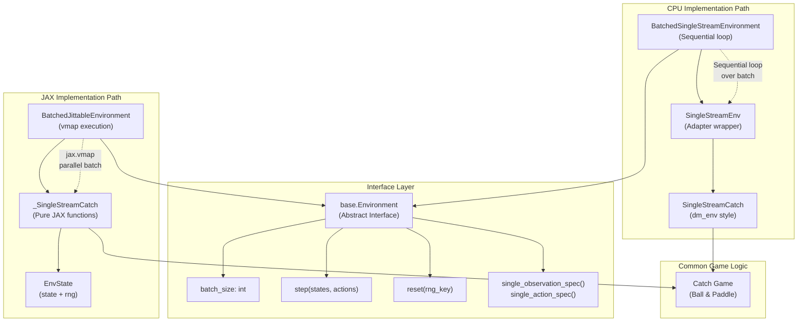
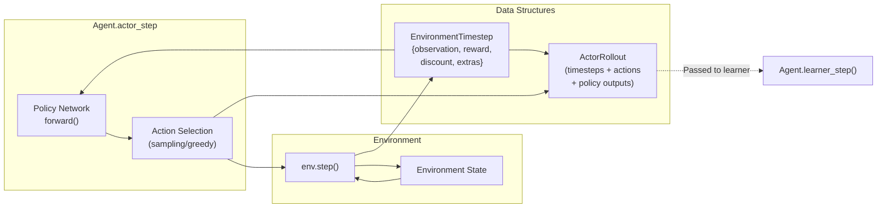

<!-- source: DeepWiki mcp.deepwiki.com · repo google-deepmind/disco_rl · page 3.2 Environments · fetched 2026-10-26 -->

# Environments

<details>
<summary>Relevant source files</summary>

The following files were used as context for generating this wiki page:

- [README.md](README.md)
- [disco_rl/environments/base.py](disco_rl/environments/base.py)

</details>


## Purpose and Scope

This document provides an overview of the environment system in DiscoRL, which provides reinforcement learning environments for agent training. The environment system implements a dual-architecture approach: CPU-based implementations for compatibility with standard Python tooling, and JAX-jittable implementations for high-performance parallel execution.

For detailed information about specific components:
- The abstract interface specification: [Environment Interface](#3.2.1)
- Implementation details of the Catch game: [Catch Environment](#3.2.2)
- Batching and streaming wrappers: [Environment Wrappers](#3.2.3)
- Integration with the agent training loop: [Agent System](#3.1)

**Sources**: [README.md:39-41](), [disco_rl/environments/base.py:1-65]()

## Architecture Overview

DiscoRL's environment system is designed around two core principles:

1. **Universal Batching**: All environments are batched by default, with a `batch_size` attribute that determines how many parallel episodes are executed simultaneously.

2. **Dual Implementation Strategy**: Each environment is provided in two forms:
   - **CPU-based**: Uses standard Python/NumPy operations and dm_env conventions, suitable for debugging and integration with external tools
   - **JAX-jittable**: Uses pure JAX functions with explicit state management, enabling JIT compilation and vectorization for efficient parallel execution

Both implementations share the same abstract interface, allowing training code to seamlessly switch between them without modification.



**Diagram**: Environment System Class Hierarchy

**Sources**: [disco_rl/environments/base.py:29-65](), [README.md:39-41]()

## Base Environment Interface

The `Environment` abstract base class [disco_rl/environments/base.py:29-65]() defines the contract that all environments must implement:

| Method | Parameters | Returns | Purpose |
|--------|-----------|---------|---------|
| `step` | `states: _EnvState, actions: ArrayTree` | `(new_states, timestep)` | Advances environment by one step |
| `reset` | `rng_key: PRNGKey` | `(initial_state, timestep)` | Resets episodes to initial state |
| `single_observation_spec` | - | `Specs` | Returns observation space for single environment |
| `single_action_spec` | - | `ActionSpec` | Returns action space for single environment |
| `batched_observation_spec` | - | `Specs` | Returns batched observation space |
| `batched_action_spec` | - | `ActionSpec` | Returns batched action space |

The interface enforces that all environments have a `batch_size` attribute [disco_rl/environments/base.py:35](), which determines the number of parallel episodes. The `batched_*_spec()` methods automatically broadcast single-environment specifications to the batch size [disco_rl/environments/base.py:58-64]().

**Sources**: [disco_rl/environments/base.py:29-65]()

## Implementation Types

### CPU-Based Environments

CPU-based environments follow these characteristics:
- Use standard Python control flow and NumPy arrays
- Implement dm_env-style conventions for compatibility
- Execute batched operations sequentially in a Python loop
- Suitable for debugging, visualization, and integration with non-JAX tools

The batching wrapper (`BatchedSingleStreamEnvironment`) wraps single-stream environments and executes `step()` operations sequentially across the batch dimension.

### JAX-Jittable Environments

JAX-jittable environments are designed for high performance:
- Use pure JAX functions with no side effects
- Maintain explicit state in an `EnvState` structure containing both game state and RNG
- Enable JIT compilation for optimized execution
- Use `jax.vmap` for automatic vectorization across batch dimension
- Provide significant performance benefits for large-scale training

The batching wrapper (`BatchedJittableEnvironment`) uses `jax.vmap` to automatically vectorize single-environment operations across the batch dimension, enabling parallel execution on accelerators.

**Sources**: [README.md:39-41]()

## Environment-Agent Integration

Environments integrate into the agent training loop through a standardized data flow:



**Diagram**: Environment Integration in Training Loop

The agent's `actor_step` method [disco_rl/agent.py]() receives `EnvironmentTimestep` structures from the environment, processes them through the policy network to select actions, and passes those actions back to `env.step()`. The collected trajectory is packaged into an `ActorRollout` structure for the learner.

**Sources**: [disco_rl/environments/base.py:38-48](), [disco_rl/types.py]()

## Environment State Management

The two implementation approaches handle state differently:

### CPU State Management
```
┌─────────────────────────────────────┐
│ Python Object State                  │
│ - Game state as object attributes    │
│ - RNG managed by dm_env.Environment │
│ - Mutable state updates              │
└─────────────────────────────────────┘
```

### JAX State Management
```
┌─────────────────────────────────────┐
│ EnvState (Immutable PyTree)          │
│ ├─ game_state: GameState            │
│ └─ rng: PRNGKey                     │
│                                      │
│ Pure functional updates:             │
│ new_state = step_fn(old_state, ...)│
└─────────────────────────────────────┘
```

The JAX approach requires explicit state passing, making all state transformations visible in function signatures. This enables JAX's transformation system (`jit`, `vmap`, `grad`) to work correctly.

**Sources**: [disco_rl/environments/base.py:26](), [disco_rl/environments/base.py:38-41]()

## Specifications System

Environments expose their action and observation spaces through specification objects:

- **Observation Specs**: Describe the shape and dtype of observations, returned by `single_observation_spec()` [disco_rl/environments/base.py:51-52]()
- **Action Specs**: Describe valid actions (discrete or continuous), returned by `single_action_spec()` [disco_rl/environments/base.py:54-56]()
- **Batched Specs**: Automatically computed by broadcasting single specs to `batch_size` [disco_rl/environments/base.py:58-64]()

The `utils.broadcast_specs()` utility [disco_rl/utils.py]() handles the transformation from single to batched specifications, prepending the batch dimension to all arrays.

**Sources**: [disco_rl/environments/base.py:51-64]()

## Performance Considerations

| Aspect | CPU Implementation | JAX Implementation |
|--------|-------------------|-------------------|
| Batch execution | Sequential Python loop | Vectorized via `vmap` |
| Compilation | Interpreted Python | JIT-compiled |
| Device support | CPU only | CPU/GPU/TPU |
| Typical speedup | 1x (baseline) | 10-100x for large batches |
| Debugging | Easy (standard Python) | Harder (requires JAX debugging) |

For meta-training with large populations and many parallel environments, the JAX-jittable implementation provides substantial performance benefits. For debugging, prototyping, or integration with visualization tools, the CPU implementation is more convenient.

**Sources**: [README.md:39-41]()

## Available Environments

Currently, DiscoRL includes the **Catch** game environment, a simple grid-based task where an agent controls a paddle to catch falling balls. The game logic is implemented in both CPU and JAX forms, sharing the same core mechanics.

For details on the Catch environment implementation, see [Catch Environment](#3.2.2).

For information on how to extend the system with custom environments, refer to the base interface requirements in [Environment Interface](#3.2.1).

**Sources**: [README.md:39-41]()

---

