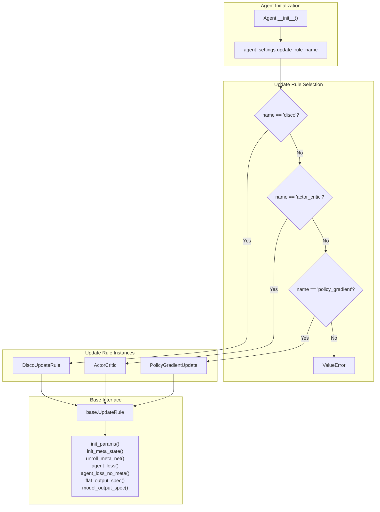
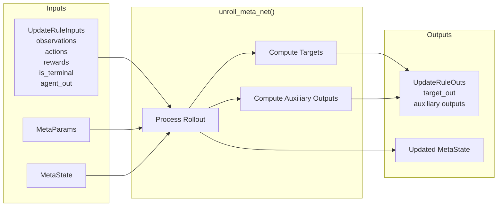
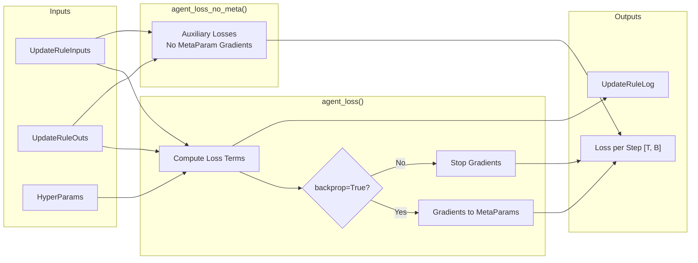
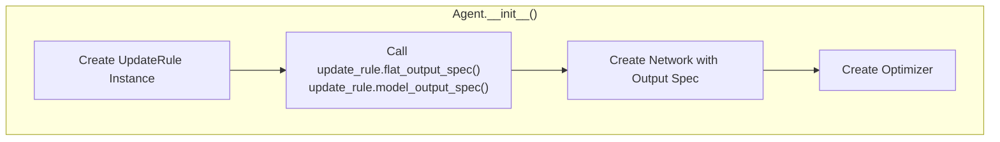
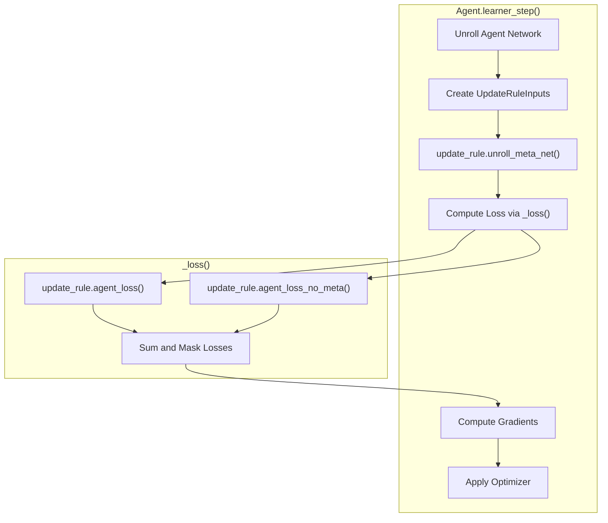

<!-- source: DeepWiki mcp.deepwiki.com · repo google-deepmind/disco_rl · page 3.3 Update Rules · fetched 2026-10-26 -->

# Update Rules

<details>
<summary>Relevant source files</summary>

The following files were used as context for generating this wiki page:

- [README.md](README.md)
- [disco_rl/agent.py](disco_rl/agent.py)
- [disco_rl/update_rules/base.py](disco_rl/update_rules/base.py)

</details>


## Purpose and Scope

Update rules define the learning algorithm that trains the agent's neural network parameters. This document provides an overview of DiscoRL's pluggable update rule architecture, explaining how different learning algorithms (Disco103, Actor-Critic, Policy Gradient) can be swapped interchangeably through a common interface. For details on implementing custom update rules, see [Update Rule Interface](#3.3.1). For documentation of specific implementations, see [Disco103 Update Rule](#3.3.2) and [Baseline Update Rules](#3.3.3).

**Sources:** [disco_rl/update_rules/base.py](), [disco_rl/agent.py](), [README.md]()

---

## Overview

Update rules in DiscoRL are responsible for computing loss functions that drive agent learning. The system is designed as a plugin architecture where different learning algorithms can be selected by name at agent initialization. All update rules implement the `base.UpdateRule` abstract class, which defines a contract for:

- Specifying the agent network's output structure
- Initializing meta-learning state and parameters
- Processing rollout data to compute auxiliary targets
- Computing per-step losses from rollout data

The update rule is invoked by the agent during each training step to transform collected experience (observations, actions, rewards) into gradient signals that update the policy parameters.

**Sources:** [disco_rl/update_rules/base.py:73-344](), [disco_rl/agent.py:47-87]()

---

## Plugin Architecture

The agent selects an update rule by name during initialization. The `Agent.__init__` method creates the appropriate update rule instance based on the `agent_settings.update_rule_name` configuration:



**Sources:** [disco_rl/agent.py:76-87](), [disco_rl/update_rules/base.py:73]()

The agent stores the selected update rule in `self.update_rule` and uses it throughout training. This design allows researchers to experiment with different learning algorithms while keeping the rest of the training infrastructure (environment, network, optimizer) unchanged.

**Sources:** [disco_rl/agent.py:56]()

---

## Update Rule Workflow

Update rules participate in the agent's learning process through a two-phase workflow:

### Phase 1: Meta-Network Unroll

The `unroll_meta_net` method processes the collected rollout data to compute auxiliary outputs and targets. This phase prepares the data needed for loss computation:



**Sources:** [disco_rl/update_rules/base.py:222-251](), [disco_rl/agent.py:276-286]()

### Phase 2: Loss Computation

The `agent_loss` and `agent_loss_no_meta` methods compute per-step losses using the rollout data and meta-network outputs:



**Sources:** [disco_rl/update_rules/base.py:253-290](), [disco_rl/agent.py:234-242]()

The separation between `agent_loss` and `agent_loss_no_meta` allows certain loss terms to be excluded from meta-gradient computation during meta-training. The `backprop` flag controls whether gradients flow back to the update rule's meta-parameters.

**Sources:** [disco_rl/update_rules/base.py:273-290]()

---

## Available Implementations

DiscoRL provides three update rule implementations:

| Implementation | Class | Configuration Name | Key Features |
|----------------|-------|-------------------|--------------|
| Disco103 | `DiscoUpdateRule` | `'disco'` | Meta-learned update rule with LSTM-based meta-network, multiple loss terms (PI, Y, Z), categorical value functions, learned input transformations |
| Actor-Critic | `ActorCritic` | `'actor_critic'` | Standard Actor-Critic with V-trace advantages, entropy regularization, optional advantage/TD normalization with EMA |
| Policy Gradient | `PolicyGradientUpdate` | `'policy_gradient'` | Simple policy gradient with entropy regularization, basic advantage estimation |

**Sources:** [disco_rl/agent.py:76-87](), [disco_rl/update_rules/disco.py](), [disco_rl/update_rules/actor_critic.py](), [disco_rl/update_rules/policy_gradient.py]()

Each implementation comes with pre-configured settings accessible through helper functions:

- `agent.get_settings_disco()` - Configuration for Disco103 ([disco_rl/agent.py:319-378]())
- `agent.get_settings_actor_critic()` - Configuration for Actor-Critic ([disco_rl/agent.py:381-420]())

These settings include hyperparameters, network architectures, and optimizer configurations tuned for each algorithm.

**Sources:** [disco_rl/agent.py:319-420]()

---

## Agent Integration Points

The agent integrates with update rules at several key points in the training loop:

### Initialization

During agent initialization, the update rule specifies the network output structure:



**Sources:** [disco_rl/agent.py:76-106]()

- `flat_output_spec()` - Returns unconditional output shapes (e.g., policy logits)
- `model_output_spec()` - Returns action-conditional output shapes (e.g., per-action value predictions)

The agent network is constructed to produce outputs matching these specifications.

**Sources:** [disco_rl/agent.py:91-99](), [disco_rl/update_rules/base.py:167-204]()

### Learner State Initialization

The update rule initializes its meta-state during learner initialization:

```python
# From disco_rl/agent.py:134-145
def initial_learner_state(self, rng_key: chex.PRNGKey) -> LearnerState:
  """Create the initial learner state."""
  net_rng, state_rng = jax.random.split(rng_key)
  dummy_obs = self._dummy_obs(batch_size=1)
  should_reset = self._dummy_should_reset(batch_size=1)
  # Init params, optimiser state and the discovered update's state.
  params, _ = self._network.init(net_rng, dummy_obs, should_reset)
  opt_state = self._optimizer.init(params)
  meta_state = self.update_rule.init_meta_state(rng=state_rng, params=params)
  return LearnerState(
      params=params, opt_state=opt_state, meta_state=meta_state
  )
```

The `LearnerState` dataclass holds the agent parameters, optimizer state, and update rule meta-state:

**Sources:** [disco_rl/agent.py:38-45](), [disco_rl/agent.py:134-145]()

### Training Step

During each training step, the agent delegates to the update rule:



**Sources:** [disco_rl/agent.py:248-316](), [disco_rl/agent.py:200-246]()

The agent:
1. Unrolls the network to get agent outputs ([disco_rl/agent.py:259-261]())
2. Constructs `UpdateRuleInputs` from the rollout ([disco_rl/agent.py:265-273]())
3. Calls `unroll_meta_net` to get targets and auxiliary outputs ([disco_rl/agent.py:276-286]())
4. Computes gradients of the loss function ([disco_rl/agent.py:289-297]())
5. Applies optimizer updates to agent parameters ([disco_rl/agent.py:302-306]())

The loss function is computed in `_loss()`, which calls both `agent_loss` and `agent_loss_no_meta` and combines them ([disco_rl/agent.py:234-242]()).

**Sources:** [disco_rl/agent.py:248-316](), [disco_rl/agent.py:200-246]()

---

## Output Specifications

Update rules define the structure of the agent network's outputs through two methods:

- `flat_output_spec(action_spec)` - Returns shapes for unconditional outputs
- `model_output_spec(action_spec)` - Returns shapes for action-conditional outputs

The agent combines these into a complete output specification:

| Update Rule | Flat Outputs | Model Outputs |
|-------------|--------------|---------------|
| Disco103 | `logits: (num_actions,)`<br/>`y: (num_y_components,)`<br/>`value: (num_actions, num_value_bins)` | `z: (num_z_components,)`<br/>`aux_pi: (num_aux_policy_components,)` |
| Actor-Critic | `logits: (num_actions,)`<br/>`value: (1,)` or `(num_actions, num_bins)` | None |
| Policy Gradient | `logits: (num_actions,)`<br/>`value: (1,)` | None |

For action-conditional outputs, the agent network produces a separate prediction for each possible action, resulting in shape `(num_actions, *model_spec_shape)`.

**Sources:** [disco_rl/update_rules/base.py:29-70](), [disco_rl/update_rules/base.py:167-204]()

---

## Data Types

Update rules work with several key data types:

### UpdateRuleInputs

Contains rollout data fed to the update rule:

```
UpdateRuleInputs
├── observations: [T+1, B, ...] - State observations
├── actions: [T+1, B] - Actions taken
├── rewards: [T, B] - Rewards received
├── is_terminal: [T, B] - Episode termination flags
├── behaviour_agent_out: [T+1, B, ...] - Outputs from behavior policy
├── agent_out: [T+1, B, ...] - Outputs from current policy
└── value_out: ValueOuts (optional) - Pre-computed value functions
```

**Sources:** [disco_rl/types.py](), [disco_rl/agent.py:221-229]()

### UpdateRuleOuts

Contains outputs from `unroll_meta_net`:

```
UpdateRuleOuts
├── target_out: [T, B, ...] - Target policy outputs
└── (additional implementation-specific fields)
```

**Sources:** [disco_rl/types.py]()

### MetaState

Opaque state maintained by the update rule between training steps. Contains recurrent state for meta-networks (Disco103) or EMA statistics (Actor-Critic).

**Sources:** [disco_rl/types.py](), [disco_rl/agent.py:44]()

### MetaParams

Learnable parameters of the meta-network. Only used by Disco103; baseline methods have empty meta-parameters.

**Sources:** [disco_rl/types.py]()

---

## Summary

The update rule system provides a clean abstraction for pluggable learning algorithms in DiscoRL. Key design principles:

1. **Unified Interface** - All update rules implement `base.UpdateRule` with consistent method signatures
2. **Two-Phase Processing** - Separation of target computation (`unroll_meta_net`) from loss calculation (`agent_loss`)
3. **Configurable Outputs** - Update rules specify required network outputs through `flat_output_spec` and `model_output_spec`
4. **Meta-Training Support** - The `backprop` flag and `agent_loss_no_meta` enable selective gradient flow during meta-training

This architecture enables direct comparison of discovered algorithms (Disco103) against hand-designed baselines (Actor-Critic, Policy Gradient) using identical training infrastructure.

**Sources:** [disco_rl/update_rules/base.py](), [disco_rl/agent.py]()

---

