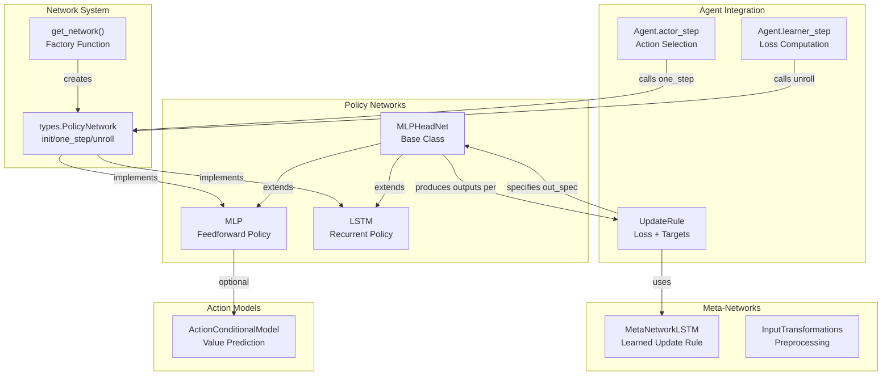
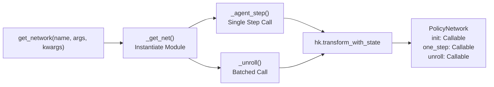
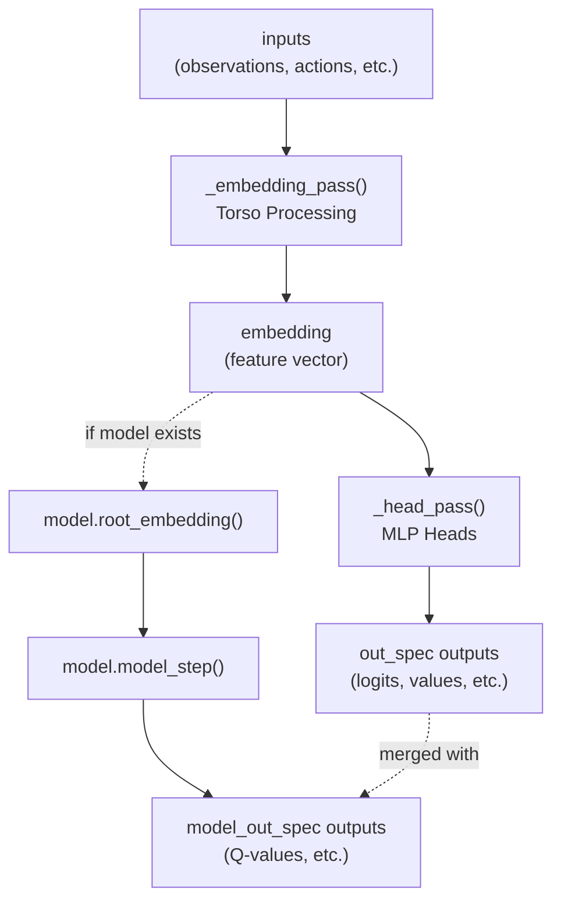
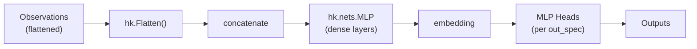
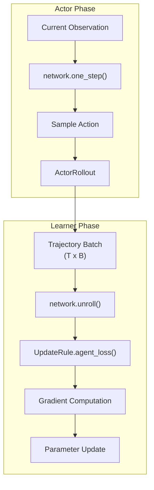
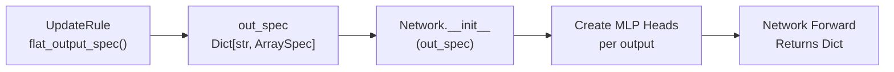
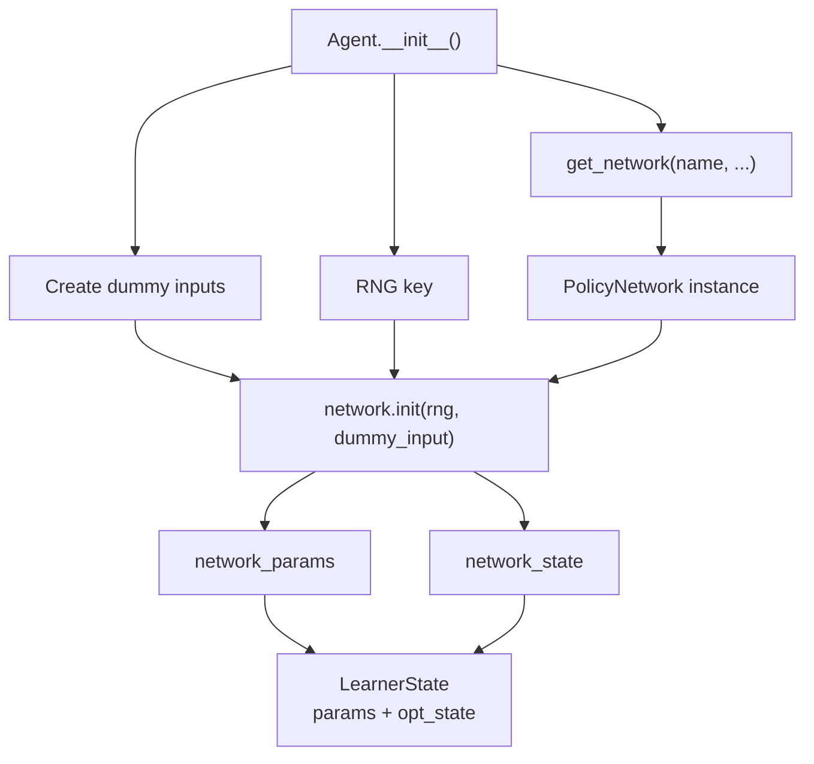

<!-- source: DeepWiki mcp.deepwiki.com · repo google-deepmind/disco_rl · page 3.4 Neural Networks · fetched 2026-10-26 -->

# Neural Networks

<details>
<summary>Relevant source files</summary>

The following files were used as context for generating this wiki page:

- [README.md](README.md)
- [disco_rl/networks/nets.py](disco_rl/networks/nets.py)

</details>


## Purpose and Scope

This section provides an overview of the neural network architectures used in DiscoRL. Neural networks serve two primary roles in the system: (1) **policy networks** that map observations to action distributions and value predictions, and (2) **meta-networks** that implement learned components of the Disco update rule. All networks are implemented using [Haiku](https://github.com/deepmind/dm-haiku) and follow a consistent interface pattern for integration with the agent system.

For detailed information about specific network types, see:
- [Policy Networks](#3.4.1) - MLP and LSTM policy implementations
- [Meta-Networks](#3.4.2) - LSTM-based meta-learning components
- [Action Models](#3.4.3) - Action-conditional value prediction models

**Sources**: [README.md:43-44](), [disco_rl/networks/nets.py]()

---

## Network Architecture Overview

DiscoRL's network system is organized into three main categories, each serving a distinct purpose in the reinforcement learning pipeline:



**Sources**: [disco_rl/networks/nets.py:32-56](), [README.md:43-44]()

---

## Network Factory Pattern

Networks are constructed using the `get_network()` factory function, which creates `types.PolicyNetwork` instances with three key methods:

| Method | Purpose | Used By |
|--------|---------|---------|
| `init` | Initialize network parameters | Agent initialization |
| `one_step` | Single timestep inference | Actor rollout |
| `unroll` | Batched sequence processing | Learner update |

### Factory Function Structure

The factory function uses Haiku's `transform_with_state` to create pure functional interfaces:



The factory pattern enables:
- **Name-based selection**: Networks chosen by string identifier (e.g., `'mlp'`)
- **Consistent interface**: All networks expose the same API
- **Stateful transformations**: Haiku handles parameter management and recurrent state

**Sources**: [disco_rl/networks/nets.py:32-56]()

---

## MLPHeadNet Architecture

The `MLPHeadNet` base class implements a two-stage architecture used by all policy networks:

### Architecture Stages



### Key Design Features

**Output Specification**: Networks produce outputs according to the `out_spec` provided by the update rule:

```
out_spec = {
    'logits': ArraySpec(shape=(num_actions,), dtype=jnp.float32),
    'value': ArraySpec(shape=(1,), dtype=jnp.float32),
    ...
}
```

The `_head_pass()` method creates one MLP head per output in the specification [disco_rl/networks/nets.py:94-107]().

**Action Models**: Networks optionally include action-conditional models for value prediction:
- Created when `model_out_spec` is provided
- Produces additional outputs (e.g., Q-values)
- Uses action information for state-action value estimation

**Initialization Control**: Head weights can use custom initialization via `head_w_init_std` parameter [disco_rl/networks/nets.py:84-86]().

**Sources**: [disco_rl/networks/nets.py:59-125]()

---

## Network Types and Use Cases

DiscoRL includes specialized network implementations for different scenarios:

| Network Type | Implementation | Use Case | Statefulness |
|-------------|----------------|----------|--------------|
| **MLP** | `MLP` class | Fully observable environments | Stateless |
| **LSTM** | LSTM-based policy | Partially observable environments | Stateful (hidden state) |
| **Meta-Network** | `MetaNetworkLSTM` | Disco update rule components | Stateful (LSTM cell) |

### MLP Implementation

The `MLP` class provides a simple feedforward architecture:



The torso processes concatenated inputs through a sequence of dense layers specified by the `dense` parameter [disco_rl/networks/nets.py:152-158]().

**Sources**: [disco_rl/networks/nets.py:127-159]()

---

## Integration with Agent System

Networks interact with the agent system through well-defined interfaces:

### Actor-Network Interaction

During actor rollouts:
1. Actor calls `network.one_step(inputs, should_reset=None)`
2. Network returns dictionary of outputs (e.g., `{'logits': ..., 'value': ...}`)
3. Actor samples actions from logit distributions
4. Results stored in `ActorRollout` for learner consumption

### Learner-Network Interaction

During learner updates:
1. Learner calls `network.unroll(inputs, should_reset)` on trajectory data
2. Network applies `hk.BatchApply` to process time dimension [disco_rl/networks/nets.py:109-113]()
3. Outputs used by update rule to compute losses
4. Gradients backpropagated through network parameters



**Sources**: [disco_rl/networks/nets.py:41-55]()

---

## Network Output Specifications

Networks produce outputs according to specifications defined by update rules. The update rule's `flat_output_spec()` method determines what outputs the policy network must produce:

| Update Rule | Typical Outputs | Purpose |
|-------------|----------------|---------|
| **Policy Gradient** | `logits`, `value` | Action selection, baseline |
| **Actor-Critic** | `logits`, `value` | Policy and value function |
| **Disco103** | `logits`, `pi`, `y`, `z` | Learned update components |

### Specification Flow



This design allows the same network architecture to support different update rules by dynamically creating appropriate output heads.

**Sources**: [disco_rl/networks/nets.py:62-74](), [disco_rl/networks/nets.py:94-107]()

---

## Haiku Integration

All networks leverage [Haiku](https://github.com/deepmind/dm-haiku) for module composition and parameter management:

### Key Haiku Features Used

**Transforms**: `hk.transform_with_state()` converts Haiku modules into pure functions suitable for JAX:
- Separates initialization from application
- Handles both parameters and state (e.g., LSTM hidden state)
- Enables JIT compilation and automatic differentiation

**BatchApply**: `hk.BatchApply()` applies single-step functions to batched sequences [disco_rl/networks/nets.py:113]():
- Handles time dimension in trajectory data
- Maintains recurrent state across timesteps
- Simplifies unroll implementation

**Module Composition**: Networks compose Haiku primitives:
- `hk.nets.MLP()` for dense layers
- `hk.Flatten()` for input preprocessing
- `hk.LSTM()` for recurrent processing (in LSTM networks)

### Parameter Management

Network parameters are stored in the agent's `LearnerState`:
```
LearnerState.params = {
    'network': {...},  # Policy network parameters
    'update_rule': {...}  # Update rule parameters (including meta-networks)
}
```

**Sources**: [disco_rl/networks/nets.py:47-50]()

---

## Network Initialization

Networks are initialized through a two-stage process:

### Initialization Flow



The initialization process:
1. Creates dummy inputs matching environment specifications
2. Calls `network.init()` to trigger parameter creation
3. Returns initial parameters and state (e.g., LSTM hidden state)
4. Stores in `LearnerState` for training loop

**Sources**: [disco_rl/networks/nets.py:47-50]()

---

## Summary

The neural network system in DiscoRL provides:

- **Modular architecture** with clear separation between torso, heads, and optional action models
- **Flexible output specification** driven by update rule requirements
- **Consistent interface** via `PolicyNetwork` type with `init`, `one_step`, and `unroll` methods
- **Haiku integration** for parameter management and module composition
- **Support for multiple network types** including feedforward (MLP) and recurrent (LSTM) architectures

The network system integrates with the agent through standardized interfaces, enabling the same training infrastructure to work with different network architectures and update rules.

**Sources**: [disco_rl/networks/nets.py](), [README.md:43-44]()

---

