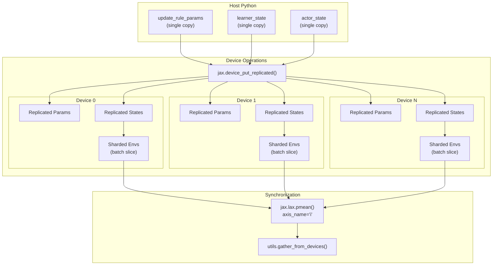
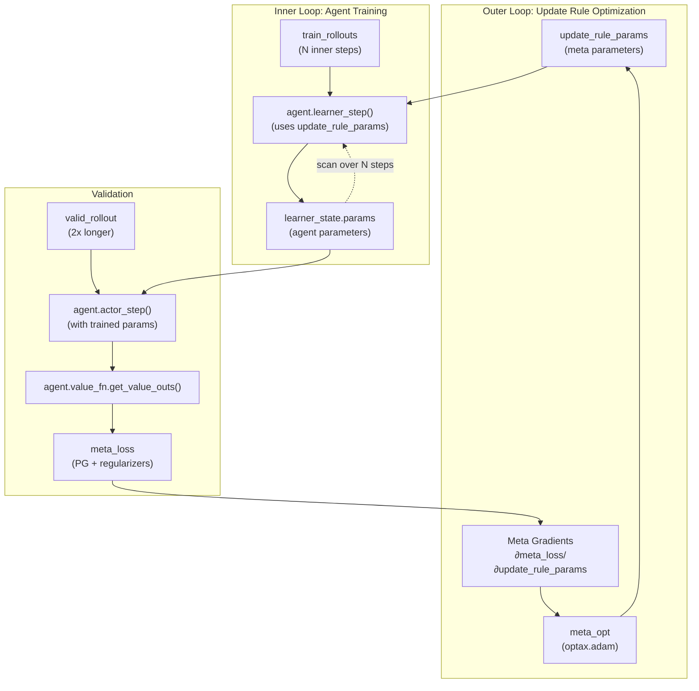
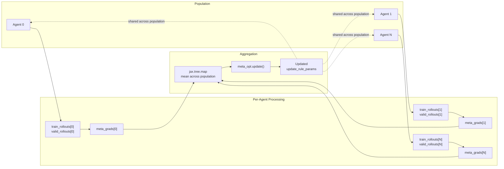
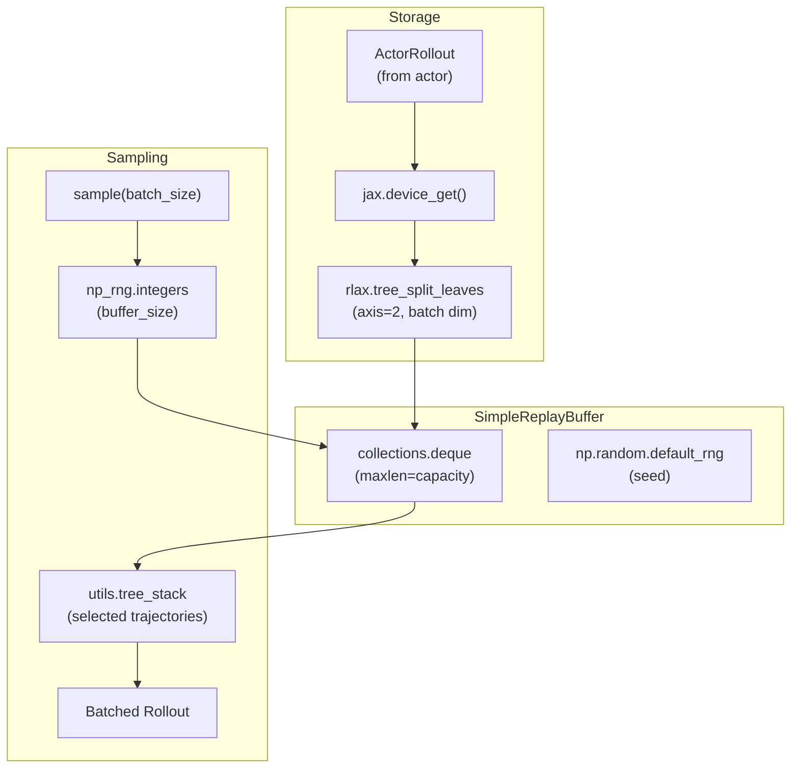
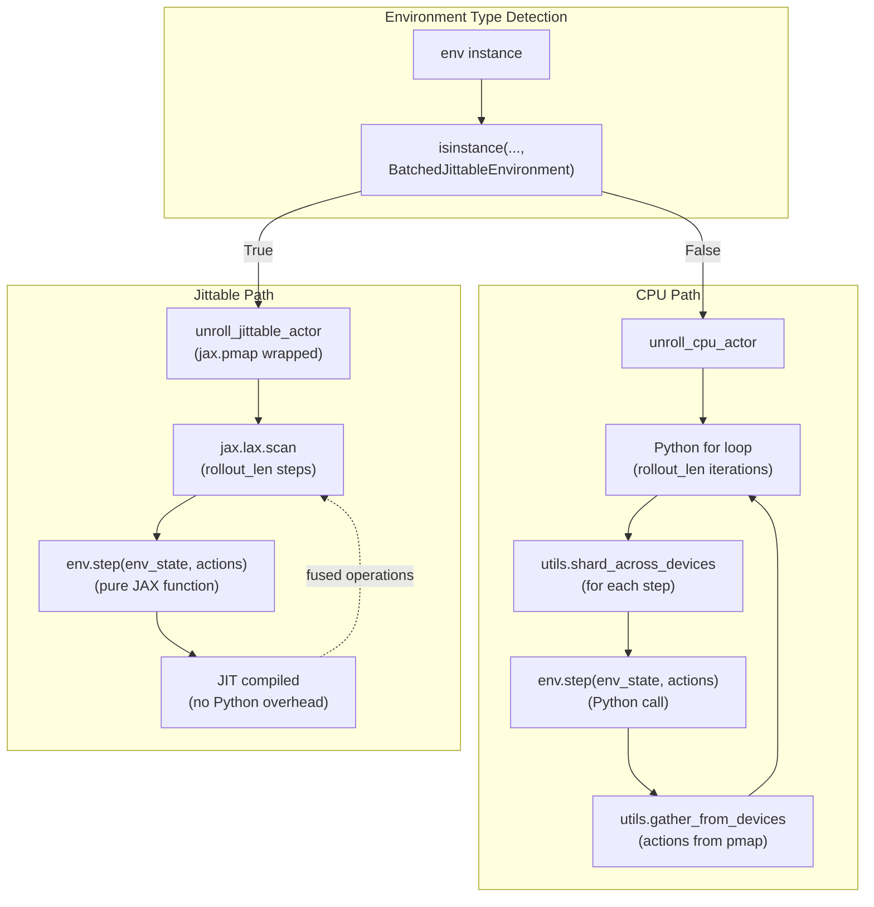

<!-- source: DeepWiki mcp.deepwiki.com · repo google-deepmind/disco_rl · page 4 Advanced Topics · fetched 2026-10-26 -->

# Advanced Topics

<details>
<summary>Relevant source files</summary>

The following files were used as context for generating this wiki page:

- [colabs/eval.ipynb](colabs/eval.ipynb)
- [colabs/meta_train.ipynb](colabs/meta_train.ipynb)

</details>


This page covers advanced implementation details and optimization techniques in DiscoRL. It provides an overview of JAX parallelization strategies, meta-gradient computation, replay buffers, and performance optimizations that enable efficient training and meta-training of RL agents.

For detailed information on parallelization patterns, see [JAX Parallelization](#4.1). For documentation on input transformation systems used by meta-networks, see [Input Transformations](#4.2).

## JAX Parallelization Strategy

DiscoRL leverages JAX's parallelization primitives to achieve efficient distributed training across multiple devices (TPUs/GPUs). The system uses three key JAX transformations:

| Transformation | Purpose | Usage in DiscoRL |
|---------------|---------|------------------|
| `jax.pmap` | Data parallelism across devices | Distributes environment batches and synchronizes gradients |
| `jax.vmap` | Vectorization within device | Batches jittable environment operations |
| `jax.jit` | Just-in-time compilation | Compiles training loops for performance |

### Device Replication Pattern



**Sources:** [colabs/eval.ipynb:316-319](), [colabs/meta_train.ipynb:609-614]()

The parallelization strategy involves:

1. **Parameter Replication**: Model parameters, optimizer states, and update rule parameters are replicated to all devices using `jax.device_put_replicated()` [colabs/eval.ipynb:316-319]()
2. **Environment Sharding**: Environment states are distributed across devices with each device handling a subset of the total batch [colabs/eval.ipynb:285-287]()
3. **Gradient Synchronization**: Gradients are averaged across devices using `jax.lax.pmean()` with a shared `axis_name` [colabs/meta_train.ipynb:443-446]()
4. **Result Gathering**: Metrics and outputs are collected from all devices using `utils.gather_from_devices()` [colabs/eval.ipynb:391-395]()

### Parallelized Function Setup

```python
# Parallelizing actor and learner steps
actor_step_fn = jax.pmap(agent.actor_step, axis_name, devices=devices)
learner_step_fn = jax.pmap(
    agent.learner_step,
    axis_name=axis_name,
    devices=devices,
    static_broadcasted_argnums=(5,),  # is_meta_training flag
)

# Parallelizing environment unroll
jitted_unroll_actor = jax.pmap(
    unroll_jittable_actor,
    axis_name=axis_name,
    devices=devices,
    static_broadcasted_argnums=(5, 6, 7, 8),  # env, rollout_len, etc.
)
```

**Sources:** [colabs/eval.ipynb:296-309]()

Key considerations:
- The `axis_name` parameter (typically `'i'`) identifies the parallel axis for collective operations like `pmean`
- `static_broadcasted_argnums` specifies arguments that should not be sharded (e.g., configuration flags, static structures)
- All pmapped functions operate on the leading axis, which represents the device dimension

## Meta-Gradient Computation

Meta-training optimizes the update rule parameters by differentiating through the inner training loop. This involves a two-level optimization structure:



**Sources:** [colabs/meta_train.ipynb:292-448]()

### Inner Step: Agent Parameter Updates

The inner loop performs standard RL updates using the current update rule:

```python
def _inner_step(carry, inputs):
    update_rule_params, learner_state, actor_state, value_state = carry
    actor_rollout, learner_rng = inputs
    
    # Update agent parameters using current update rule
    new_learner_state, new_actor_state, metrics = agent.learner_step(
        rng=learner_rng,
        rollout=actor_rollout,
        learner_state=learner_state,
        agent_net_state=actor_state,
        update_rule_params=update_rule_params,
        is_meta_training=True,
    )
    
    # Update value function
    agent_out, _ = agent.unroll_net(learner_state.params, actor_state, actor_rollout)
    new_value_state, _, _ = agent.value_fn.update(
        value_state, actor_rollout, agent_out['logits']
    )
    
    return (update_rule_params, new_learner_state, new_actor_state, new_value_state), metrics
```

**Sources:** [colabs/meta_train.ipynb:308-336]()

The inner loop:
1. Receives trajectories from the current policy
2. Updates agent parameters using the learned update rule
3. Updates the value function for advantage estimation
4. Returns updated states that carry gradients back to the update rule

### Outer Loss: Meta-Objective

The outer loss evaluates how well the trained agent performs on validation rollouts:

| Component | Purpose | Weight |
|-----------|---------|--------|
| Policy Gradient Loss | Maximize expected returns on validation | 1.0 |
| Entropy Regularizer | Encourage exploration | -1e-2 |
| Y/Z Entropy Loss | Regularize meta-network auxiliary outputs | 1e-3 |
| KL Regularizer | Stabilize policy updates | 1e-3 |
| Mean Deviation Loss | Prevent extreme auxiliary outputs | 1e-3 |

```python
# Meta loss calculation
pg_loss_per_step = utils.differentiable_policy_gradient_loss(
    logits_on_valid, actions_on_valid, adv_t=adv_t, backprop=False
)

# Regularization terms
reg_loss = 0
reg_loss += -1e-2 * distrax.Softmax(logits_on_valid).entropy().mean()
reg_loss += 1e-3 * (y_entropy_loss + z_entropy_loss)
reg_loss += 1e-2 * jnp.mean(target_kl_loss)

meta_loss = pg_loss_per_step.mean() + reg_loss
```

**Sources:** [colabs/meta_train.ipynb:383-415]()

### Gradient Computation Through Training

Meta-gradients are computed using JAX's `jax.grad` with `has_aux=True`:

```python
meta_grads, outputs = jax.grad(_outer_loss, has_aux=True)(
    update_rule_params, agent_state, train_rollouts, valid_rollout, rng
)
```

**Sources:** [colabs/meta_train.ipynb:439-441]()

JAX automatically:
1. Traces through the entire inner training loop (via `jax.lax.scan`)
2. Computes gradients of the validation loss with respect to update rule parameters
3. Handles the composition of multiple gradient computations (agent updates, value function updates)

### Population-Based Training

Meta-training uses a population of agents to stabilize learning:



**Sources:** [colabs/meta_train.ipynb:460-538]()

The population strategy:
1. Maintains multiple independent agents with separate environment states [colabs/meta_train.ipynb:580-592]()
2. Generates training and validation rollouts for each agent [colabs/meta_train.ipynb:476-491]()
3. Computes meta-gradients independently per agent [colabs/meta_train.ipynb:493-508]()
4. Averages gradients across the population before applying the meta-optimizer [colabs/meta_train.ipynb:525-527]()
5. Broadcasts updated update rule parameters to all agents [colabs/meta_train.ipynb:531]()

## Replay Buffer System

DiscoRL provides a simple FIFO replay buffer for off-policy training:



**Sources:** [colabs/eval.ipynb:232-263]()

### Buffer Implementation

The `SimpleReplayBuffer` class provides basic replay functionality:

```python
class SimpleReplayBuffer:
    def __init__(self, capacity: int, seed: int):
        self.buffer = collections.deque(maxlen=capacity)
        self.capacity = capacity
        self.np_rng = np.random.default_rng(seed)
    
    def add(self, rollout: types.ActorRollout) -> None:
        rollout = jax.device_get(rollout)
        split_tree = rlax.tree_split_leaves(rollout, axis=2)
        self.buffer.extend(split_tree)
    
    def sample(self, batch_size: int) -> types.ActorRollout | None:
        buffer_size = len(self.buffer)
        indices = self.np_rng.integers(buffer_size, size=batch_size)
        batched_samples = utils.tree_stack(
            [self.buffer[i] for i in indices], axis=2
        )
        return batched_samples
```

**Sources:** [colabs/eval.ipynb:232-259]()

Key features:
- **FIFO Storage**: Uses `collections.deque` with fixed capacity for automatic eviction of old samples
- **Device Handling**: Transfers data from device to host using `jax.device_get()` [colabs/eval.ipynb:243]()
- **Trajectory Splitting**: Splits batched rollouts into individual trajectories along the batch dimension [colabs/eval.ipynb:245]()
- **Random Sampling**: Uses NumPy's RNG for efficient CPU-based sampling [colabs/eval.ipynb:255]()
- **Tree Operations**: Leverages JAX tree utilities for structured data handling [colabs/eval.ipynb:256-258]()

### Replay Ratio Pattern

```python
replay_ratio = 32
min_buffer_size = batch_size
num_envs = batch_size // replay_ratio

# Generate trajectories with num_envs parallel environments
actor_rollout, actor_state, ts, env_state = unroll_actor(...)
buffer.add(actor_rollout)

# Sample batch_size trajectories for learning (replay_ratio > 1)
if len(buffer) >= min_buffer_size:
    learner_rollout = buffer.sample(batch_size)
    learner_state, _, metrics = learner_step_fn(...)
```

**Sources:** [colabs/eval.ipynb:281-388]()

The replay ratio allows learning from more samples than are generated per step, improving sample efficiency. With `replay_ratio=32`, the system generates experiences from 2 environments but learns from 64 sampled trajectories per step.

## CPU vs Jittable Environment Handling

DiscoRL supports both CPU-based and JAX-jittable environments with different unroll strategies:



**Sources:** [colabs/eval.ipynb:146-218](), [colabs/eval.ipynb:321-334]()

### CPU Actor Unroll

For CPU environments, the system uses a Python loop with explicit device communication:

```python
def unroll_cpu_actor(params, actor_state, ts, env_state, rng, 
                     env, rollout_len, actor_step_fn, devices):
    actor_timesteps = []
    for _ in range(rollout_len):
        rng, step_rng = jax.random.split(rng)
        step_rng = jax.random.split(step_rng, len(devices))
        ts = utils.shard_across_devices(ts, devices)
        
        actor_timestep, actor_state = actor_step_fn(
            params, step_rng, ts, actor_state
        )
        actions = utils.gather_from_devices(actor_timestep.actions)
        env_state, ts = env.step(env_state, actions)
        
        actor_timesteps.append(actor_timestep)
    
    actor_rollout = types.ActorRollout.from_timestep(
        utils.tree_stack(actor_timesteps, axis=1)
    )
    return actor_rollout, actor_state, ts, env_state
```

**Sources:** [colabs/eval.ipynb:146-175]()

### Jittable Actor Unroll

For jittable environments, the entire unroll is compiled as a single fused operation:

```python
def unroll_jittable_actor(params, actor_state, ts, env_state, rng, 
                          env, rollout_len, actor_step_fn, devices):
    def _single_step(carry, step_rng):
        env_state, ts, actor_state = carry
        actor_timestep, actor_state = agent.actor_step(
            params, step_rng, ts, actor_state
        )
        env_state, ts = env.step(env_state, actor_timestep.actions)
        return (env_state, ts, actor_state), actor_timestep
    
    (env_state, ts, actor_state), actor_rollout = jax.lax.scan(
        _single_step,
        (env_state, ts, actor_state),
        jax.random.split(rng, rollout_len),
    )
    
    actor_rollout = types.ActorRollout.from_timestep(actor_rollout)
    return actor_rollout, actor_state, ts, env_state
```

**Sources:** [colabs/eval.ipynb:178-207](), [colabs/meta_train.ipynb:154-180]()

Performance characteristics:

| Aspect | CPU Environment | Jittable Environment |
|--------|----------------|----------------------|
| Compilation | Actor steps compiled, loop in Python | Entire unroll compiled as one function |
| Device Communication | Per-step shard/gather overhead | All data stays on device |
| Flexibility | Easier to debug, arbitrary Python logic | Restricted to JAX-traceable operations |
| Performance | Lower (Python loop overhead) | Higher (fused operations, no host sync) |

## Static vs Dynamic Arguments

JAX compilation requires distinguishing between static (compile-time) and dynamic (runtime) arguments:

```python
jitted_unroll_actor = jax.pmap(
    unroll_jittable_actor,
    axis_name=axis_name,
    devices=devices,
    static_broadcasted_argnums=(5, 6, 7, 8),  # env, rollout_len, actor_step_fn, devices
)

learner_step_fn = jax.pmap(
    agent.learner_step,
    axis_name=axis_name,
    devices=devices,
    static_broadcasted_argnums=(5,),  # is_meta_training flag
)
```

**Sources:** [colabs/eval.ipynb:304-309](), [colabs/eval.ipynb:298-303]()

### Static Arguments

Arguments marked as static via `static_broadcasted_argnums`:
- Must be hashable and equal across all devices
- Trigger recompilation if their values change
- Examples: environment objects, rollout lengths, boolean flags, function references

### Dynamic Arguments

Arguments not marked as static:
- Are traced as abstract values (shapes and dtypes)
- Can change values between calls without recompilation
- Examples: parameters, states, observations, RNG keys

Proper static argument specification is critical for:
1. **Avoiding Recompilation**: Changing static arguments forces recompilation, which can be expensive
2. **Enabling Optimizations**: Static values allow XLA to perform compile-time optimizations (e.g., loop unrolling)
3. **Correctness**: Some values (like environment instances) cannot be traced and must be static

## Accumulating Episode Returns

DiscoRL provides utilities for tracking cumulative returns across episode boundaries:

```python
def accumulate_rewards(acc_rewards, x):
    rewards, discounts = x
    
    def _step_fn(acc_rewards, x):
        rewards, discounts = x
        acc_rewards += rewards
        return acc_rewards * discounts, acc_rewards
    
    return jax.lax.scan(_step_fn, acc_rewards, (rewards, discounts))
```

**Sources:** [colabs/eval.ipynb:210-218]()

The accumulator:
1. Adds immediate rewards to the running total
2. Outputs the current accumulated return
3. Resets to zero when an episode ends (discount = 0)
4. Continues accumulating for ongoing episodes (discount > 0)

This pattern correctly handles multiple parallel environments with episodes ending at different times, making it suitable for pmapped execution where each device tracks multiple episodes simultaneously.

**Sources:** [colabs/eval.ipynb:210-218](), [colabs/eval.ipynb:310-314](), [colabs/eval.ipynb:366-374]()

---

