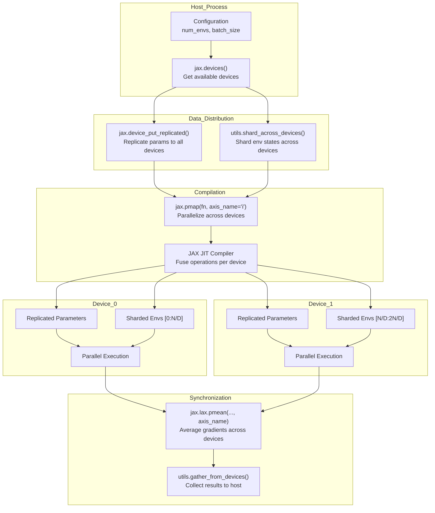
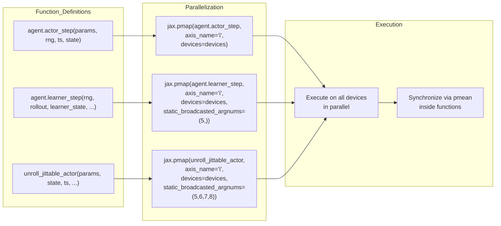
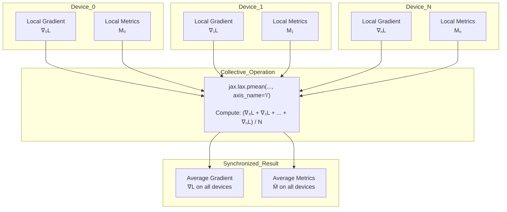
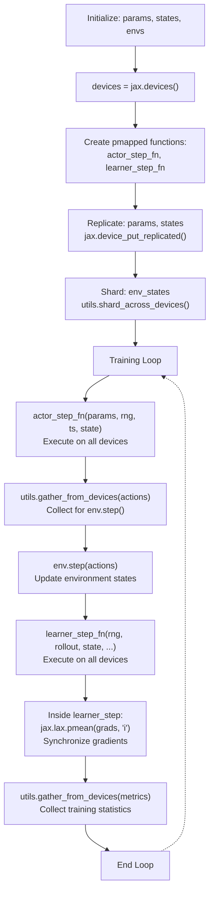

<!-- source: DeepWiki mcp.deepwiki.com · repo google-deepmind/disco_rl · page 4.1 JAX Parallelization · fetched 2026-10-26 -->

# JAX Parallelization

<details>
<summary>Relevant source files</summary>

The following files were used as context for generating this wiki page:

- [colabs/eval.ipynb](colabs/eval.ipynb)
- [colabs/meta_train.ipynb](colabs/meta_train.ipynb)
- [disco_rl/environments/wrappers/batched_jittable_env.py](disco_rl/environments/wrappers/batched_jittable_env.py)

</details>


## Purpose and Scope

This document explains how DiscoRL uses JAX's parallelization primitives to distribute computation across multiple accelerators (TPUs/GPUs). The system employs a Single Program Multiple Data (SPMD) approach using `jax.pmap` for data parallelism and `jax.vmap` for vectorization. For general information about the agent system that these parallelized functions operate on, see [Agent System](#3.1). For environment-specific parallelization details, see [Environment Wrappers](#3.2.3).

## Parallelization Strategy

DiscoRL implements a two-level parallelization strategy:

1. **Device-level parallelism** via `jax.pmap`: Distributes computation across multiple accelerators, with each device processing a subset of environments
2. **Batch-level parallelism** via `jax.vmap`: Vectorizes operations across the batch dimension within each device

The system uses an **SPMD pattern** where identical programs execute on each device with different data shards. Model parameters are replicated across all devices, while environment states and rollouts are sharded.

### Parallelization Overview



**Sources:** [colabs/eval.ipynb:286-332](), [colabs/meta_train.ipynb:594-614]()

## Device Management

### Obtaining Devices

DiscoRL queries available accelerators and distributes work across them:

```python
devices = tuple(jax.devices()[:num_envs])  # Get subset of devices
```

The number of devices used is determined by the environment configuration. In meta-evaluation, this equals `num_envs`, while in meta-training, all available devices are typically used.

**Sources:** [colabs/eval.ipynb:286](), [colabs/meta_train.ipynb:595]()

### Parameter Replication

Model parameters and optimizer states are replicated to all devices using `jax.device_put_replicated`:

```python
learner_state = jax.device_put_replicated(learner_state, devices)
actor_state = jax.device_put_replicated(actor_state, devices)
update_rule_params = jax.device_put_replicated(update_rule_params, devices)
```

This ensures each device has identical copies of the model weights for inference and gradient computation. The parameters remain synchronized through gradient averaging during updates.

**Sources:** [colabs/eval.ipynb:317-319](), [colabs/meta_train.ipynb:609-614]()

### Environment State Sharding

Unlike parameters, environment states are sharded across devices using `utils.shard_across_devices`:

```python
(env_state, ts, acc_rewards) = utils.shard_across_devices(
    (env_state, ts, acc_rewards), devices
)
```

This distributes different environment instances to different devices, enabling parallel trajectory collection. Each device simulates a disjoint subset of environments.

**Sources:** [colabs/eval.ipynb:329-331](), [colabs/eval.ipynb:162]()

## Parallelized Functions

### Using jax.pmap

The core training functions are parallelized using `jax.pmap` with a shared `axis_name`:



**Sources:** [colabs/eval.ipynb:297-314](), [colabs/meta_train.ipynb:596]()

### Actor Step Parallelization

The actor step function is parallelized for action selection:

```python
actor_step_fn = jax.pmap(agent.actor_step, axis_name, devices=devices)
```

This enables each device to independently generate actions for its subset of environments based on replicated policy parameters.

**Sources:** [colabs/eval.ipynb:297]()

### Learner Step Parallelization

The learner step function is parallelized for parameter updates:

```python
learner_step_fn = jax.pmap(
    agent.learner_step,
    axis_name=axis_name,
    devices=devices,
    static_broadcasted_argnums=(5,),
)
```

The `static_broadcasted_argnums=(5,)` argument specifies that the `is_meta_training` boolean flag should be treated as a static argument and broadcasted to all devices rather than sharded.

**Sources:** [colabs/eval.ipynb:298-303]()

### Rollout Unrolling Parallelization

For jittable environments, entire rollout generation is parallelized:

```python
jitted_unroll_actor = jax.pmap(
    unroll_jittable_actor,
    axis_name=axis_name,
    devices=devices,
    static_broadcasted_argnums=(5, 6, 7, 8),
)
```

The static arguments include the environment, rollout length, actor step function, and devices list, which remain constant across parallelization.

**Sources:** [colabs/eval.ipynb:304-309]()

## Gradient Synchronization

### The pmean Operation

Gradient averaging across devices is performed using `jax.lax.pmean`:

```python
(meta_grads, train_metrics, meta_log) = jax.lax.pmean(
    (meta_grads, train_metrics, meta_log), axis_name
)
```

This collective operation computes the mean of each array element across all devices along the specified axis. The `axis_name` parameter must match the one used in `jax.pmap`.



**Sources:** [colabs/meta_train.ipynb:443-446]()

### Synchronization in Meta-Training

In meta-training, gradients computed on each device from different agent populations are averaged:

```python
if axis_name is not None:
    (meta_grads, train_metrics, meta_log) = jax.lax.pmean(
        (meta_grads, train_metrics, meta_log), axis_name
    )
```

This ensures that the update rule parameters receive consistent gradient updates across all devices, maintaining synchronization during meta-optimization.

**Sources:** [colabs/meta_train.ipynb:443-446]()

## Environment Parallelization

### Vectorization with vmap

The `BatchedJittableEnvironment` uses `jax.vmap` to vectorize environment operations across the batch dimension:

```python
self._batched_env_step = jax.vmap(self._single_env_step)
self._batched_env_reset = jax.vmap(self._single_env_reset)
```

This transforms single-environment functions into batched versions that operate on all environments simultaneously, enabling efficient parallel simulation.

**Sources:** [disco_rl/environments/wrappers/batched_jittable_env.py:69-70]()

### Environment Execution Models

| Aspect | CPU Environments | JAX-Jittable Environments |
|--------|------------------|---------------------------|
| **Execution** | Sequential loop over environments | Vectorized via `jax.vmap` |
| **State Management** | Python objects | Pure JAX arrays in `EnvState` |
| **Compilation** | Not JIT-compiled | Fully JIT-compiled |
| **Parallelization** | Manual sharding required | Automatic with `vmap` + `pmap` |
| **RNG Handling** | Per-environment Python RNG | Explicit JAX RNG splitting |

### Environment State Structure

For jittable environments, state is encapsulated in an `EnvState` dataclass:

```python
@chex.dataclass(mappable_dataclass=False)
class EnvState:
  state: chex.ArrayTree  # Game state
  rng: chex.PRNGKey      # Random number generator key
```

This explicit state management allows JAX to trace and JIT-compile environment operations, enabling efficient parallelization.

**Sources:** [disco_rl/environments/wrappers/batched_jittable_env.py:42-46]()

### RNG Key Splitting

When resetting batched environments, RNG keys are split across the batch dimension:

```python
def reset(self, rng_key: chex.PRNGKey):
    rngs = jax.random.split(rng_key, self.batch_size)
    return self._batched_env_reset(rngs)
```

This ensures each environment instance has independent randomness while maintaining reproducibility through the single input key.

**Sources:** [disco_rl/environments/wrappers/batched_jittable_env.py:108-110]()

## Data Gathering

### Collecting Results from Devices

After parallel computation, results are gathered back to the host using `utils.gather_from_devices`:

```python
all_metrics, all_rewards, all_discounts, all_returns = (
    utils.gather_from_devices(
        (all_metrics, all_rewards, all_discounts, all_returns)
    )
)
```

This utility function collects data from all devices and returns it as host-accessible NumPy arrays or nested structures.

**Sources:** [colabs/eval.ipynb:391-395](), [colabs/meta_train.ipynb:640]()

### Post-Processing Gathered Data

After gathering, data is typically averaged across devices:

```python
(all_metrics,) = jax.tree.map(lambda x: x.mean(0), (all_metrics,))
```

The `mean(0)` operation averages over the device dimension (axis 0), producing aggregate statistics across all parallel workers.

**Sources:** [colabs/eval.ipynb:396](), [colabs/meta_train.ipynb:641]()

## Parallelization Workflow

The complete parallelization workflow follows this pattern:



**Sources:** [colabs/eval.ipynb:274-396](), [colabs/meta_train.ipynb:607-641]()

## Performance Considerations

### Compilation Overhead

The first call to a `pmap`-ed function triggers JIT compilation for each device. This can take significant time (seconds to minutes depending on complexity). Subsequent calls reuse the compiled code and execute much faster.

### Memory Distribution

- **Replicated data** (parameters): Each device holds a full copy, consuming `N × size` memory across `N` devices
- **Sharded data** (environments): Total memory usage is distributed, each device holds `1/N` of the data
- **Optimal configuration**: Balance device count to maximize environment parallelism while fitting parameters in device memory

### Static Arguments

Arguments marked as `static_broadcasted_argnums` in `jax.pmap` must not change between calls, as they become part of the compiled function signature. Changing them requires recompilation.

**Sources:** [colabs/eval.ipynb:298-309](), [colabs/meta_train.ipynb:596]()

---

