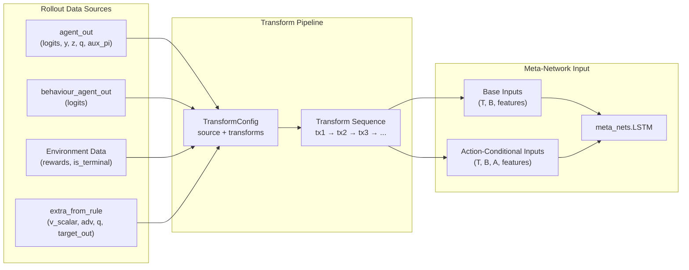
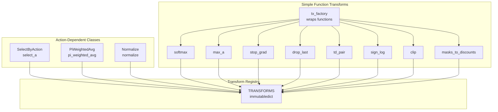
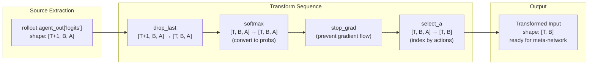
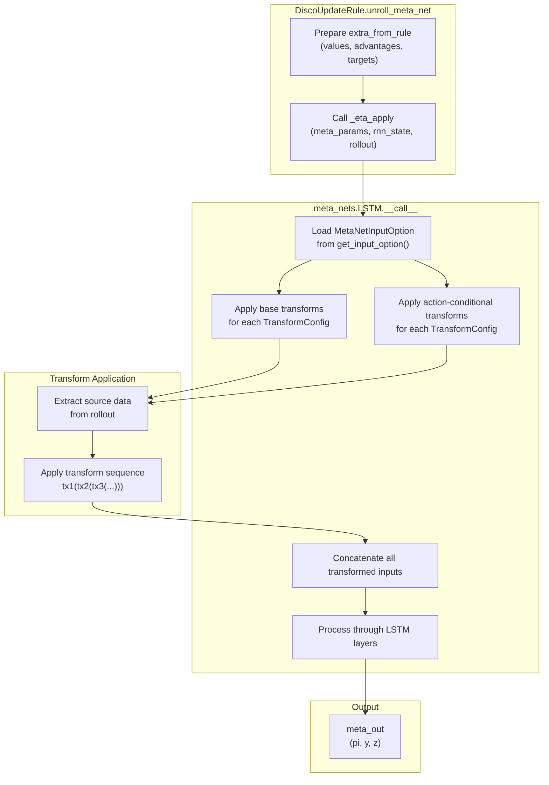

<!-- source: DeepWiki mcp.deepwiki.com · repo google-deepmind/disco_rl · page 4.2 Input Transformations · fetched 2026-10-26 -->

# Input Transformations

<details>
<summary>Relevant source files</summary>

The following files were used as context for generating this wiki page:

- [disco_rl/update_rules/disco.py](disco_rl/update_rules/disco.py)
- [disco_rl/update_rules/input_transforms.py](disco_rl/update_rules/input_transforms.py)

</details>


## Purpose and Scope

This document describes the input transformation system used by DiscoRL's meta-network to preprocess rollout data before feeding it to the LSTM. The transformation system provides a composable pipeline architecture that allows raw agent outputs, environment data, and computed values to be transformed through sequences of operations (e.g., softmax, normalization, temporal difference pairs, action selection) before being consumed by the meta-network.

For information about the meta-network itself, see [Meta-Networks](#3.4.2). For details on the Disco103 update rule that uses these transformations, see [Disco103 Update Rule](#3.3.2).

## System Overview

The input transformation system preprocesses data from rollouts before it enters the meta-network LSTM. Each input to the meta-network is defined by:
1. A **source** path (e.g., `'agent_out/logits'`, `'rewards'`, `'extra_from_rule/adv'`)
2. A **sequence of transforms** (e.g., `('drop_last', 'softmax', 'stop_grad', 'select_a')`)

Transforms are applied sequentially, with each transform's output feeding into the next. This creates a flexible preprocessing pipeline that can extract, reshape, normalize, and combine data from multiple sources.



**Sources:** [disco_rl/update_rules/input_transforms.py:1-193](), [disco_rl/update_rules/disco.py:326-429]()

## Transform Architecture

### Base Interface

All transforms implement the `InputTransform` interface, which defines a `__call__` method with the following signature:

```python
def __call__(
    self, x, actions: chex.Array, policy: chex.Array, axis: str | None
) -> chex.Array
```

The parameters are:
- `x`: The input array to transform
- `actions`: Agent actions, shape `[T, B]`
- `policy`: Policy distribution, shape `[T, B, A]`
- `axis`: Cross-replica axis name for distributed operations (e.g., `'i'`)

This interface allows transforms to access rollout context (actions, policy) when needed, enabling action-dependent operations like `select_a` or `pi_weighted_avg`.

**Sources:** [disco_rl/update_rules/input_transforms.py:31-36]()

### Transform Registry

Transforms are registered in the `TRANSFORMS` dictionary, which maps transform names (strings) to transform classes or factory functions. This registry enables configuration via string names in `TransformConfig`.



**Sources:** [disco_rl/update_rules/input_transforms.py:173-192]()

## Transform Configuration

### TransformConfig

Each input to the meta-network is specified by a `types.TransformConfig` object with two fields:
- `source`: A path string identifying data in the rollout (e.g., `'agent_out/logits'`)
- `transforms`: A tuple of transform names to apply sequentially

Example:
```python
TransformConfig(
    source='agent_out/logits',
    transforms=('drop_last', 'softmax', 'stop_grad', 'select_a')
)
```

This configuration:
1. Extracts `logits` from `agent_out` in the rollout
2. Drops the last timestep with `drop_last`
3. Applies softmax to get probabilities
4. Stops gradients with `stop_grad`
5. Selects values corresponding to taken actions with `select_a`

**Sources:** [disco_rl/update_rules/disco.py:336-429]()

### MetaNetInputOption

The `types.MetaNetInputOption` groups transform configurations into two categories:
- `base`: Tuple of `TransformConfig` for base inputs (shape `[T, B, features]`)
- `action_conditional`: Tuple of `TransformConfig` for action-conditional inputs (shape `[T, B, A, features]`)

The Disco103 update rule defines its input configuration in `get_input_option()`:

```mermaid
graph TB
    subgraph "get_input_option()"
        OPTION["MetaNetInputOption"]
    end
    
    subgraph "Base Inputs (T, B, features)"
        B1["agent_out/logits<br/>→ (drop_last, softmax, stop_grad, select_a)"]
        B2["behaviour_agent_out/logits<br/>→ (drop_last, softmax, stop_grad, select_a)"]
        B3["rewards<br/>→ (sign_log)"]
        B4["is_terminal<br/>→ (masks_to_discounts)"]
        B5["extra_from_rule/v_scalar<br/>→ (sign_log, td_pair, stop_grad)"]
        B6["extra_from_rule/adv<br/>→ (sign_log, stop_grad)"]
        B7["agent_out/y<br/>→ (softmax, y_net, td_pair)"]
        B8["agent_out/z + variants<br/>→ multiple transform sequences"]
    end
    
    subgraph "Action-Conditional (T, B, A, features)"
        AC1["agent_out/logits<br/>→ (drop_last, softmax, stop_grad)"]
        AC2["behaviour_agent_out/logits<br/>→ (drop_last, softmax, stop_grad)"]
        AC3["agent_out/z<br/>→ (drop_last, softmax, z_net)"]
        AC4["extra_from_rule/q<br/>→ (sign_log, drop_last, stop_grad)"]
        AC5["extra_from_rule/qv_adv<br/>→ (sign_log, drop_last, stop_grad)"]
    end
    
    OPTION --> B1
    OPTION --> B2
    OPTION --> B3
    OPTION --> B4
    OPTION --> B5
    OPTION --> B6
    OPTION --> B7
    OPTION --> B8
    
    OPTION --> AC1
    OPTION --> AC2
    OPTION --> AC3
    OPTION --> AC4
    OPTION --> AC5
```



**Sources:** [disco_rl/update_rules/disco.py:326-429]()

## Transform Types

### Simple Transforms

Simple transforms are stateless functions that operate on input arrays without requiring additional context. They are wrapped by `tx_factory()` to match the standard interface.

| Transform Name | Function | Description |
|----------------|----------|-------------|
| `identity` | `lambda x: x` | Pass-through, no modification |
| `softmax` | `jax.nn.softmax` | Apply softmax along last axis |
| `max_a` | `jnp.max(..., axis=2)` | Take max over action dimension |
| `stop_grad` | `jax.lax.stop_gradient` | Stop gradient flow |
| `clip` | `jnp.clip(-2.0, 2.0)` | Clip values to [-2.0, 2.0] |
| `sign` | `jnp.sign` | Sign function |
| `drop_last` | `lambda x: x[:-1]` | Remove last timestep |
| `td_pair` | `td_pair()` | Concatenate t and t+1 for TD calculations |
| `sign_log` | `rlax.signed_logp1` | Signed log(1 + |x|) * sign(x) |
| `sign_hyp` | `rlax.signed_hyperbolic` | Signed hyperbolic transformation |
| `masks_to_discounts` | `lambda x: 1.0 - x` | Convert terminal masks to discounts |

**Sources:** [disco_rl/update_rules/input_transforms.py:153-192]()

### Action-Dependent Transforms

These transforms use the actions or policy distribution from the rollout to select or aggregate values.

#### SelectByAction

The `SelectByAction` transform (`select_a`) indexes an array by the taken actions, reducing the action dimension.

```python
# Input: x with shape [T, B, A, ...]
# actions: shape [T, B]
# Output: shape [T, B, ...]
```

Example use case: Extract the Q-value for the action that was actually taken from a full Q-value array.

**Sources:** [disco_rl/update_rules/input_transforms.py:39-46]()

#### PiWeightedAvg

The `PiWeightedAvg` transform (`pi_weighted_avg`) computes a weighted average over actions using the policy distribution.

```python
# Input: x with shape [T, B, A, features]
# policy: shape [T, B, A]
# Output: shape [T, B, features]
# Computes: sum(x * policy.expand_dims(-1), axis=2)
```

Example use case: Compute expected value by averaging over action-conditional predictions weighted by policy probabilities.

**Sources:** [disco_rl/update_rules/input_transforms.py:48-56]()

### Stateful Transforms

#### Normalize

The `Normalize` transform uses exponential moving average (EMA) to normalize inputs based on running statistics. This is implemented as a Haiku module that maintains state across steps.

```python
class Normalize(InputTransform, hk.Module):
  def __call__(self, x, actions, policy, axis):
    return EmaNorm(
        decay_rate=0.99, eps=1e-6, axis=(0, 1), 
        cross_replica_axis=axis
    )(x)
```

The underlying `EmaNorm` class:
- Maintains EMA of mean and variance
- Normalizes using: `(x - ema_mean) / (sqrt(ema_var + eps_root) + eps)`
- Supports cross-replica synchronization via `jax.lax.pmean`
- Always updates state (no train/eval distinction)

**Sources:** [disco_rl/update_rules/input_transforms.py:58-151]()

## Transform Pipeline Execution

When the meta-network processes a rollout, transforms are applied in sequence as specified in each `TransformConfig`. Here's an example of how a typical input flows through the pipeline:



### Special Transform: td_pair

The `td_pair` transform is particularly important for temporal difference learning. It concatenates values at timestep t with values at timestep t+1, enabling the meta-network to compute TD-error-like quantities:

```python
def td_pair(x):
  # Input: x with shape [T+1, B, features]
  # Output: shape [T, B, 2*features]
  return jnp.concatenate([x[:-1], x[1:]], axis=-1)
```

This is used extensively in Disco103 for value predictions (`v_scalar`, `agent_out/y`, `agent_out/z`) where the meta-network needs to compare current and next-step values.

**Sources:** [disco_rl/update_rules/input_transforms.py:153-156]()

## Integration with DiscoUpdateRule

The input transformations are applied within the meta-network's forward pass. The `meta_nets.LSTM` class receives the `MetaNetInputOption` configuration and applies transforms internally when processing rollouts.



The transformation pipeline is executed for every learner step, preprocessing rollout data before the meta-network generates its policy, value, and auxiliary predictions (`pi`, `y`, `z`).

**Sources:** [disco_rl/update_rules/disco.py:112-208](), [disco_rl/update_rules/disco.py:326-429]()

## Custom Network Transforms

In addition to the standard transforms, the Disco103 configuration references special network-specific transforms (`y_net`, `z_net`) that are likely implemented within the meta-network itself to handle the specific output heads. These are used in conjunction with other transforms:

```python
TransformConfig(
    source='agent_out/y', 
    transforms=('softmax', 'y_net', 'td_pair')
)
```

This suggests that after applying softmax, the data is processed by a network component specific to the Y prediction head, then formed into temporal difference pairs.

**Sources:** [disco_rl/update_rules/disco.py:364-393]()

## Summary Table

Here's a comprehensive view of transform usage patterns in Disco103:

| Purpose | Example Transforms | Output Shape |
|---------|-------------------|--------------|
| Policy probabilities for taken action | `drop_last, softmax, stop_grad, select_a` | `[T, B]` |
| Reward signal | `sign_log` | `[T, B]` |
| Discount factor | `masks_to_discounts` | `[T, B]` |
| Value TD pair | `sign_log, td_pair, stop_grad` | `[T, B, 2]` |
| Advantage signal | `sign_log, stop_grad` | `[T, B]` |
| Full policy distribution | `drop_last, softmax, stop_grad` | `[T, B, A]` |
| Action-conditional values | `drop_last, softmax, z_net` | `[T, B, A, features]` |
| Expected value | `softmax, z_net, pi_weighted_avg, td_pair` | `[T, B, 2*features]` |
| Max value | `softmax, z_net, max_a, td_pair` | `[T, B, 2*features]` |

**Sources:** [disco_rl/update_rules/disco.py:334-427]()

---

