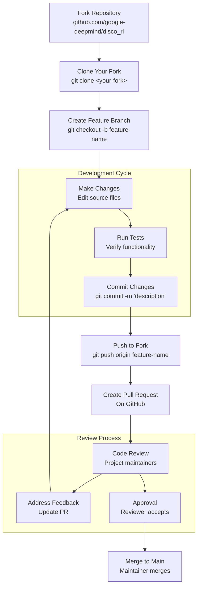
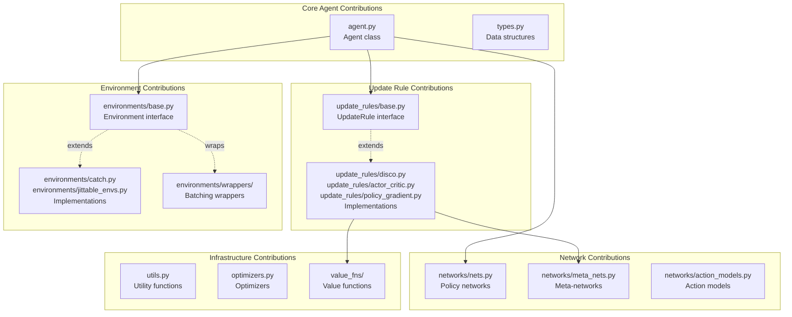
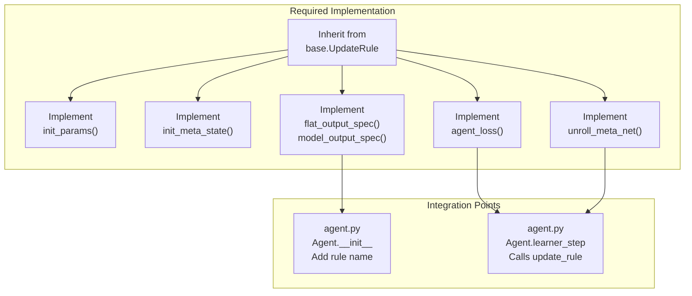
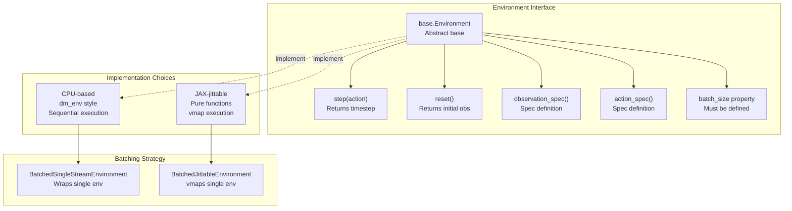
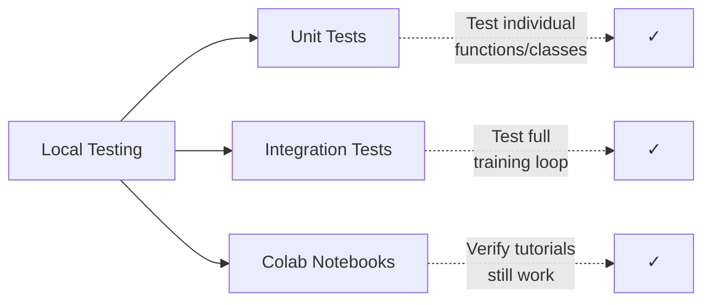

<!-- source: DeepWiki mcp.deepwiki.com · repo google-deepmind/disco_rl · page 5 Contributing · fetched 2026-10-26 -->

# Contributing

Relevant source files

The following files were used as context for generating this wiki page:

- [.gitignore](.gitignore)
- [CONTRIBUTING.md](CONTRIBUTING.md)
- [LICENSE](LICENSE)

This document provides guidelines for contributing to the DiscoRL codebase, including the Contributor License Agreement requirements, code review process, and community standards. For information about using DiscoRL, see the Getting Started guide [#2](#2). For architectural details that may help guide contributions, see Core Architecture [#3](#3).

---

## Overview

DiscoRL is an open-source project maintained by Google DeepMind that accepts contributions from the community. All contributions must comply with the Apache 2.0 license [LICENSE:1-203]() and follow Google's contribution standards.

**Sources**: [CONTRIBUTING.md:1-26]()

---

## Contributor License Agreement

Before submitting any contributions, you must sign a Contributor License Agreement (CLA). This agreement grants Google DeepMind permission to use and redistribute your contributions while you retain copyright ownership.

### CLA Requirements

| Requirement | Details |
|------------|---------|
| **URL** | https://cla.developers.google.com/ |
| **Frequency** | Once per contributor (applies across all Google projects) |
| **Employer** | If contributing on behalf of an employer, they must sign |
| **Scope** | Covers all contributions to the project |

If you have previously signed a CLA for another Google project, you generally do not need to sign again. Check your existing agreements at the CLA portal before proceeding.

**Sources**: [CONTRIBUTING.md:3-13]()

---

## Contribution Workflow

### Standard Contribution Process

**Standard Workflow Steps**:

1. **Fork** the repository to your GitHub account
2. **Clone** your fork locally
3. **Create** a feature branch for your changes
4. **Make** changes with clear commit messages
5. **Test** your changes thoroughly
6. **Push** to your fork
7. **Submit** a pull request to the main repository
8. **Respond** to reviewer feedback
9. **Wait** for maintainer approval and merge

**Sources**: [CONTRIBUTING.md:15-20]()

---

## Code Review Process

All submissions, including those from project members, require code review. DiscoRL uses GitHub pull requests for managing the review process.

### Review Requirements

- **All submissions** must go through pull request review
- **No exceptions** for project members
- **GitHub Help** available at https://help.github.com/articles/about-pull-requests/
- Reviews focus on code quality, testing, and alignment with project goals

**Sources**: [CONTRIBUTING.md:15-20]()

---

## Community Guidelines

DiscoRL follows Google's Open Source Community Guidelines, which establish standards for respectful and productive collaboration.

### Key Principles

| Principle | Description |
|-----------|-------------|
| **Respectful** | Treat all contributors with respect |
| **Constructive** | Provide helpful, actionable feedback |
| **Inclusive** | Welcome diverse perspectives and backgrounds |
| **Professional** | Maintain professional conduct in all interactions |

Full guidelines available at: https://opensource.google/conduct/

**Sources**: [CONTRIBUTING.md:22-25]()

---

## Codebase Structure for Contributors

Understanding the codebase structure helps identify where to make changes. The following diagram maps common contribution types to their relevant modules.

### Module-Level Architecture for Contributions

### Common Contribution Types

| Contribution Type | Primary Files | Key Interfaces |
|-------------------|---------------|----------------|
| **New Update Rule** | `update_rules/*.py` | `base.UpdateRule` |
| **New Environment** | `environments/*.py` | `base.Environment` |
| **New Network Architecture** | `networks/*.py` | `nets.PolicyNetwork` |
| **Agent Modifications** | `agent.py` | `Agent.actor_step`, `Agent.learner_step` |
| **Value Function Methods** | `value_fns/*.py` | Various utility functions |
| **Utilities** | `utils.py`, `optimizers.py` | Standalone functions |

**Sources**: Repository structure analysis

---

## Adding a New Update Rule

The most common contribution type is adding a new update rule. This section provides a technical guide.

### Update Rule Implementation Pattern

### Required Methods

Your update rule class must inherit from `base.UpdateRule` and implement:

| Method | Purpose | Returns |
|--------|---------|---------|
| `init_params()` | Initialize update rule parameters | `MetaParams` |
| `init_meta_state()` | Initialize meta-state (e.g., LSTM hidden state) | `MetaState` |
| `unroll_meta_net()` | Process rollout and compute targets | `MetaNetOutputs` |
| `agent_loss()` | Compute per-timestep losses | Loss values |
| `flat_output_spec()` | Define flat output structure | `FlattenedOutputs` |
| `model_output_spec()` | Define model output structure | `ModelOutputs` |

### Example Structure

Reference existing implementations:
- **Disco103**: [update_rules/disco.py:1-500]()
- **Actor-Critic**: [update_rules/actor_critic.py:1-300]()
- **Policy Gradient**: [update_rules/policy_gradient.py:1-200]()

**Sources**: [update_rules/base.py:1-150](), [update_rules/disco.py:1-500](), [update_rules/actor_critic.py:1-300]()

---

## Adding a New Environment

Environments must implement the `base.Environment` interface and support batching.

### Environment Implementation Requirements

### Implementation Options

**CPU-Based Implementation**:
- Follows dm_env conventions
- Uses Python classes with mutable state
- Wrapped with `BatchedSingleStreamEnvironment`
- Example: [environments/catch.py:1-200]()

**JAX-Jittable Implementation**:
- Pure functions with explicit state
- Uses `EnvState` dataclass
- Wrapped with `BatchedJittableEnvironment`
- Enables `jax.vmap` for parallelization
- Example: [environments/jittable_envs.py:1-300]()

### Required Specifications

Both implementations must define:
- **observation_spec**: Shape and dtype of observations
- **action_spec**: Discrete or continuous action specification
- **batch_size**: Number of parallel environments

**Sources**: [environments/base.py:1-100](), [environments/catch.py:1-200](), [environments/jittable_envs.py:1-300]()

---

## Code Quality Standards

### File Organization

The codebase uses the following organization patterns:

| Pattern | Purpose | Example |
|---------|---------|---------|
| **Interfaces** | Define abstract base classes | `base.Environment`, `base.UpdateRule` |
| **Implementations** | Concrete implementations | `disco.py`, `catch.py` |
| **Utilities** | Standalone helper functions | `utils.py`, `value_utils.py` |
| **Types** | Data structure definitions | `types.py` |

### Ignored Files

The `.gitignore` configuration excludes:
- Python cache files (`__pycache__/`, `*.pyc`)
- Distribution artifacts (`dist/`, `build/`, `*.egg-info/`)
- Virtual environments
- IDE configuration files

Do not commit these artifacts to your pull request.

**Sources**: [.gitignore:1-25]()

---

## Testing Your Changes

Before submitting a pull request, verify your changes work correctly.

### Testing Strategy

### Validation Checklist

- [ ] Code follows existing style conventions
- [ ] All functions have docstrings
- [ ] Type hints are included where appropriate
- [ ] JAX functions are properly JIT-compiled
- [ ] Changes work with both CPU and JAX-jittable environments
- [ ] Colab notebooks (`colabs/eval.ipynb`, `colabs/meta_train.ipynb`) still execute
- [ ] No new `.pyc` or cache files committed

**Sources**: Repository structure analysis

---

## Licensing

All contributions are subject to the Apache License 2.0.

### License Terms

- **Copyright**: You retain copyright to your contributions
- **License Grant**: Contributions are licensed under Apache 2.0
- **Patent Grant**: Contributors grant patent licenses for their contributions
- **Attribution**: Original notices must be preserved

Full license text: [LICENSE:1-203]()

### Submission Terms

By submitting a contribution, you agree that:
1. Your contribution is your original work
2. You have the right to submit it under the Apache 2.0 license
3. You have signed the Contributor License Agreement
4. Your contribution does not violate any third-party rights

**Sources**: [LICENSE:131-137](), [CONTRIBUTING.md:4-9]()

---

## Getting Help

If you have questions about contributing:

1. **Review existing code**: Study similar implementations in the codebase
2. **Check documentation**: Read related wiki pages ([#3](#3), [#4](#4))
3. **GitHub Issues**: Search for related discussions
4. **Pull Request**: Start a draft PR for early feedback

For community conduct issues, refer to Google's Open Source Community Guidelines at https://opensource.google/conduct/.

**Sources**: [CONTRIBUTING.md:22-25]()