# Page: Overview

# Overview

<details>
<summary>Relevant source files</summary>

The following files were used as context for generating this wiki page:

- [README.md](README.md)

</details>


## Purpose and Scope

This document provides a high-level introduction to DiscoRL, a JAX-based research framework for discovering and evaluating reinforcement learning algorithms. It explains the system's architecture, core concepts, and operational modes. For step-by-step usage instructions, see the [Getting Started](#2) guide. For detailed component documentation, see [Core Architecture](#3).

**Sources**: [README.md:1-94]()

## What is DiscoRL?

DiscoRL (Discovering Reinforcement Learning) is a minimal JAX harness that implements a meta-learning framework for discovering novel reinforcement learning update rules. The system was used to discover **Disco103**, a state-of-the-art RL algorithm published in Nature (2025).

The framework supports two primary operational modes:

| Mode | Purpose | Entry Point | Description |
|------|---------|-------------|-------------|
| **Meta-Evaluation** | Apply discovered rules | `colabs/eval.ipynb` | Train agents using pre-discovered update rules (e.g., Disco103) with fixed parameters |
| **Meta-Training** | Discover new rules | `colabs/meta_train.ipynb` | Learn new update rules from scratch using bi-level optimization |

The system provides original meta-learned weights for Disco103 and a modular architecture that allows researchers to compare discovered algorithms against standard baselines like Actor-Critic and Policy Gradient.

**Sources**: [README.md:1-17]()

## System Architecture

### High-Level Module Organization

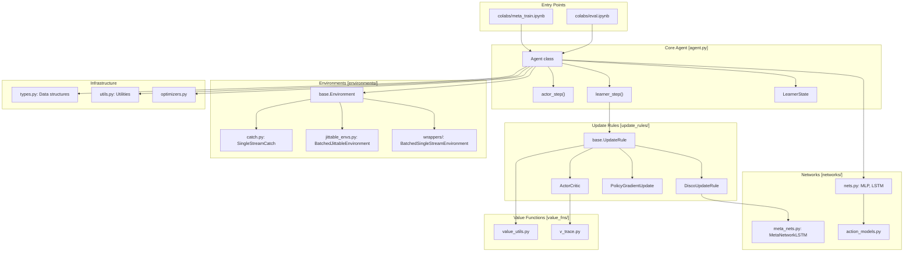

**Diagram: Main modules and their relationships in DiscoRL**

The system is organized into six primary layers:

1. **Entry Points**: Jupyter notebooks that demonstrate meta-evaluation and meta-training workflows
2. **Core Agent**: The `Agent` class orchestrates training by coordinating actor rollouts and learner updates
3. **Update Rules**: Pluggable implementations of RL algorithms (Disco103, Actor-Critic, Policy Gradient)
4. **Networks**: Neural network architectures including policy networks and meta-networks
5. **Environments**: Batched environment interface with CPU and JAX-jittable implementations
6. **Infrastructure**: Shared types, utilities, and optimizers

**Sources**: [README.md:37-56](), [agent.py](), [update_rules/](), [networks/](), [environments/]()

### Data Flow Architecture

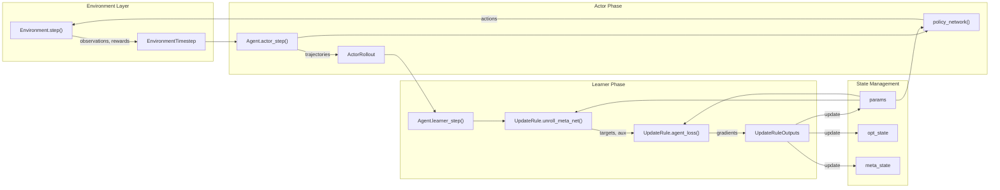

**Diagram: Data flow through the training loop**

Training proceeds through a cycle where:

1. **Environment** produces `EnvironmentTimestep` containing observations and rewards
2. **Actor** uses the policy network to select actions and collect trajectories into `ActorRollout`
3. **Learner** processes rollouts through two phases:
   - `unroll_meta_net()`: Computes learning targets and auxiliary outputs
   - `agent_loss()`: Calculates per-step losses and gradients
4. **State Update**: Parameters, optimizer state, and meta-state are updated

For details on the `Agent` class, see [Agent System](#3.1). For update rule implementations, see [Update Rules](#3.3).

**Sources**: [agent.py](), [types.py](), [update_rules/base.py]()

## Core Concepts

### Meta-Training vs Meta-Evaluation

DiscoRL operates in two distinct modes that serve different research purposes:

**Meta-Evaluation Mode**

In meta-evaluation, the system evaluates a fixed, pre-discovered update rule (typically Disco103) by training agents on target tasks:

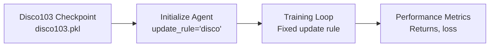

**Diagram: Meta-evaluation workflow**

- Update rule parameters are **frozen**
- Only agent policy parameters are trained
- Measures how well the discovered algorithm performs on the task
- Uses a single training loop with actor rollouts and learner updates

**Meta-Training Mode**

In meta-training, the system discovers new update rules through bi-level optimization:

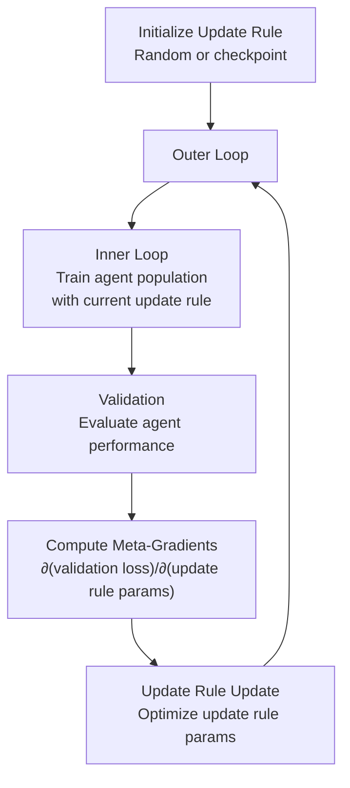

**Diagram: Meta-training workflow**

- Update rule parameters are **learned**
- Inner loop: Train agent policies using current update rule
- Outer loop: Update the update rule based on agent performance
- Requires multiple agent populations for gradient estimation
- Optimizes update rules to produce agents that learn efficiently

For detailed tutorials, see [Meta-Evaluation Tutorial](#2.1) and [Meta-Training Tutorial](#2.2).

**Sources**: [colabs/eval.ipynb](), [colabs/meta_train.ipynb](), [README.md:10-15]()

### Update Rule Plugin Architecture

DiscoRL implements a **plugin architecture** that allows different RL algorithms to be swapped seamlessly. All update rules implement the `base.UpdateRule` interface:

| Component | Role | Key Methods |
|-----------|------|-------------|
| `base.UpdateRule` | Abstract interface | `init_params()`, `init_meta_state()`, `unroll_meta_net()`, `agent_loss()` |
| `DiscoUpdateRule` | Disco103 implementation | Uses `MetaNetworkLSTM` for learned components |
| `ActorCritic` | Baseline algorithm | Uses V-trace advantages with EMA normalization |
| `PolicyGradientUpdate` | Baseline algorithm | Simple policy gradient with advantages |

The `Agent` class selects an update rule by name during initialization:

```python
# From agent.py
agent = Agent(
    update_rule_name='disco',  # Options: 'disco', 'actor_critic', 'policy_gradient'
    # ... other parameters
)
```

Each update rule is responsible for:

1. **Initialization**: Creating learnable parameters and meta-state
2. **Target Computation**: Computing learning targets via `unroll_meta_net()`
3. **Loss Calculation**: Computing per-step losses via `agent_loss()`
4. **Output Specification**: Defining auxiliary outputs via `flat_output_spec()`

This design enables researchers to:
- Compare discovered algorithms against baselines using identical infrastructure
- Implement new update rules by subclassing `base.UpdateRule`
- Meta-train update rules without modifying the core agent logic

For detailed documentation, see [Update Rules](#3.3).

**Sources**: [agent.py](), [update_rules/base.py](), [update_rules/disco.py](), [update_rules/actor_critic.py](), [update_rules/policy_gradient.py]()

### Key Data Structures

DiscoRL uses strongly-typed data structures defined in `types.py` to enforce contracts between components:

| Type | Purpose | Key Fields |
|------|---------|------------|
| `EnvironmentTimestep` | Environment observations | `observation`, `reward`, `is_first`, `is_last` |
| `ActorRollout` | Actor trajectory data | `timesteps`, `action_tm1`, `logits_tm1`, `value_tm1` |
| `UpdateRuleInputs` | Inputs to update rules | `rollout`, `meta_state`, `params`, `rng` |
| `UpdateRuleOutputs` | Update rule results | `loss`, `aux`, `meta_state`, `metrics` |
| `LearnerState` | Agent training state | `params`, `opt_state`, `meta_state` |
| `MetaParams` | Meta-learned parameters | `input_transforms`, `lstm_params` (for Disco) |

These structures flow through the system as shown in the data flow diagram above. The clear separation between environment state, actor outputs, and learner inputs enables modular testing and debugging.

**Sources**: [types.py]()

## Repository Structure

```
disco_rl/
├── colabs/                      # Entry points and examples
│   ├── eval.ipynb              # Meta-evaluation tutorial
│   └── meta_train.ipynb        # Meta-training tutorial
├── disco_rl/
│   ├── agent.py                # Generic RL agent implementation
│   ├── types.py                # Core data structures
│   ├── utils.py                # Helper utilities
│   ├── optimizers.py           # Optimizer implementations
│   ├── environments/           # Environment interface and implementations
│   │   ├── base.py            # Abstract Environment class
│   │   ├── catch.py           # CPU-based Catch game
│   │   ├── jittable_envs.py   # JAX-jittable environments
│   │   └── wrappers/          # Batching and streaming wrappers
│   ├── networks/               # Neural network architectures
│   │   ├── nets.py            # MLP and LSTM policy networks
│   │   ├── meta_nets.py       # LSTM meta-networks for Disco
│   │   └── action_models.py   # Action-conditional models
│   ├── update_rules/           # RL algorithm implementations
│   │   ├── base.py            # UpdateRule interface
│   │   ├── disco.py           # Disco103 discovered rule
│   │   ├── actor_critic.py    # Actor-Critic baseline
│   │   └── policy_gradient.py # Policy Gradient baseline
│   └── value_fns/              # Value function utilities
│       ├── value_utils.py     # Advantage computation
│       └── v_trace.py         # V-trace implementation
└── checkpoints/                # Pre-trained weights
    └── disco103.pkl           # Disco103 meta-learned parameters
```

The modular structure reflects the plugin architecture: each major component (environments, networks, update rules) has its own directory with a base interface and multiple implementations.

**Sources**: [README.md:37-56]()

## System Characteristics

### JAX-Based Implementation

DiscoRL is built entirely in JAX, enabling:

- **JIT Compilation**: All performance-critical functions are JIT-compiled for speed
- **Automatic Differentiation**: Meta-gradients computed via `jax.grad`
- **Parallelization**: Multi-device training via `jax.pmap` and `jax.vmap`
- **Functional Programming**: Pure functions with explicit state management

For details on parallelization strategies, see [JAX Parallelization](#4.1).

### Haiku Neural Networks

All neural networks are implemented using [Haiku](https://github.com/deepmind/dm-haiku), DeepMind's neural network library for JAX. Haiku provides:

- Stateless neural network modules
- Functional parameter management
- Integration with JAX transformations

Networks are defined in `networks/nets.py` and `networks/meta_nets.py`.

### Batched Environments

All environments in DiscoRL are **batched by design**. The `base.Environment` interface requires a `batch_size` attribute, and all operations (step, reset) operate on batches of environment instances simultaneously. This design:

- Maximizes GPU/TPU utilization
- Simplifies vectorization via `jax.vmap`
- Enables efficient data collection for meta-training

See [Environments](#3.2) for implementation details.

**Sources**: [environments/base.py](), [networks/nets.py](), [networks/meta_nets.py]()

## Getting Started

To begin using DiscoRL:

1. **Installation**: Follow the [Getting Started](#2) guide to install dependencies
2. **Meta-Evaluation**: Work through the [Meta-Evaluation Tutorial](#2.1) to train agents with Disco103
3. **Meta-Training**: Explore the [Meta-Training Tutorial](#2.2) to discover new update rules
4. **Deep Dives**: Consult the [Core Architecture](#3) section for detailed component documentation

For architectural details about specific components:
- Agent and training loop: [Agent System](#3.1)
- Environment implementations: [Environments](#3.2)
- Update rule details: [Update Rules](#3.3)
- Network architectures: [Neural Networks](#3.4)

**Sources**: [README.md:19-58]()

---

# Page: Getting Started

# Getting Started

<details>
<summary>Relevant source files</summary>

The following files were used as context for generating this wiki page:

- [README.md](README.md)
- [colabs/eval.ipynb](colabs/eval.ipynb)

</details>


This page provides installation instructions and basic usage patterns for DiscoRL. It covers the two primary operational modes (meta-evaluation and meta-training) and demonstrates the minimal setup required to run experiments. For detailed walkthroughs of each mode, see [Meta-Evaluation Tutorial](#2.1) and [Meta-Training Tutorial](#2.2). For architectural details about the core components, see [Core Architecture](#3).

## Installation

DiscoRL can be installed from GitHub using pip. The package requires Python 3 and includes all necessary dependencies (JAX, Haiku, RLax, etc.).

**Virtual Environment Installation:**

```bash
python3 -m venv disco_rl_venv
source disco_rl_venv/bin/activate
pip install git+https://github.com/google-deepmind/disco_rl.git
```

**Google Colab Installation:**

```bash
!pip install git+https://github.com/google-deepmind/disco_rl.git
```

After installation, the package provides access to:
- `disco_rl.agent` - The `Agent` class for RL training
- `disco_rl.environments` - Environment implementations and interfaces
- `disco_rl.update_rules` - Update rule implementations (`disco`, `actor_critic`, `policy_gradient`)
- `disco_rl.networks` - Policy and meta-network architectures
- `disco_rl.types` - Data structures for rollouts and states

**Sources:** [README.md:19-33](), [colabs/eval.ipynb:20-48]()

## Operational Modes

DiscoRL supports two distinct operational modes that share the same infrastructure but serve different purposes.

### Operational Mode Overview

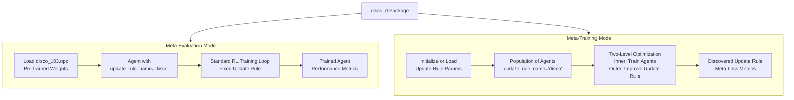

**Sources:** [README.md:9-15](), [colabs/eval.ipynb:8-14]()

### Meta-Evaluation Mode

Meta-evaluation uses a pre-discovered update rule (Disco103) to train an agent on an environment. This mode:
- Loads fixed update rule parameters from `disco_103.npz`
- Creates an `Agent` with `update_rule_name='disco'`
- Runs a standard RL training loop where the update rule is not modified
- Evaluates the discovered algorithm's performance

Entry point: `colabs/eval.ipynb`

**Sources:** [README.md:11-12](), [colabs/eval.ipynb:8-14]()

### Meta-Training Mode

Meta-training discovers new update rules through meta-learning. This mode:
- Initializes update rule parameters randomly or from a checkpoint
- Creates a population of agents for meta-gradient estimation
- Runs inner loops (agent training) and outer loops (update rule optimization)
- Produces new learned update rules

Entry point: `colabs/meta_train.ipynb`

**Sources:** [README.md:14-15]()

## Core Components Setup

The following diagram shows the key code entities required for basic setup in both modes:

### Component Initialization Flow

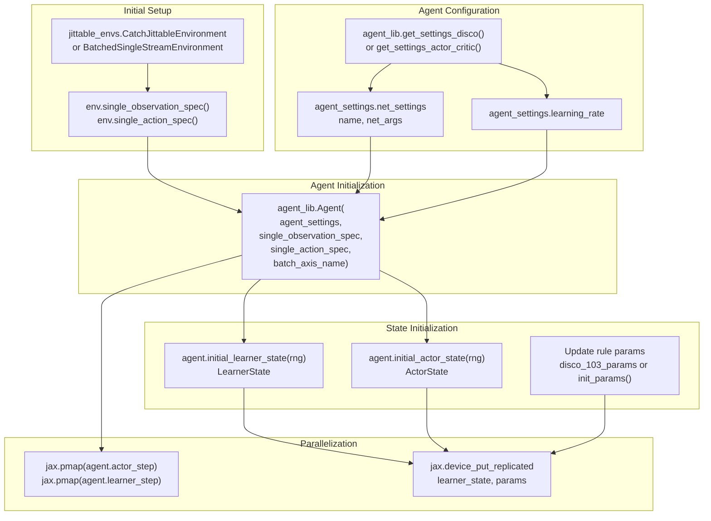

**Sources:** [colabs/eval.ipynb:89-138](), [colabs/eval.ipynb:296-319]()

## Meta-Evaluation Quick Start

This section demonstrates the minimal code pattern for meta-evaluation mode.

### Step 1: Download Disco103 Weights

```python
import numpy as np

# Download disco_103.npz from repository
disco_103_url = "https://raw.githubusercontent.com/google-deepmind/disco_rl/main/disco_rl/update_rules/weights/disco_103.npz"

# Unflatten the weight structure
def unflatten_params(flat_params):
    params = {}
    for key_wb in flat_params:
        key = '/'.join(key_wb.split('/')[:-1])
        params[key] = {'b': flat_params[f'{key}/b'], 'w': flat_params[f'{key}/w']}
    return params

with open('disco_103.npz', 'rb') as file:
    disco_103_params = unflatten_params(np.load(file))
```

**Sources:** [colabs/eval.ipynb:59-79]()

### Step 2: Create Environment and Agent

```python
from disco_rl.environments import jittable_envs
from disco_rl import agent as agent_lib

# Create environment
env = jittable_envs.CatchJittableEnvironment(
    batch_size=64,
    env_settings=jittable_envs.get_config_catch()
)

# Configure agent
agent_settings = agent_lib.get_settings_disco()
agent_settings.net_settings.name = 'mlp'
agent_settings.learning_rate = 1e-2

# Initialize agent
agent = agent_lib.Agent(
    agent_settings=agent_settings,
    single_observation_spec=env.single_observation_spec(),
    single_action_spec=env.single_action_spec(),
    batch_axis_name='i'
)
```

**Sources:** [colabs/eval.ipynb:89-135]()

### Step 3: Initialize States and Parallelize

```python
import jax

rng_key = jax.random.PRNGKey(0)
devices = tuple(jax.devices())

# Initialize states
env_state, ts = env.reset(rng_key)
learner_state = agent.initial_learner_state(rng_key)
actor_state = agent.initial_actor_state(rng_key)

# Replicate to devices
learner_state = jax.device_put_replicated(learner_state, devices)
actor_state = jax.device_put_replicated(actor_state, devices)
update_rule_params = jax.device_put_replicated(disco_103_params, devices)

# Create parallelized functions
actor_step_fn = jax.pmap(agent.actor_step, axis_name='i', devices=devices)
learner_step_fn = jax.pmap(agent.learner_step, axis_name='i', devices=devices)
```

**Sources:** [colabs/eval.ipynb:290-319]()

### Step 4: Training Loop Structure

The training loop consists of three phases:

1. **Actor Rollout**: Generate trajectories using `actor_step_fn`
2. **Buffer Management**: Store rollouts in a replay buffer
3. **Learner Update**: Sample from buffer and update parameters using `learner_step_fn`

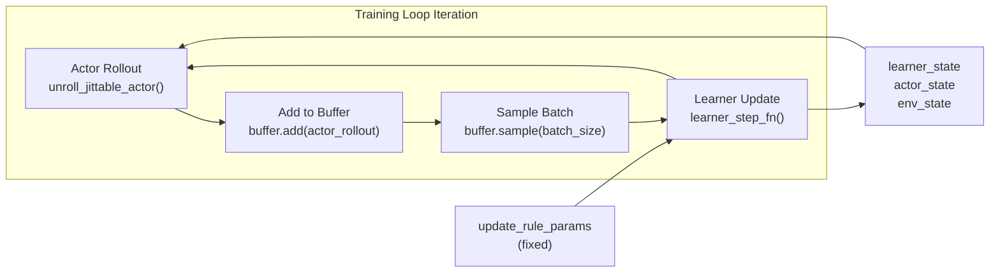

**Sources:** [colabs/eval.ipynb:274-396]()

### Key Types and Data Structures

The following table shows the primary data structures used in the training loop:

| Type | Module | Purpose |
|------|--------|---------|
| `LearnerState` | `disco_rl.types` | Contains `params`, `opt_state`, `meta_state` |
| `ActorState` | `disco_rl.types` | Policy recurrent state for actor rollouts |
| `ActorRollout` | `disco_rl.types` | Trajectory data: observations, actions, rewards, discounts |
| `EnvironmentTimestep` | `disco_rl.types` | Single environment step: observation, reward, discount |
| `EnvState` | environments | Environment-specific state (game state + RNG) |

**Sources:** [colabs/eval.ipynb:38-46](), [disco_rl/types.py:1-100]()

## Meta-Training Quick Start

Meta-training follows a similar setup but includes additional components for meta-optimization.

### Key Differences from Meta-Evaluation

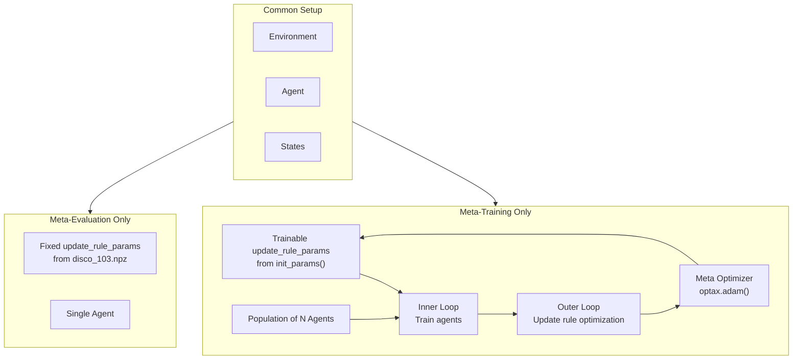

**Sources:** [README.md:14-15](), [colabs/meta_train.ipynb:1-50]()

### Population and Meta-Gradient Setup

Meta-training creates multiple agent instances for meta-gradient estimation:

1. Initialize a population of `N` agents with different random seeds
2. Run inner loops: Each agent trains for `num_inner_steps` using current update rule
3. Evaluate on validation rollouts to compute meta-loss
4. Calculate gradients of meta-loss with respect to update rule parameters
5. Average gradients across population and update the update rule

The meta-optimization loop modifies `update_rule_params` while the inner loop modifies each agent's `learner_state.params`.

**Sources:** [colabs/meta_train.ipynb:1-100]()

## Configuration Options

### Agent Settings

The `agent_lib.get_settings_disco()` function returns an `AgentSettings` object with the following key fields:

| Field | Purpose | Example Values |
|-------|---------|----------------|
| `update_rule_name` | Selects update rule implementation | `'disco'`, `'actor_critic'`, `'policy_gradient'` |
| `net_settings.name` | Policy network architecture | `'mlp'`, `'lstm'` |
| `net_settings.net_args` | Network hyperparameters | `dense=(512, 512)`, `lstm_size=128` |
| `learning_rate` | Optimizer learning rate | `1e-2`, `1e-3` |
| `entropy_cost` | Entropy regularization weight | `0.01` |

**Sources:** [colabs/eval.ipynb:102-115]()

### Environment Settings

For `CatchJittableEnvironment`:

```python
env_settings = jittable_envs.get_config_catch()
# Returns configuration with:
# - rows: 10
# - columns: 5
# - seed: random seed value
```

**Sources:** [colabs/eval.ipynb:93-96]()

## Replay Buffer Usage

DiscoRL includes a `SimpleReplayBuffer` implementation for off-policy training:

```python
from disco_rl import types

buffer = SimpleReplayBuffer(capacity=1024, seed=17)

# Add trajectories
buffer.add(actor_rollout)  # actor_rollout is types.ActorRollout

# Sample batch
learner_rollout = buffer.sample(batch_size=64)
```

The buffer:
- Stores `ActorRollout` objects
- Implements FIFO replacement when full
- Splits rollouts along batch dimension for storage
- Samples uniformly with replacement

**Sources:** [colabs/eval.ipynb:229-263]()

## Device Parallelization

DiscoRL uses JAX's `pmap` for data parallelism across TPUs/GPUs:

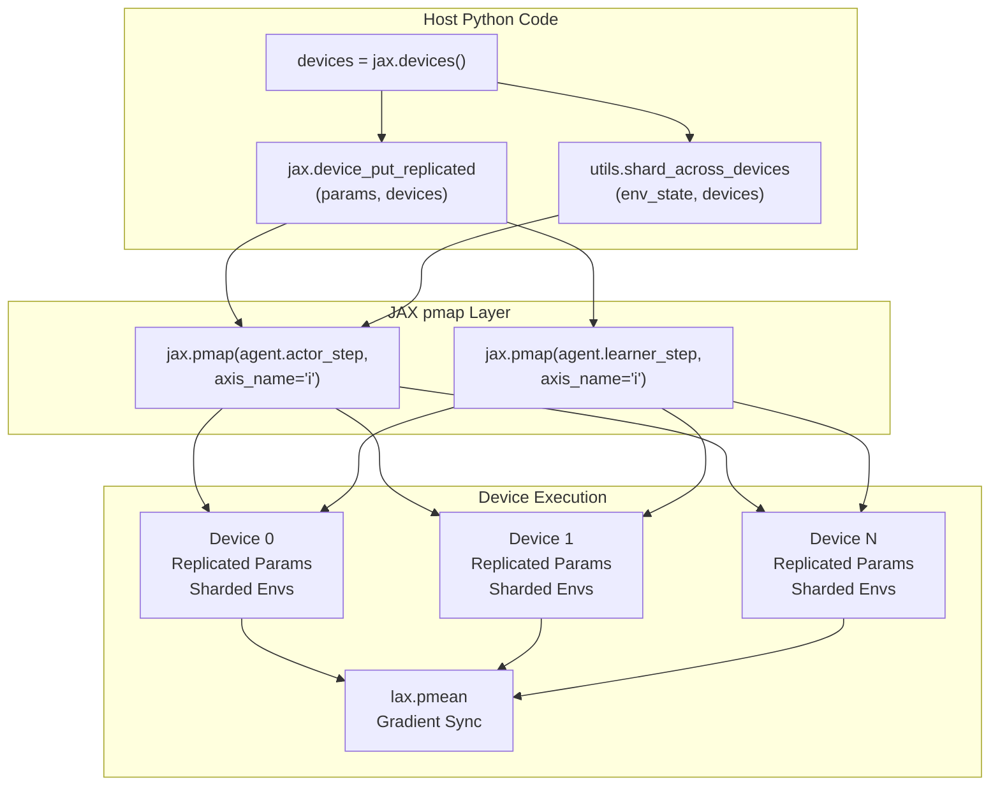

**Sources:** [colabs/eval.ipynb:296-314]()

### Replication vs Sharding

- **Replicated Data**: Model parameters and update rule parameters are identical across all devices using `jax.device_put_replicated()`
- **Sharded Data**: Environment states are distributed across devices using `utils.shard_across_devices()`, allowing different devices to simulate different environments
- **Synchronization**: Gradients are averaged across devices via `jax.lax.pmean` with `axis_name='i'`

**Sources:** [colabs/eval.ipynb:316-330]()

## Next Steps

After completing basic setup:

- **For detailed meta-evaluation workflow**: See [Meta-Evaluation Tutorial](#2.1) for complete walkthrough including rollout generation, buffer management, and metrics collection
- **For detailed meta-training workflow**: See [Meta-Training Tutorial](#2.2) for population setup, inner/outer loop mechanics, and meta-gradient computation
- **For architectural deep-dive**: See [Core Architecture](#3) for detailed documentation of `Agent`, environments, update rules, and networks
- **For JAX parallelization details**: See [JAX Parallelization](#4.1)

The two operational modes share most infrastructure, differing primarily in whether update rule parameters are fixed (meta-evaluation) or trainable (meta-training).

**Sources:** [README.md:35-58]()

---

# Page: Meta-Evaluation Tutorial

# Meta-Evaluation Tutorial

<details>
<summary>Relevant source files</summary>

The following files were used as context for generating this wiki page:

- [colabs/eval.ipynb](colabs/eval.ipynb)
- [disco_rl/agent.py](disco_rl/agent.py)

</details>


## Purpose and Scope

This tutorial demonstrates how to evaluate the pre-trained Disco103 update rule on the Catch environment. Meta-evaluation refers to using a fixed, pre-discovered update rule to train an RL agent, as opposed to meta-training where the update rule itself is being learned. This page walks through the complete evaluation pipeline including loading pre-trained weights, configuring the agent, setting up parallelization, running the training loop, and collecting metrics.

For information about meta-training update rules from scratch, see [Meta-Training Tutorial](#2.2). For details on the Agent class itself, see [Agent System](#3.1).

**Sources:** [colabs/eval.ipynb:1-14]()

## Overview: Evaluation Pipeline

The meta-evaluation pipeline involves several key stages that transform a pre-trained update rule into performance metrics on an environment:

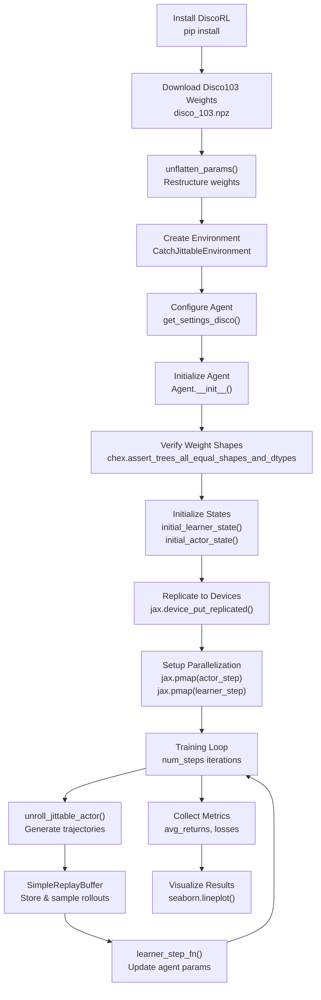

**Sources:** [colabs/eval.ipynb:1-444]()

## Installation and Imports

The evaluation notebook begins with installation and importing necessary dependencies:

```python
!pip install git+https://github.com/google-deepmind/disco_rl.git
```

Key imports include:
- **JAX ecosystem**: `jax`, `jax.numpy`, `chex`, `optax`, `rlax`, `distrax`
- **DiscoRL core**: `disco_rl.agent`, `disco_rl.types`, `disco_rl.utils`
- **Environments**: `disco_rl.environments.jittable_envs`
- **Visualization**: `pandas`, `seaborn`

An `axis_name = 'i'` is defined for JAX parallelization via `jax.pmap`.

**Sources:** [colabs/eval.ipynb:20-48]()

## Loading Pre-Trained Disco103 Weights

The Disco103 weights are stored as a flat dictionary with keys like `"layer_name/w"` and `"layer_name/b"`. The `unflatten_params()` function restructures them into nested dictionaries:

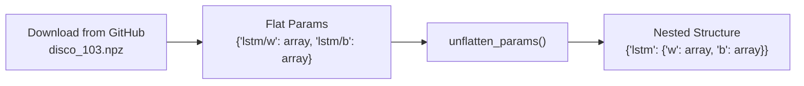

The function groups parameters by layer:

```python
def unflatten_params(flat_params):
    params = {}
    for key_wb in flat_params:
        key = '/'.join(key_wb.split('/')[:-1])
        params[key] = {
            'b': flat_params[f'{key}/b'],
            'w': flat_params[f'{key}/w'],
        }
    return params
```

**Sources:** [colabs/eval.ipynb:54-83]()

## Environment Setup

The environment factory function creates a `CatchJittableEnvironment`:

| Component | Purpose |
|-----------|---------|
| `jittable_envs.CatchJittableEnvironment` | JAX-jittable Catch environment for efficient parallel execution |
| `jittable_envs.get_config_catch()` | Default configuration for Catch game |
| `batch_size` parameter | Number of parallel environment instances |

```python
def get_env(batch_size: int) -> base_env.Environment:
    return jittable_envs.CatchJittableEnvironment(
        batch_size=batch_size, 
        env_settings=jittable_envs.get_config_catch()
    )
```

A dummy environment with `batch_size=1` is created initially for agent initialization, which requires environment specs.

**Sources:** [colabs/eval.ipynb:89-100]()

## Agent Configuration

Agent settings are obtained via `agent_lib.get_settings_disco()` and customized:

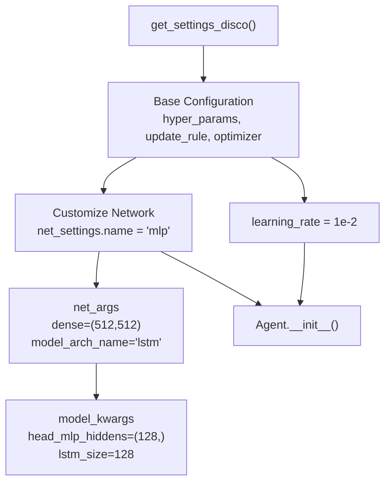

### Key Configuration Parameters

| Parameter | Value | Purpose |
|-----------|-------|---------|
| `update_rule_name` | `'disco'` | Use Disco103 update rule |
| `net_settings.name` | `'mlp'` | MLP policy network type |
| `dense` | `(512, 512)` | Hidden layer sizes |
| `model_arch_name` | `'lstm'` | LSTM for recurrent state |
| `lstm_size` | `128` | LSTM hidden state size |
| `learning_rate` | `1e-2` | Optimizer learning rate |
| `head_w_init_std` | `1e-2` | Policy head initialization std |

The agent is initialized with:
- `single_observation_spec`: From environment
- `single_action_spec`: From environment  
- `batch_axis_name`: For JAX parallelization (`'i'`)

**Sources:** [colabs/eval.ipynb:85-138](), [disco_rl/agent.py:319-378]()

## Weight Verification

Before training, the notebook verifies that the downloaded Disco103 parameters match the agent's update rule specification:

```python
random_update_rule_params, _ = agent.update_rule.init_params(jax.random.PRNGKey(0))
if agent_settings.update_rule_name == 'disco':
    chex.assert_trees_all_equal_shapes_and_dtypes(
        random_update_rule_params, disco_103_params
    )
```

This ensures compatibility between the pre-trained weights and the agent architecture.

**Sources:** [colabs/eval.ipynb:124-134]()

## Actor Unrolling Functions

Two unroll functions are provided depending on environment type:

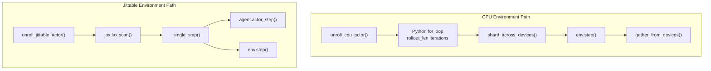

### unroll_cpu_actor()
For CPU environments, this function:
1. Iterates `rollout_len` times in a Python loop
2. Shards timesteps across devices
3. Calls `actor_step_fn` (pmapped)
4. Gathers actions back to CPU
5. Steps the environment
6. Stacks timesteps into `ActorRollout`

### unroll_jittable_actor()
For JAX-jittable environments, this function:
1. Uses `jax.lax.scan` for efficient unrolling
2. Defines `_single_step` inner function
3. Calls `agent.actor_step()` directly (not pmapped version)
4. Steps environment with jittable `env.step()`
5. Returns `ActorRollout` directly from scan

The jittable version is more efficient as the entire unroll is JIT-compiled.

**Sources:** [colabs/eval.ipynb:140-222]()

## Replay Buffer Implementation

The `SimpleReplayBuffer` class provides FIFO storage and sampling:

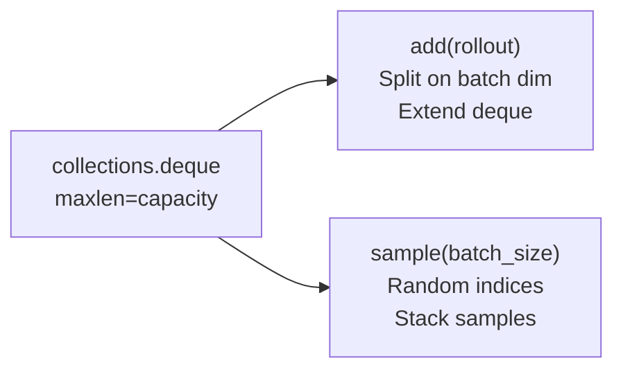

### Key Methods

| Method | Parameters | Returns | Purpose |
|--------|------------|---------|---------|
| `__init__` | `capacity`, `seed` | - | Initialize deque and RNG |
| `add` | `rollout: ActorRollout` | `None` | Split rollout on batch dim and store |
| `sample` | `batch_size: int` | `ActorRollout` | Random sample from buffer |
| `__len__` | - | `int` | Current buffer size |

The buffer uses `rlax.tree_split_leaves(rollout, axis=2)` to split rollouts along the batch dimension before storing individual trajectories.

**Sources:** [colabs/eval.ipynb:224-267]()

## Parallelization Setup

JAX's `pmap` enables data parallelism across multiple devices (TPUs/GPUs):

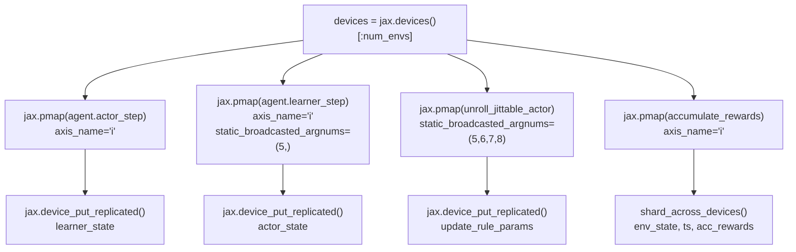

### Replication vs. Sharding

| Data | Strategy | Reason |
|------|----------|--------|
| `learner_state` | Replicated | Model parameters identical on all devices |
| `actor_state` | Replicated | Initial RNN state identical |
| `update_rule_params` | Replicated | Disco103 weights identical |
| `env_state` | Sharded | Different environment instances per device |
| `ts` (timesteps) | Sharded | Different observations per device |
| `acc_rewards` | Sharded | Track separate reward accumulation |

**Configuration:**
- `num_envs = batch_size // replay_ratio`
- `replay_ratio = 32` (learner samples 32x more than actor generates)
- `batch_size = 64` (total number of trajectories for learning)

**Sources:** [colabs/eval.ipynb:274-334]()

## Training Loop

The main training loop structure:

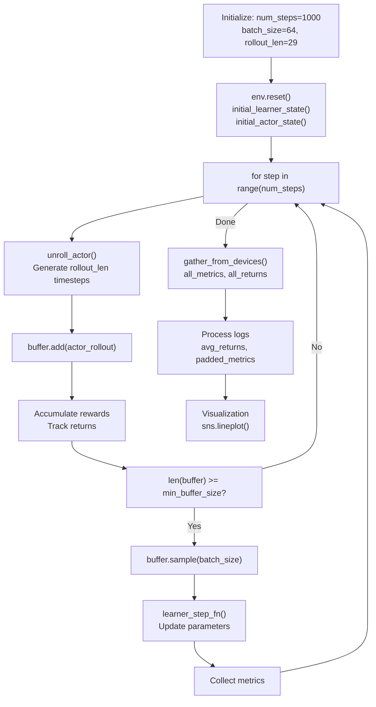

### Training Loop Parameters

| Parameter | Value | Purpose |
|-----------|-------|---------|
| `num_steps` | 1000 | Total training iterations |
| `batch_size` | 64 | Trajectories per learner update |
| `rollout_len` | 29 | Timesteps per trajectory |
| `replay_ratio` | 32 | Buffer samples per new trajectory |
| `buffer_capacity` | 1024 | Max trajectories in buffer |
| `min_buffer_size` | 64 | Minimum before learning starts |

### Loop Components

1. **Actor Phase:**
   - Split RNG for current step
   - Call `unroll_actor()` with current parameters
   - Add generated rollout to buffer
   - Accumulate episode returns

2. **Learner Phase (if buffer ready):**
   - Sample batch from replay buffer
   - Call `learner_step_fn()` with:
     - `rng_learner`: Split across devices
     - `learner_rollout`: Sampled trajectories
     - `learner_state`: Current params and optimizer state
     - `actor_state`: RNN state
     - `update_rule_params`: Disco103 weights
     - `is_meta_training=False`: Fixed update rule
   - Collect metrics dictionary

3. **Logging:**
   - Track `total_steps`, `all_rewards`, `all_discounts`, `all_returns`
   - Store metrics from learner updates

**Sources:** [colabs/eval.ipynb:269-399]()

## Metrics Collection and Processing

After training, metrics are gathered and processed:

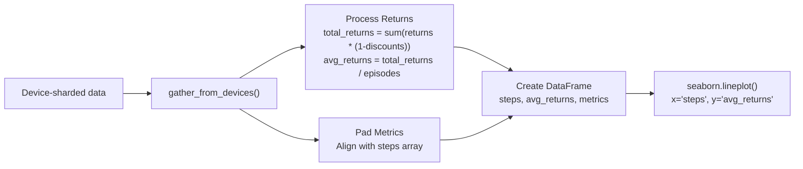

### Processing Steps

1. **Gather from devices:**
   ```python
   all_metrics, all_rewards, all_discounts, all_returns = (
       utils.gather_from_devices((all_metrics, all_rewards, all_discounts, all_returns))
   )
   ```

2. **Calculate average returns:**
   - `total_returns = (all_returns * (1 - all_discounts)).sum()`
   - `total_episodes = (1 - all_discounts).sum()`
   - `avg_returns = total_returns / total_episodes`

3. **Pad metrics:**
   - Metrics only exist after buffer fills
   - Pad with `np.nan` for initial steps
   - `pad_width = len(all_steps) - len(all_metrics)`

4. **Create DataFrame:**
   ```python
   df = pd.DataFrame(dict(
       steps=all_steps,
       avg_returns=avg_returns,
       **padded_metrics,
   ))
   ```

### Available Metrics

From `agent.learner_step()`:
- `total_loss`: Combined loss value
- `global_gradient_norm`: L2 norm of gradients
- `global_update_norm`: L2 norm of parameter updates
- Update rule specific losses (e.g., `pi_cost`, `y_cost`, `z_cost` for Disco)

**Sources:** [colabs/eval.ipynb:402-443]()

## Learner Step Details

The `agent.learner_step()` method orchestrates parameter updates:

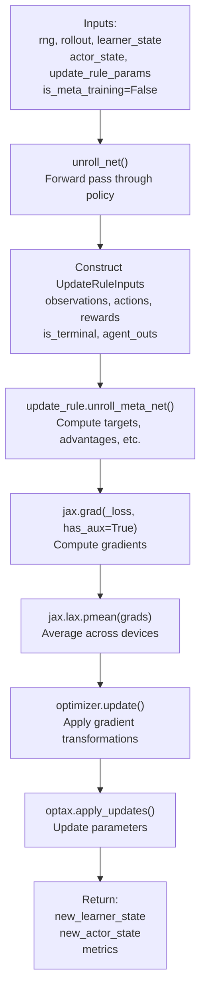

### Key Operations

1. **Network Unroll:** [disco_rl/agent.py:259-261]()
   - Forward pass through policy network
   - Computes logits, values for all timesteps

2. **Update Rule Application:** [disco_rl/agent.py:276-286]()
   - `update_rule.unroll_meta_net()` computes targets
   - For Disco103: runs meta-network LSTM
   - Returns `UpdateRuleOuts` and new meta state

3. **Loss Computation:** [disco_rl/agent.py:289-297]()
   - `jax.grad(self._loss)` computes parameter gradients
   - Loss combines update rule losses with masks
   - `has_aux=True` returns auxiliary outputs (metrics)

4. **Gradient Synchronization:** [disco_rl/agent.py:299-300]()
   - `jax.lax.pmean()` averages gradients across devices
   - Only happens if `batch_axis_name` is not None

5. **Parameter Update:** [disco_rl/agent.py:302-306]()
   - Optimizer applies transformations (clipping, Adam)
   - `optax.apply_updates()` adds updates to parameters

**Sources:** [disco_rl/agent.py:248-316]()

## Complete Evaluation Workflow

Putting it all together, here's the data flow through code entities:

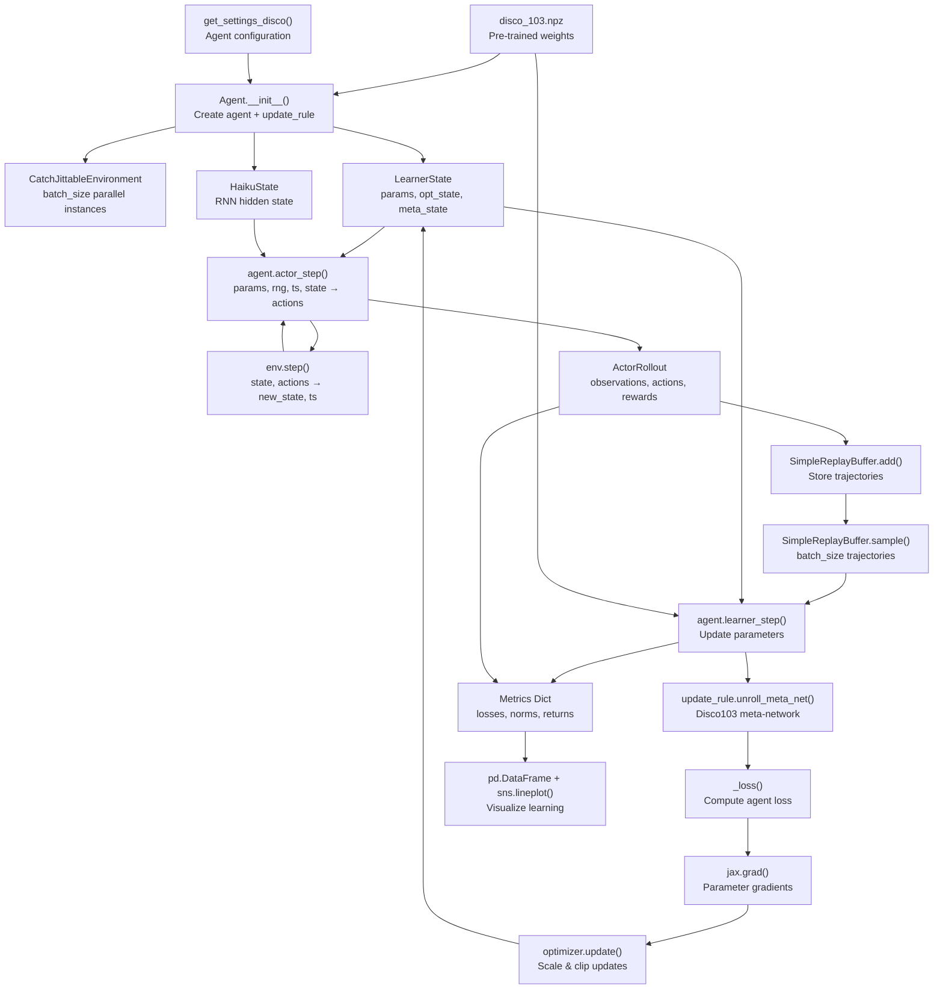

**Sources:** [colabs/eval.ipynb:1-444](), [disco_rl/agent.py:1-421]()

## Key Differences from Meta-Training

This evaluation tutorial uses a **fixed** update rule (Disco103) with pre-trained weights. Key distinctions:

| Aspect | Meta-Evaluation | Meta-Training |
|--------|-----------------|---------------|
| Update rule params | Fixed (disco_103.npz) | Being optimized |
| `is_meta_training` flag | `False` | `True` |
| Gradient computation | Only agent params | Agent params + update rule params |
| Outer loop | None | Meta-optimizer updates update rule |
| Loss backprop | Through agent loss | Through agent + meta loss |

In evaluation, `agent.learner_step()` is called with `is_meta_training=False`, which prevents gradients from flowing through the update rule's computations. The update rule parameters remain constant throughout training.

**Sources:** [colabs/eval.ipynb:386](), [disco_rl/agent.py:234-236]()

---

# Page: Meta-Training Tutorial

# Meta-Training Tutorial

<details>
<summary>Relevant source files</summary>

The following files were used as context for generating this wiki page:

- [colabs/meta_train.ipynb](colabs/meta_train.ipynb)
- [disco_rl/agent.py](disco_rl/agent.py)

</details>


## Purpose and Scope

This tutorial provides a detailed walkthrough of meta-training update rules in DiscoRL, demonstrating how to discover or fine-tune reinforcement learning algorithms from scratch. Meta-training involves a two-level optimization process: an inner loop that trains agent parameters using a candidate update rule, and an outer loop that optimizes the update rule itself based on agent performance.

For evaluating pre-trained update rules like Disco103 on RL tasks, see [Meta-Evaluation Tutorial](#2.1). For technical details on the update rule system, see [Update Rules](#3.3).

**Sources**: [colabs/meta_train.ipynb:8-13]()

---

## Meta-Training Overview

Meta-training in DiscoRL discovers or refines update rules by optimizing their parameters to maximize agent performance across a population of training runs. The process involves:

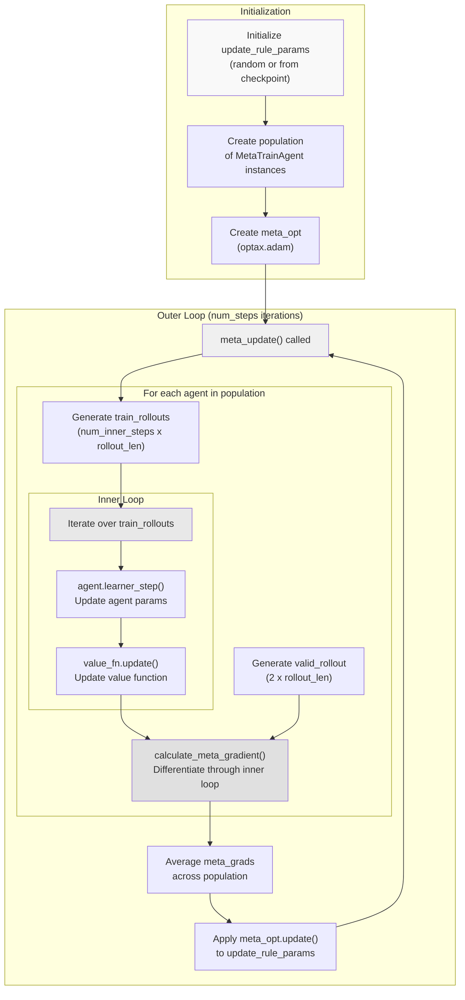

**Diagram: Meta-Training Process Flow**

The outer loop optimizes `update_rule_params` (the parameters of the meta-network), while the inner loop trains `agent.learner_state.params` (the policy network parameters) using the current update rule. Meta-gradients flow backward through the inner loop to update the update rule.

**Sources**: [colabs/meta_train.ipynb:191-281](), [colabs/meta_train.ipynb:291-448](), [colabs/meta_train.ipynb:459-538]()

---

## Setup and Configuration

### Installation and Imports

Install DiscoRL and import required dependencies:

```python
!pip install git+https://github.com/google-deepmind/disco_rl.git
```

Key imports include `MetaTrainAgent`, `Agent`, and JAX parallelization utilities.

**Sources**: [colabs/meta_train.ipynb:20-54]()

### Loading Initial Update Rule Parameters

Meta-training can start from random initialization or pre-trained weights:

```python
# Option 1: Random initialization
random_update_rule_params, _ = agent.update_rule.init_params(jax.random.PRNGKey(1))
update_rule_params = random_update_rule_params

# Option 2: Load Disco103 checkpoint for fine-tuning
with open('disco_103.npz', 'rb') as file:
    disco_103_params = unflatten_params(np.load(file))
update_rule_params = disco_103_params
```

The `unflatten_params` function restructures the flat parameter dictionary into the nested format expected by Haiku networks.

**Sources**: [colabs/meta_train.ipynb:64-85](), [colabs/meta_train.ipynb:572-573]()

### Agent Configuration

Configure the agent using `get_settings_disco()` or create custom settings:

```python
agent_settings = agent_lib.get_settings_disco()
agent_settings.net_settings.name = 'mlp'
agent_settings.net_settings.net_args = dict(
    dense=(512, 512),
    model_arch_name='lstm',
    head_w_init_std=1e-2,
    model_kwargs=dict(
        head_mlp_hiddens=(256,),
        lstm_size=256,
    ),
)
agent_settings.learning_rate = 5e-4
```

Key settings include:
- `update_rule_name`: `'disco'`, `'actor_critic'`, or `'policy_gradient'`
- `net_settings`: Architecture of the policy network
- `learning_rate`: Learning rate for agent parameter updates
- `hyper_params`: Update rule hyperparameters (costs, discount factors, etc.)

**Sources**: [colabs/meta_train.ipynb:96-142](), [disco_rl/agent.py:319-378]()

### Meta-Training Hyperparameters

Configure the meta-training process:

| Parameter | Description | Example Value |
|-----------|-------------|---------------|
| `num_steps` | Number of outer loop iterations | 800 |
| `num_agents` | Population size | 2 |
| `rollout_len` | Steps per rollout | 16 |
| `num_inner_steps` | Inner loop iterations | 2 |
| `batch_size_per_device` | Environments per device | 32 |
| `meta_opt` learning rate | Meta-optimizer step size | 5e-4 |

**Sources**: [colabs/meta_train.ipynb:549-596]()

---

## Meta-Training Components

### MetaTrainState and MetaTrainAgent

The `MetaTrainState` dataclass bundles all state required for meta-training:

```mermaid
classDiagram
    class MetaTrainState {
        +LearnerState learner_state
        +HaikuState actor_state
        +ValueState value_state
        +Any env_state
        +EnvironmentTimestep env_timestep
    }
    
    class LearnerState {
        +Params params
        +OptState opt_state
        +MetaState meta_state
    }
    
    class MetaTrainAgent {
        +Agent agent
        +ValueFunction value_fn
        +Environment env
        +init_state(rng_key) MetaTrainState
        +unroll_actor(state, rng, rollout_len) tuple
        +learner_step
        +actor_step
        +unroll_net
    }
    
    MetaTrainState *-- LearnerState
    MetaTrainAgent ..> MetaTrainState : creates/updates
```

**Diagram: Meta-Training State Components**

- `learner_state`: Agent's trainable parameters, optimizer state, and update rule state
- `actor_state`: Recurrent network hidden states for policy
- `value_state`: Value function parameters and optimizer state
- `env_state`: Environment state (positions, velocities, etc.)
- `env_timestep`: Current environment observations and rewards

The `MetaTrainAgent` class wraps an `Agent` and `ValueFunction`, providing convenience methods for rollout generation and state initialization.

**Sources**: [colabs/meta_train.ipynb:194-281](), [disco_rl/agent.py:38-45]()

### Actor Rollout Generation

Generate trajectories using the current policy:

```python
def unroll_jittable_actor(
    params, actor_state, ts, env_state, rng, env, rollout_len, actor_step_fn
):
    def _single_step(carry, step_rng):
        env_state, ts, actor_state = carry
        actor_timestep, actor_state = actor_step_fn(params, step_rng, ts, actor_state)
        env_state, ts = env.step(env_state, actor_timestep.actions)
        return (env_state, ts, actor_state), actor_timestep
    
    (env_state, ts, actor_state), actor_rollout = jax.lax.scan(
        _single_step, (env_state, ts, actor_state), jax.random.split(rng, rollout_len)
    )
    return types.ActorRollout.from_timestep(actor_rollout), actor_state, ts, env_state
```

The function uses `jax.lax.scan` to efficiently unroll `rollout_len` steps, accumulating `ActorTimestep` objects into an `ActorRollout`. This is JIT-compiled for performance.

**Sources**: [colabs/meta_train.ipynb:154-181]()

### Inner Loop: Agent Parameter Updates

The inner loop trains agent parameters using the current update rule:

```mermaid
graph LR
    subgraph "_inner_step function"
        INPUT["Input:<br/>update_rule_params<br/>learner_state<br/>actor_state<br/>value_state<br/>actor_rollout"]
        
        LEARNER["agent.learner_step()<br/>Updates params via<br/>current update rule"]
        
        UNROLL["agent.unroll_net()<br/>Compute agent_out<br/>for value function"]
        
        VALUE["value_fn.update()<br/>Train value network"]
        
        OUTPUT["Output:<br/>new_learner_state<br/>new_actor_state<br/>new_value_state<br/>metrics"]
        
        INPUT --> LEARNER
        LEARNER --> UNROLL
        UNROLL --> VALUE
        VALUE --> OUTPUT
    end
    
    SCAN["jax.lax.scan over<br/>num_inner_steps<br/>train_rollouts"]
    
    SCAN --> INPUT
    OUTPUT --> SCAN
```

**Diagram: Inner Loop Step Function**

Key operations:
1. `agent.learner_step()` computes loss via `update_rule.agent_loss()` and updates parameters
2. `agent.unroll_net()` runs forward pass for value function training
3. `value_fn.update()` fits value network to observed returns
4. Process repeats for `num_inner_steps` rollouts

**Sources**: [colabs/meta_train.ipynb:308-336]()

### Outer Loop: Meta-Gradient Calculation

The outer loop optimizes update rule parameters by differentiating through the inner loop:

```python
def _outer_loss(update_rule_params, agent_state, train_rollouts, valid_rollout, rng):
    # Perform N inner steps
    (_, new_learner_state, new_actor_state, new_value_state), train_metrics = (
        jax.lax.scan(_inner_step, initial_states, (train_rollouts, learner_rngs))
    )
    
    # Run inference on validation rollout with updated params
    agent_rollout_on_valid, _ = hk.BatchApply(...)(valid_rollout.to_env_timestep())
    
    # Calculate meta-loss components
    pg_loss_per_step = utils.differentiable_policy_gradient_loss(...)
    reg_loss = entropy_regularizers + kl_regularizers
    meta_loss = pg_loss_per_step.mean() + reg_loss
    
    return meta_loss, (new_agent_state, train_metrics, meta_log)

# Calculate meta-gradients
meta_grads, outputs = jax.grad(_outer_loss, has_aux=True)(
    update_rule_params, agent_state, train_rollouts, valid_rollout, rng
)
```

**Meta-Loss Composition**:

| Component | Formula | Weight | Purpose |
|-----------|---------|--------|---------|
| Policy Gradient | `-advantages * log π(a\|s)` | 1.0 | Maximize validation returns |
| Policy Entropy | `-H[π]` | 1e-2 | Encourage exploration |
| Y/Z Entropy | `-H[Y], -H[Z]` | 1e-3 | Regularize auxiliary outputs |
| Target KL | `KL(π_target \|\| π_meta)` | 1e-2 | Stabilize meta-updates |
| Output Centering | `mean(dy)^2 + mean(dz)^2 + mean(dp)^2` | 1e-3 | Prevent drift |

The validation rollout is 2x longer than training rollouts to provide a robust estimate of generalization performance.

**Sources**: [colabs/meta_train.ipynb:338-448]()

### Population-Based Meta-Update

Meta-gradients are averaged across the population before updating:

```mermaid
graph TB
    subgraph "For each agent in population"
        A1["Agent 1:<br/>calculate_meta_gradient()"]
        A2["Agent 2:<br/>calculate_meta_gradient()"]
        AN["Agent N:<br/>calculate_meta_gradient()"]
    end
    
    GRAD1["meta_grads[0]"]
    GRAD2["meta_grads[1]"]
    GRADN["meta_grads[N-1]"]
    
    A1 --> GRAD1
    A2 --> GRAD2
    AN --> GRADN
    
    AVG["avg_meta_gradient =<br/>tree_map(lambda x: x.mean(axis=0),<br/>tree_stack(meta_grads))"]
    
    GRAD1 --> AVG
    GRAD2 --> AVG
    GRADN --> AVG
    
    OPT["meta_update, meta_opt_state =<br/>meta_opt.update(avg_meta_gradient, meta_opt_state)"]
    
    APPLY["update_rule_params =<br/>optax.apply_updates(update_rule_params, meta_update)"]
    
    AVG --> OPT
    OPT --> APPLY
    
    PMEAN["jax.lax.pmean()<br/>within each agent<br/>across devices"]
    
    A1 -.-> PMEAN
    A2 -.-> PMEAN
    AN -.-> PMEAN
```

**Diagram: Population-Based Meta-Gradient Averaging**

Each agent independently:
1. Generates `num_inner_steps` training rollouts
2. Performs inner loop updates
3. Evaluates on a validation rollout
4. Computes meta-gradients via `jax.grad(_outer_loss)`
5. Averages gradients across devices via `jax.lax.pmean`

Then all agent gradients are averaged at the population level before applying the meta-optimizer.

**Sources**: [colabs/meta_train.ipynb:459-538]()

---

## Running Meta-Training

### Parallelization Setup

Distribute computation across devices using `jax.pmap`:

```python
# Get available devices
devices = jax.devices()

# Create jitted meta-update function
jitted_meta_update = jax.pmap(meta_update, axis_name=axis_name, devices=devices)

# Replicate initial state to all devices
step_update_rule_params = jax.device_put_replicated(update_rule_params, devices)
step_meta_opt_state = jax.device_put_replicated(meta_opt_state, devices)
step_agents_states = jax.device_put_replicated(agents_states, devices)
```

Each device processes a replica of the population, and gradients are synchronized via `pmean` before parameter updates.

**Sources**: [colabs/meta_train.ipynb:594-614]()

### Training Loop

Execute the outer loop:

```python
for meta_step in tqdm.tqdm(range(num_steps)):
    rng, step_rngs = jax.random.split(rng)
    step_rngs = jax.random.split(step_rngs, len(devices))
    
    (
        step_update_rule_params,
        step_meta_opt_state,
        step_agents_states,
        metrics[meta_step],
        meta_log[meta_step],
    ) = jitted_meta_update(
        update_rule_params=step_update_rule_params,
        meta_opt_state=step_meta_opt_state,
        agents_states=step_agents_states,
        rng=step_rngs,
    )
    
    metrics[meta_step], meta_log[meta_step] = jax.device_get(
        (metrics[meta_step], meta_log[meta_step])
    )

# Gather results from devices
metrics, meta_log = utils.gather_from_devices((metrics, meta_log))
metrics, meta_log = jax.tree.map(lambda x: x.mean(0), (metrics, meta_log))
```

The first call triggers JIT compilation, which can take several minutes. Subsequent iterations execute quickly.

**Sources**: [colabs/meta_train.ipynb:607-641]()

---

## Monitoring Progress

### Key Metrics

Track these metrics to assess meta-training convergence:

| Metric | Interpretation |
|--------|----------------|
| `meta_loss` | Meta-objective value (lower is better) |
| `pg_loss` | Policy gradient component of meta-loss |
| `reg_loss` | Regularization penalties |
| `rewards` | Average reward during inner loop training |
| `pos_rewards` / `neg_rewards` | Count of positive/negative rewards (task-specific) |
| `meta_grad_norm` | Magnitude of meta-gradients |
| `meta_up_norm` | Magnitude of meta-parameter updates |

**Sources**: [colabs/meta_train.ipynb:510-537](), [colabs/meta_train.ipynb:652-668]()

### Visualization

Process and plot metrics using pandas and seaborn:

```python
# Extract metrics to DataFrame
meta_log_cpu = jax.device_get(meta_log)
steps = np.sort(np.unique(list(meta_log_cpu.keys())))
rows = []
for i in steps:
    for key in ('meta_grad_norm', 'meta_up_norm', 'meta_loss', 'rewards', ...):
        rows.append(dict(step=i, value=float(meta_log_cpu[i][key]), f=key))

df = pd.DataFrame(rows)

# Plot training curves
sns.relplot(
    data=df[df.f.isin(['meta_loss', 'rewards'])],
    x='step', y='value', kind='line', col='f', aspect=1.5
)
```

Look for:
- Decreasing `meta_loss` over time
- Increasing `rewards` during inner loop
- Stable gradient norms (not exploding or vanishing)

**Sources**: [colabs/meta_train.ipynb:652-714]()

---

## Complete Meta-Training Example

```mermaid
sequenceDiagram
    participant Main as Main Loop
    participant MA as MetaTrainAgent
    participant Env as Environment
    participant UR as UpdateRule
    participant Meta as Meta-Optimizer
    
    Main->>MA: Create population of MetaTrainAgent instances
    Main->>Meta: Initialize meta_opt (Adam)
    
    loop Outer Loop (num_steps)
        loop For each agent
            loop Inner Loop (num_inner_steps)
                MA->>Env: unroll_actor(rollout_len)
                Env-->>MA: train_rollout
            end
            
            MA->>Env: unroll_actor(2 * rollout_len)
            Env-->>MA: valid_rollout
            
            Note over MA,UR: Inner loop:<br/>Update agent params
            loop Over train_rollouts
                MA->>UR: unroll_meta_net(update_rule_params)
                UR-->>MA: meta_out
                MA->>MA: agent.learner_step()
                MA->>MA: value_fn.update()
            end
            
            Note over MA,UR: Compute meta-gradient
            MA->>MA: jax.grad(_outer_loss)
        end
        
        Main->>Main: Average meta_grads across population
        Main->>Meta: meta_opt.update(avg_gradient)
        Meta-->>Main: meta_update
        Main->>Main: Apply updates to update_rule_params
    end
```

**Diagram: Meta-Training Sequence**

This sequence diagram illustrates the complete flow of data and control through one outer loop iteration, showing how agent rollouts, inner loop updates, and meta-gradient calculations coordinate to optimize the update rule.

**Sources**: [colabs/meta_train.ipynb:191-641]()

---

# Page: Core Architecture

# Core Architecture

<details>
<summary>Relevant source files</summary>

The following files were used as context for generating this wiki page:

- [README.md](README.md)
- [disco_rl/agent.py](disco_rl/agent.py)

</details>


## Purpose and Scope

This document provides an architectural overview of the DiscoRL system, describing the main components and how they interact to enable both meta-evaluation and meta-training of reinforcement learning update rules. 

For detailed information about specific components, see:
- Agent implementation details: [Agent System](#3.1)
- Environment implementations: [Environments](#3.2)
- Update rule plugins: [Update Rules](#3.3)
- Network architectures: [Neural Networks](#3.4)
- Parallelization strategies: [JAX Parallelization](#4.1)

## System Overview

DiscoRL is built around a modular architecture with five primary components that interact through well-defined interfaces:

```mermaid
graph TB
    subgraph "disco_rl/agent.py"
        Agent["Agent"]
        LearnerState["LearnerState"]
        actor_step["actor_step()"]
        learner_step["learner_step()"]
        unroll_net["unroll_net()"]
    end
    
    subgraph "disco_rl/update_rules/"
        UpdateRule["UpdateRule<br/>(base.py)"]
        DiscoUpdateRule["DiscoUpdateRule<br/>(disco.py)"]
        ActorCritic["ActorCritic<br/>(actor_critic.py)"]
        PolicyGradient["PolicyGradientUpdate<br/>(policy_gradient.py)"]
    end
    
    subgraph "disco_rl/environments/"
        Environment["Environment<br/>(base.py)"]
        CatchCPU["SingleStreamCatch<br/>(catch.py)"]
        CatchJAX["_SingleStreamCatch<br/>(jittable_envs.py)"]
        BatchedEnv["BatchedEnvironment<br/>(wrappers/)"]
    end
    
    subgraph "disco_rl/networks/"
        get_network["get_network()<br/>(nets.py)"]
        MLP["MLPPolicyNetwork"]
        LSTM["LSTMPolicyNetwork"]
        MetaNet["MetaNetwork<br/>(meta_nets.py)"]
    end
    
    subgraph "disco_rl/types.py"
        ActorRollout["ActorRollout"]
        UpdateRuleInputs["UpdateRuleInputs"]
        UpdateRuleOuts["UpdateRuleOuts"]
        EnvironmentTimestep["EnvironmentTimestep"]
        MetaParams["MetaParams"]
        MetaState["MetaState"]
    end
    
    Agent --> UpdateRule
    Agent --> get_network
    Agent --> LearnerState
    
    UpdateRule --> DiscoUpdateRule
    UpdateRule --> ActorCritic
    UpdateRule --> PolicyGradient
    
    DiscoUpdateRule --> MetaNet
    
    get_network --> MLP
    get_network --> LSTM
    
    actor_step --> Environment
    actor_step --> get_network
    
    learner_step --> UpdateRule
    learner_step --> unroll_net
    
    Environment --> CatchCPU
    Environment --> CatchJAX
    Environment --> BatchedEnv
    
    ActorRollout -.-> learner_step
    UpdateRuleInputs -.-> UpdateRule
    UpdateRuleOuts -.-> learner_step
    EnvironmentTimestep -.-> actor_step
    MetaParams -.-> learner_step
    MetaState -.-> LearnerState
```

**Sources:** [disco_rl/agent.py:1-421](), [README.md:37-56]()

## Core Components

DiscoRL's architecture consists of five interconnected layers:

| Component | Purpose | Key Classes | File Location |
|-----------|---------|-------------|---------------|
| **Agent** | Orchestrates training loop, manages actor/learner split | `Agent`, `LearnerState` | [disco_rl/agent.py]() |
| **Update Rules** | Pluggable learning algorithms | `UpdateRule`, `DiscoUpdateRule`, `ActorCritic`, `PolicyGradientUpdate` | [disco_rl/update_rules/]() |
| **Environments** | Provide observations and process actions | `Environment`, `SingleStreamCatch`, `_SingleStreamCatch` | [disco_rl/environments/]() |
| **Neural Networks** | Policy and meta-network implementations | `MLPPolicyNetwork`, `LSTMPolicyNetwork`, `MetaNetwork` | [disco_rl/networks/]() |
| **Types** | Data structures for inter-component communication | `ActorRollout`, `UpdateRuleInputs`, `EnvironmentTimestep` | [disco_rl/types.py]() |

**Sources:** [README.md:37-56](), [disco_rl/agent.py:1-421]()

## Agent System

The `Agent` class serves as the central orchestrator, implementing the actor-learner architecture pattern:

```mermaid
graph LR
    subgraph "Agent Class (agent.py:47-316)"
        init["__init__()<br/>Lines 58-106"]
        actor["actor_step()<br/>Lines 147-173"]
        learner["learner_step()<br/>Lines 248-316"]
        unroll["unroll_net()<br/>Lines 175-198"]
        loss["_loss()<br/>Lines 200-246"]
        
        init --> actor
        init --> learner
        learner --> unroll
        learner --> loss
    end
    
    subgraph "LearnerState (agent.py:38-44)"
        params["params: hk.Params"]
        opt_state["opt_state: optax.OptState"]
        meta_state["meta_state: types.MetaState"]
    end
    
    subgraph "External Dependencies"
        UpdateRule["update_rule:<br/>UpdateRule"]
        Network["_network:<br/>PolicyNetwork"]
        Optimizer["_optimizer:<br/>optax.GradientTransformation"]
    end
    
    init --> UpdateRule
    init --> Network
    init --> Optimizer
    
    learner --> params
    learner --> opt_state
    learner --> meta_state
    
    actor --> Network
    learner --> UpdateRule
```

### Key Responsibilities

1. **Initialization** [disco_rl/agent.py:58-106](): Creates update rule, neural network, and optimizer based on configuration
2. **Actor Step** [disco_rl/agent.py:147-173](): Performs inference to select actions given observations
3. **Learner Step** [disco_rl/agent.py:248-316](): Updates parameters using gradients from the update rule
4. **State Management**: Maintains `LearnerState` [disco_rl/agent.py:38-44]() containing parameters, optimizer state, and meta-state

**Sources:** [disco_rl/agent.py:38-316]()

## Update Rule Plugin System

The update rule system uses a plugin architecture where different learning algorithms implement the `UpdateRule` interface:

```mermaid
graph TB
    subgraph "Update Rule Selection (agent.py:76-87)"
        if_disco["if update_rule_name == 'disco'"]
        if_ac["elif update_rule_name == 'actor_critic'"]
        if_pg["elif update_rule_name == 'policy_gradient'"]
    end
    
    subgraph "Base Interface (update_rules/base.py)"
        init_params["init_params()"]
        init_meta_state["init_meta_state()"]
        unroll_meta_net["unroll_meta_net()"]
        agent_loss["agent_loss()"]
        agent_loss_no_meta["agent_loss_no_meta()"]
        flat_output_spec["flat_output_spec()"]
        model_output_spec["model_output_spec()"]
    end
    
    subgraph "Implementations"
        disco["DiscoUpdateRule<br/>(update_rules/disco.py)"]
        ac["ActorCritic<br/>(update_rules/actor_critic.py)"]
        pg["PolicyGradientUpdate<br/>(update_rules/policy_gradient.py)"]
    end
    
    if_disco --> disco
    if_ac --> ac
    if_pg --> pg
    
    disco --> init_params
    disco --> init_meta_state
    disco --> unroll_meta_net
    disco --> agent_loss
    
    ac --> init_params
    ac --> init_meta_state
    ac --> unroll_meta_net
    ac --> agent_loss
    
    pg --> init_params
    pg --> init_meta_state
    pg --> unroll_meta_net
    pg --> agent_loss
```

### Update Rule Interface Methods

| Method | Purpose | Inputs | Outputs |
|--------|---------|--------|---------|
| `init_params()` | Initialize learnable parameters | `rng` | `MetaParams` |
| `init_meta_state()` | Initialize recurrent state | `rng`, `params` | `MetaState` |
| `unroll_meta_net()` | Compute targets and auxiliary outputs | `meta_params`, `rollout`, `hyper_params` | `UpdateRuleOuts`, `MetaState` |
| `agent_loss()` | Compute per-step losses | `inputs`, `meta_out`, `hyper_params` | `loss`, `log_dict` |
| `flat_output_spec()` | Define network output structure | `action_spec` | Output specification |
| `model_output_spec()` | Define model-specific outputs | `action_spec` | Model specification |

**Sources:** [disco_rl/agent.py:76-87](), [disco_rl/update_rules/base.py]()

## Data Flow Architecture

The system follows a clear data flow pattern through the training loop:

```mermaid
graph TB
    subgraph "Actor Phase"
        env_timestep["EnvironmentTimestep<br/>(observation, reward, step_type)"]
        actor_step["Agent.actor_step()<br/>(agent.py:147-173)"]
        action["actions"]
        actor_timestep["ActorTimestep<br/>(observations, actions,<br/>agent_outs, rewards)"]
    end
    
    subgraph "Rollout Collection"
        buffer["Rollout Buffer"]
        actor_rollout["ActorRollout<br/>(stacked ActorTimesteps)"]
    end
    
    subgraph "Learner Phase"
        unroll_meta["UpdateRule.unroll_meta_net()<br/>(Compute targets)"]
        update_inputs["UpdateRuleInputs<br/>(observations, actions,<br/>rewards, is_terminal,<br/>agent_out)"]
        update_outs["UpdateRuleOuts<br/>(targets, auxiliary outputs)"]
        loss_fn["UpdateRule.agent_loss()<br/>(Compute gradients)"]
        optimizer["optax.GradientTransformation"]
        new_params["Updated params"]
    end
    
    subgraph "State Updates"
        learner_state["LearnerState<br/>(params, opt_state,<br/>meta_state)"]
        new_learner_state["Updated LearnerState"]
    end
    
    env_timestep --> actor_step
    actor_step --> action
    actor_step --> actor_timestep
    actor_timestep --> buffer
    buffer --> actor_rollout
    
    actor_rollout --> unroll_meta
    actor_rollout --> update_inputs
    unroll_meta --> update_outs
    update_inputs --> loss_fn
    update_outs --> loss_fn
    loss_fn --> optimizer
    
    learner_state --> unroll_meta
    learner_state --> loss_fn
    optimizer --> new_params
    new_params --> new_learner_state
```

### Data Type Definitions

The `types.py` module defines the data structures that flow between components:

| Type | Purpose | Key Fields |
|------|---------|------------|
| `EnvironmentTimestep` | Environment output | `observation`, `reward`, `step_type`, `discount` |
| `ActorTimestep` | Actor output | `observations`, `actions`, `agent_outs`, `rewards`, `discounts`, `states`, `logits` |
| `ActorRollout` | Trajectory segment | Stacked `ActorTimestep` over time dimension |
| `UpdateRuleInputs` | Update rule inputs | `observations`, `actions`, `rewards`, `is_terminal`, `behaviour_agent_out`, `agent_out` |
| `UpdateRuleOuts` | Update rule outputs | `y_target`, `z_target`, `pi_target`, `values` |
| `MetaParams` | Learnable update rule parameters | Haiku parameters for meta-network |
| `MetaState` | Recurrent update rule state | LSTM states, EMA statistics |

**Sources:** [disco_rl/types.py](), [disco_rl/agent.py:147-316]()

## Integration Pattern

The components integrate through a well-defined call sequence during training:

```mermaid
sequenceDiagram
    participant Env as Environment
    participant Agent as Agent
    participant Net as PolicyNetwork
    participant UR as UpdateRule
    participant Opt as Optimizer

    Note over Env,Opt: Actor Phase (unroll_length steps)
    loop for each timestep
        Env->>Agent: EnvironmentTimestep
        Agent->>Net: actor_step(params, obs)
        Net-->>Agent: agent_outs, actor_state
        Agent->>Env: actions
        Agent->>Agent: Store ActorTimestep
    end
    
    Note over Env,Opt: Learner Phase (single step)
    Agent->>Agent: Stack ActorTimesteps → ActorRollout
    Agent->>UR: unroll_meta_net(rollout, meta_params)
    UR-->>Agent: UpdateRuleOuts, new_meta_state
    Agent->>Net: unroll_net(params, rollout)
    Net-->>Agent: agent_outs
    Agent->>UR: agent_loss(inputs, meta_out)
    UR-->>Agent: loss_per_step
    Agent->>Agent: Compute total_loss, gradients
    Agent->>Opt: update(grads, opt_state)
    Opt-->>Agent: updates, new_opt_state
    Agent->>Agent: Apply updates → new_params
```

**Sources:** [disco_rl/agent.py:147-316]()

## Configuration and Settings

The agent is configured through `ConfigDict` objects that specify the update rule, network architecture, and hyperparameters:

```mermaid
graph TB
    subgraph "Agent Settings Structure"
        agent_settings["agent_settings<br/>(ConfigDict)"]
        update_rule_name["update_rule_name:<br/>'disco' | 'actor_critic' | 'policy_gradient'"]
        update_rule_config["update_rule:<br/>ConfigDict"]
        net_settings["net_settings:<br/>ConfigDict"]
        hyper_params["hyper_params:<br/>ConfigDict"]
        learning_rate["learning_rate: float"]
        max_abs_update["max_abs_update: float"]
    end
    
    agent_settings --> update_rule_name
    agent_settings --> update_rule_config
    agent_settings --> net_settings
    agent_settings --> hyper_params
    agent_settings --> learning_rate
    agent_settings --> max_abs_update
    
    subgraph "Predefined Configurations"
        get_settings_disco["get_settings_disco()<br/>(agent.py:319-378)"]
        get_settings_ac["get_settings_actor_critic()<br/>(agent.py:381-421)"]
    end
    
    get_settings_disco --> agent_settings
    get_settings_ac --> agent_settings
```

### Configuration Factory Functions

DiscoRL provides pre-configured settings for each update rule:

- **`get_settings_disco()`** [disco_rl/agent.py:319-378](): Returns configuration for Disco103 with pre-tuned hyperparameters
- **`get_settings_actor_critic()`** [disco_rl/agent.py:381-421](): Returns configuration for Actor-Critic baseline

**Sources:** [disco_rl/agent.py:319-421]()

## Key Design Patterns

### 1. Actor-Learner Split

The agent separates action selection (`actor_step`) from parameter updates (`learner_step`), enabling asynchronous execution and parallelization:

- **Actor** [disco_rl/agent.py:147-173](): Performs fast inference using current parameters
- **Learner** [disco_rl/agent.py:248-316](): Performs gradient-based updates using accumulated rollouts

### 2. Plugin Architecture

Update rules implement a common interface, allowing easy substitution:

- Selection at initialization [disco_rl/agent.py:76-87]()
- Interface methods called through the base class
- No conditional logic in the training loop

### 3. Functional State Management

All state is explicitly passed and returned:

- `LearnerState` [disco_rl/agent.py:38-44]() contains all learnable state
- `MetaState` contains update rule-specific state
- No hidden global state or side effects

### 4. JAX-Friendly Design

The architecture is designed for JAX transformations:

- Pure functions throughout the training loop
- Explicit RNG threading
- Data structures compatible with `jax.tree` operations
- Support for `jax.pmap` through `batch_axis_name` parameter [disco_rl/agent.py:64]()

**Sources:** [disco_rl/agent.py:1-421]()

## Summary

DiscoRL's core architecture achieves modularity through:

1. **Clear separation of concerns**: Agent orchestrates, update rules compute losses, networks perform inference
2. **Well-defined interfaces**: `UpdateRule`, `Environment`, and policy network interfaces enable extensibility
3. **Explicit data flow**: All data structures are defined in `types.py` with clear ownership
4. **Configuration-driven**: Settings objects allow easy experimentation without code changes
5. **JAX-native design**: Functional programming patterns enable efficient parallelization

This design allows researchers to evaluate discovered algorithms like Disco103 against baselines using identical infrastructure, or to meta-train new update rules by simply implementing the `UpdateRule` interface.

**Sources:** [README.md:1-94](), [disco_rl/agent.py:1-421]()

---

# Page: Agent System

# Agent System

<details>
<summary>Relevant source files</summary>

The following files were used as context for generating this wiki page:

- [colabs/eval.ipynb](colabs/eval.ipynb)
- [disco_rl/agent.py](disco_rl/agent.py)

</details>


## Purpose and Scope

The Agent System provides the core orchestration layer for training reinforcement learning agents in DiscoRL. The `Agent` class ([disco_rl/agent.py]()), along with its `LearnerState` dataclass, manages the integration between policy networks, update rules, and the training infrastructure. It handles both inference (action selection) and learning (parameter updates) while maintaining compatibility with any update rule implementation.

For information about specific update rule implementations, see [Update Rules](#3.3). For details on policy network architectures, see [Neural Networks](#3.4). For environment interaction patterns, see [Environments](#3.2).

## Agent Class Overview

The `Agent` class serves as the primary interface for training RL agents. It is update-rule agnostic, allowing researchers to swap different learning algorithms while maintaining the same training infrastructure.

```mermaid
graph TB
    subgraph "Agent Initialization"
        INIT["Agent.__init__"]
        SPECS["observation_spec<br/>action_spec"]
        SETTINGS["agent_settings<br/>ConfigDict"]
    end
    
    subgraph "Component Selection"
        UPDATE_RULE["Update Rule Selection"]
        DISCO["DiscoUpdateRule"]
        AC["ActorCritic"]
        PG["PolicyGradientUpdate"]
        NET["Network Selection"]
        OPT["Optimizer Setup"]
    end
    
    subgraph "Core Methods"
        ACTOR_STEP["actor_step"]
        LEARNER_STEP["learner_step"]
        UNROLL["unroll_net"]
        LOSS["_loss"]
    end
    
    subgraph "State Management"
        INITIAL_ACTOR["initial_actor_state"]
        INITIAL_LEARNER["initial_learner_state"]
        LEARNER_STATE["LearnerState"]
    end
    
    INIT --> SPECS
    INIT --> SETTINGS
    
    SETTINGS --> UPDATE_RULE
    UPDATE_RULE --> DISCO
    UPDATE_RULE --> AC
    UPDATE_RULE --> PG
    
    SETTINGS --> NET
    SETTINGS --> OPT
    
    INIT --> ACTOR_STEP
    INIT --> LEARNER_STEP
    INIT --> UNROLL
    INIT --> LOSS
    
    INIT --> INITIAL_ACTOR
    INIT --> INITIAL_LEARNER
    INITIAL_LEARNER --> LEARNER_STATE
    
    style INIT fill:#f9f9f9
    style LEARNER_STATE fill:#f9f9f9
    style ACTOR_STEP fill:#f9f9f9
    style LEARNER_STEP fill:#f9f9f9
```

**Sources**: [disco_rl/agent.py:47-107]()

### Constructor Parameters

The `Agent.__init__` method requires the following parameters:

| Parameter | Type | Description |
|-----------|------|-------------|
| `single_observation_spec` | `types.Specs` | Specification for a single environment observation |
| `single_action_spec` | `types.ActionSpec` | Specification for a single action (must be scalar discrete) |
| `agent_settings` | `config_dict.ConfigDict` | Configuration including update rule, network, and optimizer settings |
| `batch_axis_name` | `str \| None` | Axis name for JAX parallelization (e.g., `'i'`) |

**Sources**: [disco_rl/agent.py:58-69]()

## LearnerState

The `LearnerState` dataclass encapsulates all learnable and optimizer state required for training:

```mermaid
graph LR
    subgraph "LearnerState Components"
        LS["LearnerState<br/>@chex.dataclass"]
        PARAMS["params<br/>hk.Params<br/>Policy network weights"]
        OPT["opt_state<br/>optax.OptState<br/>Optimizer state"]
        META["meta_state<br/>types.MetaState<br/>Update rule state"]
    end
    
    LS --> PARAMS
    LS --> OPT
    LS --> META
    
    PARAMS -.-> NET["Policy Network<br/>MLP/LSTM"]
    OPT -.-> OPTIMIZER["Optimizer<br/>Adam + Clipping"]
    META -.-> UR["Update Rule<br/>Disco/AC/PG"]
```

**Definition**: [disco_rl/agent.py:38-45]()

| Field | Type | Description |
|-------|------|-------------|
| `params` | `hk.Params` | Haiku parameters for the policy network |
| `opt_state` | `optax.OptState` | Optimizer state (momentum buffers, step counts, etc.) |
| `meta_state` | `types.MetaState` | Update rule-specific state (e.g., EMA statistics, meta-network hidden states) |

**Sources**: [disco_rl/agent.py:38-45]()

## Initialization

### Update Rule Selection

The agent selects an update rule based on `agent_settings.update_rule_name`:

```mermaid
graph TB
    SELECT["agent_settings.update_rule_name"]
    
    SELECT -->|"'disco'"| DISCO_INIT["disco.DiscoUpdateRule"]
    SELECT -->|"'actor_critic'"| AC_INIT["actor_critic.ActorCritic"]
    SELECT -->|"'policy_gradient'"| PG_INIT["policy_gradient.PolicyGradientUpdate"]
    
    DISCO_INIT --> UR["self.update_rule"]
    AC_INIT --> UR
    PG_INIT --> UR
    
    UR --> SPECS_CALL["update_rule.flat_output_spec<br/>update_rule.model_output_spec"]
    SPECS_CALL --> NET_INIT["Network Initialization"]
```

**Implementation**: [disco_rl/agent.py:75-88]()

### Network Initialization

The agent creates a policy network based on the update rule's output specifications:

```python
# From agent.py lines 91-99
flat_out_spec = self.update_rule.flat_output_spec(self.single_action_spec)
model_out_spec = self.update_rule.model_output_spec(self.single_action_spec)
self._network = nets.get_network(
    name=agent_settings.net_settings.name,
    action_spec=self.single_action_spec,
    out_spec=flat_out_spec,
    model_out_spec=model_out_spec,
    **agent_settings.net_settings.net_args,
)
```

**Sources**: [disco_rl/agent.py:91-99]()

### Optimizer Setup

The agent uses a standard optimizer chain:

| Component | Purpose |
|-----------|---------|
| `scale_by_adam_sg_denom()` | Custom Adam variant with square-gradient denominator |
| `clip(max_delta)` | Gradient clipping by maximum absolute update |
| `scale(-learning_rate)` | Apply learning rate with negative sign for descent |

**Implementation**: [disco_rl/agent.py:101-106]()

### Initial States

The agent provides two initialization methods:

**`initial_actor_state(rng)`** - Creates the initial recurrent state for the policy network:

```python
# Returns empty dict for feedforward networks, 
# or LSTM hidden state for recurrent networks
dummy_obs = self._dummy_obs(batch_size=1)
should_reset = self._dummy_should_reset(batch_size=1)
_, rnn_state = self._network.init(rng, dummy_obs, should_reset)
```

**Implementation**: [disco_rl/agent.py:123-132]()

**`initial_learner_state(rng_key)`** - Creates the initial `LearnerState`:

```python
# Initializes params, optimizer state, and meta state
params, _ = self._network.init(net_rng, dummy_obs, should_reset)
opt_state = self._optimizer.init(params)
meta_state = self.update_rule.init_meta_state(rng=state_rng, params=params)
```

**Implementation**: [disco_rl/agent.py:134-145]()

**Sources**: [disco_rl/agent.py:123-145]()

## Actor Step (Inference)

The `actor_step` method performs action selection during environment interaction:

```mermaid
graph TB
    INPUT["actor_step Inputs"]
    PARAMS["actor_params<br/>hk.Params"]
    RNG["rng<br/>PRNGKey"]
    TS["timestep<br/>EnvironmentTimestep"]
    STATE["actor_state<br/>hk.State"]
    
    INPUT --> PARAMS
    INPUT --> RNG
    INPUT --> TS
    INPUT --> STATE
    
    CHECK["Check if episode ended<br/>should_reset = step_type == LAST"]
    TS --> CHECK
    
    INFERENCE["Network Inference<br/>_network.one_step"]
    PARAMS --> INFERENCE
    STATE --> INFERENCE
    TS --> INFERENCE
    CHECK --> INFERENCE
    
    AGENT_OUTS["agent_outs<br/>{'logits': ...}"]
    NEXT_STATE["next_actor_state<br/>Updated RNN state"]
    INFERENCE --> AGENT_OUTS
    INFERENCE --> NEXT_STATE
    
    SAMPLE["Sample Actions<br/>Softmax(logits).sample"]
    AGENT_OUTS --> SAMPLE
    RNG --> SAMPLE
    
    ACTIONS["actions<br/>int32 array"]
    SAMPLE --> ACTIONS
    
    BUILD["Build ActorTimestep"]
    ACTIONS --> BUILD
    AGENT_OUTS --> BUILD
    TS --> BUILD
    CHECK --> BUILD
    STATE --> BUILD
    
    OUTPUT["Returns:<br/>ActorTimestep, next_actor_state"]
    BUILD --> OUTPUT
    NEXT_STATE --> OUTPUT
```

**Key Steps**:
1. Determine if episode reset is needed (`should_reset = timestep.step_type == LAST`)
2. Run network inference with `_network.one_step()`
3. Sample actions from policy distribution (Softmax over logits)
4. Package results into `ActorTimestep` with observations, actions, rewards, discounts, and recurrent state

**Implementation**: [disco_rl/agent.py:147-173]()

**Sources**: [disco_rl/agent.py:147-173]()

## Learner Step (Training)

The `learner_step` method performs parameter updates on a batch of rollout data:

```mermaid
graph TB
    subgraph "Inputs"
        RNG["rng: PRNGKey"]
        ROLLOUT["rollout: ActorRollout"]
        LS["learner_state: LearnerState"]
        ANS["agent_net_state: hk.State"]
        URP["update_rule_params: MetaParams"]
        META_TRAIN["is_meta_training: bool"]
    end
    
    subgraph "Phase 1: Network Unrolling"
        UNROLL1["unroll_net()<br/>Compute on-policy outputs"]
        INPUTS_CONSTRUCT["Construct UpdateRuleInputs"]
    end
    
    subgraph "Phase 2: Meta-Network Application"
        META_UNROLL["update_rule.unroll_meta_net()<br/>Compute targets & auxiliary outputs"]
        META_OUT["meta_out: UpdateRuleOuts"]
        NEW_META["new_meta_state: MetaState"]
    end
    
    subgraph "Phase 3: Gradient Computation"
        GRAD["jax.grad(_loss, has_aux=True)"]
        LOSS_CALL["_loss() computes:<br/>- unroll_net again<br/>- agent_loss<br/>- agent_loss_no_meta"]
        GRADS["grads: Pytree"]
        LOGS["logging_dict: Dict"]
    end
    
    subgraph "Phase 4: Parameter Update"
        PMEAN["jax.lax.pmean<br/>Average across devices"]
        OPT_UPDATE["optimizer.update()"]
        APPLY["optax.apply_updates()"]
        NEW_PARAMS["new_params"]
        NEW_OPT["new_opt_state"]
    end
    
    RNG --> META_UNROLL
    ROLLOUT --> UNROLL1
    LS --> UNROLL1
    ANS --> UNROLL1
    
    UNROLL1 --> INPUTS_CONSTRUCT
    ROLLOUT --> INPUTS_CONSTRUCT
    
    INPUTS_CONSTRUCT --> META_UNROLL
    URP --> META_UNROLL
    LS --> META_UNROLL
    ANS --> META_UNROLL
    
    META_UNROLL --> META_OUT
    META_UNROLL --> NEW_META
    
    META_OUT --> LOSS_CALL
    ROLLOUT --> LOSS_CALL
    LS --> LOSS_CALL
    ANS --> LOSS_CALL
    META_TRAIN --> LOSS_CALL
    
    LOSS_CALL --> GRAD
    GRAD --> GRADS
    GRAD --> LOGS
    
    GRADS --> PMEAN
    PMEAN --> OPT_UPDATE
    LS --> OPT_UPDATE
    OPT_UPDATE --> NEW_OPT
    OPT_UPDATE --> APPLY
    LS --> APPLY
    APPLY --> NEW_PARAMS
    
    NEW_PARAMS --> OUT["LearnerState<br/>hk.State<br/>LogDict"]
    NEW_OPT --> OUT
    NEW_META --> OUT
    LOGS --> OUT
```

**Phase Breakdown**:

### Phase 1: Initial Network Unrolling
Unrolls the policy network to compute on-policy outputs for the rollout ([disco_rl/agent.py:258-273]()):
- Extracts rewards and computes masks
- Calls `unroll_net()` to get agent outputs
- Constructs `UpdateRuleInputs` containing observations, actions, rewards, terminal flags, and agent outputs

### Phase 2: Meta-Network Application
Applies the update rule's meta-network ([disco_rl/agent.py:276-286]()):
- Calls `update_rule.unroll_meta_net()` with current parameters and rollout
- Produces `UpdateRuleOuts` containing targets, predictions, and auxiliary outputs
- Updates meta-state (e.g., EMA statistics for Actor-Critic)

### Phase 3: Gradient Computation
Computes gradients through the loss function ([disco_rl/agent.py:289-297]()):
- Takes gradient of `_loss()` with respect to `learner_state.params`
- The loss function:
  - Unrolls the network again (for gradient computation)
  - Calls `update_rule.agent_loss()` with backprop enabled/disabled based on `is_meta_training`
  - Calls `update_rule.agent_loss_no_meta()` for non-differentiable components
  - Combines losses and masks invalid timesteps

### Phase 4: Parameter Update
Applies gradients to update parameters ([disco_rl/agent.py:299-316]()):
- Averages gradients across devices using `jax.lax.pmean`
- Applies optimizer transformations (clipping, learning rate)
- Updates parameters with `optax.apply_updates`
- Logs gradient and update norms

**Sources**: [disco_rl/agent.py:248-316]()

## Network Unrolling

The `unroll_net` method processes a sequence of observations through the policy network:

```mermaid
graph TB
    INPUTS["unroll_net Inputs"]
    PARAMS["agent_net_params"]
    STATE["agent_net_state"]
    ROLLOUT["rollout: ActorRollout"]
    
    INPUTS --> PARAMS
    INPUTS --> STATE
    INPUTS --> ROLLOUT
    
    MASKS["Compute masks<br/>discounts[:-1] > 0"]
    ROLLOUT --> MASKS
    
    RESET["Compute should_reset<br/>Prepend 0, concat masks"]
    MASKS --> RESET
    
    UNROLL["_network.unroll()<br/>Process all timesteps"]
    PARAMS --> UNROLL
    STATE --> UNROLL
    ROLLOUT --> UNROLL
    RESET --> UNROLL
    
    OUTS["agent_out: AgentOuts<br/>new_agent_net_state: hk.State"]
    UNROLL --> OUTS
```

**Key Details**:
- **Masks**: Computed as `rollout.discounts[:-1] > 0` to identify valid timesteps
- **Reset Logic**: `should_reset` is shifted to indicate when the network state should be reset (at episode boundaries)
- **Network Call**: `_network.unroll()` processes the entire sequence in parallel

**Implementation**: [disco_rl/agent.py:175-198]()

**Sources**: [disco_rl/agent.py:175-198]()

## Loss Computation

The `_loss` method computes the training loss using the update rule:

```mermaid
graph TB
    subgraph "Inputs to _loss"
        PARAMS_IN["agent_net_params"]
        STATE_IN["agent_net_state"]
        META_STATE_IN["meta_state"]
        ROLLOUT_IN["rollout"]
        META_OUT_IN["meta_out<br/>from unroll_meta_net"]
        IS_META["is_meta_training"]
    end
    
    subgraph "Processing"
        EXTRACT["Extract rewards, discounts<br/>Compute masks"]
        UNROLL_LOSS["unroll_net()<br/>Get agent outputs"]
        CONSTRUCT_INPUTS["Construct UpdateRuleInputs"]
        
        AGENT_LOSS["update_rule.agent_loss()<br/>backprop=is_meta_training"]
        AGENT_LOSS_NO_META["update_rule.agent_loss_no_meta()<br/>no backprop"]
        
        COMBINE["Combine losses:<br/>total = loss + loss_no_meta"]
        MASK_SUM["Mask and sum:<br/>(loss * masks).sum() / masks.sum()"]
    end
    
    subgraph "Outputs"
        TOTAL_LOSS["total_loss: scalar"]
        AUX["Auxiliary outputs:<br/>meta_state<br/>new_agent_net_state<br/>log_dict"]
    end
    
    ROLLOUT_IN --> EXTRACT
    EXTRACT --> UNROLL_LOSS
    PARAMS_IN --> UNROLL_LOSS
    STATE_IN --> UNROLL_LOSS
    ROLLOUT_IN --> UNROLL_LOSS
    
    UNROLL_LOSS --> CONSTRUCT_INPUTS
    ROLLOUT_IN --> CONSTRUCT_INPUTS
    
    CONSTRUCT_INPUTS --> AGENT_LOSS
    META_OUT_IN --> AGENT_LOSS
    IS_META --> AGENT_LOSS
    
    CONSTRUCT_INPUTS --> AGENT_LOSS_NO_META
    META_OUT_IN --> AGENT_LOSS_NO_META
    
    AGENT_LOSS --> COMBINE
    AGENT_LOSS_NO_META --> COMBINE
    
    COMBINE --> MASK_SUM
    EXTRACT --> MASK_SUM
    
    MASK_SUM --> TOTAL_LOSS
    META_STATE_IN --> AUX
    UNROLL_LOSS --> AUX
    AGENT_LOSS --> AUX
    AGENT_LOSS_NO_META --> AUX
```

**Loss Components**:

| Component | Differentiable | Description |
|-----------|----------------|-------------|
| `agent_loss` | Yes (when `is_meta_training=True`) | Primary loss computed by update rule (e.g., policy gradient, value loss) |
| `agent_loss_no_meta` | No | Auxiliary losses without meta-gradients (e.g., additional regularization) |

**Masking**: The loss is masked to exclude invalid timesteps (terminal states) using `masks = rollout.discounts[:-1] > 0`.

**Implementation**: [disco_rl/agent.py:200-246]()

**Sources**: [disco_rl/agent.py:200-246]()

## Configuration Helpers

The agent module provides pre-configured settings for different update rules:

### Disco103 Settings

`get_settings_disco()` returns a complete configuration for the Disco103 update rule:

**Key Hyperparameters**:
- `pi_cost`, `y_cost`, `z_cost`: Loss coefficients for different KL divergence terms
- `value_cost`: Weight for value function loss
- `target_params_coeff`: EMA coefficient for target network (0.9)
- `value_fn_td_lambda`: TD(λ) parameter for value estimation (0.95)
- `discount_factor`: Episode discount factor (0.997)

**Network Configuration**:
- Meta-network: LSTM with 256 hidden units
- Prediction size: 600
- Multiple embedding and channel sizes for input transformations

**Implementation**: [disco_rl/agent.py:319-378]()

### Actor-Critic Settings

`get_settings_actor_critic()` returns configuration for the Actor-Critic baseline:

**Key Hyperparameters**:
- `vtrace_lambda`: V-trace parameter (0.95)
- `entropy_cost`: Entropy regularization weight (0.2)
- `pg_cost`: Policy gradient loss weight (1.0)
- `value_cost`: Value function loss weight (0.5)

**Value Function Configuration**:
- Categorical value distribution with 601 bins
- Maximum absolute value: 300.0
- Optional advantage and TD-error normalization

**Implementation**: [disco_rl/agent.py:381-420]()

**Sources**: [disco_rl/agent.py:319-420]()

## Integration with Training Loop

The agent integrates with the training loop through parallelized step functions:

```mermaid
graph TB
    subgraph "Main Training Loop"
        LOOP["for step in range(num_steps)"]
    end
    
    subgraph "Actor Phase"
        ACTOR_CALL["actor_step_fn<br/>jax.pmap wrapped"]
        UNROLL_ACTOR["unroll_jittable_actor<br/>or unroll_cpu_actor"]
        ENV_STEP["env.step()"]
        BUFFER_ADD["buffer.add(actor_rollout)"]
    end
    
    subgraph "Learner Phase"
        BUFFER_SAMPLE["buffer.sample(batch_size)"]
        LEARNER_CALL["learner_step_fn<br/>jax.pmap wrapped"]
        UPDATE_STATE["Update learner_state"]
    end
    
    subgraph "Devices"
        DEV0["Device 0"]
        DEV1["Device 1"]
        DEVN["Device N"]
    end
    
    LOOP --> UNROLL_ACTOR
    UNROLL_ACTOR --> ACTOR_CALL
    ACTOR_CALL --> ENV_STEP
    ENV_STEP --> BUFFER_ADD
    
    BUFFER_ADD --> BUFFER_SAMPLE
    BUFFER_SAMPLE --> LEARNER_CALL
    LEARNER_CALL --> UPDATE_STATE
    UPDATE_STATE --> LOOP
    
    ACTOR_CALL -.-> DEV0
    ACTOR_CALL -.-> DEV1
    ACTOR_CALL -.-> DEVN
    
    LEARNER_CALL -.-> DEV0
    LEARNER_CALL -.-> DEV1
    LEARNER_CALL -.-> DEVN
```

**Parallelization Pattern** (from eval.ipynb):
```python
# Lines 297-303 from eval.ipynb
actor_step_fn = jax.pmap(agent.actor_step, axis_name, devices=devices)
learner_step_fn = jax.pmap(
    agent.learner_step,
    axis_name=axis_name,
    devices=devices,
    static_broadcasted_argnums=(5,),  # is_meta_training is static
)
```

**State Replication**:
```python
# Lines 317-319 from eval.ipynb
learner_state = jax.device_put_replicated(learner_state, devices)
actor_state = jax.device_put_replicated(actor_state, devices)
update_rule_params = jax.device_put_replicated(update_rule_params, devices)
```

**Sources**: [colabs/eval.ipynb:274-396](), [disco_rl/agent.py:147-316]()

## Summary

The Agent System provides a flexible, update-rule-agnostic framework for RL training:

| Component | Responsibility |
|-----------|----------------|
| `Agent` class | Orchestrates network, update rule, and optimizer |
| `LearnerState` | Encapsulates all learnable and optimizer state |
| `actor_step` | Performs inference and action selection |
| `learner_step` | Performs parameter updates with gradient computation |
| `unroll_net` | Processes rollout sequences through policy network |
| `_loss` | Computes masked training loss using update rule |

The agent integrates seamlessly with JAX's parallelization primitives (`pmap`, `pmean`) for efficient multi-device training while maintaining a clean, modular interface for swapping update rules and network architectures.

**Sources**: [disco_rl/agent.py:1-421](), [colabs/eval.ipynb:1-473]()

---

# Page: Environments

# Environments

<details>
<summary>Relevant source files</summary>

The following files were used as context for generating this wiki page:

- [README.md](README.md)
- [disco_rl/environments/base.py](disco_rl/environments/base.py)

</details>


## Purpose and Scope

This document provides an overview of the environment system in DiscoRL, which provides reinforcement learning environments for agent training. The environment system implements a dual-architecture approach: CPU-based implementations for compatibility with standard Python tooling, and JAX-jittable implementations for high-performance parallel execution.

For detailed information about specific components:
- The abstract interface specification: [Environment Interface](#3.2.1)
- Implementation details of the Catch game: [Catch Environment](#3.2.2)
- Batching and streaming wrappers: [Environment Wrappers](#3.2.3)
- Integration with the agent training loop: [Agent System](#3.1)

**Sources**: [README.md:39-41](), [disco_rl/environments/base.py:1-65]()

## Architecture Overview

DiscoRL's environment system is designed around two core principles:

1. **Universal Batching**: All environments are batched by default, with a `batch_size` attribute that determines how many parallel episodes are executed simultaneously.

2. **Dual Implementation Strategy**: Each environment is provided in two forms:
   - **CPU-based**: Uses standard Python/NumPy operations and dm_env conventions, suitable for debugging and integration with external tools
   - **JAX-jittable**: Uses pure JAX functions with explicit state management, enabling JIT compilation and vectorization for efficient parallel execution

Both implementations share the same abstract interface, allowing training code to seamlessly switch between them without modification.

```mermaid
graph TB
    subgraph "Interface Layer"
        BASE["base.Environment<br/>(Abstract Interface)"]
        BATCH_ATTR["batch_size: int"]
        STEP["step(states, actions)"]
        RESET["reset(rng_key)"]
        SPECS["single_observation_spec()<br/>single_action_spec()"]
    end
    
    subgraph "CPU Implementation Path"
        CPU_SINGLE["SingleStreamCatch<br/>(dm_env style)"]
        CPU_WRAPPER["SingleStreamEnv<br/>(Adapter wrapper)"]
        CPU_BATCHED["BatchedSingleStreamEnvironment<br/>(Sequential loop)"]
    end
    
    subgraph "JAX Implementation Path"
        JAX_SINGLE["_SingleStreamCatch<br/>(Pure JAX functions)"]
        JAX_STATE["EnvState<br/>(state + rng)"]
        JAX_BATCHED["BatchedJittableEnvironment<br/>(vmap execution)"]
    end
    
    subgraph "Common Game Logic"
        CATCH_LOGIC["Catch Game<br/>(Ball & Paddle)"]
    end
    
    BASE --> BATCH_ATTR
    BASE --> STEP
    BASE --> RESET
    BASE --> SPECS
    
    CPU_SINGLE --> CATCH_LOGIC
    CPU_WRAPPER --> CPU_SINGLE
    CPU_BATCHED --> CPU_WRAPPER
    CPU_BATCHED --> BASE
    
    JAX_SINGLE --> CATCH_LOGIC
    JAX_SINGLE --> JAX_STATE
    JAX_BATCHED --> JAX_SINGLE
    JAX_BATCHED --> BASE
    
    CPU_BATCHED -.->|"Sequential loop<br/>over batch"| CPU_WRAPPER
    JAX_BATCHED -.->|"jax.vmap<br/>parallel batch"| JAX_SINGLE
```

**Diagram**: Environment System Class Hierarchy

**Sources**: [disco_rl/environments/base.py:29-65](), [README.md:39-41]()

## Base Environment Interface

The `Environment` abstract base class [disco_rl/environments/base.py:29-65]() defines the contract that all environments must implement:

| Method | Parameters | Returns | Purpose |
|--------|-----------|---------|---------|
| `step` | `states: _EnvState, actions: ArrayTree` | `(new_states, timestep)` | Advances environment by one step |
| `reset` | `rng_key: PRNGKey` | `(initial_state, timestep)` | Resets episodes to initial state |
| `single_observation_spec` | - | `Specs` | Returns observation space for single environment |
| `single_action_spec` | - | `ActionSpec` | Returns action space for single environment |
| `batched_observation_spec` | - | `Specs` | Returns batched observation space |
| `batched_action_spec` | - | `ActionSpec` | Returns batched action space |

The interface enforces that all environments have a `batch_size` attribute [disco_rl/environments/base.py:35](), which determines the number of parallel episodes. The `batched_*_spec()` methods automatically broadcast single-environment specifications to the batch size [disco_rl/environments/base.py:58-64]().

**Sources**: [disco_rl/environments/base.py:29-65]()

## Implementation Types

### CPU-Based Environments

CPU-based environments follow these characteristics:
- Use standard Python control flow and NumPy arrays
- Implement dm_env-style conventions for compatibility
- Execute batched operations sequentially in a Python loop
- Suitable for debugging, visualization, and integration with non-JAX tools

The batching wrapper (`BatchedSingleStreamEnvironment`) wraps single-stream environments and executes `step()` operations sequentially across the batch dimension.

### JAX-Jittable Environments

JAX-jittable environments are designed for high performance:
- Use pure JAX functions with no side effects
- Maintain explicit state in an `EnvState` structure containing both game state and RNG
- Enable JIT compilation for optimized execution
- Use `jax.vmap` for automatic vectorization across batch dimension
- Provide significant performance benefits for large-scale training

The batching wrapper (`BatchedJittableEnvironment`) uses `jax.vmap` to automatically vectorize single-environment operations across the batch dimension, enabling parallel execution on accelerators.

**Sources**: [README.md:39-41]()

## Environment-Agent Integration

Environments integrate into the agent training loop through a standardized data flow:

```mermaid
graph LR
    subgraph "Agent.actor_step"
        POLICY["Policy Network<br/>forward()"]
        ACTION_SELECT["Action Selection<br/>(sampling/greedy)"]
    end
    
    subgraph "Environment"
        ENV_STEP["env.step()"]
        ENV_STATE["Environment State"]
    end
    
    subgraph "Data Structures"
        TIMESTEP["EnvironmentTimestep<br/>{observation, reward,<br/>discount, extras}"]
        ROLLOUT["ActorRollout<br/>(timesteps + actions<br/>+ policy outputs)"]
    end
    
    ENV_STATE --> ENV_STEP
    ACTION_SELECT --> ENV_STEP
    ENV_STEP --> ENV_STATE
    ENV_STEP --> TIMESTEP
    
    TIMESTEP --> POLICY
    POLICY --> ACTION_SELECT
    
    TIMESTEP --> ROLLOUT
    ACTION_SELECT --> ROLLOUT
    
    ROLLOUT -.->|"Passed to learner"| LEARNER["Agent.learner_step()"]
```

**Diagram**: Environment Integration in Training Loop

The agent's `actor_step` method [disco_rl/agent.py]() receives `EnvironmentTimestep` structures from the environment, processes them through the policy network to select actions, and passes those actions back to `env.step()`. The collected trajectory is packaged into an `ActorRollout` structure for the learner.

**Sources**: [disco_rl/environments/base.py:38-48](), [disco_rl/types.py]()

## Environment State Management

The two implementation approaches handle state differently:

### CPU State Management
```
┌─────────────────────────────────────┐
│ Python Object State                  │
│ - Game state as object attributes    │
│ - RNG managed by dm_env.Environment │
│ - Mutable state updates              │
└─────────────────────────────────────┘
```

### JAX State Management
```
┌─────────────────────────────────────┐
│ EnvState (Immutable PyTree)          │
│ ├─ game_state: GameState            │
│ └─ rng: PRNGKey                     │
│                                      │
│ Pure functional updates:             │
│ new_state = step_fn(old_state, ...)│
└─────────────────────────────────────┘
```

The JAX approach requires explicit state passing, making all state transformations visible in function signatures. This enables JAX's transformation system (`jit`, `vmap`, `grad`) to work correctly.

**Sources**: [disco_rl/environments/base.py:26](), [disco_rl/environments/base.py:38-41]()

## Specifications System

Environments expose their action and observation spaces through specification objects:

- **Observation Specs**: Describe the shape and dtype of observations, returned by `single_observation_spec()` [disco_rl/environments/base.py:51-52]()
- **Action Specs**: Describe valid actions (discrete or continuous), returned by `single_action_spec()` [disco_rl/environments/base.py:54-56]()
- **Batched Specs**: Automatically computed by broadcasting single specs to `batch_size` [disco_rl/environments/base.py:58-64]()

The `utils.broadcast_specs()` utility [disco_rl/utils.py]() handles the transformation from single to batched specifications, prepending the batch dimension to all arrays.

**Sources**: [disco_rl/environments/base.py:51-64]()

## Performance Considerations

| Aspect | CPU Implementation | JAX Implementation |
|--------|-------------------|-------------------|
| Batch execution | Sequential Python loop | Vectorized via `vmap` |
| Compilation | Interpreted Python | JIT-compiled |
| Device support | CPU only | CPU/GPU/TPU |
| Typical speedup | 1x (baseline) | 10-100x for large batches |
| Debugging | Easy (standard Python) | Harder (requires JAX debugging) |

For meta-training with large populations and many parallel environments, the JAX-jittable implementation provides substantial performance benefits. For debugging, prototyping, or integration with visualization tools, the CPU implementation is more convenient.

**Sources**: [README.md:39-41]()

## Available Environments

Currently, DiscoRL includes the **Catch** game environment, a simple grid-based task where an agent controls a paddle to catch falling balls. The game logic is implemented in both CPU and JAX forms, sharing the same core mechanics.

For details on the Catch environment implementation, see [Catch Environment](#3.2.2).

For information on how to extend the system with custom environments, refer to the base interface requirements in [Environment Interface](#3.2.1).

**Sources**: [README.md:39-41]()

---

# Page: Environment Interface

# Environment Interface

<details>
<summary>Relevant source files</summary>

The following files were used as context for generating this wiki page:

- [disco_rl/environments/base.py](disco_rl/environments/base.py)
- [disco_rl/environments/wrappers/single_stream_env.py](disco_rl/environments/wrappers/single_stream_env.py)

</details>


## Purpose and Scope

This document covers the `base.Environment` abstract class that defines the standard interface for all environments in DiscoRL. This interface establishes contracts for environment state management, action/observation specifications, and the step/reset cycle. For specific environment implementations, see [Catch Environment](#3.2.2). For batching and streaming wrappers, see [Environment Wrappers](#3.2.3).

**Sources:** [disco_rl/environments/base.py:1-65]()

## Overview

The `base.Environment` class provides an abstract interface that all DiscoRL environments must implement. Unlike traditional RL environment interfaces, DiscoRL enforces that **all environments are batched by design**. This means every environment instance manages multiple parallel episodes simultaneously, which is critical for efficient JAX parallelization and vectorized execution.

The interface uses a generic `_EnvState` type variable, allowing concrete implementations to define their own state representation. CPU-based environments may use simple state objects or ignore state entirely, while JAX-jittable environments use explicit state management for pure functional execution.

**Sources:** [disco_rl/environments/base.py:29-36]()

## Core Interface Structure

```mermaid
classDiagram
    class Environment {
        <<abstract>>
        +int batch_size
        +step(states, actions)* tuple
        +reset(rng_key)* tuple
        +single_observation_spec()* Specs
        +single_action_spec()* ActionSpec
        +batched_action_spec() ActionSpec
        +batched_observation_spec() Specs
    }
    
    class EnvironmentTimestep {
        +step_type: int
        +reward: float
        +observation: ArrayTree
    }
    
    class Specs {
        <<type alias>>
    }
    
    class ActionSpec {
        <<type alias>>
    }
    
    Environment --> EnvironmentTimestep : "returns"
    Environment --> Specs : "defines"
    Environment --> ActionSpec : "defines"
    
    note for Environment "Generic state type: _EnvState\nAll methods are batched\nbatch_size must be set by implementations"
```

**Sources:** [disco_rl/environments/base.py:29-64]()

## Abstract Methods

### step

```python
@abc.abstractmethod
def step(
    self, states: _EnvState, actions: chex.ArrayTree
) -> tuple[_EnvState, types.EnvironmentTimestep]:
```

The `step` method advances the environment forward by one timestep for all batched episodes.

**Parameters:**
| Parameter | Type | Description |
|-----------|------|-------------|
| `states` | `_EnvState` | Current environment state for all batched episodes |
| `actions` | `chex.ArrayTree` | Actions to take, with leading dimension `batch_size` |

**Returns:**
- `tuple[_EnvState, types.EnvironmentTimestep]`: Updated state and timestep information

The returned `EnvironmentTimestep` contains:
- `step_type`: Integer indicating episode status (FIRST=0, MID=1, LAST=2)
- `reward`: Scalar reward for each episode
- `observation`: Current observation for each episode

**Sources:** [disco_rl/environments/base.py:37-41]()

### reset

```python
@abc.abstractmethod
def reset(
    self, rng_key: chex.PRNGKey
) -> tuple[Any, types.EnvironmentTimestep]:
```

The `reset` method initializes or reinitializes all episodes in the batch.

**Parameters:**
| Parameter | Type | Description |
|-----------|------|-------------|
| `rng_key` | `chex.PRNGKey` | Random number generator key for environment initialization |

**Returns:**
- `tuple[Any, types.EnvironmentTimestep]`: Initial state and first timestep

The method uses the provided RNG key to generate initial environment states. For JAX-jittable environments, this key is split to provide independent randomness for each episode in the batch.

**Sources:** [disco_rl/environments/base.py:43-48]()

### single_observation_spec and single_action_spec

```python
@abc.abstractmethod
def single_observation_spec(self) -> types.Specs:
    pass

@abc.abstractmethod
def single_action_spec(self) -> types.ActionSpec:
    pass
```

These methods define the structure and constraints for observations and actions for a **single** episode (unbatched). The specifications describe:

- **Observation spec**: Shape, dtype, and valid ranges for observation arrays
- **Action spec**: Action space type (e.g., discrete action count) and valid ranges

Implementations must return specs for a single episode. The batched versions are automatically constructed by the concrete methods described below.

**Sources:** [disco_rl/environments/base.py:50-56]()

## Concrete Methods

The `Environment` class provides two concrete methods that construct batched specifications from the single-episode specs:

### batched_action_spec

```python
def batched_action_spec(self) -> types.ActionSpec:
    return utils.broadcast_specs(self.single_action_spec(), self.batch_size)
```

Returns the action specification with an additional leading batch dimension. This is used by agents to understand the expected action shape when interacting with the batched environment.

**Sources:** [disco_rl/environments/base.py:58-59]()

### batched_observation_spec

```python
def batched_observation_spec(self) -> types.Specs:
    return utils.broadcast_specs(
        self.single_observation_spec(), self.batch_size
    )
```

Returns the observation specification with an additional leading batch dimension. This is used by policy networks to construct correctly-sized input layers.

**Sources:** [disco_rl/environments/base.py:61-64]()

## Batching Requirements

```mermaid
graph TB
    subgraph "Environment Interface Contract"
        BATCH["batch_size: int<br/>(must be set by implementation)"]
        SINGLE_OBS["single_observation_spec()"]
        SINGLE_ACT["single_action_spec()"]
    end
    
    subgraph "Automatic Batching"
        BATCH_OBS["batched_observation_spec()"]
        BATCH_ACT["batched_action_spec()"]
        BROADCAST["utils.broadcast_specs()"]
    end
    
    subgraph "Runtime Methods"
        RESET["reset(rng_key)"]
        STEP["step(states, actions)"]
    end
    
    BATCH --> BROADCAST
    SINGLE_OBS --> BROADCAST
    SINGLE_ACT --> BROADCAST
    
    BROADCAST --> BATCH_OBS
    BROADCAST --> BATCH_ACT
    
    BATCH --> RESET
    BATCH --> STEP
    
    BATCH_OBS -.-> |"informs"| RESET
    BATCH_ACT -.-> |"informs"| STEP
    
    note1["All environments MUST be batched<br/>Single-episode environments are<br/>wrapped in batching wrappers"]
    
    BATCH -.-> note1
```

The design decision to enforce batching at the interface level has several implications:

1. **No Single-Episode Environments**: There is no support for non-batched environments. Single-stream environments must be wrapped (e.g., via `BatchedSingleStreamEnvironment`) to add batching.

2. **Consistent Shape Expectations**: All agent code can assume a leading batch dimension, simplifying the actor/learner implementation.

3. **Parallelization Ready**: JAX's `vmap` can be directly applied to environment operations without additional reshaping.

4. **State Management**: The `_EnvState` type must accommodate multiple episodes, whether through explicit batching (JAX arrays with leading dimension) or through sequential state management (CPU-based wrappers).

**Sources:** [disco_rl/environments/base.py:29-36]()

## Implementation Example: SingleStreamEnv

The `SingleStreamEnv` wrapper demonstrates how to adapt a single-stream `dm_env.Environment` to the DiscoRL interface:

```mermaid
graph LR
    subgraph "External Environment"
        DMENV["dm_env.Environment<br/>(unbatched)"]
    end
    
    subgraph "SingleStreamEnv Wrapper"
        INIT["__init__(env)"]
        RESET_IMPL["reset()"]
        STEP_IMPL["step()"]
        CONVERT["_to_env_timestep()"]
        UNUSED["UnusedEnvState"]
    end
    
    subgraph "DiscoRL Interface"
        BASE_ENV["base.Environment"]
    end
    
    DMENV --> INIT
    INIT --> BASE_ENV
    
    RESET_IMPL --> DMENV
    STEP_IMPL --> DMENV
    
    DMENV --> CONVERT
    CONVERT --> RESET_IMPL
    CONVERT --> STEP_IMPL
    
    UNUSED -.-> RESET_IMPL
    UNUSED -.-> STEP_IMPL
    
    note1["Converts dm_env.TimeStep<br/>to types.EnvironmentTimestep"]
    note2["State not used by CPU envs<br/>Returns UnusedEnvState()"]
    
    CONVERT -.-> note1
    UNUSED -.-> note2
```

**Key Implementation Details:**

| Aspect | Implementation |
|--------|----------------|
| State Management | Uses `UnusedEnvState()` placeholder since dm_env manages state internally |
| Timestep Conversion | `_to_env_timestep()` converts dm_env format to DiscoRL format |
| Episode Reset | Automatically resets terminal episodes by calling step again |
| Batching | This wrapper is unbatched; requires further wrapping in `BatchedSingleStreamEnvironment` |

The `_to_env_timestep` function maps dm_env's timestep format to DiscoRL's:

```python
def _to_env_timestep(timestep: dm_env.TimeStep) -> types.EnvironmentTimestep:
  return types.EnvironmentTimestep(
      step_type=np.array(timestep.step_type, dtype=np.int32),
      reward=np.array(timestep.reward or 0.0),
      observation=timestep.observation,
  )
```

Note the automatic episode reset behavior in the `step` method: when a terminal timestep is encountered (`step_type == dm_env.StepType.LAST`), the wrapper automatically calls step again to transition to the next episode, preserving the terminal reward and step_type for the agent while providing the new episode's observation.

**Sources:** [disco_rl/environments/wrappers/single_stream_env.py:1-80]()

## Integration with Agent System

The environment interface integrates with the DiscoRL agent system through a standardized data flow:

```mermaid
graph TB
    subgraph "Agent Actor"
        ACTOR["agent.actor_step"]
        POLICY["policy_network"]
        ACTION_SELECT["action selection"]
    end
    
    subgraph "Environment Interface"
        ENV["base.Environment"]
        STEP["step(states, actions)"]
        RESET["reset(rng_key)"]
        SPECS["*_spec() methods"]
    end
    
    subgraph "Environment Timestep"
        TS_STRUCT["EnvironmentTimestep"]
        TS_OBS["observation"]
        TS_REWARD["reward"]
        TS_TYPE["step_type"]
    end
    
    subgraph "Agent Learner"
        LEARNER["agent.learner_step"]
        UPDATE_RULE["update_rule.agent_loss"]
        VALUE_FN["value function computation"]
    end
    
    SPECS --> POLICY
    POLICY --> ACTION_SELECT
    ACTION_SELECT --> STEP
    
    STEP --> TS_STRUCT
    TS_STRUCT --> TS_OBS
    TS_STRUCT --> TS_REWARD
    TS_STRUCT --> TS_TYPE
    
    TS_OBS --> ACTOR
    TS_OBS --> LEARNER
    TS_REWARD --> VALUE_FN
    TS_TYPE --> UPDATE_RULE
    
    ACTOR -.-> |"actions"| STEP
    RESET -.-> |"initial timestep"| ACTOR
```

**Data Flow Summary:**

1. **Initialization**: Agent queries `single_observation_spec()` and `single_action_spec()` to construct policy networks with appropriate input/output dimensions.

2. **Episode Start**: Agent calls `reset(rng_key)` to get initial states and first timestep.

3. **Actor Step**: Agent's actor uses current observations from timesteps to select actions via the policy network.

4. **Environment Step**: Actions are passed to `step(states, actions)`, which returns new states and timesteps.

5. **Learner Step**: Collected timesteps (observations, rewards, step_types) are passed to the learner for parameter updates.

The batching requirement ensures that all operations along this pipeline naturally handle multiple parallel episodes, enabling efficient vectorized computation in JAX.

**Sources:** [disco_rl/environments/base.py:29-65](), [disco_rl/types.py]() (referenced through `types.EnvironmentTimestep`)

## State Type Flexibility

The use of `TypeVar('_EnvState')` allows different implementation strategies:

| Implementation Type | State Representation | Example |
|---------------------|---------------------|---------|
| CPU-based | `UnusedEnvState()` or None | `SingleStreamEnv` |
| JAX-jittable | JAX array pytree with batch dimension | `BatchedJittableEnvironment` |
| Hybrid | Custom dataclass with mixed types | Possible but not used in codebase |

This flexibility allows the same agent code to work with both CPU-based environments (for debugging and small-scale experiments) and JAX-jittable environments (for high-performance training), as the agent treats environment state as an opaque object that is simply passed between `reset` and `step` calls.

**Sources:** [disco_rl/environments/base.py:26](), [disco_rl/environments/wrappers/single_stream_env.py:36-38]()

---

# Page: Catch Environment

# Catch Environment

<details>
<summary>Relevant source files</summary>

The following files were used as context for generating this wiki page:

- [disco_rl/environments/catch.py](disco_rl/environments/catch.py)
- [disco_rl/environments/jittable_envs.py](disco_rl/environments/jittable_envs.py)

</details>


## Purpose and Scope

This document covers both implementations of the Catch game environment available in DiscoRL: the CPU-based `SingleStreamCatch` and the JAX-jittable `_SingleStreamCatch`. Both implementations provide identical game mechanics but differ in their execution model and performance characteristics. For information about the base environment interface that these implementations conform to, see [Environment Interface](#3.2.1). For information about the batching wrappers used by these environments, see [Environment Wrappers](#3.2.3).

## Game Mechanics

The Catch game is a simple reinforcement learning environment where an agent controls a paddle at the bottom of a grid to catch a falling ball. The game proceeds as follows:

**Sources:** [disco_rl/environments/catch.py:29-89](), [disco_rl/environments/jittable_envs.py:25-78]()

```mermaid
graph TD
    INIT["Episode Start<br/>Ball spawns at random column, row 0<br/>Paddle at center, bottom row"]
    ACTION["Agent selects action:<br/>0=Left, 1=No-op, 2=Right"]
    MOVE["Paddle moves horizontally<br/>Ball drops one row"]
    CHECK{"Ball reached<br/>paddle row?"}
    MATCH{"Ball column ==<br/>Paddle column?"}
    CATCH["Reward: +1.0<br/>Episode terminates"]
    MISS["Reward: -1.0<br/>Episode terminates"]
    CONTINUE["Reward: 0.0<br/>Continue episode"]
    
    INIT --> ACTION
    ACTION --> MOVE
    MOVE --> CHECK
    CHECK -->|Yes| MATCH
    CHECK -->|No| CONTINUE
    MATCH -->|Yes| CATCH
    MATCH -->|No| MISS
    CONTINUE --> ACTION
```

### Game Specifications

| Property | Value |
|----------|-------|
| **Grid Size** | Configurable (default: 8×8) |
| **Action Space** | Discrete(3): Left (-1), No-op (0), Right (+1) |
| **Observation Space** | Float32 grid with shape `(rows, columns)` |
| **Ball Representation** | Value 1.0 at ball position |
| **Paddle Representation** | Value 1.0 at paddle position |
| **Episode Length** | Variable (until ball reaches bottom row) |
| **Rewards** | +1.0 (catch), -1.0 (miss), 0.0 (intermediate) |

**Sources:** [disco_rl/environments/catch.py:26-88](), [disco_rl/environments/jittable_envs.py:28-77]()

## CPU-Based Implementation

The CPU-based implementation uses `dm_env` conventions and is suitable for environments that cannot be efficiently JIT-compiled or when interfacing with non-JAX code.

```mermaid
graph TB
    subgraph "CPU Implementation Stack"
        CE["CatchEnvironment<br/>(Batched)"]
        BSSE["BatchedSingleStreamEnvironment"]
        SSE["SingleStreamEnv<br/>(Wrapper)"]
        SSC["SingleStreamCatch<br/>(Core Logic)"]
    end
    
    subgraph "State Management"
        STATE["Internal State:<br/>- _board: np.ndarray<br/>- _ball_x, _ball_y: int<br/>- _paddle_x, _paddle_y: int<br/>- _rng: RandomState<br/>- _reset_next_step: bool"]
    end
    
    subgraph "dm_env Interface"
        RESET["reset() -> TimeStep"]
        STEP["step(action) -> TimeStep"]
        OBS_SPEC["observation_spec() -> Array"]
        ACT_SPEC["action_spec() -> BoundedArray"]
    end
    
    CE --> BSSE
    BSSE --> SSE
    SSE --> SSC
    SSC --> STATE
    SSC --> RESET
    SSC --> STEP
    SSC --> OBS_SPEC
    SSC --> ACT_SPEC
```

**Sources:** [disco_rl/environments/catch.py:29-112]()

### SingleStreamCatch Class

The `SingleStreamCatch` class [disco_rl/environments/catch.py:29-89]() implements the core game logic using NumPy and follows `dm_env` conventions.

#### Key Attributes

| Attribute | Type | Description |
|-----------|------|-------------|
| `_rows` | `int` | Grid height |
| `_columns` | `int` | Grid width |
| `_rng` | `np.random.RandomState` | Random number generator |
| `_board` | `np.ndarray` | Grid representation (rows × columns) |
| `_ball_x`, `_ball_y` | `int` | Ball position |
| `_paddle_x`, `_paddle_y` | `int` | Paddle position |
| `_reset_next_step` | `bool` | Flag for automatic reset |

**Sources:** [disco_rl/environments/catch.py:32-42]()

#### Key Methods

**`reset() -> dm_env.TimeStep`** [disco_rl/environments/catch.py:44-50]()
- Initializes a new episode
- Randomizes ball column position
- Centers paddle at `columns // 2`
- Returns restart `TimeStep` with initial observation

**`step(action: int) -> dm_env.TimeStep`** [disco_rl/environments/catch.py:52-70]()
- Applies action from `_ACTIONS` tuple: `(-1, 0, 1)` [disco_rl/environments/catch.py:26]()
- Updates paddle position with clipping to grid boundaries
- Advances ball downward by one row
- Returns termination `TimeStep` when ball reaches paddle row, transition otherwise

**`observation_spec() -> specs.Array`** [disco_rl/environments/catch.py:72-78]()
- Returns specification for board observation
- Shape: `(rows, columns)`, dtype: `float32`

**`action_spec() -> specs.BoundedArray`** [disco_rl/environments/catch.py:80-82]()
- Returns specification for discrete actions
- Bounded integer: 0 to 2 (inclusive)

**`_observation() -> np.ndarray`** [disco_rl/environments/catch.py:84-88]()
- Renders current game state to grid
- Sets ball and paddle positions to 1.0, all other cells to 0.0
- Returns copy of board

**Sources:** [disco_rl/environments/catch.py:44-88]()

### CatchEnvironment Class

The `CatchEnvironment` class [disco_rl/environments/catch.py:91-111]() provides a batched version of the Catch game by extending `BatchedSingleStreamEnvironment`. This wrapper enables parallel execution of multiple independent Catch environments.

```python
# Usage example (from disco_rl/environments/catch.py:94-111)
env = CatchEnvironment(
    batch_size=32,
    env_settings=get_config()
)
```

**Sources:** [disco_rl/environments/catch.py:91-111]()

## JAX-Jittable Implementation

The JAX-jittable implementation uses pure JAX functions with explicit state management, enabling JIT compilation and vectorization via `jax.vmap` for efficient parallel execution.

```mermaid
graph TB
    subgraph "JAX Implementation Stack"
        CJE["CatchJittableEnvironment<br/>(Batched)"]
        BJE["BatchedJittableEnvironment"]
        SSC_JAX["_SingleStreamCatch<br/>(Core Logic)"]
    end
    
    subgraph "Explicit State"
        ENV_STATE["EnvState:<br/>jnp.array([ball_y, ball_x,<br/>paddle_y, paddle_x])"]
        RNG["RNG Key<br/>(managed externally)"]
    end
    
    subgraph "Pure Functions"
        INIT["initial_state(rng)<br/>-> state"]
        EP_RESET["episode_reset(rng, state)<br/>-> state"]
        STEP_JAX["step(rng, state, action)<br/>-> state"]
        TERM["is_terminal(state)<br/>-> bool"]
        RENDER["render(state)<br/>-> observation"]
        REW["reward(state)<br/>-> float"]
    end
    
    CJE --> BJE
    BJE --> SSC_JAX
    SSC_JAX --> ENV_STATE
    SSC_JAX --> RNG
    SSC_JAX --> INIT
    SSC_JAX --> EP_RESET
    SSC_JAX --> STEP_JAX
    SSC_JAX --> TERM
    SSC_JAX --> RENDER
    SSC_JAX --> REW
```

**Sources:** [disco_rl/environments/jittable_envs.py:25-93]()

### _SingleStreamCatch Class

The `_SingleStreamCatch` class [disco_rl/environments/jittable_envs.py:25-78]() implements a JAX-based version optimized for JIT compilation. Unlike the CPU version, it uses explicit state passing rather than mutable instance variables.

#### State Representation

The environment state is encoded as a single `jnp.array` with 4 integer elements [disco_rl/environments/jittable_envs.py:41]():

```python
state = jnp.array([ball_y, ball_x, paddle_y, paddle_x], dtype=jnp.int32)
```

| Index | Element | Description |
|-------|---------|-------------|
| 0 | `ball_y` | Ball row position (0 to rows-1) |
| 1 | `ball_x` | Ball column position (0 to columns-1) |
| 2 | `paddle_y` | Paddle row position (always rows-1) |
| 3 | `paddle_x` | Paddle column position (0 to columns-1) |

**Sources:** [disco_rl/environments/jittable_envs.py:36-41]()

#### Key Methods

**`initial_state(rng) -> jnp.array`** [disco_rl/environments/jittable_envs.py:36-41]()
- Generates initial state for a new episode
- Randomizes ball column using provided RNG key
- Returns state array

**`episode_reset(rng, state) -> jnp.array`** [disco_rl/environments/jittable_envs.py:43-45]()
- Resets environment to initial state
- Delegates to `initial_state()`
- Pure function (ignores current state)

**`step(rng, state, action) -> jnp.array`** [disco_rl/environments/jittable_envs.py:47-50]()
- Advances game by one timestep
- Updates paddle position: `state[3] + action - 1` (action is 0, 1, or 2)
- Advances ball downward: `state[0] + 1`
- Returns new state array

**`is_terminal(state) -> bool`** [disco_rl/environments/jittable_envs.py:52-53]()
- Checks if episode has ended
- Returns `True` when ball reaches bottom row: `state[0] == rows - 1`

**`render(state) -> jnp.array`** [disco_rl/environments/jittable_envs.py:55-70]()
- Generates observation from state
- Uses vectorized operations for efficiency
- Returns grid with shape `(rows, columns, 1)`
- Ball and paddle positions marked as 1.0, others as 0.0

**`reward(state) -> float`** [disco_rl/environments/jittable_envs.py:72-77]()
- Computes reward for current state
- Uses `jax.lax.select` for conditional logic (JIT-friendly)
- Returns +1.0 if caught, -1.0 if missed, 0.0 otherwise

**Sources:** [disco_rl/environments/jittable_envs.py:36-77]()

### CatchJittableEnvironment Class

The `CatchJittableEnvironment` class [disco_rl/environments/jittable_envs.py:80-93]() wraps `_SingleStreamCatch` with `BatchedJittableEnvironment` to provide batched, vectorized execution.

```python
# Usage example (from disco_rl/environments/jittable_envs.py:83-93)
env = CatchJittableEnvironment(
    batch_size=32,
    env_settings=get_config_catch()
)
```

**Sources:** [disco_rl/environments/jittable_envs.py:80-93]()

## Implementation Comparison

The following table highlights the key differences between the CPU and JAX implementations:

| Feature | CPU Implementation | JAX Implementation |
|---------|-------------------|-------------------|
| **Base Class** | `dm_env.Environment` | Custom (wrapped by `BatchedJittableEnvironment`) |
| **State Management** | Mutable instance variables | Immutable state arrays |
| **Randomness** | `np.random.RandomState` | JAX PRNG keys |
| **Execution** | Sequential Python | JIT-compiled JAX |
| **Batching Strategy** | Loop over environments | `jax.vmap` vectorization |
| **Performance** | Slower for large batches | Fast for large batches |
| **Flexibility** | Easy to modify/debug | Requires pure functions |
| **Memory** | Lower overhead | Higher compilation overhead |
| **File** | `catch.py` | `jittable_envs.py` |

**Sources:** [disco_rl/environments/catch.py:29-111](), [disco_rl/environments/jittable_envs.py:25-93]()

### State Management Flow

```mermaid
graph LR
    subgraph "CPU Implementation"
        C_RESET["reset()"]
        C_STATE["self._ball_x<br/>self._ball_y<br/>self._paddle_x<br/>..."]
        C_STEP["step(action)"]
        
        C_RESET -->|mutates| C_STATE
        C_STEP -->|reads/mutates| C_STATE
        C_STATE -->|reads| C_STEP
    end
    
    subgraph "JAX Implementation"
        J_INIT["initial_state(rng)"]
        J_STATE["state array<br/>[ball_y, ball_x,<br/>paddle_y, paddle_x]"]
        J_STEP["step(rng, state, action)"]
        J_STATE2["new state array"]
        
        J_INIT -->|returns| J_STATE
        J_STATE -->|input to| J_STEP
        J_STEP -->|returns| J_STATE2
        J_STATE2 -.->|becomes| J_STATE
    end
```

**Sources:** [disco_rl/environments/catch.py:44-70](), [disco_rl/environments/jittable_envs.py:36-50]()

## Configuration

Both implementations use `ml_collections.ConfigDict` for configuration.

### CPU Configuration

**`get_config() -> ConfigDict`** [disco_rl/environments/catch.py:114-122]()

```python
{
    'rows': 8,        # Grid height
    'columns': 8,     # Grid width
    'random_seed': 1  # Seed for numpy RNG
}
```

### JAX Configuration

**`get_config_catch() -> ConfigDict`** [disco_rl/environments/jittable_envs.py:96-103]()

```python
{
    'rows': 8,     # Grid height
    'columns': 8   # Grid width
    # Note: No random_seed (JAX uses explicit RNG keys)
}
```

**Sources:** [disco_rl/environments/catch.py:114-122](), [disco_rl/environments/jittable_envs.py:96-103]()

## Usage in DiscoRL

The Catch environment serves as the primary testbed for evaluating discovered update rules (Disco103) and baseline algorithms. Both implementations are used throughout the codebase:

- **Meta-evaluation** ([See Tutorial](#2.1)): Uses either implementation to evaluate pre-trained update rules
- **Meta-training** ([See Tutorial](#2.2)): JAX implementation preferred for efficiency in outer-loop optimization
- **Baseline comparisons**: Both implementations available for fair comparison

The choice between implementations depends on:
- **Use JAX version** when: Training at scale, need maximum throughput, using TPU/GPU acceleration
- **Use CPU version** when: Debugging, prototyping, integrating with non-JAX code, memory-constrained

**Sources:** [disco_rl/environments/catch.py:1-123](), [disco_rl/environments/jittable_envs.py:1-104]()

---

# Page: Environment Wrappers

# Environment Wrappers

<details>
<summary>Relevant source files</summary>

The following files were used as context for generating this wiki page:

- [disco_rl/environments/wrappers/batched_env.py](disco_rl/environments/wrappers/batched_env.py)
- [disco_rl/environments/wrappers/batched_jittable_env.py](disco_rl/environments/wrappers/batched_jittable_env.py)
- [disco_rl/environments/wrappers/single_stream_env.py](disco_rl/environments/wrappers/single_stream_env.py)

</details>


## Purpose and Scope

This document describes the environment wrapper implementations in DiscoRL that adapt environments to the `base.Environment` interface and provide batching capabilities. These wrappers enable the same training code to work with both CPU-based and JAX-jittable environments while supporting batched execution for efficient parallel training.

For information about the base environment interface that these wrappers implement, see [Environment Interface](#3.2.1). For details on the Catch game environment implementations that are wrapped, see [Catch Environment](#3.2.2).

## Wrapper Architecture Overview

DiscoRL provides three wrapper classes that serve different purposes in the environment execution pipeline:

| Wrapper | Purpose | Execution Model | State Management |
|---------|---------|-----------------|------------------|
| `SingleStreamEnv` | Adapt dm_env to base interface | Single environment, sequential | `UnusedEnvState` (stateless) |
| `BatchedSingleStreamEnvironment` | Batch multiple dm_env instances | Multiple environments, sequential loop | `UnusedEnvState` (stateless) |
| `BatchedJittableEnvironment` | Batch JAX environments with vmap | Parallel via `jax.vmap` | `EnvState` (explicit state) |

All wrappers implement the `base.Environment` interface, ensuring consistent interaction patterns regardless of the underlying execution strategy.

**Sources:** [disco_rl/environments/wrappers/single_stream_env.py](), [disco_rl/environments/wrappers/batched_env.py](), [disco_rl/environments/wrappers/batched_jittable_env.py]()

## Wrapper Type Hierarchy

```mermaid
graph TB
    BASE["base.Environment<br/>Interface"]
    
    SINGLE["SingleStreamEnv<br/>wrappers/single_stream_env.py"]
    BATCHED_CPU["BatchedSingleStreamEnvironment<br/>wrappers/batched_env.py"]
    BATCHED_JAX["BatchedJittableEnvironment<br/>wrappers/batched_jittable_env.py"]
    
    DM_ENV["dm_env.Environment<br/>External Interface"]
    JITTABLE["Jittable Env Class<br/>Pure JAX functions"]
    
    HELPERS_SINGLE["_to_env_timestep()<br/>UnusedEnvState"]
    HELPERS_BATCHED["_to_env_timestep()<br/>_stack_states()<br/>UnusedEnvState"]
    HELPERS_JAX["_to_env_timestep()<br/>EnvState<br/>_single_env_step()<br/>_single_env_reset()<br/>_batched_env_step<br/>_batched_env_reset"]
    
    BASE --> SINGLE
    BASE --> BATCHED_CPU
    BASE --> BATCHED_JAX
    
    DM_ENV --> SINGLE
    SINGLE --> BATCHED_CPU
    JITTABLE --> BATCHED_JAX
    
    SINGLE --> HELPERS_SINGLE
    BATCHED_CPU --> HELPERS_BATCHED
    BATCHED_JAX --> HELPERS_JAX
```

**Sources:** [disco_rl/environments/wrappers/single_stream_env.py:40-80](), [disco_rl/environments/wrappers/batched_env.py:44-117](), [disco_rl/environments/wrappers/batched_jittable_env.py:48-117]()

## SingleStreamEnv

The `SingleStreamEnv` wrapper provides a bridge between dm_env-style environments and DiscoRL's `base.Environment` interface. It wraps a single environment instance and handles timestep conversion.

### Key Features

- **Timestep Conversion**: Converts `dm_env.TimeStep` to `types.EnvironmentTimestep` via `_to_env_timestep()` helper
- **Automatic Episode Reset**: When an episode terminates (step_type is `LAST`), automatically steps the environment again to start the next episode while preserving terminal reward information
- **Stateless Design**: Uses `UnusedEnvState` as a placeholder since dm_env manages state internally

### Implementation Details

```mermaid
graph LR
    WRAP["SingleStreamEnv"]
    
    RESET["reset(rng_key)"]
    STEP["step(state, action)"]
    
    INTERNAL["_env<br/>(dm_env.Environment)"]
    
    CONVERT["_to_env_timestep()<br/>dm_env.TimeStep →<br/>types.EnvironmentTimestep"]
    
    TERMINAL_CHECK["Check if<br/>step_type == LAST"]
    AUTO_RESET["Step again &<br/>preserve terminal data"]
    
    WRAP --> RESET
    WRAP --> STEP
    
    RESET --> INTERNAL
    STEP --> INTERNAL
    
    INTERNAL --> CONVERT
    CONVERT --> TERMINAL_CHECK
    
    TERMINAL_CHECK -->|"Terminal"| AUTO_RESET
    TERMINAL_CHECK -->|"Non-terminal"| RETURN["Return timestep"]
    AUTO_RESET --> RETURN
```

The terminal episode handling logic [disco_rl/environments/wrappers/single_stream_env.py:61-69]() ensures continuous episode streaming:

1. If `step_type == LAST`, step the environment again
2. Store the new observation in `ts_start`
3. Override `ts_start.step_type` and `ts_start.reward` with terminal values
4. Return the modified timestep

This allows the agent to observe the terminal state's reward while simultaneously preparing the next episode.

**Sources:** [disco_rl/environments/wrappers/single_stream_env.py:40-80](), [disco_rl/environments/wrappers/single_stream_env.py:28-33]()

## BatchedSingleStreamEnvironment

The `BatchedSingleStreamEnvironment` wrapper creates multiple instances of a single-stream environment and executes them sequentially, stacking the results to provide a batched interface. This is used for CPU-based environments where parallel execution is not available.

### Initialization and State Management

```mermaid
graph TB
    INIT["__init__(<br/>env_class,<br/>batch_size,<br/>env_settings)"]
    
    SEED_CHECK{"'random_seed'<br/>in settings?"}
    
    SEED_GEN["Generate unique seeds<br/>via jax.random.randint"]
    SEED_LOOP["For each env:<br/>deepcopy settings,<br/>set unique seed"]
    
    NO_SEED["Use same settings<br/>for all envs"]
    
    CREATE_ENVS["self._envs = tuple(<br/>env_class instances)"]
    
    INIT_RESET["Call reset() on each env<br/>Store in self._states"]
    
    SPECS["Store single_action_spec<br/>and single_observation_spec<br/>from _envs[0]"]
    
    INIT --> SEED_CHECK
    
    SEED_CHECK -->|"Yes"| SEED_GEN
    SEED_GEN --> SEED_LOOP
    SEED_LOOP --> CREATE_ENVS
    
    SEED_CHECK -->|"No"| NO_SEED
    NO_SEED --> CREATE_ENVS
    
    CREATE_ENVS --> INIT_RESET
    INIT_RESET --> SPECS
```

The initialization process [disco_rl/environments/wrappers/batched_env.py:53-82]() handles seed generation to ensure different random behavior across batched environments. If `random_seed` is provided in settings, it generates `batch_size` unique seeds and creates each environment with its own seed.

**Sources:** [disco_rl/environments/wrappers/batched_env.py:53-82]()

### Batched Operations

The wrapper provides batched `step()` and `reset()` operations through sequential execution:

| Method | Input Shape | Operation | Output Shape |
|--------|-------------|-----------|--------------|
| `step()` | `(batch_size, ...)` actions | Sequential loop over environments | `(batch_size, ...)` timesteps |
| `reset()` | Single RNG key (unused) | Reset all environments | `(batch_size, ...)` timesteps |
| `_stack_states()` | List of timesteps | Stack via `jax.tree.map` + `np.stack` | Batched timestep |

The `step()` method [disco_rl/environments/wrappers/batched_env.py:91-103]():

1. Validates action shapes with `chex.assert_tree_shape_prefix`
2. Reshapes actions from `(batch_size, 1, ...)` to `(batch_size, ...)`
3. Splits actions into per-environment lists via `rlax.tree_split_leaves`
4. Steps each environment sequentially in a Python loop
5. Stacks results via `_stack_states()`

The `_stack_states()` helper [disco_rl/environments/wrappers/batched_env.py:84-89]() uses `jax.tree.map` to recursively stack all fields of the timestep structure and casts to single precision.

**Sources:** [disco_rl/environments/wrappers/batched_env.py:84-103](), [disco_rl/environments/wrappers/batched_env.py:105-110]()

## BatchedJittableEnvironment

The `BatchedJittableEnvironment` wrapper enables efficient parallel execution of JAX-based environments using `jax.vmap`. Unlike the CPU-based wrapper, this implementation can be JIT-compiled and executed on accelerators.

### EnvState Dataclass

JAX-jittable environments require explicit state management. The `EnvState` dataclass [disco_rl/environments/wrappers/batched_jittable_env.py:42-45]() encapsulates:

```python
@chex.dataclass(mappable_dataclass=False)
class EnvState:
  state: chex.ArrayTree  # Environment-specific state
  rng: chex.PRNGKey      # RNG key for stochastic operations
```

This explicit state is necessary because:
- JAX functions must be pure (no hidden state)
- RNG keys need to be threaded through computations
- The state can be vmapped across batches

**Sources:** [disco_rl/environments/wrappers/batched_jittable_env.py:42-46]()

### Vectorization Architecture

```mermaid
graph TB
    INIT["__init__(<br/>env_class,<br/>batch_size,<br/>env_settings)"]
    
    CREATE_ENV["self._env = env_class(**env_settings)"]
    
    SINGLE_STEP["_single_env_step(<br/>env_state, action)<br/>Pure JAX function"]
    SINGLE_RESET["_single_env_reset(<br/>rng_key)<br/>Pure JAX function"]
    
    VMAP_STEP["self._batched_env_step =<br/>jax.vmap(_single_env_step)"]
    VMAP_RESET["self._batched_env_reset =<br/>jax.vmap(_single_env_reset)"]
    
    PUBLIC_STEP["step(state, actions)<br/>Calls _batched_env_step"]
    PUBLIC_RESET["reset(rng_key)<br/>Splits key, calls _batched_env_reset"]
    
    INIT --> CREATE_ENV
    CREATE_ENV --> SINGLE_STEP
    CREATE_ENV --> SINGLE_RESET
    
    SINGLE_STEP --> VMAP_STEP
    SINGLE_RESET --> VMAP_RESET
    
    VMAP_STEP --> PUBLIC_STEP
    VMAP_RESET --> PUBLIC_RESET
```

The initialization [disco_rl/environments/wrappers/batched_jittable_env.py:51-70]() creates vmapped versions of the single-environment functions. This allows the same code to operate on batches without explicit loops.

**Sources:** [disco_rl/environments/wrappers/batched_jittable_env.py:51-70]()

### Single Environment Step Logic

The `_single_env_step()` method [disco_rl/environments/wrappers/batched_jittable_env.py:72-90]() implements the core stepping logic:

```mermaid
graph TB
    INPUT["Input:<br/>env_state (EnvState)<br/>action (int)"]
    
    SPLIT["Split RNG:<br/>new_rng, rng_step"]
    
    STEP["new_state =<br/>_env.step(rng_step, state, action)"]
    
    QUERY["Query new_state:<br/>is_terminal(), reward(), render()"]
    
    TERMINAL_CHECK{"is_terminal?"}
    
    RESET["init_state =<br/>_env.episode_reset(rng_step, new_state)"]
    
    SELECT["next_state = jax.tree.map(<br/>lax.select(is_terminal, reset_x, x))"]
    
    TIMESTEP["Create EnvironmentTimestep:<br/>_to_env_timestep(render, reward, is_terminal)"]
    
    OUTPUT["Output:<br/>EnvState(next_state, new_rng)<br/>EnvironmentTimestep"]
    
    INPUT --> SPLIT
    SPLIT --> STEP
    STEP --> QUERY
    QUERY --> TERMINAL_CHECK
    
    TERMINAL_CHECK -->|"Yes"| RESET
    TERMINAL_CHECK -->|"No"| SELECT
    RESET --> SELECT
    
    SELECT --> TIMESTEP
    TIMESTEP --> OUTPUT
```

Key aspects of this implementation:

1. **RNG Splitting** [line 75](): Creates a new RNG for future use and one for the current step
2. **Terminal Handling** [lines 81-86](): Uses `jax.lax.select` to conditionally reset terminated episodes while keeping the terminal state's reward
3. **Pure Functional Design**: All operations are pure JAX functions, enabling JIT compilation and vectorization

The `jax.lax.select` operation is critical for efficient batched execution - it allows both paths (reset and continue) to be compiled and executed conditionally without branching that would break SIMD execution.

**Sources:** [disco_rl/environments/wrappers/batched_jittable_env.py:72-90]()

### Reset Operation

The `reset()` method [disco_rl/environments/wrappers/batched_jittable_env.py:108-110]() splits the input RNG key into `batch_size` keys and vmaps the single reset operation:

```python
def reset(self, rng_key: chex.PRNGKey):
  rngs = jax.random.split(rng_key, self.batch_size)
  return self._batched_env_reset(rngs)
```

This ensures each environment in the batch has a unique random seed for initialization.

**Sources:** [disco_rl/environments/wrappers/batched_jittable_env.py:108-110]()

## Timestep Conversion

All wrappers implement a `_to_env_timestep()` helper function that converts from environment-specific timestep formats to the unified `types.EnvironmentTimestep` structure:

| Wrapper | Input Type | Conversion Details |
|---------|------------|-------------------|
| `SingleStreamEnv` | `dm_env.TimeStep` | Extract step_type, reward (default 0.0), observation |
| `BatchedSingleStreamEnvironment` | `dm_env.TimeStep` | Same as SingleStreamEnv |
| `BatchedJittableEnvironment` | Raw obs, reward, is_terminal | Compute step_type via `jax.lax.select` |

The jittable version [disco_rl/environments/wrappers/batched_jittable_env.py:30-39]() differs significantly:

```python
def _to_env_timestep(obs, reward, is_terminal):
  return types.EnvironmentTimestep(
      step_type=jax.lax.select(
          is_terminal, dm_env.StepType.LAST, dm_env.StepType.MID
      ),
      reward=reward.astype(jnp.float32),
      observation=obs.astype(jnp.float32),
  )
```

This uses `jax.lax.select` instead of Python conditionals to remain differentiable and JIT-compatible.

**Sources:** [disco_rl/environments/wrappers/single_stream_env.py:28-33](), [disco_rl/environments/wrappers/batched_env.py:36-41](), [disco_rl/environments/wrappers/batched_jittable_env.py:30-39]()

## State Type Comparison

The wrappers use different state types reflecting their execution models:

```mermaid
graph TB
    subgraph "CPU-Based Wrappers"
        UNUSED["UnusedEnvState<br/>Empty placeholder class"]
        CPU_REASON["State managed internally<br/>by dm_env"]
    end
    
    subgraph "JAX-Jittable Wrapper"
        ENV_STATE["EnvState dataclass<br/>state: ArrayTree<br/>rng: PRNGKey"]
        JAX_REASON["Explicit state required<br/>for pure functions"]
    end
    
    SINGLE["SingleStreamEnv"] --> UNUSED
    BATCHED_CPU["BatchedSingleStreamEnvironment"] --> UNUSED
    BATCHED_JAX["BatchedJittableEnvironment"] --> ENV_STATE
    
    UNUSED --> CPU_REASON
    ENV_STATE --> JAX_REASON
```

**UnusedEnvState** [disco_rl/environments/wrappers/batched_env.py:32-33]() and [disco_rl/environments/wrappers/single_stream_env.py:36-37]():
- Empty class serving as a type marker
- CPU environments manage state internally
- State parameter exists only to satisfy the `base.Environment` interface

**EnvState** [disco_rl/environments/wrappers/batched_jittable_env.py:42-45]():
- Chex dataclass containing environment state and RNG
- Required for pure functional JAX operations
- Threaded through all step/reset calls
- Can be vmapped across batches

**Sources:** [disco_rl/environments/wrappers/single_stream_env.py:36-37](), [disco_rl/environments/wrappers/batched_env.py:32-33](), [disco_rl/environments/wrappers/batched_jittable_env.py:42-46]()

## Usage Patterns

### Creating a CPU-Based Batched Environment

```python
# Via BatchedSingleStreamEnvironment
env = BatchedSingleStreamEnvironment(
    env_class=SingleStreamCatch,  # Environment class
    batch_size=32,
    env_settings=config_dict.ConfigDict({
        'random_seed': 42,
        # other environment-specific settings
    })
)

# Operations
state, timestep = env.reset(rng_key)  # state is UnusedEnvState
state, timestep = env.step(state, actions)  # actions: (32, ...)
```

### Creating a JAX-Jittable Batched Environment

```python
# Via BatchedJittableEnvironment
env = BatchedJittableEnvironment(
    env_class=_SingleStreamCatch,  # Jittable environment class
    batch_size=32,
    env_settings=config_dict.ConfigDict({
        # environment-specific settings
    })
)

# Operations (can be JIT-compiled)
env_state, timestep = env.reset(rng_key)  # env_state is EnvState
env_state, timestep = env.step(env_state, actions)  # actions: (32,)
```

The key difference is that jittable environments maintain explicit `EnvState` that must be threaded through calls, while CPU environments use `UnusedEnvState`.

**Sources:** [disco_rl/environments/wrappers/batched_env.py:53-78](), [disco_rl/environments/wrappers/batched_jittable_env.py:51-70]()

## Specification Methods

All wrappers implement `single_action_spec()` and `single_observation_spec()` methods that return specifications for a single (non-batched) environment instance:

| Wrapper | Specification Source |
|---------|---------------------|
| `SingleStreamEnv` | Directly from wrapped `_env` |
| `BatchedSingleStreamEnvironment` | From `_envs[0]` (first environment instance) |
| `BatchedJittableEnvironment` | Constructed from `_env` properties (num_actions, render output shape) |

For `BatchedJittableEnvironment`, the specifications are constructed programmatically [disco_rl/environments/wrappers/batched_jittable_env.py:59-67]():

```python
self._single_action_spec = dm_specs.BoundedArray(
    (), np.int32, 0, self._env.num_actions - 1
)

dummy_state = self._env.initial_state(jax.random.PRNGKey(0))
obs = self._env.render(dummy_state)
self._single_observation_spec = {
    'observation': dm_specs.Array(shape=obs.shape, dtype=obs.dtype)
}
```

This construction creates a dummy initial state to determine observation shape dynamically.

**Sources:** [disco_rl/environments/wrappers/single_stream_env.py:73-79](), [disco_rl/environments/wrappers/batched_env.py:112-116](), [disco_rl/environments/wrappers/batched_jittable_env.py:59-67]()

## Performance Characteristics

| Wrapper | Execution | JIT-Compatible | Parallelization | Best Use Case |
|---------|-----------|----------------|-----------------|---------------|
| `SingleStreamEnv` | Sequential | No | None | Single environment testing |
| `BatchedSingleStreamEnvironment` | Sequential loop | No | None | CPU-only environments, small batches |
| `BatchedJittableEnvironment` | Vectorized (vmap) | Yes | Data parallel | Large batches, GPU/TPU training |

The `BatchedJittableEnvironment` provides significant performance advantages:
- **Vectorization**: `jax.vmap` applies operations across batch dimension without Python loops
- **JIT Compilation**: Entire step/reset can be compiled to XLA, eliminating Python overhead
- **Device Execution**: All operations run on accelerator without host-device transfers
- **Automatic Differentiation**: Supports gradient computation through environment dynamics (for meta-learning)

The CPU-based wrappers are suitable for:
- Environments with complex logic that cannot be expressed in JAX
- Environments requiring system calls or external libraries
- Debugging and visualization
- Small-scale experiments where performance is not critical

**Sources:** [disco_rl/environments/wrappers/batched_jittable_env.py:69-70](), [disco_rl/environments/wrappers/batched_env.py:99-102]()

---

# Page: Update Rules

# Update Rules

<details>
<summary>Relevant source files</summary>

The following files were used as context for generating this wiki page:

- [README.md](README.md)
- [disco_rl/agent.py](disco_rl/agent.py)
- [disco_rl/update_rules/base.py](disco_rl/update_rules/base.py)

</details>


## Purpose and Scope

Update rules define the learning algorithm that trains the agent's neural network parameters. This document provides an overview of DiscoRL's pluggable update rule architecture, explaining how different learning algorithms (Disco103, Actor-Critic, Policy Gradient) can be swapped interchangeably through a common interface. For details on implementing custom update rules, see [Update Rule Interface](#3.3.1). For documentation of specific implementations, see [Disco103 Update Rule](#3.3.2) and [Baseline Update Rules](#3.3.3).

**Sources:** [disco_rl/update_rules/base.py](), [disco_rl/agent.py](), [README.md]()

---

## Overview

Update rules in DiscoRL are responsible for computing loss functions that drive agent learning. The system is designed as a plugin architecture where different learning algorithms can be selected by name at agent initialization. All update rules implement the `base.UpdateRule` abstract class, which defines a contract for:

- Specifying the agent network's output structure
- Initializing meta-learning state and parameters
- Processing rollout data to compute auxiliary targets
- Computing per-step losses from rollout data

The update rule is invoked by the agent during each training step to transform collected experience (observations, actions, rewards) into gradient signals that update the policy parameters.

**Sources:** [disco_rl/update_rules/base.py:73-344](), [disco_rl/agent.py:47-87]()

---

## Plugin Architecture

The agent selects an update rule by name during initialization. The `Agent.__init__` method creates the appropriate update rule instance based on the `agent_settings.update_rule_name` configuration:

```mermaid
graph TB
    subgraph "Agent Initialization"
        INIT["Agent.__init__()"]
        CONFIG["agent_settings.update_rule_name"]
    end
    
    subgraph "Update Rule Selection"
        DISCO_CHECK{"name == 'disco'?"}
        AC_CHECK{"name == 'actor_critic'?"}
        PG_CHECK{"name == 'policy_gradient'?"}
        ERROR["ValueError"]
    end
    
    subgraph "Update Rule Instances"
        DISCO["DiscoUpdateRule"]
        AC["ActorCritic"]
        PG["PolicyGradientUpdate"]
    end
    
    subgraph "Base Interface"
        BASE["base.UpdateRule"]
        BASE_METHODS["init_params()<br/>init_meta_state()<br/>unroll_meta_net()<br/>agent_loss()<br/>agent_loss_no_meta()<br/>flat_output_spec()<br/>model_output_spec()"]
    end
    
    INIT --> CONFIG
    CONFIG --> DISCO_CHECK
    DISCO_CHECK -->|"Yes"| DISCO
    DISCO_CHECK -->|"No"| AC_CHECK
    AC_CHECK -->|"Yes"| AC
    AC_CHECK -->|"No"| PG_CHECK
    PG_CHECK -->|"Yes"| PG
    PG_CHECK -->|"No"| ERROR
    
    DISCO --> BASE
    AC --> BASE
    PG --> BASE
    
    BASE --> BASE_METHODS
```

**Sources:** [disco_rl/agent.py:76-87](), [disco_rl/update_rules/base.py:73]()

The agent stores the selected update rule in `self.update_rule` and uses it throughout training. This design allows researchers to experiment with different learning algorithms while keeping the rest of the training infrastructure (environment, network, optimizer) unchanged.

**Sources:** [disco_rl/agent.py:56]()

---

## Update Rule Workflow

Update rules participate in the agent's learning process through a two-phase workflow:

### Phase 1: Meta-Network Unroll

The `unroll_meta_net` method processes the collected rollout data to compute auxiliary outputs and targets. This phase prepares the data needed for loss computation:

```mermaid
graph LR
    subgraph "Inputs"
        ROLLOUT["UpdateRuleInputs<br/>observations<br/>actions<br/>rewards<br/>is_terminal<br/>agent_out"]
        META_PARAMS["MetaParams"]
        META_STATE["MetaState"]
    end
    
    subgraph "unroll_meta_net()"
        PROCESS["Process Rollout"]
        TARGET["Compute Targets"]
        AUX["Compute Auxiliary Outputs"]
    end
    
    subgraph "Outputs"
        META_OUT["UpdateRuleOuts<br/>target_out<br/>auxiliary outputs"]
        NEW_STATE["Updated MetaState"]
    end
    
    ROLLOUT --> PROCESS
    META_PARAMS --> PROCESS
    META_STATE --> PROCESS
    
    PROCESS --> TARGET
    PROCESS --> AUX
    
    TARGET --> META_OUT
    AUX --> META_OUT
    PROCESS --> NEW_STATE
```

**Sources:** [disco_rl/update_rules/base.py:222-251](), [disco_rl/agent.py:276-286]()

### Phase 2: Loss Computation

The `agent_loss` and `agent_loss_no_meta` methods compute per-step losses using the rollout data and meta-network outputs:

```mermaid
graph LR
    subgraph "Inputs"
        ROLLOUT_L["UpdateRuleInputs"]
        META_OUT_L["UpdateRuleOuts"]
        HYPER["HyperParams"]
    end
    
    subgraph "agent_loss()"
        COMPUTE["Compute Loss Terms"]
        BACKPROP{"backprop=True?"}
        GRAD_PATH["Gradients to MetaParams"]
        NO_GRAD["Stop Gradients"]
    end
    
    subgraph "agent_loss_no_meta()"
        AUX_LOSS["Auxiliary Losses<br/>No MetaParam Gradients"]
    end
    
    subgraph "Outputs"
        LOSS_STEP["Loss per Step [T, B]"]
        LOG["UpdateRuleLog"]
    end
    
    ROLLOUT_L --> COMPUTE
    META_OUT_L --> COMPUTE
    HYPER --> COMPUTE
    
    COMPUTE --> BACKPROP
    BACKPROP -->|"Yes"| GRAD_PATH
    BACKPROP -->|"No"| NO_GRAD
    
    GRAD_PATH --> LOSS_STEP
    NO_GRAD --> LOSS_STEP
    
    ROLLOUT_L --> AUX_LOSS
    META_OUT_L --> AUX_LOSS
    
    AUX_LOSS --> LOSS_STEP
    COMPUTE --> LOG
```

**Sources:** [disco_rl/update_rules/base.py:253-290](), [disco_rl/agent.py:234-242]()

The separation between `agent_loss` and `agent_loss_no_meta` allows certain loss terms to be excluded from meta-gradient computation during meta-training. The `backprop` flag controls whether gradients flow back to the update rule's meta-parameters.

**Sources:** [disco_rl/update_rules/base.py:273-290]()

---

## Available Implementations

DiscoRL provides three update rule implementations:

| Implementation | Class | Configuration Name | Key Features |
|----------------|-------|-------------------|--------------|
| Disco103 | `DiscoUpdateRule` | `'disco'` | Meta-learned update rule with LSTM-based meta-network, multiple loss terms (PI, Y, Z), categorical value functions, learned input transformations |
| Actor-Critic | `ActorCritic` | `'actor_critic'` | Standard Actor-Critic with V-trace advantages, entropy regularization, optional advantage/TD normalization with EMA |
| Policy Gradient | `PolicyGradientUpdate` | `'policy_gradient'` | Simple policy gradient with entropy regularization, basic advantage estimation |

**Sources:** [disco_rl/agent.py:76-87](), [disco_rl/update_rules/disco.py](), [disco_rl/update_rules/actor_critic.py](), [disco_rl/update_rules/policy_gradient.py]()

Each implementation comes with pre-configured settings accessible through helper functions:

- `agent.get_settings_disco()` - Configuration for Disco103 ([disco_rl/agent.py:319-378]())
- `agent.get_settings_actor_critic()` - Configuration for Actor-Critic ([disco_rl/agent.py:381-420]())

These settings include hyperparameters, network architectures, and optimizer configurations tuned for each algorithm.

**Sources:** [disco_rl/agent.py:319-420]()

---

## Agent Integration Points

The agent integrates with update rules at several key points in the training loop:

### Initialization

During agent initialization, the update rule specifies the network output structure:

```mermaid
graph TB
    subgraph "Agent.__init__()"
        CREATE_RULE["Create UpdateRule Instance"]
        GET_SPEC["Call update_rule.flat_output_spec()<br/>update_rule.model_output_spec()"]
        CREATE_NET["Create Network with Output Spec"]
        CREATE_OPT["Create Optimizer"]
    end
    
    CREATE_RULE --> GET_SPEC
    GET_SPEC --> CREATE_NET
    CREATE_NET --> CREATE_OPT
```

**Sources:** [disco_rl/agent.py:76-106]()

- `flat_output_spec()` - Returns unconditional output shapes (e.g., policy logits)
- `model_output_spec()` - Returns action-conditional output shapes (e.g., per-action value predictions)

The agent network is constructed to produce outputs matching these specifications.

**Sources:** [disco_rl/agent.py:91-99](), [disco_rl/update_rules/base.py:167-204]()

### Learner State Initialization

The update rule initializes its meta-state during learner initialization:

```python
# From disco_rl/agent.py:134-145
def initial_learner_state(self, rng_key: chex.PRNGKey) -> LearnerState:
  """Create the initial learner state."""
  net_rng, state_rng = jax.random.split(rng_key)
  dummy_obs = self._dummy_obs(batch_size=1)
  should_reset = self._dummy_should_reset(batch_size=1)
  # Init params, optimiser state and the discovered update's state.
  params, _ = self._network.init(net_rng, dummy_obs, should_reset)
  opt_state = self._optimizer.init(params)
  meta_state = self.update_rule.init_meta_state(rng=state_rng, params=params)
  return LearnerState(
      params=params, opt_state=opt_state, meta_state=meta_state
  )
```

The `LearnerState` dataclass holds the agent parameters, optimizer state, and update rule meta-state:

**Sources:** [disco_rl/agent.py:38-45](), [disco_rl/agent.py:134-145]()

### Training Step

During each training step, the agent delegates to the update rule:

```mermaid
graph TB
    subgraph "Agent.learner_step()"
        UNROLL_NET["Unroll Agent Network"]
        CREATE_INPUT["Create UpdateRuleInputs"]
        UNROLL_META["update_rule.unroll_meta_net()"]
        COMPUTE_LOSS["Compute Loss via _loss()"]
        GRAD["Compute Gradients"]
        UPDATE["Apply Optimizer"]
    end
    
    subgraph "_loss()"
        AGENT_LOSS["update_rule.agent_loss()"]
        NO_META["update_rule.agent_loss_no_meta()"]
        COMBINE["Sum and Mask Losses"]
    end
    
    UNROLL_NET --> CREATE_INPUT
    CREATE_INPUT --> UNROLL_META
    UNROLL_META --> COMPUTE_LOSS
    COMPUTE_LOSS --> AGENT_LOSS
    COMPUTE_LOSS --> NO_META
    AGENT_LOSS --> COMBINE
    NO_META --> COMBINE
    COMBINE --> GRAD
    GRAD --> UPDATE
```

**Sources:** [disco_rl/agent.py:248-316](), [disco_rl/agent.py:200-246]()

The agent:
1. Unrolls the network to get agent outputs ([disco_rl/agent.py:259-261]())
2. Constructs `UpdateRuleInputs` from the rollout ([disco_rl/agent.py:265-273]())
3. Calls `unroll_meta_net` to get targets and auxiliary outputs ([disco_rl/agent.py:276-286]())
4. Computes gradients of the loss function ([disco_rl/agent.py:289-297]())
5. Applies optimizer updates to agent parameters ([disco_rl/agent.py:302-306]())

The loss function is computed in `_loss()`, which calls both `agent_loss` and `agent_loss_no_meta` and combines them ([disco_rl/agent.py:234-242]()).

**Sources:** [disco_rl/agent.py:248-316](), [disco_rl/agent.py:200-246]()

---

## Output Specifications

Update rules define the structure of the agent network's outputs through two methods:

- `flat_output_spec(action_spec)` - Returns shapes for unconditional outputs
- `model_output_spec(action_spec)` - Returns shapes for action-conditional outputs

The agent combines these into a complete output specification:

| Update Rule | Flat Outputs | Model Outputs |
|-------------|--------------|---------------|
| Disco103 | `logits: (num_actions,)`<br/>`y: (num_y_components,)`<br/>`value: (num_actions, num_value_bins)` | `z: (num_z_components,)`<br/>`aux_pi: (num_aux_policy_components,)` |
| Actor-Critic | `logits: (num_actions,)`<br/>`value: (1,)` or `(num_actions, num_bins)` | None |
| Policy Gradient | `logits: (num_actions,)`<br/>`value: (1,)` | None |

For action-conditional outputs, the agent network produces a separate prediction for each possible action, resulting in shape `(num_actions, *model_spec_shape)`.

**Sources:** [disco_rl/update_rules/base.py:29-70](), [disco_rl/update_rules/base.py:167-204]()

---

## Data Types

Update rules work with several key data types:

### UpdateRuleInputs

Contains rollout data fed to the update rule:

```
UpdateRuleInputs
├── observations: [T+1, B, ...] - State observations
├── actions: [T+1, B] - Actions taken
├── rewards: [T, B] - Rewards received
├── is_terminal: [T, B] - Episode termination flags
├── behaviour_agent_out: [T+1, B, ...] - Outputs from behavior policy
├── agent_out: [T+1, B, ...] - Outputs from current policy
└── value_out: ValueOuts (optional) - Pre-computed value functions
```

**Sources:** [disco_rl/types.py](), [disco_rl/agent.py:221-229]()

### UpdateRuleOuts

Contains outputs from `unroll_meta_net`:

```
UpdateRuleOuts
├── target_out: [T, B, ...] - Target policy outputs
└── (additional implementation-specific fields)
```

**Sources:** [disco_rl/types.py]()

### MetaState

Opaque state maintained by the update rule between training steps. Contains recurrent state for meta-networks (Disco103) or EMA statistics (Actor-Critic).

**Sources:** [disco_rl/types.py](), [disco_rl/agent.py:44]()

### MetaParams

Learnable parameters of the meta-network. Only used by Disco103; baseline methods have empty meta-parameters.

**Sources:** [disco_rl/types.py]()

---

## Summary

The update rule system provides a clean abstraction for pluggable learning algorithms in DiscoRL. Key design principles:

1. **Unified Interface** - All update rules implement `base.UpdateRule` with consistent method signatures
2. **Two-Phase Processing** - Separation of target computation (`unroll_meta_net`) from loss calculation (`agent_loss`)
3. **Configurable Outputs** - Update rules specify required network outputs through `flat_output_spec` and `model_output_spec`
4. **Meta-Training Support** - The `backprop` flag and `agent_loss_no_meta` enable selective gradient flow during meta-training

This architecture enables direct comparison of discovered algorithms (Disco103) against hand-designed baselines (Actor-Critic, Policy Gradient) using identical training infrastructure.

**Sources:** [disco_rl/update_rules/base.py](), [disco_rl/agent.py]()

---

# Page: Update Rule Interface

# Update Rule Interface

<details>
<summary>Relevant source files</summary>

The following files were used as context for generating this wiki page:

- [disco_rl/agent.py](disco_rl/agent.py)
- [disco_rl/update_rules/base.py](disco_rl/update_rules/base.py)

</details>


The Update Rule Interface defines the contract for implementing pluggable learning algorithms in DiscoRL. All update rules (Disco103, Actor-Critic, Policy Gradient) implement this base interface, allowing the Agent to swap between different learning algorithms without changing the training infrastructure.

For documentation of specific implementations, see [Disco103 Update Rule](#3.3.2) and [Baseline Update Rules](#3.3.3). For information on how the Agent integrates with update rules, see [Agent System](#3.1).

## Overview

The `UpdateRule` base class is defined in [disco_rl/update_rules/base.py:73-344]() and provides an abstract interface for all learning algorithms in DiscoRL. Update rules are responsible for:

1. **Defining agent network outputs** - Specifying what auxiliary outputs the agent's policy network should produce
2. **Computing learning targets** - Unrolling meta-networks or computing value functions to prepare targets
3. **Computing losses** - Calculating per-step losses from rollouts and targets

The interface separates the loss computation into two methods: `agent_loss` (receives meta-gradients) and `agent_loss_no_meta` (blocked from meta-gradients), enabling selective backpropagation during meta-training.

**Sources**: [disco_rl/update_rules/base.py:1-344]()

## Core Interface Methods

The `UpdateRule` class defines several abstract and concrete methods that implementations must provide or may override.

### Initialization Methods

```mermaid
graph LR
    subgraph "Initialization Phase"
        INIT_PARAMS["init_params(rng)<br/>→ MetaParams, MetaNetState"]
        INIT_META["init_meta_state(rng, params)<br/>→ MetaState"]
    end
    
    subgraph "Called By"
        AGENT_INIT["Agent.__init__()"]
        LEARNER_INIT["Agent.initial_learner_state()"]
    end
    
    AGENT_INIT -.->|"during meta-training"| INIT_PARAMS
    LEARNER_INIT -.-> INIT_META
    
    INIT_PARAMS -->|"returns"| META_PARAMS["MetaParams<br/>(meta-network weights)"]
    INIT_META -->|"returns"| META_STATE["MetaState<br/>(e.g., EMA statistics)"]
```

| Method | Purpose | Return Type | Abstract |
|--------|---------|-------------|----------|
| `init_params(rng)` | Initialize meta-network parameters (e.g., for Disco's LSTM) | `(MetaParams, MetaNetState)` | Yes |
| `init_meta_state(rng, params)` | Initialize stateful information (e.g., EMA buffers) | `MetaState` | Yes |

The `init_params` method is called during meta-training setup to initialize the learnable components of the update rule. The `init_meta_state` method is called when creating a new agent to initialize any stateful information the update rule needs to maintain across training steps.

**Sources**: [disco_rl/update_rules/base.py:154-220](), [disco_rl/agent.py:134-145]()

### Output Specification Methods

Update rules specify what outputs the agent's policy network should produce beyond the policy logits:

```mermaid
graph TB
    subgraph "Output Specification Methods"
        FLAT["flat_output_spec(action_spec)<br/>→ Dict[str, ArraySpec]<br/><i>Unconditional outputs</i>"]
        MODEL["model_output_spec(action_spec)<br/>→ Dict[str, ArraySpec]<br/><i>Action-conditional outputs</i>"]
        AGENT["agent_output_spec(action_spec)<br/>→ Dict[str, ArraySpec]<br/><i>Combined specification</i>"]
    end
    
    subgraph "Example: Disco Update Rule"
        FLAT_EX["flat_output_spec:<br/>{'logits': (num_actions,),<br/> 'y': (Y_dim,)}"]
        MODEL_EX["model_output_spec:<br/>{'z': (Z_dim,),<br/> 'aux_pi': (P_dim,)}"]
        AGENT_EX["agent_output_spec:<br/>{'logits': (num_actions,),<br/> 'y': (Y_dim,),<br/> 'z': (num_actions, Z_dim),<br/> 'aux_pi': (num_actions, P_dim)}"]
    end
    
    FLAT --> AGENT
    MODEL --> AGENT
    
    FLAT -.->|"example"| FLAT_EX
    MODEL -.->|"example"| MODEL_EX
    AGENT -.->|"example"| AGENT_EX
```

| Method | Purpose | Default Implementation |
|--------|---------|------------------------|
| `flat_output_spec(action_spec)` | Define unconditional network outputs (same shape for all actions) | Returns empty dict |
| `model_output_spec(action_spec)` | Define action-conditional outputs (separate value per action) | Returns empty dict |
| `agent_output_spec(action_spec)` | Combine flat and model specs into complete output specification | Implemented in base class |

The `agent_output_spec` method [disco_rl/update_rules/base.py:191-204]() combines flat and model outputs using the helper function `get_agent_out_spec` [disco_rl/update_rules/base.py:29-71](), which expands action-conditional outputs to shape `(num_actions, *output_shape)`.

**Sources**: [disco_rl/update_rules/base.py:167-204](), [disco_rl/agent.py:91-99]()

## Two-Phase Update Process

The update rule operates in two distinct phases during each learning step:

```mermaid
graph TB
    subgraph "Phase 1: Meta-Network Unrolling"
        UNROLL_INPUT["UpdateRuleInputs<br/>observations, actions,<br/>rewards, agent_out"]
        UNROLL_METHOD["unroll_meta_net()<br/><i>Abstract method</i>"]
        UNROLL_OUTPUT["UpdateRuleOuts<br/>targets, advantages,<br/>auxiliary outputs"]
        META_STATE_IN["MetaState (input)"]
        META_STATE_OUT["MetaState (output)"]
        
        UNROLL_INPUT --> UNROLL_METHOD
        META_STATE_IN --> UNROLL_METHOD
        UNROLL_METHOD --> UNROLL_OUTPUT
        UNROLL_METHOD --> META_STATE_OUT
    end
    
    subgraph "Phase 2: Loss Computation"
        LOSS_INPUT1["UpdateRuleInputs"]
        LOSS_INPUT2["UpdateRuleOuts<br/>(from Phase 1)"]
        LOSS_META["agent_loss()<br/><i>With meta-gradients</i>"]
        LOSS_NO_META["agent_loss_no_meta()<br/><i>Blocked from meta-grad</i>"]
        LOSS_OUTPUT["loss_per_step + logs"]
        
        LOSS_INPUT1 --> LOSS_META
        LOSS_INPUT2 --> LOSS_META
        LOSS_INPUT1 --> LOSS_NO_META
        LOSS_INPUT2 --> LOSS_NO_META
        LOSS_META --> LOSS_OUTPUT
        LOSS_NO_META --> LOSS_OUTPUT
    end
    
    UNROLL_OUTPUT -.-> LOSS_INPUT2
```

### Phase 1: unroll_meta_net

The `unroll_meta_net` method [disco_rl/update_rules/base.py:222-251]() prepares auxiliary outputs needed for loss computation:

**Method Signature**:
```python
def unroll_meta_net(
    meta_params: MetaParams,      # Meta-network weights
    params: AgentParams,           # Agent policy weights
    state: HaikuState,             # Agent RNN state
    meta_state: MetaState,         # Update rule state
    rollout: UpdateRuleInputs,     # Trajectory data
    hyper_params: HyperParams,     # Loss coefficients
    unroll_policy_fn: AgentStepFn, # Policy unroll function
    rng: PRNGKey,                  # Random key
    axis_name: str | None,         # For pmap sync
) -> (UpdateRuleOuts, MetaState)
```

**Responsibilities**:
- Compute value targets (e.g., TD-lambda returns, Q-values)
- Generate advantage estimates
- Run meta-networks (for Disco) or compute baselines
- Update internal state (e.g., EMA statistics)

### Phase 2: agent_loss and agent_loss_no_meta

After unrolling, two loss methods compute per-step losses:

| Method | Purpose | Meta-Gradients | Typical Use |
|--------|---------|----------------|-------------|
| `agent_loss()` | Main learning loss | ✓ Receives | Policy gradient, value losses with meta-learned components |
| `agent_loss_no_meta()` | Auxiliary loss | ✗ Blocked | Regularization, entropy bonus, fixed baselines |

Both methods [disco_rl/update_rules/base.py:253-291]() take the same inputs and return `(loss_per_step, logs)`. The Agent combines their outputs [disco_rl/agent.py:234-242]():

```python
loss_per_step, log = self.update_rule.agent_loss(...)
loss_per_step_no_meta, log_no_meta = self.update_rule.agent_loss_no_meta(...)
total_loss = loss_per_step + loss_per_step_no_meta
```

**Sources**: [disco_rl/update_rules/base.py:222-291](), [disco_rl/agent.py:200-246]()

## Data Types and Specifications

The update rule interface relies on several key data structures defined in the types system:

```mermaid
graph LR
    subgraph "Input Types"
        URI["UpdateRuleInputs<br/>observations: [T+1, B, ...]<br/>actions: [T+1, B]<br/>rewards: [T, B]<br/>is_terminal: [T, B]<br/>agent_out: [T+1, B, ...]<br/>behaviour_agent_out: [T+1, B, ...]"]
        HP["HyperParams<br/>Dict[str, float]<br/>(loss coefficients)"]
    end
    
    subgraph "Parameter Types"
        MP["MetaParams<br/>Meta-network weights<br/>(e.g., LSTM params)"]
        MS["MetaState<br/>Stateful information<br/>(e.g., EMA buffers)"]
        AP["AgentParams<br/>Policy network weights"]
    end
    
    subgraph "Output Types"
        URO["UpdateRuleOuts<br/>Targets, advantages,<br/>auxiliary outputs<br/>(structure varies by rule)"]
        LOSS["Loss<br/>Per-step scalar: [T, B]"]
        LOGS["Logs<br/>Dict[str, Array]"]
    end
    
    URI --> URO
    HP --> URO
    MP --> URO
    MS --> URO
    
    URI --> LOSS
    URO --> LOSS
    
    LOSS --> LOGS
```

### UpdateRuleInputs

The `UpdateRuleInputs` structure [disco_rl/types.py]() provides trajectory data to the update rule:

| Field | Shape | Description |
|-------|-------|-------------|
| `observations` | `[T+1, B, ...]` | Observations including bootstrap |
| `actions` | `[T+1, B]` | Actions taken |
| `rewards` | `[T, B]` | Rewards received |
| `is_terminal` | `[T, B]` | Episode termination flags |
| `agent_out` | `[T+1, B, ...]` | Current policy outputs |
| `behaviour_agent_out` | `[T+1, B, ...]` | Behavior policy outputs (for off-policy) |

Note the temporal structure: most fields have `T` timesteps, but `observations`, `actions`, and `agent_out` include a bootstrap timestep (`T+1`).

### MetaParams vs MetaState

- **`MetaParams`**: Learnable parameters of the update rule (e.g., meta-network weights). These receive gradients during meta-training.
- **`MetaState`**: Non-learnable stateful information (e.g., EMA statistics for normalization). Updated during training but not differentiated.

**Sources**: [disco_rl/types.py](), [disco_rl/update_rules/base.py:73-344]()

## Integration with Agent

The Agent class [disco_rl/agent.py:47-317]() integrates with update rules through several key points:

```mermaid
graph TB
    subgraph "Agent Initialization"
        AGENT_INIT["Agent.__init__()"]
        SELECT["Select update rule<br/>by name"]
        CREATE_RULE["Create UpdateRule instance<br/>(disco/actor_critic/policy_gradient)"]
        QUERY_SPEC["Query output specs<br/>flat_output_spec()<br/>model_output_spec()"]
        CREATE_NET["Create policy network<br/>with required outputs"]
        
        AGENT_INIT --> SELECT
        SELECT --> CREATE_RULE
        CREATE_RULE --> QUERY_SPEC
        QUERY_SPEC --> CREATE_NET
    end
    
    subgraph "Agent.learner_step()"
        ROLLOUT["ActorRollout<br/>(trajectory data)"]
        CONVERT["Convert to<br/>UpdateRuleInputs"]
        UNROLL["update_rule.unroll_meta_net()"]
        COMPUTE_LOSS["Compute loss via<br/>agent_loss() +<br/>agent_loss_no_meta()"]
        BACKPROP["Backpropagate gradients<br/>Update agent params"]
        
        ROLLOUT --> CONVERT
        CONVERT --> UNROLL
        UNROLL --> COMPUTE_LOSS
        COMPUTE_LOSS --> BACKPROP
    end
    
    CREATE_RULE -.->|"used in"| UNROLL
    CREATE_RULE -.->|"used in"| COMPUTE_LOSS
```

### Initialization Flow

1. **Update rule selection** [disco_rl/agent.py:76-88](): Agent constructor uses `agent_settings.update_rule_name` to instantiate the appropriate `UpdateRule` subclass
2. **Output specification** [disco_rl/agent.py:91-99](): Agent queries `flat_output_spec()` and `model_output_spec()` to configure the policy network
3. **Meta-state initialization** [disco_rl/agent.py:142](): When creating a new learner, Agent calls `init_meta_state()`

### Training Loop Integration

During each training step, the Agent's `learner_step` method [disco_rl/agent.py:248-316]():

1. **Constructs `UpdateRuleInputs`** [disco_rl/agent.py:265-273]() from the trajectory rollout
2. **Calls `unroll_meta_net`** [disco_rl/agent.py:275-286]() to compute targets and auxiliary outputs
3. **Computes gradients** [disco_rl/agent.py:289-297]() of `_loss`, which internally calls `agent_loss` and `agent_loss_no_meta`
4. **Updates parameters** using the optimizer

The separation of `unroll_meta_net` from loss computation allows the Agent to compute gradients with respect to agent parameters while treating meta-network outputs appropriately (with or without meta-gradients).

**Sources**: [disco_rl/agent.py:47-317](), [disco_rl/update_rules/base.py:73-344]()

## Convenience Method: __call__

The `UpdateRule` base class provides a `__call__` method [disco_rl/update_rules/base.py:292-344]() that combines the two-phase process into a single call:

```python
def __call__(
    meta_params, params, state, rollout, 
    hyper_params, meta_state, unroll_policy_fn,
    rng, axis_name, backprop=False
) -> (loss_per_step, MetaState, logs)
```

This convenience method:
1. Calls `unroll_meta_net()` to prepare targets
2. Calls `agent_loss()` and `agent_loss_no_meta()` 
3. Combines losses and returns per-step loss, updated state, and logs

The `backprop` parameter controls whether `agent_loss` should differentiate through meta-parameters. This is useful for simplified evaluation code that doesn't need to distinguish between the two phases.

**Note**: The Agent class does not use this method; it explicitly calls `unroll_meta_net` and the loss methods separately [disco_rl/agent.py:275-286]() for finer control over the computation graph.

**Sources**: [disco_rl/update_rules/base.py:292-344](), [disco_rl/agent.py:248-316]()

## Helper Methods

The base class provides utility methods for testing and initialization:

### _get_dummy_input

The `_get_dummy_input` method [disco_rl/update_rules/base.py:76-152]() generates synthetic `UpdateRuleInputs` for initializing meta-networks:

```python
def _get_dummy_input(
    include_behaviour_out: bool = True,
    include_value_out: bool = False,
    include_agent_adv: bool = False,
) -> UpdateRuleInputs
```

This method creates small (T=2, B=1) dummy tensors with correct shapes, allowing update rule implementations to initialize their meta-network parameters without requiring real trajectory data.

### get_agent_out_spec

The helper function `get_agent_out_spec` [disco_rl/update_rules/base.py:29-71]() combines flat and model output specifications:

- **Flat outputs** (e.g., `logits`, `y`) are used as-is
- **Model outputs** (e.g., `z`, `aux_pi`) are expanded to shape `(num_actions, *original_shape)`

This ensures action-conditional outputs have one value per action, enabling Q-function style architectures.

**Sources**: [disco_rl/update_rules/base.py:29-152]()

## Implementation Checklist

When implementing a new update rule, the following methods must be provided:

| Method | Required | Purpose |
|--------|----------|---------|
| `init_params(rng)` | ✓ | Initialize meta-network parameters |
| `init_meta_state(rng, params)` | ✓ | Initialize stateful information |
| `unroll_meta_net(...)` | ✓ | Compute targets and auxiliary outputs |
| `agent_loss(...)` | ✓ | Compute main loss (with meta-gradients) |
| `flat_output_spec(action_spec)` | If needed | Define unconditional network outputs |
| `model_output_spec(action_spec)` | If needed | Define action-conditional outputs |
| `agent_loss_no_meta(...)` | Optional | Auxiliary loss (no meta-gradients) |

For examples of complete implementations, see:
- [Disco103 Update Rule](#3.3.2) - Complex meta-learned update with LSTM meta-network
- [Baseline Update Rules](#3.3.3) - Simpler Actor-Critic and Policy Gradient implementations

**Sources**: [disco_rl/update_rules/base.py:73-344](), [disco_rl/update_rules/disco.py](), [disco_rl/update_rules/actor_critic.py](), [disco_rl/update_rules/policy_gradient.py]()

---

# Page: Disco103 Update Rule

# Disco103 Update Rule

<details>
<summary>Relevant source files</summary>

The following files were used as context for generating this wiki page:

- [colabs/eval.ipynb](colabs/eval.ipynb)
- [colabs/meta_train.ipynb](colabs/meta_train.ipynb)
- [disco_rl/update_rules/disco.py](disco_rl/update_rules/disco.py)

</details>


## Purpose and Scope

This document describes the `DiscoUpdateRule` implementation, which is the discovered learning algorithm called **Disco103**. This update rule uses a meta-learned LSTM-based neural network to generate learning signals for training RL agents. The Disco103 algorithm was discovered through meta-training (see [Meta-Training Tutorial](#2.2)) and represents a sophisticated alternative to traditional update rules like Actor-Critic.

For information about the base update rule interface that this class implements, see [Update Rule Interface](#3.3.1). For baseline comparisons, see [Baseline Update Rules](#3.3.3).

**Sources:** [disco_rl/update_rules/disco.py:1-429]()

---

## Overview

The `DiscoUpdateRule` class implements a meta-learned update rule that produces three distinct outputs (π, y, z) which guide agent learning through KL divergence losses. The rule integrates:

1. An LSTM meta-network that processes trajectory information
2. Categorical Q-value learning with non-linear transformations
3. Target networks with exponential moving average updates
4. Adaptive normalization using moving averages
5. Complex input transformations for the meta-network

**Sources:** [disco_rl/update_rules/disco.py:33-94]()

---

## Architecture Overview

```mermaid
graph TB
    subgraph "DiscoUpdateRule Components"
        DISCO[DiscoUpdateRule]
        META_NET["Meta-Network<br/>(LSTM)"]
        VALUE["Value Utils<br/>(Q-learning)"]
        INPUT_TRANSFORM["Input Transformations<br/>(get_input_option)"]
        EMA["Moving Averages<br/>(adv_ema, td_ema)"]
    end
    
    subgraph "Inputs"
        ROLLOUT["UpdateRuleInputs<br/>(rollout)"]
        PARAMS["AgentParams<br/>(params)"]
        META_PARAMS["MetaParams<br/>(meta_params)"]
        META_STATE["MetaState<br/>(target_params, rnn_state, ema_states)"]
    end
    
    subgraph "Outputs"
        META_OUT["UpdateRuleOuts<br/>(pi, y, z, q_target, adv)"]
        LOSS["Loss Components<br/>(pi_loss, y_loss, z_loss, q_loss)"]
        NEW_META_STATE["Updated MetaState"]
    end
    
    ROLLOUT --> DISCO
    PARAMS --> DISCO
    META_PARAMS --> DISCO
    META_STATE --> DISCO
    
    DISCO --> META_NET
    DISCO --> VALUE
    DISCO --> INPUT_TRANSFORM
    DISCO --> EMA
    
    META_NET --> META_OUT
    VALUE --> META_OUT
    
    DISCO --> LOSS
    META_OUT --> LOSS
    DISCO --> NEW_META_STATE
```

**Sources:** [disco_rl/update_rules/disco.py:33-323]()

---

## Class Structure and Initialization

### Constructor Parameters

The `DiscoUpdateRule` constructor accepts the following parameters:

| Parameter | Type | Description |
|-----------|------|-------------|
| `net` | `ConfigDict` | Configuration for the meta-network (LSTM) |
| `value_discount` | `float` | Discount factor for value function (γ) |
| `max_abs_value` | `float` | Maximum absolute value for categorical value clipping |
| `num_bins` | `int` | Number of bins for categorical Q-value distribution |
| `moving_average_decay` | `float` | Decay rate for EMA (default: 0.99) |
| `moving_average_eps` | `float` | Epsilon for EMA stability (default: 1e-6) |

**Sources:** [disco_rl/update_rules/disco.py:36-58]()

### Internal Components

The constructor initializes three key components:

1. **Moving Averages**: Two `MovingAverage` instances for normalizing advantages and TD errors
2. **Meta-Network**: An LSTM network instantiated via Haiku's `transform_with_state`
3. **Configuration Values**: Stored for use in value function computations

```mermaid
graph LR
    INIT["__init__"]
    ADV_EMA["self._adv_ema<br/>(MovingAverage)"]
    TD_EMA["self._td_ema<br/>(MovingAverage)"]
    META_INIT["self._eta_init_fn<br/>(Haiku init)"]
    META_APPLY["self._eta_apply<br/>(Haiku apply)"]
    
    INIT --> ADV_EMA
    INIT --> TD_EMA
    INIT --> META_INIT
    INIT --> META_APPLY
```

**Sources:** [disco_rl/update_rules/disco.py:52-67]()

---

## Initialization Methods

### init_params

Initializes the meta-network parameters and RNN state:

```python
def init_params(rng: PRNGKey) -> tuple[MetaParams, ArrayTree]
```

This method creates a dummy input with all required fields (including `behaviour_out` and `agent_adv`) and passes it through the meta-network's initialization function to determine parameter shapes.

**Sources:** [disco_rl/update_rules/disco.py:69-78]()

### init_meta_state

Creates the initial meta-state, which contains:

| Field | Description |
|-------|-------------|
| `rnn_state` | LSTM hidden state |
| `adv_ema_state` | Advantage normalization state |
| `td_ema_state` | TD error normalization state |
| `target_params` | Copy of agent parameters for target network |

**Sources:** [disco_rl/update_rules/disco.py:80-93]()

---

## Output Specifications

### Agent Network Outputs

The agent network must produce outputs matching these specifications:

```mermaid
graph TB
    AGENT["Agent Network"]
    FLAT["flat_output_spec"]
    MODEL["model_output_spec"]
    
    FLAT_LOGITS["logits<br/>(ActionSpec shape)"]
    FLAT_Y["y<br/>(prediction_size,)"]
    
    MODEL_Z["z<br/>(prediction_size,)"]
    MODEL_AUX["aux_pi<br/>(ActionSpec shape)"]
    MODEL_Q["q<br/>(num_bins,)"]
    
    AGENT --> FLAT
    AGENT --> MODEL
    
    FLAT --> FLAT_LOGITS
    FLAT --> FLAT_Y
    
    MODEL --> MODEL_Z
    MODEL --> MODEL_AUX
    MODEL --> MODEL_Q
```

**Flat Outputs** (returned by policy head):
- `logits`: Action logits for policy distribution
- `y`: Prediction vector of size `prediction_size`

**Model Outputs** (computed by forward pass):
- `z`: Another prediction vector of size `prediction_size`
- `aux_pi`: Auxiliary policy prediction (next-step policy)
- `q`: Categorical Q-value distribution with `num_bins` bins

**Sources:** [disco_rl/update_rules/disco.py:95-110]()

---

## Meta-Network Unrolling

### unroll_meta_net Method

The core method that processes a rollout through the meta-network:

```mermaid
graph TB
    START["unroll_meta_net"]
    
    TARGET["Unroll Target Policy<br/>(target_params)"]
    VALUE["Compute Value Targets<br/>(get_value_outs)"]
    ENRICH["Enrich Rollout<br/>(extra_from_rule)"]
    APPLY["Apply Meta-Network<br/>(_eta_apply)"]
    UPDATE_STATE["Update Meta State<br/>(rnn_state, ema_states, target_params)"]
    
    OUTPUT["Return<br/>(meta_out, new_meta_state)"]
    
    START --> TARGET
    TARGET --> VALUE
    VALUE --> ENRICH
    ENRICH --> APPLY
    APPLY --> UPDATE_STATE
    UPDATE_STATE --> OUTPUT
```

**Processing Steps:**

1. **Target Policy Unroll**: Runs the target network (using `target_params` from meta-state) on the rollout observations to get target outputs
   
2. **Value Function Computation**: Calls `value_utils.get_value_outs` to compute:
   - Q-value targets using categorical distribution
   - Advantages and normalized advantages
   - TD errors and normalized TD errors
   - Updates EMA states

3. **Rollout Enrichment**: Adds computed values to `rollout.extra_from_rule`:
   - `v_scalar`: Scalar value estimates
   - `adv`, `normalized_adv`: Advantages
   - `q`, `qv_adv`, `normalized_qv_adv`: Q-value related metrics
   - `target_out`: Target network outputs

4. **Meta-Network Application**: Processes the enriched rollout through the LSTM meta-network to produce:
   - `pi`: Target policy logits
   - `y`: Target for y-prediction
   - `z`: Target for z-prediction

5. **Meta-State Update**: Updates the meta-state with:
   - New RNN state
   - New EMA states
   - Target params (EMA update: `target = coeff * old + (1-coeff) * new`)

**Sources:** [disco_rl/update_rules/disco.py:112-208]()

---

## Loss Computation

### agent_loss Method

Computes the primary agent losses based on KL divergences:

```mermaid
graph TB
    INPUT["Inputs:<br/>rollout, meta_out, hyper_params, backprop"]
    
    PARSE_AGENT["Parse Agent Outputs<br/>(logits, y, z)"]
    PARSE_META["Parse Meta Outputs<br/>(pi_hat, y_hat, z_hat)"]
    STOP_GRAD{"backprop?"}
    
    PI_LOSS["π Loss<br/>KL(pi_hat || logits)"]
    Y_LOSS["y Loss<br/>KL(y_hat || y)"]
    Z_LOSS["z Loss<br/>KL(z_hat || z_a)"]
    AUX_LOSS["Aux Policy Loss<br/>KL(target || aux_pi_a)"]
    
    WEIGHTED["Weighted Sum<br/>(pi_cost, y_cost, z_cost, aux_policy_cost)"]
    OUTPUT["Return<br/>(total_loss_per_step, log)"]
    
    INPUT --> PARSE_AGENT
    INPUT --> PARSE_META
    PARSE_META --> STOP_GRAD
    STOP_GRAD -->|"False"| PI_LOSS
    STOP_GRAD -->|"True"| PI_LOSS
    
    PARSE_AGENT --> PI_LOSS
    PARSE_AGENT --> Y_LOSS
    PARSE_AGENT --> Z_LOSS
    PARSE_AGENT --> AUX_LOSS
    
    PARSE_META --> Y_LOSS
    PARSE_META --> Z_LOSS
    
    PI_LOSS --> WEIGHTED
    Y_LOSS --> WEIGHTED
    Z_LOSS --> WEIGHTED
    AUX_LOSS --> WEIGHTED
    
    WEIGHTED --> OUTPUT
```

**Loss Components:**

| Loss | Formula | Purpose |
|------|---------|---------|
| π Loss | `KL(π̂ ‖ π)` | Match agent's policy to meta-network target |
| y Loss | `KL(ŷ ‖ y)` | Match y-prediction to meta-network target |
| z Loss | `KL(ẑ ‖ z_a)` | Match z-prediction (for taken action) to target |
| Aux Policy Loss | `KL(π_{t+1} ‖ aux_π_a)` | Predict next-step policy distribution |

**Total Loss:**
```
total_loss = pi_cost * π_loss + y_cost * y_loss + z_cost * z_loss + aux_policy_cost * aux_loss
```

The `backprop` parameter controls whether gradients flow through the meta-network targets (`pi_hat`, `y_hat`, `z_hat`). During meta-training, this is set to `True` to enable meta-gradients.

**Sources:** [disco_rl/update_rules/disco.py:210-294]()

### agent_loss_no_meta Method

Computes value function losses that don't affect meta-gradients:

```python
def agent_loss_no_meta(rollout, meta_out, hyper_params)
```

This method computes:
- **Q-value Loss**: Categorical cross-entropy between predicted Q-distribution and TD target

The loss is computed using `value_utils.value_loss_from_td` with the TD target from `meta_out['q_td']` (which is stop-gradiented).

**Sources:** [disco_rl/update_rules/disco.py:296-323]()

---

## Input Transformations

### get_input_option Function

Returns a `MetaNetInputOption` that specifies how to transform rollout data into meta-network inputs:

```mermaid
graph TB
    RAW["Raw Rollout Data"]
    
    BASE["Base Inputs<br/>(scalar per timestep)"]
    ACTION_COND["Action-Conditional Inputs<br/>(vector per action)"]
    
    TRANSFORMS["Transformations:<br/>- drop_last<br/>- softmax<br/>- stop_grad<br/>- select_a<br/>- sign_log<br/>- td_pair<br/>- y_net/z_net<br/>- pi_weighted_avg<br/>- max_a<br/>- masks_to_discounts"]
    
    META_NET["Meta-Network LSTM"]
    
    RAW --> BASE
    RAW --> ACTION_COND
    
    BASE --> TRANSFORMS
    ACTION_COND --> TRANSFORMS
    
    TRANSFORMS --> META_NET
```

The function defines two types of inputs:

1. **Base Inputs** (scalar features): 16 transform configurations including:
   - Current and behavior policy distributions (softmax, selected action)
   - Rewards (sign-log transform)
   - Discount factors (from terminal masks)
   - Value function outputs (V-values, advantages)
   - Target network outputs
   - y and z network outputs with various aggregations

2. **Action-Conditional Inputs** (per-action features): 8 transform configurations including:
   - Policy distributions (current, behavior, target)
   - z-network outputs
   - Q-values and advantages

**Key Transformations:**

| Transform | Purpose |
|-----------|---------|
| `drop_last` | Remove last timestep (no next state) |
| `softmax` | Convert logits to probabilities |
| `stop_grad` | Prevent gradient flow |
| `select_a` | Extract value for taken action |
| `sign_log` | Apply sign(x) * log(1 + abs(x)) |
| `td_pair` | Create [x_t, x_{t+1}] pairs |
| `y_net` / `z_net` | Apply learned transformation networks |
| `pi_weighted_avg` | Average over actions weighted by policy |
| `max_a` | Take maximum over actions |
| `masks_to_discounts` | Convert terminal masks to discount factors |

**Sources:** [disco_rl/update_rules/disco.py:326-428]()

---

## Usage Example

### Loading Disco103 Weights

```python
# Download and load pre-trained Disco103 weights
disco_103_params = unflatten_params(np.load('disco_103.npz'))

# Initialize agent with disco update rule
agent_settings = agent_lib.get_settings_disco()
agent = agent_lib.Agent(
    agent_settings=agent_settings,
    single_observation_spec=env.single_observation_spec(),
    single_action_spec=env.single_action_spec(),
    batch_axis_name='i',
)

# Verify parameter compatibility
random_params, _ = agent.update_rule.init_params(rng_key)
chex.assert_trees_all_equal_shapes_and_dtypes(random_params, disco_103_params)
```

**Sources:** [colabs/eval.ipynb:59-134]()

### Training with Disco103

The update rule is used automatically by the agent's `learner_step` method:

```python
learner_state, _, metrics = agent.learner_step(
    rng=learner_rng,
    rollout=actor_rollout,
    learner_state=learner_state,
    agent_net_state=actor_state,
    update_rule_params=disco_103_params,
    is_meta_training=False,
)
```

**Sources:** [colabs/eval.ipynb:380-387]()

---

## Meta-Training Flow

During meta-training, the Disco103 parameters are optimized through a two-level optimization process:

```mermaid
graph TB
    OUTER["Outer Loop:<br/>Optimize update_rule_params"]
    
    INNER_START["Inner Loop:<br/>Train agent using current update rule"]
    INNER_UNROLL["Generate Training Rollouts"]
    INNER_STEP["Agent learner_step<br/>(with backprop=True)"]
    INNER_REPEAT["Repeat N times"]
    
    VALID["Generate Validation Rollout"]
    COMPUTE_LOSS["Compute Meta-Loss<br/>(policy gradient on validation)"]
    META_GRAD["Calculate Meta-Gradients<br/>∂Loss/∂update_rule_params"]
    UPDATE_RULE["Update update_rule_params"]
    
    OUTER --> INNER_START
    INNER_START --> INNER_UNROLL
    INNER_UNROLL --> INNER_STEP
    INNER_STEP --> INNER_REPEAT
    INNER_REPEAT -->|"N times"| INNER_UNROLL
    INNER_REPEAT -->|"Done"| VALID
    
    VALID --> COMPUTE_LOSS
    COMPUTE_LOSS --> META_GRAD
    META_GRAD --> UPDATE_RULE
    UPDATE_RULE --> OUTER
```

The `backprop` parameter in `agent_loss` is set to `True` during inner loop training to allow meta-gradients to flow through the meta-network's outputs.

**Sources:** [colabs/meta_train.ipynb:292-448]()

---

## Key Implementation Details

### Categorical Q-Values

The update rule uses categorical Q-value distributions rather than scalar Q-values:
- Q-values are represented as probability distributions over `num_bins` bins
- Non-linear transformation is applied: `max_abs_value * tanh(x / max_abs_value)`
- This provides more stable learning and better captures value uncertainty

**Sources:** [disco_rl/update_rules/disco.py:48-50](), [disco_rl/update_rules/disco.py:141-159]()

### Target Network Updates

Target parameters are updated using exponential moving average:
```python
target_params = coeff * old_target + (1 - coeff) * new_params
```

The coefficient is controlled by `hyper_params['target_params_coeff']` (typically 0.995-0.999).

**Sources:** [disco_rl/update_rules/disco.py:200-206]()

### Advantage Normalization

Advantages and TD errors are normalized using exponential moving averages:
- Mean and standard deviation are tracked separately
- Normalized values: `(x - mean) / (std + eps)`
- Used to stabilize learning across different reward scales

**Sources:** [disco_rl/update_rules/disco.py:52-58](), [disco_rl/update_rules/disco.py:141-159]()

### Auxiliary Policy Prediction

The agent network outputs `aux_pi`, which predicts the next-step policy distribution:
- Input: Current observation and taken action
- Target: Policy distribution at next timestep
- Loss: KL divergence between prediction and target
- Masked at terminal states

This encourages the agent to model policy dynamics and can improve sample efficiency.

**Sources:** [disco_rl/update_rules/disco.py:249-257]()

---

## Configuration and Hyperparameters

Common hyperparameters used by DiscoUpdateRule:

| Hyperparameter | Typical Value | Purpose |
|----------------|---------------|---------|
| `pi_cost` | 1.0 | Weight for policy KL loss |
| `y_cost` | 1.0 | Weight for y-prediction KL loss |
| `z_cost` | 1.0 | Weight for z-prediction KL loss |
| `aux_policy_cost` | 0.5-1.0 | Weight for auxiliary policy loss |
| `value_cost` | 0.5-1.0 | Weight for Q-value loss |
| `value_fn_td_lambda` | 0.95-0.99 | TD(λ) parameter for advantages |
| `target_params_coeff` | 0.995-0.999 | EMA coefficient for target params |

These hyperparameters are typically stored in `agent_settings` and passed through `hyper_params` to loss functions.

**Sources:** [disco_rl/update_rules/disco.py:210-323](), [colabs/eval.ipynb:103-114]()

---

# Page: Baseline Update Rules

# Baseline Update Rules

<details>
<summary>Relevant source files</summary>

The following files were used as context for generating this wiki page:

- [disco_rl/update_rules/actor_critic.py](disco_rl/update_rules/actor_critic.py)
- [disco_rl/update_rules/policy_gradient.py](disco_rl/update_rules/policy_gradient.py)

</details>


## Purpose and Scope

This page documents the baseline reinforcement learning update rules provided in DiscoRL: `ActorCritic` and `PolicyGradientUpdate`. These implementations serve as comparison baselines for evaluating the discovered Disco103 algorithm. Both classes implement the `base.UpdateRule` interface (see [3.3.1](#3.3.1)) and can be plugged into the agent system by specifying `update_rule_name='actor_critic'` or `update_rule_name='policy_gradient'`.

For information about the Disco103 discovered update rule, see [3.3.2](#3.3.2). For the update rule interface specification, see [3.3.1](#3.3.1).

---

## Overview

DiscoRL includes two baseline update rules that implement well-established RL algorithms:

| Update Rule | Class | File | Key Features |
|-------------|-------|------|--------------|
| **Actor-Critic** | `ActorCritic` | [disco_rl/update_rules/actor_critic.py]() | V-trace advantages, categorical value function, EMA normalization |
| **Policy Gradient** | `PolicyGradientUpdate` | [disco_rl/update_rules/policy_gradient.py]() | Simple advantage-based updates, no learned value function |

Both implementations follow the standard update rule contract: they define output specifications, initialize parameters and meta-state, prepare values in `unroll_meta_net`, and compute losses in `agent_loss`.

**Sources:** [disco_rl/update_rules/actor_critic.py](), [disco_rl/update_rules/policy_gradient.py]()

---

## Baseline Update Rules Architecture

```mermaid
graph TB
    subgraph "base.UpdateRule Interface"
        INTERFACE["base.UpdateRule"]
        INIT_PARAMS["init_params()"]
        INIT_META["init_meta_state()"]
        FLAT_SPEC["flat_output_spec()"]
        MODEL_SPEC["model_output_spec()"]
        UNROLL["unroll_meta_net()"]
        LOSS["agent_loss()"]
    end
    
    subgraph "ActorCritic Implementation"
        AC["ActorCritic"]
        AC_CONFIG["Configuration:<br/>categorical_value<br/>normalize_adv/td<br/>moving_average_decay"]
        AC_EMA["MovingAverage<br/>adv_ema<br/>td_ema"]
        AC_VALUE["value_utils.get_value_outs()<br/>V-trace advantages"]
        AC_LOSS_IMPL["Loss Components:<br/>pg_cost * PG loss<br/>value_cost * Value loss<br/>entropy_cost * Entropy"]
    end
    
    subgraph "PolicyGradientUpdate Implementation"
        PG["PolicyGradientUpdate"]
        PG_CONFIG["Configuration:<br/>normalize_adv<br/>pg_cost<br/>entropy_cost"]
        PG_ADV["rollout.value_out.adv<br/>Pre-computed advantages"]
        PG_LOSS_IMPL["Loss Components:<br/>pg_cost * PG loss<br/>entropy_cost * Entropy"]
    end
    
    INTERFACE --> AC
    INTERFACE --> PG
    
    AC --> AC_CONFIG
    AC --> AC_EMA
    AC_CONFIG --> AC_VALUE
    AC_VALUE --> AC_LOSS_IMPL
    AC_EMA --> AC_VALUE
    
    PG --> PG_CONFIG
    PG_CONFIG --> PG_ADV
    PG_ADV --> PG_LOSS_IMPL
    
    INIT_PARAMS -.->|"dummy params"| AC
    INIT_META -.->|"EMA states"| AC
    FLAT_SPEC -.->|"logits + v"| AC
    UNROLL -.->|"compute targets"| AC_VALUE
    LOSS -.->|"weighted sum"| AC_LOSS_IMPL
    
    INIT_PARAMS -.->|"dummy params"| PG
    INIT_META -.->|"empty dict"| PG
    FLAT_SPEC -.->|"logits only"| PG
    UNROLL -.->|"extract advs"| PG_ADV
    LOSS -.->|"weighted sum"| PG_LOSS_IMPL
```

**Sources:** [disco_rl/update_rules/actor_critic.py:34-235](), [disco_rl/update_rules/policy_gradient.py:31-128]()

---

## Actor-Critic Update Rule

The `ActorCritic` class implements a full actor-critic algorithm with flexible value function representations and normalization strategies.

### Configuration Options

The `ActorCritic` constructor accepts the following configuration parameters:

| Parameter | Type | Default | Description |
|-----------|------|---------|-------------|
| `categorical_value` | bool | False | Use categorical value function instead of scalar |
| `num_bins` | int | 601 | Number of bins for categorical value distribution |
| `max_abs_value` | float | 300.0 | Maximum absolute value for categorical representation |
| `nonlinear_value_transform` | bool | False | Apply nonlinear transform (h/h_inv) to values |
| `normalize_adv` | bool | False | Normalize advantages for policy gradient |
| `normalize_td` | bool | False | Normalize TD errors for value loss |
| `moving_average_decay` | float | 0.99 | Decay rate for EMA normalization |
| `moving_average_eps` | float | 1e-6 | Epsilon for EMA normalization stability |

**Constraints:** `normalize_td` and `categorical_value` cannot both be True, as categorical value functions already handle scale internally.

**Sources:** [disco_rl/update_rules/actor_critic.py:37-80]()

### Output Specifications

The actor-critic update rule requires the policy network to output both action logits and value predictions:

```python
# flat_output_spec returns:
{
    'logits': <action space logits>,
    'v': <num_bins if categorical else 1 dimensions>
}

# model_output_spec returns:
{}  # No action-conditional outputs
```

**Sources:** [disco_rl/update_rules/actor_critic.py:88-118]()

### Meta-State Initialization

The actor-critic maintains EMA (Exponential Moving Average) states for normalizing advantages and TD errors:

```python
meta_state = {
    'adv_ema_state': <initialized by MovingAverage>,
    'td_ema_state': <initialized by MovingAverage>
}
```

These states are initialized via [disco_rl/update_rules/actor_critic.py:120-129]() and updated during `unroll_meta_net`.

**Sources:** [disco_rl/update_rules/actor_critic.py:74-79, 120-129]()

### Value Computation in unroll_meta_net

The `unroll_meta_net` method delegates to `value_utils.get_value_outs` to compute V-trace advantages and value targets:

```mermaid
graph LR
    INPUT["UpdateRuleInputs<br/>rollout"]
    VALUE_NET["rollout.agent_out['v']<br/>Value predictions"]
    LOGITS["rollout.agent_out['logits']<br/>Action logits"]
    
    VUTILS["value_utils.get_value_outs()"]
    
    EMA_ADV["adv_ema<br/>Advantage normalization"]
    EMA_TD["td_ema<br/>TD normalization"]
    
    OUTPUT["UpdateRuleOuts:<br/>raw_advs<br/>normalized_advs<br/>value_target<br/>values<br/>normalized_tds<br/>tds"]
    
    INPUT --> VALUE_NET
    INPUT --> LOGITS
    VALUE_NET --> VUTILS
    LOGITS --> VUTILS
    EMA_ADV --> VUTILS
    EMA_TD --> VUTILS
    VUTILS --> OUTPUT
```

The method computes:
- **V-trace advantages:** Used for policy gradient updates
- **TD errors:** Used for value function training
- **Normalized versions:** If `normalize_adv` or `normalize_td` is enabled
- **Updated EMA states:** Returned in the new meta-state

**Sources:** [disco_rl/update_rules/actor_critic.py:131-178]()

### Loss Computation

The `agent_loss` method combines three loss components with configurable weights:

```python
total_loss_per_step = (
    hyper_params['pg_cost'] * pg_loss_per_step +
    hyper_params['value_cost'] * value_loss_per_step +
    hyper_params['entropy_cost'] * entropy_loss_per_step
)
```

#### Policy Gradient Loss

Computed using `utils.differentiable_policy_gradient_loss` with either raw or normalized advantages based on `normalize_adv` configuration:

```python
pg_advs = (
    meta_out['normalized_advs'] if normalize_adv
    else meta_out['raw_advs']
)
pg_loss_per_step = utils.differentiable_policy_gradient_loss(
    logits, actions, adv_t=pg_advs, backprop=False
)
```

**Sources:** [disco_rl/update_rules/actor_critic.py:192-215]()

#### Value Loss

Computed using `value_utils.value_loss_from_td` with either raw or normalized TD errors:

```python
value_tds = (
    meta_out['normalized_tds'] if normalize_td 
    else meta_out['tds']
)
value_loss_per_step = value_utils.value_loss_from_td(
    rollout.agent_out['v'][:-1],
    jax.lax.stop_gradient(value_tds),
    nonlinear_transform=nonlinear_value_transform,
    categorical_value=categorical_value,
    max_abs_value=max_abs_value,
)
```

**Sources:** [disco_rl/update_rules/actor_critic.py:197-207]()

#### Entropy Loss

Standard entropy regularization on the action distribution:

```python
entropy_loss_per_step = -distrax.Softmax(logits).entropy()
```

**Sources:** [disco_rl/update_rules/actor_critic.py:210]()

### Logged Metrics

The actor-critic returns the following metrics in its update rule logs:

| Metric | Description |
|--------|-------------|
| `logits` | Mean logit values |
| `entropy` | Mean policy entropy |
| `pg_advs` | Mean advantages used for PG (normalized or raw) |
| `raw_advs` | Mean raw advantages before normalization |
| `avg_value` | Mean value predictions |

**Sources:** [disco_rl/update_rules/actor_critic.py:227-233]()

---

## Policy Gradient Update Rule

The `PolicyGradientUpdate` class implements a simpler policy gradient algorithm that relies on externally computed value functions (typically from a separate value estimation pass).

### Configuration Options

The `PolicyGradientUpdate` constructor accepts:

| Parameter | Type | Default | Description |
|-----------|------|---------|-------------|
| `entropy_cost` | float | 0.01 | Weight for entropy regularization |
| `normalize_adv` | bool | True | Normalize advantages for policy gradient |
| `pg_cost` | float | 1.0 | Weight for policy gradient loss |
| `kl_prior_cost` | float | 0.5 | (Unused) Weight for KL prior regularization |
| `p_actor_prior` | float | 0.03 | (Unused) Prior probability for actor |
| `p_uniform_prior` | float | 0.003 | (Unused) Prior probability for uniform |
| `target_params_coeff` | float | 0.1 | (Unused) Coefficient for target parameters |

**Note:** Several configuration parameters (kl_prior_cost, p_actor_prior, p_uniform_prior, target_params_coeff) are stored but not used in the current implementation.

**Sources:** [disco_rl/update_rules/policy_gradient.py:34-51]()

### Output Specifications

Policy gradient only requires action logits from the policy network:

```python
# flat_output_spec returns:
{
    'logits': <action space logits>
}

# model_output_spec returns:
{}  # No action-conditional outputs
```

**Sources:** [disco_rl/update_rules/policy_gradient.py:59-68]()

### Advantage Extraction in unroll_meta_net

Unlike actor-critic, policy gradient does not compute value functions internally. Instead, it extracts pre-computed advantages from `rollout.value_out`:

```python
assert rollout.value_out is not None
pg_adv = (
    rollout.value_out.normalized_adv if normalize_adv
    else rollout.value_out.adv
)
return {'pi': pg_adv}, meta_state
```

The advantages must be computed externally before calling the update rule (typically by the agent using a separate value estimation phase).

**Sources:** [disco_rl/update_rules/policy_gradient.py:78-98]()

### Loss Computation

Policy gradient computes a simpler loss with only two components:

```python
total_loss_per_step = (
    self._pg_cost * pg_loss_per_step +
    self._entropy_cost * entropy_loss_per_step
)
```

#### Policy Gradient Loss

```python
pg_loss_per_step = utils.differentiable_policy_gradient_loss(
    logits, actions, adv_t=meta_out['pi'], backprop=False
)
```

**Sources:** [disco_rl/update_rules/policy_gradient.py:112-114]()

#### Entropy Loss

```python
entropy_loss_per_step = -distrax.Softmax(logits).entropy()
```

**Sources:** [disco_rl/update_rules/policy_gradient.py:115]()

### Logged Metrics

Policy gradient returns:

| Metric | Description |
|--------|-------------|
| `entropy` | Mean policy entropy |
| `pg_advs` | Mean advantages used for PG |

**Sources:** [disco_rl/update_rules/policy_gradient.py:124-127]()

---

## Comparison of Baseline Update Rules

```mermaid
graph TB
    subgraph "ActorCritic"
        AC_IN["UpdateRuleInputs"]
        AC_COMPUTE["Compute V-trace<br/>advantages internally"]
        AC_VALUE_NET["Requires 'v' output<br/>from policy network"]
        AC_LOSS["3 loss components:<br/>PG + Value + Entropy"]
        AC_EMA["EMA normalization<br/>with state tracking"]
        
        AC_IN --> AC_VALUE_NET
        AC_VALUE_NET --> AC_COMPUTE
        AC_COMPUTE --> AC_EMA
        AC_EMA --> AC_LOSS
    end
    
    subgraph "PolicyGradientUpdate"
        PG_IN["UpdateRuleInputs"]
        PG_EXTRACT["Extract advantages<br/>from rollout.value_out"]
        PG_VALUE_NET["Only requires 'logits'<br/>from policy network"]
        PG_LOSS["2 loss components:<br/>PG + Entropy"]
        PG_NO_STATE["No state tracking<br/>simple normalization"]
        
        PG_IN --> PG_VALUE_NET
        PG_VALUE_NET --> PG_EXTRACT
        PG_EXTRACT --> PG_NO_STATE
        PG_NO_STATE --> PG_LOSS
    end
```

### Feature Comparison Table

| Feature | ActorCritic | PolicyGradientUpdate |
|---------|-------------|----------------------|
| **Value Function** | Computed internally with V-trace | Requires external value computation |
| **Network Outputs** | `logits` + `v` | `logits` only |
| **Advantage Computation** | V-trace with lambda returns | Pre-computed, extracted from rollout |
| **Normalization** | EMA-based with state tracking | Simple batch normalization |
| **Value Loss** | ✓ Included | ✗ Not included |
| **Entropy Loss** | ✓ Included | ✓ Included |
| **Meta-State** | EMA states for adv/TD | Empty dictionary |
| **Categorical Value** | ✓ Supported | ✗ Not supported |
| **Complexity** | Higher (full AC algorithm) | Lower (simple PG) |

**Sources:** [disco_rl/update_rules/actor_critic.py](), [disco_rl/update_rules/policy_gradient.py]()

---

## Usage in Agent Configuration

Both baseline update rules can be selected during agent initialization:

```python
# Actor-Critic
agent = Agent(
    update_rule_name='actor_critic',
    update_rule_config={
        'categorical_value': False,
        'normalize_adv': True,
        'normalize_td': False,
        'moving_average_decay': 0.99,
    },
    ...
)

# Policy Gradient
agent = Agent(
    update_rule_name='policy_gradient',
    update_rule_config={
        'normalize_adv': True,
        'entropy_cost': 0.01,
        'pg_cost': 1.0,
    },
    ...
)
```

The agent system (see [3.1](#3.1)) handles instantiation and integration of the selected update rule.

**Sources:** [disco_rl/agent.py]() (referenced in Diagram 4 from high-level architecture)

---

# Page: Neural Networks

# Neural Networks

<details>
<summary>Relevant source files</summary>

The following files were used as context for generating this wiki page:

- [README.md](README.md)
- [disco_rl/networks/nets.py](disco_rl/networks/nets.py)

</details>


## Purpose and Scope

This section provides an overview of the neural network architectures used in DiscoRL. Neural networks serve two primary roles in the system: (1) **policy networks** that map observations to action distributions and value predictions, and (2) **meta-networks** that implement learned components of the Disco update rule. All networks are implemented using [Haiku](https://github.com/deepmind/dm-haiku) and follow a consistent interface pattern for integration with the agent system.

For detailed information about specific network types, see:
- [Policy Networks](#3.4.1) - MLP and LSTM policy implementations
- [Meta-Networks](#3.4.2) - LSTM-based meta-learning components
- [Action Models](#3.4.3) - Action-conditional value prediction models

**Sources**: [README.md:43-44](), [disco_rl/networks/nets.py]()

---

## Network Architecture Overview

DiscoRL's network system is organized into three main categories, each serving a distinct purpose in the reinforcement learning pipeline:

```mermaid
graph TB
    subgraph "Network System"
        FACTORY["get_network()<br/>Factory Function"]
        POLICY_TYPE["types.PolicyNetwork<br/>init/one_step/unroll"]
    end
    
    subgraph "Policy Networks"
        MLP["MLP<br/>Feedforward Policy"]
        LSTM["LSTM<br/>Recurrent Policy"]
        HEAD["MLPHeadNet<br/>Base Class"]
    end
    
    subgraph "Meta-Networks"
        META_LSTM["MetaNetworkLSTM<br/>Learned Update Rule"]
        TRANSFORMS["InputTransformations<br/>Preprocessing"]
    end
    
    subgraph "Action Models"
        ACTION_COND["ActionConditionalModel<br/>Value Prediction"]
    end
    
    subgraph "Agent Integration"
        ACTOR["Agent.actor_step<br/>Action Selection"]
        LEARNER["Agent.learner_step<br/>Loss Computation"]
        UPDATE_RULE["UpdateRule<br/>Loss + Targets"]
    end
    
    FACTORY -->|"creates"| POLICY_TYPE
    POLICY_TYPE -->|"implements"| MLP
    POLICY_TYPE -->|"implements"| LSTM
    HEAD -->|"extends"| MLP
    HEAD -->|"extends"| LSTM
    
    MLP -->|"optional"| ACTION_COND
    
    ACTOR -->|"calls one_step"| POLICY_TYPE
    LEARNER -->|"calls unroll"| POLICY_TYPE
    
    UPDATE_RULE -->|"uses"| META_LSTM
    UPDATE_RULE -->|"specifies out_spec"| HEAD
    
    HEAD -->|"produces outputs per"| UPDATE_RULE
```

**Sources**: [disco_rl/networks/nets.py:32-56](), [README.md:43-44]()

---

## Network Factory Pattern

Networks are constructed using the `get_network()` factory function, which creates `types.PolicyNetwork` instances with three key methods:

| Method | Purpose | Used By |
|--------|---------|---------|
| `init` | Initialize network parameters | Agent initialization |
| `one_step` | Single timestep inference | Actor rollout |
| `unroll` | Batched sequence processing | Learner update |

### Factory Function Structure

The factory function uses Haiku's `transform_with_state` to create pure functional interfaces:

```mermaid
graph LR
    FACTORY["get_network(name, args, kwargs)"]
    GET_NET["_get_net()<br/>Instantiate Module"]
    AGENT_STEP["_agent_step()<br/>Single Step Call"]
    UNROLL["_unroll()<br/>Batched Call"]
    
    TRANSFORM["hk.transform_with_state"]
    
    POLICY_NET["PolicyNetwork<br/>init: Callable<br/>one_step: Callable<br/>unroll: Callable"]
    
    FACTORY --> GET_NET
    GET_NET --> AGENT_STEP
    GET_NET --> UNROLL
    
    AGENT_STEP --> TRANSFORM
    UNROLL --> TRANSFORM
    
    TRANSFORM --> POLICY_NET
```

The factory pattern enables:
- **Name-based selection**: Networks chosen by string identifier (e.g., `'mlp'`)
- **Consistent interface**: All networks expose the same API
- **Stateful transformations**: Haiku handles parameter management and recurrent state

**Sources**: [disco_rl/networks/nets.py:32-56]()

---

## MLPHeadNet Architecture

The `MLPHeadNet` base class implements a two-stage architecture used by all policy networks:

### Architecture Stages

```mermaid
graph TB
    INPUT["inputs<br/>(observations, actions, etc.)"]
    EMBEDDING["_embedding_pass()<br/>Torso Processing"]
    TORSO["embedding<br/>(feature vector)"]
    HEAD["_head_pass()<br/>MLP Heads"]
    
    OUTPUT["out_spec outputs<br/>(logits, values, etc.)"]
    
    MODEL_ROOT["model.root_embedding()"]
    MODEL_STEP["model.model_step()"]
    MODEL_OUT["model_out_spec outputs<br/>(Q-values, etc.)"]
    
    INPUT --> EMBEDDING
    EMBEDDING --> TORSO
    TORSO --> HEAD
    HEAD --> OUTPUT
    
    TORSO -.->|"if model exists"| MODEL_ROOT
    MODEL_ROOT --> MODEL_STEP
    MODEL_STEP --> MODEL_OUT
    
    OUTPUT -.->|"merged with"| MODEL_OUT
```

### Key Design Features

**Output Specification**: Networks produce outputs according to the `out_spec` provided by the update rule:

```
out_spec = {
    'logits': ArraySpec(shape=(num_actions,), dtype=jnp.float32),
    'value': ArraySpec(shape=(1,), dtype=jnp.float32),
    ...
}
```

The `_head_pass()` method creates one MLP head per output in the specification [disco_rl/networks/nets.py:94-107]().

**Action Models**: Networks optionally include action-conditional models for value prediction:
- Created when `model_out_spec` is provided
- Produces additional outputs (e.g., Q-values)
- Uses action information for state-action value estimation

**Initialization Control**: Head weights can use custom initialization via `head_w_init_std` parameter [disco_rl/networks/nets.py:84-86]().

**Sources**: [disco_rl/networks/nets.py:59-125]()

---

## Network Types and Use Cases

DiscoRL includes specialized network implementations for different scenarios:

| Network Type | Implementation | Use Case | Statefulness |
|-------------|----------------|----------|--------------|
| **MLP** | `MLP` class | Fully observable environments | Stateless |
| **LSTM** | LSTM-based policy | Partially observable environments | Stateful (hidden state) |
| **Meta-Network** | `MetaNetworkLSTM` | Disco update rule components | Stateful (LSTM cell) |

### MLP Implementation

The `MLP` class provides a simple feedforward architecture:

```mermaid
graph LR
    OBS["Observations<br/>(flattened)"]
    FLATTEN["hk.Flatten()"]
    CONCAT["concatenate"]
    TORSO["hk.nets.MLP<br/>(dense layers)"]
    EMBED["embedding"]
    HEADS["MLP Heads<br/>(per out_spec)"]
    OUTPUTS["Outputs"]
    
    OBS --> FLATTEN
    FLATTEN --> CONCAT
    CONCAT --> TORSO
    TORSO --> EMBED
    EMBED --> HEADS
    HEADS --> OUTPUTS
```

The torso processes concatenated inputs through a sequence of dense layers specified by the `dense` parameter [disco_rl/networks/nets.py:152-158]().

**Sources**: [disco_rl/networks/nets.py:127-159]()

---

## Integration with Agent System

Networks interact with the agent system through well-defined interfaces:

### Actor-Network Interaction

During actor rollouts:
1. Actor calls `network.one_step(inputs, should_reset=None)`
2. Network returns dictionary of outputs (e.g., `{'logits': ..., 'value': ...}`)
3. Actor samples actions from logit distributions
4. Results stored in `ActorRollout` for learner consumption

### Learner-Network Interaction

During learner updates:
1. Learner calls `network.unroll(inputs, should_reset)` on trajectory data
2. Network applies `hk.BatchApply` to process time dimension [disco_rl/networks/nets.py:109-113]()
3. Outputs used by update rule to compute losses
4. Gradients backpropagated through network parameters

```mermaid
graph TB
    subgraph "Actor Phase"
        ACTOR_INPUT["Current Observation"]
        ONE_STEP["network.one_step()"]
        SAMPLE["Sample Action"]
        ACTOR_OUT["ActorRollout"]
    end
    
    subgraph "Learner Phase"
        LEARNER_INPUT["Trajectory Batch<br/>(T x B)"]
        UNROLL["network.unroll()"]
        UPDATE_RULE["UpdateRule.agent_loss()"]
        GRAD["Gradient Computation"]
        PARAM_UPDATE["Parameter Update"]
    end
    
    ACTOR_INPUT --> ONE_STEP
    ONE_STEP --> SAMPLE
    SAMPLE --> ACTOR_OUT
    
    ACTOR_OUT --> LEARNER_INPUT
    LEARNER_INPUT --> UNROLL
    UNROLL --> UPDATE_RULE
    UPDATE_RULE --> GRAD
    GRAD --> PARAM_UPDATE
```

**Sources**: [disco_rl/networks/nets.py:41-55]()

---

## Network Output Specifications

Networks produce outputs according to specifications defined by update rules. The update rule's `flat_output_spec()` method determines what outputs the policy network must produce:

| Update Rule | Typical Outputs | Purpose |
|-------------|----------------|---------|
| **Policy Gradient** | `logits`, `value` | Action selection, baseline |
| **Actor-Critic** | `logits`, `value` | Policy and value function |
| **Disco103** | `logits`, `pi`, `y`, `z` | Learned update components |

### Specification Flow

```mermaid
graph LR
    UPDATE_RULE["UpdateRule<br/>flat_output_spec()"]
    OUT_SPEC["out_spec<br/>Dict[str, ArraySpec]"]
    NETWORK_INIT["Network.__init__<br/>(out_spec)"]
    HEAD_CREATION["Create MLP Heads<br/>per output"]
    FORWARD["Network Forward<br/>Returns Dict"]
    
    UPDATE_RULE --> OUT_SPEC
    OUT_SPEC --> NETWORK_INIT
    NETWORK_INIT --> HEAD_CREATION
    HEAD_CREATION --> FORWARD
```

This design allows the same network architecture to support different update rules by dynamically creating appropriate output heads.

**Sources**: [disco_rl/networks/nets.py:62-74](), [disco_rl/networks/nets.py:94-107]()

---

## Haiku Integration

All networks leverage [Haiku](https://github.com/deepmind/dm-haiku) for module composition and parameter management:

### Key Haiku Features Used

**Transforms**: `hk.transform_with_state()` converts Haiku modules into pure functions suitable for JAX:
- Separates initialization from application
- Handles both parameters and state (e.g., LSTM hidden state)
- Enables JIT compilation and automatic differentiation

**BatchApply**: `hk.BatchApply()` applies single-step functions to batched sequences [disco_rl/networks/nets.py:113]():
- Handles time dimension in trajectory data
- Maintains recurrent state across timesteps
- Simplifies unroll implementation

**Module Composition**: Networks compose Haiku primitives:
- `hk.nets.MLP()` for dense layers
- `hk.Flatten()` for input preprocessing
- `hk.LSTM()` for recurrent processing (in LSTM networks)

### Parameter Management

Network parameters are stored in the agent's `LearnerState`:
```
LearnerState.params = {
    'network': {...},  # Policy network parameters
    'update_rule': {...}  # Update rule parameters (including meta-networks)
}
```

**Sources**: [disco_rl/networks/nets.py:47-50]()

---

## Network Initialization

Networks are initialized through a two-stage process:

### Initialization Flow

```mermaid
graph TB
    AGENT_INIT["Agent.__init__()"]
    GET_NET["get_network(name, ...)"]
    POLICY_NET["PolicyNetwork instance"]
    
    DUMMY_INPUT["Create dummy inputs"]
    RNG["RNG key"]
    INIT_CALL["network.init(rng, dummy_input)"]
    
    PARAMS["network_params"]
    STATE["network_state"]
    LEARNER_STATE["LearnerState<br/>params + opt_state"]
    
    AGENT_INIT --> GET_NET
    GET_NET --> POLICY_NET
    
    AGENT_INIT --> DUMMY_INPUT
    AGENT_INIT --> RNG
    
    DUMMY_INPUT --> INIT_CALL
    RNG --> INIT_CALL
    POLICY_NET --> INIT_CALL
    
    INIT_CALL --> PARAMS
    INIT_CALL --> STATE
    
    PARAMS --> LEARNER_STATE
    STATE --> LEARNER_STATE
```

The initialization process:
1. Creates dummy inputs matching environment specifications
2. Calls `network.init()` to trigger parameter creation
3. Returns initial parameters and state (e.g., LSTM hidden state)
4. Stores in `LearnerState` for training loop

**Sources**: [disco_rl/networks/nets.py:47-50]()

---

## Summary

The neural network system in DiscoRL provides:

- **Modular architecture** with clear separation between torso, heads, and optional action models
- **Flexible output specification** driven by update rule requirements
- **Consistent interface** via `PolicyNetwork` type with `init`, `one_step`, and `unroll` methods
- **Haiku integration** for parameter management and module composition
- **Support for multiple network types** including feedforward (MLP) and recurrent (LSTM) architectures

The network system integrates with the agent through standardized interfaces, enabling the same training infrastructure to work with different network architectures and update rules.

**Sources**: [disco_rl/networks/nets.py](), [README.md:43-44]()

---

# Page: Policy Networks

# Policy Networks

<details>
<summary>Relevant source files</summary>

The following files were used as context for generating this wiki page:

- [disco_rl/agent.py](disco_rl/agent.py)
- [disco_rl/networks/nets.py](disco_rl/networks/nets.py)

</details>


Policy networks are the neural network architectures that agents use to compute action distributions from observations. They implement the policy function π(a|s), producing outputs (logits, values, etc.) according to specifications defined by update rules. For meta-network architectures used by the Disco update rule, see [Meta-Networks](#3.4.2). For action-conditional models that extend policy networks, see [Action Models](#3.4.3).

**Sources**: [disco_rl/networks/nets.py:1-159](), [disco_rl/agent.py:90-99]()

---

## Architecture Overview

Policy networks in DiscoRL follow a modular design with three key components:

1. **Factory Function**: `get_network()` constructs networks based on string names
2. **Base Class**: `MLPHeadNet` defines the embedding + head architecture pattern
3. **Concrete Implementations**: Currently `MLP` for feedforward networks with optional recurrent action models

The system uses Haiku's `transform_with_state` to create pure functional interfaces that separate parameter initialization from execution.

```mermaid
graph TB
    subgraph "Factory Layer"
        GET_NET["get_network(name, ...)"]
    end
    
    subgraph "PolicyNetwork Interface"
        POLICY_NET["PolicyNetwork NamedTuple"]
        INIT["init(rng, obs, should_reset)"]
        ONE_STEP["one_step(params, state, obs, should_reset)"]
        UNROLL["unroll(params, state, obs, should_reset)"]
    end
    
    subgraph "Implementation Layer"
        BASE["MLPHeadNet<br/>Abstract Base"]
        MLP["MLP<br/>Concrete Implementation"]
        EMBEDDING["_embedding_pass()"]
        HEAD["_head_pass()"]
    end
    
    subgraph "Optional Extensions"
        ACTION_MODEL["ActionModel<br/>(LSTM/Transformer)"]
        MODEL_OUT["model_out"]
    end
    
    subgraph "Output Structure"
        OUT_SPEC["out_spec<br/>from UpdateRule"]
        MODEL_SPEC["model_out_spec<br/>from UpdateRule"]
        AGENT_OUTS["AgentOuts<br/>{logits, value, ...}"]
    end
    
    GET_NET -->|"returns"| POLICY_NET
    POLICY_NET --> INIT
    POLICY_NET --> ONE_STEP
    POLICY_NET --> UNROLL
    
    INIT -.->|"wraps"| MLP
    ONE_STEP -.->|"wraps"| MLP
    UNROLL -.->|"wraps"| MLP
    
    MLP -->|"inherits"| BASE
    BASE --> EMBEDDING
    BASE --> HEAD
    
    BASE -.->|"optional"| ACTION_MODEL
    ACTION_MODEL --> MODEL_OUT
    
    OUT_SPEC -->|"defines"| HEAD
    MODEL_SPEC -->|"defines"| ACTION_MODEL
    
    HEAD --> AGENT_OUTS
    MODEL_OUT --> AGENT_OUTS
```

**Sources**: [disco_rl/networks/nets.py:32-56](), [disco_rl/networks/nets.py:59-125]()

---

## PolicyNetwork Interface

The `PolicyNetwork` named tuple defines the functional interface for all policy networks, consisting of three pure functions:

| Function | Signature | Purpose |
|----------|-----------|---------|
| `init` | `(rng, obs, should_reset) -> (params, state)` | Initialize network parameters and initial RNN state |
| `one_step` | `(params, state, obs, should_reset) -> (outs, state)` | Single-step inference for actor rollout |
| `unroll` | `(params, state, obs, should_reset) -> (outs, state)` | Batched time-series processing for learning |

These functions are created by Haiku's `transform_with_state` and `without_apply_rng`, making them compatible with JAX transformations like `jit`, `vmap`, and `grad`.

```mermaid
graph LR
    subgraph "Haiku Transform"
        MODULE["Network Module<br/>(MLP class)"]
        TRANSFORM["hk.transform_with_state"]
        WITHOUT_RNG["hk.without_apply_rng"]
    end
    
    subgraph "Wrapped Functions"
        AGENT_STEP["_agent_step()"]
        UNROLL_FN["_unroll()"]
    end
    
    subgraph "Pure Functions"
        INIT_FN["init_fn"]
        ONE_STEP_FN["one_step_fn"]
        UNROLL_PURE["unroll_fn"]
    end
    
    subgraph "PolicyNetwork"
        PN_INIT["init"]
        PN_STEP["one_step"]
        PN_UNROLL["unroll"]
    end
    
    MODULE --> AGENT_STEP
    MODULE --> UNROLL_FN
    
    AGENT_STEP --> TRANSFORM
    UNROLL_FN --> TRANSFORM
    
    TRANSFORM --> WITHOUT_RNG
    WITHOUT_RNG --> INIT_FN
    WITHOUT_RNG --> ONE_STEP_FN
    WITHOUT_RNG --> UNROLL_PURE
    
    INIT_FN --> PN_INIT
    ONE_STEP_FN --> PN_STEP
    UNROLL_PURE --> PN_UNROLL
```

**Sources**: [disco_rl/networks/nets.py:32-56](), [disco_rl/types.py]()

---

## Network Implementations

### MLPHeadNet Base Class

`MLPHeadNet` is an abstract base class that implements the common **embedding + head** architecture pattern used across all policy networks. It separates the network into two stages:

1. **Embedding Pass**: Converts observations into a fixed-size embedding vector
2. **Head Pass**: Produces multiple outputs from the embedding according to `out_spec`

```mermaid
graph TB
    subgraph "Input Processing"
        OBS["observations<br/>(dict of arrays)"]
        SHOULD_RESET["should_reset<br/>(bool array)"]
    end
    
    subgraph "MLPHeadNet Pipeline"
        EMBED_PASS["_embedding_pass()<br/>Abstract method"]
        EMBEDDING["embedding<br/>(fixed-size vector)"]
        HEAD_PASS["_head_pass()<br/>Linear heads"]
        OUT_SPEC["out_spec<br/>(from update rule)"]
    end
    
    subgraph "Optional Action Model"
        ROOT_EMBED["_model.root_embedding()"]
        MODEL_STEP["_model.model_step()"]
        MODEL_OUT_SPEC["model_out_spec"]
    end
    
    subgraph "Output"
        BASE_OUTS["{'logits': [...], 'value': [...], ...}"]
        MODEL_OUTS["{'model_logits': [...], ...}"]
        FINAL_OUTS["AgentOuts<br/>(merged dict)"]
    end
    
    OBS --> EMBED_PASS
    SHOULD_RESET --> EMBED_PASS
    EMBED_PASS --> EMBEDDING
    
    EMBEDDING --> HEAD_PASS
    OUT_SPEC -.->|"defines structure"| HEAD_PASS
    HEAD_PASS --> BASE_OUTS
    
    EMBEDDING --> ROOT_EMBED
    ROOT_EMBED --> MODEL_STEP
    MODEL_OUT_SPEC -.->|"defines structure"| MODEL_STEP
    MODEL_STEP --> MODEL_OUTS
    
    BASE_OUTS --> FINAL_OUTS
    MODEL_OUTS --> FINAL_OUTS
```

The `_head_pass` method creates a separate linear layer for each output in `out_spec`, all reading from the same embedding:

```python
# Conceptual structure from _head_pass
for name, spec in out_spec.items():
    output[name] = hk.nets.MLP([spec.shape])(embedding)
```

**Sources**: [disco_rl/networks/nets.py:59-125]()

### MLP Implementation

The `MLP` class is a concrete implementation of `MLPHeadNet` that uses a simple feedforward network for the embedding pass. It flattens and concatenates all observation components, then passes them through a multi-layer perceptron.

| Component | Implementation | Configuration |
|-----------|----------------|---------------|
| Observation Processing | `hk.Flatten()` + `jnp.concatenate()` | Automatic |
| Embedding Network | `hk.nets.MLP(dense)` | `dense=(512, 512)` |
| Head Network | Linear layers per `out_spec` | `head_w_init_std=1e-2` |
| Action Model | Optional LSTM/Transformer | `model_arch_name='lstm'` |

```mermaid
graph TB
    subgraph "Input Layer"
        OBS_DICT["observations<br/>{grid: [B,H,W], ...}"]
        FLATTEN["hk.Flatten()"]
        CONCAT["jnp.concatenate()"]
    end
    
    subgraph "Embedding MLP"
        FLAT_INPUT["flat_input<br/>[B, D]"]
        DENSE1["Dense(512)<br/>+ ReLU"]
        DENSE2["Dense(512)<br/>+ ReLU"]
        EMBEDDING["embedding<br/>[B, 512]"]
    end
    
    subgraph "Output Heads"
        LOGITS_HEAD["Linear(num_actions)<br/>logits"]
        VALUE_HEAD["Linear(num_bins)<br/>value"]
        OTHER_HEADS["... other outputs"]
    end
    
    OBS_DICT --> FLATTEN
    FLATTEN --> CONCAT
    CONCAT --> FLAT_INPUT
    
    FLAT_INPUT --> DENSE1
    DENSE1 --> DENSE2
    DENSE2 --> EMBEDDING
    
    EMBEDDING --> LOGITS_HEAD
    EMBEDDING --> VALUE_HEAD
    EMBEDDING --> OTHER_HEADS
```

The `unroll` method applies the network to time-series data using `hk.BatchApply`:

```python
def unroll(self, inputs, should_reset):
    return hk.BatchApply(self.__call__)(inputs, should_reset)
```

This efficiently processes sequences by vectorizing over the time dimension.

**Sources**: [disco_rl/networks/nets.py:127-159]()

---

## Integration with Update Rules

Policy networks are tightly coupled with update rules, which define the network's output structure through two specifications:

### Output Specifications

```mermaid
graph LR
    subgraph "Update Rule"
        UR["UpdateRule instance"]
        FLAT_SPEC["flat_output_spec()"]
        MODEL_SPEC["model_output_spec()"]
    end
    
    subgraph "Network Factory"
        GET_NET["get_network()"]
        OUT_SPEC["out_spec parameter"]
        MODEL_OUT_SPEC["model_out_spec parameter"]
    end
    
    subgraph "Network Outputs"
        REQUIRED["Required Outputs<br/>logits, value"]
        OPTIONAL["Optional Outputs<br/>model_logits, aux_*"]
    end
    
    UR --> FLAT_SPEC
    UR --> MODEL_SPEC
    
    FLAT_SPEC --> OUT_SPEC
    MODEL_SPEC --> MODEL_OUT_SPEC
    
    OUT_SPEC --> GET_NET
    MODEL_OUT_SPEC --> GET_NET
    
    GET_NET --> REQUIRED
    GET_NET --> OPTIONAL
```

Example from Disco update rule configuration:
- `out_spec`: Contains 'logits' for action selection and 'value' for value prediction
- `model_out_spec`: Contains 'model_logits' and other auxiliary outputs from the action model

**Sources**: [disco_rl/agent.py:91-99](), [disco_rl/update_rules/base.py]()

---

## Agent Integration

The Agent class uses policy networks in three contexts:

### 1. Initialization

```mermaid
graph TB
    AGENT_INIT["Agent.__init__()"]
    UR_SPECS["update_rule.flat_output_spec()<br/>update_rule.model_output_spec()"]
    GET_NET["nets.get_network()"]
    NETWORK["self._network<br/>(PolicyNetwork)"]
    
    AGENT_INIT --> UR_SPECS
    UR_SPECS --> GET_NET
    GET_NET --> NETWORK
```

The agent creates the network during initialization, passing specifications from the update rule and configuration from `agent_settings.net_settings`.

**Sources**: [disco_rl/agent.py:90-99]()

### 2. Actor Step (Inference)

During environment interaction, the agent uses `one_step` for single-timestep inference:

```mermaid
graph LR
    subgraph "Actor Step"
        TIMESTEP["EnvironmentTimestep<br/>(obs, reward, ...)"]
        ACTOR_STATE["actor_state<br/>(RNN hidden state)"]
        PARAMS["actor_params"]
    end
    
    subgraph "Network Inference"
        ONE_STEP["network.one_step()"]
        AGENT_OUTS["agent_outs<br/>{logits, value, ...}"]
        NEXT_STATE["next_actor_state"]
    end
    
    subgraph "Action Selection"
        SAMPLE["distrax.Softmax.sample()"]
        ACTIONS["actions"]
    end
    
    TIMESTEP --> ONE_STEP
    ACTOR_STATE --> ONE_STEP
    PARAMS --> ONE_STEP
    
    ONE_STEP --> AGENT_OUTS
    ONE_STEP --> NEXT_STATE
    
    AGENT_OUTS --> SAMPLE
    SAMPLE --> ACTIONS
```

**Sources**: [disco_rl/agent.py:147-173]()

### 3. Learner Step (Training)

During training, the agent uses `unroll` to process entire trajectories efficiently:

```mermaid
graph TB
    subgraph "Input"
        ROLLOUT["ActorRollout<br/>(T timesteps)"]
        PARAMS["learner_state.params"]
        NET_STATE["agent_net_state"]
    end
    
    subgraph "Network Unroll"
        MASKS["masks = discounts[:-1] > 0"]
        SHOULD_RESET["should_reset<br/>(shifted masks)"]
        UNROLL["network.unroll()"]
    end
    
    subgraph "Output"
        AGENT_OUT["agent_out<br/>(T timesteps)"]
        NEW_STATE["new_agent_net_state"]
    end
    
    subgraph "Loss Computation"
        UR_INPUTS["UpdateRuleInputs"]
        LOSS["update_rule.agent_loss()"]
        GRADS["gradients"]
    end
    
    ROLLOUT --> MASKS
    MASKS --> SHOULD_RESET
    
    ROLLOUT --> UNROLL
    PARAMS --> UNROLL
    NET_STATE --> UNROLL
    SHOULD_RESET --> UNROLL
    
    UNROLL --> AGENT_OUT
    UNROLL --> NEW_STATE
    
    AGENT_OUT --> UR_INPUTS
    UR_INPUTS --> LOSS
    LOSS --> GRADS
```

The `unroll_net` method prepares reset signals and calls the network's `unroll` function, which uses `hk.BatchApply` to efficiently process the time dimension.

**Sources**: [disco_rl/agent.py:175-198](), [disco_rl/agent.py:248-316]()

---

## Configuration

Policy networks are configured through the `net_settings` section of agent configuration. Here are the typical configurations for different scenarios:

### Disco103 Configuration

```python
net_settings = dict(
    name='mlp',
    net_args=dict(
        dense=(512, 512),              # MLP embedding layers
        model_arch_name='lstm',        # Optional action model
        head_w_init_std=1e-2,          # Head initialization
        model_kwargs=dict(
            head_mlp_hiddens=(128,),   # Action model MLP
            lstm_size=128,             # Action model LSTM size
        ),
    ),
)
```

### Actor-Critic Configuration

```python
net_settings = dict(
    name='mlp',
    net_args=dict(
        dense=(64, 32, 32),            # Smaller MLP
        model_arch_name='lstm',
        head_w_init_std=1e-2,
        model_kwargs=dict(
            head_mlp_hiddens=(64,),
            lstm_size=64,
        ),
    ),
)
```

### Configuration Parameters

| Parameter | Type | Purpose |
|-----------|------|---------|
| `name` | str | Network architecture ('mlp') |
| `dense` | tuple[int] | Hidden layer sizes for embedding MLP |
| `model_arch_name` | str | Optional action model type ('lstm', 'transformer') |
| `head_w_init_std` | float | Standard deviation for head weight initialization |
| `model_kwargs` | dict | Configuration for optional action model |

**Sources**: [disco_rl/agent.py:319-420]()

---

## Network State Management

Policy networks maintain state for recurrent components (LSTM hidden states). The state lifecycle:

```mermaid
graph TB
    subgraph "Initialization"
        INIT_STATE["initial_actor_state(rng)"]
        DUMMY_OBS["dummy observations"]
        NETWORK_INIT["network.init()"]
        EMPTY_STATE["empty RNN state"]
    end
    
    subgraph "Actor Loop"
        ACTOR_STEP["actor_step()"]
        CURR_STATE["current actor_state"]
        ONE_STEP["network.one_step()"]
        NEXT_STATE["next_actor_state"]
        SHOULD_RESET["should_reset<br/>(on episode end)"]
    end
    
    subgraph "Learner Loop"
        UNROLL_NET["unroll_net()"]
        INITIAL_STATE["initial agent_net_state"]
        NET_UNROLL["network.unroll()"]
        FINAL_STATE["final agent_net_state"]
    end
    
    INIT_STATE --> DUMMY_OBS
    DUMMY_OBS --> NETWORK_INIT
    NETWORK_INIT --> EMPTY_STATE
    
    EMPTY_STATE --> CURR_STATE
    CURR_STATE --> ONE_STEP
    ONE_STEP --> NEXT_STATE
    SHOULD_RESET -.->|"resets if true"| ONE_STEP
    NEXT_STATE --> CURR_STATE
    
    EMPTY_STATE --> INITIAL_STATE
    INITIAL_STATE --> NET_UNROLL
    NET_UNROLL --> FINAL_STATE
```

The `should_reset` parameter signals when episodes end, allowing LSTM states to be reset appropriately. This is computed from the environment's `step_type` in the actor and from `discounts` in the learner.

**Sources**: [disco_rl/agent.py:123-132](), [disco_rl/agent.py:147-173](), [disco_rl/agent.py:175-198]()

---

# Page: Meta-Networks

# Meta-Networks

<details>
<summary>Relevant source files</summary>

The following files were used as context for generating this wiki page:

- [disco_rl/networks/meta_nets.py](disco_rl/networks/meta_nets.py)
- [disco_rl/update_rules/disco.py](disco_rl/update_rules/disco.py)

</details>


This document covers the meta-network implementations in DiscoRL, specifically the LSTM-based architectures that generate learning targets for discovered update rules. Meta-networks process agent rollouts and produce targets for policy learning, auxiliary predictions, and value functions. For information about how meta-networks integrate with update rules, see [Update Rules](#3.3). For policy network architectures, see [Policy Networks](#3.4.1).

## Purpose and Architecture

Meta-networks transform agent rollout data (`UpdateRuleInputs`) into learning targets (`UpdateRuleOuts`). They maintain state across the agent's lifetime using LSTM cells and produce targets including policy logits (`pi`), auxiliary predictions (`y`), and action-conditional predictions (`z`).

The architecture consists of two levels of recurrence:
1. **Per-Trajectory RNN**: Processes individual trajectory steps, unrolling backward for bootstrapping
2. **Per-Lifetime Meta RNN**: Maintains state across all trajectories during the agent's lifetime, updated after each rollout

**Diagram: Two-Level Meta-Network Architecture**

```mermaid
graph TB
    subgraph Input["Input Processing"]
        UR_IN["UpdateRuleInputs<br/>[T+1, B, ...]"]
        TRANSFORMS["input_transforms<br/>sign_log, softmax, etc."]
        Y_NET["y_net: MLP<br/>embedding_size"]
        Z_NET["z_net: MLP<br/>embedding_size"]
        POLICY_NET["policy_net: Conv1D<br/>policy_channels"]
    end
    
    subgraph PerTraj["Per-Trajectory Processing"]
        TRAJ_INPUT["Transformed Inputs<br/>[T, B, ...]"]
        TRAJ_LSTM["hk.ResetCore(hk.LSTM)<br/>hidden_size"]
        TRAJ_OUT["Trajectory Features<br/>[T, B, H]"]
    end
    
    subgraph Interaction["Multiplicative Interaction"]
        META_STATE["meta_rnn_state.hidden<br/>[H]"]
        MULT["x * Linear(y)<br/>Condition on lifetime state"]
        COND_OUT["Conditioned Features<br/>[T, B, H]"]
    end
    
    subgraph Outputs["Target Generation"]
        META_INPUT_EMB["meta_input_emb<br/>Linear(1)"]
        Y_HAT["y_hat<br/>Linear(prediction_size)"]
        Z_HAT["z_hat<br/>Linear(prediction_size)"]
        PI_HAT["pi_hat<br/>Conv1D + Linear(1)"]
    end
    
    subgraph MetaRNN["Per-Lifetime Meta RNN"]
        META_INPUT["Concatenate inputs<br/>+ embeddings"]
        META_EMBED["MLP embedding"]
        POOL["Average pooling<br/>over [T, B]"]
        META_LSTM["hk.LSTM<br/>hidden_size"]
        NEW_STATE["Updated meta_rnn_state"]
    end
    
    UR_IN --> TRANSFORMS
    TRANSFORMS --> Y_NET
    TRANSFORMS --> Z_NET
    TRANSFORMS --> POLICY_NET
    Y_NET --> TRAJ_INPUT
    Z_NET --> TRAJ_INPUT
    POLICY_NET --> TRAJ_INPUT
    
    TRAJ_INPUT --> TRAJ_LSTM
    TRAJ_LSTM -->|"reverse=True"| TRAJ_OUT
    
    TRAJ_OUT --> MULT
    META_STATE --> MULT
    MULT --> COND_OUT
    
    COND_OUT --> META_INPUT_EMB
    COND_OUT --> Y_HAT
    COND_OUT --> Z_HAT
    COND_OUT --> PI_HAT
    
    META_INPUT_EMB --> META_INPUT
    Y_HAT --> META_INPUT
    TRAJ_INPUT --> META_INPUT
    META_INPUT --> META_EMBED
    META_EMBED --> POOL
    POOL --> META_LSTM
    META_LSTM --> NEW_STATE
    
    NEW_STATE -.->|"stored in hk state"| META_STATE
    
    style Input fill:#f9f9f9
    style PerTraj fill:#f0f0f0
    style Interaction fill:#e8e8e8
    style Outputs fill:#f0f0f0
    style MetaRNN fill:#e0e0e0
```

**Sources:** [disco_rl/networks/meta_nets.py:45-158]()

## Class Hierarchy

**Diagram: Meta-Network Class Structure**

```mermaid
classDiagram
    class MetaNet {
        <<abstract>>
        +__call__(inputs: UpdateRuleInputs, axis_name: str|None) UpdateRuleOuts
    }
    
    class LSTM {
        -int _hidden_size
        -Sequence~int~ _embedding_size
        -int _prediction_size
        -MetaNetInputOption _input_option
        -MetaLSTM _meta_rnn_core
        +__init__(hidden_size, embedding_size, prediction_size, meta_rnn_kwargs, input_option, ...)
        +__call__(inputs, axis_name) UpdateRuleOuts
    }
    
    class MetaLSTM {
        -MetaNetInputOption _input_option
        -int _hidden_size
        -Callable _core_constructor
        +__init__(input_option, policy_channels, embedding_size, pred_embedding_size, hidden_size)
        +unroll(inputs, meta_out, state, axis_name) hk.LSTMState
        +initial_state() hk.LSTMState
        +output(state) Array
    }
    
    class UpdateRuleInputs {
        +agent_out: AgentOut
        +actions: Actions
        +rewards: Array
        +is_terminal: Array
        +observations: Observations
        +should_reset_mask_fwd: Array
        +should_reset_mask_bwd: Array
        +behaviour_agent_out: AgentOut
        +extra_from_rule: dict
    }
    
    class UpdateRuleOuts {
        +pi: Array
        +y: Array
        +z: Array
        +meta_input_emb: Array
        +additional outputs...
    }
    
    MetaNet <|-- LSTM
    LSTM *-- MetaLSTM
    LSTM ..> UpdateRuleInputs : consumes
    LSTM ..> UpdateRuleOuts : produces
    MetaLSTM ..> UpdateRuleInputs : processes
```

**Sources:** [disco_rl/networks/meta_nets.py:33-227](), [disco_rl/types.py]()

## MetaNet Base Class

The abstract `MetaNet` class defines the interface for all meta-network implementations.

| Method | Parameters | Returns | Description |
|--------|-----------|---------|-------------|
| `__call__` | `inputs: UpdateRuleInputs`<br/>`axis_name: str \| None` | `UpdateRuleOuts` | Processes rollout inputs and produces learning targets |

**Sources:** [disco_rl/networks/meta_nets.py:33-42]()

## LSTM Implementation

The `LSTM` class implements a meta-network using a two-level LSTM architecture. It is instantiated by `DiscoUpdateRule` and transforms rollout data into learning targets.

### Initialization Parameters

| Parameter | Type | Description |
|-----------|------|-------------|
| `hidden_size` | `int` | Hidden dimension for LSTM cells |
| `embedding_size` | `Sequence[int]` | MLP layer sizes for input embeddings |
| `prediction_size` | `int` | Output dimension for y and z predictions |
| `meta_rnn_kwargs` | `Mapping[str, Any]` | Configuration for `MetaLSTM` |
| `input_option` | `MetaNetInputOption` | Specifies input sources and transformations |
| `policy_channels` | `Sequence[int]` | Conv1D channel sizes for policy embeddings (default: `(16, 2)`) |
| `policy_target_channels` | `Sequence[int]` | Conv1D channel sizes for policy targets (default: `(128,)`) |
| `*_stddev` | `float \| None` | Optional standard deviations for weight initializers |

**Sources:** [disco_rl/networks/meta_nets.py:48-76]()

### Forward Pass

The `__call__` method executes the following pipeline:

1. **State Management**: Retrieves or initializes `meta_rnn_state` from Haiku state [meta_nets.py:82-89]()
2. **Input Construction**: Applies transformations and embeddings to rollout data [meta_nets.py:96-107]()
3. **Per-Trajectory RNN**: Unrolls backward through trajectory for bootstrapping [meta_nets.py:110-117]()
4. **Multiplicative Interaction**: Conditions trajectory features on lifetime state [meta_nets.py:119-124]()
5. **Target Computation**: Generates `pi_hat`, `y_hat`, `z_hat`, and `meta_input_emb` [meta_nets.py:126-149]()
6. **Meta RNN Update**: Unrolls lifetime RNN and updates state [meta_nets.py:152-156]()

**Diagram: LSTM Forward Pass Data Flow**

```mermaid
graph LR
    subgraph State["State Management"]
        GET_STATE["hk.get_state('meta_rnn_state')"]
        INIT_STATE["meta_rnn_core.initial_state()"]
    end
    
    subgraph InputProc["Input Processing"]
        CONSTRUCT["_construct_input()"]
        Y_MLP["_batch_mlp(embedding_size, num_dims=2)"]
        Z_MLP["_batch_mlp(embedding_size, num_dims=3)"]
        POLICY["_conv1d_net(policy_channels)"]
    end
    
    subgraph TrajRNN["Per-Trajectory RNN"]
        RESET_CORE["hk.ResetCore(hk.LSTM(hidden_size))"]
        UNROLL["hk.dynamic_unroll(reverse=True)"]
    end
    
    subgraph MultInt["Multiplicative Interaction"]
        MULT["_multiplicative_interaction(x, meta_state.hidden)"]
    end
    
    subgraph Targets["Target Generation"]
        LINEAR_EMB["Linear(1) -> meta_input_emb"]
        LINEAR_Y["Linear(prediction_size) -> y_hat"]
        LINEAR_Z["Linear(prediction_size) -> z_hat"]
        CONV_PI["Conv1D + Linear(1) -> pi_hat"]
    end
    
    subgraph MetaUpdate["Meta RNN Update"]
        UNROLL_META["meta_rnn_core.unroll()"]
        SET_STATE["hk.set_state('meta_rnn_state')"]
    end
    
    INIT_STATE --> GET_STATE
    GET_STATE --> CONSTRUCT
    
    Y_MLP --> CONSTRUCT
    Z_MLP --> CONSTRUCT
    POLICY --> CONSTRUCT
    
    CONSTRUCT --> RESET_CORE
    RESET_CORE --> UNROLL
    UNROLL --> MULT
    GET_STATE --> MULT
    
    MULT --> LINEAR_EMB
    MULT --> LINEAR_Y
    MULT --> LINEAR_Z
    MULT --> CONV_PI
    
    LINEAR_EMB --> UNROLL_META
    LINEAR_Y --> UNROLL_META
    CONSTRUCT --> UNROLL_META
    GET_STATE --> UNROLL_META
    UNROLL_META --> SET_STATE
```

**Sources:** [disco_rl/networks/meta_nets.py:78-157]()

## MetaLSTM: Per-Lifetime Recurrence

`MetaLSTM` maintains state across all rollouts during the agent's lifetime, providing temporal context for learning target generation.

### Key Methods

| Method | Parameters | Returns | Description |
|--------|-----------|---------|-------------|
| `unroll` | `inputs: UpdateRuleInputs`<br/>`meta_out: UpdateRuleOuts`<br/>`state: hk.LSTMState`<br/>`axis_name: str \| None` | `hk.LSTMState` | Updates meta state given rollout and current state |
| `initial_state` | None | `hk.LSTMState` | Returns initial LSTM state with `batch_size=None` |
| `output` | `state: hk.LSTMState` | `Array` | Extracts hidden state vector for conditioning |

**Sources:** [disco_rl/networks/meta_nets.py:160-227]()

### Unroll Process

The `unroll` method processes a complete rollout to update the lifetime state:

1. **Input Preparation**: Constructs meta inputs from rollout using same transformations as main LSTM [meta_nets.py:189-199]()
2. **Input Concatenation**: Combines transformed inputs with `meta_input_emb` and softmax of `y` predictions [meta_nets.py:200-204]()
3. **Embedding**: Applies MLP to concatenated inputs [meta_nets.py:207-208]()
4. **Pooling**: Averages over batch and time dimensions, optionally syncing across devices with `pmean` [meta_nets.py:210-213]()
5. **State Update**: Unrolls LSTM core with pooled input to produce new state [meta_nets.py:216-218]()

**Sources:** [disco_rl/networks/meta_nets.py:179-218]()

## Input Construction

The `_construct_input` function transforms raw rollout data into neural network inputs by applying configurable transformations.

### Input Processing Pipeline

**Diagram: Input Transformation Pipeline**

```mermaid
graph TB
    subgraph Config["MetaNetInputOption"]
        BASE_CFG["base: Sequence[TransformConfig]"]
        ACT_CFG["action_conditional: Sequence[TransformConfig]"]
    end
    
    subgraph TransformCfg["TransformConfig"]
        SOURCE["source: str<br/>e.g. 'agent_out/logits'"]
        TRANSFORMS["transforms: Sequence[str]<br/>e.g. ('softmax', 'select_a')"]
    end
    
    subgraph Extract["Extraction"]
        MULTI_EXTRACT["_multi_level_extract_by_attr_or_key()"]
    end
    
    subgraph Transform["Transformation"]
        Y_NET_TX["'y_net' -> y_net(x)"]
        Z_NET_TX["'z_net' -> z_net(x)"]
        BUILTIN["'softmax', 'sign_log', etc.<br/>input_transforms.TRANSFORMS"]
    end
    
    subgraph Combine["Combination"]
        FLATTEN["Flatten to vector"]
        CONCAT_BASE["Concatenate base inputs"]
        POLICY_NET_TX["policy_net(act_cond_inputs)"]
        CONCAT_ACT["Add action embeddings"]
    end
    
    BASE_CFG --> SOURCE
    ACT_CFG --> SOURCE
    SOURCE --> MULTI_EXTRACT
    
    MULTI_EXTRACT --> TRANSFORMS
    TRANSFORMS --> Y_NET_TX
    TRANSFORMS --> Z_NET_TX
    TRANSFORMS --> BUILTIN
    
    Y_NET_TX --> FLATTEN
    Z_NET_TX --> FLATTEN
    BUILTIN --> FLATTEN
    FLATTEN --> CONCAT_BASE
    FLATTEN --> POLICY_NET_TX
    POLICY_NET_TX --> CONCAT_ACT
    
    CONCAT_BASE -->|"[T, B, ...]"| OUTPUT["Combined input vector"]
    CONCAT_ACT -->|"[T, B, A, C]"| ACT_EMB["Action-conditional embeddings"]
```

**Sources:** [disco_rl/networks/meta_nets.py:256-331](), [disco_rl/update_rules/input_transforms.py]()

### Transform Configuration

Input sources are specified using path strings (e.g., `"agent_out/logits"`, `"extra_from_rule/adv"`) and extracted using `_multi_level_extract_by_attr_or_key` [meta_nets.py:229-253](). Each source can have multiple transformations applied sequentially.

Common transformations include:
- `y_net`, `z_net`: Apply learned MLP embeddings
- `softmax`: Apply softmax activation
- `select_a`: Select action taken from action-conditional output
- `drop_last`: Remove last timestep (for [T+1] → [T] alignment)
- `sign_log`, `td_pair`, `stop_grad`: See [Input Transformations](#4.2)

**Sources:** [disco_rl/networks/meta_nets.py:273-303](), [disco_rl/update_rules/disco.py:326-428]()

### Action-Conditional Inputs

When `input_option.action_conditional` is specified, the function generates per-action embeddings:

1. Process action-conditional sources (shape: `[T, B, A, ...]`)
2. Concatenate with one-hot action encoding [meta_nets.py:316-321]()
3. Apply `policy_net` (Conv1D) to produce embeddings [meta_nets.py:322]()
4. Extract both averaged and action-specific embeddings [meta_nets.py:323-325]()

**Sources:** [disco_rl/networks/meta_nets.py:310-327]()

## Output Structure

Meta-networks produce `UpdateRuleOuts` dictionaries with the following keys:

| Key | Shape | Description |
|-----|-------|-------------|
| `pi` | `[T, B, A]` | Policy target logits for each action |
| `y` | `[T, B, Y]` | Auxiliary prediction targets (prediction_size) |
| `z` | `[T, B, Y]` | Action-conditional prediction targets |
| `meta_input_emb` | `[T, B, 1]` | Embedding for meta RNN input |

Additional outputs may be added by the update rule after meta-network processing, such as value function outputs and advantages [disco.py:183-192]().

**Sources:** [disco_rl/networks/meta_nets.py:149-157](), [disco_rl/update_rules/disco.py:161-192]()

## Integration with Update Rules

The meta-network is integrated into `DiscoUpdateRule` via Haiku's transform API:

**Diagram: Meta-Network Integration in DiscoUpdateRule**

```mermaid
graph TB
    subgraph Init["Initialization"]
        CONSTRUCTOR["DiscoUpdateRule.__init__()"]
        META_NET_FN["meta_net_fn(*args, **kwargs)"]
        TRANSFORM["hk.transform_with_state(meta_net_fn)"]
        INIT_FN["_eta_init_fn"]
        APPLY_FN["_eta_apply"]
    end
    
    subgraph InitParams["init_params()"]
        DUMMY["_get_dummy_input()"]
        CALL_INIT["_eta_init_fn(rng, dummy_input)"]
        RETURN_PARAMS["meta_params, meta_rnn_state"]
    end
    
    subgraph Unroll["unroll_meta_net()"]
        PREPARE["Prepare UpdateRuleInputs<br/>Add extra_from_rule"]
        CALL_APPLY["_eta_apply(meta_params,<br/>meta_state['rnn_state'],<br/>rollout, axis_name)"]
        ENRICH["Enrich meta_out with<br/>value function outputs"]
        UPDATE_STATE["Update meta_state<br/>with new rnn_state"]
    end
    
    subgraph Loss["agent_loss()"]
        EXTRACT_TARGETS["Extract pi_hat, y_hat, z_hat"]
        STOP_GRAD["Optional stop_gradient<br/>if not backprop"]
        COMPUTE_KL["Compute KL divergences"]
        TOTAL_LOSS["Weighted sum of losses"]
    end
    
    CONSTRUCTOR --> META_NET_FN
    META_NET_FN --> TRANSFORM
    TRANSFORM --> INIT_FN
    TRANSFORM --> APPLY_FN
    
    INIT_FN --> DUMMY
    DUMMY --> CALL_INIT
    CALL_INIT --> RETURN_PARAMS
    
    APPLY_FN --> PREPARE
    PREPARE --> CALL_APPLY
    CALL_APPLY --> ENRICH
    ENRICH --> UPDATE_STATE
    
    UPDATE_STATE --> EXTRACT_TARGETS
    EXTRACT_TARGETS --> STOP_GRAD
    STOP_GRAD --> COMPUTE_KL
    COMPUTE_KL --> TOTAL_LOSS
```

**Sources:** [disco_rl/update_rules/disco.py:60-67](), [disco_rl/update_rules/disco.py:69-78](), [disco_rl/update_rules/disco.py:112-208](), [disco_rl/update_rules/disco.py:210-294]()

### Initialization

```python
# In DiscoUpdateRule.__init__()
def meta_net_fn(*args, **kwargs):
    if net['name'] == 'lstm':
        return meta_nets.LSTM(**net)(*args, **kwargs)
    else:
        raise ValueError(f'Invalid model network name: {net["name"]}.')

self._eta_init_fn, self._eta_apply = hk.transform_with_state(meta_net_fn)
```

**Sources:** [disco_rl/update_rules/disco.py:61-67]()

### Parameter Initialization

The `init_params` method creates dummy inputs matching expected shapes and initializes meta-network parameters:

```python
def init_params(self, rng: chex.PRNGKey) -> tuple[types.MetaParams, chex.ArrayTree]:
    dummy_input = self._get_dummy_input(
        include_behaviour_out=True, include_agent_adv=True
    )
    meta_params, meta_rnn_state = self._eta_init_fn(
        rng, dummy_input, axis_name=None
    )
    return meta_params, meta_rnn_state
```

**Sources:** [disco_rl/update_rules/disco.py:69-78]()

### Target Generation

During `unroll_meta_net`, the meta-network is applied to produce learning targets:

1. **Prepare Rollout**: Add value function outputs to `rollout.extra_from_rule` [disco.py:162-170]()
2. **Apply Meta-Network**: Call `_eta_apply` to get targets [disco.py:171-177]()
3. **Enrich Outputs**: Add additional outputs from value functions [disco.py:183-192]()
4. **Update State**: Store new RNN state and other meta state components [disco.py:194-206]()

**Sources:** [disco_rl/update_rules/disco.py:112-208]()

### Loss Computation

The `agent_loss` method uses meta-network outputs to compute KL divergence losses:

```python
# Parse meta-net's output
pi_hat = meta_out['pi']
y_hat = meta_out['y']
z_hat = meta_out['z']

# Compute losses
pi_loss_per_step = rlax.categorical_kl_divergence(pi_hat, logits)
y_loss_per_step = rlax.categorical_kl_divergence(y_hat, y)
z_loss_per_step = rlax.categorical_kl_divergence(z_hat, z_a)
```

When `backprop=False`, targets are stopped from gradient propagation [disco.py:238-239]().

**Sources:** [disco_rl/update_rules/disco.py:210-294]()

## Helper Functions

### Batch Operations

| Function | Signature | Description |
|----------|-----------|-------------|
| `_batch_mlp` | `(hiddens, num_dims=2)` | Creates `hk.BatchApply(hk.nets.MLP)` for batched MLP operations |
| `_conv1d_net` | `(channels)` | Creates sequential Conv1D blocks with average pooling |
| `_conv1d_block` | `(x, n_channels)` | Single Conv1D block with mean pooling and concatenation |

**Sources:** [disco_rl/networks/meta_nets.py:352-370]()

### State Interaction

```python
def _multiplicative_interaction(
    x: chex.Array, y: chex.Array, initializer: hk.initializers.Initializer
) -> chex.Array:
    """Returns out = x * Linear(y) if y is not None. Otherwise, returns x."""
    if isinstance(y, chex.Array) and y.shape:  # not scalar
        y_embed = hk.Linear(x.shape[-1], w_init=initializer)(y)
        return jnp.multiply(x, y_embed)
    else:
        return x
```

This function conditions per-trajectory features on the per-lifetime meta state through element-wise multiplication with a learned linear projection.

**Sources:** [disco_rl/networks/meta_nets.py:340-349]()

### Initialization Utilities

```python
def _maybe_get_initializer(
    stddev: float | None,
) -> hk.initializers.Initializer | None:
    return hk_init.TruncatedNormal(stddev=stddev) if stddev is not None else None
```

**Sources:** [disco_rl/networks/meta_nets.py:334-337]()

---

# Page: Action Models

# Action Models

<details>
<summary>Relevant source files</summary>

The following files were used as context for generating this wiki page:

- [disco_rl/networks/action_models.py](disco_rl/networks/action_models.py)
- [disco_rl/networks/nets.py](disco_rl/networks/nets.py)

</details>


## Purpose and Scope

This document describes the action-conditional models in DiscoRL, which enable neural networks to predict values or other quantities conditioned on all possible actions simultaneously. These models are optional components that can be integrated into policy networks to provide action-conditional outputs.

For information about the policy networks that use these models, see [Policy Networks](#3.4.1). For information about meta-networks used in the Disco update rule, see [Meta-Networks](#3.4.2).

## Overview

Action models extend policy networks by providing the ability to predict values for all actions in a single forward pass. This is particularly useful for Q-learning style algorithms that need to evaluate multiple actions when computing learning targets.

The action model system in DiscoRL is inspired by Muesli/MuZero architectures and uses an LSTM-based approach to condition predictions on actions. The model takes an embedding from the policy network and outputs predictions for all possible actions in parallel.

**Key characteristics:**
- **Action-conditional**: Produces separate predictions for each action in the action space
- **Parallel evaluation**: Evaluates all actions simultaneously using vectorized operations
- **Modular integration**: Can be optionally added to any policy network
- **Flexible outputs**: Supports arbitrary output specifications via `out_spec`

**Sources:** [disco_rl/networks/action_models.py:1-105]()

## System Architecture

```mermaid
graph TB
    subgraph PolicyNetwork["Policy Network (MLPHeadNet)"]
        Inputs["Agent Inputs<br/>(observations)"]
        Embedding["_embedding_pass()<br/>Torso Embedding"]
        HeadPass["_head_pass()<br/>Direct Outputs"]
        Optional["Optional Action Model"]
    end
    
    subgraph ActionModel["LSTMModel"]
        Root["root_embedding()<br/>state → LSTMState"]
        Transition["_model_transition_all_actions()<br/>LSTMState → [BA, lstm_size]"]
        Heads["_model_head_pass()<br/>[BA, *] → predictions"]
        ModelStep["model_step()<br/>Main Entry Point"]
    end
    
    subgraph Outputs["Model Outputs"]
        PolicyOut["Policy logits,<br/>value, etc."]
        ModelOut["Action-conditional<br/>predictions"]
        Merged["Merged outputs<br/>(dict)"]
    end
    
    Inputs --> Embedding
    Embedding --> HeadPass
    Embedding --> Optional
    
    Optional --> Root
    Root --> ModelStep
    ModelStep --> Transition
    Transition --> Heads
    
    HeadPass --> Merged
    Heads --> Merged
    
    Merged --> PolicyOut
    Merged --> ModelOut
    
    style ActionModel fill:#f9f9f9
    style Optional fill:#e1f5ff
```

**Diagram: Integration of action models with policy networks**

This diagram shows how `LSTMModel` integrates with the policy network's `MLPHeadNet` base class. The policy network's embedding passes through both direct heads and optionally through the action model, with outputs merged into a single dictionary.

**Sources:** [disco_rl/networks/action_models.py:36-104](), [disco_rl/networks/nets.py:59-124]()

## LSTMModel Class

The `LSTMModel` class is the primary implementation of action-conditional models in DiscoRL. It uses an LSTM to process action embeddings and produce predictions for all actions in parallel.

### Constructor Parameters

| Parameter | Type | Description |
|-----------|------|-------------|
| `action_spec` | `types.ActionSpec` | Specification of the action space |
| `out_spec` | `types.Specs` | Dictionary mapping output names to their specifications |
| `head_mlp_hiddens` | `tuple[int, ...]` | Hidden layer sizes for MLP heads |
| `lstm_size` | `int` | Size of the LSTM hidden state |

**Sources:** [disco_rl/networks/action_models.py:39-49]()

### Architecture Components

```mermaid
graph TB
    subgraph Input["Input"]
        State["Agent State<br/>[B, *state_dims]"]
    end
    
    subgraph RootEmbedding["root_embedding()"]
        Flatten["hk.Flatten()"]
        Linear["hk.Linear(lstm_size)"]
        Tanh["jnp.tanh()"]
        LSTMStateOut["LSTMState<br/>(hidden, cell)"]
    end
    
    subgraph Transition["_model_transition_all_actions()"]
        OneHot["One-hot actions<br/>[A, A]"]
        Tile["Tile to [BA, A]"]
        Repeat["Repeat embedding<br/>[BA, *H]"]
        LSTM["hk.LSTM(lstm_size)<br/>name='action_cond'"]
        LSTMOut["LSTM output<br/>[BA, lstm_size]"]
    end
    
    subgraph Heads["_model_head_pass()"]
        MLPs["MLP heads<br/>(one per output)"]
        Reshape["Reshape to<br/>[B, A, *pred_shape]"]
        OutputDict["Dict of predictions"]
    end
    
    State --> Flatten
    Flatten --> Linear
    Linear --> Tanh
    Tanh --> LSTMStateOut
    
    LSTMStateOut --> OneHot
    LSTMStateOut --> Repeat
    OneHot --> Tile
    Tile --> LSTM
    Repeat --> LSTM
    LSTM --> LSTMOut
    
    LSTMOut --> MLPs
    MLPs --> Reshape
    Reshape --> OutputDict
    
    style RootEmbedding fill:#f9f9f9
    style Transition fill:#f9f9f9
    style Heads fill:#f9f9f9
```

**Diagram: LSTMModel forward pass architecture**

This diagram shows the three-stage computation flow: (1) converting agent state to LSTM state, (2) processing all actions through the LSTM, and (3) applying MLP heads to produce final predictions.

**Sources:** [disco_rl/networks/action_models.py:51-104]()

### Root Embedding

The `root_embedding()` method converts the agent's state into an LSTM hidden state that serves as the starting point for action-conditional predictions.

**Implementation:** [disco_rl/networks/action_models.py:100-104]()

```
Input: state [B, *state_dims]
       ↓
  hk.Flatten()
       ↓
  hk.Linear(lstm_size) → cell
       ↓
  jnp.tanh(cell) → hidden
       ↓
Output: LSTMState(hidden, cell)
```

**Key points:**
- Flattens the state tensor to 1D
- Projects to LSTM cell state size
- Applies `tanh` to create hidden state
- Returns `hk.LSTMState` with both hidden and cell components

**Sources:** [disco_rl/networks/action_models.py:100-104]()

### Transition Function

The `_model_transition_all_actions()` method processes all possible actions in parallel by replicating the embedding and processing each action through the LSTM.

**Implementation:** [disco_rl/networks/action_models.py:51-73]()

#### Parallel Action Processing

The method enumerates all actions and processes them simultaneously:

1. **Create one-hot actions**: `jnp.eye(num_actions)` creates an identity matrix where each row is a one-hot encoding of an action
2. **Tile for batch**: Repeat the one-hot matrix `batch_size` times to get shape `[B*A, A]`
3. **Repeat embeddings**: Replicate the LSTM state `num_actions` times to get shape `[B*A, *H]`
4. **LSTM pass**: Process all action-embedding pairs through the LSTM
5. **Output**: LSTM output with shape `[B*A, lstm_size]`

**Example shapes** (B=4 batch size, A=3 actions, H=64 LSTM size):
```
one_hot_actions:          [3, 3]
batched_one_hot_actions:  [12, 3]
all_actions_embed:        [12, 64] (hidden and cell)
lstm_output:              [12, 64]
```

**Sources:** [disco_rl/networks/action_models.py:51-73]()

### Head Pass

The `_model_head_pass()` method applies MLP heads to the LSTM output to produce final predictions according to the output specification.

**Implementation:** [disco_rl/networks/action_models.py:75-92]()

For each key in `out_spec`, the method:
1. Applies an MLP with hidden layers `head_mlp_hiddens` and output size matching the spec
2. Reshapes from `[B*A, prod(pred_shape)]` to `[B, A, *pred_shape]`
3. Stores the result in the output dictionary

**Example:**
```
Input: transition_output [B*A, lstm_size]
       
For each output key:
  MLP(head_mlp_hiddens + (prod(pred_spec.shape),))
  → reshape to [B, A, *pred_spec.shape]
  
Output: Dict[str, Array[B, A, *pred_shape]]
```

**Sources:** [disco_rl/networks/action_models.py:75-92]()

### Main Entry Point

The `model_step()` method is the primary interface for using the action model:

**Implementation:** [disco_rl/networks/action_models.py:94-98]()

```python
def model_step(self, embedding: hk.LSTMState) -> dict[str, chex.Array]:
    transition_output = self._model_transition_all_actions(embedding)
    model_outputs = self._model_head_pass(transition_output)
    return model_outputs
```

This method orchestrates the full forward pass through the action model, from embedding to final predictions.

**Sources:** [disco_rl/networks/action_models.py:94-98]()

## Integration with Policy Networks

Action models are integrated into policy networks through the `MLPHeadNet` base class. The integration is optional and controlled by constructor parameters.

### Configuration Parameters

In `MLPHeadNet.__init__()`:

| Parameter | Type | Description |
|-----------|------|-------------|
| `model_out_spec` | `chex.ArrayTree \| None` | Output specifications for the action model; if `None`, no model is created |
| `model_arch_name` | `str \| None` | Name of the action model architecture (e.g., `'lstm'`) |
| `model_kwargs` | `Mapping[str, Any] \| None` | Additional kwargs passed to the action model constructor |

**Sources:** [disco_rl/networks/nets.py:67-86]()

### Initialization

When `model_out_spec` is provided, the policy network creates an action model:

**Implementation:** [disco_rl/networks/nets.py:75-83]()

```python
if model_out_spec:
    self._model = action_models.get_action_model(
        model_arch_name,
        action_spec=action_spec,
        out_spec=model_out_spec,
        **model_kwargs,
    )
else:
    self._model = None
```

The `get_action_model()` factory function supports the `'lstm'` architecture name, returning an `LSTMModel` instance.

**Sources:** [disco_rl/networks/action_models.py:28-33](), [disco_rl/networks/nets.py:75-83]()

### Forward Pass Integration

During the forward pass, action model outputs are merged with the policy network's direct outputs:

**Implementation:** [disco_rl/networks/nets.py:115-124]()

```python
def __call__(self, inputs, should_reset=None):
    torso = self._embedding_pass(inputs)
    out = self._head_pass(torso)
    if self._model:
        root = self._model.root_embedding(torso)
        model_out = self._model.model_step(root)
        out.update(model_out)
    return out
```

**Execution flow:**
1. Compute torso embedding from inputs
2. Generate direct outputs via `_head_pass()` (e.g., policy logits)
3. If action model exists:
   - Convert torso to LSTM state via `root_embedding()`
   - Generate action-conditional predictions via `model_step()`
   - Merge into output dictionary
4. Return combined outputs

**Sources:** [disco_rl/networks/nets.py:115-124]()

## Usage Patterns

### Output Specification

The action model produces outputs according to `out_spec`, a dictionary mapping output names to array specifications:

```python
out_spec = {
    'q_values': types.ArraySpec(shape=(,), dtype=jnp.float32),
    'policy_logits': types.ArraySpec(shape=(num_actions,), dtype=jnp.float32),
}
```

For each key, the model produces predictions with shape `[B, A, *spec.shape]`, where:
- `B` is the batch size
- `A` is the number of actions
- `*spec.shape` is the shape defined in the specification

**Sources:** [disco_rl/networks/action_models.py:84-91]()

### Example Configuration

To add an action model to a policy network:

```python
policy_net = nets.get_network(
    'mlp',
    out_spec=base_out_spec,
    dense=(64, 64),
    action_spec=env.action_spec(),
    head_w_init_std=0.01,
    model_out_spec={'q_values': types.ArraySpec(shape=(), dtype=jnp.float32)},
    model_arch_name='lstm',
    model_kwargs={'head_mlp_hiddens': (64,), 'lstm_size': 64},
)
```

This configuration creates an MLP policy network with an LSTM-based action model that produces Q-values for all actions.

**Sources:** [disco_rl/networks/nets.py:32-56](), [disco_rl/networks/action_models.py:28-33]()

### When to Use Action Models

Action models are useful when:
- The update rule requires action-conditional value estimates (e.g., Q-learning)
- Computing separate forward passes for each action would be inefficient
- The algorithm needs to evaluate all actions simultaneously for target computation

The Disco103 update rule uses action models to generate Q-learning style targets, while simpler baselines like policy gradient may not need them.

**Sources:** [disco_rl/networks/action_models.py:16-17]()

## Factory Function

The `get_action_model()` function provides a centralized way to instantiate action models:

**Implementation:** [disco_rl/networks/action_models.py:28-33]()

```python
def get_action_model(name: str, *args, **kwargs):
    if name == 'lstm':
        net = LSTMModel(*args, **kwargs)
    else:
        raise ValueError(f'Invalid model network name {name}.')
    return net
```

**Supported architectures:**
- `'lstm'`: Creates an `LSTMModel` instance

**Extension pattern:** To add new action model architectures, add additional branches to the conditional logic in this function.

**Sources:** [disco_rl/networks/action_models.py:28-33]()

---

# Page: Advanced Topics

# Advanced Topics

<details>
<summary>Relevant source files</summary>

The following files were used as context for generating this wiki page:

- [colabs/eval.ipynb](colabs/eval.ipynb)
- [colabs/meta_train.ipynb](colabs/meta_train.ipynb)

</details>


This page covers advanced implementation details and optimization techniques in DiscoRL. It provides an overview of JAX parallelization strategies, meta-gradient computation, replay buffers, and performance optimizations that enable efficient training and meta-training of RL agents.

For detailed information on parallelization patterns, see [JAX Parallelization](#4.1). For documentation on input transformation systems used by meta-networks, see [Input Transformations](#4.2).

## JAX Parallelization Strategy

DiscoRL leverages JAX's parallelization primitives to achieve efficient distributed training across multiple devices (TPUs/GPUs). The system uses three key JAX transformations:

| Transformation | Purpose | Usage in DiscoRL |
|---------------|---------|------------------|
| `jax.pmap` | Data parallelism across devices | Distributes environment batches and synchronizes gradients |
| `jax.vmap` | Vectorization within device | Batches jittable environment operations |
| `jax.jit` | Just-in-time compilation | Compiles training loops for performance |

### Device Replication Pattern

```mermaid
graph TB
    subgraph "Host Python"
        PARAMS["update_rule_params<br/>(single copy)"]
        LEARNER["learner_state<br/>(single copy)"]
        ACTOR["actor_state<br/>(single copy)"]
    end
    
    subgraph "Device Operations"
        REPLICATE["jax.device_put_replicated()"]
        
        subgraph "Device 0"
            D0_PARAMS["Replicated Params"]
            D0_STATE["Replicated States"]
            D0_ENV["Sharded Envs<br/>(batch slice)"]
        end
        
        subgraph "Device 1"
            D1_PARAMS["Replicated Params"]
            D1_STATE["Replicated States"]
            D1_ENV["Sharded Envs<br/>(batch slice)"]
        end
        
        subgraph "Device N"
            DN_PARAMS["Replicated Params"]
            DN_STATE["Replicated States"]
            DN_ENV["Sharded Envs<br/>(batch slice)"]
        end
    end
    
    subgraph "Synchronization"
        PMEAN["jax.lax.pmean()<br/>axis_name='i'"]
        GATHER["utils.gather_from_devices()"]
    end
    
    PARAMS --> REPLICATE
    LEARNER --> REPLICATE
    ACTOR --> REPLICATE
    
    REPLICATE --> D0_PARAMS
    REPLICATE --> D0_STATE
    REPLICATE --> D1_PARAMS
    REPLICATE --> D1_STATE
    REPLICATE --> DN_PARAMS
    REPLICATE --> DN_STATE
    
    D0_STATE --> D0_ENV
    D1_STATE --> D1_ENV
    DN_STATE --> DN_ENV
    
    D0_ENV --> PMEAN
    D1_ENV --> PMEAN
    DN_ENV --> PMEAN
    
    PMEAN --> GATHER
```

**Sources:** [colabs/eval.ipynb:316-319](), [colabs/meta_train.ipynb:609-614]()

The parallelization strategy involves:

1. **Parameter Replication**: Model parameters, optimizer states, and update rule parameters are replicated to all devices using `jax.device_put_replicated()` [colabs/eval.ipynb:316-319]()
2. **Environment Sharding**: Environment states are distributed across devices with each device handling a subset of the total batch [colabs/eval.ipynb:285-287]()
3. **Gradient Synchronization**: Gradients are averaged across devices using `jax.lax.pmean()` with a shared `axis_name` [colabs/meta_train.ipynb:443-446]()
4. **Result Gathering**: Metrics and outputs are collected from all devices using `utils.gather_from_devices()` [colabs/eval.ipynb:391-395]()

### Parallelized Function Setup

```python
# Parallelizing actor and learner steps
actor_step_fn = jax.pmap(agent.actor_step, axis_name, devices=devices)
learner_step_fn = jax.pmap(
    agent.learner_step,
    axis_name=axis_name,
    devices=devices,
    static_broadcasted_argnums=(5,),  # is_meta_training flag
)

# Parallelizing environment unroll
jitted_unroll_actor = jax.pmap(
    unroll_jittable_actor,
    axis_name=axis_name,
    devices=devices,
    static_broadcasted_argnums=(5, 6, 7, 8),  # env, rollout_len, etc.
)
```

**Sources:** [colabs/eval.ipynb:296-309]()

Key considerations:
- The `axis_name` parameter (typically `'i'`) identifies the parallel axis for collective operations like `pmean`
- `static_broadcasted_argnums` specifies arguments that should not be sharded (e.g., configuration flags, static structures)
- All pmapped functions operate on the leading axis, which represents the device dimension

## Meta-Gradient Computation

Meta-training optimizes the update rule parameters by differentiating through the inner training loop. This involves a two-level optimization structure:

```mermaid
graph TB
    subgraph "Outer Loop: Update Rule Optimization"
        UR_PARAMS["update_rule_params<br/>(meta parameters)"]
        META_OPT["meta_opt<br/>(optax.adam)"]
        META_GRAD["Meta Gradients<br/>∂meta_loss/∂update_rule_params"]
    end
    
    subgraph "Inner Loop: Agent Training"
        AGENT_PARAMS["learner_state.params<br/>(agent parameters)"]
        
        TRAIN_ROLL["train_rollouts<br/>(N inner steps)"]
        INNER_STEP["agent.learner_step()<br/>(uses update_rule_params)"]
        
        TRAIN_ROLL --> INNER_STEP
        INNER_STEP --> AGENT_PARAMS
        AGENT_PARAMS -.->|"scan over N steps"| INNER_STEP
    end
    
    subgraph "Validation"
        VALID_ROLL["valid_rollout<br/>(2x longer)"]
        VALID_INFERENCE["agent.actor_step()<br/>(with trained params)"]
        VALUE_FN["agent.value_fn.get_value_outs()"]
        META_LOSS["meta_loss<br/>(PG + regularizers)"]
        
        VALID_ROLL --> VALID_INFERENCE
        VALID_INFERENCE --> VALUE_FN
        VALUE_FN --> META_LOSS
    end
    
    UR_PARAMS --> INNER_STEP
    AGENT_PARAMS --> VALID_INFERENCE
    
    META_LOSS --> META_GRAD
    META_GRAD --> META_OPT
    META_OPT --> UR_PARAMS
```

**Sources:** [colabs/meta_train.ipynb:292-448]()

### Inner Step: Agent Parameter Updates

The inner loop performs standard RL updates using the current update rule:

```python
def _inner_step(carry, inputs):
    update_rule_params, learner_state, actor_state, value_state = carry
    actor_rollout, learner_rng = inputs
    
    # Update agent parameters using current update rule
    new_learner_state, new_actor_state, metrics = agent.learner_step(
        rng=learner_rng,
        rollout=actor_rollout,
        learner_state=learner_state,
        agent_net_state=actor_state,
        update_rule_params=update_rule_params,
        is_meta_training=True,
    )
    
    # Update value function
    agent_out, _ = agent.unroll_net(learner_state.params, actor_state, actor_rollout)
    new_value_state, _, _ = agent.value_fn.update(
        value_state, actor_rollout, agent_out['logits']
    )
    
    return (update_rule_params, new_learner_state, new_actor_state, new_value_state), metrics
```

**Sources:** [colabs/meta_train.ipynb:308-336]()

The inner loop:
1. Receives trajectories from the current policy
2. Updates agent parameters using the learned update rule
3. Updates the value function for advantage estimation
4. Returns updated states that carry gradients back to the update rule

### Outer Loss: Meta-Objective

The outer loss evaluates how well the trained agent performs on validation rollouts:

| Component | Purpose | Weight |
|-----------|---------|--------|
| Policy Gradient Loss | Maximize expected returns on validation | 1.0 |
| Entropy Regularizer | Encourage exploration | -1e-2 |
| Y/Z Entropy Loss | Regularize meta-network auxiliary outputs | 1e-3 |
| KL Regularizer | Stabilize policy updates | 1e-3 |
| Mean Deviation Loss | Prevent extreme auxiliary outputs | 1e-3 |

```python
# Meta loss calculation
pg_loss_per_step = utils.differentiable_policy_gradient_loss(
    logits_on_valid, actions_on_valid, adv_t=adv_t, backprop=False
)

# Regularization terms
reg_loss = 0
reg_loss += -1e-2 * distrax.Softmax(logits_on_valid).entropy().mean()
reg_loss += 1e-3 * (y_entropy_loss + z_entropy_loss)
reg_loss += 1e-2 * jnp.mean(target_kl_loss)

meta_loss = pg_loss_per_step.mean() + reg_loss
```

**Sources:** [colabs/meta_train.ipynb:383-415]()

### Gradient Computation Through Training

Meta-gradients are computed using JAX's `jax.grad` with `has_aux=True`:

```python
meta_grads, outputs = jax.grad(_outer_loss, has_aux=True)(
    update_rule_params, agent_state, train_rollouts, valid_rollout, rng
)
```

**Sources:** [colabs/meta_train.ipynb:439-441]()

JAX automatically:
1. Traces through the entire inner training loop (via `jax.lax.scan`)
2. Computes gradients of the validation loss with respect to update rule parameters
3. Handles the composition of multiple gradient computations (agent updates, value function updates)

### Population-Based Training

Meta-training uses a population of agents to stabilize learning:

```mermaid
graph LR
    subgraph "Population"
        A0["Agent 0"]
        A1["Agent 1"]
        AN["Agent N"]
    end
    
    subgraph "Per-Agent Processing"
        R0["train_rollouts[0]<br/>valid_rollouts[0]"]
        R1["train_rollouts[1]<br/>valid_rollouts[1]"]
        RN["train_rollouts[N]<br/>valid_rollouts[N]"]
        
        G0["meta_grads[0]"]
        G1["meta_grads[1]"]
        GN["meta_grads[N]"]
    end
    
    subgraph "Aggregation"
        AVG["jax.tree.map<br/>mean across population"]
        META_OPT["meta_opt.update()"]
        NEW_UR["Updated<br/>update_rule_params"]
    end
    
    A0 --> R0
    A1 --> R1
    AN --> RN
    
    R0 --> G0
    R1 --> G1
    RN --> GN
    
    G0 --> AVG
    G1 --> AVG
    GN --> AVG
    
    AVG --> META_OPT
    META_OPT --> NEW_UR
    
    NEW_UR -.->|"shared across population"| A0
    NEW_UR -.->|"shared across population"| A1
    NEW_UR -.->|"shared across population"| AN
```

**Sources:** [colabs/meta_train.ipynb:460-538]()

The population strategy:
1. Maintains multiple independent agents with separate environment states [colabs/meta_train.ipynb:580-592]()
2. Generates training and validation rollouts for each agent [colabs/meta_train.ipynb:476-491]()
3. Computes meta-gradients independently per agent [colabs/meta_train.ipynb:493-508]()
4. Averages gradients across the population before applying the meta-optimizer [colabs/meta_train.ipynb:525-527]()
5. Broadcasts updated update rule parameters to all agents [colabs/meta_train.ipynb:531]()

## Replay Buffer System

DiscoRL provides a simple FIFO replay buffer for off-policy training:

```mermaid
graph TB
    subgraph "SimpleReplayBuffer"
        DEQUE["collections.deque<br/>(maxlen=capacity)"]
        NP_RNG["np.random.default_rng<br/>(seed)"]
    end
    
    subgraph "Storage"
        ACTOR_ROLL["ActorRollout<br/>(from actor)"]
        DEVICE_GET["jax.device_get()"]
        SPLIT["rlax.tree_split_leaves<br/>(axis=2, batch dim)"]
        
        ACTOR_ROLL --> DEVICE_GET
        DEVICE_GET --> SPLIT
        SPLIT --> DEQUE
    end
    
    subgraph "Sampling"
        SAMPLE_REQ["sample(batch_size)"]
        INDICES["np_rng.integers<br/>(buffer_size)"]
        STACK["utils.tree_stack<br/>(selected trajectories)"]
        SAMPLED["Batched Rollout"]
        
        SAMPLE_REQ --> INDICES
        INDICES --> DEQUE
        DEQUE --> STACK
        STACK --> SAMPLED
    end
```

**Sources:** [colabs/eval.ipynb:232-263]()

### Buffer Implementation

The `SimpleReplayBuffer` class provides basic replay functionality:

```python
class SimpleReplayBuffer:
    def __init__(self, capacity: int, seed: int):
        self.buffer = collections.deque(maxlen=capacity)
        self.capacity = capacity
        self.np_rng = np.random.default_rng(seed)
    
    def add(self, rollout: types.ActorRollout) -> None:
        rollout = jax.device_get(rollout)
        split_tree = rlax.tree_split_leaves(rollout, axis=2)
        self.buffer.extend(split_tree)
    
    def sample(self, batch_size: int) -> types.ActorRollout | None:
        buffer_size = len(self.buffer)
        indices = self.np_rng.integers(buffer_size, size=batch_size)
        batched_samples = utils.tree_stack(
            [self.buffer[i] for i in indices], axis=2
        )
        return batched_samples
```

**Sources:** [colabs/eval.ipynb:232-259]()

Key features:
- **FIFO Storage**: Uses `collections.deque` with fixed capacity for automatic eviction of old samples
- **Device Handling**: Transfers data from device to host using `jax.device_get()` [colabs/eval.ipynb:243]()
- **Trajectory Splitting**: Splits batched rollouts into individual trajectories along the batch dimension [colabs/eval.ipynb:245]()
- **Random Sampling**: Uses NumPy's RNG for efficient CPU-based sampling [colabs/eval.ipynb:255]()
- **Tree Operations**: Leverages JAX tree utilities for structured data handling [colabs/eval.ipynb:256-258]()

### Replay Ratio Pattern

```python
replay_ratio = 32
min_buffer_size = batch_size
num_envs = batch_size // replay_ratio

# Generate trajectories with num_envs parallel environments
actor_rollout, actor_state, ts, env_state = unroll_actor(...)
buffer.add(actor_rollout)

# Sample batch_size trajectories for learning (replay_ratio > 1)
if len(buffer) >= min_buffer_size:
    learner_rollout = buffer.sample(batch_size)
    learner_state, _, metrics = learner_step_fn(...)
```

**Sources:** [colabs/eval.ipynb:281-388]()

The replay ratio allows learning from more samples than are generated per step, improving sample efficiency. With `replay_ratio=32`, the system generates experiences from 2 environments but learns from 64 sampled trajectories per step.

## CPU vs Jittable Environment Handling

DiscoRL supports both CPU-based and JAX-jittable environments with different unroll strategies:

```mermaid
graph TB
    subgraph "Environment Type Detection"
        ENV["env instance"]
        CHECK["isinstance(...,<br/>BatchedJittableEnvironment)"]
        
        ENV --> CHECK
    end
    
    subgraph "CPU Path"
        CPU_UNROLL["unroll_cpu_actor"]
        CPU_LOOP["Python for loop<br/>(rollout_len iterations)"]
        CPU_STEP["env.step(env_state, actions)<br/>(Python call)"]
        CPU_SHARD["utils.shard_across_devices<br/>(for each step)"]
        CPU_GATHER["utils.gather_from_devices<br/>(actions from pmap)"]
        
        CPU_UNROLL --> CPU_LOOP
        CPU_LOOP --> CPU_SHARD
        CPU_SHARD --> CPU_STEP
        CPU_STEP --> CPU_GATHER
        CPU_GATHER --> CPU_LOOP
    end
    
    subgraph "Jittable Path"
        JIT_UNROLL["unroll_jittable_actor<br/>(jax.pmap wrapped)"]
        JIT_SCAN["jax.lax.scan<br/>(rollout_len steps)"]
        JIT_STEP["env.step(env_state, actions)<br/>(pure JAX function)"]
        JIT_COMPILE["JIT compiled<br/>(no Python overhead)"]
        
        JIT_UNROLL --> JIT_SCAN
        JIT_SCAN --> JIT_STEP
        JIT_STEP --> JIT_COMPILE
        JIT_COMPILE -.->|"fused operations"| JIT_SCAN
    end
    
    CHECK -->|"False"| CPU_UNROLL
    CHECK -->|"True"| JIT_UNROLL
```

**Sources:** [colabs/eval.ipynb:146-218](), [colabs/eval.ipynb:321-334]()

### CPU Actor Unroll

For CPU environments, the system uses a Python loop with explicit device communication:

```python
def unroll_cpu_actor(params, actor_state, ts, env_state, rng, 
                     env, rollout_len, actor_step_fn, devices):
    actor_timesteps = []
    for _ in range(rollout_len):
        rng, step_rng = jax.random.split(rng)
        step_rng = jax.random.split(step_rng, len(devices))
        ts = utils.shard_across_devices(ts, devices)
        
        actor_timestep, actor_state = actor_step_fn(
            params, step_rng, ts, actor_state
        )
        actions = utils.gather_from_devices(actor_timestep.actions)
        env_state, ts = env.step(env_state, actions)
        
        actor_timesteps.append(actor_timestep)
    
    actor_rollout = types.ActorRollout.from_timestep(
        utils.tree_stack(actor_timesteps, axis=1)
    )
    return actor_rollout, actor_state, ts, env_state
```

**Sources:** [colabs/eval.ipynb:146-175]()

### Jittable Actor Unroll

For jittable environments, the entire unroll is compiled as a single fused operation:

```python
def unroll_jittable_actor(params, actor_state, ts, env_state, rng, 
                          env, rollout_len, actor_step_fn, devices):
    def _single_step(carry, step_rng):
        env_state, ts, actor_state = carry
        actor_timestep, actor_state = agent.actor_step(
            params, step_rng, ts, actor_state
        )
        env_state, ts = env.step(env_state, actor_timestep.actions)
        return (env_state, ts, actor_state), actor_timestep
    
    (env_state, ts, actor_state), actor_rollout = jax.lax.scan(
        _single_step,
        (env_state, ts, actor_state),
        jax.random.split(rng, rollout_len),
    )
    
    actor_rollout = types.ActorRollout.from_timestep(actor_rollout)
    return actor_rollout, actor_state, ts, env_state
```

**Sources:** [colabs/eval.ipynb:178-207](), [colabs/meta_train.ipynb:154-180]()

Performance characteristics:

| Aspect | CPU Environment | Jittable Environment |
|--------|----------------|----------------------|
| Compilation | Actor steps compiled, loop in Python | Entire unroll compiled as one function |
| Device Communication | Per-step shard/gather overhead | All data stays on device |
| Flexibility | Easier to debug, arbitrary Python logic | Restricted to JAX-traceable operations |
| Performance | Lower (Python loop overhead) | Higher (fused operations, no host sync) |

## Static vs Dynamic Arguments

JAX compilation requires distinguishing between static (compile-time) and dynamic (runtime) arguments:

```python
jitted_unroll_actor = jax.pmap(
    unroll_jittable_actor,
    axis_name=axis_name,
    devices=devices,
    static_broadcasted_argnums=(5, 6, 7, 8),  # env, rollout_len, actor_step_fn, devices
)

learner_step_fn = jax.pmap(
    agent.learner_step,
    axis_name=axis_name,
    devices=devices,
    static_broadcasted_argnums=(5,),  # is_meta_training flag
)
```

**Sources:** [colabs/eval.ipynb:304-309](), [colabs/eval.ipynb:298-303]()

### Static Arguments

Arguments marked as static via `static_broadcasted_argnums`:
- Must be hashable and equal across all devices
- Trigger recompilation if their values change
- Examples: environment objects, rollout lengths, boolean flags, function references

### Dynamic Arguments

Arguments not marked as static:
- Are traced as abstract values (shapes and dtypes)
- Can change values between calls without recompilation
- Examples: parameters, states, observations, RNG keys

Proper static argument specification is critical for:
1. **Avoiding Recompilation**: Changing static arguments forces recompilation, which can be expensive
2. **Enabling Optimizations**: Static values allow XLA to perform compile-time optimizations (e.g., loop unrolling)
3. **Correctness**: Some values (like environment instances) cannot be traced and must be static

## Accumulating Episode Returns

DiscoRL provides utilities for tracking cumulative returns across episode boundaries:

```python
def accumulate_rewards(acc_rewards, x):
    rewards, discounts = x
    
    def _step_fn(acc_rewards, x):
        rewards, discounts = x
        acc_rewards += rewards
        return acc_rewards * discounts, acc_rewards
    
    return jax.lax.scan(_step_fn, acc_rewards, (rewards, discounts))
```

**Sources:** [colabs/eval.ipynb:210-218]()

The accumulator:
1. Adds immediate rewards to the running total
2. Outputs the current accumulated return
3. Resets to zero when an episode ends (discount = 0)
4. Continues accumulating for ongoing episodes (discount > 0)

This pattern correctly handles multiple parallel environments with episodes ending at different times, making it suitable for pmapped execution where each device tracks multiple episodes simultaneously.

**Sources:** [colabs/eval.ipynb:210-218](), [colabs/eval.ipynb:310-314](), [colabs/eval.ipynb:366-374]()

---

# Page: JAX Parallelization

# JAX Parallelization

<details>
<summary>Relevant source files</summary>

The following files were used as context for generating this wiki page:

- [colabs/eval.ipynb](colabs/eval.ipynb)
- [colabs/meta_train.ipynb](colabs/meta_train.ipynb)
- [disco_rl/environments/wrappers/batched_jittable_env.py](disco_rl/environments/wrappers/batched_jittable_env.py)

</details>


## Purpose and Scope

This document explains how DiscoRL uses JAX's parallelization primitives to distribute computation across multiple accelerators (TPUs/GPUs). The system employs a Single Program Multiple Data (SPMD) approach using `jax.pmap` for data parallelism and `jax.vmap` for vectorization. For general information about the agent system that these parallelized functions operate on, see [Agent System](#3.1). For environment-specific parallelization details, see [Environment Wrappers](#3.2.3).

## Parallelization Strategy

DiscoRL implements a two-level parallelization strategy:

1. **Device-level parallelism** via `jax.pmap`: Distributes computation across multiple accelerators, with each device processing a subset of environments
2. **Batch-level parallelism** via `jax.vmap`: Vectorizes operations across the batch dimension within each device

The system uses an **SPMD pattern** where identical programs execute on each device with different data shards. Model parameters are replicated across all devices, while environment states and rollouts are sharded.

### Parallelization Overview

```mermaid
graph TB
    subgraph "Host_Process"
        CONFIG["Configuration<br/>num_envs, batch_size"]
        DEVICES["jax.devices()<br/>Get available devices"]
    end
    
    subgraph "Data_Distribution"
        REPLICATE["jax.device_put_replicated()<br/>Replicate params to all devices"]
        SHARD["utils.shard_across_devices()<br/>Shard env states across devices"]
    end
    
    subgraph "Compilation"
        PMAP["jax.pmap(fn, axis_name='i')<br/>Parallelize across devices"]
        JIT["JAX JIT Compiler<br/>Fuse operations per device"]
    end
    
    subgraph "Device_0"
        D0_PARAMS["Replicated Parameters"]
        D0_ENV["Sharded Envs [0:N/D]"]
        D0_COMPUTE["Parallel Execution"]
    end
    
    subgraph "Device_1"
        D1_PARAMS["Replicated Parameters"]
        D1_ENV["Sharded Envs [N/D:2N/D]"]
        D1_COMPUTE["Parallel Execution"]
    end
    
    subgraph "Synchronization"
        PMEAN["jax.lax.pmean(..., axis_name)<br/>Average gradients across devices"]
        GATHER["utils.gather_from_devices()<br/>Collect results to host"]
    end
    
    CONFIG --> DEVICES
    DEVICES --> REPLICATE
    DEVICES --> SHARD
    
    REPLICATE --> PMAP
    SHARD --> PMAP
    PMAP --> JIT
    
    JIT --> D0_PARAMS
    JIT --> D0_ENV
    JIT --> D1_PARAMS
    JIT --> D1_ENV
    
    D0_PARAMS --> D0_COMPUTE
    D0_ENV --> D0_COMPUTE
    D1_PARAMS --> D1_COMPUTE
    D1_ENV --> D1_COMPUTE
    
    D0_COMPUTE --> PMEAN
    D1_COMPUTE --> PMEAN
    
    PMEAN --> GATHER
```

**Sources:** [colabs/eval.ipynb:286-332](), [colabs/meta_train.ipynb:594-614]()

## Device Management

### Obtaining Devices

DiscoRL queries available accelerators and distributes work across them:

```python
devices = tuple(jax.devices()[:num_envs])  # Get subset of devices
```

The number of devices used is determined by the environment configuration. In meta-evaluation, this equals `num_envs`, while in meta-training, all available devices are typically used.

**Sources:** [colabs/eval.ipynb:286](), [colabs/meta_train.ipynb:595]()

### Parameter Replication

Model parameters and optimizer states are replicated to all devices using `jax.device_put_replicated`:

```python
learner_state = jax.device_put_replicated(learner_state, devices)
actor_state = jax.device_put_replicated(actor_state, devices)
update_rule_params = jax.device_put_replicated(update_rule_params, devices)
```

This ensures each device has identical copies of the model weights for inference and gradient computation. The parameters remain synchronized through gradient averaging during updates.

**Sources:** [colabs/eval.ipynb:317-319](), [colabs/meta_train.ipynb:609-614]()

### Environment State Sharding

Unlike parameters, environment states are sharded across devices using `utils.shard_across_devices`:

```python
(env_state, ts, acc_rewards) = utils.shard_across_devices(
    (env_state, ts, acc_rewards), devices
)
```

This distributes different environment instances to different devices, enabling parallel trajectory collection. Each device simulates a disjoint subset of environments.

**Sources:** [colabs/eval.ipynb:329-331](), [colabs/eval.ipynb:162]()

## Parallelized Functions

### Using jax.pmap

The core training functions are parallelized using `jax.pmap` with a shared `axis_name`:

```mermaid
graph LR
    subgraph "Function_Definitions"
        ACTOR["agent.actor_step(params, rng, ts, state)"]
        LEARNER["agent.learner_step(rng, rollout, learner_state, ...)"]
        UNROLL["unroll_jittable_actor(params, state, ts, ...)"]
    end
    
    subgraph "Parallelization"
        PMAP_ACTOR["jax.pmap(agent.actor_step,<br/>axis_name='i',<br/>devices=devices)"]
        PMAP_LEARNER["jax.pmap(agent.learner_step,<br/>axis_name='i',<br/>devices=devices,<br/>static_broadcasted_argnums=(5,))"]
        PMAP_UNROLL["jax.pmap(unroll_jittable_actor,<br/>axis_name='i',<br/>devices=devices,<br/>static_broadcasted_argnums=(5,6,7,8))"]
    end
    
    subgraph "Execution"
        MULTI_DEV["Execute on all devices<br/>in parallel"]
        SYNC["Synchronize via pmean<br/>inside functions"]
    end
    
    ACTOR --> PMAP_ACTOR
    LEARNER --> PMAP_LEARNER
    UNROLL --> PMAP_UNROLL
    
    PMAP_ACTOR --> MULTI_DEV
    PMAP_LEARNER --> MULTI_DEV
    PMAP_UNROLL --> MULTI_DEV
    
    MULTI_DEV --> SYNC
```

**Sources:** [colabs/eval.ipynb:297-314](), [colabs/meta_train.ipynb:596]()

### Actor Step Parallelization

The actor step function is parallelized for action selection:

```python
actor_step_fn = jax.pmap(agent.actor_step, axis_name, devices=devices)
```

This enables each device to independently generate actions for its subset of environments based on replicated policy parameters.

**Sources:** [colabs/eval.ipynb:297]()

### Learner Step Parallelization

The learner step function is parallelized for parameter updates:

```python
learner_step_fn = jax.pmap(
    agent.learner_step,
    axis_name=axis_name,
    devices=devices,
    static_broadcasted_argnums=(5,),
)
```

The `static_broadcasted_argnums=(5,)` argument specifies that the `is_meta_training` boolean flag should be treated as a static argument and broadcasted to all devices rather than sharded.

**Sources:** [colabs/eval.ipynb:298-303]()

### Rollout Unrolling Parallelization

For jittable environments, entire rollout generation is parallelized:

```python
jitted_unroll_actor = jax.pmap(
    unroll_jittable_actor,
    axis_name=axis_name,
    devices=devices,
    static_broadcasted_argnums=(5, 6, 7, 8),
)
```

The static arguments include the environment, rollout length, actor step function, and devices list, which remain constant across parallelization.

**Sources:** [colabs/eval.ipynb:304-309]()

## Gradient Synchronization

### The pmean Operation

Gradient averaging across devices is performed using `jax.lax.pmean`:

```python
(meta_grads, train_metrics, meta_log) = jax.lax.pmean(
    (meta_grads, train_metrics, meta_log), axis_name
)
```

This collective operation computes the mean of each array element across all devices along the specified axis. The `axis_name` parameter must match the one used in `jax.pmap`.

```mermaid
graph TB
    subgraph "Device_0"
        D0_GRAD["Local Gradient<br/>∇₀L"]
        D0_METRICS["Local Metrics<br/>M₀"]
    end
    
    subgraph "Device_1"
        D1_GRAD["Local Gradient<br/>∇₁L"]
        D1_METRICS["Local Metrics<br/>M₁"]
    end
    
    subgraph "Device_N"
        DN_GRAD["Local Gradient<br/>∇ₙL"]
        DN_METRICS["Local Metrics<br/>Mₙ"]
    end
    
    subgraph "Collective_Operation"
        PMEAN["jax.lax.pmean(..., axis_name='i')<br/><br/>Compute: (∇₀L + ∇₁L + ... + ∇ₙL) / N"]
    end
    
    subgraph "Synchronized_Result"
        SYNC_GRAD["Average Gradient<br/>∇̄L on all devices"]
        SYNC_METRICS["Average Metrics<br/>M̄ on all devices"]
    end
    
    D0_GRAD --> PMEAN
    D1_GRAD --> PMEAN
    DN_GRAD --> PMEAN
    
    D0_METRICS --> PMEAN
    D1_METRICS --> PMEAN
    DN_METRICS --> PMEAN
    
    PMEAN --> SYNC_GRAD
    PMEAN --> SYNC_METRICS
```

**Sources:** [colabs/meta_train.ipynb:443-446]()

### Synchronization in Meta-Training

In meta-training, gradients computed on each device from different agent populations are averaged:

```python
if axis_name is not None:
    (meta_grads, train_metrics, meta_log) = jax.lax.pmean(
        (meta_grads, train_metrics, meta_log), axis_name
    )
```

This ensures that the update rule parameters receive consistent gradient updates across all devices, maintaining synchronization during meta-optimization.

**Sources:** [colabs/meta_train.ipynb:443-446]()

## Environment Parallelization

### Vectorization with vmap

The `BatchedJittableEnvironment` uses `jax.vmap` to vectorize environment operations across the batch dimension:

```python
self._batched_env_step = jax.vmap(self._single_env_step)
self._batched_env_reset = jax.vmap(self._single_env_reset)
```

This transforms single-environment functions into batched versions that operate on all environments simultaneously, enabling efficient parallel simulation.

**Sources:** [disco_rl/environments/wrappers/batched_jittable_env.py:69-70]()

### Environment Execution Models

| Aspect | CPU Environments | JAX-Jittable Environments |
|--------|------------------|---------------------------|
| **Execution** | Sequential loop over environments | Vectorized via `jax.vmap` |
| **State Management** | Python objects | Pure JAX arrays in `EnvState` |
| **Compilation** | Not JIT-compiled | Fully JIT-compiled |
| **Parallelization** | Manual sharding required | Automatic with `vmap` + `pmap` |
| **RNG Handling** | Per-environment Python RNG | Explicit JAX RNG splitting |

### Environment State Structure

For jittable environments, state is encapsulated in an `EnvState` dataclass:

```python
@chex.dataclass(mappable_dataclass=False)
class EnvState:
  state: chex.ArrayTree  # Game state
  rng: chex.PRNGKey      # Random number generator key
```

This explicit state management allows JAX to trace and JIT-compile environment operations, enabling efficient parallelization.

**Sources:** [disco_rl/environments/wrappers/batched_jittable_env.py:42-46]()

### RNG Key Splitting

When resetting batched environments, RNG keys are split across the batch dimension:

```python
def reset(self, rng_key: chex.PRNGKey):
    rngs = jax.random.split(rng_key, self.batch_size)
    return self._batched_env_reset(rngs)
```

This ensures each environment instance has independent randomness while maintaining reproducibility through the single input key.

**Sources:** [disco_rl/environments/wrappers/batched_jittable_env.py:108-110]()

## Data Gathering

### Collecting Results from Devices

After parallel computation, results are gathered back to the host using `utils.gather_from_devices`:

```python
all_metrics, all_rewards, all_discounts, all_returns = (
    utils.gather_from_devices(
        (all_metrics, all_rewards, all_discounts, all_returns)
    )
)
```

This utility function collects data from all devices and returns it as host-accessible NumPy arrays or nested structures.

**Sources:** [colabs/eval.ipynb:391-395](), [colabs/meta_train.ipynb:640]()

### Post-Processing Gathered Data

After gathering, data is typically averaged across devices:

```python
(all_metrics,) = jax.tree.map(lambda x: x.mean(0), (all_metrics,))
```

The `mean(0)` operation averages over the device dimension (axis 0), producing aggregate statistics across all parallel workers.

**Sources:** [colabs/eval.ipynb:396](), [colabs/meta_train.ipynb:641]()

## Parallelization Workflow

The complete parallelization workflow follows this pattern:

```mermaid
graph TB
    INIT["Initialize: params, states, envs"]
    GET_DEV["devices = jax.devices()"]
    PMAP_FNS["Create pmapped functions:<br/>actor_step_fn, learner_step_fn"]
    REPLICATE["Replicate: params, states<br/>jax.device_put_replicated()"]
    SHARD["Shard: env_states<br/>utils.shard_across_devices()"]
    
    LOOP_START["Training Loop"]
    ACTOR_CALL["actor_step_fn(params, rng, ts, state)<br/>Execute on all devices"]
    GATHER_ACTIONS["utils.gather_from_devices(actions)<br/>Collect for env.step()"]
    ENV_STEP["env.step(actions)<br/>Update environment states"]
    LEARNER_CALL["learner_step_fn(rng, rollout, state, ...)<br/>Execute on all devices"]
    PMEAN_INSIDE["Inside learner_step:<br/>jax.lax.pmean(grads, 'i')<br/>Synchronize gradients"]
    GATHER_METRICS["utils.gather_from_devices(metrics)<br/>Collect training statistics"]
    LOOP_END["End Loop"]
    
    INIT --> GET_DEV
    GET_DEV --> PMAP_FNS
    PMAP_FNS --> REPLICATE
    REPLICATE --> SHARD
    SHARD --> LOOP_START
    
    LOOP_START --> ACTOR_CALL
    ACTOR_CALL --> GATHER_ACTIONS
    GATHER_ACTIONS --> ENV_STEP
    ENV_STEP --> LEARNER_CALL
    LEARNER_CALL --> PMEAN_INSIDE
    PMEAN_INSIDE --> GATHER_METRICS
    GATHER_METRICS --> LOOP_END
    LOOP_END -.-> LOOP_START
```

**Sources:** [colabs/eval.ipynb:274-396](), [colabs/meta_train.ipynb:607-641]()

## Performance Considerations

### Compilation Overhead

The first call to a `pmap`-ed function triggers JIT compilation for each device. This can take significant time (seconds to minutes depending on complexity). Subsequent calls reuse the compiled code and execute much faster.

### Memory Distribution

- **Replicated data** (parameters): Each device holds a full copy, consuming `N × size` memory across `N` devices
- **Sharded data** (environments): Total memory usage is distributed, each device holds `1/N` of the data
- **Optimal configuration**: Balance device count to maximize environment parallelism while fitting parameters in device memory

### Static Arguments

Arguments marked as `static_broadcasted_argnums` in `jax.pmap` must not change between calls, as they become part of the compiled function signature. Changing them requires recompilation.

**Sources:** [colabs/eval.ipynb:298-309](), [colabs/meta_train.ipynb:596]()

---

# Page: Input Transformations

# Input Transformations

<details>
<summary>Relevant source files</summary>

The following files were used as context for generating this wiki page:

- [disco_rl/update_rules/disco.py](disco_rl/update_rules/disco.py)
- [disco_rl/update_rules/input_transforms.py](disco_rl/update_rules/input_transforms.py)

</details>


## Purpose and Scope

This document describes the input transformation system used by DiscoRL's meta-network to preprocess rollout data before feeding it to the LSTM. The transformation system provides a composable pipeline architecture that allows raw agent outputs, environment data, and computed values to be transformed through sequences of operations (e.g., softmax, normalization, temporal difference pairs, action selection) before being consumed by the meta-network.

For information about the meta-network itself, see [Meta-Networks](#3.4.2). For details on the Disco103 update rule that uses these transformations, see [Disco103 Update Rule](#3.3.2).

## System Overview

The input transformation system preprocesses data from rollouts before it enters the meta-network LSTM. Each input to the meta-network is defined by:
1. A **source** path (e.g., `'agent_out/logits'`, `'rewards'`, `'extra_from_rule/adv'`)
2. A **sequence of transforms** (e.g., `('drop_last', 'softmax', 'stop_grad', 'select_a')`)

Transforms are applied sequentially, with each transform's output feeding into the next. This creates a flexible preprocessing pipeline that can extract, reshape, normalize, and combine data from multiple sources.

```mermaid
graph LR
    subgraph "Rollout Data Sources"
        AGO["agent_out<br/>(logits, y, z, q, aux_pi)"]
        BAGO["behaviour_agent_out<br/>(logits)"]
        ENV["Environment Data<br/>(rewards, is_terminal)"]
        EFR["extra_from_rule<br/>(v_scalar, adv, q, target_out)"]
    end
    
    subgraph "Transform Pipeline"
        TC["TransformConfig<br/>source + transforms"]
        TP["Transform Sequence<br/>tx1 → tx2 → tx3 → ..."]
    end
    
    subgraph "Meta-Network Input"
        BASE["Base Inputs<br/>(T, B, features)"]
        ACOND["Action-Conditional Inputs<br/>(T, B, A, features)"]
        LSTM["meta_nets.LSTM"]
    end
    
    AGO --> TC
    BAGO --> TC
    ENV --> TC
    EFR --> TC
    
    TC --> TP
    TP --> BASE
    TP --> ACOND
    
    BASE --> LSTM
    ACOND --> LSTM
```

**Sources:** [disco_rl/update_rules/input_transforms.py:1-193](), [disco_rl/update_rules/disco.py:326-429]()

## Transform Architecture

### Base Interface

All transforms implement the `InputTransform` interface, which defines a `__call__` method with the following signature:

```python
def __call__(
    self, x, actions: chex.Array, policy: chex.Array, axis: str | None
) -> chex.Array
```

The parameters are:
- `x`: The input array to transform
- `actions`: Agent actions, shape `[T, B]`
- `policy`: Policy distribution, shape `[T, B, A]`
- `axis`: Cross-replica axis name for distributed operations (e.g., `'i'`)

This interface allows transforms to access rollout context (actions, policy) when needed, enabling action-dependent operations like `select_a` or `pi_weighted_avg`.

**Sources:** [disco_rl/update_rules/input_transforms.py:31-36]()

### Transform Registry

Transforms are registered in the `TRANSFORMS` dictionary, which maps transform names (strings) to transform classes or factory functions. This registry enables configuration via string names in `TransformConfig`.

```mermaid
graph TB
    subgraph "Transform Registry"
        TRANS["TRANSFORMS<br/>immutabledict"]
    end
    
    subgraph "Action-Dependent Classes"
        SEL["SelectByAction<br/>select_a"]
        PI_AVG["PiWeightedAvg<br/>pi_weighted_avg"]
        NORM["Normalize<br/>normalize"]
    end
    
    subgraph "Simple Function Transforms"
        FACTORY["tx_factory<br/>wraps functions"]
        SOFT["softmax"]
        MAX["max_a"]
        STOP["stop_grad"]
        DROP["drop_last"]
        TD["td_pair"]
        SIGN_LOG["sign_log"]
        CLIP["clip"]
        MASKS["masks_to_discounts"]
    end
    
    SEL --> TRANS
    PI_AVG --> TRANS
    NORM --> TRANS
    
    FACTORY --> SOFT
    FACTORY --> MAX
    FACTORY --> STOP
    FACTORY --> DROP
    FACTORY --> TD
    FACTORY --> SIGN_LOG
    FACTORY --> CLIP
    FACTORY --> MASKS
    
    SOFT --> TRANS
    MAX --> TRANS
    STOP --> TRANS
    DROP --> TRANS
    TD --> TRANS
    SIGN_LOG --> TRANS
    CLIP --> TRANS
    MASKS --> TRANS
```

**Sources:** [disco_rl/update_rules/input_transforms.py:173-192]()

## Transform Configuration

### TransformConfig

Each input to the meta-network is specified by a `types.TransformConfig` object with two fields:
- `source`: A path string identifying data in the rollout (e.g., `'agent_out/logits'`)
- `transforms`: A tuple of transform names to apply sequentially

Example:
```python
TransformConfig(
    source='agent_out/logits',
    transforms=('drop_last', 'softmax', 'stop_grad', 'select_a')
)
```

This configuration:
1. Extracts `logits` from `agent_out` in the rollout
2. Drops the last timestep with `drop_last`
3. Applies softmax to get probabilities
4. Stops gradients with `stop_grad`
5. Selects values corresponding to taken actions with `select_a`

**Sources:** [disco_rl/update_rules/disco.py:336-429]()

### MetaNetInputOption

The `types.MetaNetInputOption` groups transform configurations into two categories:
- `base`: Tuple of `TransformConfig` for base inputs (shape `[T, B, features]`)
- `action_conditional`: Tuple of `TransformConfig` for action-conditional inputs (shape `[T, B, A, features]`)

The Disco103 update rule defines its input configuration in `get_input_option()`:

```mermaid
graph TB
    subgraph "get_input_option()"
        OPTION["MetaNetInputOption"]
    end
    
    subgraph "Base Inputs (T, B, features)"
        B1["agent_out/logits<br/>→ (drop_last, softmax, stop_grad, select_a)"]
        B2["behaviour_agent_out/logits<br/>→ (drop_last, softmax, stop_grad, select_a)"]
        B3["rewards<br/>→ (sign_log)"]
        B4["is_terminal<br/>→ (masks_to_discounts)"]
        B5["extra_from_rule/v_scalar<br/>→ (sign_log, td_pair, stop_grad)"]
        B6["extra_from_rule/adv<br/>→ (sign_log, stop_grad)"]
        B7["agent_out/y<br/>→ (softmax, y_net, td_pair)"]
        B8["agent_out/z + variants<br/>→ multiple transform sequences"]
    end
    
    subgraph "Action-Conditional (T, B, A, features)"
        AC1["agent_out/logits<br/>→ (drop_last, softmax, stop_grad)"]
        AC2["behaviour_agent_out/logits<br/>→ (drop_last, softmax, stop_grad)"]
        AC3["agent_out/z<br/>→ (drop_last, softmax, z_net)"]
        AC4["extra_from_rule/q<br/>→ (sign_log, drop_last, stop_grad)"]
        AC5["extra_from_rule/qv_adv<br/>→ (sign_log, drop_last, stop_grad)"]
    end
    
    OPTION --> B1
    OPTION --> B2
    OPTION --> B3
    OPTION --> B4
    OPTION --> B5
    OPTION --> B6
    OPTION --> B7
    OPTION --> B8
    
    OPTION --> AC1
    OPTION --> AC2
    OPTION --> AC3
    OPTION --> AC4
    OPTION --> AC5
```

**Sources:** [disco_rl/update_rules/disco.py:326-429]()

## Transform Types

### Simple Transforms

Simple transforms are stateless functions that operate on input arrays without requiring additional context. They are wrapped by `tx_factory()` to match the standard interface.

| Transform Name | Function | Description |
|----------------|----------|-------------|
| `identity` | `lambda x: x` | Pass-through, no modification |
| `softmax` | `jax.nn.softmax` | Apply softmax along last axis |
| `max_a` | `jnp.max(..., axis=2)` | Take max over action dimension |
| `stop_grad` | `jax.lax.stop_gradient` | Stop gradient flow |
| `clip` | `jnp.clip(-2.0, 2.0)` | Clip values to [-2.0, 2.0] |
| `sign` | `jnp.sign` | Sign function |
| `drop_last` | `lambda x: x[:-1]` | Remove last timestep |
| `td_pair` | `td_pair()` | Concatenate t and t+1 for TD calculations |
| `sign_log` | `rlax.signed_logp1` | Signed log(1 + |x|) * sign(x) |
| `sign_hyp` | `rlax.signed_hyperbolic` | Signed hyperbolic transformation |
| `masks_to_discounts` | `lambda x: 1.0 - x` | Convert terminal masks to discounts |

**Sources:** [disco_rl/update_rules/input_transforms.py:153-192]()

### Action-Dependent Transforms

These transforms use the actions or policy distribution from the rollout to select or aggregate values.

#### SelectByAction

The `SelectByAction` transform (`select_a`) indexes an array by the taken actions, reducing the action dimension.

```python
# Input: x with shape [T, B, A, ...]
# actions: shape [T, B]
# Output: shape [T, B, ...]
```

Example use case: Extract the Q-value for the action that was actually taken from a full Q-value array.

**Sources:** [disco_rl/update_rules/input_transforms.py:39-46]()

#### PiWeightedAvg

The `PiWeightedAvg` transform (`pi_weighted_avg`) computes a weighted average over actions using the policy distribution.

```python
# Input: x with shape [T, B, A, features]
# policy: shape [T, B, A]
# Output: shape [T, B, features]
# Computes: sum(x * policy.expand_dims(-1), axis=2)
```

Example use case: Compute expected value by averaging over action-conditional predictions weighted by policy probabilities.

**Sources:** [disco_rl/update_rules/input_transforms.py:48-56]()

### Stateful Transforms

#### Normalize

The `Normalize` transform uses exponential moving average (EMA) to normalize inputs based on running statistics. This is implemented as a Haiku module that maintains state across steps.

```python
class Normalize(InputTransform, hk.Module):
  def __call__(self, x, actions, policy, axis):
    return EmaNorm(
        decay_rate=0.99, eps=1e-6, axis=(0, 1), 
        cross_replica_axis=axis
    )(x)
```

The underlying `EmaNorm` class:
- Maintains EMA of mean and variance
- Normalizes using: `(x - ema_mean) / (sqrt(ema_var + eps_root) + eps)`
- Supports cross-replica synchronization via `jax.lax.pmean`
- Always updates state (no train/eval distinction)

**Sources:** [disco_rl/update_rules/input_transforms.py:58-151]()

## Transform Pipeline Execution

When the meta-network processes a rollout, transforms are applied in sequence as specified in each `TransformConfig`. Here's an example of how a typical input flows through the pipeline:

```mermaid
graph LR
    subgraph "Source Extraction"
        ROLL["rollout.agent_out['logits']<br/>shape: [T+1, B, A]"]
    end
    
    subgraph "Transform Sequence"
        T1["drop_last<br/>[T+1, B, A] → [T, B, A]"]
        T2["softmax<br/>[T, B, A] → [T, B, A]<br/>(convert to probs)"]
        T3["stop_grad<br/>(prevent gradient flow)"]
        T4["select_a<br/>[T, B, A] → [T, B]<br/>(index by actions)"]
    end
    
    subgraph "Output"
        OUT["Transformed Input<br/>shape: [T, B]<br/>ready for meta-network"]
    end
    
    ROLL --> T1
    T1 --> T2
    T2 --> T3
    T3 --> T4
    T4 --> OUT
```

### Special Transform: td_pair

The `td_pair` transform is particularly important for temporal difference learning. It concatenates values at timestep t with values at timestep t+1, enabling the meta-network to compute TD-error-like quantities:

```python
def td_pair(x):
  # Input: x with shape [T+1, B, features]
  # Output: shape [T, B, 2*features]
  return jnp.concatenate([x[:-1], x[1:]], axis=-1)
```

This is used extensively in Disco103 for value predictions (`v_scalar`, `agent_out/y`, `agent_out/z`) where the meta-network needs to compare current and next-step values.

**Sources:** [disco_rl/update_rules/input_transforms.py:153-156]()

## Integration with DiscoUpdateRule

The input transformations are applied within the meta-network's forward pass. The `meta_nets.LSTM` class receives the `MetaNetInputOption` configuration and applies transforms internally when processing rollouts.

```mermaid
graph TB
    subgraph "DiscoUpdateRule.unroll_meta_net"
        PREP["Prepare extra_from_rule<br/>(values, advantages, targets)"]
        APPLY["Call _eta_apply<br/>(meta_params, rnn_state, rollout)"]
    end
    
    subgraph "meta_nets.LSTM.__call__"
        CONFIG["Load MetaNetInputOption<br/>from get_input_option()"]
        BASE_TX["Apply base transforms<br/>for each TransformConfig"]
        ACOND_TX["Apply action-conditional transforms<br/>for each TransformConfig"]
        CONCAT["Concatenate all transformed inputs"]
        LSTM_PROC["Process through LSTM layers"]
    end
    
    subgraph "Transform Application"
        EXTRACT["Extract source data<br/>from rollout"]
        SEQ["Apply transform sequence<br/>tx1(tx2(tx3(...)))"]
    end
    
    subgraph "Output"
        META_OUT["meta_out<br/>(pi, y, z)"]
    end
    
    PREP --> APPLY
    APPLY --> CONFIG
    CONFIG --> BASE_TX
    CONFIG --> ACOND_TX
    
    BASE_TX --> EXTRACT
    ACOND_TX --> EXTRACT
    EXTRACT --> SEQ
    SEQ --> CONCAT
    
    CONCAT --> LSTM_PROC
    LSTM_PROC --> META_OUT
```

The transformation pipeline is executed for every learner step, preprocessing rollout data before the meta-network generates its policy, value, and auxiliary predictions (`pi`, `y`, `z`).

**Sources:** [disco_rl/update_rules/disco.py:112-208](), [disco_rl/update_rules/disco.py:326-429]()

## Custom Network Transforms

In addition to the standard transforms, the Disco103 configuration references special network-specific transforms (`y_net`, `z_net`) that are likely implemented within the meta-network itself to handle the specific output heads. These are used in conjunction with other transforms:

```python
TransformConfig(
    source='agent_out/y', 
    transforms=('softmax', 'y_net', 'td_pair')
)
```

This suggests that after applying softmax, the data is processed by a network component specific to the Y prediction head, then formed into temporal difference pairs.

**Sources:** [disco_rl/update_rules/disco.py:364-393]()

## Summary Table

Here's a comprehensive view of transform usage patterns in Disco103:

| Purpose | Example Transforms | Output Shape |
|---------|-------------------|--------------|
| Policy probabilities for taken action | `drop_last, softmax, stop_grad, select_a` | `[T, B]` |
| Reward signal | `sign_log` | `[T, B]` |
| Discount factor | `masks_to_discounts` | `[T, B]` |
| Value TD pair | `sign_log, td_pair, stop_grad` | `[T, B, 2]` |
| Advantage signal | `sign_log, stop_grad` | `[T, B]` |
| Full policy distribution | `drop_last, softmax, stop_grad` | `[T, B, A]` |
| Action-conditional values | `drop_last, softmax, z_net` | `[T, B, A, features]` |
| Expected value | `softmax, z_net, pi_weighted_avg, td_pair` | `[T, B, 2*features]` |
| Max value | `softmax, z_net, max_a, td_pair` | `[T, B, 2*features]` |

**Sources:** [disco_rl/update_rules/disco.py:334-427]()

---

# Page: Contributing

# Contributing

<details>
<summary>Relevant source files</summary>

The following files were used as context for generating this wiki page:

- [.gitignore](.gitignore)
- [CONTRIBUTING.md](CONTRIBUTING.md)
- [LICENSE](LICENSE)

</details>


This document provides guidelines for contributing to the DiscoRL codebase, including the Contributor License Agreement requirements, code review process, and community standards. For information about using DiscoRL, see the Getting Started guide [#2](#2). For architectural details that may help guide contributions, see Core Architecture [#3](#3).

---

## Overview

DiscoRL is an open-source project maintained by Google DeepMind that accepts contributions from the community. All contributions must comply with the Apache 2.0 license [LICENSE:1-203]() and follow Google's contribution standards.

**Sources**: [CONTRIBUTING.md:1-26]()

---

## Contributor License Agreement

Before submitting any contributions, you must sign a Contributor License Agreement (CLA). This agreement grants Google DeepMind permission to use and redistribute your contributions while you retain copyright ownership.

### CLA Requirements

| Requirement | Details |
|------------|---------|
| **URL** | https://cla.developers.google.com/ |
| **Frequency** | Once per contributor (applies across all Google projects) |
| **Employer** | If contributing on behalf of an employer, they must sign |
| **Scope** | Covers all contributions to the project |

If you have previously signed a CLA for another Google project, you generally do not need to sign again. Check your existing agreements at the CLA portal before proceeding.

**Sources**: [CONTRIBUTING.md:3-13]()

---

## Contribution Workflow

### Standard Contribution Process

```mermaid
graph TB
    Fork["Fork Repository<br/>github.com/google-deepmind/disco_rl"]
    Clone["Clone Your Fork<br/>git clone &lt;your-fork&gt;"]
    Branch["Create Feature Branch<br/>git checkout -b feature-name"]
    
    subgraph "Development Cycle"
        Edit["Make Changes<br/>Edit source files"]
        Test["Run Tests<br/>Verify functionality"]
        Commit["Commit Changes<br/>git commit -m 'description'"]
    end
    
    Push["Push to Fork<br/>git push origin feature-name"]
    PR["Create Pull Request<br/>On GitHub"]
    
    subgraph "Review Process"
        Review["Code Review<br/>Project maintainers"]
        Feedback["Address Feedback<br/>Update PR"]
        Approve["Approval<br/>Reviewer accepts"]
    end
    
    Merge["Merge to Main<br/>Maintainer merges"]
    
    Fork --> Clone
    Clone --> Branch
    Branch --> Edit
    Edit --> Test
    Test --> Commit
    Commit --> Push
    Push --> PR
    PR --> Review
    Review --> Feedback
    Feedback --> Edit
    Review --> Approve
    Approve --> Merge
```

**Standard Workflow Steps**:

1. **Fork** the repository to your GitHub account
2. **Clone** your fork locally
3. **Create** a feature branch for your changes
4. **Make** changes with clear commit messages
5. **Test** your changes thoroughly
6. **Push** to your fork
7. **Submit** a pull request to the main repository
8. **Respond** to reviewer feedback
9. **Wait** for maintainer approval and merge

**Sources**: [CONTRIBUTING.md:15-20]()

---

## Code Review Process

All submissions, including those from project members, require code review. DiscoRL uses GitHub pull requests for managing the review process.

### Review Requirements

- **All submissions** must go through pull request review
- **No exceptions** for project members
- **GitHub Help** available at https://help.github.com/articles/about-pull-requests/
- Reviews focus on code quality, testing, and alignment with project goals

**Sources**: [CONTRIBUTING.md:15-20]()

---

## Community Guidelines

DiscoRL follows Google's Open Source Community Guidelines, which establish standards for respectful and productive collaboration.

### Key Principles

| Principle | Description |
|-----------|-------------|
| **Respectful** | Treat all contributors with respect |
| **Constructive** | Provide helpful, actionable feedback |
| **Inclusive** | Welcome diverse perspectives and backgrounds |
| **Professional** | Maintain professional conduct in all interactions |

Full guidelines available at: https://opensource.google/conduct/

**Sources**: [CONTRIBUTING.md:22-25]()

---

## Codebase Structure for Contributors

Understanding the codebase structure helps identify where to make changes. The following diagram maps common contribution types to their relevant modules.

### Module-Level Architecture for Contributions

```mermaid
graph TB
    subgraph "Update Rule Contributions"
        UR_BASE["update_rules/base.py<br/>UpdateRule interface"]
        UR_IMPL["update_rules/disco.py<br/>update_rules/actor_critic.py<br/>update_rules/policy_gradient.py<br/>Implementations"]
    end
    
    subgraph "Environment Contributions"
        ENV_BASE["environments/base.py<br/>Environment interface"]
        ENV_IMPL["environments/catch.py<br/>environments/jittable_envs.py<br/>Implementations"]
        ENV_WRAP["environments/wrappers/<br/>Batching wrappers"]
    end
    
    subgraph "Network Contributions"
        NET_POL["networks/nets.py<br/>Policy networks"]
        NET_META["networks/meta_nets.py<br/>Meta-networks"]
        NET_ACT["networks/action_models.py<br/>Action models"]
    end
    
    subgraph "Core Agent Contributions"
        AGENT["agent.py<br/>Agent class"]
        TYPES["types.py<br/>Data structures"]
    end
    
    subgraph "Infrastructure Contributions"
        UTILS["utils.py<br/>Utility functions"]
        OPT["optimizers.py<br/>Optimizers"]
        VALUE["value_fns/<br/>Value functions"]
    end
    
    UR_BASE -.->|"extends"| UR_IMPL
    ENV_BASE -.->|"extends"| ENV_IMPL
    ENV_BASE -.->|"wraps"| ENV_WRAP
    
    AGENT --> UR_BASE
    AGENT --> ENV_BASE
    AGENT --> NET_POL
    
    UR_IMPL --> NET_META
    UR_IMPL --> VALUE
```

### Common Contribution Types

| Contribution Type | Primary Files | Key Interfaces |
|-------------------|---------------|----------------|
| **New Update Rule** | `update_rules/*.py` | `base.UpdateRule` |
| **New Environment** | `environments/*.py` | `base.Environment` |
| **New Network Architecture** | `networks/*.py` | `nets.PolicyNetwork` |
| **Agent Modifications** | `agent.py` | `Agent.actor_step`, `Agent.learner_step` |
| **Value Function Methods** | `value_fns/*.py` | Various utility functions |
| **Utilities** | `utils.py`, `optimizers.py` | Standalone functions |

**Sources**: Repository structure analysis

---

## Adding a New Update Rule

The most common contribution type is adding a new update rule. This section provides a technical guide.

### Update Rule Implementation Pattern

```mermaid
graph TB
    subgraph "Required Implementation"
        BASE["Inherit from<br/>base.UpdateRule"]
        
        INIT_P["Implement<br/>init_params()"]
        INIT_M["Implement<br/>init_meta_state()"]
        UNROLL["Implement<br/>unroll_meta_net()"]
        LOSS["Implement<br/>agent_loss()"]
        SPECS["Implement<br/>flat_output_spec()<br/>model_output_spec()"]
    end
    
    subgraph "Integration Points"
        AGENT_INIT["agent.py<br/>Agent.__init__<br/>Add rule name"]
        AGENT_STEP["agent.py<br/>Agent.learner_step<br/>Calls update_rule"]
    end
    
    BASE --> INIT_P
    BASE --> INIT_M
    BASE --> UNROLL
    BASE --> LOSS
    BASE --> SPECS
    
    SPECS --> AGENT_INIT
    LOSS --> AGENT_STEP
    UNROLL --> AGENT_STEP
```

### Required Methods

Your update rule class must inherit from `base.UpdateRule` and implement:

| Method | Purpose | Returns |
|--------|---------|---------|
| `init_params()` | Initialize update rule parameters | `MetaParams` |
| `init_meta_state()` | Initialize meta-state (e.g., LSTM hidden state) | `MetaState` |
| `unroll_meta_net()` | Process rollout and compute targets | `MetaNetOutputs` |
| `agent_loss()` | Compute per-timestep losses | Loss values |
| `flat_output_spec()` | Define flat output structure | `FlattenedOutputs` |
| `model_output_spec()` | Define model output structure | `ModelOutputs` |

### Example Structure

Reference existing implementations:
- **Disco103**: [update_rules/disco.py:1-500]()
- **Actor-Critic**: [update_rules/actor_critic.py:1-300]()
- **Policy Gradient**: [update_rules/policy_gradient.py:1-200]()

**Sources**: [update_rules/base.py:1-150](), [update_rules/disco.py:1-500](), [update_rules/actor_critic.py:1-300]()

---

## Adding a New Environment

Environments must implement the `base.Environment` interface and support batching.

### Environment Implementation Requirements

```mermaid
graph TB
    subgraph "Environment Interface"
        BASE["base.Environment<br/>Abstract base"]
        STEP["step(action)<br/>Returns timestep"]
        RESET["reset()<br/>Returns initial obs"]
        OBS_SPEC["observation_spec()<br/>Spec definition"]
        ACT_SPEC["action_spec()<br/>Spec definition"]
        BATCH["batch_size property<br/>Must be defined"]
    end
    
    subgraph "Implementation Choices"
        CPU["CPU-based<br/>dm_env style<br/>Sequential execution"]
        JAX["JAX-jittable<br/>Pure functions<br/>vmap execution"]
    end
    
    subgraph "Batching Strategy"
        WRAP_CPU["BatchedSingleStreamEnvironment<br/>Wraps single env"]
        WRAP_JAX["BatchedJittableEnvironment<br/>vmaps single env"]
    end
    
    BASE --> STEP
    BASE --> RESET
    BASE --> OBS_SPEC
    BASE --> ACT_SPEC
    BASE --> BATCH
    
    BASE -.->|"implement"| CPU
    BASE -.->|"implement"| JAX
    
    CPU --> WRAP_CPU
    JAX --> WRAP_JAX
```

### Implementation Options

**CPU-Based Implementation**:
- Follows dm_env conventions
- Uses Python classes with mutable state
- Wrapped with `BatchedSingleStreamEnvironment`
- Example: [environments/catch.py:1-200]()

**JAX-Jittable Implementation**:
- Pure functions with explicit state
- Uses `EnvState` dataclass
- Wrapped with `BatchedJittableEnvironment`
- Enables `jax.vmap` for parallelization
- Example: [environments/jittable_envs.py:1-300]()

### Required Specifications

Both implementations must define:
- **observation_spec**: Shape and dtype of observations
- **action_spec**: Discrete or continuous action specification
- **batch_size**: Number of parallel environments

**Sources**: [environments/base.py:1-100](), [environments/catch.py:1-200](), [environments/jittable_envs.py:1-300]()

---

## Code Quality Standards

### File Organization

The codebase uses the following organization patterns:

| Pattern | Purpose | Example |
|---------|---------|---------|
| **Interfaces** | Define abstract base classes | `base.Environment`, `base.UpdateRule` |
| **Implementations** | Concrete implementations | `disco.py`, `catch.py` |
| **Utilities** | Standalone helper functions | `utils.py`, `value_utils.py` |
| **Types** | Data structure definitions | `types.py` |

### Ignored Files

The `.gitignore` configuration excludes:
- Python cache files (`__pycache__/`, `*.pyc`)
- Distribution artifacts (`dist/`, `build/`, `*.egg-info/`)
- Virtual environments
- IDE configuration files

Do not commit these artifacts to your pull request.

**Sources**: [.gitignore:1-25]()

---

## Testing Your Changes

Before submitting a pull request, verify your changes work correctly.

### Testing Strategy

```mermaid
graph LR
    Local["Local Testing"]
    Unit["Unit Tests"]
    Integration["Integration Tests"]
    Notebook["Colab Notebooks"]
    
    Local --> Unit
    Local --> Integration
    Local --> Notebook
    
    Unit -.->|"Test individual<br/>functions/classes"| Pass1["✓"]
    Integration -.->|"Test full<br/>training loop"| Pass2["✓"]
    Notebook -.->|"Verify tutorials<br/>still work"| Pass3["✓"]
```

### Validation Checklist

- [ ] Code follows existing style conventions
- [ ] All functions have docstrings
- [ ] Type hints are included where appropriate
- [ ] JAX functions are properly JIT-compiled
- [ ] Changes work with both CPU and JAX-jittable environments
- [ ] Colab notebooks (`colabs/eval.ipynb`, `colabs/meta_train.ipynb`) still execute
- [ ] No new `.pyc` or cache files committed

**Sources**: Repository structure analysis

---

## Licensing

All contributions are subject to the Apache License 2.0.

### License Terms

- **Copyright**: You retain copyright to your contributions
- **License Grant**: Contributions are licensed under Apache 2.0
- **Patent Grant**: Contributors grant patent licenses for their contributions
- **Attribution**: Original notices must be preserved

Full license text: [LICENSE:1-203]()

### Submission Terms

By submitting a contribution, you agree that:
1. Your contribution is your original work
2. You have the right to submit it under the Apache 2.0 license
3. You have signed the Contributor License Agreement
4. Your contribution does not violate any third-party rights

**Sources**: [LICENSE:131-137](), [CONTRIBUTING.md:4-9]()

---

## Getting Help

If you have questions about contributing:

1. **Review existing code**: Study similar implementations in the codebase
2. **Check documentation**: Read related wiki pages ([#3](#3), [#4](#4))
3. **GitHub Issues**: Search for related discussions
4. **Pull Request**: Start a draft PR for early feedback

For community conduct issues, refer to Google's Open Source Community Guidelines at https://opensource.google/conduct/.

**Sources**: [CONTRIBUTING.md:22-25]()