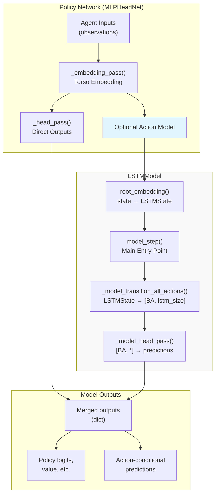
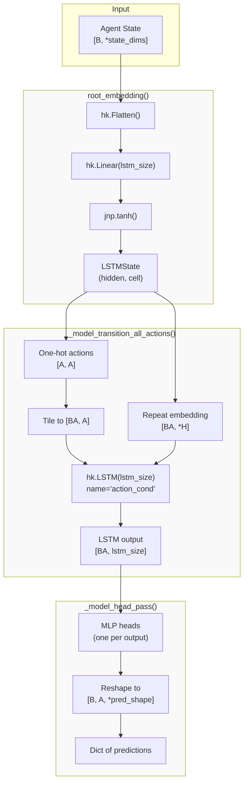

<!-- source: DeepWiki mcp.deepwiki.com · repo google-deepmind/disco_rl · extra page Action Models · fetched 2026-10-26 -->

# Action Models

<details>
<summary>Relevant source files</summary>

The following files were used as context for generating this wiki page:

- [disco_rl/networks/action_models.py](disco_rl/networks/action_models.py)
- [disco_rl/networks/nets.py](disco_rl/networks/nets.py)

</details>


## Purpose and Scope

This document describes the action-conditional models in DiscoRL, which enable neural networks to predict values or other quantities conditioned on all possible actions simultaneously. These models are optional components that can be integrated into policy networks to provide action-conditional outputs.

For information about the policy networks that use these models, see [Policy Networks](#3.4.1). For information about meta-networks used in the Disco update rule, see [Meta-Networks](#3.4.2).

## Overview

Action models extend policy networks by providing the ability to predict values for all actions in a single forward pass. This is particularly useful for Q-learning style algorithms that need to evaluate multiple actions when computing learning targets.

The action model system in DiscoRL is inspired by Muesli/MuZero architectures and uses an LSTM-based approach to condition predictions on actions. The model takes an embedding from the policy network and outputs predictions for all possible actions in parallel.

**Key characteristics:**
- **Action-conditional**: Produces separate predictions for each action in the action space
- **Parallel evaluation**: Evaluates all actions simultaneously using vectorized operations
- **Modular integration**: Can be optionally added to any policy network
- **Flexible outputs**: Supports arbitrary output specifications via `out_spec`

**Sources:** [disco_rl/networks/action_models.py:1-105]()

## System Architecture



**Diagram: Integration of action models with policy networks**

This diagram shows how `LSTMModel` integrates with the policy network's `MLPHeadNet` base class. The policy network's embedding passes through both direct heads and optionally through the action model, with outputs merged into a single dictionary.

**Sources:** [disco_rl/networks/action_models.py:36-104](), [disco_rl/networks/nets.py:59-124]()

## LSTMModel Class

The `LSTMModel` class is the primary implementation of action-conditional models in DiscoRL. It uses an LSTM to process action embeddings and produce predictions for all actions in parallel.

### Constructor Parameters

| Parameter | Type | Description |
|-----------|------|-------------|
| `action_spec` | `types.ActionSpec` | Specification of the action space |
| `out_spec` | `types.Specs` | Dictionary mapping output names to their specifications |
| `head_mlp_hiddens` | `tuple[int, ...]` | Hidden layer sizes for MLP heads |
| `lstm_size` | `int` | Size of the LSTM hidden state |

**Sources:** [disco_rl/networks/action_models.py:39-49]()

### Architecture Components



**Diagram: LSTMModel forward pass architecture**

This diagram shows the three-stage computation flow: (1) converting agent state to LSTM state, (2) processing all actions through the LSTM, and (3) applying MLP heads to produce final predictions.

**Sources:** [disco_rl/networks/action_models.py:51-104]()

### Root Embedding

The `root_embedding()` method converts the agent's state into an LSTM hidden state that serves as the starting point for action-conditional predictions.

**Implementation:** [disco_rl/networks/action_models.py:100-104]()

```
Input: state [B, *state_dims]
       ↓
  hk.Flatten()
       ↓
  hk.Linear(lstm_size) → cell
       ↓
  jnp.tanh(cell) → hidden
       ↓
Output: LSTMState(hidden, cell)
```

**Key points:**
- Flattens the state tensor to 1D
- Projects to LSTM cell state size
- Applies `tanh` to create hidden state
- Returns `hk.LSTMState` with both hidden and cell components

**Sources:** [disco_rl/networks/action_models.py:100-104]()

### Transition Function

The `_model_transition_all_actions()` method processes all possible actions in parallel by replicating the embedding and processing each action through the LSTM.

**Implementation:** [disco_rl/networks/action_models.py:51-73]()

#### Parallel Action Processing

The method enumerates all actions and processes them simultaneously:

1. **Create one-hot actions**: `jnp.eye(num_actions)` creates an identity matrix where each row is a one-hot encoding of an action
2. **Tile for batch**: Repeat the one-hot matrix `batch_size` times to get shape `[B*A, A]`
3. **Repeat embeddings**: Replicate the LSTM state `num_actions` times to get shape `[B*A, *H]`
4. **LSTM pass**: Process all action-embedding pairs through the LSTM
5. **Output**: LSTM output with shape `[B*A, lstm_size]`

**Example shapes** (B=4 batch size, A=3 actions, H=64 LSTM size):
```
one_hot_actions:          [3, 3]
batched_one_hot_actions:  [12, 3]
all_actions_embed:        [12, 64] (hidden and cell)
lstm_output:              [12, 64]
```

**Sources:** [disco_rl/networks/action_models.py:51-73]()

### Head Pass

The `_model_head_pass()` method applies MLP heads to the LSTM output to produce final predictions according to the output specification.

**Implementation:** [disco_rl/networks/action_models.py:75-92]()

For each key in `out_spec`, the method:
1. Applies an MLP with hidden layers `head_mlp_hiddens` and output size matching the spec
2. Reshapes from `[B*A, prod(pred_shape)]` to `[B, A, *pred_shape]`
3. Stores the result in the output dictionary

**Example:**
```
Input: transition_output [B*A, lstm_size]
       
For each output key:
  MLP(head_mlp_hiddens + (prod(pred_spec.shape),))
  → reshape to [B, A, *pred_spec.shape]
  
Output: Dict[str, Array[B, A, *pred_shape]]
```

**Sources:** [disco_rl/networks/action_models.py:75-92]()

### Main Entry Point

The `model_step()` method is the primary interface for using the action model:

**Implementation:** [disco_rl/networks/action_models.py:94-98]()

```python
def model_step(self, embedding: hk.LSTMState) -> dict[str, chex.Array]:
    transition_output = self._model_transition_all_actions(embedding)
    model_outputs = self._model_head_pass(transition_output)
    return model_outputs
```

This method orchestrates the full forward pass through the action model, from embedding to final predictions.

**Sources:** [disco_rl/networks/action_models.py:94-98]()

## Integration with Policy Networks

Action models are integrated into policy networks through the `MLPHeadNet` base class. The integration is optional and controlled by constructor parameters.

### Configuration Parameters

In `MLPHeadNet.__init__()`:

| Parameter | Type | Description |
|-----------|------|-------------|
| `model_out_spec` | `chex.ArrayTree \| None` | Output specifications for the action model; if `None`, no model is created |
| `model_arch_name` | `str \| None` | Name of the action model architecture (e.g., `'lstm'`) |
| `model_kwargs` | `Mapping[str, Any] \| None` | Additional kwargs passed to the action model constructor |

**Sources:** [disco_rl/networks/nets.py:67-86]()

### Initialization

When `model_out_spec` is provided, the policy network creates an action model:

**Implementation:** [disco_rl/networks/nets.py:75-83]()

```python
if model_out_spec:
    self._model = action_models.get_action_model(
        model_arch_name,
        action_spec=action_spec,
        out_spec=model_out_spec,
        **model_kwargs,
    )
else:
    self._model = None
```

The `get_action_model()` factory function supports the `'lstm'` architecture name, returning an `LSTMModel` instance.

**Sources:** [disco_rl/networks/action_models.py:28-33](), [disco_rl/networks/nets.py:75-83]()

### Forward Pass Integration

During the forward pass, action model outputs are merged with the policy network's direct outputs:

**Implementation:** [disco_rl/networks/nets.py:115-124]()

```python
def __call__(self, inputs, should_reset=None):
    torso = self._embedding_pass(inputs)
    out = self._head_pass(torso)
    if self._model:
        root = self._model.root_embedding(torso)
        model_out = self._model.model_step(root)
        out.update(model_out)
    return out
```

**Execution flow:**
1. Compute torso embedding from inputs
2. Generate direct outputs via `_head_pass()` (e.g., policy logits)
3. If action model exists:
   - Convert torso to LSTM state via `root_embedding()`
   - Generate action-conditional predictions via `model_step()`
   - Merge into output dictionary
4. Return combined outputs

**Sources:** [disco_rl/networks/nets.py:115-124]()

## Usage Patterns

### Output Specification

The action model produces outputs according to `out_spec`, a dictionary mapping output names to array specifications:

```python
out_spec = {
    'q_values': types.ArraySpec(shape=(,), dtype=jnp.float32),
    'policy_logits': types.ArraySpec(shape=(num_actions,), dtype=jnp.float32),
}
```

For each key, the model produces predictions with shape `[B, A, *spec.shape]`, where:
- `B` is the batch size
- `A` is the number of actions
- `*spec.shape` is the shape defined in the specification

**Sources:** [disco_rl/networks/action_models.py:84-91]()

### Example Configuration

To add an action model to a policy network:

```python
policy_net = nets.get_network(
    'mlp',
    out_spec=base_out_spec,
    dense=(64, 64),
    action_spec=env.action_spec(),
    head_w_init_std=0.01,
    model_out_spec={'q_values': types.ArraySpec(shape=(), dtype=jnp.float32)},
    model_arch_name='lstm',
    model_kwargs={'head_mlp_hiddens': (64,), 'lstm_size': 64},
)
```

This configuration creates an MLP policy network with an LSTM-based action model that produces Q-values for all actions.

**Sources:** [disco_rl/networks/nets.py:32-56](), [disco_rl/networks/action_models.py:28-33]()

### When to Use Action Models

Action models are useful when:
- The update rule requires action-conditional value estimates (e.g., Q-learning)
- Computing separate forward passes for each action would be inefficient
- The algorithm needs to evaluate all actions simultaneously for target computation

The Disco103 update rule uses action models to generate Q-learning style targets, while simpler baselines like policy gradient may not need them.

**Sources:** [disco_rl/networks/action_models.py:16-17]()

## Factory Function

The `get_action_model()` function provides a centralized way to instantiate action models:

**Implementation:** [disco_rl/networks/action_models.py:28-33]()

```python
def get_action_model(name: str, *args, **kwargs):
    if name == 'lstm':
        net = LSTMModel(*args, **kwargs)
    else:
        raise ValueError(f'Invalid model network name {name}.')
    return net
```

**Supported architectures:**
- `'lstm'`: Creates an `LSTMModel` instance

**Extension pattern:** To add new action model architectures, add additional branches to the conditional logic in this function.

**Sources:** [disco_rl/networks/action_models.py:28-33]()

---

