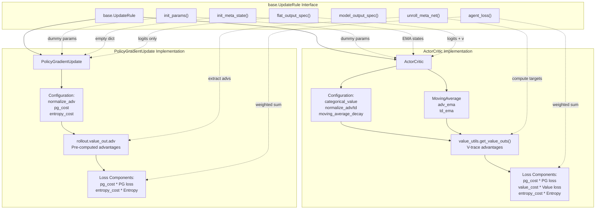
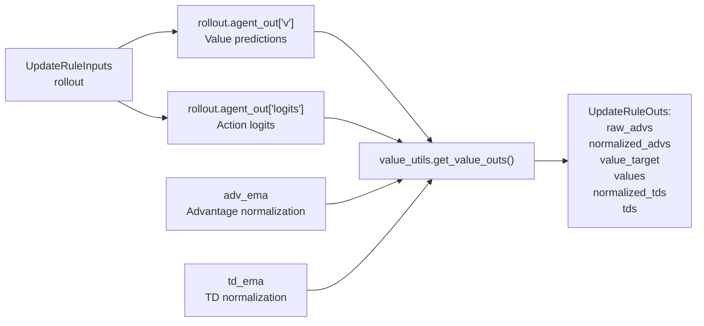

<!-- source: DeepWiki mcp.deepwiki.com · repo google-deepmind/disco_rl · extra page Baseline Update Rules · fetched 2026-10-26 -->

# Baseline Update Rules

<details>
<summary>Relevant source files</summary>

The following files were used as context for generating this wiki page:

- [disco_rl/update_rules/actor_critic.py](disco_rl/update_rules/actor_critic.py)
- [disco_rl/update_rules/policy_gradient.py](disco_rl/update_rules/policy_gradient.py)

</details>


## Purpose and Scope

This page documents the baseline reinforcement learning update rules provided in DiscoRL: `ActorCritic` and `PolicyGradientUpdate`. These implementations serve as comparison baselines for evaluating the discovered Disco103 algorithm. Both classes implement the `base.UpdateRule` interface (see [3.3.1](#3.3.1)) and can be plugged into the agent system by specifying `update_rule_name='actor_critic'` or `update_rule_name='policy_gradient'`.

For information about the Disco103 discovered update rule, see [3.3.2](#3.3.2). For the update rule interface specification, see [3.3.1](#3.3.1).

---

## Overview

DiscoRL includes two baseline update rules that implement well-established RL algorithms:

| Update Rule | Class | File | Key Features |
|-------------|-------|------|--------------|
| **Actor-Critic** | `ActorCritic` | [disco_rl/update_rules/actor_critic.py]() | V-trace advantages, categorical value function, EMA normalization |
| **Policy Gradient** | `PolicyGradientUpdate` | [disco_rl/update_rules/policy_gradient.py]() | Simple advantage-based updates, no learned value function |

Both implementations follow the standard update rule contract: they define output specifications, initialize parameters and meta-state, prepare values in `unroll_meta_net`, and compute losses in `agent_loss`.

**Sources:** [disco_rl/update_rules/actor_critic.py](), [disco_rl/update_rules/policy_gradient.py]()

---

## Baseline Update Rules Architecture



**Sources:** [disco_rl/update_rules/actor_critic.py:34-235](), [disco_rl/update_rules/policy_gradient.py:31-128]()

---

## Actor-Critic Update Rule

The `ActorCritic` class implements a full actor-critic algorithm with flexible value function representations and normalization strategies.

### Configuration Options

The `ActorCritic` constructor accepts the following configuration parameters:

| Parameter | Type | Default | Description |
|-----------|------|---------|-------------|
| `categorical_value` | bool | False | Use categorical value function instead of scalar |
| `num_bins` | int | 601 | Number of bins for categorical value distribution |
| `max_abs_value` | float | 300.0 | Maximum absolute value for categorical representation |
| `nonlinear_value_transform` | bool | False | Apply nonlinear transform (h/h_inv) to values |
| `normalize_adv` | bool | False | Normalize advantages for policy gradient |
| `normalize_td` | bool | False | Normalize TD errors for value loss |
| `moving_average_decay` | float | 0.99 | Decay rate for EMA normalization |
| `moving_average_eps` | float | 1e-6 | Epsilon for EMA normalization stability |

**Constraints:** `normalize_td` and `categorical_value` cannot both be True, as categorical value functions already handle scale internally.

**Sources:** [disco_rl/update_rules/actor_critic.py:37-80]()

### Output Specifications

The actor-critic update rule requires the policy network to output both action logits and value predictions:

```python
# flat_output_spec returns:
{
    'logits': <action space logits>,
    'v': <num_bins if categorical else 1 dimensions>
}

# model_output_spec returns:
{}  # No action-conditional outputs
```

**Sources:** [disco_rl/update_rules/actor_critic.py:88-118]()

### Meta-State Initialization

The actor-critic maintains EMA (Exponential Moving Average) states for normalizing advantages and TD errors:

```python
meta_state = {
    'adv_ema_state': <initialized by MovingAverage>,
    'td_ema_state': <initialized by MovingAverage>
}
```

These states are initialized via [disco_rl/update_rules/actor_critic.py:120-129]() and updated during `unroll_meta_net`.

**Sources:** [disco_rl/update_rules/actor_critic.py:74-79, 120-129]()

### Value Computation in unroll_meta_net

The `unroll_meta_net` method delegates to `value_utils.get_value_outs` to compute V-trace advantages and value targets:



The method computes:
- **V-trace advantages:** Used for policy gradient updates
- **TD errors:** Used for value function training
- **Normalized versions:** If `normalize_adv` or `normalize_td` is enabled
- **Updated EMA states:** Returned in the new meta-state

**Sources:** [disco_rl/update_rules/actor_critic.py:131-178]()

### Loss Computation

The `agent_loss` method combines three loss components with configurable weights:

```python
total_loss_per_step = (
    hyper_params['pg_cost'] * pg_loss_per_step +
    hyper_params['value_cost'] * value_loss_per_step +
    hyper_params['entropy_cost'] * entropy_loss_per_step
)
```

#### Policy Gradient Loss

Computed using `utils.differentiable_policy_gradient_loss` with either raw or normalized advantages based on `normalize_adv` configuration:

```python
pg_advs = (
    meta_out['normalized_advs'] if normalize_adv
    else meta_out['raw_advs']
)
pg_loss_per_step = utils.differentiable_policy_gradient_loss(
    logits, actions, adv_t=pg_advs, backprop=False
)
```

**Sources:** [disco_rl/update_rules/actor_critic.py:192-215]()

#### Value Loss

Computed using `value_utils.value_loss_from_td` with either raw or normalized TD errors:

```python
value_tds = (
    meta_out['normalized_tds'] if normalize_td 
    else meta_out['tds']
)
value_loss_per_step = value_utils.value_loss_from_td(
    rollout.agent_out['v'][:-1],
    jax.lax.stop_gradient(value_tds),
    nonlinear_transform=nonlinear_value_transform,
    categorical_value=categorical_value,
    max_abs_value=max_abs_value,
)
```

**Sources:** [disco_rl/update_rules/actor_critic.py:197-207]()

#### Entropy Loss

Standard entropy regularization on the action distribution:

```python
entropy_loss_per_step = -distrax.Softmax(logits).entropy()
```

**Sources:** [disco_rl/update_rules/actor_critic.py:210]()

### Logged Metrics

The actor-critic returns the following metrics in its update rule logs:

| Metric | Description |
|--------|-------------|
| `logits` | Mean logit values |
| `entropy` | Mean policy entropy |
| `pg_advs` | Mean advantages used for PG (normalized or raw) |
| `raw_advs` | Mean raw advantages before normalization |
| `avg_value` | Mean value predictions |

**Sources:** [disco_rl/update_rules/actor_critic.py:227-233]()

---

## Policy Gradient Update Rule

The `PolicyGradientUpdate` class implements a simpler policy gradient algorithm that relies on externally computed value functions (typically from a separate value estimation pass).

### Configuration Options

The `PolicyGradientUpdate` constructor accepts:

| Parameter | Type | Default | Description |
|-----------|------|---------|-------------|
| `entropy_cost` | float | 0.01 | Weight for entropy regularization |
| `normalize_adv` | bool | True | Normalize advantages for policy gradient |
| `pg_cost` | float | 1.0 | Weight for policy gradient loss |
| `kl_prior_cost` | float | 0.5 | (Unused) Weight for KL prior regularization |
| `p_actor_prior` | float | 0.03 | (Unused) Prior probability for actor |
| `p_uniform_prior` | float | 0.003 | (Unused) Prior probability for uniform |
| `target_params_coeff` | float | 0.1 | (Unused) Coefficient for target parameters |

**Note:** Several configuration parameters (kl_prior_cost, p_actor_prior, p_uniform_prior, target_params_coeff) are stored but not used in the current implementation.

**Sources:** [disco_rl/update_rules/policy_gradient.py:34-51]()

### Output Specifications

Policy gradient only requires action logits from the policy network:

```python
# flat_output_spec returns:
{
    'logits': <action space logits>
}

# model_output_spec returns:
{}  # No action-conditional outputs
```

**Sources:** [disco_rl/update_rules/policy_gradient.py:59-68]()

### Advantage Extraction in unroll_meta_net

Unlike actor-critic, policy gradient does not compute value functions internally. Instead, it extracts pre-computed advantages from `rollout.value_out`:

```python
assert rollout.value_out is not None
pg_adv = (
    rollout.value_out.normalized_adv if normalize_adv
    else rollout.value_out.adv
)
return {'pi': pg_adv}, meta_state
```

The advantages must be computed externally before calling the update rule (typically by the agent using a separate value estimation phase).

**Sources:** [disco_rl/update_rules/policy_gradient.py:78-98]()

### Loss Computation

Policy gradient computes a simpler loss with only two components:

```python
total_loss_per_step = (
    self._pg_cost * pg_loss_per_step +
    self._entropy_cost * entropy_loss_per_step
)
```

#### Policy Gradient Loss

```python
pg_loss_per_step = utils.differentiable_policy_gradient_loss(
    logits, actions, adv_t=meta_out['pi'], backprop=False
)
```

**Sources:** [disco_rl/update_rules/policy_gradient.py:112-114]()

#### Entropy Loss

```python
entropy_loss_per_step = -distrax.Softmax(logits).entropy()
```

**Sources:** [disco_rl/update_rules/policy_gradient.py:115]()

### Logged Metrics

Policy gradient returns:

| Metric | Description |
|--------|-------------|
| `entropy` | Mean policy entropy |
| `pg_advs` | Mean advantages used for PG |

**Sources:** [disco_rl/update_rules/policy_gradient.py:124-127]()

---

## Comparison of Baseline Update Rules

```mermaid
graph TB
    subgraph "ActorCritic"
        AC_IN["UpdateRuleInputs"]
        AC_COMPUTE["Compute V-trace<br/>advantages internally"]
        AC_VALUE_NET["Requires 'v' output<br/>from policy network"]
        AC_LOSS["3 loss components:<br/>PG + Value + Entropy"]
        AC_EMA["EMA normalization<br/>with state tracking"]
        
        AC_IN --> AC_VALUE_NET
        AC_VALUE_NET --> AC_COMPUTE
        AC_COMPUTE --> AC_EMA
        AC_EMA --> AC_LOSS
    end
    
    subgraph "PolicyGradientUpdate"
        PG_IN["UpdateRuleInputs"]
        PG_EXTRACT["Extract advantages<br/>from rollout.value_out"]
        PG_VALUE_NET["Only requires 'logits'<br/>from policy network"]
        PG_LOSS["2 loss components:<br/>PG + Entropy"]
        PG_NO_STATE["No state tracking<br/>simple normalization"]
        
        PG_IN --> PG_VALUE_NET
        PG_VALUE_NET --> PG_EXTRACT
        PG_EXTRACT --> PG_NO_STATE
        PG_NO_STATE --> PG_LOSS
    end
```



### Feature Comparison Table

| Feature | ActorCritic | PolicyGradientUpdate |
|---------|-------------|----------------------|
| **Value Function** | Computed internally with V-trace | Requires external value computation |
| **Network Outputs** | `logits` + `v` | `logits` only |
| **Advantage Computation** | V-trace with lambda returns | Pre-computed, extracted from rollout |
| **Normalization** | EMA-based with state tracking | Simple batch normalization |
| **Value Loss** | ✓ Included | ✗ Not included |
| **Entropy Loss** | ✓ Included | ✓ Included |
| **Meta-State** | EMA states for adv/TD | Empty dictionary |
| **Categorical Value** | ✓ Supported | ✗ Not supported |
| **Complexity** | Higher (full AC algorithm) | Lower (simple PG) |

**Sources:** [disco_rl/update_rules/actor_critic.py](), [disco_rl/update_rules/policy_gradient.py]()

---

## Usage in Agent Configuration

Both baseline update rules can be selected during agent initialization:

```python
# Actor-Critic
agent = Agent(
    update_rule_name='actor_critic',
    update_rule_config={
        'categorical_value': False,
        'normalize_adv': True,
        'normalize_td': False,
        'moving_average_decay': 0.99,
    },
    ...
)

# Policy Gradient
agent = Agent(
    update_rule_name='policy_gradient',
    update_rule_config={
        'normalize_adv': True,
        'entropy_cost': 0.01,
        'pg_cost': 1.0,
    },
    ...
)
```

The agent system (see [3.1](#3.1)) handles instantiation and integration of the selected update rule.

**Sources:** [disco_rl/agent.py]() (referenced in Diagram 4 from high-level architecture)

---

