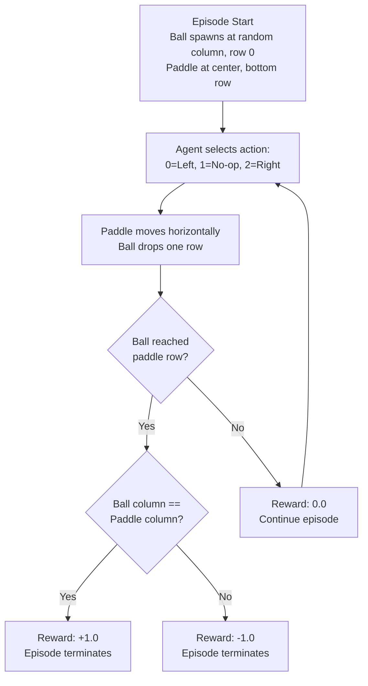
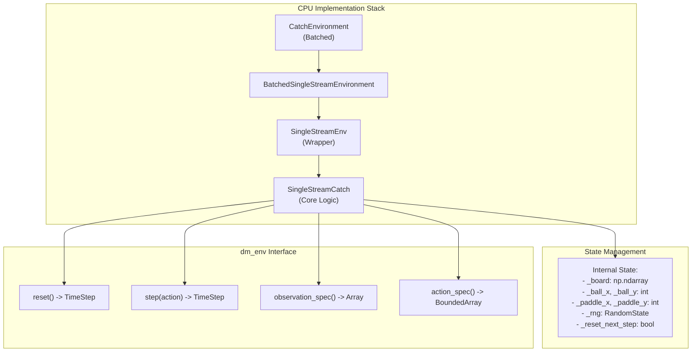
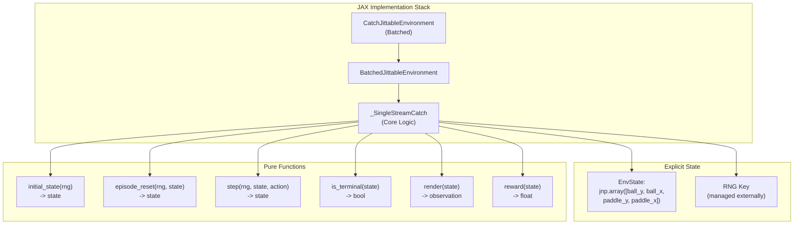
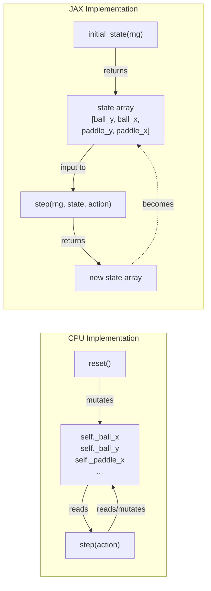

<!-- source: DeepWiki mcp.deepwiki.com · repo google-deepmind/disco_rl · extra page Catch Environment · fetched 2026-10-26 -->

# Catch Environment

<details>
<summary>Relevant source files</summary>

The following files were used as context for generating this wiki page:

- [disco_rl/environments/catch.py](disco_rl/environments/catch.py)
- [disco_rl/environments/jittable_envs.py](disco_rl/environments/jittable_envs.py)

</details>


## Purpose and Scope

This document covers both implementations of the Catch game environment available in DiscoRL: the CPU-based `SingleStreamCatch` and the JAX-jittable `_SingleStreamCatch`. Both implementations provide identical game mechanics but differ in their execution model and performance characteristics. For information about the base environment interface that these implementations conform to, see [Environment Interface](#3.2.1). For information about the batching wrappers used by these environments, see [Environment Wrappers](#3.2.3).

## Game Mechanics

The Catch game is a simple reinforcement learning environment where an agent controls a paddle at the bottom of a grid to catch a falling ball. The game proceeds as follows:

**Sources:** [disco_rl/environments/catch.py:29-89](), [disco_rl/environments/jittable_envs.py:25-78]()



### Game Specifications

| Property | Value |
|----------|-------|
| **Grid Size** | Configurable (default: 8×8) |
| **Action Space** | Discrete(3): Left (-1), No-op (0), Right (+1) |
| **Observation Space** | Float32 grid with shape `(rows, columns)` |
| **Ball Representation** | Value 1.0 at ball position |
| **Paddle Representation** | Value 1.0 at paddle position |
| **Episode Length** | Variable (until ball reaches bottom row) |
| **Rewards** | +1.0 (catch), -1.0 (miss), 0.0 (intermediate) |

**Sources:** [disco_rl/environments/catch.py:26-88](), [disco_rl/environments/jittable_envs.py:28-77]()

## CPU-Based Implementation

The CPU-based implementation uses `dm_env` conventions and is suitable for environments that cannot be efficiently JIT-compiled or when interfacing with non-JAX code.



**Sources:** [disco_rl/environments/catch.py:29-112]()

### SingleStreamCatch Class

The `SingleStreamCatch` class [disco_rl/environments/catch.py:29-89]() implements the core game logic using NumPy and follows `dm_env` conventions.

#### Key Attributes

| Attribute | Type | Description |
|-----------|------|-------------|
| `_rows` | `int` | Grid height |
| `_columns` | `int` | Grid width |
| `_rng` | `np.random.RandomState` | Random number generator |
| `_board` | `np.ndarray` | Grid representation (rows × columns) |
| `_ball_x`, `_ball_y` | `int` | Ball position |
| `_paddle_x`, `_paddle_y` | `int` | Paddle position |
| `_reset_next_step` | `bool` | Flag for automatic reset |

**Sources:** [disco_rl/environments/catch.py:32-42]()

#### Key Methods

**`reset() -> dm_env.TimeStep`** [disco_rl/environments/catch.py:44-50]()
- Initializes a new episode
- Randomizes ball column position
- Centers paddle at `columns // 2`
- Returns restart `TimeStep` with initial observation

**`step(action: int) -> dm_env.TimeStep`** [disco_rl/environments/catch.py:52-70]()
- Applies action from `_ACTIONS` tuple: `(-1, 0, 1)` [disco_rl/environments/catch.py:26]()
- Updates paddle position with clipping to grid boundaries
- Advances ball downward by one row
- Returns termination `TimeStep` when ball reaches paddle row, transition otherwise

**`observation_spec() -> specs.Array`** [disco_rl/environments/catch.py:72-78]()
- Returns specification for board observation
- Shape: `(rows, columns)`, dtype: `float32`

**`action_spec() -> specs.BoundedArray`** [disco_rl/environments/catch.py:80-82]()
- Returns specification for discrete actions
- Bounded integer: 0 to 2 (inclusive)

**`_observation() -> np.ndarray`** [disco_rl/environments/catch.py:84-88]()
- Renders current game state to grid
- Sets ball and paddle positions to 1.0, all other cells to 0.0
- Returns copy of board

**Sources:** [disco_rl/environments/catch.py:44-88]()

### CatchEnvironment Class

The `CatchEnvironment` class [disco_rl/environments/catch.py:91-111]() provides a batched version of the Catch game by extending `BatchedSingleStreamEnvironment`. This wrapper enables parallel execution of multiple independent Catch environments.

```python
# Usage example (from disco_rl/environments/catch.py:94-111)
env = CatchEnvironment(
    batch_size=32,
    env_settings=get_config()
)
```

**Sources:** [disco_rl/environments/catch.py:91-111]()

## JAX-Jittable Implementation

The JAX-jittable implementation uses pure JAX functions with explicit state management, enabling JIT compilation and vectorization via `jax.vmap` for efficient parallel execution.



**Sources:** [disco_rl/environments/jittable_envs.py:25-93]()

### _SingleStreamCatch Class

The `_SingleStreamCatch` class [disco_rl/environments/jittable_envs.py:25-78]() implements a JAX-based version optimized for JIT compilation. Unlike the CPU version, it uses explicit state passing rather than mutable instance variables.

#### State Representation

The environment state is encoded as a single `jnp.array` with 4 integer elements [disco_rl/environments/jittable_envs.py:41]():

```python
state = jnp.array([ball_y, ball_x, paddle_y, paddle_x], dtype=jnp.int32)
```

| Index | Element | Description |
|-------|---------|-------------|
| 0 | `ball_y` | Ball row position (0 to rows-1) |
| 1 | `ball_x` | Ball column position (0 to columns-1) |
| 2 | `paddle_y` | Paddle row position (always rows-1) |
| 3 | `paddle_x` | Paddle column position (0 to columns-1) |

**Sources:** [disco_rl/environments/jittable_envs.py:36-41]()

#### Key Methods

**`initial_state(rng) -> jnp.array`** [disco_rl/environments/jittable_envs.py:36-41]()
- Generates initial state for a new episode
- Randomizes ball column using provided RNG key
- Returns state array

**`episode_reset(rng, state) -> jnp.array`** [disco_rl/environments/jittable_envs.py:43-45]()
- Resets environment to initial state
- Delegates to `initial_state()`
- Pure function (ignores current state)

**`step(rng, state, action) -> jnp.array`** [disco_rl/environments/jittable_envs.py:47-50]()
- Advances game by one timestep
- Updates paddle position: `state[3] + action - 1` (action is 0, 1, or 2)
- Advances ball downward: `state[0] + 1`
- Returns new state array

**`is_terminal(state) -> bool`** [disco_rl/environments/jittable_envs.py:52-53]()
- Checks if episode has ended
- Returns `True` when ball reaches bottom row: `state[0] == rows - 1`

**`render(state) -> jnp.array`** [disco_rl/environments/jittable_envs.py:55-70]()
- Generates observation from state
- Uses vectorized operations for efficiency
- Returns grid with shape `(rows, columns, 1)`
- Ball and paddle positions marked as 1.0, others as 0.0

**`reward(state) -> float`** [disco_rl/environments/jittable_envs.py:72-77]()
- Computes reward for current state
- Uses `jax.lax.select` for conditional logic (JIT-friendly)
- Returns +1.0 if caught, -1.0 if missed, 0.0 otherwise

**Sources:** [disco_rl/environments/jittable_envs.py:36-77]()

### CatchJittableEnvironment Class

The `CatchJittableEnvironment` class [disco_rl/environments/jittable_envs.py:80-93]() wraps `_SingleStreamCatch` with `BatchedJittableEnvironment` to provide batched, vectorized execution.

```python
# Usage example (from disco_rl/environments/jittable_envs.py:83-93)
env = CatchJittableEnvironment(
    batch_size=32,
    env_settings=get_config_catch()
)
```

**Sources:** [disco_rl/environments/jittable_envs.py:80-93]()

## Implementation Comparison

The following table highlights the key differences between the CPU and JAX implementations:

| Feature | CPU Implementation | JAX Implementation |
|---------|-------------------|-------------------|
| **Base Class** | `dm_env.Environment` | Custom (wrapped by `BatchedJittableEnvironment`) |
| **State Management** | Mutable instance variables | Immutable state arrays |
| **Randomness** | `np.random.RandomState` | JAX PRNG keys |
| **Execution** | Sequential Python | JIT-compiled JAX |
| **Batching Strategy** | Loop over environments | `jax.vmap` vectorization |
| **Performance** | Slower for large batches | Fast for large batches |
| **Flexibility** | Easy to modify/debug | Requires pure functions |
| **Memory** | Lower overhead | Higher compilation overhead |
| **File** | `catch.py` | `jittable_envs.py` |

**Sources:** [disco_rl/environments/catch.py:29-111](), [disco_rl/environments/jittable_envs.py:25-93]()

### State Management Flow



**Sources:** [disco_rl/environments/catch.py:44-70](), [disco_rl/environments/jittable_envs.py:36-50]()

## Configuration

Both implementations use `ml_collections.ConfigDict` for configuration.

### CPU Configuration

**`get_config() -> ConfigDict`** [disco_rl/environments/catch.py:114-122]()

```python
{
    'rows': 8,        # Grid height
    'columns': 8,     # Grid width
    'random_seed': 1  # Seed for numpy RNG
}
```

### JAX Configuration

**`get_config_catch() -> ConfigDict`** [disco_rl/environments/jittable_envs.py:96-103]()

```python
{
    'rows': 8,     # Grid height
    'columns': 8   # Grid width
    # Note: No random_seed (JAX uses explicit RNG keys)
}
```

**Sources:** [disco_rl/environments/catch.py:114-122](), [disco_rl/environments/jittable_envs.py:96-103]()

## Usage in DiscoRL

The Catch environment serves as the primary testbed for evaluating discovered update rules (Disco103) and baseline algorithms. Both implementations are used throughout the codebase:

- **Meta-evaluation** ([See Tutorial](#2.1)): Uses either implementation to evaluate pre-trained update rules
- **Meta-training** ([See Tutorial](#2.2)): JAX implementation preferred for efficiency in outer-loop optimization
- **Baseline comparisons**: Both implementations available for fair comparison

The choice between implementations depends on:
- **Use JAX version** when: Training at scale, need maximum throughput, using TPU/GPU acceleration
- **Use CPU version** when: Debugging, prototyping, integrating with non-JAX code, memory-constrained

**Sources:** [disco_rl/environments/catch.py:1-123](), [disco_rl/environments/jittable_envs.py:1-104]()

---

