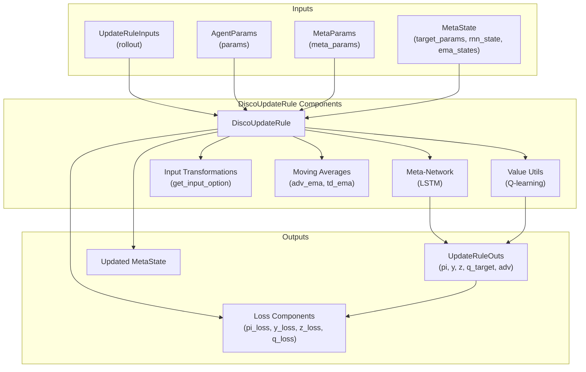
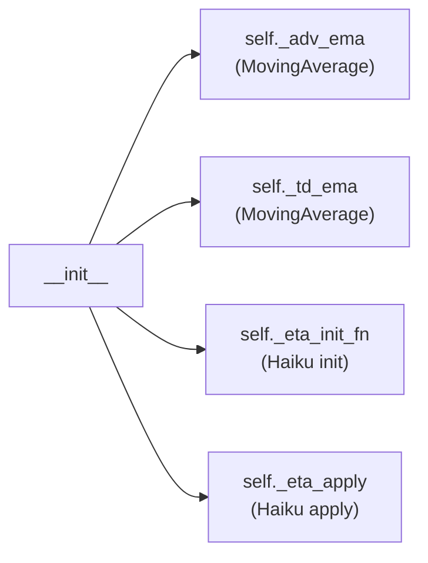
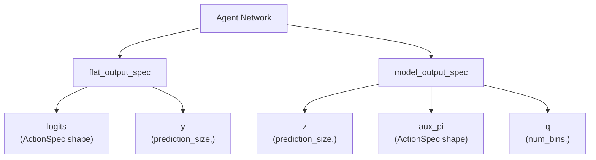
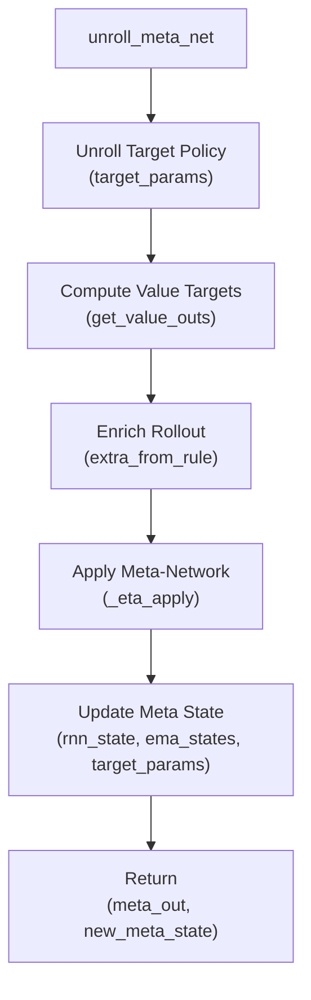
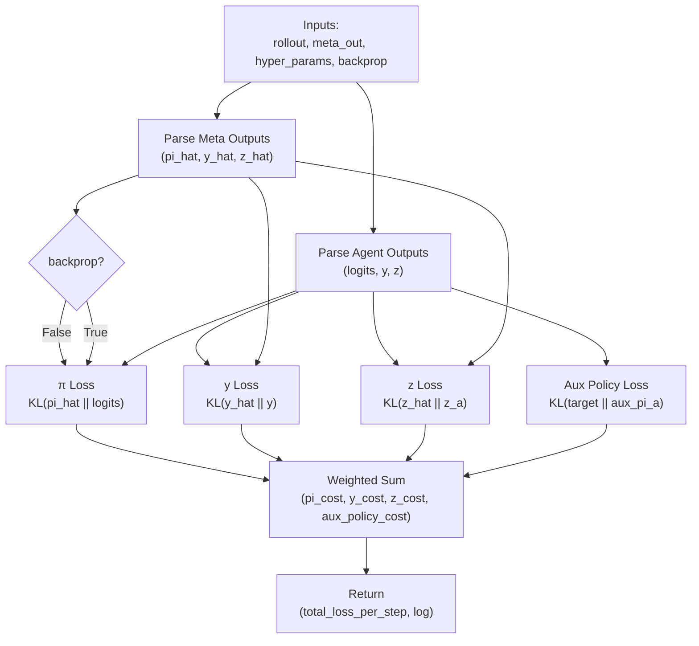
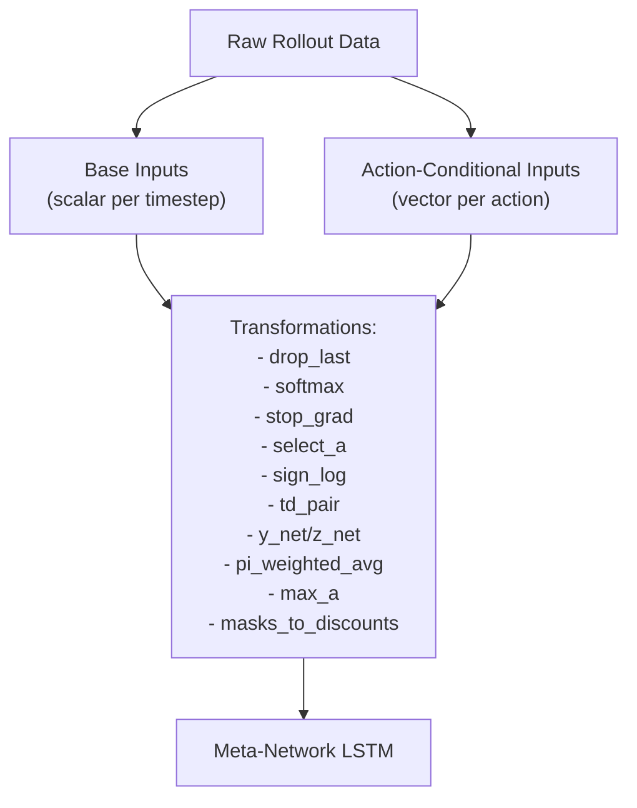
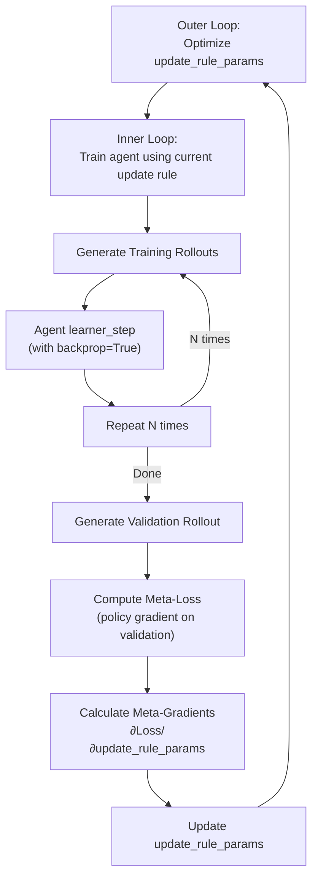

<!-- source: DeepWiki mcp.deepwiki.com · repo google-deepmind/disco_rl · extra page Disco103 Update Rule · fetched 2026-10-26 -->

# Disco103 Update Rule

<details>
<summary>Relevant source files</summary>

The following files were used as context for generating this wiki page:

- [colabs/eval.ipynb](colabs/eval.ipynb)
- [colabs/meta_train.ipynb](colabs/meta_train.ipynb)
- [disco_rl/update_rules/disco.py](disco_rl/update_rules/disco.py)

</details>


## Purpose and Scope

This document describes the `DiscoUpdateRule` implementation, which is the discovered learning algorithm called **Disco103**. This update rule uses a meta-learned LSTM-based neural network to generate learning signals for training RL agents. The Disco103 algorithm was discovered through meta-training (see [Meta-Training Tutorial](#2.2)) and represents a sophisticated alternative to traditional update rules like Actor-Critic.

For information about the base update rule interface that this class implements, see [Update Rule Interface](#3.3.1). For baseline comparisons, see [Baseline Update Rules](#3.3.3).

**Sources:** [disco_rl/update_rules/disco.py:1-429]()

---

## Overview

The `DiscoUpdateRule` class implements a meta-learned update rule that produces three distinct outputs (π, y, z) which guide agent learning through KL divergence losses. The rule integrates:

1. An LSTM meta-network that processes trajectory information
2. Categorical Q-value learning with non-linear transformations
3. Target networks with exponential moving average updates
4. Adaptive normalization using moving averages
5. Complex input transformations for the meta-network

**Sources:** [disco_rl/update_rules/disco.py:33-94]()

---

## Architecture Overview



**Sources:** [disco_rl/update_rules/disco.py:33-323]()

---

## Class Structure and Initialization

### Constructor Parameters

The `DiscoUpdateRule` constructor accepts the following parameters:

| Parameter | Type | Description |
|-----------|------|-------------|
| `net` | `ConfigDict` | Configuration for the meta-network (LSTM) |
| `value_discount` | `float` | Discount factor for value function (γ) |
| `max_abs_value` | `float` | Maximum absolute value for categorical value clipping |
| `num_bins` | `int` | Number of bins for categorical Q-value distribution |
| `moving_average_decay` | `float` | Decay rate for EMA (default: 0.99) |
| `moving_average_eps` | `float` | Epsilon for EMA stability (default: 1e-6) |

**Sources:** [disco_rl/update_rules/disco.py:36-58]()

### Internal Components

The constructor initializes three key components:

1. **Moving Averages**: Two `MovingAverage` instances for normalizing advantages and TD errors
2. **Meta-Network**: An LSTM network instantiated via Haiku's `transform_with_state`
3. **Configuration Values**: Stored for use in value function computations



**Sources:** [disco_rl/update_rules/disco.py:52-67]()

---

## Initialization Methods

### init_params

Initializes the meta-network parameters and RNN state:

```python
def init_params(rng: PRNGKey) -> tuple[MetaParams, ArrayTree]
```

This method creates a dummy input with all required fields (including `behaviour_out` and `agent_adv`) and passes it through the meta-network's initialization function to determine parameter shapes.

**Sources:** [disco_rl/update_rules/disco.py:69-78]()

### init_meta_state

Creates the initial meta-state, which contains:

| Field | Description |
|-------|-------------|
| `rnn_state` | LSTM hidden state |
| `adv_ema_state` | Advantage normalization state |
| `td_ema_state` | TD error normalization state |
| `target_params` | Copy of agent parameters for target network |

**Sources:** [disco_rl/update_rules/disco.py:80-93]()

---

## Output Specifications

### Agent Network Outputs

The agent network must produce outputs matching these specifications:



**Flat Outputs** (returned by policy head):
- `logits`: Action logits for policy distribution
- `y`: Prediction vector of size `prediction_size`

**Model Outputs** (computed by forward pass):
- `z`: Another prediction vector of size `prediction_size`
- `aux_pi`: Auxiliary policy prediction (next-step policy)
- `q`: Categorical Q-value distribution with `num_bins` bins

**Sources:** [disco_rl/update_rules/disco.py:95-110]()

---

## Meta-Network Unrolling

### unroll_meta_net Method

The core method that processes a rollout through the meta-network:



**Processing Steps:**

1. **Target Policy Unroll**: Runs the target network (using `target_params` from meta-state) on the rollout observations to get target outputs
   
2. **Value Function Computation**: Calls `value_utils.get_value_outs` to compute:
   - Q-value targets using categorical distribution
   - Advantages and normalized advantages
   - TD errors and normalized TD errors
   - Updates EMA states

3. **Rollout Enrichment**: Adds computed values to `rollout.extra_from_rule`:
   - `v_scalar`: Scalar value estimates
   - `adv`, `normalized_adv`: Advantages
   - `q`, `qv_adv`, `normalized_qv_adv`: Q-value related metrics
   - `target_out`: Target network outputs

4. **Meta-Network Application**: Processes the enriched rollout through the LSTM meta-network to produce:
   - `pi`: Target policy logits
   - `y`: Target for y-prediction
   - `z`: Target for z-prediction

5. **Meta-State Update**: Updates the meta-state with:
   - New RNN state
   - New EMA states
   - Target params (EMA update: `target = coeff * old + (1-coeff) * new`)

**Sources:** [disco_rl/update_rules/disco.py:112-208]()

---

## Loss Computation

### agent_loss Method

Computes the primary agent losses based on KL divergences:



**Loss Components:**

| Loss | Formula | Purpose |
|------|---------|---------|
| π Loss | `KL(π̂ ‖ π)` | Match agent's policy to meta-network target |
| y Loss | `KL(ŷ ‖ y)` | Match y-prediction to meta-network target |
| z Loss | `KL(ẑ ‖ z_a)` | Match z-prediction (for taken action) to target |
| Aux Policy Loss | `KL(π_{t+1} ‖ aux_π_a)` | Predict next-step policy distribution |

**Total Loss:**
```
total_loss = pi_cost * π_loss + y_cost * y_loss + z_cost * z_loss + aux_policy_cost * aux_loss
```

The `backprop` parameter controls whether gradients flow through the meta-network targets (`pi_hat`, `y_hat`, `z_hat`). During meta-training, this is set to `True` to enable meta-gradients.

**Sources:** [disco_rl/update_rules/disco.py:210-294]()

### agent_loss_no_meta Method

Computes value function losses that don't affect meta-gradients:

```python
def agent_loss_no_meta(rollout, meta_out, hyper_params)
```

This method computes:
- **Q-value Loss**: Categorical cross-entropy between predicted Q-distribution and TD target

The loss is computed using `value_utils.value_loss_from_td` with the TD target from `meta_out['q_td']` (which is stop-gradiented).

**Sources:** [disco_rl/update_rules/disco.py:296-323]()

---

## Input Transformations

### get_input_option Function

Returns a `MetaNetInputOption` that specifies how to transform rollout data into meta-network inputs:



The function defines two types of inputs:

1. **Base Inputs** (scalar features): 16 transform configurations including:
   - Current and behavior policy distributions (softmax, selected action)
   - Rewards (sign-log transform)
   - Discount factors (from terminal masks)
   - Value function outputs (V-values, advantages)
   - Target network outputs
   - y and z network outputs with various aggregations

2. **Action-Conditional Inputs** (per-action features): 8 transform configurations including:
   - Policy distributions (current, behavior, target)
   - z-network outputs
   - Q-values and advantages

**Key Transformations:**

| Transform | Purpose |
|-----------|---------|
| `drop_last` | Remove last timestep (no next state) |
| `softmax` | Convert logits to probabilities |
| `stop_grad` | Prevent gradient flow |
| `select_a` | Extract value for taken action |
| `sign_log` | Apply sign(x) * log(1 + abs(x)) |
| `td_pair` | Create [x_t, x_{t+1}] pairs |
| `y_net` / `z_net` | Apply learned transformation networks |
| `pi_weighted_avg` | Average over actions weighted by policy |
| `max_a` | Take maximum over actions |
| `masks_to_discounts` | Convert terminal masks to discount factors |

**Sources:** [disco_rl/update_rules/disco.py:326-428]()

---

## Usage Example

### Loading Disco103 Weights

```python
# Download and load pre-trained Disco103 weights
disco_103_params = unflatten_params(np.load('disco_103.npz'))

# Initialize agent with disco update rule
agent_settings = agent_lib.get_settings_disco()
agent = agent_lib.Agent(
    agent_settings=agent_settings,
    single_observation_spec=env.single_observation_spec(),
    single_action_spec=env.single_action_spec(),
    batch_axis_name='i',
)

# Verify parameter compatibility
random_params, _ = agent.update_rule.init_params(rng_key)
chex.assert_trees_all_equal_shapes_and_dtypes(random_params, disco_103_params)
```

**Sources:** [colabs/eval.ipynb:59-134]()

### Training with Disco103

The update rule is used automatically by the agent's `learner_step` method:

```python
learner_state, _, metrics = agent.learner_step(
    rng=learner_rng,
    rollout=actor_rollout,
    learner_state=learner_state,
    agent_net_state=actor_state,
    update_rule_params=disco_103_params,
    is_meta_training=False,
)
```

**Sources:** [colabs/eval.ipynb:380-387]()

---

## Meta-Training Flow

During meta-training, the Disco103 parameters are optimized through a two-level optimization process:



The `backprop` parameter in `agent_loss` is set to `True` during inner loop training to allow meta-gradients to flow through the meta-network's outputs.

**Sources:** [colabs/meta_train.ipynb:292-448]()

---

## Key Implementation Details

### Categorical Q-Values

The update rule uses categorical Q-value distributions rather than scalar Q-values:
- Q-values are represented as probability distributions over `num_bins` bins
- Non-linear transformation is applied: `max_abs_value * tanh(x / max_abs_value)`
- This provides more stable learning and better captures value uncertainty

**Sources:** [disco_rl/update_rules/disco.py:48-50](), [disco_rl/update_rules/disco.py:141-159]()

### Target Network Updates

Target parameters are updated using exponential moving average:
```python
target_params = coeff * old_target + (1 - coeff) * new_params
```

The coefficient is controlled by `hyper_params['target_params_coeff']` (typically 0.995-0.999).

**Sources:** [disco_rl/update_rules/disco.py:200-206]()

### Advantage Normalization

Advantages and TD errors are normalized using exponential moving averages:
- Mean and standard deviation are tracked separately
- Normalized values: `(x - mean) / (std + eps)`
- Used to stabilize learning across different reward scales

**Sources:** [disco_rl/update_rules/disco.py:52-58](), [disco_rl/update_rules/disco.py:141-159]()

### Auxiliary Policy Prediction

The agent network outputs `aux_pi`, which predicts the next-step policy distribution:
- Input: Current observation and taken action
- Target: Policy distribution at next timestep
- Loss: KL divergence between prediction and target
- Masked at terminal states

This encourages the agent to model policy dynamics and can improve sample efficiency.

**Sources:** [disco_rl/update_rules/disco.py:249-257]()

---

## Configuration and Hyperparameters

Common hyperparameters used by DiscoUpdateRule:

| Hyperparameter | Typical Value | Purpose |
|----------------|---------------|---------|
| `pi_cost` | 1.0 | Weight for policy KL loss |
| `y_cost` | 1.0 | Weight for y-prediction KL loss |
| `z_cost` | 1.0 | Weight for z-prediction KL loss |
| `aux_policy_cost` | 0.5-1.0 | Weight for auxiliary policy loss |
| `value_cost` | 0.5-1.0 | Weight for Q-value loss |
| `value_fn_td_lambda` | 0.95-0.99 | TD(λ) parameter for advantages |
| `target_params_coeff` | 0.995-0.999 | EMA coefficient for target params |

These hyperparameters are typically stored in `agent_settings` and passed through `hyper_params` to loss functions.

**Sources:** [disco_rl/update_rules/disco.py:210-323](), [colabs/eval.ipynb:103-114]()

---

