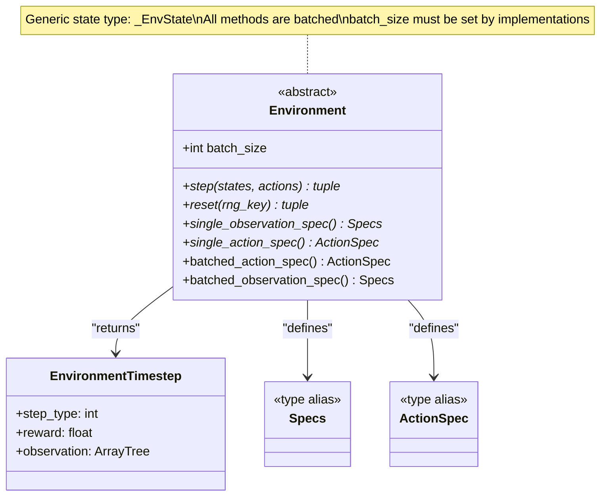
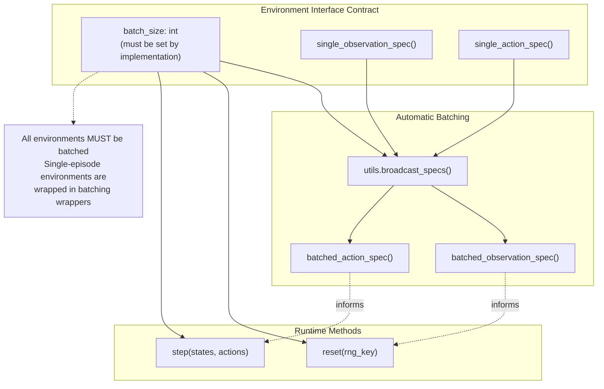
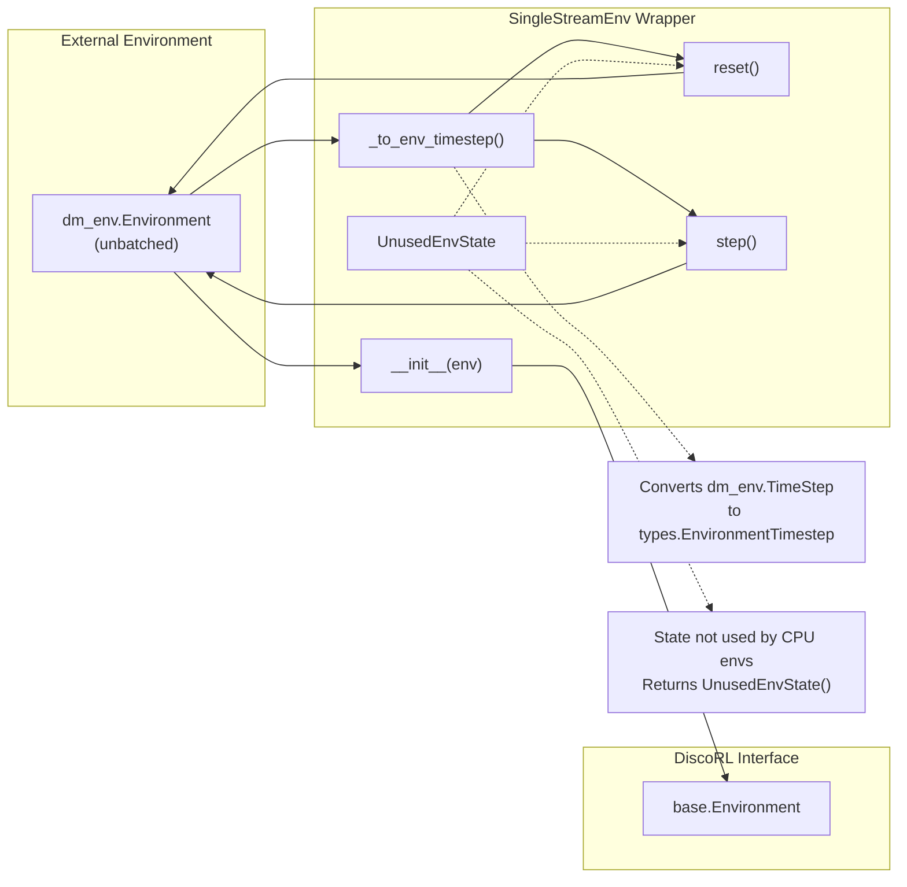
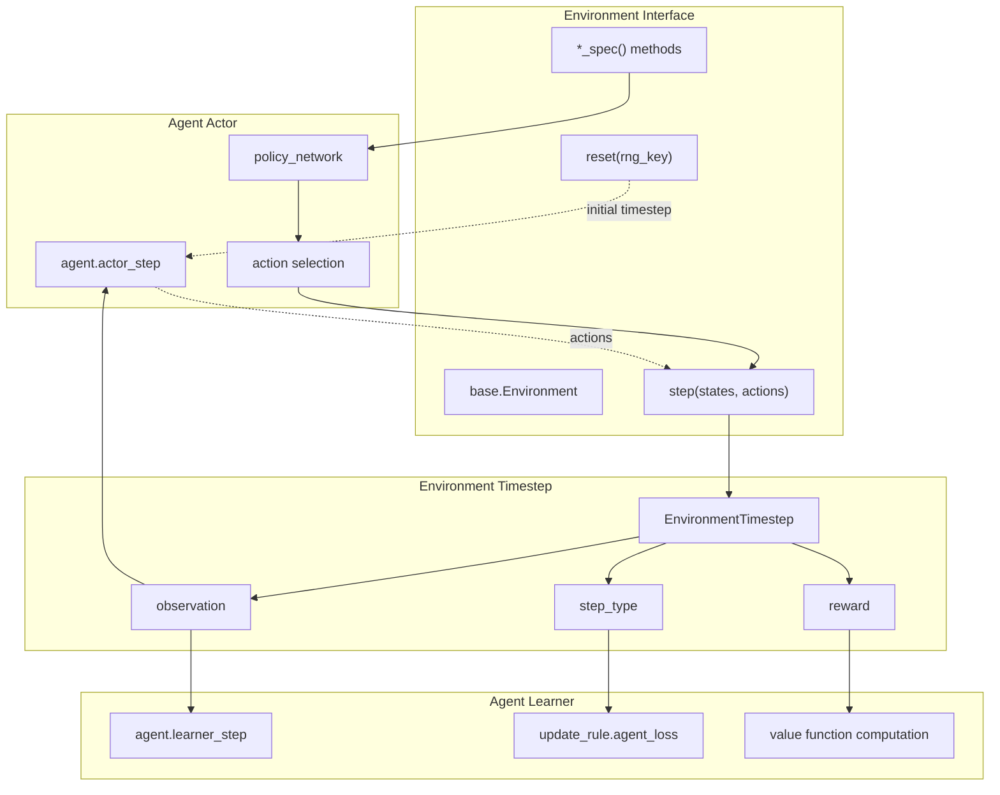

<!-- source: DeepWiki mcp.deepwiki.com · repo google-deepmind/disco_rl · extra page Environment Interface · fetched 2026-10-26 -->

# Environment Interface

<details>
<summary>Relevant source files</summary>

The following files were used as context for generating this wiki page:

- [disco_rl/environments/base.py](disco_rl/environments/base.py)
- [disco_rl/environments/wrappers/single_stream_env.py](disco_rl/environments/wrappers/single_stream_env.py)

</details>


## Purpose and Scope

This document covers the `base.Environment` abstract class that defines the standard interface for all environments in DiscoRL. This interface establishes contracts for environment state management, action/observation specifications, and the step/reset cycle. For specific environment implementations, see [Catch Environment](#3.2.2). For batching and streaming wrappers, see [Environment Wrappers](#3.2.3).

**Sources:** [disco_rl/environments/base.py:1-65]()

## Overview

The `base.Environment` class provides an abstract interface that all DiscoRL environments must implement. Unlike traditional RL environment interfaces, DiscoRL enforces that **all environments are batched by design**. This means every environment instance manages multiple parallel episodes simultaneously, which is critical for efficient JAX parallelization and vectorized execution.

The interface uses a generic `_EnvState` type variable, allowing concrete implementations to define their own state representation. CPU-based environments may use simple state objects or ignore state entirely, while JAX-jittable environments use explicit state management for pure functional execution.

**Sources:** [disco_rl/environments/base.py:29-36]()

## Core Interface Structure



**Sources:** [disco_rl/environments/base.py:29-64]()

## Abstract Methods

### step

```python
@abc.abstractmethod
def step(
    self, states: _EnvState, actions: chex.ArrayTree
) -> tuple[_EnvState, types.EnvironmentTimestep]:
```

The `step` method advances the environment forward by one timestep for all batched episodes.

**Parameters:**
| Parameter | Type | Description |
|-----------|------|-------------|
| `states` | `_EnvState` | Current environment state for all batched episodes |
| `actions` | `chex.ArrayTree` | Actions to take, with leading dimension `batch_size` |

**Returns:**
- `tuple[_EnvState, types.EnvironmentTimestep]`: Updated state and timestep information

The returned `EnvironmentTimestep` contains:
- `step_type`: Integer indicating episode status (FIRST=0, MID=1, LAST=2)
- `reward`: Scalar reward for each episode
- `observation`: Current observation for each episode

**Sources:** [disco_rl/environments/base.py:37-41]()

### reset

```python
@abc.abstractmethod
def reset(
    self, rng_key: chex.PRNGKey
) -> tuple[Any, types.EnvironmentTimestep]:
```

The `reset` method initializes or reinitializes all episodes in the batch.

**Parameters:**
| Parameter | Type | Description |
|-----------|------|-------------|
| `rng_key` | `chex.PRNGKey` | Random number generator key for environment initialization |

**Returns:**
- `tuple[Any, types.EnvironmentTimestep]`: Initial state and first timestep

The method uses the provided RNG key to generate initial environment states. For JAX-jittable environments, this key is split to provide independent randomness for each episode in the batch.

**Sources:** [disco_rl/environments/base.py:43-48]()

### single_observation_spec and single_action_spec

```python
@abc.abstractmethod
def single_observation_spec(self) -> types.Specs:
    pass

@abc.abstractmethod
def single_action_spec(self) -> types.ActionSpec:
    pass
```

These methods define the structure and constraints for observations and actions for a **single** episode (unbatched). The specifications describe:

- **Observation spec**: Shape, dtype, and valid ranges for observation arrays
- **Action spec**: Action space type (e.g., discrete action count) and valid ranges

Implementations must return specs for a single episode. The batched versions are automatically constructed by the concrete methods described below.

**Sources:** [disco_rl/environments/base.py:50-56]()

## Concrete Methods

The `Environment` class provides two concrete methods that construct batched specifications from the single-episode specs:

### batched_action_spec

```python
def batched_action_spec(self) -> types.ActionSpec:
    return utils.broadcast_specs(self.single_action_spec(), self.batch_size)
```

Returns the action specification with an additional leading batch dimension. This is used by agents to understand the expected action shape when interacting with the batched environment.

**Sources:** [disco_rl/environments/base.py:58-59]()

### batched_observation_spec

```python
def batched_observation_spec(self) -> types.Specs:
    return utils.broadcast_specs(
        self.single_observation_spec(), self.batch_size
    )
```

Returns the observation specification with an additional leading batch dimension. This is used by policy networks to construct correctly-sized input layers.

**Sources:** [disco_rl/environments/base.py:61-64]()

## Batching Requirements



The design decision to enforce batching at the interface level has several implications:

1. **No Single-Episode Environments**: There is no support for non-batched environments. Single-stream environments must be wrapped (e.g., via `BatchedSingleStreamEnvironment`) to add batching.

2. **Consistent Shape Expectations**: All agent code can assume a leading batch dimension, simplifying the actor/learner implementation.

3. **Parallelization Ready**: JAX's `vmap` can be directly applied to environment operations without additional reshaping.

4. **State Management**: The `_EnvState` type must accommodate multiple episodes, whether through explicit batching (JAX arrays with leading dimension) or through sequential state management (CPU-based wrappers).

**Sources:** [disco_rl/environments/base.py:29-36]()

## Implementation Example: SingleStreamEnv

The `SingleStreamEnv` wrapper demonstrates how to adapt a single-stream `dm_env.Environment` to the DiscoRL interface:



**Key Implementation Details:**

| Aspect | Implementation |
|--------|----------------|
| State Management | Uses `UnusedEnvState()` placeholder since dm_env manages state internally |
| Timestep Conversion | `_to_env_timestep()` converts dm_env format to DiscoRL format |
| Episode Reset | Automatically resets terminal episodes by calling step again |
| Batching | This wrapper is unbatched; requires further wrapping in `BatchedSingleStreamEnvironment` |

The `_to_env_timestep` function maps dm_env's timestep format to DiscoRL's:

```python
def _to_env_timestep(timestep: dm_env.TimeStep) -> types.EnvironmentTimestep:
  return types.EnvironmentTimestep(
      step_type=np.array(timestep.step_type, dtype=np.int32),
      reward=np.array(timestep.reward or 0.0),
      observation=timestep.observation,
  )
```

Note the automatic episode reset behavior in the `step` method: when a terminal timestep is encountered (`step_type == dm_env.StepType.LAST`), the wrapper automatically calls step again to transition to the next episode, preserving the terminal reward and step_type for the agent while providing the new episode's observation.

**Sources:** [disco_rl/environments/wrappers/single_stream_env.py:1-80]()

## Integration with Agent System

The environment interface integrates with the DiscoRL agent system through a standardized data flow:



**Data Flow Summary:**

1. **Initialization**: Agent queries `single_observation_spec()` and `single_action_spec()` to construct policy networks with appropriate input/output dimensions.

2. **Episode Start**: Agent calls `reset(rng_key)` to get initial states and first timestep.

3. **Actor Step**: Agent's actor uses current observations from timesteps to select actions via the policy network.

4. **Environment Step**: Actions are passed to `step(states, actions)`, which returns new states and timesteps.

5. **Learner Step**: Collected timesteps (observations, rewards, step_types) are passed to the learner for parameter updates.

The batching requirement ensures that all operations along this pipeline naturally handle multiple parallel episodes, enabling efficient vectorized computation in JAX.

**Sources:** [disco_rl/environments/base.py:29-65](), [disco_rl/types.py]() (referenced through `types.EnvironmentTimestep`)

## State Type Flexibility

The use of `TypeVar('_EnvState')` allows different implementation strategies:

| Implementation Type | State Representation | Example |
|---------------------|---------------------|---------|
| CPU-based | `UnusedEnvState()` or None | `SingleStreamEnv` |
| JAX-jittable | JAX array pytree with batch dimension | `BatchedJittableEnvironment` |
| Hybrid | Custom dataclass with mixed types | Possible but not used in codebase |

This flexibility allows the same agent code to work with both CPU-based environments (for debugging and small-scale experiments) and JAX-jittable environments (for high-performance training), as the agent treats environment state as an opaque object that is simply passed between `reset` and `step` calls.

**Sources:** [disco_rl/environments/base.py:26](), [disco_rl/environments/wrappers/single_stream_env.py:36-38]()

---

