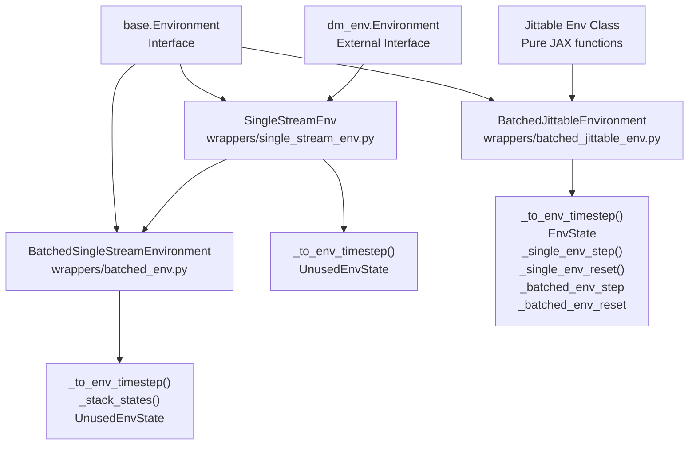
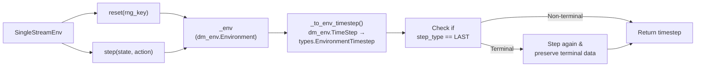
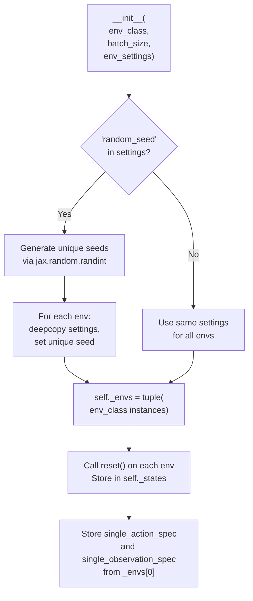
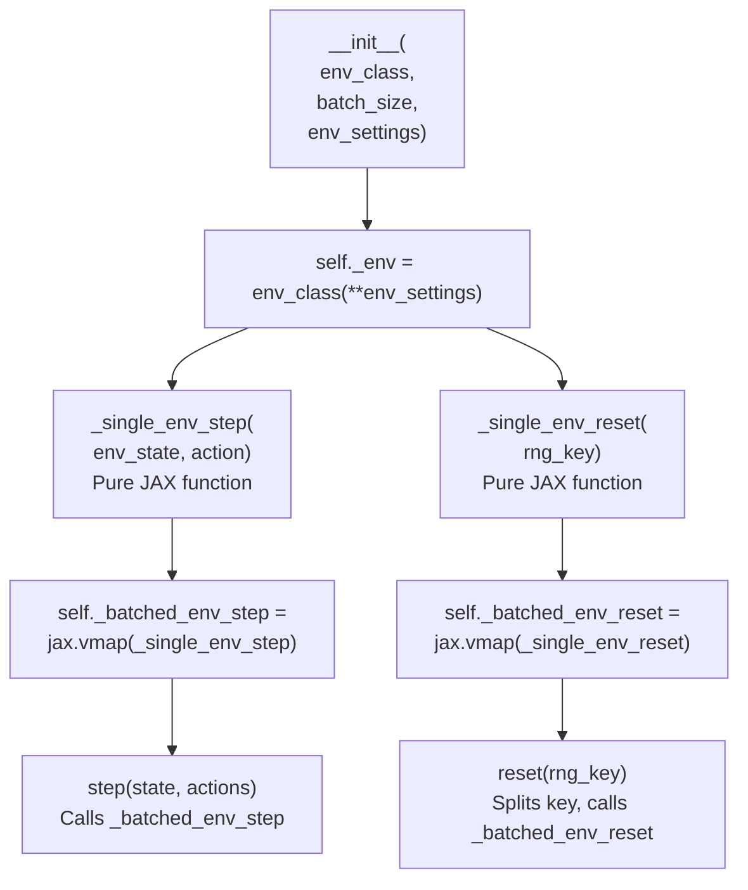
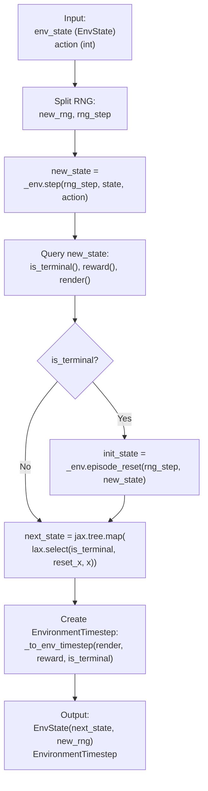
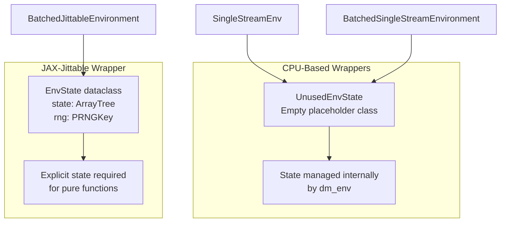

<!-- source: DeepWiki mcp.deepwiki.com · repo google-deepmind/disco_rl · extra page Environment Wrappers · fetched 2026-10-26 -->

# Environment Wrappers

<details>
<summary>Relevant source files</summary>

The following files were used as context for generating this wiki page:

- [disco_rl/environments/wrappers/batched_env.py](disco_rl/environments/wrappers/batched_env.py)
- [disco_rl/environments/wrappers/batched_jittable_env.py](disco_rl/environments/wrappers/batched_jittable_env.py)
- [disco_rl/environments/wrappers/single_stream_env.py](disco_rl/environments/wrappers/single_stream_env.py)

</details>


## Purpose and Scope

This document describes the environment wrapper implementations in DiscoRL that adapt environments to the `base.Environment` interface and provide batching capabilities. These wrappers enable the same training code to work with both CPU-based and JAX-jittable environments while supporting batched execution for efficient parallel training.

For information about the base environment interface that these wrappers implement, see [Environment Interface](#3.2.1). For details on the Catch game environment implementations that are wrapped, see [Catch Environment](#3.2.2).

## Wrapper Architecture Overview

DiscoRL provides three wrapper classes that serve different purposes in the environment execution pipeline:

| Wrapper | Purpose | Execution Model | State Management |
|---------|---------|-----------------|------------------|
| `SingleStreamEnv` | Adapt dm_env to base interface | Single environment, sequential | `UnusedEnvState` (stateless) |
| `BatchedSingleStreamEnvironment` | Batch multiple dm_env instances | Multiple environments, sequential loop | `UnusedEnvState` (stateless) |
| `BatchedJittableEnvironment` | Batch JAX environments with vmap | Parallel via `jax.vmap` | `EnvState` (explicit state) |

All wrappers implement the `base.Environment` interface, ensuring consistent interaction patterns regardless of the underlying execution strategy.

**Sources:** [disco_rl/environments/wrappers/single_stream_env.py](), [disco_rl/environments/wrappers/batched_env.py](), [disco_rl/environments/wrappers/batched_jittable_env.py]()

## Wrapper Type Hierarchy



**Sources:** [disco_rl/environments/wrappers/single_stream_env.py:40-80](), [disco_rl/environments/wrappers/batched_env.py:44-117](), [disco_rl/environments/wrappers/batched_jittable_env.py:48-117]()

## SingleStreamEnv

The `SingleStreamEnv` wrapper provides a bridge between dm_env-style environments and DiscoRL's `base.Environment` interface. It wraps a single environment instance and handles timestep conversion.

### Key Features

- **Timestep Conversion**: Converts `dm_env.TimeStep` to `types.EnvironmentTimestep` via `_to_env_timestep()` helper
- **Automatic Episode Reset**: When an episode terminates (step_type is `LAST`), automatically steps the environment again to start the next episode while preserving terminal reward information
- **Stateless Design**: Uses `UnusedEnvState` as a placeholder since dm_env manages state internally

### Implementation Details



The terminal episode handling logic [disco_rl/environments/wrappers/single_stream_env.py:61-69]() ensures continuous episode streaming:

1. If `step_type == LAST`, step the environment again
2. Store the new observation in `ts_start`
3. Override `ts_start.step_type` and `ts_start.reward` with terminal values
4. Return the modified timestep

This allows the agent to observe the terminal state's reward while simultaneously preparing the next episode.

**Sources:** [disco_rl/environments/wrappers/single_stream_env.py:40-80](), [disco_rl/environments/wrappers/single_stream_env.py:28-33]()

## BatchedSingleStreamEnvironment

The `BatchedSingleStreamEnvironment` wrapper creates multiple instances of a single-stream environment and executes them sequentially, stacking the results to provide a batched interface. This is used for CPU-based environments where parallel execution is not available.

### Initialization and State Management



The initialization process [disco_rl/environments/wrappers/batched_env.py:53-82]() handles seed generation to ensure different random behavior across batched environments. If `random_seed` is provided in settings, it generates `batch_size` unique seeds and creates each environment with its own seed.

**Sources:** [disco_rl/environments/wrappers/batched_env.py:53-82]()

### Batched Operations

The wrapper provides batched `step()` and `reset()` operations through sequential execution:

| Method | Input Shape | Operation | Output Shape |
|--------|-------------|-----------|--------------|
| `step()` | `(batch_size, ...)` actions | Sequential loop over environments | `(batch_size, ...)` timesteps |
| `reset()` | Single RNG key (unused) | Reset all environments | `(batch_size, ...)` timesteps |
| `_stack_states()` | List of timesteps | Stack via `jax.tree.map` + `np.stack` | Batched timestep |

The `step()` method [disco_rl/environments/wrappers/batched_env.py:91-103]():

1. Validates action shapes with `chex.assert_tree_shape_prefix`
2. Reshapes actions from `(batch_size, 1, ...)` to `(batch_size, ...)`
3. Splits actions into per-environment lists via `rlax.tree_split_leaves`
4. Steps each environment sequentially in a Python loop
5. Stacks results via `_stack_states()`

The `_stack_states()` helper [disco_rl/environments/wrappers/batched_env.py:84-89]() uses `jax.tree.map` to recursively stack all fields of the timestep structure and casts to single precision.

**Sources:** [disco_rl/environments/wrappers/batched_env.py:84-103](), [disco_rl/environments/wrappers/batched_env.py:105-110]()

## BatchedJittableEnvironment

The `BatchedJittableEnvironment` wrapper enables efficient parallel execution of JAX-based environments using `jax.vmap`. Unlike the CPU-based wrapper, this implementation can be JIT-compiled and executed on accelerators.

### EnvState Dataclass

JAX-jittable environments require explicit state management. The `EnvState` dataclass [disco_rl/environments/wrappers/batched_jittable_env.py:42-45]() encapsulates:

```python
@chex.dataclass(mappable_dataclass=False)
class EnvState:
  state: chex.ArrayTree  # Environment-specific state
  rng: chex.PRNGKey      # RNG key for stochastic operations
```

This explicit state is necessary because:
- JAX functions must be pure (no hidden state)
- RNG keys need to be threaded through computations
- The state can be vmapped across batches

**Sources:** [disco_rl/environments/wrappers/batched_jittable_env.py:42-46]()

### Vectorization Architecture



The initialization [disco_rl/environments/wrappers/batched_jittable_env.py:51-70]() creates vmapped versions of the single-environment functions. This allows the same code to operate on batches without explicit loops.

**Sources:** [disco_rl/environments/wrappers/batched_jittable_env.py:51-70]()

### Single Environment Step Logic

The `_single_env_step()` method [disco_rl/environments/wrappers/batched_jittable_env.py:72-90]() implements the core stepping logic:



Key aspects of this implementation:

1. **RNG Splitting** [line 75](): Creates a new RNG for future use and one for the current step
2. **Terminal Handling** [lines 81-86](): Uses `jax.lax.select` to conditionally reset terminated episodes while keeping the terminal state's reward
3. **Pure Functional Design**: All operations are pure JAX functions, enabling JIT compilation and vectorization

The `jax.lax.select` operation is critical for efficient batched execution - it allows both paths (reset and continue) to be compiled and executed conditionally without branching that would break SIMD execution.

**Sources:** [disco_rl/environments/wrappers/batched_jittable_env.py:72-90]()

### Reset Operation

The `reset()` method [disco_rl/environments/wrappers/batched_jittable_env.py:108-110]() splits the input RNG key into `batch_size` keys and vmaps the single reset operation:

```python
def reset(self, rng_key: chex.PRNGKey):
  rngs = jax.random.split(rng_key, self.batch_size)
  return self._batched_env_reset(rngs)
```

This ensures each environment in the batch has a unique random seed for initialization.

**Sources:** [disco_rl/environments/wrappers/batched_jittable_env.py:108-110]()

## Timestep Conversion

All wrappers implement a `_to_env_timestep()` helper function that converts from environment-specific timestep formats to the unified `types.EnvironmentTimestep` structure:

| Wrapper | Input Type | Conversion Details |
|---------|------------|-------------------|
| `SingleStreamEnv` | `dm_env.TimeStep` | Extract step_type, reward (default 0.0), observation |
| `BatchedSingleStreamEnvironment` | `dm_env.TimeStep` | Same as SingleStreamEnv |
| `BatchedJittableEnvironment` | Raw obs, reward, is_terminal | Compute step_type via `jax.lax.select` |

The jittable version [disco_rl/environments/wrappers/batched_jittable_env.py:30-39]() differs significantly:

```python
def _to_env_timestep(obs, reward, is_terminal):
  return types.EnvironmentTimestep(
      step_type=jax.lax.select(
          is_terminal, dm_env.StepType.LAST, dm_env.StepType.MID
      ),
      reward=reward.astype(jnp.float32),
      observation=obs.astype(jnp.float32),
  )
```

This uses `jax.lax.select` instead of Python conditionals to remain differentiable and JIT-compatible.

**Sources:** [disco_rl/environments/wrappers/single_stream_env.py:28-33](), [disco_rl/environments/wrappers/batched_env.py:36-41](), [disco_rl/environments/wrappers/batched_jittable_env.py:30-39]()

## State Type Comparison

The wrappers use different state types reflecting their execution models:



**UnusedEnvState** [disco_rl/environments/wrappers/batched_env.py:32-33]() and [disco_rl/environments/wrappers/single_stream_env.py:36-37]():
- Empty class serving as a type marker
- CPU environments manage state internally
- State parameter exists only to satisfy the `base.Environment` interface

**EnvState** [disco_rl/environments/wrappers/batched_jittable_env.py:42-45]():
- Chex dataclass containing environment state and RNG
- Required for pure functional JAX operations
- Threaded through all step/reset calls
- Can be vmapped across batches

**Sources:** [disco_rl/environments/wrappers/single_stream_env.py:36-37](), [disco_rl/environments/wrappers/batched_env.py:32-33](), [disco_rl/environments/wrappers/batched_jittable_env.py:42-46]()

## Usage Patterns

### Creating a CPU-Based Batched Environment

```python
# Via BatchedSingleStreamEnvironment
env = BatchedSingleStreamEnvironment(
    env_class=SingleStreamCatch,  # Environment class
    batch_size=32,
    env_settings=config_dict.ConfigDict({
        'random_seed': 42,
        # other environment-specific settings
    })
)

# Operations
state, timestep = env.reset(rng_key)  # state is UnusedEnvState
state, timestep = env.step(state, actions)  # actions: (32, ...)
```

### Creating a JAX-Jittable Batched Environment

```python
# Via BatchedJittableEnvironment
env = BatchedJittableEnvironment(
    env_class=_SingleStreamCatch,  # Jittable environment class
    batch_size=32,
    env_settings=config_dict.ConfigDict({
        # environment-specific settings
    })
)

# Operations (can be JIT-compiled)
env_state, timestep = env.reset(rng_key)  # env_state is EnvState
env_state, timestep = env.step(env_state, actions)  # actions: (32,)
```

The key difference is that jittable environments maintain explicit `EnvState` that must be threaded through calls, while CPU environments use `UnusedEnvState`.

**Sources:** [disco_rl/environments/wrappers/batched_env.py:53-78](), [disco_rl/environments/wrappers/batched_jittable_env.py:51-70]()

## Specification Methods

All wrappers implement `single_action_spec()` and `single_observation_spec()` methods that return specifications for a single (non-batched) environment instance:

| Wrapper | Specification Source |
|---------|---------------------|
| `SingleStreamEnv` | Directly from wrapped `_env` |
| `BatchedSingleStreamEnvironment` | From `_envs[0]` (first environment instance) |
| `BatchedJittableEnvironment` | Constructed from `_env` properties (num_actions, render output shape) |

For `BatchedJittableEnvironment`, the specifications are constructed programmatically [disco_rl/environments/wrappers/batched_jittable_env.py:59-67]():

```python
self._single_action_spec = dm_specs.BoundedArray(
    (), np.int32, 0, self._env.num_actions - 1
)

dummy_state = self._env.initial_state(jax.random.PRNGKey(0))
obs = self._env.render(dummy_state)
self._single_observation_spec = {
    'observation': dm_specs.Array(shape=obs.shape, dtype=obs.dtype)
}
```

This construction creates a dummy initial state to determine observation shape dynamically.

**Sources:** [disco_rl/environments/wrappers/single_stream_env.py:73-79](), [disco_rl/environments/wrappers/batched_env.py:112-116](), [disco_rl/environments/wrappers/batched_jittable_env.py:59-67]()

## Performance Characteristics

| Wrapper | Execution | JIT-Compatible | Parallelization | Best Use Case |
|---------|-----------|----------------|-----------------|---------------|
| `SingleStreamEnv` | Sequential | No | None | Single environment testing |
| `BatchedSingleStreamEnvironment` | Sequential loop | No | None | CPU-only environments, small batches |
| `BatchedJittableEnvironment` | Vectorized (vmap) | Yes | Data parallel | Large batches, GPU/TPU training |

The `BatchedJittableEnvironment` provides significant performance advantages:
- **Vectorization**: `jax.vmap` applies operations across batch dimension without Python loops
- **JIT Compilation**: Entire step/reset can be compiled to XLA, eliminating Python overhead
- **Device Execution**: All operations run on accelerator without host-device transfers
- **Automatic Differentiation**: Supports gradient computation through environment dynamics (for meta-learning)

The CPU-based wrappers are suitable for:
- Environments with complex logic that cannot be expressed in JAX
- Environments requiring system calls or external libraries
- Debugging and visualization
- Small-scale experiments where performance is not critical

**Sources:** [disco_rl/environments/wrappers/batched_jittable_env.py:69-70](), [disco_rl/environments/wrappers/batched_env.py:99-102]()

---

