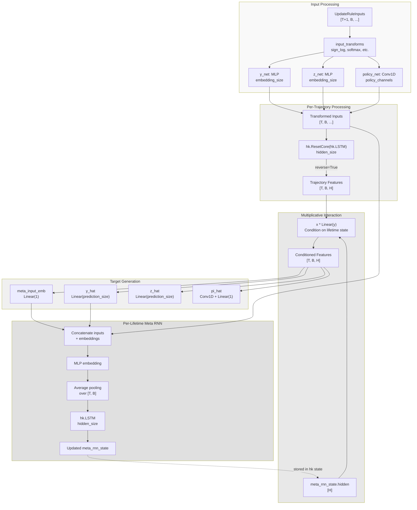
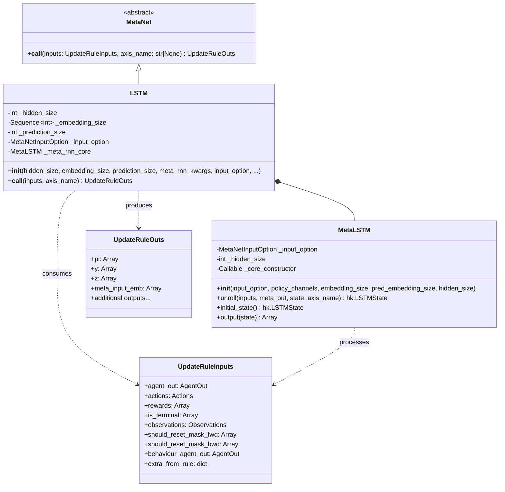
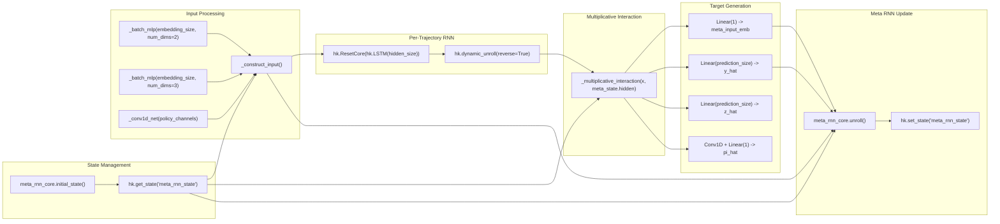
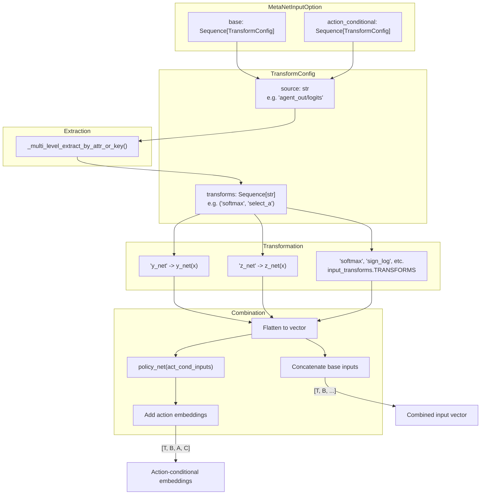
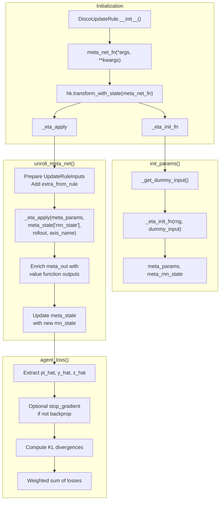

<!-- source: DeepWiki mcp.deepwiki.com · repo google-deepmind/disco_rl · extra page Meta-Networks · fetched 2026-10-26 -->

# Meta-Networks

<details>
<summary>Relevant source files</summary>

The following files were used as context for generating this wiki page:

- [disco_rl/networks/meta_nets.py](disco_rl/networks/meta_nets.py)
- [disco_rl/update_rules/disco.py](disco_rl/update_rules/disco.py)

</details>


This document covers the meta-network implementations in DiscoRL, specifically the LSTM-based architectures that generate learning targets for discovered update rules. Meta-networks process agent rollouts and produce targets for policy learning, auxiliary predictions, and value functions. For information about how meta-networks integrate with update rules, see [Update Rules](#3.3). For policy network architectures, see [Policy Networks](#3.4.1).

## Purpose and Architecture

Meta-networks transform agent rollout data (`UpdateRuleInputs`) into learning targets (`UpdateRuleOuts`). They maintain state across the agent's lifetime using LSTM cells and produce targets including policy logits (`pi`), auxiliary predictions (`y`), and action-conditional predictions (`z`).

The architecture consists of two levels of recurrence:
1. **Per-Trajectory RNN**: Processes individual trajectory steps, unrolling backward for bootstrapping
2. **Per-Lifetime Meta RNN**: Maintains state across all trajectories during the agent's lifetime, updated after each rollout

**Diagram: Two-Level Meta-Network Architecture**



**Sources:** [disco_rl/networks/meta_nets.py:45-158]()

## Class Hierarchy

**Diagram: Meta-Network Class Structure**



**Sources:** [disco_rl/networks/meta_nets.py:33-227](), [disco_rl/types.py]()

## MetaNet Base Class

The abstract `MetaNet` class defines the interface for all meta-network implementations.

| Method | Parameters | Returns | Description |
|--------|-----------|---------|-------------|
| `__call__` | `inputs: UpdateRuleInputs`<br/>`axis_name: str \| None` | `UpdateRuleOuts` | Processes rollout inputs and produces learning targets |

**Sources:** [disco_rl/networks/meta_nets.py:33-42]()

## LSTM Implementation

The `LSTM` class implements a meta-network using a two-level LSTM architecture. It is instantiated by `DiscoUpdateRule` and transforms rollout data into learning targets.

### Initialization Parameters

| Parameter | Type | Description |
|-----------|------|-------------|
| `hidden_size` | `int` | Hidden dimension for LSTM cells |
| `embedding_size` | `Sequence[int]` | MLP layer sizes for input embeddings |
| `prediction_size` | `int` | Output dimension for y and z predictions |
| `meta_rnn_kwargs` | `Mapping[str, Any]` | Configuration for `MetaLSTM` |
| `input_option` | `MetaNetInputOption` | Specifies input sources and transformations |
| `policy_channels` | `Sequence[int]` | Conv1D channel sizes for policy embeddings (default: `(16, 2)`) |
| `policy_target_channels` | `Sequence[int]` | Conv1D channel sizes for policy targets (default: `(128,)`) |
| `*_stddev` | `float \| None` | Optional standard deviations for weight initializers |

**Sources:** [disco_rl/networks/meta_nets.py:48-76]()

### Forward Pass

The `__call__` method executes the following pipeline:

1. **State Management**: Retrieves or initializes `meta_rnn_state` from Haiku state [meta_nets.py:82-89]()
2. **Input Construction**: Applies transformations and embeddings to rollout data [meta_nets.py:96-107]()
3. **Per-Trajectory RNN**: Unrolls backward through trajectory for bootstrapping [meta_nets.py:110-117]()
4. **Multiplicative Interaction**: Conditions trajectory features on lifetime state [meta_nets.py:119-124]()
5. **Target Computation**: Generates `pi_hat`, `y_hat`, `z_hat`, and `meta_input_emb` [meta_nets.py:126-149]()
6. **Meta RNN Update**: Unrolls lifetime RNN and updates state [meta_nets.py:152-156]()

**Diagram: LSTM Forward Pass Data Flow**



**Sources:** [disco_rl/networks/meta_nets.py:78-157]()

## MetaLSTM: Per-Lifetime Recurrence

`MetaLSTM` maintains state across all rollouts during the agent's lifetime, providing temporal context for learning target generation.

### Key Methods

| Method | Parameters | Returns | Description |
|--------|-----------|---------|-------------|
| `unroll` | `inputs: UpdateRuleInputs`<br/>`meta_out: UpdateRuleOuts`<br/>`state: hk.LSTMState`<br/>`axis_name: str \| None` | `hk.LSTMState` | Updates meta state given rollout and current state |
| `initial_state` | None | `hk.LSTMState` | Returns initial LSTM state with `batch_size=None` |
| `output` | `state: hk.LSTMState` | `Array` | Extracts hidden state vector for conditioning |

**Sources:** [disco_rl/networks/meta_nets.py:160-227]()

### Unroll Process

The `unroll` method processes a complete rollout to update the lifetime state:

1. **Input Preparation**: Constructs meta inputs from rollout using same transformations as main LSTM [meta_nets.py:189-199]()
2. **Input Concatenation**: Combines transformed inputs with `meta_input_emb` and softmax of `y` predictions [meta_nets.py:200-204]()
3. **Embedding**: Applies MLP to concatenated inputs [meta_nets.py:207-208]()
4. **Pooling**: Averages over batch and time dimensions, optionally syncing across devices with `pmean` [meta_nets.py:210-213]()
5. **State Update**: Unrolls LSTM core with pooled input to produce new state [meta_nets.py:216-218]()

**Sources:** [disco_rl/networks/meta_nets.py:179-218]()

## Input Construction

The `_construct_input` function transforms raw rollout data into neural network inputs by applying configurable transformations.

### Input Processing Pipeline

**Diagram: Input Transformation Pipeline**



**Sources:** [disco_rl/networks/meta_nets.py:256-331](), [disco_rl/update_rules/input_transforms.py]()

### Transform Configuration

Input sources are specified using path strings (e.g., `"agent_out/logits"`, `"extra_from_rule/adv"`) and extracted using `_multi_level_extract_by_attr_or_key` [meta_nets.py:229-253](). Each source can have multiple transformations applied sequentially.

Common transformations include:
- `y_net`, `z_net`: Apply learned MLP embeddings
- `softmax`: Apply softmax activation
- `select_a`: Select action taken from action-conditional output
- `drop_last`: Remove last timestep (for [T+1] → [T] alignment)
- `sign_log`, `td_pair`, `stop_grad`: See [Input Transformations](#4.2)

**Sources:** [disco_rl/networks/meta_nets.py:273-303](), [disco_rl/update_rules/disco.py:326-428]()

### Action-Conditional Inputs

When `input_option.action_conditional` is specified, the function generates per-action embeddings:

1. Process action-conditional sources (shape: `[T, B, A, ...]`)
2. Concatenate with one-hot action encoding [meta_nets.py:316-321]()
3. Apply `policy_net` (Conv1D) to produce embeddings [meta_nets.py:322]()
4. Extract both averaged and action-specific embeddings [meta_nets.py:323-325]()

**Sources:** [disco_rl/networks/meta_nets.py:310-327]()

## Output Structure

Meta-networks produce `UpdateRuleOuts` dictionaries with the following keys:

| Key | Shape | Description |
|-----|-------|-------------|
| `pi` | `[T, B, A]` | Policy target logits for each action |
| `y` | `[T, B, Y]` | Auxiliary prediction targets (prediction_size) |
| `z` | `[T, B, Y]` | Action-conditional prediction targets |
| `meta_input_emb` | `[T, B, 1]` | Embedding for meta RNN input |

Additional outputs may be added by the update rule after meta-network processing, such as value function outputs and advantages [disco.py:183-192]().

**Sources:** [disco_rl/networks/meta_nets.py:149-157](), [disco_rl/update_rules/disco.py:161-192]()

## Integration with Update Rules

The meta-network is integrated into `DiscoUpdateRule` via Haiku's transform API:

**Diagram: Meta-Network Integration in DiscoUpdateRule**



**Sources:** [disco_rl/update_rules/disco.py:60-67](), [disco_rl/update_rules/disco.py:69-78](), [disco_rl/update_rules/disco.py:112-208](), [disco_rl/update_rules/disco.py:210-294]()

### Initialization

```python
# In DiscoUpdateRule.__init__()
def meta_net_fn(*args, **kwargs):
    if net['name'] == 'lstm':
        return meta_nets.LSTM(**net)(*args, **kwargs)
    else:
        raise ValueError(f'Invalid model network name: {net["name"]}.')

self._eta_init_fn, self._eta_apply = hk.transform_with_state(meta_net_fn)
```

**Sources:** [disco_rl/update_rules/disco.py:61-67]()

### Parameter Initialization

The `init_params` method creates dummy inputs matching expected shapes and initializes meta-network parameters:

```python
def init_params(self, rng: chex.PRNGKey) -> tuple[types.MetaParams, chex.ArrayTree]:
    dummy_input = self._get_dummy_input(
        include_behaviour_out=True, include_agent_adv=True
    )
    meta_params, meta_rnn_state = self._eta_init_fn(
        rng, dummy_input, axis_name=None
    )
    return meta_params, meta_rnn_state
```

**Sources:** [disco_rl/update_rules/disco.py:69-78]()

### Target Generation

During `unroll_meta_net`, the meta-network is applied to produce learning targets:

1. **Prepare Rollout**: Add value function outputs to `rollout.extra_from_rule` [disco.py:162-170]()
2. **Apply Meta-Network**: Call `_eta_apply` to get targets [disco.py:171-177]()
3. **Enrich Outputs**: Add additional outputs from value functions [disco.py:183-192]()
4. **Update State**: Store new RNN state and other meta state components [disco.py:194-206]()

**Sources:** [disco_rl/update_rules/disco.py:112-208]()

### Loss Computation

The `agent_loss` method uses meta-network outputs to compute KL divergence losses:

```python
# Parse meta-net's output
pi_hat = meta_out['pi']
y_hat = meta_out['y']
z_hat = meta_out['z']

# Compute losses
pi_loss_per_step = rlax.categorical_kl_divergence(pi_hat, logits)
y_loss_per_step = rlax.categorical_kl_divergence(y_hat, y)
z_loss_per_step = rlax.categorical_kl_divergence(z_hat, z_a)
```

When `backprop=False`, targets are stopped from gradient propagation [disco.py:238-239]().

**Sources:** [disco_rl/update_rules/disco.py:210-294]()

## Helper Functions

### Batch Operations

| Function | Signature | Description |
|----------|-----------|-------------|
| `_batch_mlp` | `(hiddens, num_dims=2)` | Creates `hk.BatchApply(hk.nets.MLP)` for batched MLP operations |
| `_conv1d_net` | `(channels)` | Creates sequential Conv1D blocks with average pooling |
| `_conv1d_block` | `(x, n_channels)` | Single Conv1D block with mean pooling and concatenation |

**Sources:** [disco_rl/networks/meta_nets.py:352-370]()

### State Interaction

```python
def _multiplicative_interaction(
    x: chex.Array, y: chex.Array, initializer: hk.initializers.Initializer
) -> chex.Array:
    """Returns out = x * Linear(y) if y is not None. Otherwise, returns x."""
    if isinstance(y, chex.Array) and y.shape:  # not scalar
        y_embed = hk.Linear(x.shape[-1], w_init=initializer)(y)
        return jnp.multiply(x, y_embed)
    else:
        return x
```

This function conditions per-trajectory features on the per-lifetime meta state through element-wise multiplication with a learned linear projection.

**Sources:** [disco_rl/networks/meta_nets.py:340-349]()

### Initialization Utilities

```python
def _maybe_get_initializer(
    stddev: float | None,
) -> hk.initializers.Initializer | None:
    return hk_init.TruncatedNormal(stddev=stddev) if stddev is not None else None
```

**Sources:** [disco_rl/networks/meta_nets.py:334-337]()

---

