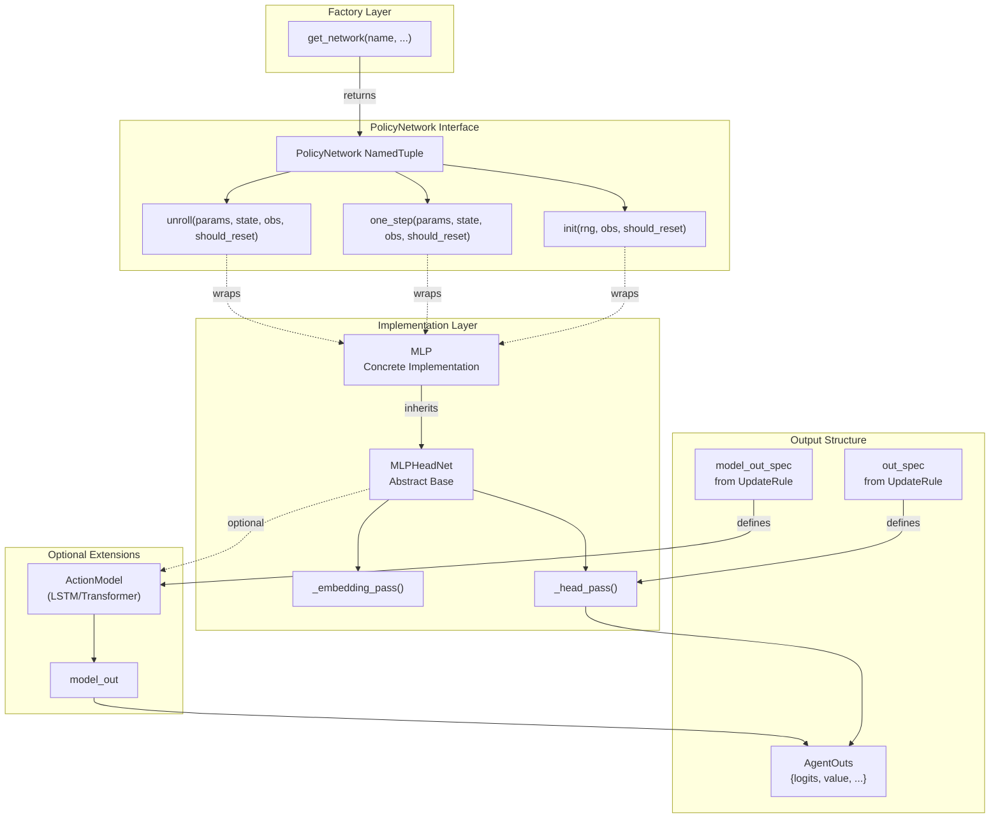
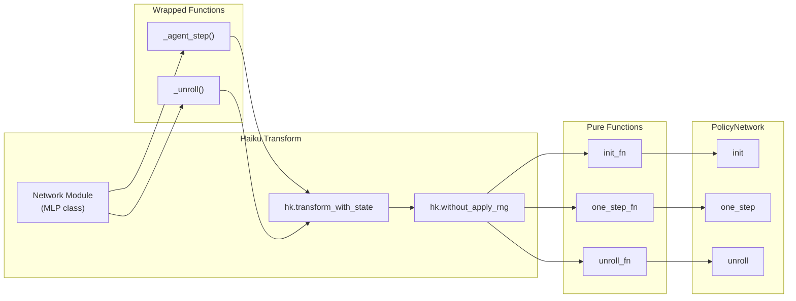
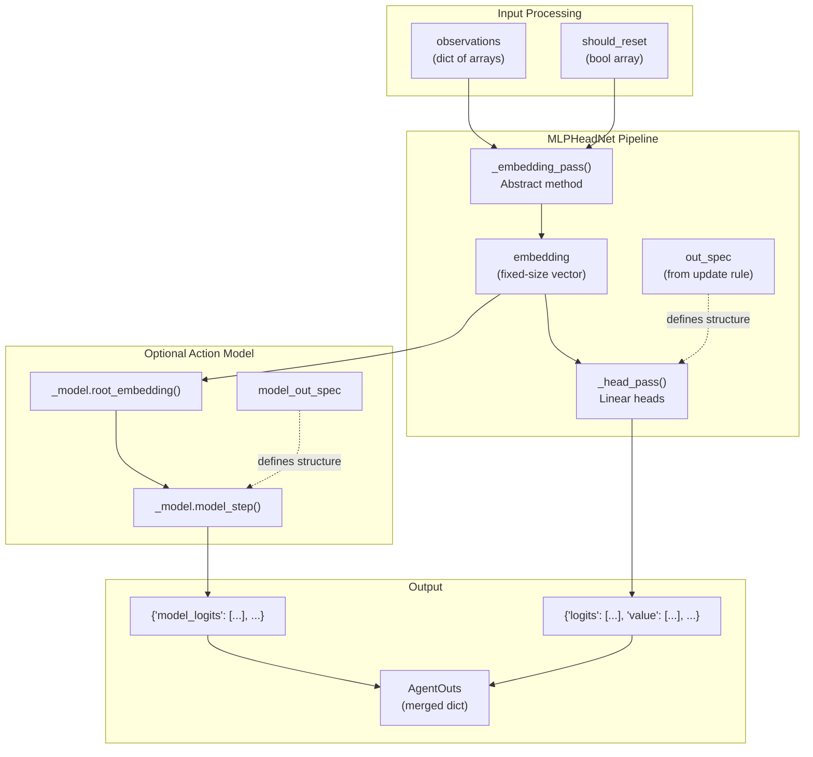
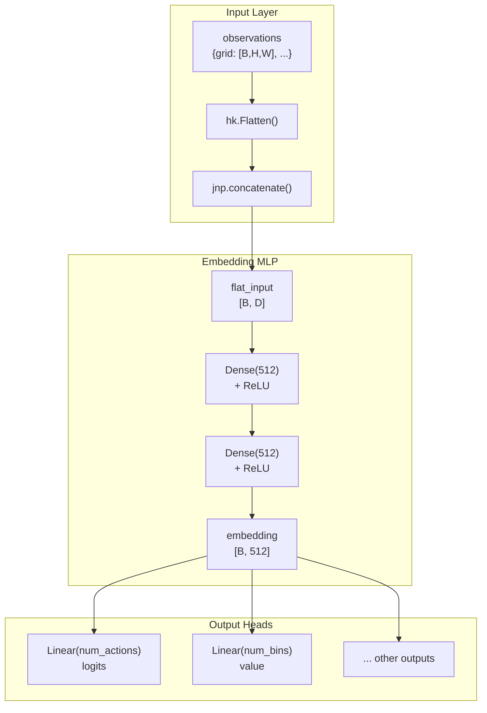
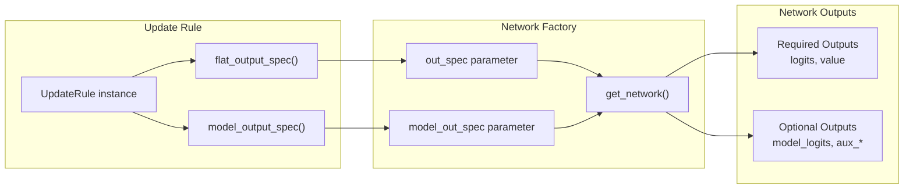
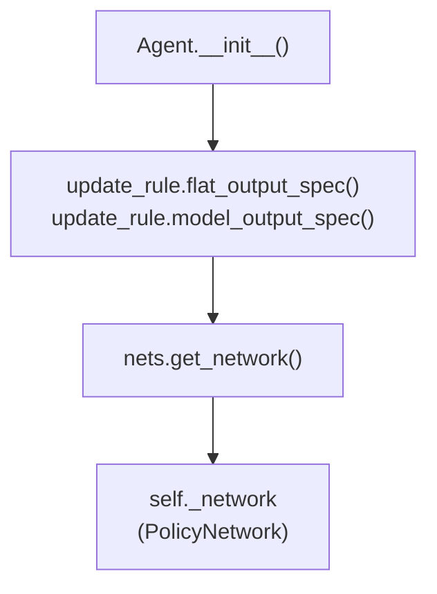
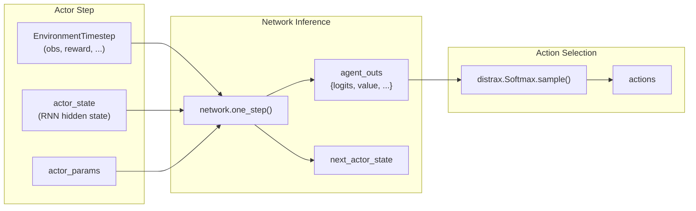
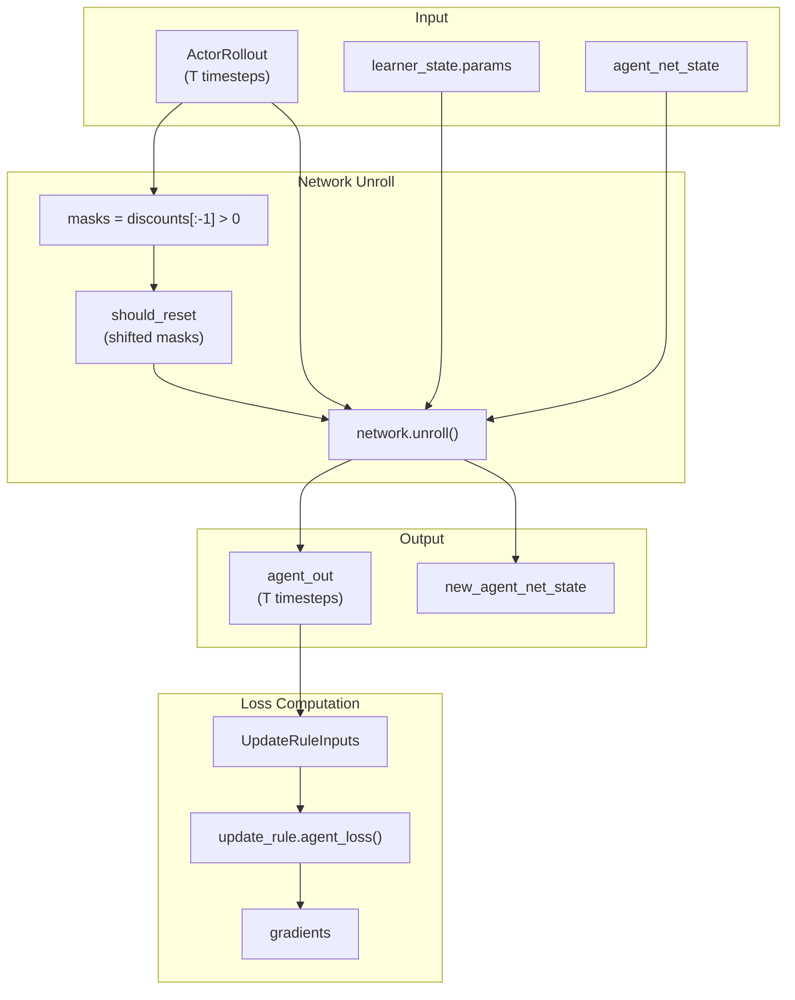
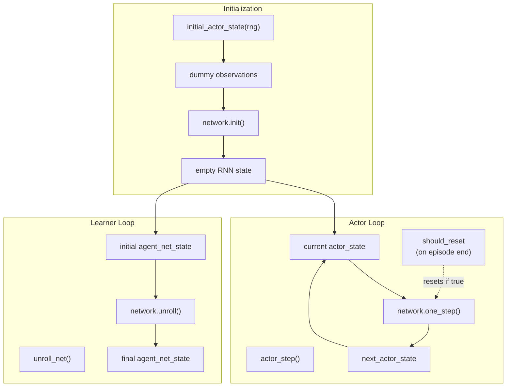

<!-- source: DeepWiki mcp.deepwiki.com · repo google-deepmind/disco_rl · extra page Policy Networks · fetched 2026-10-26 -->

# Policy Networks

<details>
<summary>Relevant source files</summary>

The following files were used as context for generating this wiki page:

- [disco_rl/agent.py](disco_rl/agent.py)
- [disco_rl/networks/nets.py](disco_rl/networks/nets.py)

</details>


Policy networks are the neural network architectures that agents use to compute action distributions from observations. They implement the policy function π(a|s), producing outputs (logits, values, etc.) according to specifications defined by update rules. For meta-network architectures used by the Disco update rule, see [Meta-Networks](#3.4.2). For action-conditional models that extend policy networks, see [Action Models](#3.4.3).

**Sources**: [disco_rl/networks/nets.py:1-159](), [disco_rl/agent.py:90-99]()

---

## Architecture Overview

Policy networks in DiscoRL follow a modular design with three key components:

1. **Factory Function**: `get_network()` constructs networks based on string names
2. **Base Class**: `MLPHeadNet` defines the embedding + head architecture pattern
3. **Concrete Implementations**: Currently `MLP` for feedforward networks with optional recurrent action models

The system uses Haiku's `transform_with_state` to create pure functional interfaces that separate parameter initialization from execution.



**Sources**: [disco_rl/networks/nets.py:32-56](), [disco_rl/networks/nets.py:59-125]()

---

## PolicyNetwork Interface

The `PolicyNetwork` named tuple defines the functional interface for all policy networks, consisting of three pure functions:

| Function | Signature | Purpose |
|----------|-----------|---------|
| `init` | `(rng, obs, should_reset) -> (params, state)` | Initialize network parameters and initial RNN state |
| `one_step` | `(params, state, obs, should_reset) -> (outs, state)` | Single-step inference for actor rollout |
| `unroll` | `(params, state, obs, should_reset) -> (outs, state)` | Batched time-series processing for learning |

These functions are created by Haiku's `transform_with_state` and `without_apply_rng`, making them compatible with JAX transformations like `jit`, `vmap`, and `grad`.



**Sources**: [disco_rl/networks/nets.py:32-56](), [disco_rl/types.py]()

---

## Network Implementations

### MLPHeadNet Base Class

`MLPHeadNet` is an abstract base class that implements the common **embedding + head** architecture pattern used across all policy networks. It separates the network into two stages:

1. **Embedding Pass**: Converts observations into a fixed-size embedding vector
2. **Head Pass**: Produces multiple outputs from the embedding according to `out_spec`



The `_head_pass` method creates a separate linear layer for each output in `out_spec`, all reading from the same embedding:

```python
# Conceptual structure from _head_pass
for name, spec in out_spec.items():
    output[name] = hk.nets.MLP([spec.shape])(embedding)
```

**Sources**: [disco_rl/networks/nets.py:59-125]()

### MLP Implementation

The `MLP` class is a concrete implementation of `MLPHeadNet` that uses a simple feedforward network for the embedding pass. It flattens and concatenates all observation components, then passes them through a multi-layer perceptron.

| Component | Implementation | Configuration |
|-----------|----------------|---------------|
| Observation Processing | `hk.Flatten()` + `jnp.concatenate()` | Automatic |
| Embedding Network | `hk.nets.MLP(dense)` | `dense=(512, 512)` |
| Head Network | Linear layers per `out_spec` | `head_w_init_std=1e-2` |
| Action Model | Optional LSTM/Transformer | `model_arch_name='lstm'` |



The `unroll` method applies the network to time-series data using `hk.BatchApply`:

```python
def unroll(self, inputs, should_reset):
    return hk.BatchApply(self.__call__)(inputs, should_reset)
```

This efficiently processes sequences by vectorizing over the time dimension.

**Sources**: [disco_rl/networks/nets.py:127-159]()

---

## Integration with Update Rules

Policy networks are tightly coupled with update rules, which define the network's output structure through two specifications:

### Output Specifications



Example from Disco update rule configuration:
- `out_spec`: Contains 'logits' for action selection and 'value' for value prediction
- `model_out_spec`: Contains 'model_logits' and other auxiliary outputs from the action model

**Sources**: [disco_rl/agent.py:91-99](), [disco_rl/update_rules/base.py]()

---

## Agent Integration

The Agent class uses policy networks in three contexts:

### 1. Initialization



The agent creates the network during initialization, passing specifications from the update rule and configuration from `agent_settings.net_settings`.

**Sources**: [disco_rl/agent.py:90-99]()

### 2. Actor Step (Inference)

During environment interaction, the agent uses `one_step` for single-timestep inference:



**Sources**: [disco_rl/agent.py:147-173]()

### 3. Learner Step (Training)

During training, the agent uses `unroll` to process entire trajectories efficiently:



The `unroll_net` method prepares reset signals and calls the network's `unroll` function, which uses `hk.BatchApply` to efficiently process the time dimension.

**Sources**: [disco_rl/agent.py:175-198](), [disco_rl/agent.py:248-316]()

---

## Configuration

Policy networks are configured through the `net_settings` section of agent configuration. Here are the typical configurations for different scenarios:

### Disco103 Configuration

```python
net_settings = dict(
    name='mlp',
    net_args=dict(
        dense=(512, 512),              # MLP embedding layers
        model_arch_name='lstm',        # Optional action model
        head_w_init_std=1e-2,          # Head initialization
        model_kwargs=dict(
            head_mlp_hiddens=(128,),   # Action model MLP
            lstm_size=128,             # Action model LSTM size
        ),
    ),
)
```

### Actor-Critic Configuration

```python
net_settings = dict(
    name='mlp',
    net_args=dict(
        dense=(64, 32, 32),            # Smaller MLP
        model_arch_name='lstm',
        head_w_init_std=1e-2,
        model_kwargs=dict(
            head_mlp_hiddens=(64,),
            lstm_size=64,
        ),
    ),
)
```

### Configuration Parameters

| Parameter | Type | Purpose |
|-----------|------|---------|
| `name` | str | Network architecture ('mlp') |
| `dense` | tuple[int] | Hidden layer sizes for embedding MLP |
| `model_arch_name` | str | Optional action model type ('lstm', 'transformer') |
| `head_w_init_std` | float | Standard deviation for head weight initialization |
| `model_kwargs` | dict | Configuration for optional action model |

**Sources**: [disco_rl/agent.py:319-420]()

---

## Network State Management

Policy networks maintain state for recurrent components (LSTM hidden states). The state lifecycle:



The `should_reset` parameter signals when episodes end, allowing LSTM states to be reset appropriately. This is computed from the environment's `step_type` in the actor and from `discounts` in the learner.

**Sources**: [disco_rl/agent.py:123-132](), [disco_rl/agent.py:147-173](), [disco_rl/agent.py:175-198]()

---

