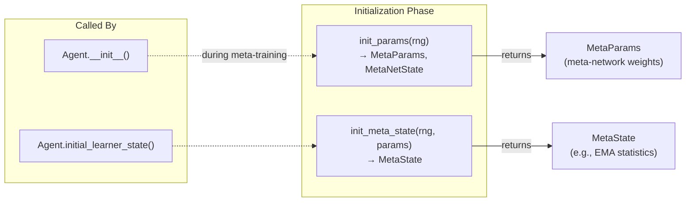
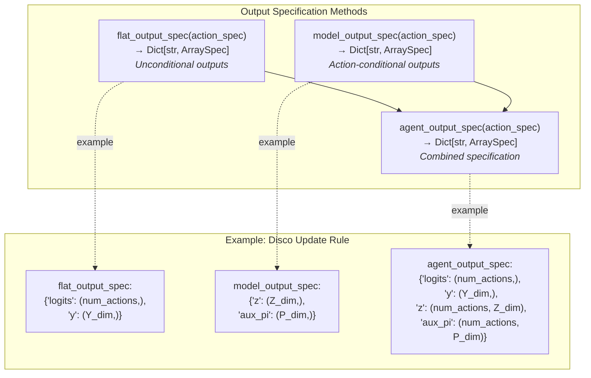
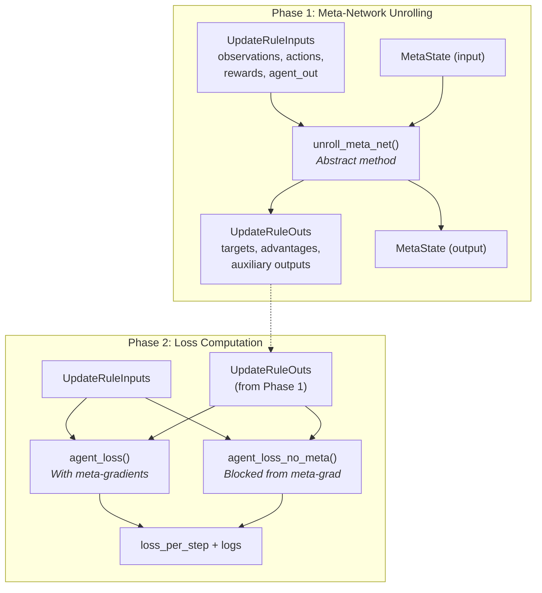
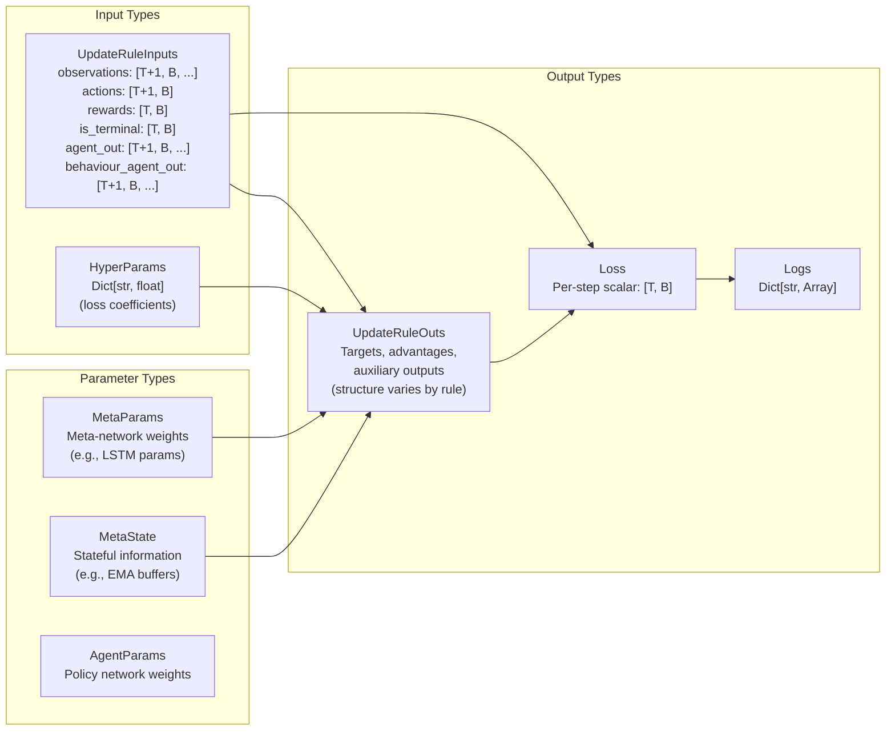
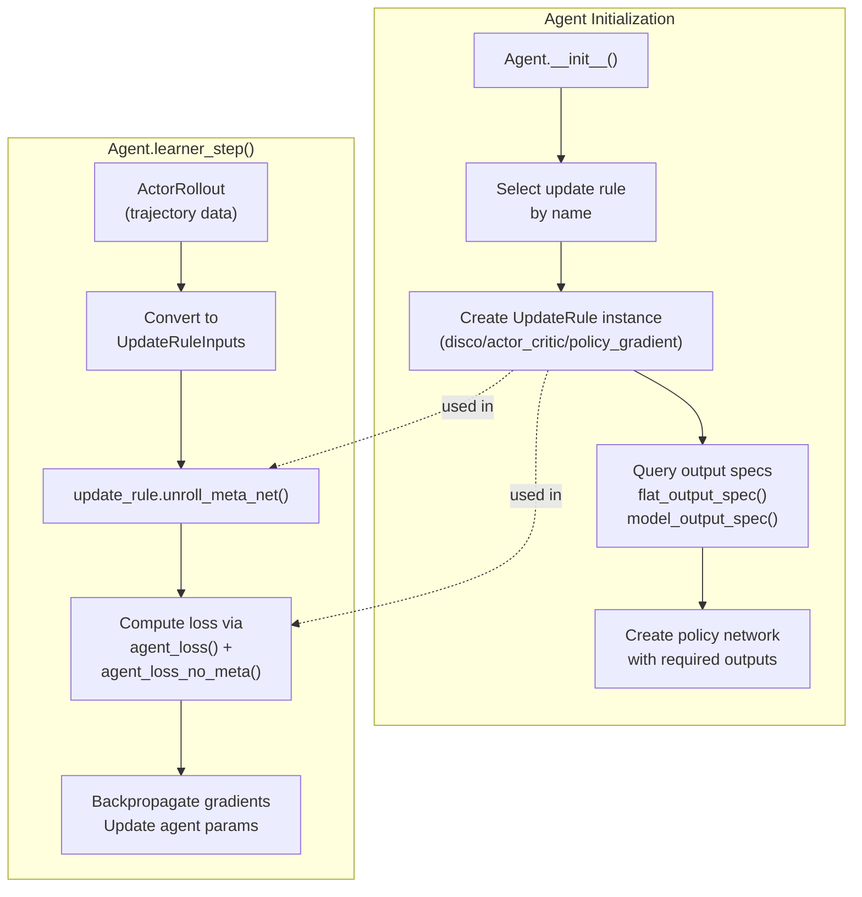

<!-- source: DeepWiki mcp.deepwiki.com · repo google-deepmind/disco_rl · extra page Update Rule Interface · fetched 2026-10-26 -->

# Update Rule Interface

<details>
<summary>Relevant source files</summary>

The following files were used as context for generating this wiki page:

- [disco_rl/agent.py](disco_rl/agent.py)
- [disco_rl/update_rules/base.py](disco_rl/update_rules/base.py)

</details>


The Update Rule Interface defines the contract for implementing pluggable learning algorithms in DiscoRL. All update rules (Disco103, Actor-Critic, Policy Gradient) implement this base interface, allowing the Agent to swap between different learning algorithms without changing the training infrastructure.

For documentation of specific implementations, see [Disco103 Update Rule](#3.3.2) and [Baseline Update Rules](#3.3.3). For information on how the Agent integrates with update rules, see [Agent System](#3.1).

## Overview

The `UpdateRule` base class is defined in [disco_rl/update_rules/base.py:73-344]() and provides an abstract interface for all learning algorithms in DiscoRL. Update rules are responsible for:

1. **Defining agent network outputs** - Specifying what auxiliary outputs the agent's policy network should produce
2. **Computing learning targets** - Unrolling meta-networks or computing value functions to prepare targets
3. **Computing losses** - Calculating per-step losses from rollouts and targets

The interface separates the loss computation into two methods: `agent_loss` (receives meta-gradients) and `agent_loss_no_meta` (blocked from meta-gradients), enabling selective backpropagation during meta-training.

**Sources**: [disco_rl/update_rules/base.py:1-344]()

## Core Interface Methods

The `UpdateRule` class defines several abstract and concrete methods that implementations must provide or may override.

### Initialization Methods



| Method | Purpose | Return Type | Abstract |
|--------|---------|-------------|----------|
| `init_params(rng)` | Initialize meta-network parameters (e.g., for Disco's LSTM) | `(MetaParams, MetaNetState)` | Yes |
| `init_meta_state(rng, params)` | Initialize stateful information (e.g., EMA buffers) | `MetaState` | Yes |

The `init_params` method is called during meta-training setup to initialize the learnable components of the update rule. The `init_meta_state` method is called when creating a new agent to initialize any stateful information the update rule needs to maintain across training steps.

**Sources**: [disco_rl/update_rules/base.py:154-220](), [disco_rl/agent.py:134-145]()

### Output Specification Methods

Update rules specify what outputs the agent's policy network should produce beyond the policy logits:



| Method | Purpose | Default Implementation |
|--------|---------|------------------------|
| `flat_output_spec(action_spec)` | Define unconditional network outputs (same shape for all actions) | Returns empty dict |
| `model_output_spec(action_spec)` | Define action-conditional outputs (separate value per action) | Returns empty dict |
| `agent_output_spec(action_spec)` | Combine flat and model specs into complete output specification | Implemented in base class |

The `agent_output_spec` method [disco_rl/update_rules/base.py:191-204]() combines flat and model outputs using the helper function `get_agent_out_spec` [disco_rl/update_rules/base.py:29-71](), which expands action-conditional outputs to shape `(num_actions, *output_shape)`.

**Sources**: [disco_rl/update_rules/base.py:167-204](), [disco_rl/agent.py:91-99]()

## Two-Phase Update Process

The update rule operates in two distinct phases during each learning step:



### Phase 1: unroll_meta_net

The `unroll_meta_net` method [disco_rl/update_rules/base.py:222-251]() prepares auxiliary outputs needed for loss computation:

**Method Signature**:
```python
def unroll_meta_net(
    meta_params: MetaParams,      # Meta-network weights
    params: AgentParams,           # Agent policy weights
    state: HaikuState,             # Agent RNN state
    meta_state: MetaState,         # Update rule state
    rollout: UpdateRuleInputs,     # Trajectory data
    hyper_params: HyperParams,     # Loss coefficients
    unroll_policy_fn: AgentStepFn, # Policy unroll function
    rng: PRNGKey,                  # Random key
    axis_name: str | None,         # For pmap sync
) -> (UpdateRuleOuts, MetaState)
```

**Responsibilities**:
- Compute value targets (e.g., TD-lambda returns, Q-values)
- Generate advantage estimates
- Run meta-networks (for Disco) or compute baselines
- Update internal state (e.g., EMA statistics)

### Phase 2: agent_loss and agent_loss_no_meta

After unrolling, two loss methods compute per-step losses:

| Method | Purpose | Meta-Gradients | Typical Use |
|--------|---------|----------------|-------------|
| `agent_loss()` | Main learning loss | ✓ Receives | Policy gradient, value losses with meta-learned components |
| `agent_loss_no_meta()` | Auxiliary loss | ✗ Blocked | Regularization, entropy bonus, fixed baselines |

Both methods [disco_rl/update_rules/base.py:253-291]() take the same inputs and return `(loss_per_step, logs)`. The Agent combines their outputs [disco_rl/agent.py:234-242]():

```python
loss_per_step, log = self.update_rule.agent_loss(...)
loss_per_step_no_meta, log_no_meta = self.update_rule.agent_loss_no_meta(...)
total_loss = loss_per_step + loss_per_step_no_meta
```

**Sources**: [disco_rl/update_rules/base.py:222-291](), [disco_rl/agent.py:200-246]()

## Data Types and Specifications

The update rule interface relies on several key data structures defined in the types system:



### UpdateRuleInputs

The `UpdateRuleInputs` structure [disco_rl/types.py]() provides trajectory data to the update rule:

| Field | Shape | Description |
|-------|-------|-------------|
| `observations` | `[T+1, B, ...]` | Observations including bootstrap |
| `actions` | `[T+1, B]` | Actions taken |
| `rewards` | `[T, B]` | Rewards received |
| `is_terminal` | `[T, B]` | Episode termination flags |
| `agent_out` | `[T+1, B, ...]` | Current policy outputs |
| `behaviour_agent_out` | `[T+1, B, ...]` | Behavior policy outputs (for off-policy) |

Note the temporal structure: most fields have `T` timesteps, but `observations`, `actions`, and `agent_out` include a bootstrap timestep (`T+1`).

### MetaParams vs MetaState

- **`MetaParams`**: Learnable parameters of the update rule (e.g., meta-network weights). These receive gradients during meta-training.
- **`MetaState`**: Non-learnable stateful information (e.g., EMA statistics for normalization). Updated during training but not differentiated.

**Sources**: [disco_rl/types.py](), [disco_rl/update_rules/base.py:73-344]()

## Integration with Agent

The Agent class [disco_rl/agent.py:47-317]() integrates with update rules through several key points:



### Initialization Flow

1. **Update rule selection** [disco_rl/agent.py:76-88](): Agent constructor uses `agent_settings.update_rule_name` to instantiate the appropriate `UpdateRule` subclass
2. **Output specification** [disco_rl/agent.py:91-99](): Agent queries `flat_output_spec()` and `model_output_spec()` to configure the policy network
3. **Meta-state initialization** [disco_rl/agent.py:142](): When creating a new learner, Agent calls `init_meta_state()`

### Training Loop Integration

During each training step, the Agent's `learner_step` method [disco_rl/agent.py:248-316]():

1. **Constructs `UpdateRuleInputs`** [disco_rl/agent.py:265-273]() from the trajectory rollout
2. **Calls `unroll_meta_net`** [disco_rl/agent.py:275-286]() to compute targets and auxiliary outputs
3. **Computes gradients** [disco_rl/agent.py:289-297]() of `_loss`, which internally calls `agent_loss` and `agent_loss_no_meta`
4. **Updates parameters** using the optimizer

The separation of `unroll_meta_net` from loss computation allows the Agent to compute gradients with respect to agent parameters while treating meta-network outputs appropriately (with or without meta-gradients).

**Sources**: [disco_rl/agent.py:47-317](), [disco_rl/update_rules/base.py:73-344]()

## Convenience Method: __call__

The `UpdateRule` base class provides a `__call__` method [disco_rl/update_rules/base.py:292-344]() that combines the two-phase process into a single call:

```python
def __call__(
    meta_params, params, state, rollout, 
    hyper_params, meta_state, unroll_policy_fn,
    rng, axis_name, backprop=False
) -> (loss_per_step, MetaState, logs)
```

This convenience method:
1. Calls `unroll_meta_net()` to prepare targets
2. Calls `agent_loss()` and `agent_loss_no_meta()` 
3. Combines losses and returns per-step loss, updated state, and logs

The `backprop` parameter controls whether `agent_loss` should differentiate through meta-parameters. This is useful for simplified evaluation code that doesn't need to distinguish between the two phases.

**Note**: The Agent class does not use this method; it explicitly calls `unroll_meta_net` and the loss methods separately [disco_rl/agent.py:275-286]() for finer control over the computation graph.

**Sources**: [disco_rl/update_rules/base.py:292-344](), [disco_rl/agent.py:248-316]()

## Helper Methods

The base class provides utility methods for testing and initialization:

### _get_dummy_input

The `_get_dummy_input` method [disco_rl/update_rules/base.py:76-152]() generates synthetic `UpdateRuleInputs` for initializing meta-networks:

```python
def _get_dummy_input(
    include_behaviour_out: bool = True,
    include_value_out: bool = False,
    include_agent_adv: bool = False,
) -> UpdateRuleInputs
```

This method creates small (T=2, B=1) dummy tensors with correct shapes, allowing update rule implementations to initialize their meta-network parameters without requiring real trajectory data.

### get_agent_out_spec

The helper function `get_agent_out_spec` [disco_rl/update_rules/base.py:29-71]() combines flat and model output specifications:

- **Flat outputs** (e.g., `logits`, `y`) are used as-is
- **Model outputs** (e.g., `z`, `aux_pi`) are expanded to shape `(num_actions, *original_shape)`

This ensures action-conditional outputs have one value per action, enabling Q-function style architectures.

**Sources**: [disco_rl/update_rules/base.py:29-152]()

## Implementation Checklist

When implementing a new update rule, the following methods must be provided:

| Method | Required | Purpose |
|--------|----------|---------|
| `init_params(rng)` | ✓ | Initialize meta-network parameters |
| `init_meta_state(rng, params)` | ✓ | Initialize stateful information |
| `unroll_meta_net(...)` | ✓ | Compute targets and auxiliary outputs |
| `agent_loss(...)` | ✓ | Compute main loss (with meta-gradients) |
| `flat_output_spec(action_spec)` | If needed | Define unconditional network outputs |
| `model_output_spec(action_spec)` | If needed | Define action-conditional outputs |
| `agent_loss_no_meta(...)` | Optional | Auxiliary loss (no meta-gradients) |

For examples of complete implementations, see:
- [Disco103 Update Rule](#3.3.2) - Complex meta-learned update with LSTM meta-network
- [Baseline Update Rules](#3.3.3) - Simpler Actor-Critic and Policy Gradient implementations

**Sources**: [disco_rl/update_rules/base.py:73-344](), [disco_rl/update_rules/disco.py](), [disco_rl/update_rules/actor_critic.py](), [disco_rl/update_rules/policy_gradient.py]()

---

