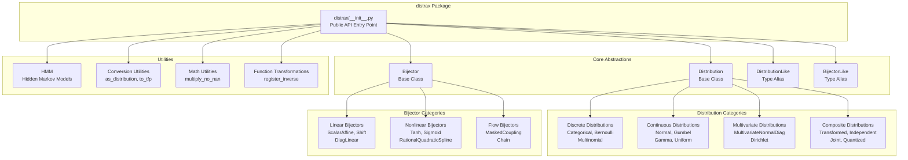
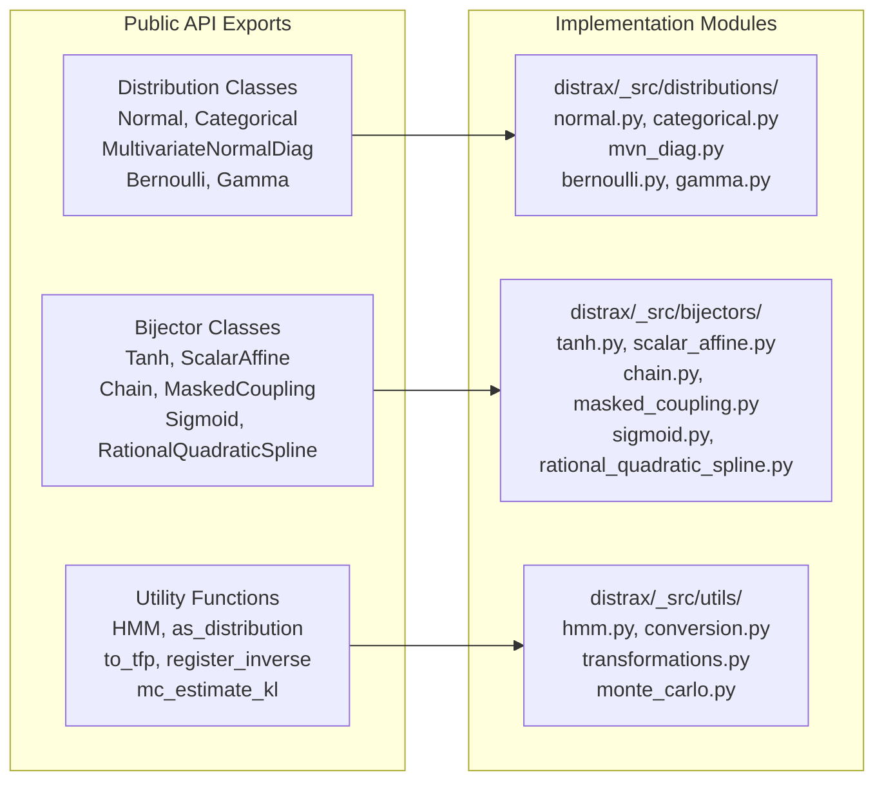
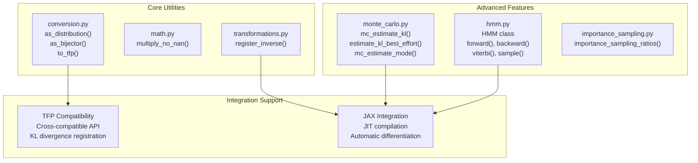
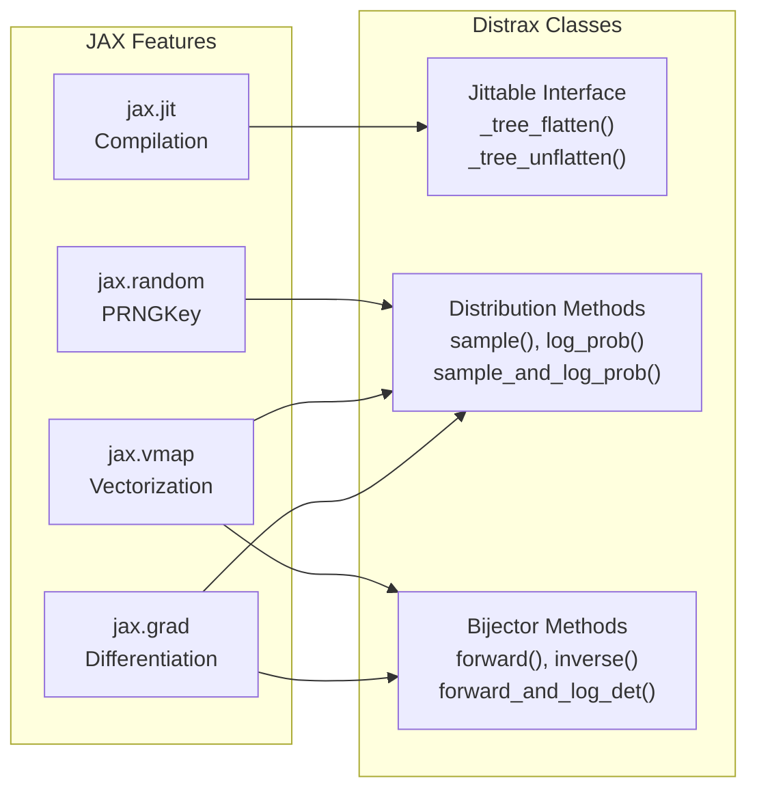
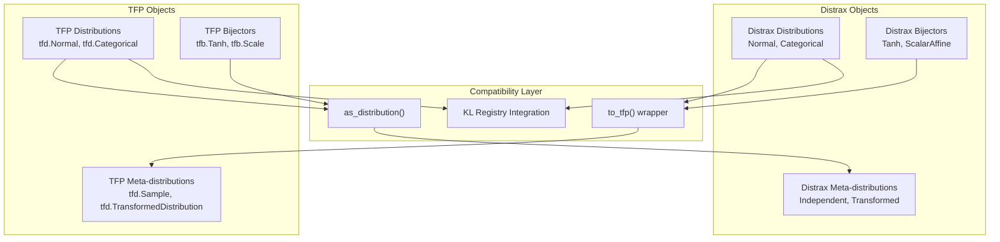

<!-- source: DeepWiki mcp.deepwiki.com · repo google-deepmind/distrax · page 1 Overview · fetched 2026-10-26 -->

# Overview

Relevant source files

The following files were used as context for generating this wiki page:

- [README.md](README.md)
- [distrax/__init__.py](distrax/__init__.py)
- [distrax/_src/distributions/clipped.py](distrax/_src/distributions/clipped.py)
- [distrax/_src/distributions/clipped_test.py](distrax/_src/distributions/clipped_test.py)
- [distrax/_src/utils/hmm.py](distrax/_src/utils/hmm.py)
- [distrax/_src/utils/hmm_test.py](distrax/_src/utils/hmm_test.py)
- [examples/hmm.py](examples/hmm.py)

## Purpose and Scope

Distrax is a JAX-native probability distribution library that provides implementations of probability distributions and bijective transformations (bijectors). It serves as a lightweight alternative to TensorFlow Probability (TFP) with emphasis on readability, extensibility, and JAX performance optimizations.

This document covers the overall architecture and design principles of Distrax. For specific distribution implementations, see [Distributions](#3). For bijector details, see [Bijectors](#4). For JAX-specific features and performance considerations, see [JAX Integration](#2.3).

**Sources:** [README.md:1-47](), [distrax/__init__.py:15]()

## Core Architecture

Distrax is built around two primary abstractions: `Distribution` and `Bijector` classes, with additional utilities for advanced probabilistic modeling. The library maintains strict compatibility with TensorFlow Probability while leveraging JAX's compilation and transformation capabilities.

### Main Library Components

**Sources:** [distrax/__init__.py:17-89](), [README.md:48-137]()

### Code Entity Mapping

**Sources:** [distrax/__init__.py:40-89](), [distrax/__init__.py:17-37](), [distrax/__init__.py:77-88]()

## Key Components

### Distribution System

The `Distribution` base class provides a uniform interface for probability distributions with methods for sampling, probability calculation, and shape handling. All distributions support JAX transformations and maintain compatibility with TensorFlow Probability.

| Distribution Type | Key Classes | Event Shape | Use Cases |
|------------------|-------------|-------------|-----------|
| Discrete | `Categorical`, `Bernoulli`, `Multinomial` | `()` or `(k,)` | Classification, discrete choice |
| Continuous | `Normal`, `Gumbel`, `Gamma`, `Uniform` | `()` | Regression, continuous modeling |
| Multivariate | `MultivariateNormalDiag`, `Dirichlet` | `(d,)` | Vector-valued variables |
| Composite | `Transformed`, `Independent`, `Joint` | Variable | Meta-distributions |

**Sources:** [distrax/__init__.py:40-75](), [README.md:49-107]()

### Bijector System

Bijectors implement invertible transformations with automatic Jacobian computation. They enable creation of complex distributions by transforming simpler base distributions through the `Transformed` class.

| Bijector Type | Key Classes | Transformation | Jacobian |
|--------------|-------------|----------------|----------|
| Linear | `ScalarAffine`, `Shift`, `DiagLinear` | `y = ax + b` | Constant or diagonal |
| Nonlinear | `Tanh`, `Sigmoid` | Element-wise | Element-wise |
| Flow | `MaskedCoupling`, `RationalQuadraticSpline` | Normalizing flows | Complex |
| Composite | `Chain`, `Inverse` | Composition | Product/inverse |

**Sources:** [distrax/__init__.py:17-37](), [README.md:138-255]()

### Utility System

**Sources:** [distrax/__init__.py:77-88](), [distrax/_src/utils/hmm.py:47-324](), [examples/hmm.py:91-96]()

## JAX Integration

Distrax distributions and bijectors are designed as JAX-native implementations that support:

- **JIT Compilation**: All classes implement the `Jittable` interface for compilation optimization
- **Automatic Differentiation**: Native support for `jax.grad` and related transformations  
- **Vectorization**: Compatible with `jax.vmap` for batch operations
- **Functional Programming**: Immutable objects that work naturally with JAX transformations

**Sources:** [README.md:257-278](), [README.md:280-294]()

## TensorFlow Probability Compatibility

Distrax maintains bidirectional compatibility with TensorFlow Probability through wrapper utilities and shared API conventions. This enables gradual migration and interoperability between the libraries.

### Compatibility Features

- **API Consistency**: Method signatures match TFP where possible (`sample`, `log_prob`, `kl_divergence`)
- **Cross-Library Usage**: TFP distributions work in Distrax meta-distributions and vice versa
- **Conversion Utilities**: `to_tfp()` wrapper for using Distrax objects in TFP contexts
- **KL Divergence Registration**: Automatic registration with TFP's KL divergence registry

**Sources:** [README.md:76-136](), [README.md:173-195](), [distrax/__init__.py:78-80]()

## Public API Structure

The main entry point [distrax/__init__.py]() exports 160 public symbols organized into logical categories. The `__all__` tuple defines the complete public API surface, ensuring consistent imports and documentation.

| Category | Count | Examples |
|----------|-------|----------|
| Distribution Classes | 25 | `Normal`, `Categorical`, `MultivariateNormalDiag` |
| Bijector Classes | 18 | `Tanh`, `ScalarAffine`, `MaskedCoupling` |
| Utility Functions | 12 | `HMM`, `as_distribution`, `mc_estimate_kl` |
| Type Aliases | 2 | `DistributionLike`, `BijectorLike` |

**Sources:** [distrax/__init__.py:92-160](), [distrax/__init__.py:90]()

---

