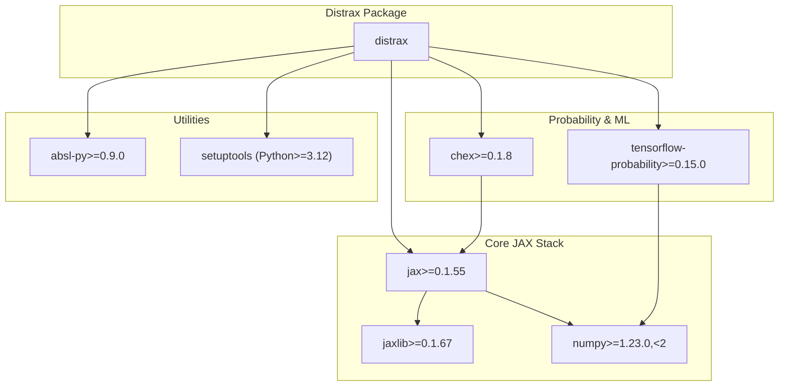
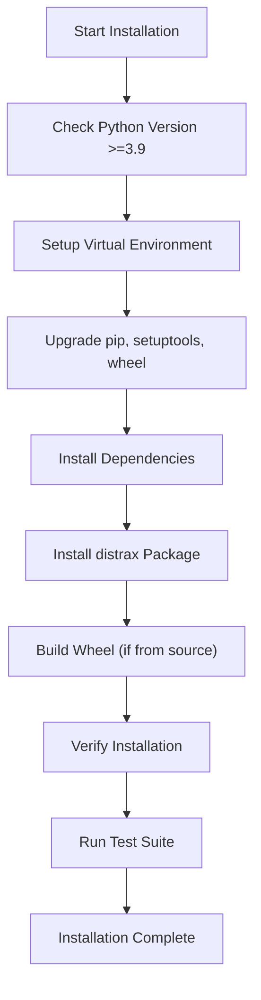

<!-- source: DeepWiki mcp.deepwiki.com · repo google-deepmind/distrax · page 1.1 Installation and Setup · fetched 2026-10-26 -->

# Installation and Setup

<details>
<summary>Relevant source files</summary>

The following files were used as context for generating this wiki page:

- [.github/workflows/tests.yml](.github/workflows/tests.yml)
- [CONTRIBUTING.md](CONTRIBUTING.md)
- [requirements/requirements.txt](requirements/requirements.txt)
- [setup.py](setup.py)
- [test.sh](test.sh)

</details>


This document provides comprehensive guidance for installing Distrax and its dependencies, configuring the environment, and verifying the installation. It covers standard installation methods, dependency management, and troubleshooting common issues.

For information about using Distrax after installation, see [Quick Start Guide](#1.2). For development setup and contribution workflows, see [Contributing Guidelines](#6.2). For details about JAX integration features, see [JAX Integration](#2.3).

## System Requirements

Distrax requires Python 3.9 or higher and is officially tested on Python 3.9, 3.10, and 3.11. The library is designed to run on Unix-based systems (Linux, macOS) and follows the JAX ecosystem compatibility requirements.

### Supported Python Versions

| Python Version | Support Status | Testing |
|----------------|----------------|---------|
| 3.9            | ✅ Supported   | CI tested |
| 3.10           | ✅ Supported   | CI tested |
| 3.11           | ✅ Supported   | CI tested |
| 3.12+          | ⚠️ Limited     | Manual testing |

### Platform Support

Distrax inherits platform support from JAX and TensorFlow Probability:

- **Linux**: Full support (primary CI platform)
- **macOS**: Full support  
- **Windows**: Limited support (depends on JAX/TFP compatibility)

Sources: [setup.py:62](), [.github/workflows/tests.yml:18-19]()

## Core Dependencies

Distrax has a carefully managed dependency stack built around JAX and TensorFlow Probability. The core dependencies provide numerical computing, automatic differentiation, and probability distribution functionality.

### Dependency Architecture



### Required Dependencies

| Package | Version Constraint | Purpose |
|---------|-------------------|---------|
| `jax` | `>=0.1.55` | Core JAX functionality, JIT compilation, autodiff |
| `jaxlib` | `>=0.1.67` | JAX XLA backend, platform-specific optimizations |
| `numpy` | `>=1.23.0,<2` | Numerical computing foundation |
| `tensorflow-probability` | `>=0.15.0` | Probability distributions, bijectors, statistical functions |
| `chex` | `>=0.1.8` | JAX testing utilities, array assertions |
| `absl-py` | `>=0.9.0` | Command-line flags, logging utilities |
| `setuptools` | (Python ≥3.12) | Package installation utilities |

Sources: [requirements/requirements.txt:1-7]()

## Installation Methods

### Standard Installation (PyPI)

The recommended installation method for most users is via pip from PyPI:

```bash
pip install distrax
```

This installs the latest stable release with all required dependencies. For specific versions:

```bash
pip install distrax==0.1.4  # Replace with desired version
```

### Installation with Virtual Environment

To avoid dependency conflicts, use a virtual environment:

```bash
python3 -m venv distrax-env
source distrax-env/bin/activate  # On Windows: distrax-env\Scripts\activate
pip install --upgrade pip setuptools wheel
pip install distrax
```

### Development Installation

For contributors or users needing the latest features:

```bash
git clone https://github.com/google-deepmind/distrax.git
cd distrax
pip install -e .
```

This creates an editable installation that reflects local code changes.

Sources: [setup.py:44-77](), [test.sh:19-30]()

## Installation Flow and Verification

### Installation Process Flow



### Installation Verification

After installation, verify that Distrax is working correctly:

```python
import distrax
import jax.numpy as jnp

# Basic functionality test
dist = distrax.Normal(loc=0.0, scale=1.0)
samples = dist.sample(seed=jax.random.PRNGKey(42), sample_shape=(10,))
log_probs = dist.log_prob(samples)
print(f"Samples shape: {samples.shape}")
print(f"Log probabilities shape: {log_probs.shape}")
```

### Comprehensive Testing

For thorough verification, run the test suite using the provided script:

```bash
bash test.sh
```

This script performs:
- Dependency installation in a clean virtual environment
- Code linting with `flake8` and `pylint`
- Package building and wheel installation
- Type checking with `pytype` (Python < 3.11)
- Comprehensive test execution with `pytest`

The test script validates installation by building the package from source and running the full test suite in an isolated environment.

Sources: [test.sh:16-86](), [CONTRIBUTING.md:27-29]()

## Development Dependencies

For development work, additional dependencies are required for testing, linting, and type checking:

### Testing Framework Dependencies

```bash
pip install -r requirements/requirements-tests.txt
```

Common development dependencies include:
- `pytest-xdist`: Parallel test execution
- `pytest-forked`: Process isolation for tests  
- `flake8`: Code style checking
- `pylint`: Advanced code analysis
- `pytype`: Static type checking

### Development Workflow

The development installation process follows these steps:

1. **Environment Setup**: Create virtual environment in `/tmp/distrax-env`
2. **Dependency Installation**: Install core and testing dependencies
3. **Code Quality**: Run `flake8` and `pylint` checks
4. **Package Building**: Build source distribution and wheel
5. **TFP Integration**: Install TFP nightly for compatibility testing
6. **Type Checking**: Run `pytype` analysis (Python < 3.11)
7. **Test Execution**: Run full test suite with JAX optimizations disabled

Sources: [test.sh:19-86]()

## Troubleshooting

### Common Installation Issues

| Issue | Symptoms | Solution |
|-------|----------|----------|
| JAX/JAXLIB mismatch | Import errors, compilation failures | Ensure compatible JAX/JAXLIB versions |
| NumPy version conflicts | Array operation errors | Install NumPy in supported range (>=1.23.0,<2) |
| TFP compatibility | Distribution behavior differences | Use TFP >=0.15.0, consider TFP nightly |
| Python 3.12 issues | Setup tool errors | Ensure `setuptools` is installed |

### JAX Configuration

For optimal performance, configure JAX settings:

```python
import os
# Disable JAX optimizations for faster testing
os.environ['JAX_DISABLE_MOST_OPTIMIZATIONS'] = 'True'

# Enable double precision if needed
from jax.config import config
config.update("jax_enable_x64", True)
```

### Platform-Specific Notes

- **macOS**: May require Xcode command line tools for compilation
- **Linux**: Ensure CUDA compatibility for GPU acceleration
- **Windows**: Limited support; use WSL2 for best compatibility

Sources: [test.sh:75-80](), [setup.py:62]()

## Version Management

### Package Version Detection

The package version is automatically detected from the main module:

```python
import distrax
print(distrax.__version__)
```

The version is parsed from `distrax/__init__.py` during package building using the `_get_version()` function in the setup script.

### Dependency Version Constraints

Distrax uses conservative version constraints to ensure stability:
- **Lower bounds**: Specify minimum versions with required features
- **Upper bounds**: Applied selectively (e.g., NumPy <2) to prevent breaking changes
- **TFP compatibility**: Tested with both stable and nightly builds

Sources: [setup.py:24-31](), [test.sh:56-57]()

---

