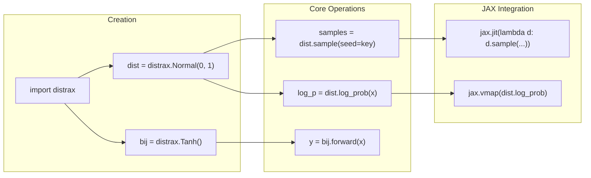
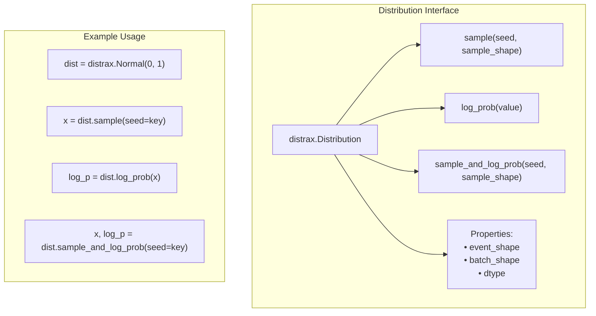
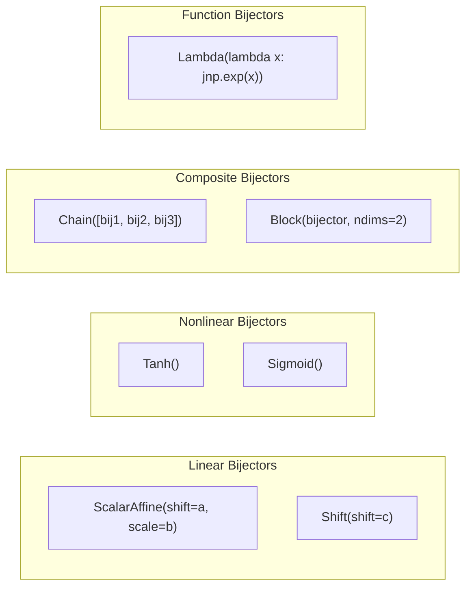
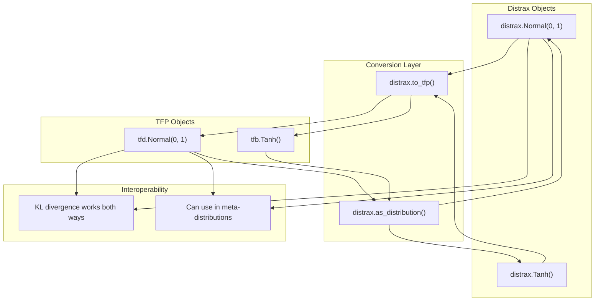

<!-- source: DeepWiki mcp.deepwiki.com · repo google-deepmind/distrax · page 1.2 Quick Start Guide · fetched 2026-10-26 -->

# Quick Start Guide

<details>
<summary>Relevant source files</summary>

The following files were used as context for generating this wiki page:

- [README.md](README.md)
- [distrax/__init__.py](distrax/__init__.py)
- [distrax/_src/distributions/clipped.py](distrax/_src/distributions/clipped.py)
- [distrax/_src/distributions/clipped_test.py](distrax/_src/distributions/clipped_test.py)
- [distrax/_src/utils/hmm.py](distrax/_src/utils/hmm.py)
- [distrax/_src/utils/hmm_test.py](distrax/_src/utils/hmm_test.py)
- [examples/hmm.py](examples/hmm.py)

</details>


This guide provides simple examples to get you started with Distrax, covering the basic workflows for creating distributions, sampling, computing probabilities, and using bijectors. For detailed API documentation of specific distributions, see [Distributions](#3). For bijector details, see [Bijectors](#4). For advanced features like HMMs and function transformations, see [Utilities and Advanced Features](#5).

## Core Workflow Overview

Distrax follows a simple workflow: create distributions or bijectors, then use them for sampling, probability computation, or transformation. All objects are JAX-compatible and can be passed to `jax.jit`, `jax.vmap`, and other JAX transformations.



**Sources:** [distrax/__init__.py:15-173](), [README.md:54-107]()

## Basic Imports and Setup

```python
import distrax
import jax
import jax.numpy as jnp

# Generate random key for sampling
key = jax.random.PRNGKey(42)
```

All Distrax classes are available directly from the main module import. The library exports distributions, bijectors, and utility functions through a single namespace.

**Sources:** [distrax/__init__.py:17-90](), [README.md:55-57]()

## Creating and Using Distributions

### Univariate Continuous Distributions

```python
# Normal distribution
normal_dist = distrax.Normal(loc=0.0, scale=1.0)
samples = normal_dist.sample(seed=key)
log_prob = normal_dist.log_prob(samples)

# Uniform distribution  
uniform_dist = distrax.Uniform(low=-1.0, high=1.0)

# Gumbel distribution
gumbel_dist = distrax.Gumbel(loc=0.0, scale=1.0)
```

### Discrete Distributions

```python
# Categorical distribution
probs = jnp.array([0.3, 0.4, 0.3])
categorical_dist = distrax.Categorical(probs=probs)

# Bernoulli distribution
bernoulli_dist = distrax.Bernoulli(probs=0.7)

# Alternative parameterization using logits
logits = jnp.array([1.0, 2.0, 0.5])
categorical_logits = distrax.Categorical(logits=logits)
```

### Multivariate Distributions

```python
# Multivariate Normal with diagonal covariance
mu = jnp.array([0.0, 1.0, -0.5])
sigma = jnp.array([1.0, 0.5, 2.0])
mvn_diag = distrax.MultivariateNormalDiag(loc=mu, scale_diag=sigma)

# Dirichlet distribution
concentration = jnp.array([1.0, 2.0, 3.0])
dirichlet_dist = distrax.Dirichlet(concentration=concentration)
```

**Sources:** [README.md:54-74](), [distrax/__init__.py:40-75]()

## Key Distribution Methods

All Distrax distributions implement a common interface with these essential methods:



### Efficient Sampling with Log Probabilities

```python
# Instead of separate calls
samples = dist.sample(seed=key)
log_prob = dist.log_prob(samples)

# Use the combined method for efficiency
samples, log_prob = dist.sample_and_log_prob(seed=key)
```

**Sources:** [README.md:93-107](), [distrax/_src/distributions/distribution.py]()

## Working with Bijectors

Bijectors are invertible transformations that can create new distributions by transforming base distributions:

```python
# Create a base distribution and bijector
base_dist = distrax.Normal(0.0, 1.0)
bijector = distrax.Tanh()

# Transform the distribution
transformed_dist = distrax.Transformed(base_dist, bijector)

# Direct bijector operations
x = jnp.array([0.5, -0.3, 1.2])
y = bijector.forward(x)
x_reconstructed = bijector.inverse(y)

# Get transformation and log determinant together
y, log_det = bijector.forward_and_log_det(x)
```

### Common Bijector Patterns



**Sources:** [README.md:138-255](), [distrax/__init__.py:17-37]()

## JAX Integration

### JIT Compilation

Distrax objects can be passed to JIT-compiled functions:

```python
@jax.jit
def log_likelihood(dist, data):
    return jnp.sum(dist.log_prob(data))

# Works with any Distrax distribution
dist = distrax.Normal(0.0, 1.0)
data = jnp.array([0.1, -0.2, 0.5])
ll = log_likelihood(dist, data)
```

### Vectorization with vmap

```python
# Vectorize over different parameters
locs = jnp.array([0.0, 1.0, 2.0])
scales = jnp.array([1.0, 0.5, 2.0])

# Create multiple distributions
dists = jax.vmap(distrax.Normal)(locs, scales)

# Vectorized sampling
samples = jax.vmap(lambda d: d.sample(seed=key))(dists)
```

**Sources:** [README.md:257-294](), [distrax/_src/utils/jittable.py]()

## TensorFlow Probability Interoperability

### Using TFP Distributions in Distrax

```python
import tensorflow_probability.substrates.jax as tfp
tfd = tfp.distributions

# TFP distribution in Distrax meta-distribution
tfp_normal = tfd.Normal(0.0, 1.0)
independent_dist = distrax.Independent(tfp_normal, reinterpreted_batch_ndims=1)
```

### Using Distrax in TFP

```python
# Wrap Distrax distribution for TFP
distrax_dist = distrax.Normal(0.0, 1.0)
wrapped_dist = distrax.to_tfp(distrax_dist)
tfp_meta = tfd.Sample(wrapped_dist, sample_shape=[3])
```

### Cross-Library Compatibility



**Sources:** [README.md:76-136](), [README.md:173-195](), [distrax/_src/utils/conversion.py]()

## Practical Examples

### Simple Variational Model

```python
# Prior and posterior
prior = distrax.Normal(0.0, 1.0)
posterior = distrax.Normal(0.5, 0.2)

# Sample from posterior and compute KL divergence
key, subkey = jax.random.split(key)
z = posterior.sample(seed=subkey)
kl_div = posterior.kl_divergence(prior)
```

### Normalizing Flow

```python
# Chain of bijectors for normalizing flow
bijectors = [
    distrax.ScalarAffine(shift=1.0, scale=2.0),
    distrax.Tanh(),
    distrax.ScalarAffine(shift=-0.5, scale=0.5)
]
flow = distrax.Chain(bijectors)

# Transform base distribution
base_dist = distrax.Normal(0.0, 1.0)
flow_dist = distrax.Transformed(base_dist, flow)
```

### Clipped Distribution

```python
# Distribution with bounded support
base_normal = distrax.Normal(0.0, 1.0)
clipped_normal = distrax.Clipped(
    distribution=base_normal,
    minimum=-2.0,
    maximum=2.0
)
```

**Sources:** [examples/vae.py](), [examples/flow.py](), [distrax/_src/distributions/clipped.py:34-142]()

## Next Steps

- For comprehensive distribution documentation, see [Distributions](#3)
- For detailed bijector information, see [Bijectors](#4)  
- For advanced features like HMMs, see [Hidden Markov Models](#5.4)
- For custom distribution creation, see [Development and Testing](#6)

**Sources:** [README.md:348-364](), [examples/hmm.py:1-268]()

---

