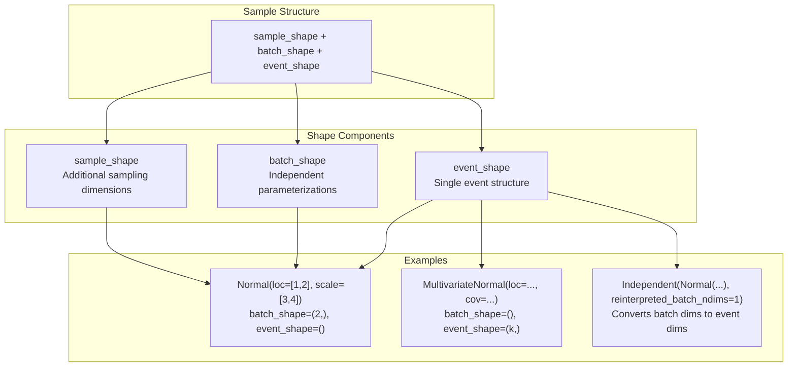
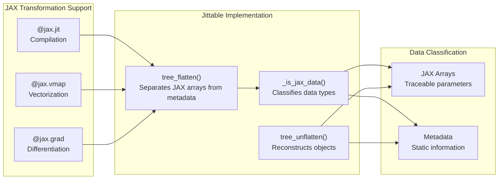
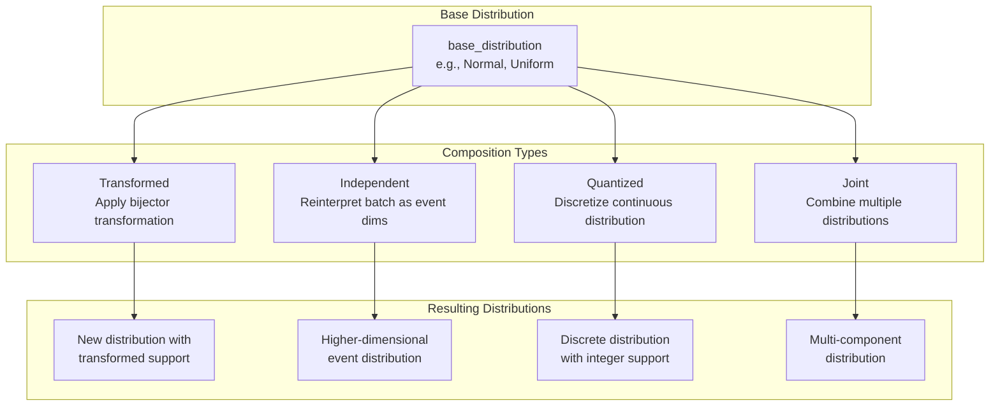
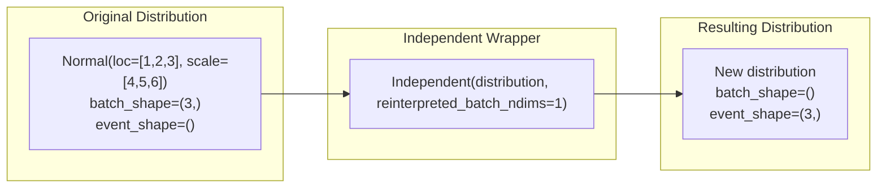
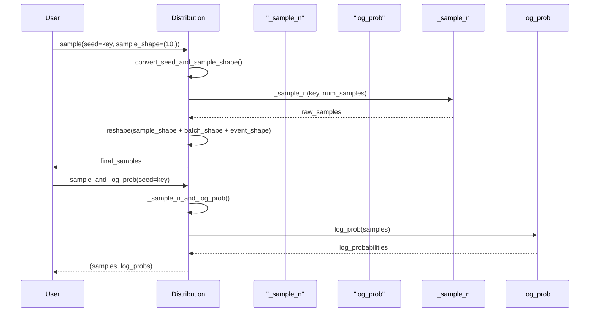
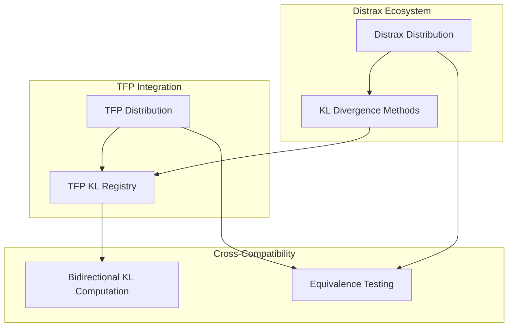

<!-- source: DeepWiki mcp.deepwiki.com · repo google-deepmind/distrax · page 2 Core Concepts · fetched 2026-10-26 -->

# Core Concepts

<details>
<summary>Relevant source files</summary>

The following files were used as context for generating this wiki page:

- [distrax/_src/distributions/distribution.py](distrax/_src/distributions/distribution.py)
- [distrax/_src/distributions/distribution_test.py](distrax/_src/distributions/distribution_test.py)
- [distrax/_src/distributions/independent.py](distrax/_src/distributions/independent.py)
- [distrax/_src/distributions/quantized.py](distrax/_src/distributions/quantized.py)
- [distrax/_src/distributions/quantized_test.py](distrax/_src/distributions/quantized_test.py)
- [distrax/_src/utils/jittable.py](distrax/_src/utils/jittable.py)
- [distrax/_src/utils/jittable_test.py](distrax/_src/utils/jittable_test.py)

</details>


This document explains the fundamental abstractions that form the foundation of Distrax: distributions, JAX integration, and bijectors. These concepts enable efficient, composable probability distributions that work seamlessly with JAX's functional programming paradigm.

For detailed information about specific distribution types, see [Distributions](#3). For bijector implementations and transformations, see [Bijectors and Transformations](#2.2). For JAX-specific features like JIT compilation and vectorization, see [JAX Integration](#2.3).

## The Distribution Abstraction

The `Distribution` class serves as the abstract base for all probability distributions in Distrax. It defines a consistent interface for sampling, probability computation, and statistical operations while ensuring JAX compatibility.

### Core Distribution Interface

```mermaid
classDiagram
    class Distribution {
        <<abstract>>
        +_sample_n(key: PRNGKey, n: int) EventT*
        +log_prob(value: EventT) Array*
        +event_shape: ShapeT*
        +batch_shape: Tuple[int, ...]
        +sample(seed, sample_shape) EventT
        +prob(value: EventT) Array
        +kl_divergence(other_dist) Array
        +entropy() Array
        +mean() EventT
        +variance() EventT
    }
    
    class Jittable {
        <<abstract>>
        +tree_flatten()
        +tree_unflatten(aux_data, children)
    }
    
    class "Concrete Distributions" {
        +Normal
        +Categorical  
        +Quantized
        +Independent
        +Transformed
    }
    
    Distribution --|> Jittable
    "Concrete Distributions" --|> Distribution
```

The `Distribution` class requires implementations to provide three core abstract components:

- **`_sample_n`**: Internal sampling method that generates `n` samples
- **`log_prob`**: Computes log probability density/mass for given values  
- **`event_shape`**: Defines the shape of individual distribution events

Sources: [distrax/_src/distributions/distribution.py:49-91](), [distrax/_src/distributions/distribution.py:103-106]()

### Event vs Batch Semantics

Distrax follows TensorFlow Probability's event/batch shape semantics, which distinguish between the shape of individual samples and batches of parameters:



The `batch_shape` is computed dynamically by sampling and analyzing the result structure, while `event_shape` is defined by each distribution implementation.

Sources: [distrax/_src/distributions/distribution.py:109-131](), [distrax/_src/distributions/independent.py:77-82]()

## JAX Integration via Jittable

All Distrax distributions inherit from the `Jittable` interface, which enables seamless integration with JAX transformations like `jit`, `vmap`, and `grad`.

### Jittable Interface Architecture



The `Jittable` class automatically registers distribution objects as JAX pytrees and handles the separation of traceable arrays from static metadata during compilation.

Sources: [distrax/_src/utils/jittable.py:21-48](), [distrax/_src/utils/jittable.py:50-65]()

### JAX Data Classification

The `_is_jax_data` function determines which object attributes are traced by JAX transformations:

- **Traceable**: JAX arrays, tracers, and valid JAX types
- **Static Metadata**: Primitive types (`bool`, `int`, `float`), `None`, and shape tuples

This separation ensures that distribution parameters get differentiated while structural information remains static during compilation.

Sources: [distrax/_src/utils/jittable.py:50-65]()

## Composite Distribution Patterns

Distrax provides several patterns for creating complex distributions by composing simpler ones:

### Composition Patterns



### Independent Distribution Example

The `Independent` distribution demonstrates how batch dimensions can be reinterpreted as event dimensions:



This pattern is essential for creating multivariate distributions from univariate ones and for controlling how `log_prob` operations aggregate across dimensions.

Sources: [distrax/_src/distributions/independent.py:34-90](), [distrax/_src/distributions/quantized.py:37-92]()

## Distribution Method Implementation Patterns

### Sampling and Probability Computation



The framework provides default implementations for most methods, with concrete distributions only needing to implement the core abstract methods. The `_sample_n_and_log_prob` method can be overridden for efficiency when log probabilities can be computed more efficiently during sampling.

Sources: [distrax/_src/distributions/distribution.py:57-79](), [distrax/_src/distributions/distribution.py:144-177]()

### Integration with TensorFlow Probability

Distrax distributions integrate seamlessly with TensorFlow Probability through shared KL divergence registrations and compatible interfaces:



The `kl_divergence` method delegates to TensorFlow Probability's registry system, enabling computation between any combination of Distrax and TFP distributions.

Sources: [distrax/_src/distributions/distribution.py:179-189](), [distrax/_src/distributions/independent.py:189-194]()

---

