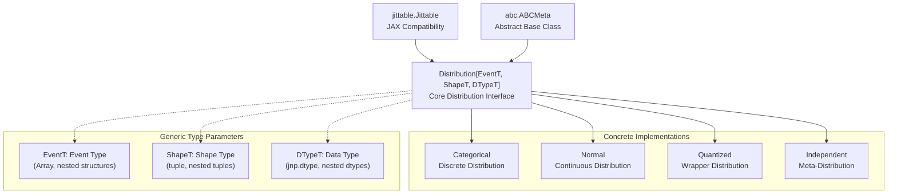
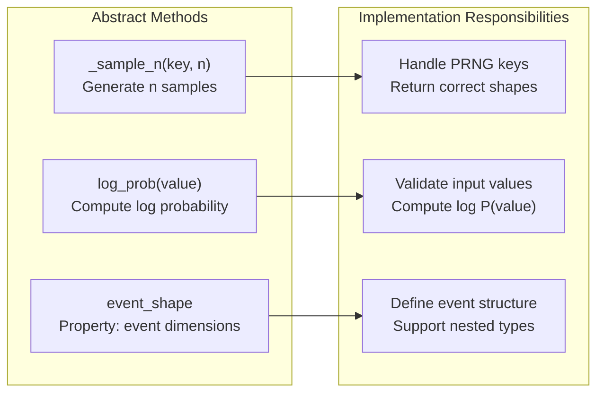
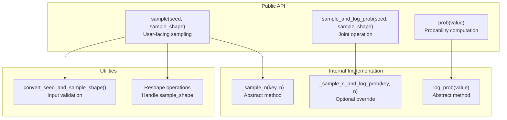
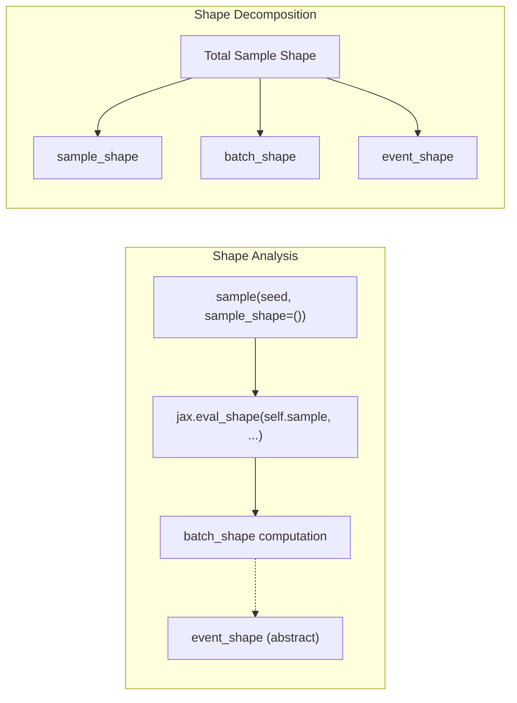
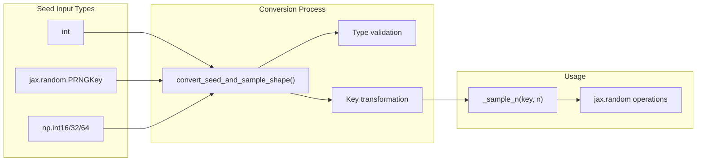
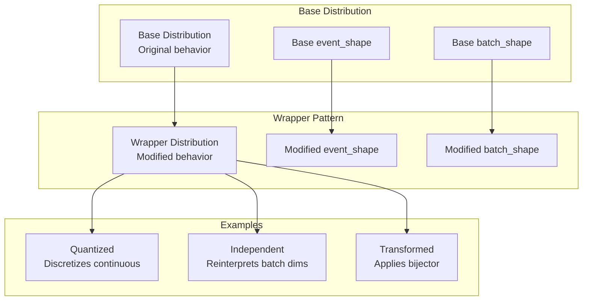
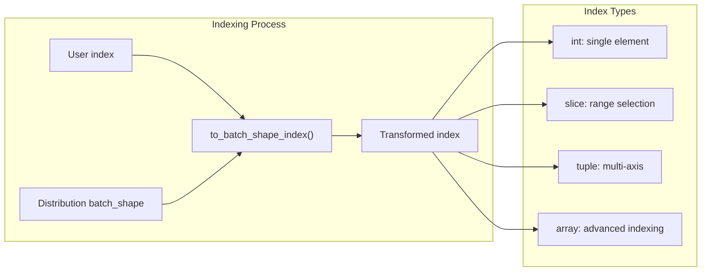

<!-- source: DeepWiki mcp.deepwiki.com · repo google-deepmind/distrax · page 2.1 Distribution Base Class · fetched 2026-10-26 -->

# Distribution Base Class

Relevant source files

The following files were used as context for generating this wiki page:

- [distrax/_src/distributions/distribution.py](distrax/_src/distributions/distribution.py)
- [distrax/_src/distributions/distribution_test.py](distrax/_src/distributions/distribution_test.py)
- [distrax/_src/distributions/independent.py](distrax/_src/distributions/independent.py)
- [distrax/_src/distributions/quantized.py](distrax/_src/distributions/quantized.py)

This document covers the `Distribution` abstract base class, which serves as the foundation for all probability distributions in Distrax. This class defines the core interface that distributions must implement and provides common functionality for sampling, probability computation, and statistical operations.

For information about specific distribution implementations, see [Distributions](#3). For details about JAX integration patterns, see [JAX Integration](#2.3). For bijector transformations that operate on distributions, see [Bijectors and Transformations](#2.2).

## Purpose and Architecture

The `Distribution` class establishes a unified interface for probability distributions while leveraging JAX for high-performance numerical computing. It inherits from `jittable.Jittable` to ensure compatibility with JAX transformations and uses generic typing to support diverse event types including arrays, tuples, and nested structures.

### Class Hierarchy

**Sources:** [distrax/_src/distributions/distribution.py:49-51](), [distrax/_src/distributions/quantized.py:37-38](), [distrax/_src/distributions/independent.py:34]()

## Abstract Interface

All distribution implementations must provide these core methods:

### Required Abstract Methods

| Method | Purpose | Return Type | Notes |
|--------|---------|-------------|-------|
| `_sample_n(key, n)` | Generate `n` samples | `EventT` | Must handle JAX PRNG keys |
| `log_prob(value)` | Compute log probability | `Array` | Should validate input domain |
| `event_shape` | Event dimensions | `ShapeT` | Can be nested for complex events |

**Sources:** [distrax/_src/distributions/distribution.py:53-55](), [distrax/_src/distributions/distribution.py:81-90](), [distrax/_src/distributions/distribution.py:103-106]()

### Optional Abstract Methods

Some distributions may override these for better performance:

- `_sample_n_and_log_prob(key, n)`: Joint sampling and log probability computation
- `entropy()`: Shannon entropy calculation
- Statistical moments: `mean()`, `variance()`, `mode()`, `median()`
- CDF methods: `log_cdf(value)`, `cdf(value)`, `survival_function(value)`

**Sources:** [distrax/_src/distributions/distribution.py:57-79](), [distrax/_src/distributions/distribution.py:191-194]()

## Concrete Interface

The base class provides a comprehensive set of methods built on the abstract interface:

### Sampling and Probability

**Sources:** [distrax/_src/distributions/distribution.py:144-162](), [distrax/_src/distributions/distribution.py:164-177](), [distrax/_src/distributions/distribution.py:92-101]()

### Shape System

The shape system distinguishes between batch dimensions and event dimensions:

| Property | Purpose | Computation |
|----------|---------|-------------|
| `event_shape` | Dimensions of individual events | Defined by implementation |
| `batch_shape` | Dimensions for independent samples | Derived via `jax.eval_shape` |
| `dtype` | Data type of samples | Computed from sample specification |

**Sources:** [distrax/_src/distributions/distribution.py:108-131](), [distrax/_src/distributions/distribution.py:137-142]()

## Statistical and Utility Methods

The base class provides default implementations for statistical operations:

| Category | Methods | Default Behavior |
|----------|---------|------------------|
| Statistical | `mean()`, `variance()`, `stddev()`, `mode()`, `median()` | Raise `NotImplementedError` |
| CDF/Survival | `cdf()`, `log_cdf()`, `survival_function()` | Basic implementations or `NotImplementedError` |
| Information | `entropy()`, `kl_divergence()`, `cross_entropy()` | TFP integration for KL divergence |
| Indexing | `__getitem__(index)` | Batch dimension slicing |

**Sources:** [distrax/_src/distributions/distribution.py:179-189](), [distrax/_src/distributions/distribution.py:262-284](), [distrax/_src/distributions/distribution.py:302-309]()

## JAX Integration Patterns

The Distribution class is designed for seamless JAX integration:

### PRNG Key Handling

**Sources:** [distrax/_src/distributions/distribution.py:312-327](), [distrax/_src/distributions/distribution_test.py:183-186]()

### JIT Compatibility

The `jittable.Jittable` inheritance ensures all distribution methods work with JAX transformations:

- `jax.jit`: Just-in-time compilation
- `jax.vmap`: Vectorization  
- `jax.grad`: Automatic differentiation

**Sources:** [distrax/_src/distributions/distribution.py:27](), [distrax/_src/distributions/distribution_test.py:165-174]()

## Extension Patterns

### Wrapper Distributions

Distributions can wrap other distributions to modify behavior:

**Sources:** [distrax/_src/distributions/quantized.py:49-91](), [distrax/_src/distributions/independent.py:39-74]()

### Index Operations

Distributions support batch indexing through the `to_batch_shape_index` utility:

**Sources:** [distrax/_src/distributions/distribution.py:330-358](), [distrax/_src/distributions/distribution_test.py:233-259]()

## Type System and Generics

The Distribution class uses generic typing to support diverse event structures:

| Type Parameter | Purpose | Examples |
|----------------|---------|----------|
| `EventT` | Event type structure | `Array`, `Dict[str, Array]`, nested structures |
| `ShapeT` | Shape type structure | `Tuple[int, ...]`, nested shape tuples |
| `DTypeT` | Data type structure | `jnp.dtype`, nested dtype specifications |

This enables distributions over complex structured events while maintaining type safety.

**Sources:** [distrax/_src/distributions/distribution.py:44-46](), [distrax/_src/distributions/distribution_test.py:61-78]()

---

