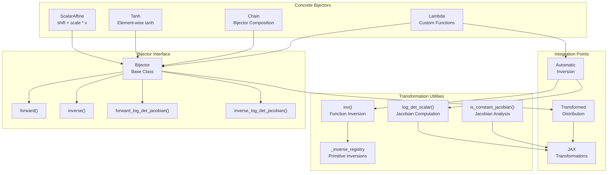
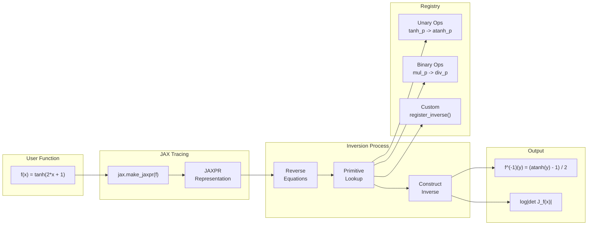
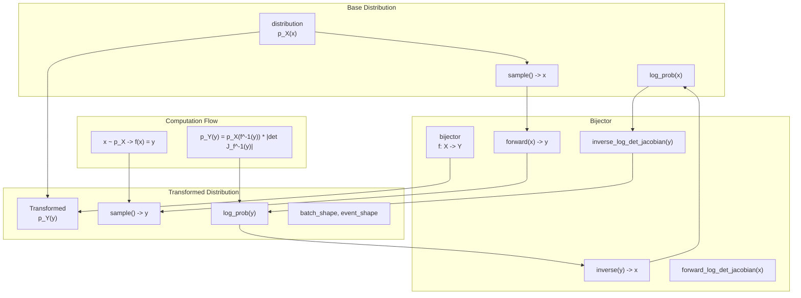
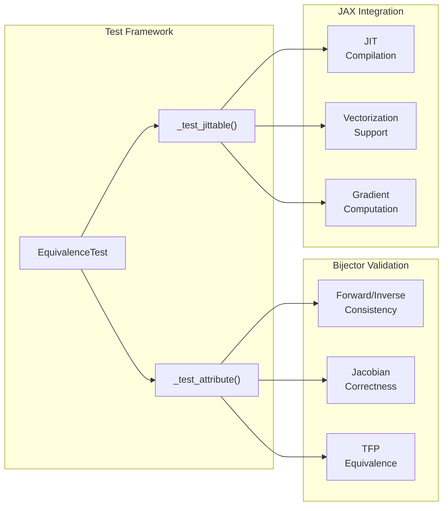

<!-- source: DeepWiki mcp.deepwiki.com · repo google-deepmind/distrax · page 2.2 Bijectors and Transformations · fetched 2026-10-26 -->

# Bijectors and Transformations

<details>
<summary>Relevant source files</summary>

The following files were used as context for generating this wiki page:

- [distrax/_src/bijectors/scalar_affine.py](distrax/_src/bijectors/scalar_affine.py)
- [distrax/_src/distributions/transformed.py](distrax/_src/distributions/transformed.py)
- [distrax/_src/utils/equivalence.py](distrax/_src/utils/equivalence.py)
- [distrax/_src/utils/transformations.py](distrax/_src/utils/transformations.py)

</details>


This document covers bijectors as invertible transformations in Distrax, their interface and implementation patterns, and the supporting transformation utilities that enable automatic function inversion and Jacobian computation. For information about how bijectors integrate with distributions to create new probability distributions, see the Transformed Distributions section in [Composite and Meta-Distributions](#3.4.1). For details on specific bijector implementations, see [Bijectors](#4).

## Core Bijector Concepts

Bijectors in Distrax are invertible transformations that can be applied to random variables to create new distributions. A bijector `f` implements four key operations:

- `forward(x)`: Computes `y = f(x)` 
- `inverse(y)`: Computes `x = f^(-1)(y)`
- `forward_log_det_jacobian(x)`: Computes `log|det J_f(x)|`
- `inverse_log_det_jacobian(y)`: Computes `log|det J_{f^(-1)}(y)|`

The mathematical foundation ensures that when transforming a distribution with density `p_X(x)`, the resulting distribution has density:

```
p_Y(y) = p_X(f^(-1)(y)) * |det J_{f^(-1)}(y)|
```

## Bijector System Architecture



Sources: [distrax/_src/utils/transformations.py:15-48](), [distrax/_src/distributions/transformed.py:35-71](), [distrax/_src/bijectors/scalar_affine.py:28-40]()

## Automatic Function Inversion System

The transformation utilities provide powerful automatic inversion capabilities that allow users to define bijectors using only a forward function. The system traces JAX functions to their JAXPR representation and constructs the inverse by reversing the computation graph.



Sources: [distrax/_src/utils/transformations.py:129-138](), [distrax/_src/utils/transformations.py:258-330](), [distrax/_src/utils/transformations.py:68-127]()

### Supported Primitive Operations

The inversion system includes built-in support for common mathematical operations:

| Category | Primitives | Inverse Mapping |
|----------|------------|----------------|
| **Unary** | `tanh_p`, `exp_p`, `log_p` | `atanh_p`, `log_p`, `exp_p` |
| **Trigonometric** | `sinh_p`, `cosh_p` | `asinh_p`, `acosh_p` |
| **Binary** | `mul_p`, `add_p`, `div_p` | Handled with left/right cases |
| **Power** | `pow_p`, `sqrt_p`, `square_p` | Reciprocal exponents |

Users can extend this system using `register_inverse()` to add support for custom primitives.

Sources: [distrax/_src/utils/transformations.py:68-102](), [distrax/_src/utils/transformations.py:110-127]()

## Transformed Distribution Integration

Bijectors integrate seamlessly with the distribution system through the `Transformed` class, which represents the pushforward of a base distribution through a bijective transformation.



Sources: [distrax/_src/distributions/transformed.py:44-50](), [distrax/_src/distributions/transformed.py:161-166](), [distrax/_src/distributions/transformed.py:168-172]()

### Shape and Dtype Inference

The `Transformed` distribution infers its properties by tracing the bijector's `forward` method on dummy inputs from the base distribution. This enables automatic computation of:

- `batch_shape` and `event_shape` after transformation
- Output `dtype` after bijector application
- Compatibility validation between distribution and bijector dimensions

Sources: [distrax/_src/distributions/transformed.py:120-136]()

## JAX Integration and Performance

### Constant Jacobian Optimization

Bijectors can declare whether their Jacobian determinant is constant with respect to input, enabling significant optimizations for operations like `mean()`, `mode()`, and `entropy()`:

```python
if self.bijector.is_constant_jacobian:
    return self.bijector.forward(self.distribution.mean())
```

The `is_constant_jacobian()` utility function can automatically detect this property by analyzing the JAXPR representation.

Sources: [distrax/_src/distributions/transformed.py:194-200](), [distrax/_src/utils/transformations.py:141-163]()

### Numerical Stability

The transformation system includes safeguards against numerically unstable operations, logging warnings when potentially problematic primitives are detected:

```python
_potentially_unstable_primitives = {
    jax.lax.tanh_p: "distrax.Tanh or distrax.Inverse(distrax.Tanh)",
    jax.lax.atanh_p: "distrax.Tanh or distrax.Inverse(distrax.Tanh)",
}
```

Sources: [distrax/_src/utils/transformations.py:104-107](), [distrax/_src/utils/transformations.py:178-186]()

## Example: ScalarAffine Bijector

The `ScalarAffine` bijector demonstrates a complete bijector implementation with the affine transformation `y = scale * x + shift`:

### Key Implementation Features

| Method | Implementation | 
|--------|----------------|
| `forward(x)` | `batched_scale * x + batched_shift` |
| `inverse(y)` | `batched_inv_scale * (y - batched_shift)` |
| `forward_log_det_jacobian(x)` | `broadcast_to(self._log_scale, batch_shape)` |
| `is_constant_jacobian` | `True` (set in constructor) |

The implementation handles broadcasting between bijector parameters and input shapes, and optimizes by precomputing `inv_scale` and `log_scale` during initialization.

Sources: [distrax/_src/bijectors/scalar_affine.py:98-128](), [distrax/_src/bijectors/scalar_affine.py:41-81]()

## Testing and Validation Framework

The bijector system integrates with Distrax's equivalence testing framework, which validates bijector implementations against TensorFlow Probability equivalents:



Sources: [distrax/_src/utils/equivalence.py:74-98](), [distrax/_src/utils/equivalence.py:344-360]()

---

