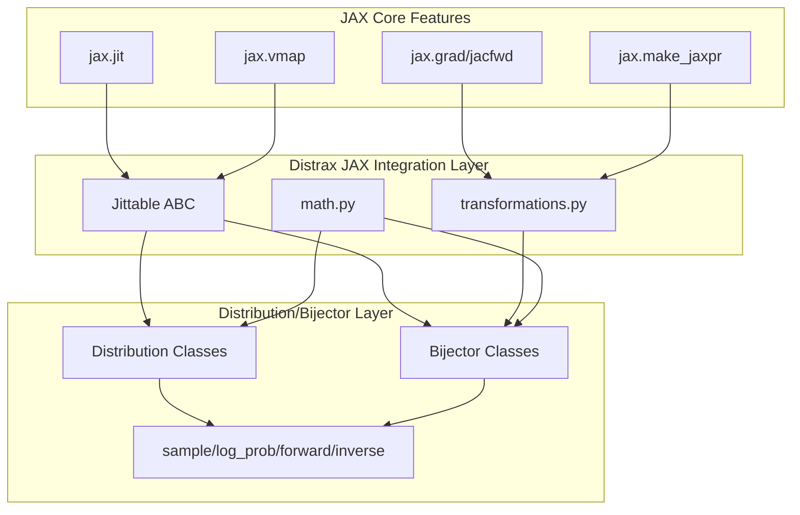
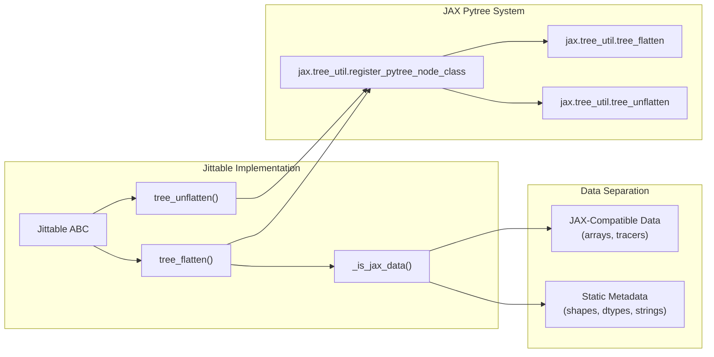
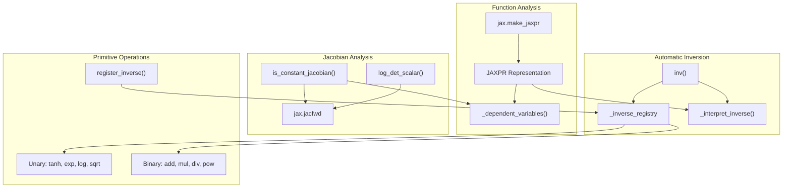
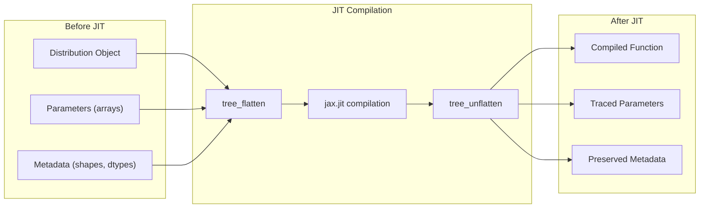
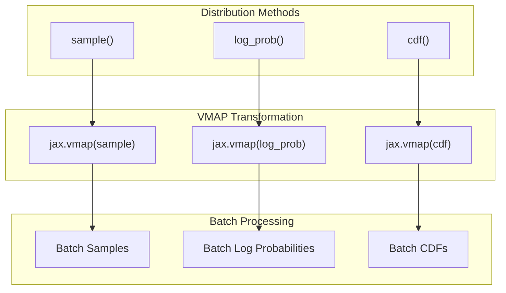
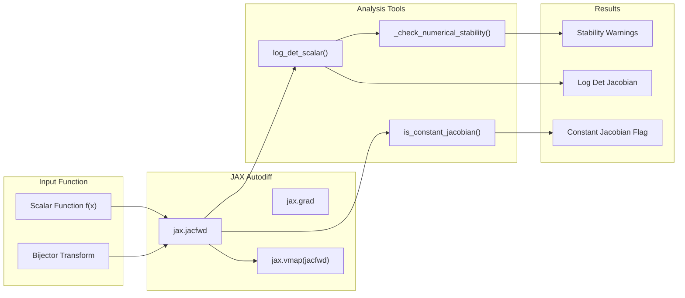
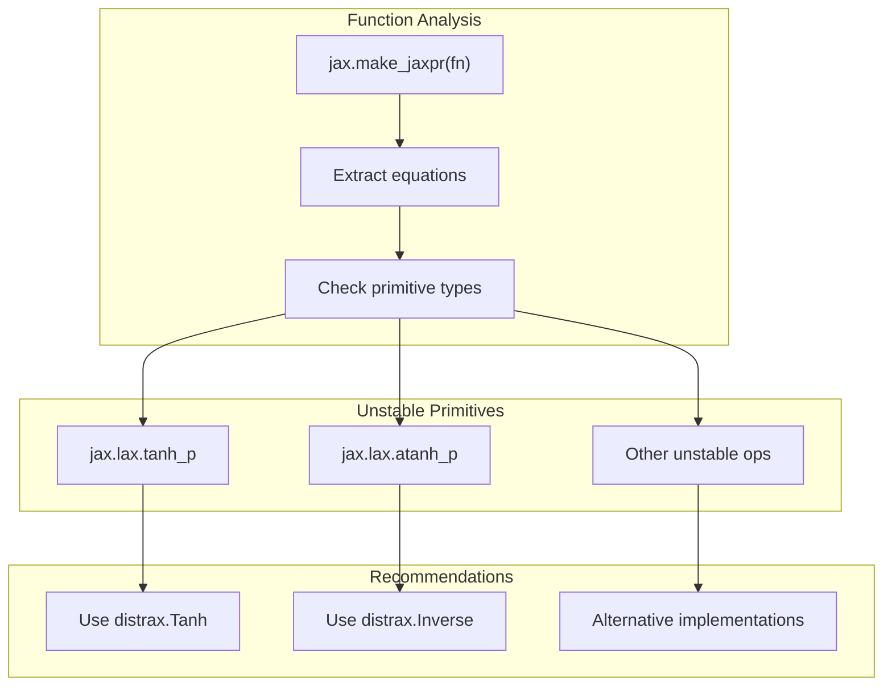

<!-- source: DeepWiki mcp.deepwiki.com · repo google-deepmind/distrax · page 2.3 JAX Integration · fetched 2026-10-26 -->

# JAX Integration

<details>
<summary>Relevant source files</summary>

The following files were used as context for generating this wiki page:

- [distrax/_src/distributions/quantized_test.py](distrax/_src/distributions/quantized_test.py)
- [distrax/_src/utils/jittable.py](distrax/_src/utils/jittable.py)
- [distrax/_src/utils/jittable_test.py](distrax/_src/utils/jittable_test.py)
- [distrax/_src/utils/transformations.py](distrax/_src/utils/transformations.py)

</details>


This document covers how Distrax leverages JAX's core features including JIT compilation, automatic vectorization (vmap), automatic differentiation, and function transformations. It explains the design patterns and utilities that enable seamless integration with JAX's functional programming paradigm and performance optimizations.

For information about the Distribution base class and its JAX-compatible interface, see [Distribution Base Class](#2.1). For details about bijector transformations, see [Bijectors and Transformations](#2.2).

## Core JAX Integration Architecture

Distrax's JAX integration is built around several key components that enable distributions and bijectors to work seamlessly with JAX transformations:



Sources: [distrax/_src/utils/jittable.py:1-66](), [distrax/_src/utils/transformations.py:1-48]()

## Jittable Interface

The `Jittable` abstract base class enables Distrax objects to be passed as arguments to JIT-compiled functions while maintaining access to their internal state. This is achieved through custom pytree registration that separates JAX-traceable data from metadata.



The `Jittable` class automatically registers itself as a JAX pytree and implements intelligent data separation:

- **JAX-compatible data** (arrays, tracers): Included in JAX transformations
- **Static metadata** (shapes, dtypes, strings): Preserved but not traced

Sources: [distrax/_src/utils/jittable.py:21-66]()

### Key Implementation Details

The `tree_flatten` method separates data based on JAX compatibility:

```python
def tree_flatten(self):
    leaves, treedef = jax.tree_util.tree_flatten(self.__dict__)
    switch = list(map(_is_jax_data, leaves))
    children = [leaf if s else None for leaf, s in zip(leaves, switch)]
    metadata = [None if s else leaf for leaf, s in zip(leaves, switch)]
    return children, (metadata, switch, treedef)
```

The `_is_jax_data` function determines what constitutes JAX-compatible data:
- JAX tracers (already converted by JAX)
- Arrays and valid JAX types  
- Excludes primitive types (bool, int, float) and None

Sources: [distrax/_src/utils/jittable.py:34-48](), [distrax/_src/utils/jittable.py:50-65]()

## Function Transformations and Automatic Inversion

The `transformations.py` module provides sophisticated utilities for working with JAX's function transformation system, particularly for automatic bijector inversion.



Sources: [distrax/_src/utils/transformations.py:28-48](), [distrax/_src/utils/transformations.py:68-95]()

### Automatic Function Inversion

The `inv` function provides automatic inversion of JAX-traceable functions by analyzing their JAXPR representation and applying inverse operations:

```python
def inv(fun):
    """Returns the inverse of `fun` such that (inv(fun) o fun)(x) = x."""
    jaxpr_fn = _invertible_jaxpr_and_constants(fun)
    
    @functools.wraps(fun)
    def wrapped(*args, **kwargs):
        jaxpr, consts = jaxpr_fn(*args, **kwargs)
        out = _interpret_inverse(jaxpr, consts, *args)
        return out[0]
    return wrapped
```

The system maintains a registry of inverse operations for JAX primitives, supporting both unary and binary operations with proper handling of variable positioning.

Sources: [distrax/_src/utils/transformations.py:129-138](), [distrax/_src/utils/transformations.py:258-330]()

## JIT Compilation Support

All Distrax distributions and bijectors are designed to work seamlessly with JAX's JIT compilation through the `Jittable` interface. This enables significant performance improvements for repeated operations.

### JIT-Compatible Design Patterns

1. **Stateless Operations**: All probability computations are pure functions
2. **Pytree Registration**: Automatic handling of complex nested structures  
3. **Static Shape Information**: Shapes and dtypes are preserved as metadata
4. **Tracer Compatibility**: All array operations work with JAX tracers



Sources: [distrax/_src/utils/jittable_test.py:35-41](), [distrax/_src/utils/jittable_test.py:58-82]()

## Vectorization (VMAP) Support

The `Jittable` interface enables automatic vectorization through `jax.vmap`, allowing operations to be efficiently broadcasted across batch dimensions.

### VMAP Integration Points



The vectorization works seamlessly because:
- Parameters are automatically broadcasted through the pytree system
- Batch and event shapes are correctly handled
- All operations remain pure functions

Sources: [distrax/_src/utils/jittable_test.py:42-56]()

## Jacobian Computation and Analysis

Distrax provides utilities for automatic Jacobian computation and analysis, essential for bijector implementations and probability density transformations.

### Jacobian Analysis Pipeline



### Key Analysis Functions

The `log_det_scalar` function computes log-determinants for scalar transformations:

```python
def log_det_scalar(fn):
    """Uses JAX autograd to derive the log-det-jacobian of a scalar function."""
    _check_numerical_stability(fn)
    jac_fn = jax.vmap(jax.jacfwd(fn))
    def log_det_fn(x):
        x = jnp.asarray(x)
        jac_scalar = jac_fn(x.reshape(-1))
        log_det_ = jnp.log(jnp.absolute(jac_scalar))
        return log_det_.reshape(x.shape)
    return log_det_fn
```

Sources: [distrax/_src/utils/transformations.py:166-175](), [distrax/_src/utils/transformations.py:141-163]()

## Numerical Stability and Warnings

The transformation system includes built-in numerical stability checks that warn about potentially unstable operations:

### Stability Monitoring



The system maintains a registry of potentially unstable primitives and suggests more stable Distrax alternatives when detected.

Sources: [distrax/_src/utils/transformations.py:104-107](), [distrax/_src/utils/transformations.py:178-186]()

## Integration Testing Framework

Distrax includes comprehensive testing to ensure JAX integration works correctly across all transformation scenarios:

| Test Category | Coverage | Key Files |
|---------------|----------|-----------|
| JIT Compilation | Distribution/bijector methods | `*_test.py` files |
| VMAP Compatibility | Batch operations | `jittable_test.py` |
| Gradient Computation | Automatic differentiation | `transformations.py` tests |
| Function Inversion | Bijector inverse operations | `transformations.py` tests |
| Pytree Registration | Object serialization | `jittable_test.py` |

The testing framework verifies that all objects remain functional after JAX transformations and that gradients flow correctly through all operations.

Sources: [distrax/_src/utils/jittable_test.py:35-118](), [distrax/_src/distributions/quantized_test.py:195-197]()

---

