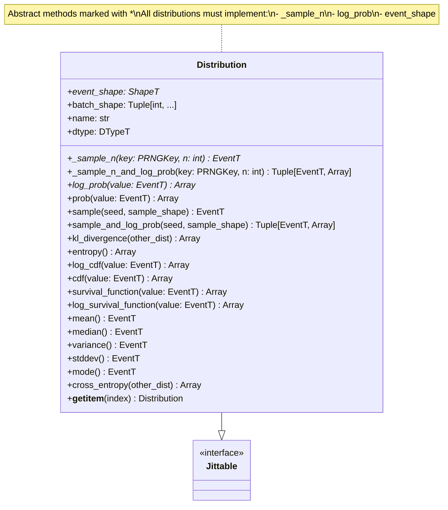
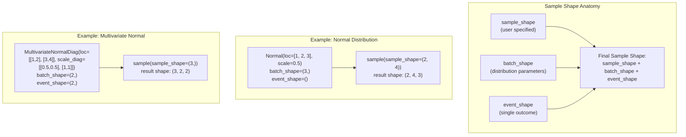
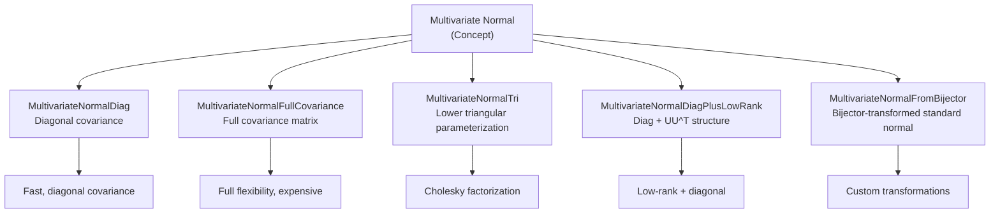
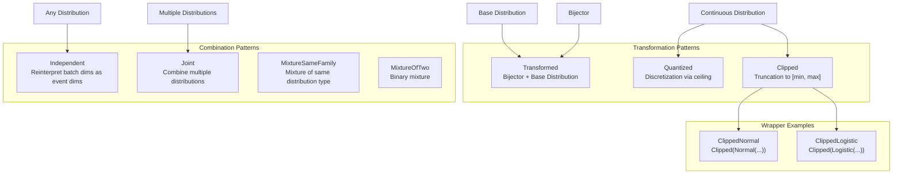
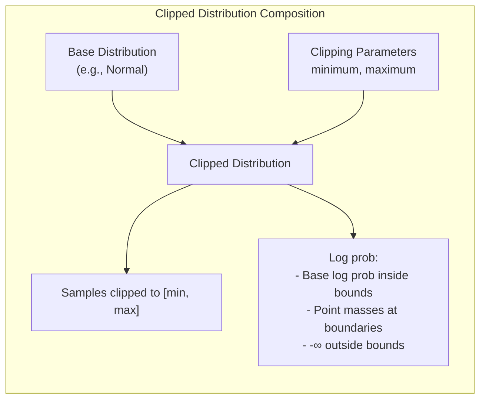

<!-- source: DeepWiki mcp.deepwiki.com · repo google-deepmind/distrax · page 3 Distributions · fetched 2026-10-26 -->

# Distributions

Relevant source files

The following files were used as context for generating this wiki page:

- [distrax/__init__.py](distrax/__init__.py)
- [distrax/_src/distributions/clipped.py](distrax/_src/distributions/clipped.py)
- [distrax/_src/distributions/clipped_test.py](distrax/_src/distributions/clipped_test.py)
- [distrax/_src/distributions/distribution.py](distrax/_src/distributions/distribution.py)
- [distrax/_src/distributions/distribution_test.py](distrax/_src/distributions/distribution_test.py)
- [distrax/_src/distributions/independent.py](distrax/_src/distributions/independent.py)
- [distrax/_src/distributions/quantized.py](distrax/_src/distributions/quantized.py)

This document provides a comprehensive overview of probability distributions in Distrax, covering the base `Distribution` class, the taxonomy of available distributions, and key design patterns for extending and composing distributions.

Distrax offers a rich collection of probability distributions that are JAX-native and compatible with TensorFlow Probability. All distributions inherit from a common base class and provide consistent interfaces for sampling, probability computation, and statistical operations. For detailed information about specific distribution categories, see [Discrete Distributions](#3.1), [Continuous Distributions](#3.2), [Multivariate Distributions](#3.3), and [Composite and Meta-Distributions](#3.4). For information about bijective transformations that can create new distributions, see [Bijectors and Transformations](#2.2).

## Distribution Hierarchy and Base Class

All Distrax distributions inherit from the abstract `Distribution` base class, which defines the core interface and provides common functionality. The base class is generic over event type, shape type, and dtype to support both simple array-valued distributions and nested structured distributions.

**Distribution Base Class Interface**

**Core Distribution Categories**

```mermaid
graph TD
    Distribution["Distribution\n(Base Class)"]
    
    subgraph "Discrete Distributions"
        Categorical["Categorical"]
        Bernoulli["Bernoulli"]
        Multinomial["Multinomial"]
        OneHotCategorical["OneHotCategorical"]
        CategoricalUniform["CategoricalUniform"]
    end
    
    subgraph "Continuous Distributions"
        Normal["Normal"]
        Gumbel["Gumbel"]
        Gamma["Gamma"]
        Beta["Beta"]
        Uniform["Uniform"]
        Laplace["Laplace"]
        Logistic["Logistic"]
        VonMises["VonMises"]
    end
    
    subgraph "Multivariate Distributions"
        MultivariateNormalDiag["MultivariateNormalDiag"]
        MultivariateNormalFullCovariance["MultivariateNormalFullCovariance"]
        MultivariateNormalTri["MultivariateNormalTri"]
        MultivariateNormalDiagPlusLowRank["MultivariateNormalDiagPlusLowRank"]
        MultivariateNormalFromBijector["MultivariateNormalFromBijector"]
        Dirichlet["Dirichlet"]
    end
    
    subgraph "Composite Distributions"
        Transformed["Transformed"]
        Independent["Independent"]
        Joint["Joint"]
        Quantized["Quantized"]
        Clipped["Clipped"]
        MixtureSameFamily["MixtureSameFamily"]
        MixtureOfTwo["MixtureOfTwo"]
    end
    
    subgraph "Specialized Distributions"
        Deterministic["Deterministic"]
        Greedy["Greedy"]
        EpsilonGreedy["EpsilonGreedy"]
        Softmax["Softmax"]
        LogStddevNormal["LogStddevNormal"]
    end
    
    Distribution --> Categorical
    Distribution --> Bernoulli
    Distribution --> Multinomial
    Distribution --> OneHotCategorical
    Distribution --> CategoricalUniform
    
    Distribution --> Normal
    Distribution --> Gumbel
    Distribution --> Gamma
    Distribution --> Beta
    Distribution --> Uniform
    Distribution --> Laplace
    Distribution --> Logistic
    Distribution --> VonMises
    
    Distribution --> MultivariateNormalDiag
    Distribution --> MultivariateNormalFullCovariance
    Distribution --> MultivariateNormalTri
    Distribution --> MultivariateNormalDiagPlusLowRank
    Distribution --> MultivariateNormalFromBijector
    Distribution --> Dirichlet
    
    Distribution --> Transformed
    Distribution --> Independent
    Distribution --> Joint
    Distribution --> Quantized
    Distribution --> Clipped
    Distribution --> MixtureSameFamily
    Distribution --> MixtureOfTwo
    
    Distribution --> Deterministic
    Distribution --> Greedy
    Distribution --> EpsilonGreedy
    Distribution --> Softmax
    Distribution --> LogStddevNormal
```

Sources: [distrax/__init__.py:39-76](), [distrax/_src/distributions/distribution.py:49-51](), [distrax/_src/distributions/distribution.py:103-143]()

## Key Distribution Properties and Methods

Every distribution provides consistent interfaces for the fundamental operations needed in probabilistic programming and machine learning applications.

**Essential Distribution Methods**

| Method | Purpose | Return Type | Notes |
|--------|---------|-------------|--------|
| `sample(seed, sample_shape)` | Generate random samples | `EventT` | Uses `_sample_n` internally |
| `log_prob(value)` | Compute log probability/density | `Array` | Core method, must be implemented |
| `prob(value)` | Compute probability/density | `Array` | Computed as `exp(log_prob)` |
| `sample_and_log_prob(seed, sample_shape)` | Efficient joint sampling and log prob | `Tuple[EventT, Array]` | Often more efficient than separate calls |
| `kl_divergence(other_dist)` | KL divergence to another distribution | `Array` | Uses TFP's KL registry |
| `entropy()` | Shannon entropy | `Array` | Implementation optional |

**Shape and Type Properties**

| Property | Purpose | Type | Description |
|----------|---------|------|-------------|
| `event_shape` | Shape of a single sample | `ShapeT` | Abstract property, must be implemented |
| `batch_shape` | Shape of batch dimensions | `Tuple[int, ...]` | Computed automatically from sample shape |
| `dtype` | Data type of samples | `DTypeT` | Derived from sample evaluation |
| `name` | Distribution name | `str` | Defaults to class name |

**Distribution Shape Semantics**

Sources: [distrax/_src/distributions/distribution.py:144-162](), [distrax/_src/distributions/distribution.py:109-130](), [distrax/_src/distributions/distribution.py:138-143]()

## Discrete Distributions

Discrete distributions represent probability mass functions over discrete sample spaces. These distributions are commonly used for categorical data, counts, and discrete decision problems.

**Available Discrete Distributions**

| Distribution | Use Case | Key Parameters | Event Shape |
|-------------|----------|----------------|-------------|
| `Categorical` | Multi-class classification | `logits` or `probs` | `()` |
| `OneHotCategorical` | One-hot encoded categories | `logits` or `probs` | `(num_classes,)` |
| `Bernoulli` | Binary outcomes | `logits` or `probs` | `()` |
| `Multinomial` | Count data | `total_count`, `logits`/`probs` | `(num_classes,)` |
| `CategoricalUniform` | Uniform over categories | `num_categories` | `()` |

For detailed information about discrete distributions, see [Discrete Distributions](#3.1).

Sources: [distrax/__init__.py:40-44](), [distrax/__init__.py:69]()

## Continuous Distributions

Continuous distributions represent probability density functions over continuous sample spaces. These form the backbone of many statistical models and deep learning applications.

**Available Continuous Distributions**

| Distribution | Use Case | Key Parameters | Support |
|-------------|----------|----------------|---------|
| `Normal` | General continuous modeling | `loc`, `scale` | ℝ |
| `Uniform` | Bounded uniform sampling | `low`, `high` | `[low, high)` |
| `Gumbel` | Extreme value modeling | `loc`, `scale` | ℝ |
| `Gamma` | Positive continuous values | `concentration`, `rate` | ℝ⁺ |
| `Beta` | Values in (0,1) | `concentration1`, `concentration0` | `(0, 1)` |
| `Laplace` | Heavy-tailed distributions | `loc`, `scale` | ℝ |
| `Logistic` | Sigmoid-shaped densities | `loc`, `scale` | ℝ |
| `VonMises` | Circular/angular data | `loc`, `concentration` | `[0, 2π)` |

For detailed information about continuous distributions, see [Continuous Distributions](#3.2).

Sources: [distrax/__init__.py:41](), [distrax/__init__.py:52-60](), [distrax/__init__.py:68](), [distrax/__init__.py:74-75]()

## Multivariate Distributions

Multivariate distributions handle vector-valued random variables with potentially complex covariance structures. Distrax provides several parameterizations of multivariate normal distributions and other multivariate distributions.

**Multivariate Normal Variants**

For detailed information about multivariate distributions, see [Multivariate Distributions](#3.3).

Sources: [distrax/__init__.py:63-67](), [distrax/__init__.py:48]()

## Composite and Meta-Distributions

Composite distributions create new distributions by wrapping, transforming, or combining existing distributions. These provide powerful tools for building complex probabilistic models from simpler components.

**Composite Distribution Patterns**

**Key Composite Distribution Classes**

| Class | Purpose | Key Features |
|-------|---------|--------------|
| `Transformed` | Apply bijector to base distribution | Automatic Jacobian correction |
| `Independent` | Reinterpret batch dimensions as event dimensions | Change statistical semantics |
| `Joint` | Combine multiple distributions into one | Structured events |
| `Quantized` | Discretize continuous distribution | Integer-valued samples via ceiling |
| `Clipped` | Truncate distribution to bounded interval | Mixed discrete-continuous density |

**Clipped Distribution Example**

For detailed information about composite distributions, see [Composite and Meta-Distributions](#3.4).

Sources: [distrax/_src/distributions/clipped.py:34-68](), [distrax/_src/distributions/quantized.py:37-47](), [distrax/_src/distributions/independent.py:34-75](), [distrax/__init__.py:44-47](), [distrax/__init__.py:55-56](), [distrax/__init__.py:60-62](), [distrax/__init__.py:70](), [distrax/__init__.py:73]()

## JAX Integration and Performance

All Distrax distributions are designed to work seamlessly with JAX transformations, providing efficient compilation and execution on accelerators.

**JAX Compatibility Features**

| Feature | Description | Implementation |
|---------|-------------|----------------|
| JIT Compilation | All methods compile with `jax.jit` | Inherits from `Jittable` base class |
| Vectorization | Support for `jax.vmap` | Consistent batch dimension handling |
| Automatic Differentiation | Gradients through all operations | JAX-native implementations |
| Device Placement | GPU/TPU execution | JAX array operations throughout |

**TensorFlow Probability Integration**

Many distributions include an `equiv_tfp_cls` attribute that specifies the equivalent TensorFlow Probability distribution class. This enables:

- Cross-validation with TFP implementations
- KL divergence registration with TFP's registry
- Seamless interoperability in mixed codebases

For more information about JAX integration patterns, see [JAX Integration](#2.3). For TFP compatibility details, see [TensorFlow Probability Integration](#5.3).

Sources: [distrax/_src/distributions/distribution.py:27](), [distrax/_src/distributions/distribution.py:50](), [distrax/_src/distributions/quantized.py:47](), [distrax/_src/distributions/independent.py:37]()

---

