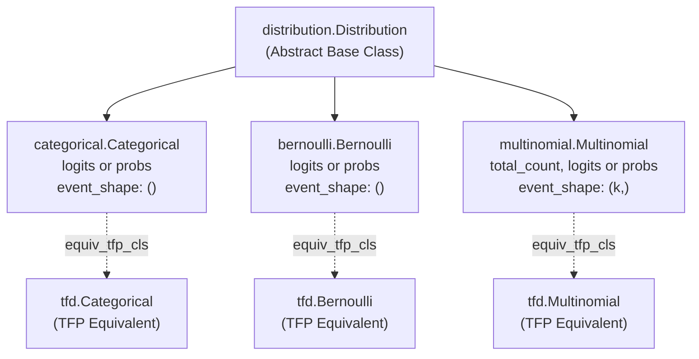
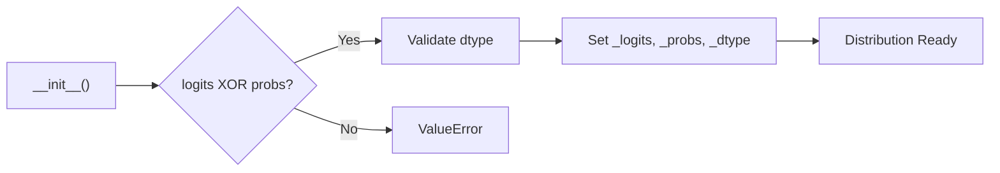
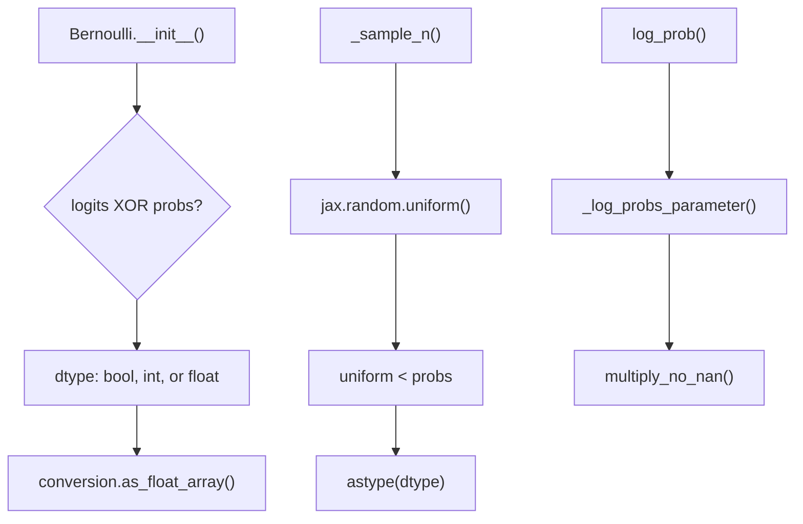
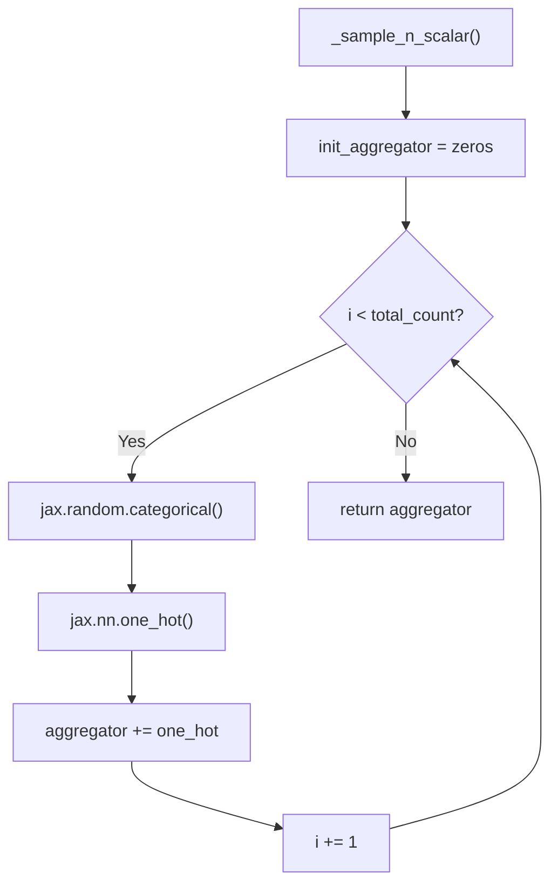
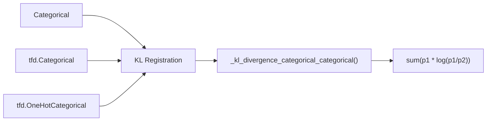

<!-- source: DeepWiki mcp.deepwiki.com · repo google-deepmind/distrax · page 3.1 Discrete Distributions · fetched 2026-10-26 -->

# Discrete Distributions

Relevant source files

The following files were used as context for generating this wiki page:

- [distrax/_src/distributions/bernoulli.py](distrax/_src/distributions/bernoulli.py)
- [distrax/_src/distributions/categorical.py](distrax/_src/distributions/categorical.py)
- [distrax/_src/distributions/categorical_test.py](distrax/_src/distributions/categorical_test.py)
- [distrax/_src/distributions/distribution_from_tfp_test.py](distrax/_src/distributions/distribution_from_tfp_test.py)
- [distrax/_src/distributions/multinomial.py](distrax/_src/distributions/multinomial.py)

This document covers Distrax's discrete probability distributions, which model random variables that take values from countable sample spaces. The discrete distributions in Distrax include `Categorical`, `Bernoulli`, and `Multinomial` distributions, all of which inherit from the base `Distribution` class and provide full compatibility with TensorFlow Probability.

For information about continuous distributions, see [Continuous Distributions](#3.2). For details about the base distribution interface, see [Distribution Base Class](#2.1).

## Overview

Discrete distributions in Distrax are implemented as JAX-native classes that extend the abstract `Distribution` base class. Each distribution provides methods for sampling, probability computation, and statistical operations while maintaining compatibility with TensorFlow Probability through equivalence classes and KL divergence registration.

**Discrete Distribution Class Hierarchy**

Sources: [distrax/_src/distributions/categorical.py:33-36](), [distrax/_src/distributions/bernoulli.py:36-42](), [distrax/_src/distributions/multinomial.py:40-43]()

## Common Interface and Parameters

All discrete distributions in Distrax share a common parameterization pattern and interface derived from the base `Distribution` class. The key design principles include:

| Feature | Description | Implementation |
|---------|-------------|----------------|
| **Dual Parameterization** | Support for both `logits` and `probs` parameters | Exactly one must be specified, not both |
| **JAX Integration** | Full compatibility with JAX transformations | All methods are JAX-transformable |
| **TFP Compatibility** | Equivalence with TensorFlow Probability | `equiv_tfp_cls` attribute and KL registration |
| **Type Safety** | Configurable output dtypes | `dtype` parameter for sample types |

**Parameter Validation Pattern**

Sources: [distrax/_src/distributions/categorical.py:52-64](), [distrax/_src/distributions/bernoulli.py:60-73](), [distrax/_src/distributions/multinomial.py:63-84]()

## Categorical Distribution

The `Categorical` distribution models discrete random variables that can take one of `k` mutually exclusive outcomes. It is parameterized by either unnormalized log-probabilities (`logits`) or probabilities (`probs`) for each category.

### Key Properties

| Property | Description | Code Reference |
|----------|-------------|----------------|
| `event_shape` | Always `()` (scalar outcomes) | [categorical.py:67-69]() |
| `num_categories` | Number of possible outcomes | [categorical.py:86-90]() |
| `logits` | Log-probabilities (computed if needed) | [categorical.py:72-76]() |
| `probs` | Normalized probabilities | [categorical.py:78-83]() |

### Core Methods

The `Categorical` distribution implements all required distribution methods with special handling for discrete semantics:

- **Sampling**: Uses `jax.random.categorical` with invalid probability handling [categorical.py:92-99]()
- **Log Probability**: Converts values to one-hot and computes log probability [categorical.py:101-109]()
- **CDF**: Cumulative sum of probabilities up to the given value [categorical.py:130-144]()
- **Entropy**: Computed using the formula `-sum(p * log(p))` [categorical.py:117-123]()

Sources: [distrax/_src/distributions/categorical.py:92-148]()

## Bernoulli Distribution

The `Bernoulli` distribution models binary random variables, representing the outcome of a single trial with success probability `p`. It can be viewed as a special case of the categorical distribution with exactly two outcomes.

### Implementation Details

The Bernoulli distribution uses a helper function `_log_probs_parameter()` that efficiently computes log probabilities for both outcomes, avoiding numerical issues when probabilities are near 0 or 1 [bernoulli.py:101-106]().

Sources: [distrax/_src/distributions/bernoulli.py:44-161]()

## Multinomial Distribution

The `Multinomial` distribution models the outcome of `total_count` independent trials, each of which results in one of `k` mutually exclusive outcomes. Unlike the categorical distribution, it returns count vectors rather than single category indices.

### Key Characteristics

| Aspect | Details |
|--------|---------|
| **Event Shape** | `(k,)` where `k` is number of categories |
| **Parameters** | `total_count`, and either `logits` or `probs` |
| **Output** | Count vector summing to `total_count` |
| **Sampling** | Uses while loop for exact count constraint |

### Sampling Implementation

The multinomial sampling uses a sophisticated approach with JAX's `lax.while_loop` to ensure exact count constraints:

Sources: [distrax/_src/distributions/multinomial.py:152-181]()

## TensorFlow Probability Integration

All discrete distributions provide seamless integration with TensorFlow Probability through several mechanisms:

### KL Divergence Registration

Each distribution registers KL divergence functions for cross-compatibility:

The KL divergence computation handles edge cases where probabilities are zero using `math.mul_exp` for numerical stability [categorical.py:165-200]().

### Equivalence Testing

The testing framework extensively validates compatibility with TFP equivalents using the `EquivalenceTest` base class, ensuring mathematical correctness across all operations [categorical_test.py:29-33]().

Sources: [distrax/_src/distributions/categorical.py:203-215](), [distrax/_src/distributions/bernoulli.py:214-220](), [distrax/_src/distributions/categorical_test.py:29-454]()

## Usage Patterns

### Parameter Normalization

All discrete distributions automatically normalize parameters using utilities from `math.normalize()`:

- `logits` are normalized using log-softmax
- `probs` are normalized to sum to 1.0

### Batch Operations

Discrete distributions support full broadcasting and batching operations, with slicing support for efficient subset operations [categorical.py:154-159]().

### JAX Transformations  

All distributions are designed to work seamlessly with JAX transformations including `jit`, `vmap`, and `grad`, as demonstrated in the extensive test suites [categorical_test.py:412-454]().

Sources: [distrax/_src/distributions/categorical.py:62-63](), [distrax/_src/distributions/multinomial.py:82-83](), [distrax/_src/distributions/categorical_test.py:412-498]()

---

