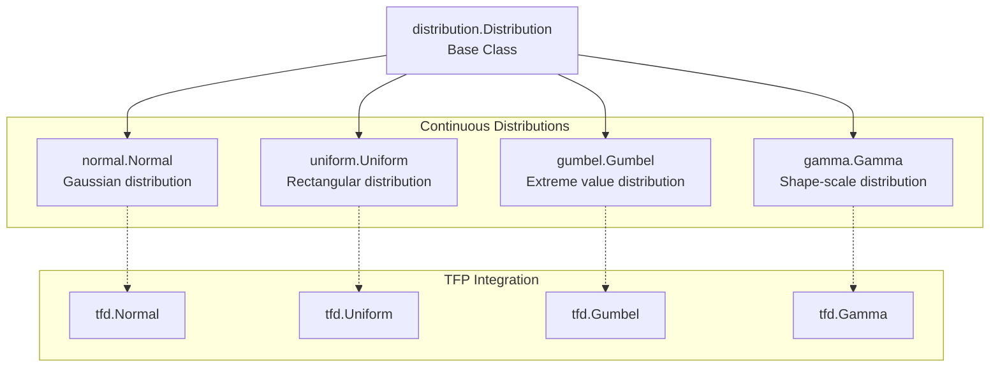
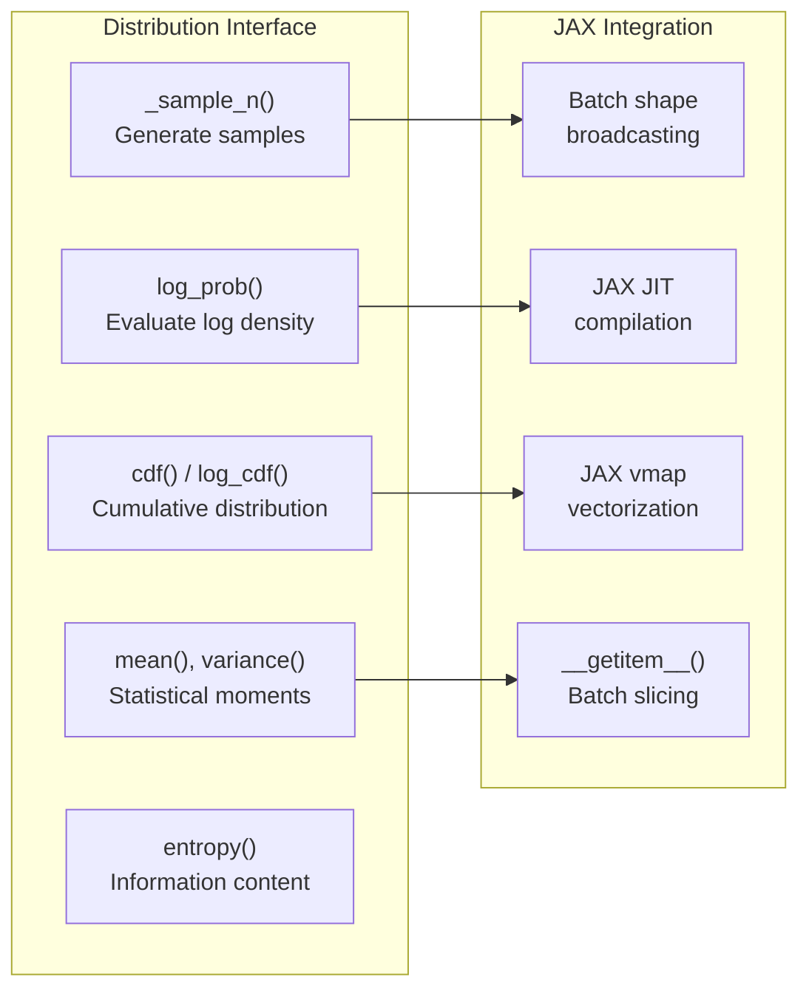
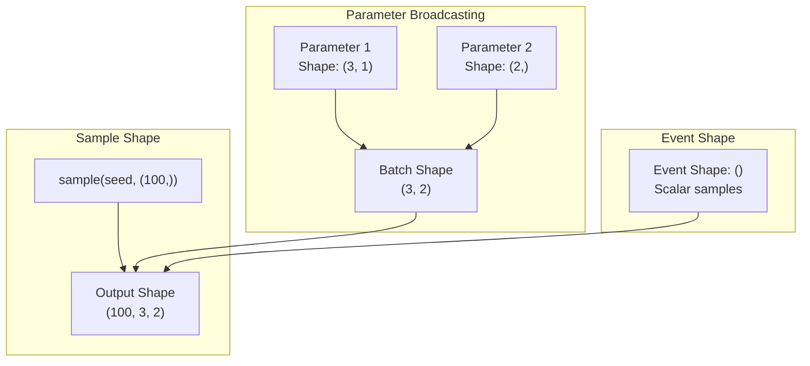
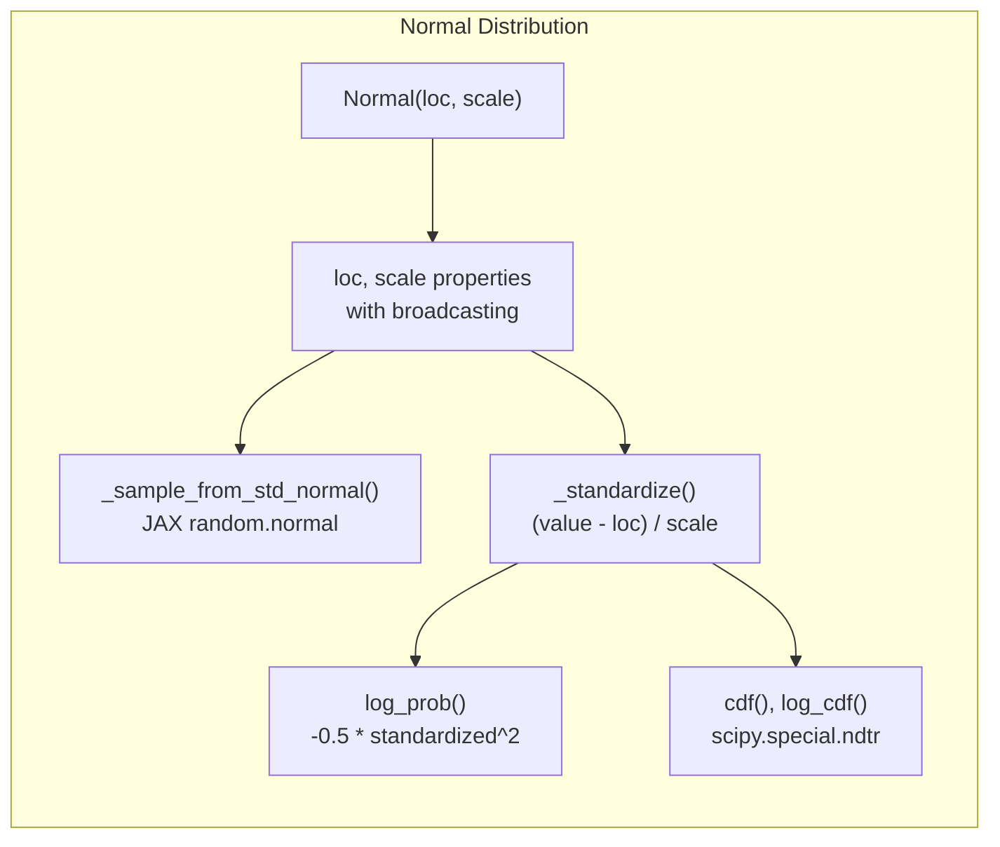
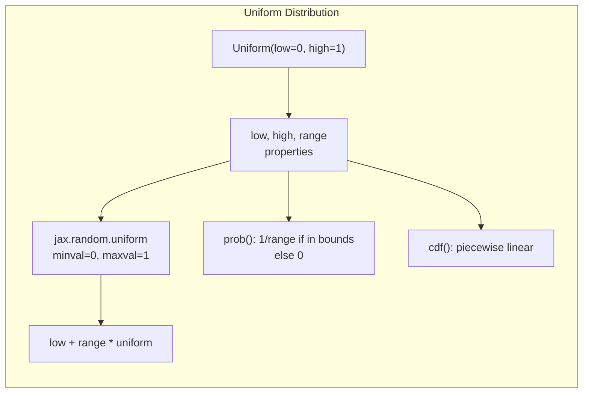
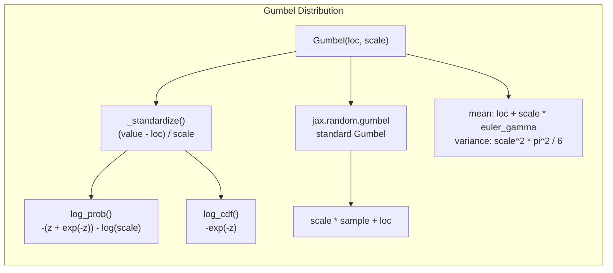
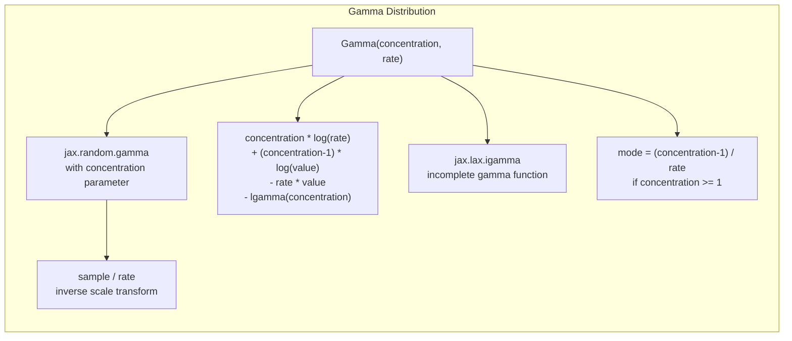
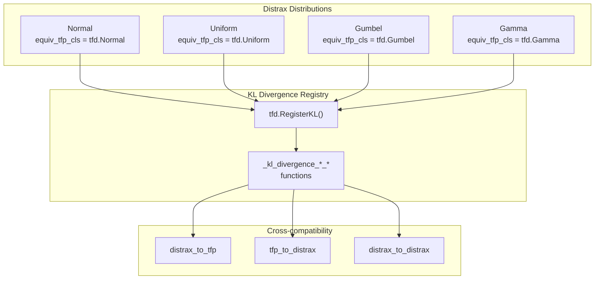
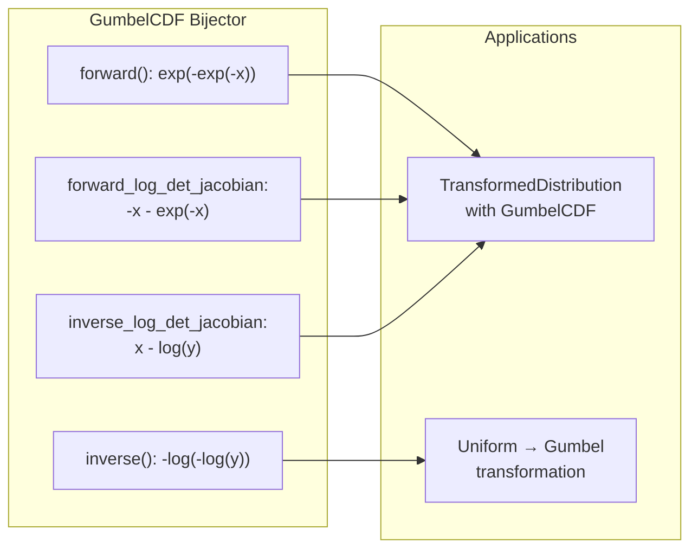

<!-- source: DeepWiki mcp.deepwiki.com · repo google-deepmind/distrax · page 3.2 Continuous Distributions · fetched 2026-10-26 -->

# Continuous Distributions

Relevant source files

The following files were used as context for generating this wiki page:

- [distrax/_src/bijectors/gumbel_cdf.py](distrax/_src/bijectors/gumbel_cdf.py)
- [distrax/_src/bijectors/gumbel_cdf_test.py](distrax/_src/bijectors/gumbel_cdf_test.py)
- [distrax/_src/distributions/gamma.py](distrax/_src/distributions/gamma.py)
- [distrax/_src/distributions/gamma_test.py](distrax/_src/distributions/gamma_test.py)
- [distrax/_src/distributions/gumbel.py](distrax/_src/distributions/gumbel.py)
- [distrax/_src/distributions/normal.py](distrax/_src/distributions/normal.py)
- [distrax/_src/distributions/normal_test.py](distrax/_src/distributions/normal_test.py)
- [distrax/_src/distributions/uniform.py](distrax/_src/distributions/uniform.py)
- [distrax/_src/distributions/uniform_test.py](distrax/_src/distributions/uniform_test.py)

This document covers univariate continuous probability distributions in Distrax that operate over real-valued sample spaces. These distributions model random variables that can take any value within a continuous range, such as the Normal, Uniform, Gumbel, and Gamma distributions.

For discrete distributions over finite sample spaces, see [Discrete Distributions](#3.1). For distributions over vector-valued random variables, see [Multivariate Distributions](#3.3). For distributions that combine or transform other distributions, see [Composite and Meta-Distributions](#3.4).

## Architecture Overview

Continuous distributions in Distrax follow a consistent architectural pattern, inheriting from the base `Distribution` class and providing implementations for core probability operations.

### Class Hierarchy

**Sources:** [distrax/_src/distributions/normal.py:37-40](), [distrax/_src/distributions/uniform.py:35-38](), [distrax/_src/distributions/gumbel.py:35-38](), [distrax/_src/distributions/gamma.py:34-37]()

### Core Interface Pattern

All continuous distributions implement a standard interface with the following key methods:

**Sources:** [distrax/_src/distributions/normal.py:78-91](), [distrax/_src/distributions/uniform.py:76-90](), [distrax/_src/distributions/gumbel.py:87-97](), [distrax/_src/distributions/gamma.py:79-91]()

## Key Features

### Parameterization and Broadcasting

Continuous distributions support flexible parameterization with automatic broadcasting between parameter arrays:

| Distribution | Parameters | Constraints |
|--------------|------------|-------------|
| `Normal` | `loc` (mean), `scale` (std dev) | `scale > 0` |
| `Uniform` | `low` (minimum), `high` (maximum) | `low < high` |
| `Gumbel` | `loc` (location), `scale` (scale) | `scale > 0` |
| `Gamma` | `concentration` (shape), `rate` (inverse scale) | `concentration > 0`, `rate > 0` |

**Sources:** [distrax/_src/distributions/normal.py:42-52](), [distrax/_src/distributions/uniform.py:40-51](), [distrax/_src/distributions/gumbel.py:40-51](), [distrax/_src/distributions/gamma.py:39-50]()

### Batch Shape Handling

Each distribution automatically computes its batch shape from parameter broadcasting:

**Sources:** [distrax/_src/distributions/normal.py:58-61](), [distrax/_src/distributions/uniform.py:73-74](), [distrax/_src/distributions/gumbel.py:59-61]()

## Individual Distributions

### Normal Distribution

The `Normal` class implements the Gaussian distribution with location-scale parameterization.

Key implementation details:
- Uses `jax.random.normal` for efficient sampling [distrax/_src/distributions/normal.py:73-76]()
- Implements both `cdf` and `survival_function` using JAX scipy functions [distrax/_src/distributions/normal.py:98-112]()
- Provides optimized `_sample_n_and_log_prob` for simultaneous operations [distrax/_src/distributions/normal.py:85-90]()

**Sources:** [distrax/_src/distributions/normal.py:37-147]()

### Uniform Distribution

The `Uniform` class implements the rectangular distribution over a bounded interval.

Key features:
- Default parameters create standard uniform [0, 1] distribution [distrax/_src/distributions/uniform.py:40]()
- Efficient piecewise probability computation using `jnp.where` [distrax/_src/distributions/uniform.py:96-101]()
- Handles boundary conditions explicitly in CDF [distrax/_src/distributions/uniform.py:123-129]()

**Sources:** [distrax/_src/distributions/uniform.py:35-167]()

### Gumbel Distribution

The `Gumbel` class implements the Type-I extreme value distribution, commonly used in extreme value theory.

Special features:
- Uses Euler's constant in mean calculation [distrax/_src/distributions/gumbel.py:108-110]()
- Mode equals the location parameter [distrax/_src/distributions/gumbel.py:120-122]()
- Implements numerically stable CDF using exponential form [distrax/_src/distributions/gumbel.py:103-106]()

**Sources:** [distrax/_src/distributions/gumbel.py:35-158]()

### Gamma Distribution

The `Gamma` class implements the Gamma distribution using concentration-rate parameterization.

Key characteristics:
- Uses JAX's incomplete gamma function for CDF [distrax/_src/distributions/gamma.py:103-105]()
- Mode is undefined (NaN) when concentration < 1 [distrax/_src/distributions/gamma.py:123-126]()
- Entropy calculation uses digamma function [distrax/_src/distributions/gamma.py:93-101]()

**Sources:** [distrax/_src/distributions/gamma.py:34-161]()

## TensorFlow Probability Integration

All continuous distributions include seamless integration with TensorFlow Probability through equivalent class mappings and KL divergence registration:

Each distribution implements custom KL divergence functions that are automatically registered with TFP, enabling cross-library compatibility for KL divergence and cross-entropy calculations.

**Sources:** [distrax/_src/distributions/normal.py:170-173](), [distrax/_src/distributions/uniform.py:164-167](), [distrax/_src/distributions/gumbel.py:155-158](), [distrax/_src/distributions/gamma.py:158-161]()

## Related Bijectors

The Gumbel distribution has a corresponding bijector implementation for CDF transformations:

### GumbelCDF Bijector

The `GumbelCDF` bijector implements the transformation `y = exp(-exp(-x))` and its inverse:

**Sources:** [distrax/_src/bijectors/gumbel_cdf.py:25-52]()

---

