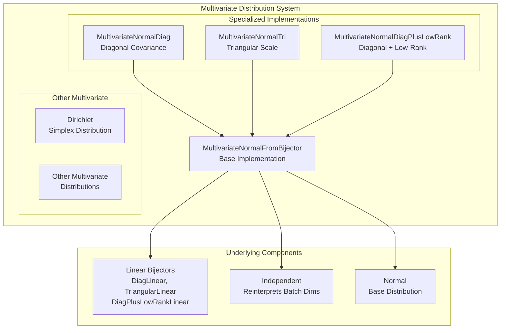
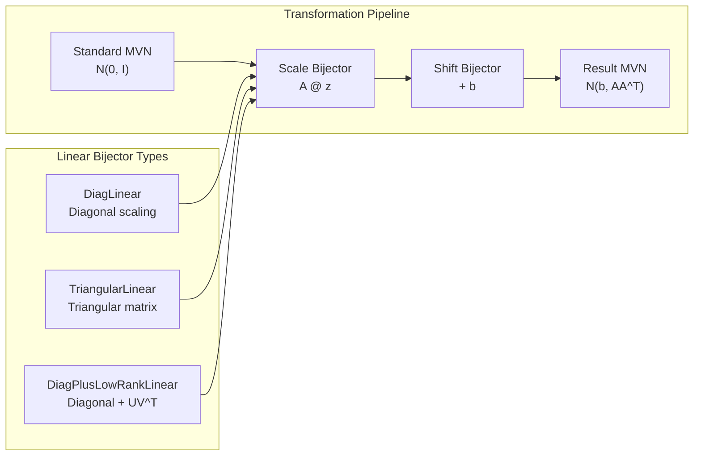
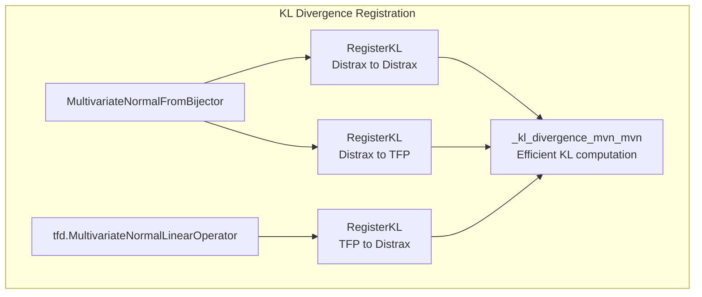

<!-- source: DeepWiki mcp.deepwiki.com · repo google-deepmind/distrax · page 3.3 Multivariate Distributions · fetched 2026-10-26 -->

# Multivariate Distributions

<details>
<summary>Relevant source files</summary>

The following files were used as context for generating this wiki page:

- [distrax/_src/distributions/mvn_diag_plus_low_rank.py](distrax/_src/distributions/mvn_diag_plus_low_rank.py)
- [distrax/_src/distributions/mvn_diag_plus_low_rank_test.py](distrax/_src/distributions/mvn_diag_plus_low_rank_test.py)
- [distrax/_src/distributions/mvn_diag_test.py](distrax/_src/distributions/mvn_diag_test.py)
- [distrax/_src/distributions/mvn_from_bijector.py](distrax/_src/distributions/mvn_from_bijector.py)
- [distrax/_src/distributions/mvn_from_bijector_test.py](distrax/_src/distributions/mvn_from_bijector_test.py)
- [distrax/_src/distributions/mvn_tri.py](distrax/_src/distributions/mvn_tri.py)
- [distrax/_src/distributions/one_hot_categorical_test.py](distrax/_src/distributions/one_hot_categorical_test.py)

</details>


This document covers probability distributions over vector-valued random variables in Distrax. Multivariate distributions model joint probability distributions where each sample is a vector rather than a scalar value. The primary focus is on multivariate normal distributions and related parameterizations, though other multivariate distributions like Dirichlet are also available.

For univariate continuous distributions, see [Continuous Distributions](#3.2). For discrete distributions that may have vector outputs (like OneHotCategorical), see [Discrete Distributions](#3.1).

## Core Architecture

Distrax implements multivariate distributions primarily through a bijector-based approach, where complex multivariate distributions are constructed by transforming simpler base distributions using invertible transformations.



**Multivariate Distribution Architecture**

Sources: [distrax/_src/distributions/mvn_from_bijector.py:51-88](), [distrax/_src/distributions/mvn_diag.py](), [distrax/_src/distributions/mvn_tri.py](), [distrax/_src/distributions/mvn_diag_plus_low_rank.py]()

## MultivariateNormalFromBijector

The `MultivariateNormalFromBijector` class is the foundational implementation for multivariate normal distributions in Distrax. It uses the bijector pattern to transform a standard multivariate normal distribution.



**MultivariateNormalFromBijector Transformation Chain**

The class implements the transformation `x = A @ z + b` where:
- `z ~ N(0, I)` is a standard multivariate normal
- `A` is a linear transformation matrix (implemented as a linear bijector)
- `b` is the location parameter
- The resulting distribution is `x ~ N(b, AA^T)`

Key methods include:
- `mean()`, `median()`, `mode()` - all return the location parameter
- `covariance()` - computes `AA^T` 
- `variance()` - diagonal entries of the covariance matrix
- `stddev()` - square root of variance

Sources: [distrax/_src/distributions/mvn_from_bijector.py:51-152]()

## Distribution Variants

### MultivariateNormalDiag

Optimized implementation for multivariate normal distributions with diagonal covariance matrices. Uses `DiagLinear` bijector for efficient computation.

```python
# Parameterized by location and scale diagonal
dist = MultivariateNormalDiag(
    loc=jnp.array([0., 1.]), 
    scale_diag=jnp.array([0.5, 2.0])
)
```

### MultivariateNormalTri  

For distributions with triangular scale matrices, supporting both lower and upper triangular parameterizations via the `TriangularLinear` bijector.

```python
# Lower triangular scale matrix
dist = MultivariateNormalTri(
    loc=jnp.zeros((3,)),
    scale_tri=jnp.array([[1., 0., 0.],
                         [0.5, 1., 0.], 
                         [0.2, 0.3, 1.]]),
    is_lower=True
)
```

### MultivariateNormalDiagPlusLowRank

Implements the parameterization `S = diag(D) + U @ V^T` where the scale matrix has a diagonal component plus a low-rank component.

```python
dist = MultivariateNormalDiagPlusLowRank(
    loc=jnp.zeros((4,)),
    scale_diag=jnp.ones((4,)),
    scale_u_matrix=jnp.random.normal(key, (4, 2)),
    scale_v_matrix=jnp.random.normal(key, (4, 2))
)
```

Sources: [distrax/_src/distributions/mvn_diag.py](), [distrax/_src/distributions/mvn_tri.py:62-139](), [distrax/_src/distributions/mvn_diag_plus_low_rank.py:88-206]()

## KL Divergence Registration

The multivariate normal implementations include comprehensive KL divergence computation support, with registered functions for cross-compatibility with TensorFlow Probability.



**KL Divergence Registration System**

The KL divergence implementation uses the formula:
```
KL(p || q) = log|det(Σ_q)| - log|det(Σ_p)| + 0.5 * (
    -k + tr[Σ_q^{-1} Σ_p] + (μ_q - μ_p)^T Σ_q^{-1} (μ_q - μ_p)
)
```

Special optimizations are applied when both distributions have diagonal scale matrices to avoid computing full matrix operations.

Sources: [distrax/_src/distributions/mvn_from_bijector.py:214-266]()

## Parameter Validation and Broadcasting

All multivariate normal implementations include comprehensive parameter validation and support JAX broadcasting semantics.

| Parameter | Validation | Broadcasting |
|-----------|------------|--------------|
| `loc` | Must have ≥1 dimension | Broadcasts with scale parameters |
| `scale_diag` | Must have ≥1 dimension | Last dimension must match `loc` |
| `scale_tri` | Must be square matrix | Last two dimensions define event shape |
| `scale_u_matrix` | Must have ≥2 dimensions | Batch dimensions broadcast |
| `scale_v_matrix` | Must match `scale_u_matrix` rank | Must have same last dimension as `scale_u_matrix` |

The batch shape is computed as the broadcast of all parameter batch shapes, and the event shape is determined by the last dimension of the location parameter.

Sources: [distrax/_src/distributions/mvn_from_bijector.py:40-49](), [distrax/_src/distributions/mvn_tri.py:33-60](), [distrax/_src/distributions/mvn_diag_plus_low_rank.py:33-86]()

## Testing and Equivalence

The multivariate distribution implementations are extensively tested for equivalence with TensorFlow Probability counterparts, ensuring mathematical correctness and API compatibility.

Key test patterns include:
- Sample shape verification across different parameterizations
- Log probability computation against TFP reference implementations  
- Statistical moment calculations (mean, variance, covariance)
- KL divergence cross-validation between Distrax and TFP
- Numerical stability with extreme parameter values
- JAX transformation compatibility (JIT, vmap, grad)

Sources: [distrax/_src/distributions/mvn_from_bijector_test.py](), [distrax/_src/distributions/mvn_diag_test.py](), [distrax/_src/distributions/mvn_diag_plus_low_rank_test.py]()

---

