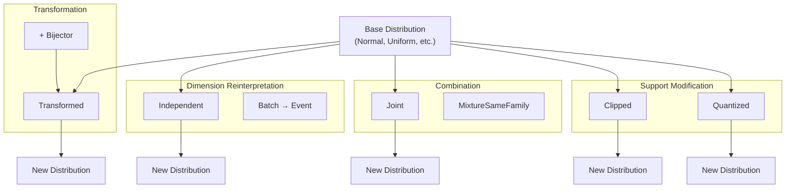
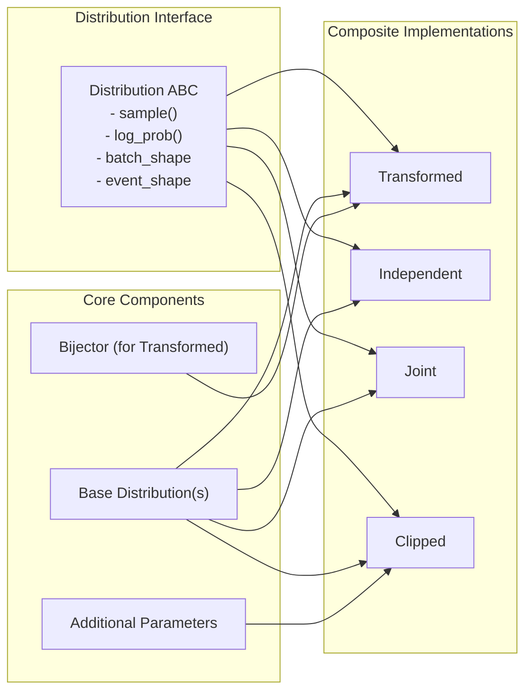
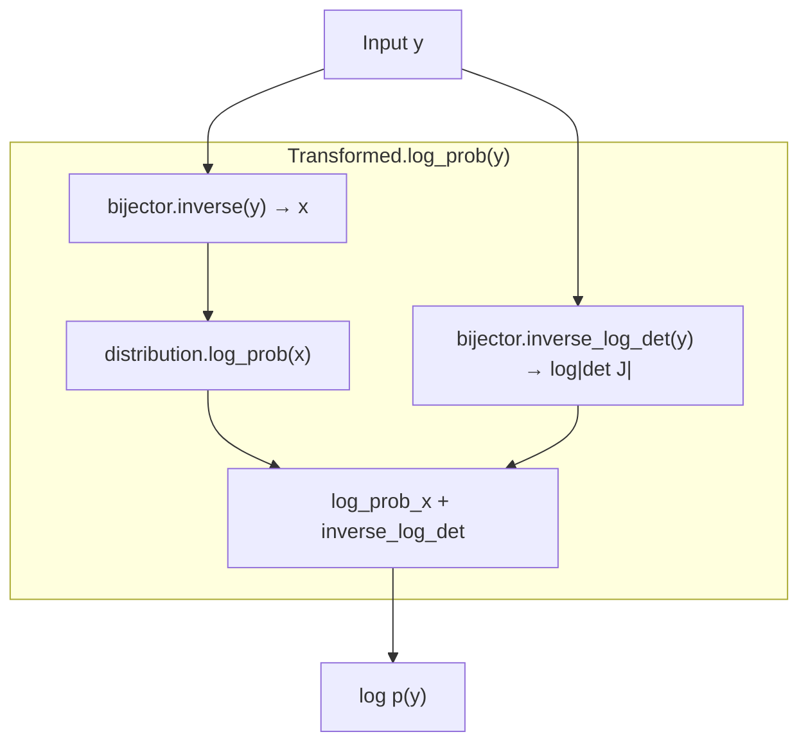
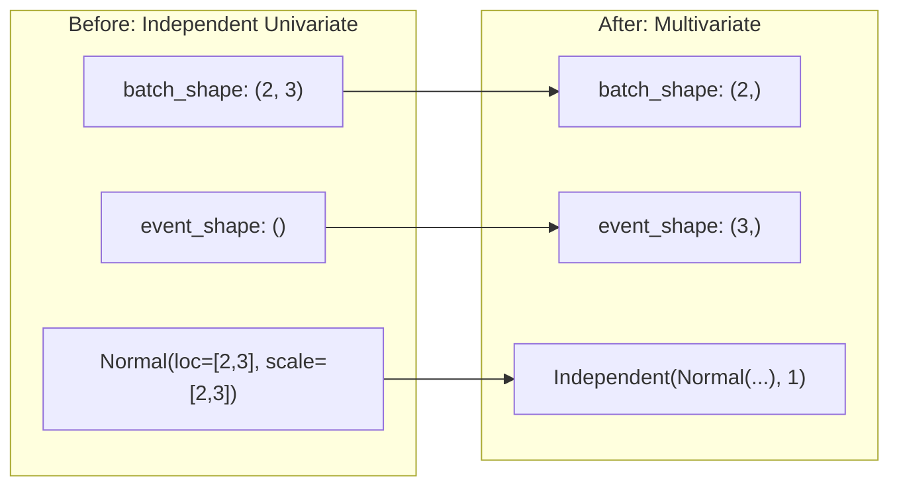
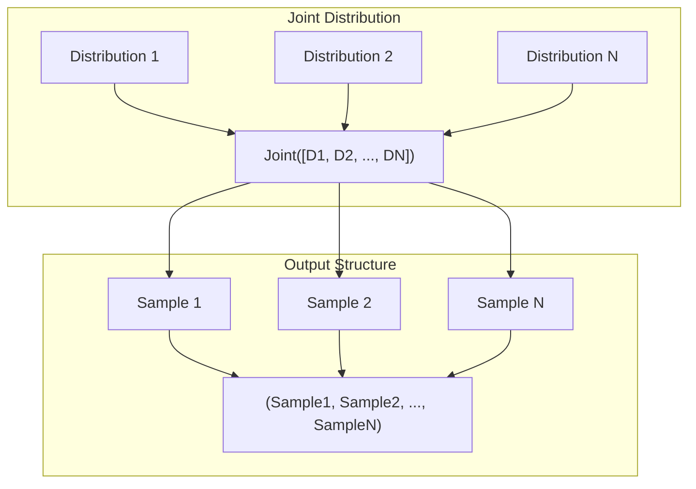
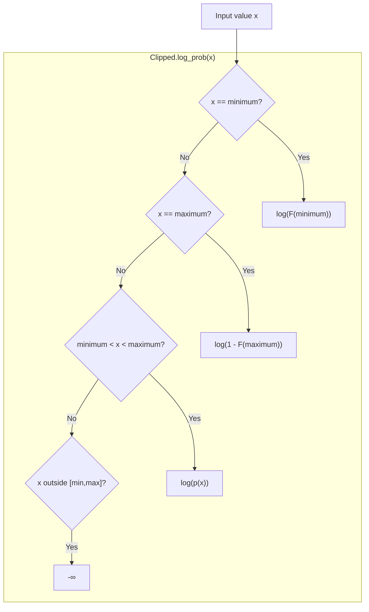
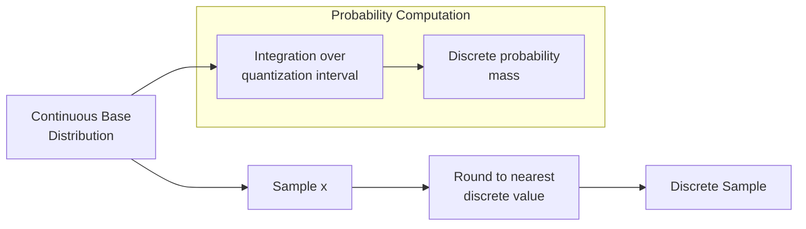
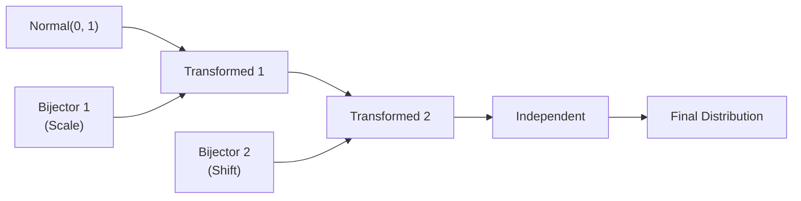

<!-- source: DeepWiki mcp.deepwiki.com · repo google-deepmind/distrax · page 3.4 Composite and Meta-Distributions · fetched 2026-10-26 -->

# Composite and Meta-Distributions

<details>
<summary>Relevant source files</summary>

The following files were used as context for generating this wiki page:

- [distrax/__init__.py](distrax/__init__.py)
- [distrax/_src/bijectors/scalar_affine.py](distrax/_src/bijectors/scalar_affine.py)
- [distrax/_src/distributions/clipped.py](distrax/_src/distributions/clipped.py)
- [distrax/_src/distributions/clipped_test.py](distrax/_src/distributions/clipped_test.py)
- [distrax/_src/distributions/dirichlet.py](distrax/_src/distributions/dirichlet.py)
- [distrax/_src/distributions/dirichlet_test.py](distrax/_src/distributions/dirichlet_test.py)
- [distrax/_src/distributions/independent_test.py](distrax/_src/distributions/independent_test.py)
- [distrax/_src/distributions/transformed.py](distrax/_src/distributions/transformed.py)
- [distrax/_src/distributions/transformed_test.py](distrax/_src/distributions/transformed_test.py)
- [distrax/_src/utils/equivalence.py](distrax/_src/utils/equivalence.py)

</details>


This document covers distributions in Distrax that wrap, transform, or combine other distributions to create new probability distributions. These meta-distributions enable powerful composition patterns by building complex distributions from simpler components.

For information about specific univariate or multivariate distributions, see [Continuous Distributions](#3.2) and [Multivariate Distributions](#3.3). For details about bijectors used in transformations, see [Bijectors](#4).

## Overview

Composite and meta-distributions in Distrax fall into several categories based on how they modify or combine base distributions:



**Sources:** [distrax/__init__.py:39-76]()

| Distribution Class | Purpose | Key Use Cases |
|-------------------|---------|---------------|
| `Transformed` | Apply bijective transformations | Normalizing flows, constrained parameters |
| `Independent` | Reinterpret batch dims as event dims | Converting univariate to multivariate |
| `Joint` | Combine multiple distributions | Modeling correlated variables |
| `Clipped` | Truncate distribution support | Bounded continuous variables |
| `Quantized` | Discretize continuous distributions | Discrete approximations |
| `MixtureSameFamily` | Mixture of same distribution family | Multi-modal distributions |

## Architecture of Composite Distributions

The composite distribution system follows a clear architectural pattern where each meta-distribution wraps one or more base distributions while preserving the core `Distribution` interface:



**Sources:** [distrax/_src/distributions/distribution.py](), [distrax/_src/distributions/transformed.py:35-71](), [distrax/_src/distributions/clipped.py:34-68]()

Each composite distribution handles:
- **Shape management**: Computing correct `batch_shape` and `event_shape` from components
- **Sampling**: Coordinating sampling from base distributions and applying transformations
- **Probability computation**: Adjusting log probabilities for transformations or constraints
- **JAX compatibility**: Ensuring JIT compilation and automatic differentiation work correctly

## Transformed Distributions

The `Transformed` distribution applies a bijective transformation to a base distribution using a `Bijector`. This is the foundation for normalizing flows and constraining parameters to specific domains.

### Mathematical Foundation

For a base distribution `p(x)` and bijector `f`, the transformed distribution has density:

```
log p(y) = log p(x) - log|det J_f(x)|
```

where `x = f^(-1)(y)` and `J_f(x)` is the Jacobian of `f` at `x`.

### Implementation Details



**Sources:** [distrax/_src/distributions/transformed.py:161-166]()

The `Transformed` class performs lazy shape inference using JAX tracing to determine the output shapes and dtype:

| Property | Computation Method |
|----------|-------------------|
| `batch_shape` | Inferred via `jax.eval_shape` on bijector forward pass |
| `event_shape` | Based on `bijector.event_ndims_out` |
| `dtype` | Determined by bijector output type |

**Sources:** [distrax/_src/distributions/transformed.py:120-136]()

### Example Usage Patterns

The `Transformed` distribution enables several important patterns:

1. **Parameter constraints**: Transform unconstrained parameters to constrained domains
2. **Normalizing flows**: Chain multiple bijectors for complex transformations  
3. **Change of variables**: Apply mathematical transformations with correct density adjustments

**Sources:** [distrax/_src/distributions/transformed.py:52-61]()

## Independent Distributions  

The `Independent` distribution reinterprets batch dimensions as event dimensions, effectively treating a collection of independent random variables as a single multivariate distribution.

### Dimension Reinterpretation



**Sources:** [distrax/_src/distributions/independent_test.py:36-41]()

The `reinterpreted_batch_ndims` parameter controls how many batch dimensions become event dimensions:

| `reinterpreted_batch_ndims` | Effect |
|---------------------------|--------|
| `0` | No change (identity transformation) |
| `1` | Last batch dim becomes event dim |
| `2` | Last two batch dims become event dims |
| `None` | All batch dims become event dims |

### Log Probability Computation

For `Independent` distributions, log probabilities are summed over the reinterpreted dimensions:

```
log_prob_independent = sum(log_prob_base, axis=reinterpreted_axes)
```

This reflects the mathematical fact that independent random variables have joint log probability equal to the sum of individual log probabilities.

**Sources:** [distrax/_src/distributions/independent_test.py:79-101]()

## Joint Distributions

The `Joint` distribution combines multiple distributions to model correlated random variables. Unlike `Independent`, `Joint` preserves potential dependencies between components.

### Structure and Interface



**Sources:** [distrax/__init__.py:56]()

Joint distributions enable modeling scenarios where multiple random variables need to be sampled together while maintaining their individual distributional properties.

## Clipped Distributions

Clipped distributions truncate the support of a base distribution to a specified interval `[minimum, maximum]`, creating a mixture of discrete and continuous components.

### Mathematical Formulation

For a base distribution with CDF `F(x)` and PDF `p(x)`:



**Sources:** [distrax/_src/distributions/clipped.py:79-95]()

### Implementation Components

The `Clipped` class maintains several precomputed quantities for efficiency:

| Attribute | Purpose | Computation |
|-----------|---------|-------------|
| `_log_prob_minimum` | Log probability mass at lower bound | `distribution.log_cdf(minimum)` |
| `_log_prob_maximum` | Log probability mass at upper bound | `distribution.log_survival_function(maximum)` |
| `_minimum` | Lower clipping boundary | Broadcasted to `batch_shape` |
| `_maximum` | Upper clipping boundary | Broadcasted to `batch_shape` |

**Sources:** [distrax/_src/distributions/clipped.py:63-67]()

### Specialized Clipped Distributions

Distrax provides specialized implementations for common cases:

- **`ClippedNormal`**: Clipped normal distribution
- **`ClippedLogistic`**: Clipped logistic distribution

These inherit from `Clipped` and provide convenient constructors:

**Sources:** [distrax/_src/distributions/clipped.py:126-141]()

## Quantized Distributions

The `Quantized` distribution discretizes a continuous base distribution by rounding samples to discrete values while maintaining proper probability mass assignments.

### Quantization Process



**Sources:** [distrax/__init__.py:70]()

Quantized distributions are particularly useful for:
- Discrete approximations of continuous models
- Modeling inherently discrete but approximately continuous phenomena
- Bridging continuous and discrete modeling approaches

## Integration and Composition Patterns

Composite distributions can be nested and combined to create sophisticated probability models:

### Chaining Transformations



### Shape Evolution

| Stage | `batch_shape` | `event_shape` | Description |
|-------|---------------|---------------|-------------|
| Base Normal | `()` | `()` | Standard scalar normal |
| After Scale | `(3,)` | `()` | Batched scaling |
| After Shift | `(3,)` | `()` | Batched shifting |
| After Independent | `()` | `(3,)` | Multivariate distribution |

**Sources:** [distrax/_src/distributions/transformed.py:88-102](), [distrax/_src/distributions/independent_test.py:184-207]()

This composition pattern demonstrates how Distrax's design enables building complex distributions through systematic application of simple transformations, each preserving the core `Distribution` interface while adding specific functionality.

---

