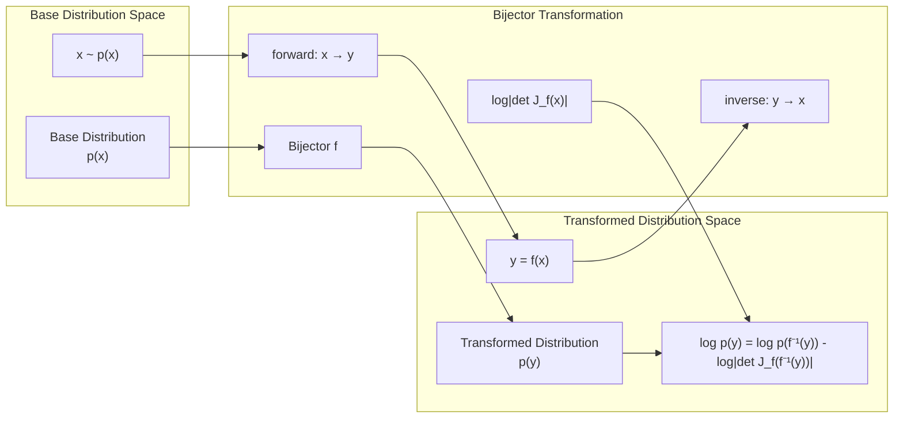
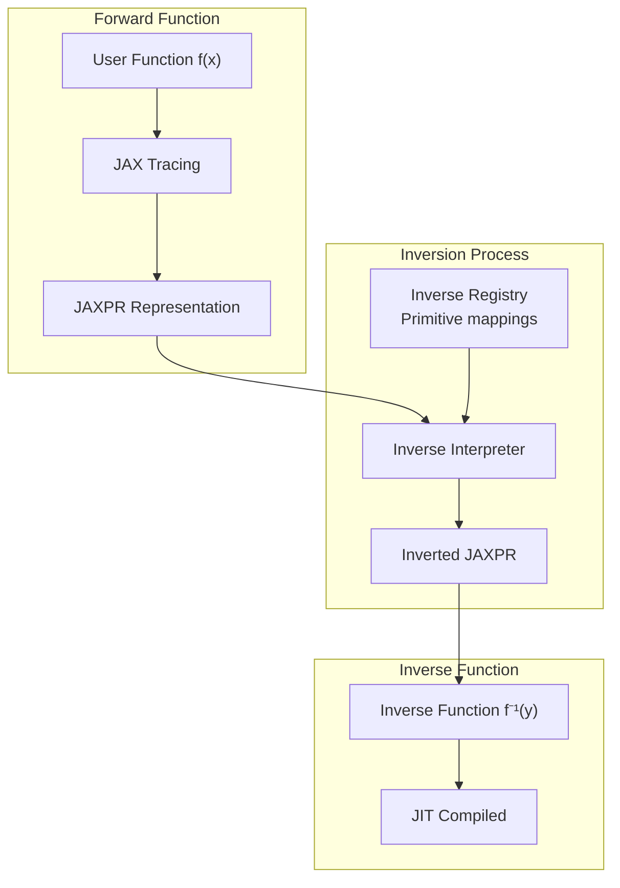

<!-- source: DeepWiki mcp.deepwiki.com · repo google-deepmind/distrax · page 4 Bijectors · fetched 2026-10-26 -->

# Bijectors

<details>
<summary>Relevant source files</summary>

The following files were used as context for generating this wiki page:

- [distrax/_src/bijectors/scalar_affine.py](distrax/_src/bijectors/scalar_affine.py)
- [distrax/_src/distributions/transformed.py](distrax/_src/distributions/transformed.py)
- [distrax/_src/utils/equivalence.py](distrax/_src/utils/equivalence.py)
- [distrax/_src/utils/transformations.py](distrax/_src/utils/transformations.py)

</details>


Bijectors are invertible transformations that enable the creation of new probability distributions by transforming existing ones. This page provides a comprehensive guide to the bijector system in Distrax, covering the core interface, transformation mechanics, and integration with distributions.

For conceptual background on bijectors and their role in probability transformations, see [Bijectors and Transformations](#2.2). For specific implementations of different bijector types, see [Linear Bijectors](#4.1), [Nonlinear Bijectors](#4.2), [Coupling and Flow Bijectors](#4.3), and [Custom Bijectors and Function Inversion](#4.4). For automatic function transformations and utilities, see [Function Transformations](#5.2).

## Core Bijector Interface

The bijector system in Distrax is built around differentiable, invertible transformations that implement a standardized interface. All bijectors inherit from a base `Bijector` class and must provide forward and inverse transformations along with their corresponding Jacobian determinants.

### Essential Methods

Every bijector must implement the following core functionality:

| Method | Purpose | Mathematical Expression |
|--------|---------|------------------------|
| `forward(x)` | Transform from base space to target space | `y = f(x)` |
| `inverse(y)` | Transform from target space to base space | `x = f^{-1}(y)` |
| `forward_log_det_jacobian(x)` | Log determinant of forward Jacobian | `log|det ∂f/∂x|` |
| `inverse_log_det_jacobian(y)` | Log determinant of inverse Jacobian | `log|det ∂f^{-1}/∂y|` |

Additional convenience methods combine transformations with their log determinants:
- `forward_and_log_det(x)` returns `(f(x), log|det ∂f/∂x|)`
- `inverse_and_log_det(y)` returns `(f^{-1}(y), log|det ∂f^{-1}/∂y|)`

```mermaid
graph TB
    subgraph "Bijector Interface"
        BijectorBase["Bijector Base Class"]
        
        Forward["forward(x)"]
        Inverse["inverse(y)"]
        ForwardLogDet["forward_log_det_jacobian(x)"]
        InverseLogDet["inverse_log_det_jacobian(y)"]
        
        ForwardAndLogDet["forward_and_log_det(x)"]
        InverseAndLogDet["inverse_and_log_det(y)"]
    end
    
    subgraph "Properties"
        EventNdimsIn["event_ndims_in"]
        EventNdimsOut["event_ndims_out"]
        IsConstantJacobian["is_constant_jacobian"]
        IsConstantLogDet["is_constant_log_det"]
    end
    
    BijectorBase --> Forward
    BijectorBase --> Inverse
    BijectorBase --> ForwardLogDet
    BijectorBase --> InverseLogDet
    BijectorBase --> ForwardAndLogDet
    BijectorBase --> InverseAndLogDet
    
    BijectorBase --> EventNdimsIn
    BijectorBase --> EventNdimsOut
    BijectorBase --> IsConstantJacobian
    BijectorBase --> IsConstantLogDet
```



Sources: [distrax/_src/utils/transformations.py:15-48](), [distrax/_src/bijectors/scalar_affine.py:28-140]()

### Key Properties

Bijectors expose several properties that describe their transformation characteristics:

- `event_ndims_in`: Number of dimensions in input events
- `event_ndims_out`: Number of dimensions in output events  
- `is_constant_jacobian`: Whether the Jacobian matrix is constant w.r.t. input
- `is_constant_log_det`: Whether the log determinant is constant w.r.t. input

These properties enable optimizations in transformed distributions and help determine when certain operations (like computing means or modes) are feasible.

Sources: [distrax/_src/bijectors/scalar_affine.py:62](), [distrax/_src/distributions/transformed.py:195-210]()

## Bijector Types and Hierarchy

Distrax provides a comprehensive set of bijector implementations organized by transformation type and complexity.

```mermaid
graph TB
    subgraph "Linear Transformations"
        ScalarAffine["ScalarAffine<br/>y = scale * x + shift"]
        Scale["Scale<br/>y = scale * x"]
        Shift["Shift<br/>y = x + shift"]
        MatrixBijectors["Matrix-based<br/>Linear transformations"]
    end
    
    subgraph "Nonlinear Transformations"
        Tanh["Tanh<br/>Element-wise tanh"]
        Sigmoid["Sigmoid<br/>Element-wise sigmoid"]
        Exp["Exp<br/>Element-wise exponential"]
        Log["Log<br/>Element-wise logarithm"]
    end
    
    subgraph "Composite Bijectors"
        Chain["Chain<br/>Composition of bijectors"]
        Block["Block<br/>Apply to tensor blocks"]
        Lambda["Lambda<br/>Custom function wrapper"]
        Inverse["Inverse<br/>Automatic inversion"]
    end
    
    subgraph "Normalizing Flows"
        MaskedCoupling["MaskedCoupling<br/>Coupling layers"]
        SplineFlows["Spline-based<br/>Rational quadratic splines"]
        AutoregressiveFlows["Autoregressive<br/>Sequential transformations"]
    end
    
    BijectorBase --> ScalarAffine
    BijectorBase --> Tanh
    BijectorBase --> Chain
    BijectorBase --> MaskedCoupling
```



Sources: [distrax/_src/bijectors/scalar_affine.py:28-40](), [distrax/_src/utils/transformations.py:68-95]()

## Integration with Distributions

Bijectors integrate seamlessly with Distrax distributions through the `Transformed` distribution class, which applies bijective transformations to base distributions.

### Transformation Mathematics

When a bijector `f` transforms a distribution with density `p(x)`, the resulting distribution has density:

```
log p(y) = log p(x) - log|det J_f(x)|
```

where `x = f^{-1}(y)` and `J_f(x)` is the Jacobian matrix of `f` at `x`.



Sources: [distrax/_src/distributions/transformed.py:35-70]()

### Sampling and Probability Computation

The `Transformed` distribution implements sampling and probability evaluation by coordinating between the base distribution and bijector:

**Sampling Process:**
1. Sample from base distribution: `x ~ p(x)`
2. Apply forward transformation: `y = f(x)`
3. Return transformed sample `y`

**Log Probability Computation:**
1. Apply inverse transformation: `x = f^{-1}(y)`
2. Compute base log probability: `log p(x)`
3. Compute inverse log determinant: `log|det J_{f^{-1}}(y)|`
4. Return: `log p(x) + log|det J_{f^{-1}}(y)|`

Sources: [distrax/_src/distributions/transformed.py:161-191]()

## Automatic Function Inversion

Distrax provides powerful utilities for automatically deriving bijector implementations from JAX-traceable functions, eliminating the need to manually implement inverse transformations and Jacobian computations.

### Function Inversion System

The `inv` function in the transformations module can automatically invert functions composed of invertible JAX primitives:



The system maintains a registry mapping JAX primitives to their inverses:

| Primitive | Inverse | Type |
|-----------|---------|------|
| `tanh_p` | `atanh_p` | Unary |
| `exp_p` | `log_p` | Unary |
| `sqrt_p` | `x² (power 2)` | Unary |
| `mul_p` | `div_p` | Binary |
| `add_p` | `sub_p` | Binary |

Sources: [distrax/_src/utils/transformations.py:68-95](), [distrax/_src/utils/transformations.py:129-139]()

### Jacobian Computation Utilities

The transformations module provides utilities for automatically computing log-determinant Jacobians:

- `log_det_scalar(fn)`: Derives log-det-jacobian using JAX autograd for scalar functions
- `is_constant_jacobian(fn, x)`: Attempts to determine if a function has constant Jacobian

These utilities enable the creation of bijectors from simple mathematical functions without manual derivation of gradients or determinants.

Sources: [distrax/_src/utils/transformations.py:141-176]()

## Custom Bijector Development

Developers can extend the bijector system by implementing custom transformations or using the automatic function inversion capabilities.

### Manual Implementation

Custom bijectors inherit from the base `Bijector` class and implement the required interface methods. The `ScalarAffine` bijector provides a canonical example:

```python
class ScalarAffine(base.Bijector):
  def __init__(self, shift, scale=None, log_scale=None):
    super().__init__(event_ndims_in=0, is_constant_jacobian=True)
    # Parameter initialization...
  
  def forward(self, x): 
    return self._scale * x + self._shift
    
  def inverse(self, y):
    return self._inv_scale * (y - self._shift)
    
  def forward_log_det_jacobian(self, x):
    return jnp.broadcast_to(self._log_scale, x.shape)
```

Sources: [distrax/_src/bijectors/scalar_affine.py:28-140]()

### Lambda Bijectors

For simple transformations, the `Lambda` bijector wrapper allows creation of bijectors from JAX functions, automatically deriving inverses and Jacobians when possible using the transformation utilities.

Sources: [distrax/_src/utils/transformations.py:15-48]()

## Performance and Optimization

Bijectors in Distrax are designed for high performance with JAX transformations and automatic differentiation.

### Constant Jacobian Optimizations

Bijectors with constant Jacobians (like affine transformations) enable significant optimizations:
- Mean and mode computations become simple forward transformations
- Entropy calculations use constant log-determinant offsets
- Reduced computational overhead in probability calculations

### JAX Integration

All bijector operations are compatible with JAX transformations:
- `jit` compilation for performance
- `vmap` for vectorized operations
- `grad` for automatic differentiation
- Full integration with JAX's functional programming model

Sources: [distrax/_src/distributions/transformed.py:195-243](), [distrax/_src/bijectors/scalar_affine.py:62]()

---

