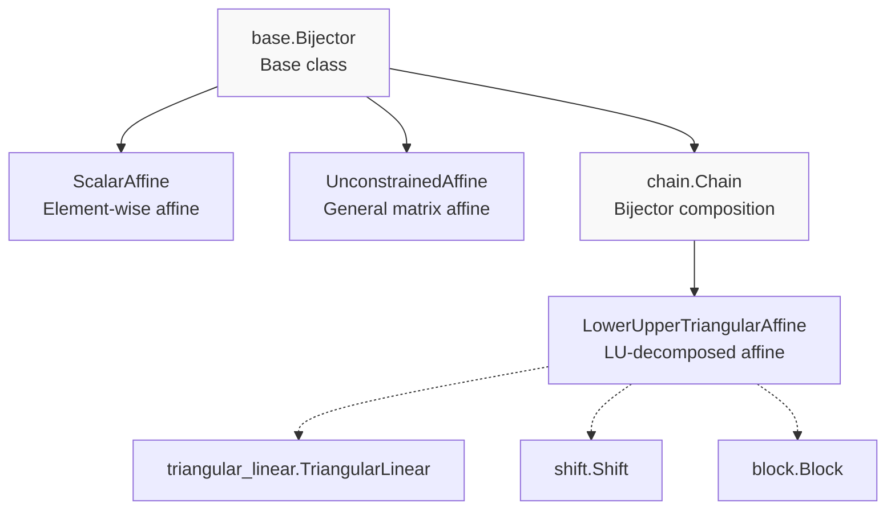
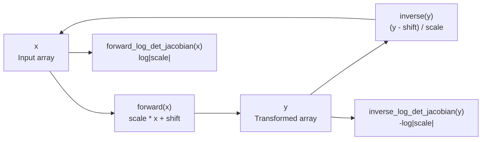
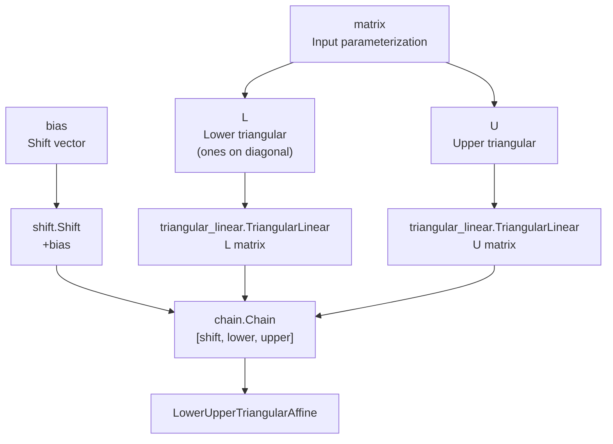
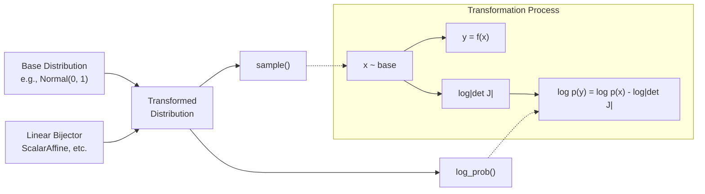

<!-- source: DeepWiki mcp.deepwiki.com · repo google-deepmind/distrax · page 4.1 Linear Bijectors · fetched 2026-10-26 -->

# Linear Bijectors

<details>
<summary>Relevant source files</summary>

The following files were used as context for generating this wiki page:

- [distrax/_src/bijectors/lower_upper_triangular_affine.py](distrax/_src/bijectors/lower_upper_triangular_affine.py)
- [distrax/_src/bijectors/lower_upper_triangular_affine_test.py](distrax/_src/bijectors/lower_upper_triangular_affine_test.py)
- [distrax/_src/bijectors/scalar_affine.py](distrax/_src/bijectors/scalar_affine.py)
- [distrax/_src/bijectors/unconstrained_affine.py](distrax/_src/bijectors/unconstrained_affine.py)
- [distrax/_src/distributions/transformed.py](distrax/_src/distributions/transformed.py)
- [distrax/_src/utils/equivalence.py](distrax/_src/utils/equivalence.py)

</details>


## Purpose and Scope

Linear bijectors implement affine transformations (linear functions plus a constant shift) that can be applied to probability distributions through the `Transformed` class. These bijectors perform computationally efficient transformations with constant Jacobian determinants, making them particularly useful for constructing complex distributions from simple base distributions.

This page covers the three main linear bijector implementations in Distrax:
- `ScalarAffine` for element-wise transformations  
- `UnconstrainedAffine` for general matrix transformations
- `LowerUpperTriangularAffine` for efficient LU-decomposed transformations

For nonlinear transformations like `Tanh` and `Sigmoid`, see [Nonlinear Bijectors](#4.2). For more complex flow-based bijectors, see [Coupling and Flow Bijectors](#4.3).

## Linear Bijector Types

| Bijector | Transformation | Computational Cost | Use Case |
|----------|---------------|-------------------|----------|
| `ScalarAffine` | `y = scale * x + shift` | O(1) per element | Element-wise scaling/shifting |
| `UnconstrainedAffine` | `y = Ax + b` | O(D³) for inverse/det | Small dimensionality, general transforms |
| `LowerUpperTriangularAffine` | `y = LUx + b` | O(D²) for inverse, O(D) for det | Efficient matrix transforms |

## Class Hierarchy and Relationships



Sources: [distrax/_src/bijectors/scalar_affine.py:28-29](), [distrax/_src/bijectors/unconstrained_affine.py:49-50](), [distrax/_src/bijectors/lower_upper_triangular_affine.py:28-29]()

## ScalarAffine

The `ScalarAffine` bijector performs element-wise affine transformations with the formula `y = scale * x + shift`. It operates independently on each element of the input, making it suitable for applying different scales and shifts across batch or event dimensions.

### Parameters and Properties

The bijector accepts three parameter configurations:
- `shift` (required): The additive constant
- `scale`: The multiplicative factor (must be non-zero)
- `log_scale`: Unconstrained log of the scale parameter

Key properties defined in [distrax/_src/bijectors/scalar_affine.py:62]():
- `event_ndims_in=0`: Operates element-wise
- `is_constant_jacobian=True`: Jacobian determinant is constant

### Core Methods



Sources: [distrax/_src/bijectors/scalar_affine.py:98-129]()

## UnconstrainedAffine  

The `UnconstrainedAffine` bijector implements general matrix affine transformations `y = Ax + b` where `A` is a square matrix and `b` is a bias vector. This provides maximum flexibility but comes with O(D³) computational cost for matrix operations.

### Implementation Details

The bijector validates parameters through `check_affine_parameters()` in [distrax/_src/bijectors/unconstrained_affine.py:26-47]():
- Matrix must be square and at least 2D
- Bias must be at least 1D  
- Matrix and bias dimensions must be compatible

The forward transformation uses vectorized matrix multiplication in [distrax/_src/bijectors/unconstrained_affine.py:95-99]():

```python
def unbatched(single_x, matrix, bias):
    return matrix @ single_x + bias
batched = jnp.vectorize(unbatched, signature="(m),(m,m),(m)->(m)")
```

### Computational Considerations

⚠️ **Performance Warning**: Both determinant computation and matrix inversion scale as O(D³), making this bijector suitable only for small dimensionalities. For larger dimensions, consider `LowerUpperTriangularAffine`.

Sources: [distrax/_src/bijectors/unconstrained_affine.py:62-64](), [distrax/_src/bijectors/unconstrained_affine.py:91-127]()

## LowerUpperTriangularAffine

The `LowerUpperTriangularAffine` bijector provides an efficient implementation of matrix affine transformations using LU decomposition. It parameterizes the transformation matrix `A` as `A = LU` where `L` is lower-triangular and `U` is upper-triangular.

### LU Decomposition Structure



Sources: [distrax/_src/bijectors/lower_upper_triangular_affine.py:70-77]()

### Efficiency Benefits

The LU parameterization provides significant computational advantages:

| Operation | Complexity | Implementation |
|-----------|------------|----------------|
| Forward transform | O(D²) | Two triangular solves |
| Jacobian determinant | O(D) | `sum(log(diag(U)))` |
| Matrix reconstruction | O(D³) | `L @ U` (when needed) |

The parameterization ensures that when the input `matrix` is identity, `LU` is also identity, providing a natural initialization in [distrax/_src/bijectors/lower_upper_triangular_affine.py:51-58]().

### Properties and Access

The bijector exposes the decomposed components:
- `lower`: Lower triangular matrix `L` with ones on diagonal
- `upper`: Upper triangular matrix `U`  
- `matrix`: Reconstructed product `A = LU`
- `bias`: The shift vector `b`

Sources: [distrax/_src/bijectors/lower_upper_triangular_affine.py:79-97]()

## Integration with Transformed Distributions

Linear bijectors integrate seamlessly with the `Transformed` distribution class to create new distributions through change of variables. The constant Jacobian property enables efficient computation of transformed distribution properties.



Example usage pattern from [distrax/_src/distributions/transformed.py:55-61]():
```python
dist = distrax.Normal(loc=0., scale=1.)
bij = distrax.ScalarAffine(shift=jnp.asarray([3., 3., 3.]))
transformed_dist = distrax.Transformed(distribution=dist, bijector=bij)
```

Sources: [distrax/_src/distributions/transformed.py:35-71](), [distrax/_src/distributions/transformed.py:161-166]()

---

